# [译] 用 60 幅图从零构建 FlashAttention-4

[下载完整中文 PDF](./article.pdf)

<!-- imported-translation:start -->

<article><header class="mb-14"><!-- original-title -->
在最新硬件上构建并理解最复杂的 GPU 内核之一 

60 幅图 · 14 阶段内核演进 · 达到 FlashAttention-4 的 94.4% 性能 · CUDA/PTX · 视频生成综合实践 

<time datetime="2026-08-28">2026 年 8 月 28 日</time>·
最后更新：<time datetime="2026-09-12">2026 年 9 月 12 日</time>
<nav aria-label="Article shortcuts" class="post-header-links"><a href="https://iaroslavelistratov.github.io/b200-attention/">图解指南</a>·<a href="https://github.com/IaroslavElistratov/b200-attention">源代码</a>·<a href="https://github.com/IaroslavElistratov/b200-attention/tree/master/benchmarks">基准测试</a>·<a href="https://github.com/IaroslavElistratov/b200-attention/tree/master/capstone-project">综合实践：视频</a></nav><!-- translation-process-note removed -->
<a href="https://iaroslavelistratov.github.io/b200-attention/">原文：FlashAttention-4 from Scratch to Near-SOTA in 60 Diagrams (CUDA/PTX)</a>
</header>

目录
展开
收起
+
-
<nav id="TableOfContents"><ul><li><a href="#what-this-blog-is-about">这篇博客讲什么</a></li><li><a href="#part-i--basics">第一部分：基础</a><ul><li><a href="#chapter-1--baseline-blackwell-b200-attention">第 1 章：Blackwell B200 Attention 基础实现</a><ul><li><a href="#i-roadmap-for-this-chapter">i. 本章路线图</a></li><li><a href="#ii-work-parallelization">ii. 工作并行化</a></li><li><a href="#iii-beginner-onramp--optional">iii. 初学者入门，可选阅读</a></li><li><a href="#a-qkt-explaining-k-major">A）Q@K.T：解释 K-major</a></li><li><a href="#b-online-softmax-explaining-s-p">B）在线 Softmax：解释 S -&gt; P</a></li><li><a href="#c-pv-explaining-mn-major">C）P@V：解释 MN-major</a></li></ul></li><li><a href="#chapter-2--move-p-from-smem-to-tmem">第 2 章：将 P 从 SMEM 移到 TMEM</a></li><li><a href="#chapter-3--swizzling">第 3 章：Swizzling</a></li><li><a href="#chapter-4--warp-specialization">第 4 章：Warp Specialization（warp 分工）</a></li></ul></li><li><a href="#part-ii--coarse-scheduling">第二部分：粗粒度调度</a><ul><li><a href="#chapter-5--two-q-tiles">第 5 章：两个 Q tile</a></li><li><a href="#chapter-6--load-pipeline">第 6 章：加载流水线</a></li><li><a href="#chapter-7--compute-pipeline">第 7 章：计算流水线</a></li></ul></li><li><a href="#part-iii--hot-loop-optimizations">第三部分：热循环优化</a><ul><li><a href="#chapter-8--hardware-approximations">第 8 章：硬件近似</a></li><li><a href="#chapter-9--software-approximations">第 9 章：软件近似</a></li><li><a href="#chapter-10--register-caching">第 10 章：寄存器缓存</a></li><li><a href="#chapter-11--skip-o-rescale">第 11 章：跳过 O 重缩放</a></li><li><a href="#chapter-12--split-correction-from-softmax">第 12 章：将修正与 Softmax 分离</a></li><li><a href="#chapter-13--early-pv">第 13 章：提前执行 PV</a></li></ul></li><li><a href="#part-iv--persistent-kernels">第四部分：持久化内核</a><ul><li><a href="#chapter-14--persistent">第 14 章：持久化</a></li></ul></li><li><a href="#minor-optimizations">小优化</a></li><li><a href="#capstone-project--generate-videos">综合实践：生成视频！</a></li><li><a href="#the-graveyard---and-some-hope-">失败尝试的墓地……以及一点希望</a></li><li><a href="#stay-in-touch-for-more-ml-sys">保持联系，获取更多 ML 系统内容</a></li><li><a href="#appendix">附录</a><ul><li><ul><li><a href="#citation">引用</a></li><li><a href="#benchmark-calibration">基准校准</a></li><li><a href="#how-software-exp2-works">软件 exp2 如何工作</a></li></ul></li></ul></li><li><a href="#acknowledgments">致谢</a></li></ul></nav>
<section><figure class="post-video post-video-wide post-video-overlay-two-line-title post-video-overlay-title-exact-center">
<video autoplay="" controls="" height="512" loop="" muted="" playsinline="" width="1536">
<source src="./resources/iaroslavelistratov.github.io/assets/videos/custom19_eight_up_1536x512.mp4" type="video/mp4"/><a href="./resources/iaroslavelistratov.github.io/assets/videos/custom19_eight_up_1536x512.mp4">下载视频</a></video>
你将使用下文构建的 B200 Attention 内核生成这些视频

<figcaption data-block="B003">这些视频由视频模型生成，模型使用本文实现的 Blackwell B200 Attention 内核。参见后文的综合实践项目。 </figcaption></figure><figure class="post-image-wide">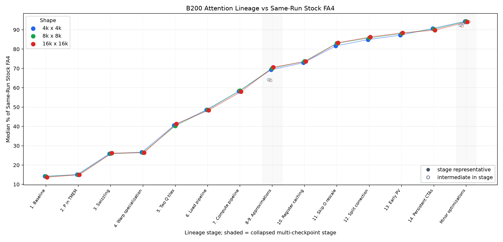<figcaption>
14 个内核阶段及文末小优化相对于同次运行 stock FA4 的性能百分比。每种实现都在其偏好的连续布局上计时；详见“<a href="#benchmark-calibration">基准校准</a>”。 
</figcaption></figure><h1 data-block="B005" id="what-this-blog-is-about">这篇博客讲什么 </h1>
本文使用 CUDA 和少量 PTX，从零构建一个 B200 稠密 Attention 内核。在 FA4 论文使用的 4K、8K 和 16K 形状上，我们将从基础实现逐步推进，达到 FlashAttention-4 性能的 94.4%。 

本文的主要贡献是一份图解指南：围绕 60 幅图组织、适合初学者循序渐进学习。我们先直观理解朴素内核如何工作，再一次加入一项优化，配以详细图示、简明解释和代码。 

在最后的综合实践中，我们会把最终内核接入视频生成模型。 

本文的重点不是榨取最后几个百分点的性能；那是我下一篇博客的主题。 

这是最难的内核之一，而且运行在最新硬件上，所以过程会很有趣。 

研究：本文旨在为你在最新硬件上开展 GPU 内核研究打下基础。我们聚焦 B200 Attention，但许多概念和思考方式也适用于其他内核。读完后，你将理解这个内核，并能够提出自己的优化想法。 

前置知识：文中提供了初学者入门小节。如果你是完全的新手，或者觉得 CUDA 基础不牢，请先按<a href="#fn:1" id="fnref:1">脚注 1</a> 的建议学习，再继续阅读。我仍假定你具备基本 CUDA 知识，但不要求了解 Blackwell。新概念只会在需要时逐一引入，并通过图示讲解。因此，即使 Blackwell 对你很陌生，也可以继续读，你应该能够跟上整个过程。 <a href="#iii-beginner-onramp--optional" title="beginner on-ramp">〔链接1〕</a>

我假定你知道 Attention 是什么，也对在线 Softmax 的思想有所了解。这部分不是 Blackwell 特有的，已有很多相关资料。 

跟着本文学习不需要家里有一块 B200；我也没有。 

代码：全部代码都在我的 <a href="https://github.com/IaroslavElistratov/b200-attention">B200 Attention 仓库</a>中。基础实现之后，每章加入一项主要优化。源码的组织方式使相邻内核大多容易进行 diff，因此你可以一次看清一项优化改动了什么。 

综合实践：最后，我们会把你已经理解的内核接入视频生成模型，生成漂亮的视频。参见主体章节之后的“<a href="#capstone-project--generate-videos">综合实践项目</a>”。 

DSL 与 CUDA：原版 FA4 使用 CuTe 编写。我个人觉得原生 CUDA 加少量 PTX 更容易理解，因为抽象层更少，所以我们将用 CUDA 实现。我们不是把 FA4 的 CuTe 实现逐行改写成 CUDA 语法，而是沿着清晰、直观的演进路线，理解一般意义上的高性能 B200 Attention 内核。不过，FA4 仍是本文的主要参考之一，多数优化思想都借鉴自它；FA4 本身也基于 CUTLASS 和 CuTe DSL 内核，详见致谢。 

现有资料：已有很棒的资料讲解 H200 和 B200 上的矩阵乘法优化，见致谢。但对于 B200 Attention，我没有找到自己想要的深入解释。有的资料直接讲最终内核，不解释演进过程，也不说明多数优化背后的底层动机；有的资料则停留在浅层概述，例如总结流水线和 warp 角色，却略去了真正理解内核所需的大量细节和逐步引导。它们都没有提供我想要的深度。 

范围：我们要优化的是稠密、head dimension 为 128、非因果、BF16 的 Attention 内核。 

<blockquote>
如果你拥有的只有 AI，那么我们也有与你一样的 AI，而且很可能比你更擅长使用它。 

- tomcr00se 
</blockquote><h1 data-block="B022" id="part-i--basics">第一部分：基础 </h1><h2 data-block="B023" id="chapter-1--baseline-blackwell-b200-attention">第 1 章：Blackwell B200 Attention 基础实现 </h2><h3 data-block="B024" id="i-roadmap-for-this-chapter">i. 本章路线图 </h3>
我们首先学习每个 CTA 做哪些工作，以及这些工作如何分配给 B200 上的不同 CTA，见“工作并行化”小节。 

然后可选地绕道初学者入门，介绍逻辑表示与物理表示、指针和分块矩阵乘法。 

接着放大观察 B200 Attention 内核，讨论每个 CTA 内部发生的事情。 

后文会用图示更详细地解释这一切。这里先给出整体地图，随后我会提供与图示直接对应的代码链接。 

Attention 基础内核 

先来理解第一个内核。后续内核大多沿用本章引入的数学和 tcgen05 概念，所以本章会讲清贯穿全文的基础。这也是第一章比后续章节更长的原因。 

第一个内核是起点，能给出正确的数值结果，但效率远不及后续内核。它本身已经不简单，并使用了不少 Blackwell 特有功能，下面会逐步介绍。 

主要瓶颈 

Attention 基本上就是两次矩阵乘法，中间夹着一次 Softmax。Softmax 的 FLOPs 少得多，但它运行在 ALU 和 MUFU 单元上，而不是 Tensor Core 上。在 Blackwell B200 上，Tensor Core 吞吐量大致翻倍，指数运算单元却基本没变；FA4 论文称之为“不对称的硬件扩展”。因此，在我们的 tile 尺寸下，Softmax 消耗的周期数与算力很强的 MMA 差不多，成为该内核的主要瓶颈。多数优化从两方面着手：降低 Softmax 工作的代价，以及让它与矩阵乘法重叠，也就是把它隐藏在 MMA 执行期间。 
<h3 data-block="B034" id="ii-work-parallelization">ii. 工作并行化 </h3>
在讨论 B200 特有细节之前，先看工作如何划分。 
<figure>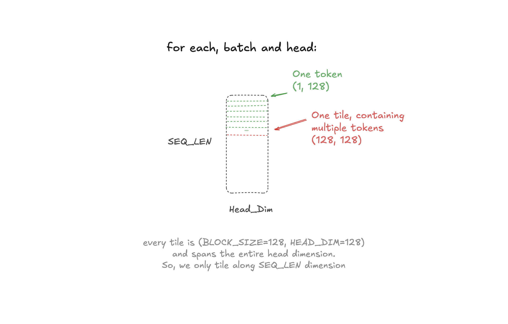</figure>
可以把 Q、K、V 和输出张量都看成具有相同的形状：B、num_heads、seq_len、head_dim。 

我们将张量划分成 tile，使之能放入速度快但容量小的片上存储。如上图所示，tile 尺寸为 [128, 128]。 
<figure>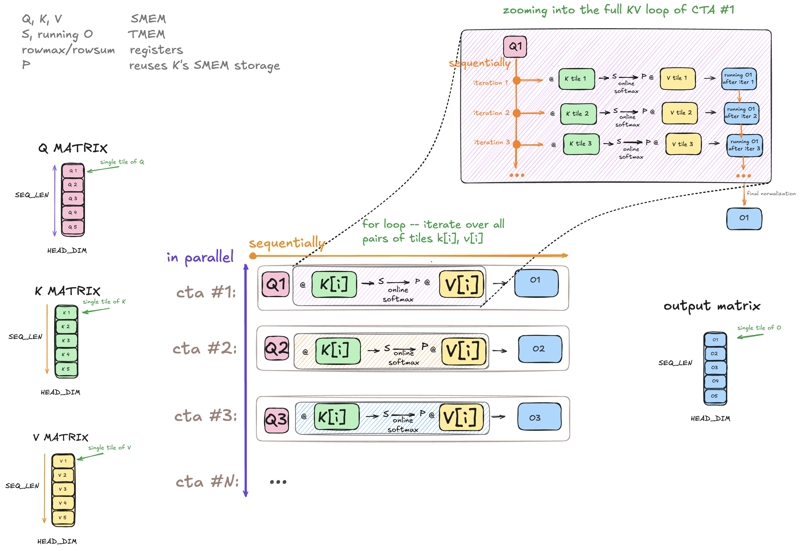</figure>
有多少个 O（输出）tile，就调度多少个 CTA；每个 CTA 生成一个 O tile。所有 CTA 合起来生成完整输出张量的全部 tile。CTA 并行执行，见紫色箭头。 

每个 CTA 内部的 K/V 循环工作则是顺序执行的，见橙色箭头。放大观察一个 CTA：为了生成自己的 O tile，CTA 只加载一次对应的 Q tile，然后遍历所有 K/V tile 对。每轮计算 S_tile = Q_tile @ K_tile.T，再执行在线 Softmax 得到 P_tile，并把 P_tile @ V_tile 累加到该 CTA 私有的 O tile 缓冲区中。这个私有 O tile 是运行中的累加器，在每轮 K/V 循环中更新。最后一轮结束后，CTA 对 O 累加器做归一化，并将完成的输出 tile 写入全局内存。 

如果现在还有不理解的地方，不用担心，下面会详细解释每一步。 

这种划分基本类似于分块矩阵乘法：不同 CTA 生成不同输出 tile，而一个输出 tile 对应的循环留在其 CTA 内部。但与矩阵乘法不同，Attention 还需要在整个 K/V 循环中维护在线 Softmax 状态。 

高层流程的伪代码如下： 

<table style="border-spacing:0;padding:0;margin:0;border:0"><tr><td style="vertical-align:top;padding:0;margin:0;border:0"><pre style="color:#f8f8f2;background-color:#272822;-moz-tab-size:4;-o-tab-size:4;tab-size:4;-webkit-text-size-adjust:none" tabindex="0"><code> 1
 2
 3
 4
 5
 6
 7
 8
 9
10
11
12
13
14
15
16
17
18
19
20
21
22
</code></pre></td><td style="vertical-align:top;padding:0;margin:0;border:0;width:100%"><pre style="color:#f8f8f2;background-color:#272822;-moz-tab-size:4;-o-tab-size:4;tab-size:4;-webkit-text-size-adjust:none" tabindex="0"><code class="language-python" data-lang="python"># purple arrow: independent work items mapped across CTAs
parallel_for batch, head, q_tile:

    # one CTA starts here
    Q = load_q_tile(batch, head, q_tile)

    # orange arrow: sequential loop inside this CTA
    for K, V in kv_tiles(batch, head):

        # Section A: Q @ K.T -&gt; S
        S = Q @ K.T

        # Section B: S -&gt; P, update rowmax/rowsum, and correct old O
        P, softmax_state, O = online_softmax_update(
            S, softmax_state, O
        )

        # Section C: add the current P @ V contribution
        O += P @ V

    # final normalization of this single O tile
    output[batch, head, q_tile] = O / softmax_state.rowsum
</code></pre></td></tr></table>

遍历 Q tile 的外层循环成为 CUDA grid；遍历 KV tile 的内层循环则留在每个 CTA 内部。 

上述伪代码标出的部分与第一个 B200 内核的代码直接对应，本章会详细讨论： 
<ul><li data-block="B045">A 部分）Scores = Query @ Key.T：使用微块执行 tcgen05，采用 K-major 布局。 </li><li data-block="B046">B 部分）Scores -&gt; Probabilities：从 TMEM 读取。 </li><li data-block="B047">C 部分）O += Probabilities @ Values：使用微块执行 tcgen05，采用 MN-major 布局。 </li></ul><mark>阅读第 1 章时请始终记住这个整体图景；接下来会逐步放大，说明内核如何实现上述伪代码的每一步。</mark><h3 data-block="B048" id="iii-beginner-onramp--optional">iii. 初学者入门，可选阅读 </h3>
本节可选。如果你已经熟悉分块矩阵乘法、内存布局、数据逻辑视图与物理视图的区别，以及如何用指针对内存进行索引，可以跳过。 

与分块矩阵乘法的相似之处： 

先建立一个后面会用到的基本直觉：分块矩阵乘法。 
<figure>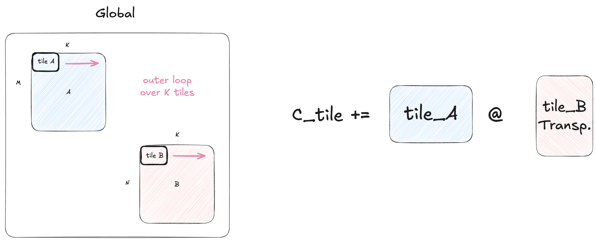</figure>
普通分块矩阵乘法将两个操作数矩阵都拆成 tile，使较小的 tile 能装进高速但容量有限的片上存储，从而可以直接在片上多次复用每次加载的数据。每一轮沿归约维推进，图中为 K 维，将匹配的 A、B tile 相乘，再把部分结果累加到同一个 C tile。处理完所有 K tile 后，将这些部分结果相加，在数学上等价于不拆分 K 维的完整矩阵乘法。 

Attention 的形式与之相似，但并不完全相同： 
<ul><li data-block="B054">一般的分块矩阵乘法固定一个 C tile，沿其归约维遍历。 </li><li data-block="B055">Attention 固定一个 Q tile，沿 K/V 的序列维遍历。 </li></ul>
引入布局： 

现在，全局内存中存放着我们的数据 tile。 

假设要将一个 A tile 和一个 B tile 相乘。我们不想用软件手动遍历各元素，再用标量指令计算点积，因为那会非常慢。我们希望使用 Tensor Core，而在 Blackwell 上使用 Tensor Core，需要采用 tcgen05.mma 指令族。 

上图中的 tile_a 和 tile_b 看起来是二维矩阵，但它们只是已存数据的逻辑视图，实际内存是一维的。 
<figure>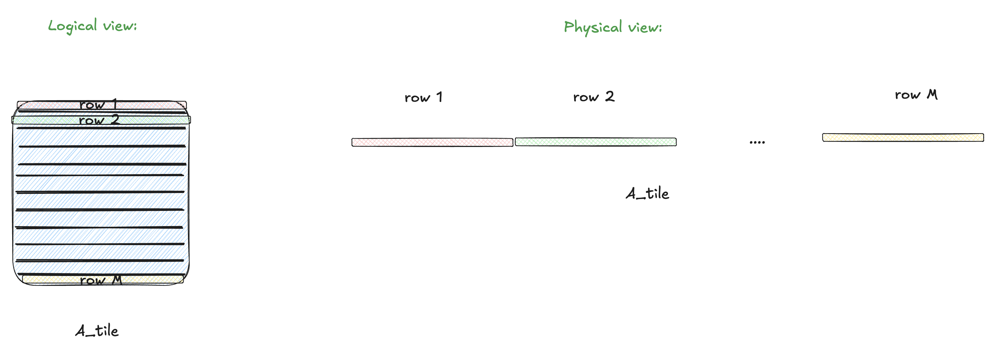</figure>
因此，数据在物理内存中总是按照某种方式“排布”的。 

假设 GMEM 中的 A 操作数采用行主序。那么，各行在一维内存中依次连续存放，如上图所示。 

要在这段线性内存中找到某个 [row, col] 元素，需要从基指针出发，利用 stride 计算偏移量。 

例如有一个很小的 [2,2] 矩阵，我们想取得 my_matrix[1,1]。 
<figure>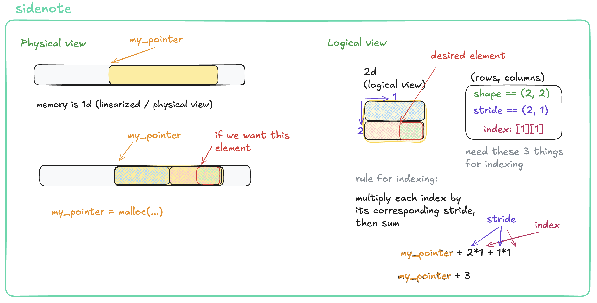</figure>
这些二维 tile 总会以某种方式放入物理内存。布局就是把 [row, col] 这样的逻辑坐标映射到物理内存地址的规则；行主序就是一种布局。 

但我们想调用的 tcgen05.mma(tile_A, tile_B) 不能使用这种简单的行主序物理布局。它只支持少数几种非常特定的布局，不只是普通行主序或列主序。MMA 具体要求哪些布局，暂时还不重要，后面会讲。 

tcgen05 要求数据按特定布局组织，也就是按特定方式存放在内存中。此外，它不支持直接使用 GMEM 操作数，因为 GMEM 带宽太低，操作数必须先写入高速片上存储。 

本节要记住：我们需要在 SMEM 中，把 A、B 操作数排布成 tcgen05 支持的某一种布局。 

离开入门小节，回到主线： 

如前两幅图和伪代码所示，每个 CTA 内的 Q 保持不变，每轮 K/V 循环计算： 
<ul><li data-block="B070">A）Q @ K.T -&gt; S </li><li data-block="B071">B）S -&gt; P </li><li data-block="B072">C）P @ V -&gt; O </li></ul>
这就是沿 SEQ_LEN 遍历的 KV 循环每轮执行的三项主要计算。下面放大观察一轮循环，逐一讲解这三步。 
<h3 data-block="B074" id="a-qkt-explaining-k-major">A）Q@K.T：解释 K-major </h3>
一轮 K/V 循环内部：三步中的第 1 步。 

执行 QK 前，Q 和当前 K tile 必须已经在 SMEM 中。Q 由 CTA 加载一次，每轮 K/V 循环则加载新的 K tile。Q、K 使用相同布局，所以下面只画 Q 的复制过程，省略 K。 
<figure>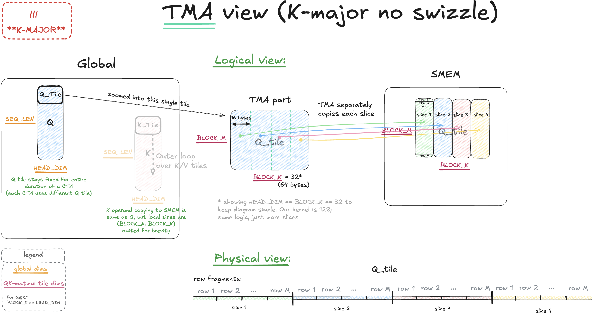</figure><blockquote>
注意：QK 矩阵乘法的图和代码片段采用常规矩阵乘法维度名称：Q[M,K] @ K[N,K].T = S[M,N]。这是局部矩阵乘法的轴名，不是内核输入全局张量的轴名。 
</blockquote>
前面说过，Blackwell 的 Tensor Core 通过 tcgen05 指令族使用。tcgen05.mma 要求操作数按特定布局组织，不能随意把 tile 从全局内存复制到共享内存后就执行 MMA。因此，我们必须将数据排布成 MMA 支持的布局之一。 

那么，具体应如何在 SMEM 中排布数据，才能让 MMA 使用？为简单起见，只说明 Q tile 从 GMEM 到 SMEM 的复制过程，K tile 同样独立执行此过程。在逻辑上，我们将 Q tile 纵向切成若干条带，图中示意为 4 条，再用 TMA 逐条从 GMEM 复制到 SMEM，见上图与<a href="#fn:2" id="fnref:2">脚注 2</a>。 
<blockquote>
为什么要这样切分 tile，而不是一次复制整个 tile？这是个好问题，先记在心里。我不想一次引入太多东西，等真正需要时再回来解释。现在只需记住，我们按条带复制。 
</blockquote>
复制完所有条带后，从 GMEM 到 SMEM 似乎没发生变化：图上仍是同一个逻辑 [BLOCK_M, BLOCK_K] 矩阵，只是现在位于 SMEM。但物理表示实际上变了，见上图绿色的“Physical view”标注。SMEM 中的结果不再是 GMEM 原有的行主序，而是先存一个条带的所有行，再存另一个条带的所有行，依此类推。 

每个条带内部采用行主序，但整个 SMEM 中 [BLOCK_M, BLOCK_K] 的布局并非简单的行主序或列主序，而是 tcgen05.mma 支持的所谓“规范布局”（canonical layout）之一。记住这个术语，后面会经常遇到。 
<figure>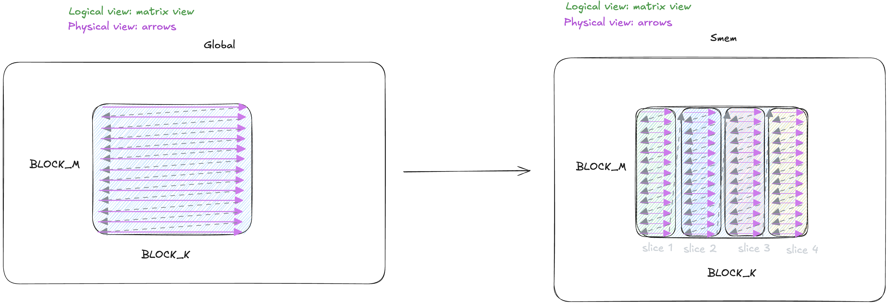</figure>
上图用另一种方式展示同一个 Q tile 在 GMEM 与 SMEM 中的物理表示差异。粉色箭头表示元素的物理顺序。GMEM 采用普通行主序；SMEM 则采用 tcgen05 能解释的规范布局。图中具体是 K-major、无 swizzle 的布局，稍后再讲。 

K-major 中的“K”不是 Key 张量，而是常规矩阵乘法命名中的归约维。在这里，它沿逻辑 tile 的水平方向延伸。上面的每条纵向条带只覆盖 K 维的一小部分。 

暂时可以忽略这些细节，为简单起见，把它当成 tcgen05 唯一支持的布局。我不想一次引入太多概念，其他布局会在需要时讨论。这里主要强调：使用 TMA 复制纵向条带，改变了数据的物理组织方式。 
<blockquote>
为什么物理布局必须这样，而不是其他任意方式？这看起来确实不直观，但我认为除了“NVIDIA 文档规定这是 tcgen05 支持的规范布局之一”以外，并没有更深的直觉解释。有些事情最终就是硬件契约，我们必须以它为准。 
</blockquote>

下面是稍作简化的复制代码。每轮由 src_col 选择 Q 接下来的 8 列，dst_smem 则选择所复制条带在 SMEM 中的存放位置。 

Q_tmap 保存 TMA 读取 Q 所需的元数据：全局内存地址、dtype、维度、stride 和复制形状。这里的形状是 BLOCK_M 行、8 列的 BF16 数据。 

TMA 结合这些元数据、源坐标和 SMEM 目标指针，复制选定条带。 

注意源和目标的指定方式不同。对 Q，我们给 TMA 行列坐标，由 Q_tmap 描述坐标如何映射到全局内存；对 SMEM，则直接给字节地址。因此 src_col 的单位是列，而目标偏移量的单位是字节。 

<pre style="color:#f8f8f2;background-color:#272822;-moz-tab-size:4;-o-tab-size:4;tab-size:4;-webkit-text-size-adjust:none" tabindex="0"><code class="language-cpp" data-lang="cpp">int SLICE_COLS = 8;
int SLICE_BYTES = (BLOCK_M * SLICE_COLS) * 2;  // each BF16 value is 2 bytes

// one thread issues all copies in this loop
for (int slice = 0; slice &lt; BLOCK_K / SLICE_COLS; ++slice) {
    // move right to the next source slice
    int src_col = slice * SLICE_COLS;               // column idx

    // Q_smem is starting byte address in SMEM,
    // place next slice after the previous one in SMEM
    int dst_smem = Q_smem + slice * SLICE_BYTES;    // byte address

    // TMA copy
    tma::copy_2d_gmem_to_smem(
        dst_smem,            // destination byte address in SMEM
        &amp;Q_tmap,             // Q's metadata (address, dtype, dims, strides, and copy size)
        src_col,            // starting source column (advances by 8 each iter)
        q_row0,              // this Q tile's first global row (stays fixed)
        mbar_addr            // barrier to track copy completion
    );
}
</code></pre>

这里没有遍历行的软件循环，每次 TMA 调用复制完整的 (BLOCK_M, 8) 条带。我们将 SMEM 目标地址增加 SLICE_BYTES，使新条带紧跟前一个条带。所以物理内存中先是条带 0 的所有行，再是条带 1 的所有行，依此类推，如上图所示。 

这里 BLOCK_K = 128，因此循环发起 16 次复制。简化图只画了 4 条。屏障设置和等待完成的代码在此省略。 

以上讲完 TMA 部分：把数据从 GMEM 复制到 SMEM。现在讨论 MMA 部分：如何对已经准备好的 SMEM 数据真正执行 MMA。 

TMA 只是复制机制，并不知道后面要调用什么 tcgen05.MMA。另一方面，tcgen05.MMA 只知道如何解释少量特定布局，并不知道待读取的数据最初如何进入 SMEM。因此可以把它们看成前面讲过的加载部分与下面要讲的 MMA 部分。这两个步骤彼此独立、互不知情，确保它们采用一致布局是我们的责任。 
<figure>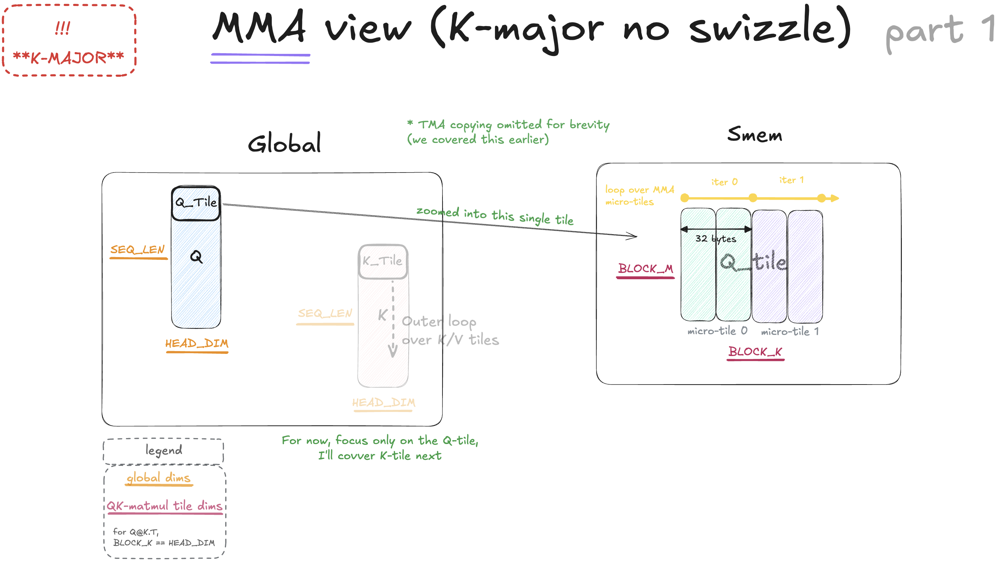</figure><blockquote>
图示简化说明：为方便阅读，图中使用 BLOCK_K = HEAD_DIM = 32 个 BF16 元素，即 64B。下面的文字和代码使用 BLOCK_K = HEAD_DIM = 128，即 256B。原理完全相同，只是实际代码的条带数量是图中的 4 倍。 
</blockquote>
回顾一下：之前沿 K 维以 16B 宽的条带，将 Q_tile 和 K_tile 分别复制到 SMEM。现在需要将形状为 (block_m, block_k) 的 Q tile 与 (block_n, block_k).T 的 K tile 相乘。先只看 Q，也就是 tcgen05.mma 的第一个输入，暂时省略第二个输入 K。 

我们的 tile 在 K 维有 BLOCK_K = 128 个元素；BF16 下即 256 字节。但一条 tcgen05.mma 在 K 维只消耗 MMA_K = 16 个 BF16 元素，即 32B，见<a href="#fn:3" id="fnref:3">脚注 3</a>。MMA_K 小于 tile 的 K 宽度，因此需要一个 for 循环，以 32 字节为步长遍历 Q、K tile 的 BLOCK_K 维；图中黄色表示对 SMEM 数据进行的软件循环。 

Q 的每条条带在 K 维宽 16B，而一条 tcgen05.mma 消耗 32B。因此，相邻两条 Q 条带组成一个 Q 微块。上图每对同色条带就是一个微块。 

这里的“微块”（micro-tile）指 tcgen05 直接消耗的 BLOCK_M = 128、MMA_K = 16 数据块。“微步”（micro-step）指一次 tcgen05.mma 调用，它消耗一个 Q 微块和对应的 K 微块。由于 BLOCK_K = 128、MMA_K = 16，128 / 16 = 8 个微步即可覆盖整个归约 K 维。简化图画出了其中两个微步。 
<figure>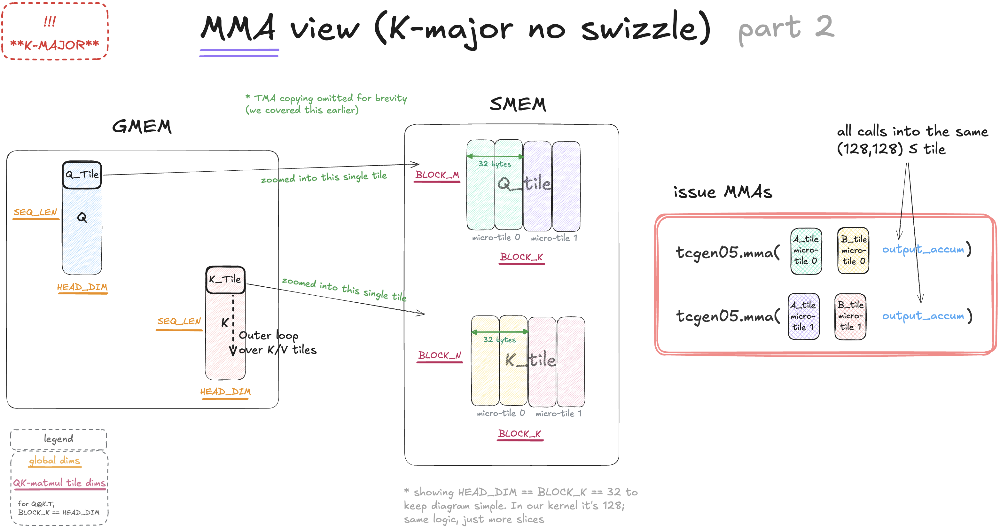</figure>
为了更直观，我也画出了 K_tile。K 同样独立切成 16B 宽的条带并由 TMA 复制，每两个条带视作一个微块。因为与前面 Q 的过程相同，所以图中省略了复制 K_tile 的过程。 

将 Q_tile 与 K_tile 相乘，基本上就是将对应微块相乘，见上图红框： 
<ul><li data-block="B102">第 1 个 Q 微块 @ 第 1 个 K 微块.T </li><li data-block="B103">第 2 个 Q 微块 @ 第 2 个 K 微块.T </li></ul>
图中的 output_accum 就是分数 tile S。在 Blackwell 上，tcgen05.mma 将输出累加到 Tensor Memory（TMEM）；这是独立于 SMEM 和寄存器的专用片上存储。更早的 GPU 则将 Tensor Core 累加器放在寄存器中。所有 QK 微步都累加到 TMEM 中同一个 S tile。现在只需记住 MMA 输出位于 TMEM；到 B 部分 Softmax 需要读取 S 时，再解释 TMEM 的分配和访问。 

我们将上面逐条展开的 MMA 调用改成一个循环，以 MMA_K = 16 的微步遍历 Q_tile、K_tile 的 BLOCK_K 维。伪代码如下： 
<figure>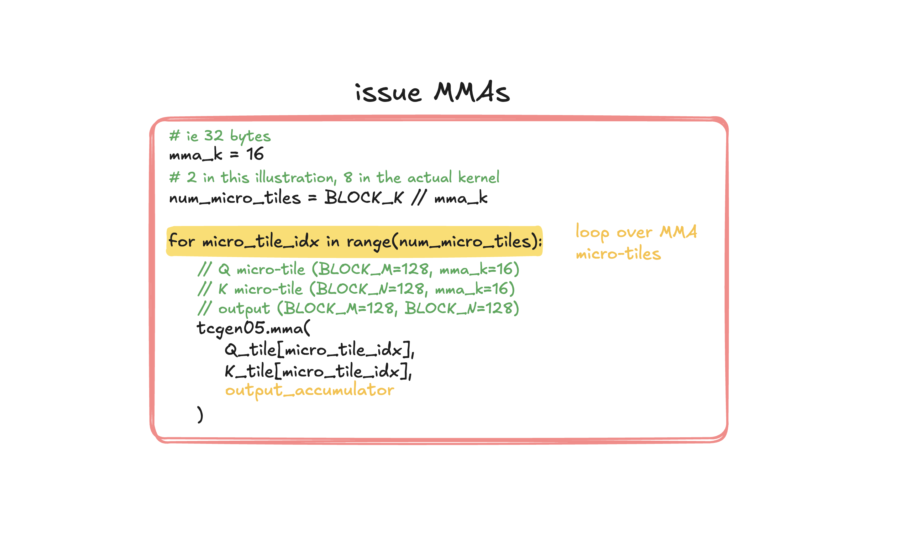</figure>
下面是实际内核中稍作简化的“黄色”循环，由一个线程执行： 

<pre style="color:#f8f8f2;background-color:#272822;-moz-tab-size:4;-o-tab-size:4;tab-size:4;-webkit-text-size-adjust:none" tabindex="0"><code class="language-cpp" data-lang="cpp">// tcgen05 mma_k width along K-dim
int MMA_K_BYTES = 32; // in bytes
int MMA_K = 16; // in BF16 values

// for now, think of each K-major SMEM "descriptor" as a
// pointer-like value selecting current micro-tile
// (it also contains some layout metadata, covered later)
uint64_t q_desc = noswizzle::desc_kmajor(Q_smem, BLOCK_M);
uint64_t k_desc = noswizzle::desc_kmajor(K_smem, BLOCK_N);

// offsets to advance the descriptors to next Q and K micro-tiles
// (minor detail, divide by 16 because descriptor addresses are encoded in 16B units)
uint64_t q_desc_step = (BLOCK_M * MMA_K_BYTES) / 16;
uint64_t k_desc_step = (BLOCK_N * MMA_K_BYTES) / 16;

// BLOCK_K = 128, MMA_K = 16, so 8 micro-steps
for (int k = 0; k &lt; BLOCK_K / MMA_K; ++k) {

    // one micro-step
    tcgen05::mma_f16(
        taddr_s, q_desc, k_desc,
        /*MMA shape and dtypes=*/i_desc_qk,
        /*enable_input_d=*/(k == 0 ? 0 : 1));

    // advance descriptors to the next pair of micro-tiles
    q_desc += q_desc_step;
    k_desc += k_desc_step;
}

// make mbarrier track completion of all 8 micro-steps
tcgen05::commit_arrive(mbar_addr);
// the wait and required synchronization are omitted here
</code></pre>

每轮对下一个 MMA_K = 16 的数据块调用 tcgen05.mma，并累加到同一个 S tile。第一个 MMA 微步初始化 S，余下 7 个微步继续累加。遍历所有微块并等待完成后，S_tile 就包含 Q_tile @ K_tile.T 的结果。 

无需显式转置 K_tile。Q、K 均使用 K-major 布局。MMA 的 A 操作数直接读取 Q[m,k]；对于 B 操作数，tcgen05.mma 将已存 K tile 解释成 Q @ K.T 所需的 [k,n] 操作数。K-major 本身不意味着“转置这个操作数”：A、B 是不同的 MMA 操作数槽位，逻辑形状分别为 [M,K] 和 [K,N]，所以 MMA 对它们的解释不同。 

现在已经看过 QK 微步循环的代码。此前我们把 q_desc 和 k_desc 看作选择当前微块的类指针值。下面展开这些描述符还包含哪些布局信息，以及 MMA 如何用它们定位微块内部的数据。 
<figure>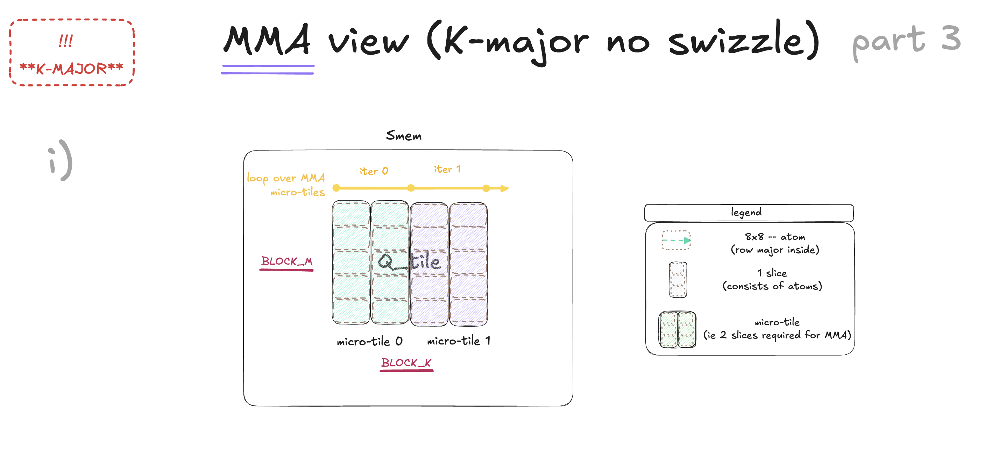</figure>
这里其实还有更细的一层粒度。放大观察一个 Q 微块，即 BLOCK_M = 128、MMA_K = 16；相同逻辑也适用于 K 微块。 

微块本身由更底层的单元构成，称为 atom。CUDA 文档也称它们为“swizzle atom”。注意我们此时并未进行 swizzle；即使 swizzle 模式是 None，NVIDIA 仍将“swizzle layout atom”作为总称，见表 53。 <a href="https://docs.nvidia.com/cuda/archive/13.0.0/parallel-thread-execution/#tcgen05-smem-swizzle-mode" title="table 53">〔链接〕</a>

atom 的大小取决于采用的规范布局。在这里，即 K-major 无 swizzle 布局下，atom 的尺寸为 (8, 8)，见<a href="#fn:4" id="fnref:4">脚注 4</a>。暂时仍可忽略布局细节，假定这是 tcgen05.mma 唯一支持的布局。 

从上到下总结，见上图图例：一个微块由两条条带组成，每条条带又由 atom 组成。我们需要理解 atom 在 SMEM 中的排布，但它们不是可以单独编程的 MMA 单元。发起 MMA 时，操作粒度仍是微块，而非单个 atom。 
<blockquote>
现在可以回答前面的问题：为什么要用 TMA 按 8 个元素宽的纵向条带复制 Q、K，而不是一次复制整个 tile？ 

之前的条带宽度不是随意选择的，而是恰好一个 atom 的宽度。对 Q 而言，每条 (128,8) 条带是一叠纵向排列的 (8,8) atom。我们将 tile 切成这些条带，每次用 TMA 复制完整一叠，并在 SMEM 中将各叠依次存放。这就形成 tcgen05.mma 支持的 K-major atom 物理顺序。 
</blockquote><figure>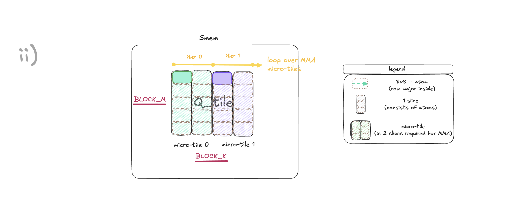</figure>
记住，前面说过，“黄色”循环每轮都向 tcgen05.mma 提供两个数据微块：一个 Q 微块和一个 K 微块。 

对于单个微块，无需给 MMA 提供其中所有 atom 的地址，只需提供第一个 atom 的基指针，见上图高亮部分。 

随着黄色循环推进，基指针从一个微块移向下一个微块。第一轮指向青色 atom，即微块 0 的起点；第二轮指向紫色 atom，即微块 1 的起点；如此沿 K 维推进。K 操作数描述符也做同样的事。 

但基地址只指向第一个 atom，因此直觉上，除了基地址以外，MMA 还必须知道如何从当前微块的第一个 atom 走到同一微块中的其他 atom。 
<figure>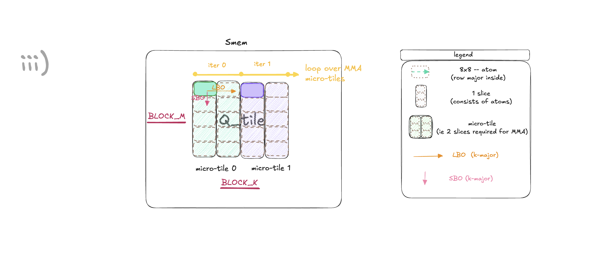</figure>
为此引入 SBO 和 LBO，见上图。它们不会增加软件循环次数，而是描述同一微块中其他 atom 相对基指针的位置。SBO 告诉 MMA 如何到达同一条带的下一个 atom；LBO 告诉 MMA 如何到达下一条带中索引相同的 atom。 

对当前讨论的 K-major 无 swizzle SMEM 布局，每个 atom，以及每条纵向条带，宽度都是 8 个 BF16 元素，即 16B，因此： 
<pre tabindex="0"><code>SBO = 8 rows * 16B per row = 128B   // step over one atom
LBO = BLOCK_M rows * 16B per row = 2048B    // step over one complete slice of atoms
</code></pre>
这里 LBO 就是 Q 复制循环中的 SLICE_BYTES，也就是 SMEM 中相邻纵向条带的偏移。一个 Q 微块包含两条条带，因此循环将描述符基地址增加 2 * SLICE_BYTES 字节，便可到达下一个微块。描述符地址以 16 字节为单位编码，所以除以 16 后，就得到上面代码使用的 q_desc_step。 

合起来看，软件循环把基指针从一个微块移到下一个，而 SBO、LBO 描述当前微块内部其他 atom 的偏移。 
<h3 data-block="B124" id="b-online-softmax-explaining-s-p">B）在线 Softmax：解释 S -&gt; P </h3>
一轮 K/V 循环内部：三步中的第 2 步。 

现在已讲完第一次矩阵乘法 Q@K.T，接下来进入内核的在线 Softmax 部分，即 S -&gt; P。 

在线 Softmax 的数学是标准内容，并非 B200 特有，已有很多讲解，所以这里不重新推导。我只概述所需状态更新，然后重点介绍 B200 内核如何实现。 
<figure>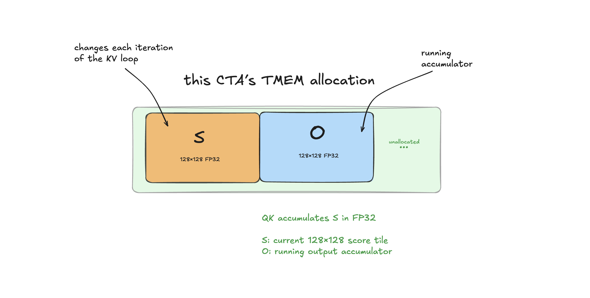</figure>
A 部分已简要见过 TMEM：Q @ K.T 的各个微步在那里累加出 S。现在放大观察 TMEM 本身，看看在线 Softmax 如何读取 S 并转换成 P。 

TMEM 的结构为 128 行、512 列，且必须显式分配。K/V 循环前，内核 1 为 S 分配 128 列，为 O 再分配 128 列。分配以列为单位，每列包含 128 个元素，因此分配 128 列就得到 [128,128] 的 FP32 TMEM 存储块。 

S 保存当前 K/V tile 的分数，每轮 K/V 循环都会覆盖。O 是运行中的输出累加器，后面 C 部分的 P@V 每轮向其中累加。tcgen05.alloc 将所分配区域的 TMEM 基地址写入共享内存槽 tmem_addr，再将该分配区域划分成 S、O 两个地址： 

<pre style="color:#f8f8f2;background-color:#272822;-moz-tab-size:4;-o-tab-size:4;tab-size:4;-webkit-text-size-adjust:none" tabindex="0"><code class="language-cpp" data-lang="cpp">int TMEM_S_COLS = 128;
int TMEM_O_COLS = 128;

__shared__ int tmem_addr[1];

// simplified PTX notation
// warp selection and synchronization omitted.
tcgen05.alloc(tmem_addr, TMEM_S_COLS + TMEM_O_COLS);

// first 128 columns for S, next 128 for O.
int taddr_s = tmem_addr[0];
int taddr_o = taddr_s + TMEM_S_COLS;
</code></pre>

把之前的这层抽象展开： 

<pre style="color:#f8f8f2;background-color:#272822;-moz-tab-size:4;-o-tab-size:4;tab-size:4;-webkit-text-size-adjust:none" tabindex="0"><code class="language-py" data-lang="py"># Section B: S -&gt; P, update rowmax/rowsum, and correct old O
P, softmax_state, O = online_softmax_update(
    S, softmax_state, O
)
</code></pre>

一轮 K/V 迭代中的状态变化如下，先看伪代码： 

<pre style="color:#f8f8f2;background-color:#272822;-moz-tab-size:4;-o-tab-size:4;tab-size:4;-webkit-text-size-adjust:none" tabindex="0"><code class="language-c" data-lang="c">// Section A, covered earlier
// S = Q @ K.T;

// Section B:

tile_rowmax = row_max(S);
// new basis
new_rowmax  = max(running_rowmax, tile_rowmax);

// rescale old state to the new basis
rescale     = exp(running_rowmax - new_rowmax);
running_rowsum *= rescale;
O              *= rescale;

// produce P and update denom
P               = exp(S - new_rowmax);
running_rowsum  += row_sum(P);
running_rowmax   = new_rowmax;

// Section C, covered later:
// O += P @ V;
// after complete K/V loop:
// output = O / running_rowsum;
</code></pre>

这是通用在线 Softmax 更新，并非 B200 特有，因此不再多讲。主要问题是如何把它映射成 B200 内核。 

上述伪代码有许多个状态更新，但内核中整个在线 Softmax 工作主要围绕三次 TMEM 遍历组织，其他状态更新大多融合进这三次遍历中。因此，可以把它理解为“对 TMEM 中的数据 tile 做三次遍历”。 

三次遍历可分为： 
<ul><li data-block="B136">两次遍历 S tile，共同用于生成 P。 </li><li data-block="B137">一次遍历 O tile，用于对 O 重缩放。 </li></ul>
源码中的 O 重缩放位于两次 S 遍历之间。但由于两次 S 遍历的方式相同，我会把它们放在一起解释，再回来讲 O 重缩放。 

下面依次说明，随后对照代码。 

<h4 data-block="B140" id="i-producing-p">i）生成 P </h4>
先讲两次 S 遍历如何将 S 转成未归一化的 P，见<a href="#fn:5" id="fnref:5">脚注 5</a>；之后 P 会用于 P@V 矩阵乘法。为此，内核 1 对 TMEM 中 S 的每一行遍历两次： 
<ol><li data-block="B142">第一次计算各行最大值，为第二步提供数值稳定性。 </li><li data-block="B143">第二次减去行最大值并取指数，即 exp(S - new_rowmax)，生成未归一化 P。 </li></ol>
在取指数前，先计算 S 每行最大值并从该行各元素减去它，称为 max trick，是 Softmax 实现常用的数值稳定技巧。S 中可能有很大的正分数，直接取指数可能溢出。减去行最大值，使 exp 输入都变成零或负数，在不改变 Softmax 结果的同时避免溢出。因此，不先减去 rowmax 就直接算 exp(S)，通常不具备数值稳定性。 

之所以要做两次遍历，是因为实现没有把所有 S 保留在寄存器中。第一次按块从 TMEM 加载 S、更新逐行最大值，然后复用同一组寄存器加载下一块。完成第一次完整遍历时，早先读取的数据已不在寄存器中。为了生成 P，必须第二次从 TMEM 读取 S，减去更新后的行最大值，再取指数。 

第一次 S 遍历：计算 rowmax 

先看第一次遍历如何扫描 S 并计算逐行最大值，先看图，再看代码。 
<figure>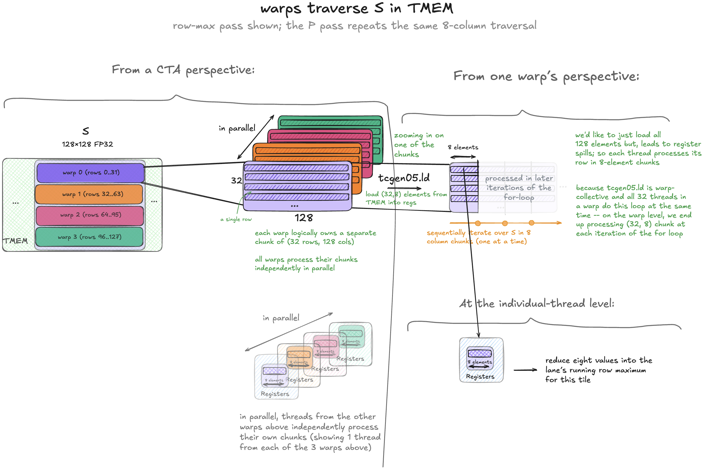</figure>
只有 tcgen05 指令族能访问 TMEM，普通 load/store 不行。计算逐行最大值前，必须先加载 TMEM 中的数据，因此这里用 tcgen05.ld（ld 表示 load）将数据从 TMEM 加载到寄存器。 

从左到右读这幅图。我们分三个层次追踪 TMEM 遍历：整个 CTA、一个 warp、以及该 warp 中的一个线程。TMEM 中的 S tile 为 128 行、128 列。 

从 CTA 角度看，4 个 warp 分摊 S 的 128 行，每个 warp 负责一个 (32,128) 的行块。因此内核 1 使用 4 个 warp，以 32 行为单位覆盖并并行处理全部 128 行。 

但每个 warp 不会一次读完整个 (32,128) 块。那会导致寄存器溢出：寄存器不足以容纳四个这样的块，编译器就会把部分数据写入极慢的全局内存。为避免这一点，4 个 warp 各自以更小的 (32,8) 步长遍历自己的 (32,128) 块，见<a href="#fn:6" id="fnref:6">脚注 6</a>。因此需要一个遍历 TMEM 列的 for 循环。 

放大到单个 warp：每轮使用 tcgen05.ld 从 TMEM 加载 32 行、8 列的数据块。32 个线程共同参与一条加载指令，tcgen05.ld 是 warp 集体操作。它将加载的 32 行分配给 32 个线程，每线程一行。因此，每线程收到自己那一行的 8 个 FP32 值，32 个线程合起来持有完整 (32,8) 块。 

从一个线程角度看，每轮始终跟踪同一行，一次收到 8 个值；它遍历这 8 个值，保留目前见过的最大值。 

换句话说，加载是 warp 集体操作，而行计算是线程局部操作。每线程分批看到该行全部 128 个分数，每批 8 个，因此可在第一次 S 遍历中独立求出行最大值。这就是每个线程能在寄存器中维护自己的 tile_rowmax 标量的原因。 

每个线程在整个 K/V 循环中始终处理同一查询行。rowmax 和 rowsum 跨迭代保留，而 tile_rowmax、tile_rowsum 则对每个 tile 重新计算。 

因此，4 个 warp 合起来每轮处理 S 的一个 (128,8) 块，再向右移动 8 列重复。经过 128 / 8 = 16 轮，4 个 warp 遍历 S 全部 128 列。循环结束时，每个线程都持有某一 TMEM 行的最大值。 

代码调用 tcgen05::ld_32x32b_x8 辅助函数：.32x32b 表示加载 32 行 TMEM，每行一个 32 bit 值；.x8 表示在 8 列上重复该形状，并且仍是一条 tcgen05.ld 指令。于是每线程把 8 个 32 bit 行元素放入自己的 8 个寄存器。这就是图中的 (32,8) 块。 

下面是第一次 S 遍历的代码。每线程维护自己的 tile_rowmax，在经过各数据块时更新。 

<pre style="color:#f8f8f2;background-color:#272822;-moz-tab-size:4;-o-tab-size:4;tab-size:4;-webkit-text-size-adjust:none" tabindex="0"><code class="language-c" data-lang="c">float tile_rowmax = -FLT_MAX;

for (int score_n8 = 0; score_n8 &lt; BLOCK_N / 8; ++score_n8) {
    // 8 FP32 temporaries per lane
    float s8[8];

    int addr = ... // covered below
    tcgen05::ld_32x32b_x8(addr, s8);

    for (int i = 0; i &lt; 8; ++i) {
        tile_rowmax = fmaxf(tile_rowmax, s8[i]);
    }

}
</code></pre>

那么，我们如何告诉这条指令要读取哪个数据块？ 

S tile 的 [BLOCK_M, BLOCK_N] = [128,128] 分别对应 TMEM 的行和列。如前所示，4 个 warp 分别覆盖不同的 32 行区域，而每个 warp 的循环沿列推进。 

TMEM 地址是一个包含两个坐标的 32 bit 值，而不是普通字节地址： 
<pre tabindex="0"><code>[ upper 16 bits: row ][ lower 16 bits: column ]
</code></pre>
PTX 将 TMEM 的行称为“lane”。对于当前加载方式，这两个坐标指定整个 warp 数据块的起始行和列，而不是分别给每个线程指定行列。 

地址构造如下： 

<pre style="color:#f8f8f2;background-color:#272822;-moz-tab-size:4;-o-tab-size:4;tab-size:4;-webkit-text-size-adjust:none" tabindex="0"><code class="language-cpp" data-lang="cpp">// first row of this warp's region:
// 0, 32, 64, or 96, depending on the warp_id
int row_base = warp_id * 32;
// bitshift to the upper 16 bits
int trow = row_base &lt;&lt; 16;

// inside the loop over S columns
int taddr =
    trow                // starting row, encoded in the upper bits
    + taddr_s           // starting column of S
    + score_n8 * 8;     // current chunk's column offset within S
</code></pre>

&lt;&lt; 16 将 row_base 移到高 16 位，低半部分为零。列号数值很小，自然位于低 16 位，高半部分为零，无需移位。下面每对括号表示 16 位： 
<pre tabindex="0"><code>row_base &lt;&lt; 16:  [row_base][  0   ]
column:          [   0    ][column]
sum:             [row_base][column]

(here, column = taddr_s + score_n8 * 8)
</code></pre>
两个字段不重叠，因此用普通加法即可把行列组合成一个 TMEM 地址。 

注意，32 个线程传入相同的 taddr。对于这个加载形状，硬件利用线程的 lane ID，将 row_base + lane_id 行的数据分配给它。我们不自己把 lane_id 加到地址中，这与 ld.global 的普通逐线程寻址不同。例如 row_base = 32 时： 
<ul><li data-block="B167">lane 0 收到第 32 行的数据。 </li><li data-block="B168">lane 1 收到第 33 行的数据。 </li><li data-block="B169">…… </li><li data-block="B170">lane 31 收到第 63 行的数据。 </li></ul>
这就是 warp 集体加载的含义：同一 warp 的 32 个线程共同参与同一条加载指令。这里它们使用相同 taddr，但每个线程收到自己那一行的 8 个值。 

循环推进时，trow 不变，而列偏移量每次增加 8。 

第二次 S 遍历之前：更新累计 rowmax 

得到当前 S tile 的逐行最大值后，需要按在线 Softmax 定义更新累计 rowmax、rowsum。第一次遍历得到 tile_rowmax，即当前 S tile 中该行的最大值；第二次遍历使用的却是包含先前 K/V tile 在内的累计最大值。因此，第二次遍历前，要将 tile_rowmax 与旧 rowmax 合并，并对旧 rowsum 重缩放。这些都是寄存器中的逐线程标量更新，不是再遍历一遍 S。 

取两个最大值中的较大者，并计算重缩放因子： 

<pre style="color:#f8f8f2;background-color:#272822;-moz-tab-size:4;-o-tab-size:4;tab-size:4;-webkit-text-size-adjust:none" tabindex="0"><code class="language-c" data-lang="c">float new_rowmax = fmaxf(rowmax, tile_rowmax);
float rescale = __expf(rowmax - new_rowmax);

rowmax = new_rowmax;
rowsum *= rescale;
</code></pre>

如果当前 tile 提高了累计 rowmax，那么旧 rowsum 是按之前的最大值计算的，必须乘以 rescale，才能让早先贡献与更新后的最大值一致。 

第二次 S 遍历会使用更新后的 rowmax 生成 P。同一个 rescale 也必须施加到旧 O 上，稍后在 ii 小节说明。 

第二次 S 遍历：生成 P 并更新 rowsum 

现在有了更新后的累计行最大值，再遍历一次 S。分块重读 S，从分数中减去这些 rowmax，再安全地取指数，生成未归一化 P。 

TMEM 遍历方式与第一次相同，因此不另画遍历图。变化在于每线程对加载的 8 个值做什么：减去更新后的累计 rowmax、取指数、将结果加入该行的和，并将 P 写入 SMEM。 

仔细看看第二次遍历如何把 P 写入 SMEM。 
<figure>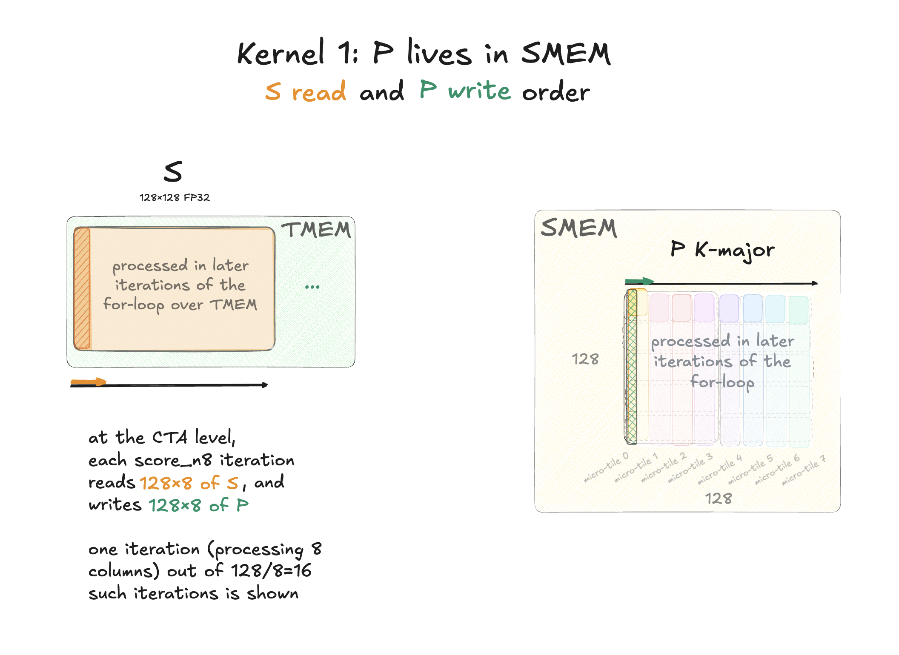</figure>
每读一块 S，就生成对应的一块 P，并写成 K-major SMEM 布局。这是后面 P@V MMA 所要求的布局。 

第二次 S 遍历每轮产生 8 列 P。相邻两块组成一个 16 列的 P 微块，由后续 PV MMA 微步消耗。 

TMEM 中的 S 本身不变。P 存入之前存 K 的同一个 SMEM 缓冲区。QK 结束后 K 已无后续用途，因此可以安全复用其空间存 P。 

下面是第二次 S 遍历的代码，从 TMEM 读 S，并向 SMEM 写 P。 

<pre style="color:#f8f8f2;background-color:#272822;-moz-tab-size:4;-o-tab-size:4;tab-size:4;-webkit-text-size-adjust:none" tabindex="0"><code class="language-cpp" data-lang="cpp">int row = row_base + lane_id;
float tile_rowsum = 0.0f;

for (int score_n8 = 0; score_n8 &lt; BLOCK_N / 8; ++score_n8) {
    float s8[8];

    int addr = ...; // same TMEM address calculation as the first pass
    tcgen05::ld_32x32b_x8(addr, s8);

    for (int i = 0; i &lt; 8; ++i) {
        float p = __expf(s8[i] - rowmax);
        tile_rowsum += p;

        // write P into K-major SMEM
        int col = score_n8 * 8 + i;
        int p_idx = idx_kmajor_w8(BLOCK_M, row, col);
        P_smem_ptr[p_idx] = __float2bfloat16_rn(p);
    }
}

rowsum += tile_rowsum;
</code></pre>

将 P 写入 SMEM 

idx_kmajor_w8 计算每个 P 元素在熟悉的 K-major SMEM 布局中的位置，供后续 PV 矩阵乘法使用；该布局已在 A 部分介绍。辅助函数的具体实现并不重要，可以略过。这里需要 row 变量，因为这些是普通的逐线程 SMEM store，与 warp 集体 TMEM load 不同。 

<h4 data-block="B188" id="ii-rescaling-o">ii）对 O 重缩放 </h4>
回到 O 重缩放。源码中，它位于两次 S 遍历之间。前面已算出新的最大值基准，但旧 O tile 仍处于旧基准下。因此，执行 O += P @ V 前必须重缩放 O。在在线 Softmax 中，在旧 O 转换到当前最大值基准之前，通常不能安全地向 O 累加 PV。 

之前将当前 S tile 纳入了累计 rowmax。rowmax 的改变会改变未归一化 P 的尺度，也就影响累加到 O 中的 P@V 贡献。因此，在加入当前 P@V 贡献前，必须重缩放旧 O，让早先贡献与新的 rowmax 对齐。 

这是标准在线 Softmax 公式；这里唯一不同的是把它映射到 Blackwell B200 硬件。 

如前所述，rowsum 和 rowmax 是逐线程标量。O 不同，它是存于 TMEM 的完整 [BLOCK_M, HEAD_DIM] 部分累加 tile。 

因此，重缩放这些值需要读取 TMEM 中保存 O 的列，用刚从新旧 rowmax 算出的 rescale 乘它们，再写回 TMEM。必须写回，因为 O 仍是中间累加结果，并非最终输出；后续 PV 要继续在更新后的基准下累加。 

每线程对自己 O 行的全部值使用同一个 rescale。第一次 K/V 迭代跳过此遍历，因为还没有旧 O；第一个 PV 微步会初始化 O。 

<pre style="color:#f8f8f2;background-color:#272822;-moz-tab-size:4;-o-tab-size:4;tab-size:4;-webkit-text-size-adjust:none" tabindex="0"><code class="language-c" data-lang="c">float o8[8];

for (int out_n8 = 0; out_n8 &lt; HEAD_DIM / 8; ++out_n8) {

    // same TMEM address calculation as before, now for O
    int taddr =
        trow                // starting row, encoded in the upper bits
        + taddr_o           // starting column of O
        + out_n8 * 8;       // current chunk's column offset within O
    tcgen05::ld_32x32b_x8(taddr, o8);

    for (int i = 0; i &lt; 8; ++i) {
        o8[i] *= rescale;
    }

    tcgen05::st_32x32b_x8(taddr, o8);
}
</code></pre>

这里使用与 S 遍历相同的 4 个 warp、行归属和 8 列分块。新内容是：在寄存器里完成重缩放后，用 tcgen05.st 将修正后的 O 写回 TMEM。 

此处省略 store 完成等待和同步。完整内核确保 O 的写入在 PV 使用累加器之前完成。 

现在 P 已在 SMEM 中准备好，O 也已在 TMEM 中重缩放，C 部分便可把 P @ V 加入 O。 

<h3 data-block="B198" id="c-pv-explaining-mn-major">C）P@V：解释 MN-major </h3>
一轮 K/V 循环内部：三步中的第 3 步。 

前面介绍了如何生成 P tile，现在要将它与 V tile 相乘。与 Q、K、P 都使用 K-major SMEM 布局不同，V 使用另一种 SMEM 布局。这就是接下来的主题。 

在内核 1 中，P_tile 由 Softmax 直接生成到 SMEM，因此下面的全局内存视图不画 P。 

实际内核在 QK 之前随 K 一起加载 V。这里才讲 V 的复制，是为了把它的 SMEM 布局与消费它的 PV 矩阵乘法放在一起讨论。 
<figure>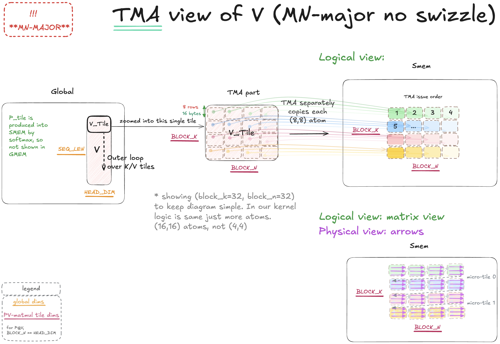</figure><blockquote>
注意：矩阵乘法图和代码片段以矩阵乘法为中心命名维度；实际内核源码则保留固定的 Attention tile 维度名。 

下面 PV 图采用常规矩阵乘法维度名：P[M,K] @ V[K,N] = O[M,N]。 

先退一步解释为什么把轴叫作 M、N、K。我对每次矩阵乘法分别使用常规 M/N/K 命名，因为这样单独观察每次乘法时，输入形状更容易理解。因此，这些是面向矩阵乘法的局部名称，不是全局张量 Q、K、P、V 固有的属性。 

同一个源维度在 QK、PV 中可以有不同的局部名称。K 维总指当前矩阵乘法的归约维：QK 中是特征维，PV 中则是 K/V tile 的行维。现在回到 PV 矩阵乘法。 
</blockquote>
Q、K、V 最初采用相同的全局内存布局，但内核根据各自 MMA 的消费方式，把它们放成不同的 SMEM 布局。为什么 Q、K、P tile 使用 K-major，而 V tile 要用下面介绍的另一种布局？ 

因为 QK 需要把 K 看成转置后的矩阵；PV 的内部维度本来就匹配，V 无需转置。具体来说： 
<pre tabindex="0"><code>QK: Q[M,K] @ K[N,K].T
PV: P[M,K] @ V[K,N]
</code></pre>
QK 中，K 按 [N,K] 存储，MMA 却将 B 操作数视为逻辑 [K,N]。因此 K 使用 K-major，使 MMA 能把已存 K tile 解释成逻辑转置操作数，而无需先构造另一份转置 K tile。 

PV 中，V 已经是 MMA B 操作数所需的 [K,N] 方向，所以使用 MN-major，让 MMA 直接消费 V，而无需先转置 V tile。P 是 [M,K] 的 A 操作数，仍使用 K-major。 

换句话说，对这些图使用的存储视图，我的速记方式是： 
<ul><li data-block="B212">K-major：归约 K 在右侧，如 Q[M,K]、K[N,K]、P[M,K]。 </li><li data-block="B213">MN-major 的 B 操作数：归约 K 在左侧，如 V[K,N]。 </li></ul>
这只是我阅读这些操作数视图的速记方式，不是 K-major、MN-major 布局的正式定义。 
<figure>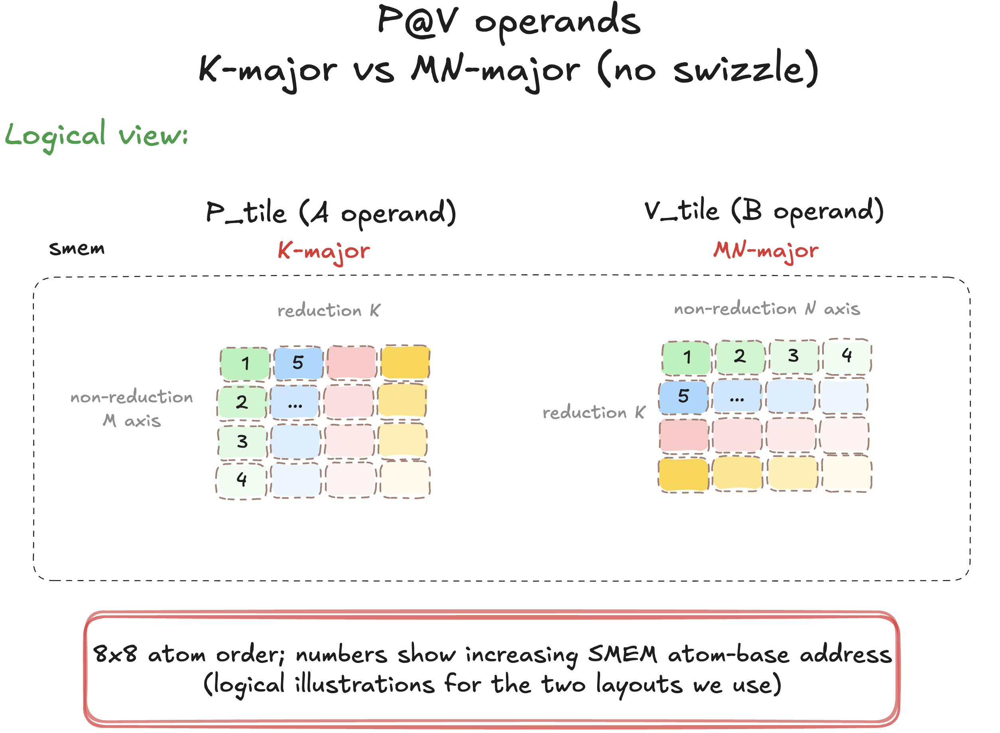</figure>
它们是同一次 PV MMA 的两个操作数。tcgen05.mma 允许独立选择 A、B 的 major mode，因此 P 可以是 K-major，V 可以是 MN-major。 

左侧 P 使用与 A 部分 Q 相同的 K-major atom 顺序。数字表示递增的 SMEM 地址。两种布局都采用 (8,8) atom，区别在于哪些 atom 紧挨着存放，这决定每次 TMA 调用复制多少数据。 

记住，对 Q，一次 TMA 调用复制整条纵向条带，并按正确顺序放置其中的 atom。V 的 SMEM 布局和 atom 顺序不同，因此需要重新考虑每次 TMA 调用应复制多少数据。 
<blockquote>
为什么不和 Q 一样，按更大的条带复制 V？ 

Q 的同一纵向条带中，各 atom 在 SMEM 中连续存放，因此一次 TMA 可复制整个条带。 

看图中 V 的 atom 顺序：先沿第一个 8 行横带依次存放 atom，再向下移到下一个横带。因此，同一纵向条带的 atom 在 SMEM 中被其他 atom 隔开；一次 TMA 复制整条纵向条带，会把 atom 放错位置。 

那为什么不复制整个横带？我们使用的简单、无 swizzle 二维 TMA 复制会逐行存储矩形，得到普通行主序：一整行元素，接着下一整行。但目标布局要求先放完一个 (8,8) atom 的 8 行，再放下一个 atom。 

所以我们一次复制一个 atom，显式选择每个 atom 在 SMEM 中的落点。 
</blockquote>
下面是稍作简化的 V 复制循环。与 Q 不同，每次 TMA 复制一个 (8,8) BF16 atom，而非覆盖整个高度的纵向条带。 

V_tmap 与之前 Q_tmap 包含同类元数据，即全局地址、dtype、维度、stride，但复制形状现在是 8 行、8 列。kv_row0 是当前 V tile 的首个全局行。按图中命名，该 V tile 为 BLOCK_K 行、BLOCK_N 列。 

<pre style="color:#f8f8f2;background-color:#272822;-moz-tab-size:4;-o-tab-size:4;tab-size:4;-webkit-text-size-adjust:none" tabindex="0"><code class="language-c" data-lang="c">int ATOM_BYTES = (8 * 8) * 2;          // one 8x8 BF16 atom
int STRIPE_BYTES = (8 * BLOCK_N) * 2;  // one full 8-row stripe

// one thread issues all these TMA copies;
// barrier setup and completion wait omitted

// move down V, 8 rows at a time
for (int row8 = 0; row8 &lt; BLOCK_K / 8; ++row8) {

    // copy one (8,8) atom per iteration, moving from left to right
    for (int col8 = 0; col8 &lt; BLOCK_N / 8; ++col8) {

        // starting row and column of this (8,8) atom in global V;
        // element coordinates, not byte offsets
        int src_row = kv_row0 + row8 * 8;
        int src_col = col8 * 8;

        // V_smem is the starting byte address in SMEM
        int dst_smem = V_smem
                     + row8 * STRIPE_BYTES
                     + col8 * ATOM_BYTES;

        tma::copy_2d_gmem_to_smem(
            dst_smem, &amp;V_tmap, src_col, src_row, mbar_addr);
    }
}
</code></pre>

内层循环把完整 atom 在 SMEM 中相邻存放；外层循环向下移到下一个 8 行横带，再重复。这些偏移构造出上图所示的 MN-major 物理布局。 

对于 (128,128) 的 V tile，循环发起纵向 16 次、横向 16 次，共 256 次复制。我们并不遍历单个元素，每次调用会复制 (8,8) atom 的全部 64 个值。 

现在知道了 PV 两个操作数如何在 SMEM 中准备好：P 由前面 B 部分的 Softmax 生成，V 则按刚介绍的过程单独复制。下面看 MMA 如何消费它们。 
<figure>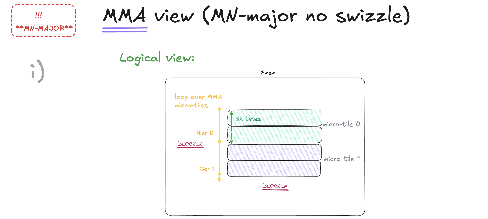</figure>
基本思想与 A 部分 QK 相同：图中的归约维 BLOCK_K 有 128 个 BF16 元素，而一次 tcgen05.mma 只消耗 MMA_K = 16 个。因此 PV 分成 128 / 16 = 8 个 MMA 微步。为简单起见，图中只画 2 个。 

在这个 V 视图中，归约 K 是纵向的，所以一个微步消耗相邻两条 8 行横带。 

每个微步沿 BLOCK_K 消耗 16 个 BF16 元素，每个 BF16 占 2 字节，所以就是图中的 32 字节。 

PV 循环结构与 QK 相同。P 使用 K-major 描述符，不同的是 V 使用 MN-major 描述符。指令描述符 i_desc_pv 指定 MMA 形状、数据类型和这些操作数模式。 

每个 PV 微步消费 P 的 16 列和 V 中对应的 16 行，并向同一 O tile 贡献结果。 

<pre style="color:#f8f8f2;background-color:#272822;-moz-tab-size:4;-o-tab-size:4;tab-size:4;-webkit-text-size-adjust:none" tabindex="0"><code class="language-cpp" data-lang="cpp">// P uses SMEM storage previously used by K
int P_smem = K_smem;

uint64_t p_desc = noswizzle::desc_kmajor(P_smem, BLOCK_M);
uint64_t v_desc = noswizzle::desc_mnmajor(V_smem, BLOCK_N);

// MMA_K = 16 BF16 values; MMA_K_BYTES = 32.
// descriptor addresses are encoded in 16-byte units
uint64_t p_desc_step = (BLOCK_M * MMA_K_BYTES) / 16;
uint64_t v_desc_step = (BLOCK_N * MMA_K_BYTES) / 16;

// one thread issues all MMA micro-steps
for (int k = 0; k &lt; BLOCK_K / MMA_K; ++k) {

    // initialize O only on very first PV microstep,
    // every later microstep accumulates into existing O.
    // (kv_tile is zero-based index of the current K/V tile).
    int enable_input_d = (kv_tile == 0 &amp;&amp; k == 0) ? 0 : 1;

    tcgen05::mma_f16(
        taddr_o, p_desc, v_desc, i_desc_pv, enable_input_d);

    p_desc += p_desc_step;  // next 16 columns of P
    v_desc += v_desc_step;  // next 16 rows of V
}

// track completion of all 128/16=8 PV microsteps
tcgen05::commit_arrive(mbar_addr);
</code></pre>

与 QK 的一个区别是初始化条件。QK 每轮 K/V 迭代都创建新的 S tile；O 则必须保留先前 K/V tile 的贡献，它们已在 B 部分重缩放。因此，仅第一轮 K/V 迭代的第一个微步初始化 O，后续全部累加。第一轮还跳过 O 重缩放，因为尚无旧 O。 

循环将两个描述符推进到下一对微块。现在放大 V 描述符：基地址指向哪里，MMA 如何定位同一微块的其他 atom？ 

<figure>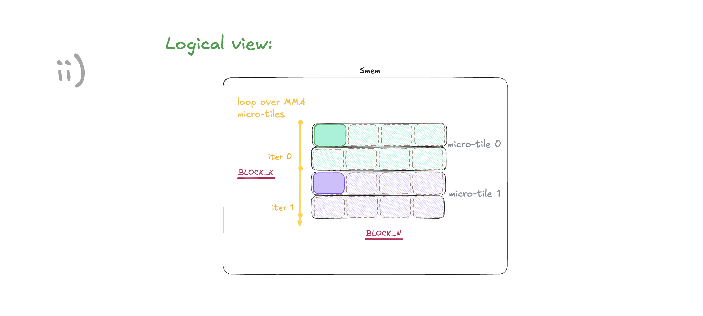</figure>
每个 PV 微步中，V 操作数描述符的基地址指向该 16 行块中的第一个 (8,8) V atom。 

微步 0 的 V 基地址是绿色高亮 atom。微块循环随后把描述符移到下一个 16 行块，微步 1 的基地址就变成紫色高亮 atom。 

下图展示 LBO、SBO 如何从描述符基地址覆盖同一微块中的其余 atom。 
<figure>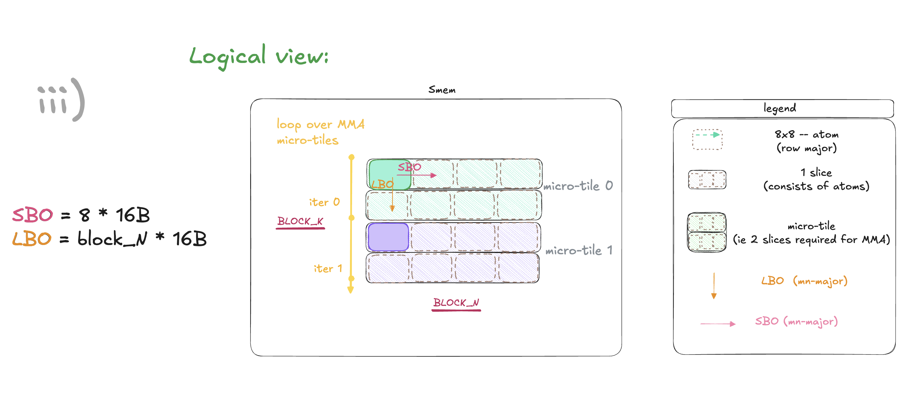</figure>
每个 PV 微步的描述符基地址，都指向第一条 8 行 V 横带的首个 atom。 

LBO 到达第二条 8 行横带中的对应 atom；SBO 则沿 N 维跨越宽度为 8 列的各个 atom。 

这些与 V 复制循环中的偏移完全相同。对于 128 列的 V tile： 
<pre tabindex="0"><code>SBO = ATOM_BYTES   = 8 * 8 * 2       = 128 bytes
LBO = STRIPE_BYTES = 8 * BLOCK_N * 2 = 2048 bytes
</code></pre>
因此，复制循环与 MMA 描述符对 atom 的位置达成一致：TMA 按这些偏移放置，MMA 用相同偏移找到它们。 

给定起始地址、两个偏移和 MMA 形状，一次 tcgen05.mma 就覆盖完整的 16 行 V 微块。 

随后循环将 P 描述符移到下一个 16 列，将 V 描述符移到匹配的下一个 16 行。V 的下一微块位于下方 16 行，即向下跨两条 8 行横带，所以基地址增加 2 * STRIPE_BYTES = 4096 字节。描述符地址以 16 字节为单位编码，除以 16 就得到上面代码中的 v_desc_step。 

拉回整体视角：一轮 K/V 迭代 

第 1 章 A、B、C 部分放大观察了一轮 K/V 循环内的各个步骤。现在回到完整一轮 KV 迭代的层面。 

上面的图省略了一件事：同步。 

TMA 加载和 tcgen05.mma 都是异步的。但内核 1 在每个主要交接点立刻等待：加载当前 K/V tile 后等待，运行 QK 后等待，完成行处理，再运行 PV 并等待。只有 PV 结束后才开始加载下一个 K/V tile。 

因此，这个基础实现仍逐阶段串行运行。只有一个 K/V tile 处于存活状态，K/V 加载、QK、行处理和 PV 之间尚无有效重叠。后续内核才开始让这些阶段重叠。 

源码使用 mbarrier 判断异步 TMA、MMA 是否完成。__syncthreads() 只等待 CTA 所有线程到达同一点，并不会等待异步 TMA 或 MMA 完成。 

收尾：整个 K/V 循环结束后，仍由同样的 4 个 warp 每次读 8 列 TMEM 中的 O。每线程将自己行的值除以最终 rowsum，转成 BF16，写入全局内存。与前面的 O 重缩放遍历不同，这里写的是最终输出，目标是全局内存，而不是 TMEM。 

内核检查点 

本文不仅有图，代码同样重要。 

参见 <a href="https://github.com/IaroslavElistratov/b200-attention/blob/master/kernels/1_basic/1_baseline.cu">1_baseline.cu</a>。 

它严格遵循刚才学习的顺序： 
<ul><li data-block="B255">每个 CTA 持有一个 Q tile，遍历全部 K、V tile。 </li><li data-block="B256">S = Q@K.T：按微块执行 tcgen05，采用 K-major 布局。 </li><li data-block="B257">S -&gt; P：访问 TMEM。 </li><li data-block="B258">O += P@V：按微块执行 tcgen05，采用 MN-major 布局。 </li></ul>
现在请熟悉这份代码。 

当前性能 

以后每章结束，这张表都会增加一行。stock FA4（CuTe DSL）为 100%。每个值是 6 个同次运行比值的中位数；每次基准调用都在同一块 B200 上测量当前内核和 stock FA4。 
<table><thead><tr><th style="text-align:right">内核</th><th>改动</th><th style="text-align:right">4k</th><th style="text-align:right">8k</th><th style="text-align:right">16k</th></tr></thead><tbody><tr><td style="text-align:right"><strong>1</strong></td><td>基础实现</td><td style="text-align:right"><strong>14.2%</strong></td><td style="text-align:right"><strong>14.1%</strong></td><td style="text-align:right"><strong>13.7%</strong></td></tr></tbody></table>
给仓库点个 Star，后续阅读时就能随手找到所有内核。 <a href="https://github.com/IaroslavElistratov/b200-attention" title="Star the repo">〔链接〕</a>

后续还会发布更多 ML 系统文章、视频和代码：<a href="https://www.linkedin.com/in/iaroslav-elistratov/">LinkedIn</a> · <a href="https://x.com/iaro_e">X</a> · <a href="https://www.youtube.com/@IaroslavElistratov">YouTube</a>。 
<h2 data-block="B264" id="chapter-2--move-p-from-smem-to-tmem">第 2 章：将 P 从 SMEM 移到 TMEM </h2>
内核 1 的第二次 Softmax 遍历从 TMEM 读 S，转换成未归一化概率 P，再将 P 写入原先存 K 的 SMEM 缓冲区。QK 后 K 已不再使用，因此可以安全复用。 

内核 2 改变 P 的存放位置：不再把 P 片段写入 SMEM，而是写回 TMEM。这是本章的主要变化。 

这一改动不会减少 SMEM 使用量，但为后续优化做准备。内核 1 把 P 放入 K 不再使用的 SMEM 槽，耦合了两者生命周期：QK 后不再需要 K，但它的槽要一直由 P 占用到 PV 消费完，这并不理想。可以给 P 单独分配 SMEM，但后续优化几乎需要整个 SM 的 SMEM 预算。因此，内核将 P 移到 TMEM，在不增加 SMEM 分配的前提下解耦生命周期，后面会据此继续优化。 

分配的 SMEM 不会减少，因为内核仍需要 Q、K、V 的存储空间。 
<figure>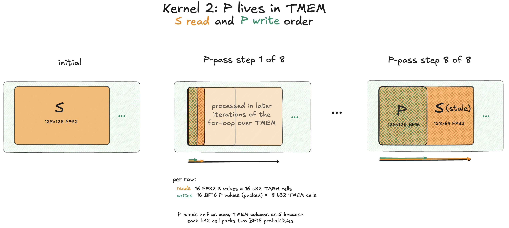</figure>
进一步地，我们直接把 P 写进原来存 S 的区域，无需额外分配 TMEM。因为第二次 TMEM 遍历已经消费掉的 S 元素可以安全覆盖。 

因此，在内核 2 中，同一个 TMEM 槽的含义随时间变化： 
<ul><li data-block="B271">QK 后：槽内是 FP32 的 S。 </li><li data-block="B272">Softmax 第二遍：已消费的 S 块被打包的 BF16 P 覆盖。 </li><li data-block="B273">PV：将该槽作为 P 消费。 </li></ul>
这确实耦合了 S、P 生命周期，但后面会看到，它不像 P、K 耦合那样棘手，见<a href="#fn:7" id="fnref:7">脚注 7</a>。 

TMEM 以 32 bit 存储单元组织，而 P 是 BF16，因此两个 P 值可以打包进一个 TMEM 单元。S 是 FP32，一个分数占一个 b32 单元。所以 P 所需的 TMEM 列数是 S 的一半。 

图中不同颜色箭头表示一次逻辑上处理 16 个分数的步骤。代码用两次 tcgen05.ld.x8 加载（橙色箭头），随后一次 tcgen05.st.x8 写入（绿色箭头）来实现。内核 1 按宽 8 的块处理 P；内核 2 每轮把两块合并，每行加载 16 个 FP32 S，生成 16 个 BF16 P。按宽 16 分组并非本质要求，见<a href="#fn:8" id="fnref:8">脚注 8</a>。 

回忆内核 1，生成 P 时按块遍历 TMEM，本章非常类似。新变化是把结果 P 块存入 TMEM：16 个 P 值打包进 8 个 b32 单元。因此 S 读指针前进 16 列，P 写指针只前进 8 列。每次 P 写入始终落在读指针之后，只覆盖第二次遍历已经消费的分数，因而不会破坏尚未读取的 S，图中也展示了这一点，见<a href="#fn:9" id="fnref:9">脚注 9</a>。 

S 占 128 个 TMEM 列，每次读取 16 列，共需 128 / 16 = 8 轮。结束后，低 64 个 b32 列包含完整的 128 列 BF16 P tile。P 只覆盖 S 缓冲区的一半，另一半保留不会再读的过期 S 值。下一轮 KV 循环的 QK 会用 S(i+1) 完整覆盖整个 S/P 槽。 
<figure>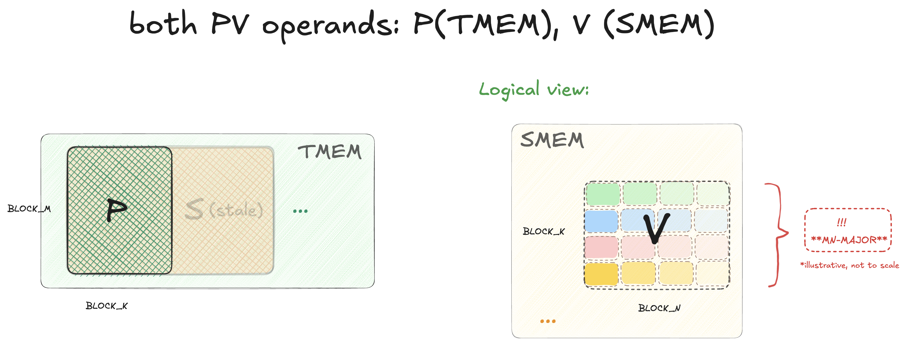</figure>
PV 矩阵乘法不变：P[BLOCK_M, BLOCK_K] @ V[BLOCK_K, BLOCK_N] -&gt; O[BLOCK_M, BLOCK_N]。 

只改变了 A 操作数 P 的来源。内核 1 的 P、V 都从 SMEM 消费；内核 2 的 P 从 TMEM，V 从 SMEM 消费。 

内核 1 的 P 需要 K-major SMEM 布局和 SMEM 描述符。内核 2 直接用 TMEM 地址标识 P，不再为 P 使用 SMEM 描述符。 

K-major、MN-major 是 SMEM 布局，不用于 TMEM 操作数。V 仍是 MN-major 的 SMEM B 操作数。 

到这里已讲完 P 如何生成并写入 TMEM，而非第 1 章的 SMEM。现在再讨论 P@V，只是其中一个操作数 P 来自 TMEM。 
<figure>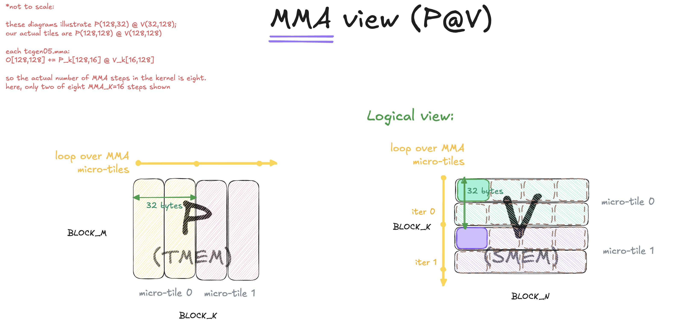</figure>
记住，所有 MMA 图中的维度都采用常规局部矩阵乘法记号：A[M,K] @ B[K,N] = C[M,N]。 

PV 沿 BLOCK_K = 128 归约。与第 1 章一样，每次 MMA 消费匹配的 MMA_K = 16 微块：P[:, 16k : 16(k+1)] @ V[16k : 16(k+1), :]。8 次调用覆盖完整的 BLOCK_K = 128。为避免图面拥挤，只画前两次。 
<figure>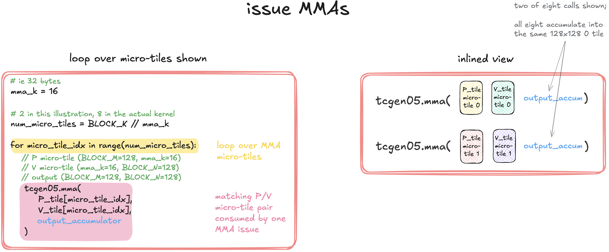</figure>
循环沿用内核 1 的逻辑 MMA_K = 16 微块顺序，但通过 TMEM 地址选择 P，而不是推进 SMEM 描述符。taddr_p + k * 8 指向下一个 128x16 P 微块的起点；每行的 16 个 BF16 值占 8 个 b32 列。V 描述符推进到匹配的 16 行，每次结果都累加到同一 O tile。 

P 现在由 tcgen05.st 产生，因此行线程在 PV 开始前必须等待这些 TMEM store，并执行 fence。这只是数据发布机制的小改动。 

所以内核 2 不改变 Softmax 数学、PV 归约顺序和高层调度。唯一语义变化是：QK 在 TMEM 生成 S，Softmax 将该存储区域变为 P，PV 直接从 TMEM 消费 P。 

内核检查点 

参见 <a href="https://github.com/IaroslavElistratov/b200-attention/blob/master/kernels/1_basic/2_p_to_tmem.cu">2_p_to_tmem.cu</a>，并与内核 1 做 diff。 

它严格遵循刚才学习的顺序： 
<ul><li data-block="B292">Softmax 用打包的 BF16 P 覆盖已消费的 S。 </li><li data-block="B293">PV 从 TMEM 读 P，从 MN-major SMEM 读 V。 </li><li data-block="B294">P 不再复用 K 的 SMEM 槽。 </li><li data-block="B295">数学和调度不变。 </li></ul>
现在请熟悉代码。 

当前性能 
<table><thead><tr><th style="text-align:right">内核</th><th>改动</th><th style="text-align:right">4k</th><th style="text-align:right">8k</th><th style="text-align:right">16k</th></tr></thead><tbody><tr><td style="text-align:right">1</td><td>基础实现</td><td style="text-align:right">14.2%</td><td style="text-align:right">14.1%</td><td style="text-align:right">13.7%</td></tr><tr><td style="text-align:right"><strong>2</strong></td><td>P 存入 TMEM</td><td style="text-align:right"><strong>15.1%</strong></td><td style="text-align:right"><strong>15.0%</strong></td><td style="text-align:right"><strong>15.0%</strong></td></tr></tbody></table>
这没有带来性能提升，但解耦了 K、P 生命周期，为后面的大优化创造了条件。 

我将它单列一步，而非并入内核 1，是因为把 P 写入 TMEM 会引入额外的寻址、打包和同步细节。内核 1 已有足够多新概念，我不想无谓地增加复杂度，希望起始版本尽量简单。 
<h2 data-block="B300" id="chapter-3--swizzling">第 3 章：Swizzling </h2>
前面已根据各源 tile 被 MMA 消费的方式，选择 Q/K 为 K-major、V 为 MN-major，见第 1 章。内核 3 保持调度和 major mode 不变，只分别改变各 tile 的 swizzle 模式：SMEM 中 Q/K/V 从无 swizzle 改为 SW128，以减少 bank conflict。P 留在 TMEM，因此不做 swizzle。 

已有很多资料解释 swizzle 的动机，这里不重复，因为目标是理解 B200 相关概念。只需知道，swizzle 在每个 atom 内置换 SMEM 地址，使 Tensor Core 访问更好地分散到各 SMEM bank，避免 bank conflict。下面讲 B200 特有细节，而非通用 swizzle 教程。 

Major mode 与 swizzle 是两回事，第 1 章已讨论。Major mode 指明每个 16B 元素内部紧密排列的是哪个矩阵乘法维度：K-major 为 K，MN-major 为 M/N；swizzle 则在该布局固定大小的 atom 内加入地址置换。因此先根据操作数角色选择 major mode，再决定使用 SW128，所需 atom 形状便由下面的 tcgen05 布局表确定。 
<figure>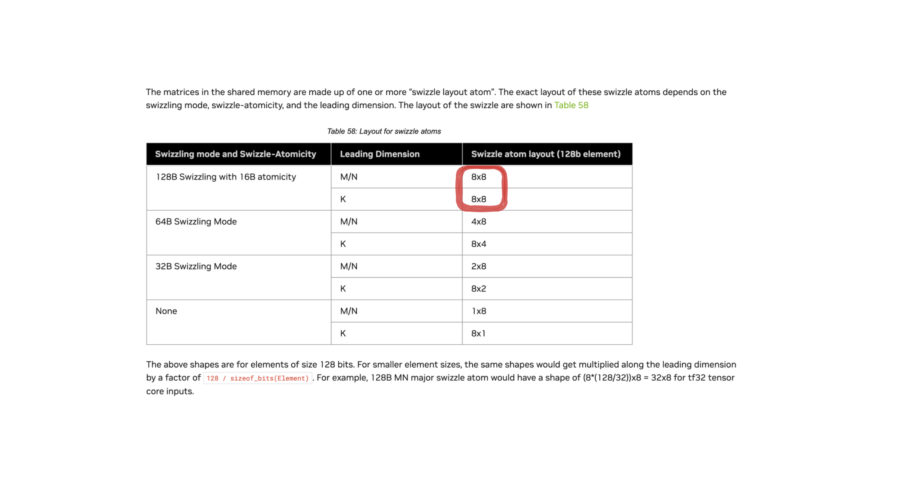</figure>
下面把表中的单位换算成输入张量的数据类型 BF16 元素。 
<figure>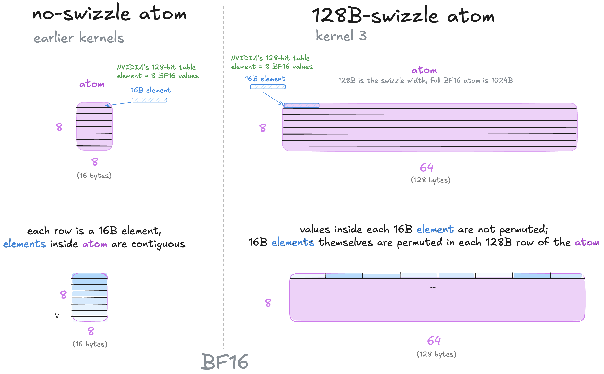</figure>
加入 swizzle 后，有两点值得讨论：（i）atom 变宽了；（ii）atom 内部发生了 swizzle。下面依次介绍。 

（i）atom 变宽 

NVIDIA 的 tcgen05 共享内存布局表以 128 bit 元素，即 16 字节，为单位，而不是 BF16 值。一个 BF16 是 16 bit，因此一个 128 bit 元素包含 128 / 16 = 8 个 BF16 值。 <a href="https://docs.nvidia.com/cuda/archive/13.0.0/parallel-thread-execution/#tcgen05-smem-swizzle-mode" title="tcgen05 shared-memory layout table">〔链接〕</a>

文档要求只扩展 atom 的 leading dimension。表中 atom 维度按 (M/N, K) 排列，但这一点起初并不明显，见<a href="#fn:10" id="fnref:10">脚注 10</a>。 

K-major 的 leading dimension 是 K，也就是第二个轴： 
<pre tabindex="0"><code>(8,8) -&gt; (8, 8*8) = (8,64) BF16
</code></pre>
Q/K 源 tile 已用 [M/N,K] 坐标绘制，因此其 K-major atom 看起来是 (8,64)。 

MN-major 的 leading dimension 是 M/N，也就是第一个轴： 
<pre tabindex="0"><code>(8,8) -&gt; (8*8, 8) = (64,8) BF16
</code></pre>
对 V，按 NVIDIA 的 [N,K] 坐标，MN-major atom 为 (64,8)。而我画的源 V[K,N] 逻辑视图交换了两个轴，因此变成 (8,64)。这就是为什么在我的源坐标图中，两类 atom 都看似 (8,64)，实际却不是同一布局。 

先放大观察 Q@K 使用的 K-major 布局，稍后再回到 P@V 中 V 使用的 MN-major 布局。 

（ii）内部发生 swizzle 

据我理解，引入 swizzle 后，不会置换 16B 元素内部的数据，而是置换这些 16B 元素本身。 

我们不关心逐行的具体置换，因为不需要手动计算。在 Blackwell 上，我们依靠 TMA 按 swizzle-128B 布局写入，tcgen05 按同一布局读取。 

如第 1 章所知，SMEM 布局必须与下游 MMA 一致。具体来说，在 TMA tensor map 中设置 CU_TENSOR_MAP_SWIZZLE_128B，使 TMA 以 swizzle 方式写 Q/K/V；再在 tcgen05 操作数描述符中设置匹配的 SW128 模式，让 tcgen05 知道如何消费。 
<figure>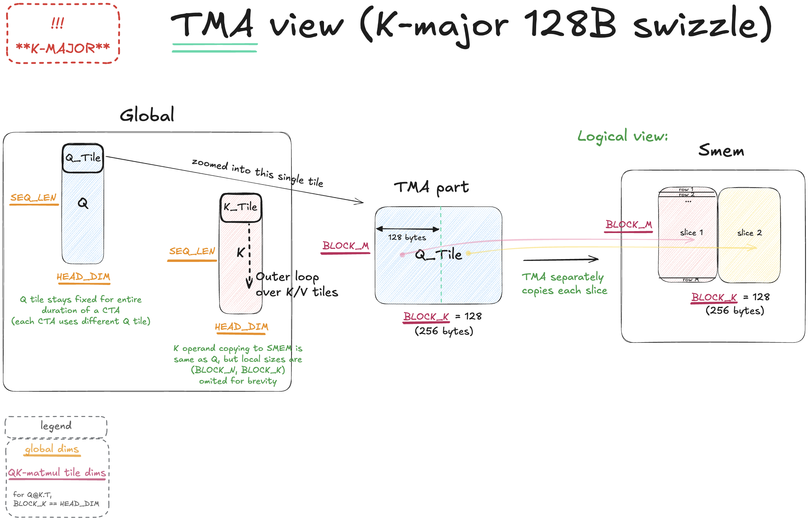</figure>
先放大观察 K-major 布局，它用于 Q@K.T 的两个操作数。 

如前所述，复制进 SMEM 时希望按 (8,64) atom 排布。一个 K-major SW128 atom 宽 64 个 BF16，即 128B；完整 Q/K tile 的 HEAD_DIM = 128，即 256B。 

我们使用简单的二维 SW128 TMA map，无法一次复制整个 128 元素宽的 tile，再要求 TMA 将它视为两个独立 swizzle 的 128B 区域。CUDA 要求一个 SW128 TMA box 的内层维度最多 128B。在 Q/K tensor map 中，内层维度对应 HEAD_DIM，即图中横向维度。因此将 HEAD_DIM 切成两条宽 64 的条带。 

但这不意味着每个 (8,64) atom 都要单独发起一次 TMA。128B 只限制内层宽度；宽度设为 64 后，同一个 TMA box 可以向下覆盖 tile 的所有行： 
<ul><li data-block="B322">Q 复制：(BLOCK_M, 64)。 </li><li data-block="B323">K 复制：(BLOCK_N, 64)。 </li></ul>
此内核中两个 tile 都高 128。因此一次 TMA 复制一个 (128,64) 条带，包含纵向叠放的 16 个 (8,64) atom。 

以上讲了如何告诉 TMA，复制到 K-major swizzle SMEM 布局时使用 swizzle。第二部分则是告诉 MMA 如何消费这种布局。 
<figure>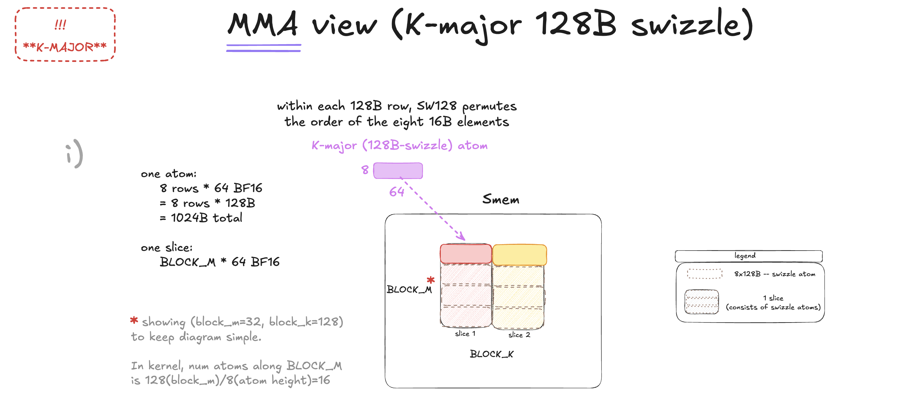</figure>
现在放大观察一个宽 64 的条带由什么构成。 

一个 K-major SW128 atom 为 (8,64) BF16，即 1024B。一个宽 64 的 Q 条带由这些 atom 沿 BLOCK_M 方向叠放组成。 

小注：为了清晰，图中只画 BLOCK_M = 32；实际内核每条带包含 16 个 atom。 
<figure>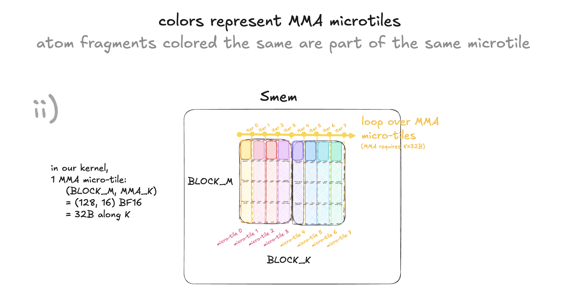</figure>
每次 MMA 仍操作 MMA_K = 32B，即 16 个 BF16 元素的宽度。BLOCK_K 大于 MMA_K，因此与第 1 章无 swizzle 情况类似，需要 for 循环以 MMA_K = 16 个元素为步长遍历 BLOCK_K。 

区别是现在逻辑上要拆分单个 atom：每个 atom 宽 64，而 MMA_K 只有 16。因此，128B 的 atom 宽度 / 32B 的 MMA 宽度 = 4 个微块。 

无 swizzle 时，我们把两列 atom 合成一个微块；现在的微块则来自拆分 atom，而非合并。 
<figure>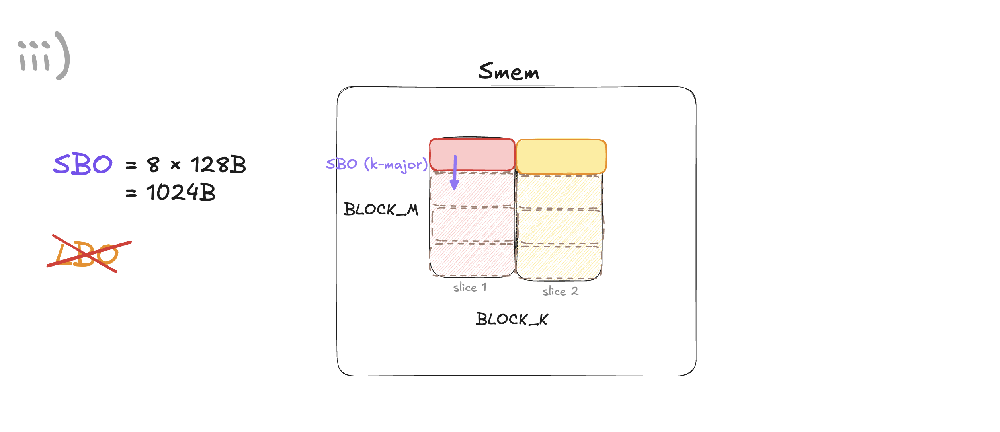</figure>
对一个 K-major SW128 条带，我把 SBO 字段理解为：告诉硬件如何到达下一个 8 行 atom 中的对应片段。 

这里不使用 LBO。据我理解，这是因为： 
<ol><li data-block="B334">SBO 已经告诉硬件如何找到同一微块中的其他 atom 片段；另一方面， </li><li data-block="B335">推进描述符基地址，也就是 MMA 外层的软件循环，说明如何移到下一个微块。这两者已共同覆盖数据的两个轴。 </li></ol>
因此，此处不需要 LBO 这样的额外偏移来描述另一个独立的遍历方向。 

回顾一下： 

选定 major mode 后，SW128 决定一个 atom 的形状，以及其中 16B 元素如何置换。但单靠 SW128 并不能决定整个 tile 中全部 atom 的顺序。 

TMA 复制目标决定每个 atom 落在 SMEM 的哪里。MMA 一侧的描述符基地址、SBO，以及适用时的 LBO，必须描述相同排布；基地址由软件循环逐微块推进。否则 tcgen05 会读到错误数据。 

到这里介绍完了带 swizzle 的 K-major。现在讨论 PV 矩阵乘法中 V 使用的带 swizzle 的 MN-major 布局。 
<figure>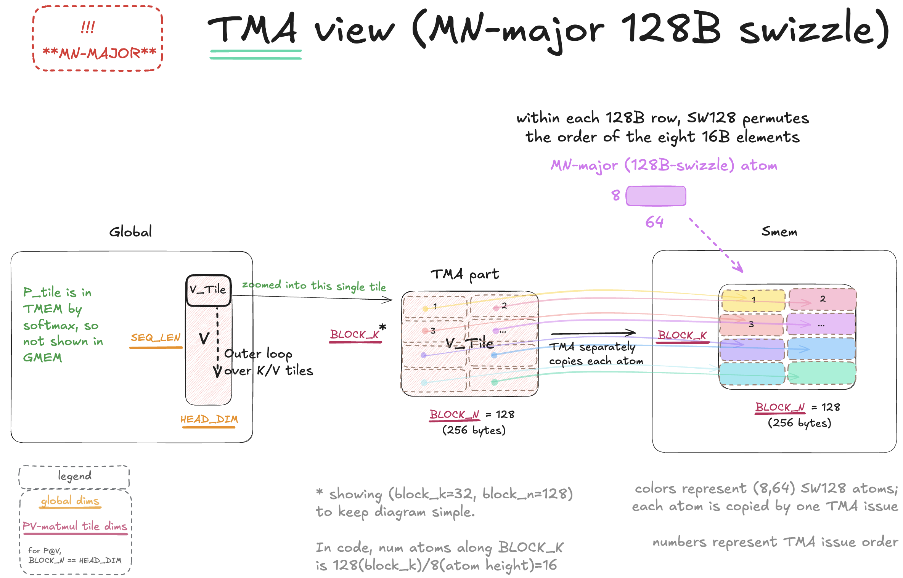</figure><figure>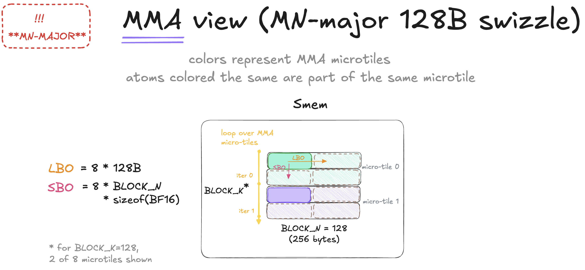</figure>
每个 PV MMA 微块读取 V 的一个 16×128 切片，即归约 K 方向 16 行、输出 N 方向 128 列。每个 atom 是 8×64，所以该切片包含四个完整 atom。 

在 V[K,N] 视图中，LBO 找到右侧下一个 atom，SBO 找到下方下一个 8 行横带。 

为便于阅读，图中只展示 8 个 PV 微块中的两个。 

内核检查点 

参见 <a href="https://github.com/IaroslavElistratov/b200-attention/blob/master/kernels/1_basic/3_swizzle.cu">3_swizzle.cu</a>，并与内核 2 做 diff。 

现在请熟悉代码。 

当前性能 
<table><thead><tr><th style="text-align:right">内核</th><th>改动</th><th style="text-align:right">4k</th><th style="text-align:right">8k</th><th style="text-align:right">16k</th></tr></thead><tbody><tr><td style="text-align:right">1</td><td>基础实现</td><td style="text-align:right">14.2%</td><td style="text-align:right">14.1%</td><td style="text-align:right">13.7%</td></tr><tr><td style="text-align:right">2</td><td>P 存入 TMEM</td><td style="text-align:right">15.1%</td><td style="text-align:right">15.0%</td><td style="text-align:right">15.0%</td></tr><tr><td style="text-align:right"><strong>3</strong></td><td>Swizzle</td><td style="text-align:right"><strong>25.9%</strong></td><td style="text-align:right"><strong>25.9%</strong></td><td style="text-align:right"><strong>26.2%</strong></td></tr></tbody></table><h2 data-block="B348" id="chapter-4--warp-specialization">第 4 章：Warp Specialization（warp 分工） </h2><figure>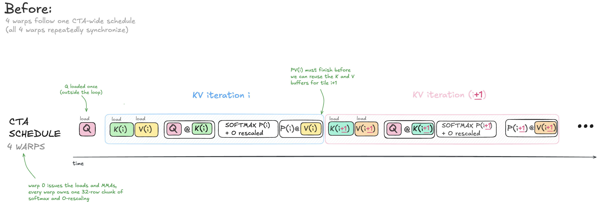</figure>
目前内核使用 4 个 warp，各自可独立调度。但它们共 128 个线程在内核中多次同步，因此实际上是 CTA 范围同步。前面的内核已经使用可做更细粒度同步的 mbarrier，却仍让所有 warp 等待它们，几处 __syncthreads() 也仍同步整个 CTA，见上图。 

我们希望让工作者，也就是 warp，独立起来，以便后续并行并重叠它们的工作。首先需要让 warp 具备独立运行的能力，暂时还不分配独立工作。 

例如总共 128 线程、4 个 warp，目前在 load K/V(i) -&gt; QK(i) -&gt; softmax(i) -&gt; PV(i) -&gt; load K/V(i+1) 的每个箭头处全部同步。我们可以重排内核，让每个交接点只同步该操作真正需要的线程；例如仅同步 4 个 warp 中的两个，不阻塞另外两个。 

例如，加载生产者与 MMA 消费者通过屏障握手：生产者 warp 到达屏障，通知数据就绪 [^20]；消费者 warp 等待该屏障。其他两个 warp 无需参与，因此未来可以继续自己的工作，不被全局握手阻塞。这样，无关 warp 不必参与这次同步，也无需无谓暂停。 

内核 4 就做这种变换：不再像之前每个工作阶段都同步全部 128 线程，而是给各 warp 分工，只同步与当前交接真正相关的子集。 
<figure>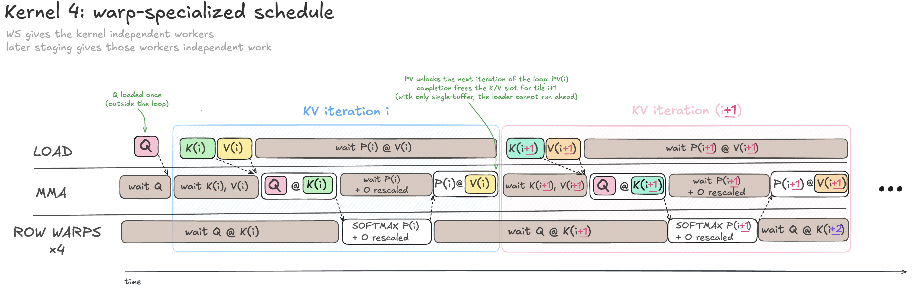</figure>
特别注意，内核 4 给 warp 分配了独立角色，却还没有给它们足够的独立工作来形成重叠。那些不参与某次握手的 warp 暂时仍没有独立工作可做，这会在后面实现。因此，虽然各角色拥有独立指令流，硬件操作也是异步的，主要阶段仍基本串行：加载 -&gt; MMA -&gt; Softmax -&gt; MMA。具体到前面的 load/MMA 握手示例，行处理 warp 即便不直接参与握手，也因为没有待执行工作而仍处于空闲。 

这显然不理想，我们需要给空闲 warp 找工作；后面几章会处理。我这样安排是为了循序渐进教学，而不是一次抛出所有优化。 

单独这项变化并不预期提升性能，因为它还没有增加并行工作量，但它为后续优化创造条件。概念上，内核 4 把整个内核拆成独立工作者：有些需要同步，其他的则具备独立前进能力。后续内核再给它们独立工作，把这种能力变成实际的工作重叠。 

要建立这些独立工作者，内核 4 需要比之前更多的 warp： 

首先，仅并行完成 TMEM 中整个 S -&gt; P 就需要 4 个 warp。S 为 128×128，单个 warp 每次只能加载 32 行，为并行加载和处理 128 行，需要 4 个 warp。它们称为“行处理 warp”（row warps），负责 Softmax 与 O 重缩放，见<a href="#fn:11" id="fnref:11">脚注 11</a>。 

其次，若希望加载成为独立工作者，就要再给它一个 warp。因为 SM 按 warp 而非单线程调度，即便发起 TMA 的工作很少，仍须分配完整 warp。到这里共有 5 个 warp。 

若 MMA 也要成为独立工作者，按与 TMA 相同的理由，还需要一个 warp，总数为 6。 

因此内核 4 共用 6 个 warp：4 个行处理 warp、1 个加载 warp、1 个 MMA warp。 

内核检查点 

参见 <a href="https://github.com/IaroslavElistratov/b200-attention/blob/master/kernels/1_basic/4_warp_specialization.cu">4_warp_specialization.cu</a>，并与内核 3 做 diff。 

现在请熟悉代码。 

当前性能 
<table><thead><tr><th style="text-align:right">内核</th><th>改动</th><th style="text-align:right">4k</th><th style="text-align:right">8k</th><th style="text-align:right">16k</th></tr></thead><tbody><tr><td style="text-align:right">1</td><td>基础实现</td><td style="text-align:right">14.2%</td><td style="text-align:right">14.1%</td><td style="text-align:right">13.7%</td></tr><tr><td style="text-align:right">2</td><td>P 存入 TMEM</td><td style="text-align:right">15.1%</td><td style="text-align:right">15.0%</td><td style="text-align:right">15.0%</td></tr><tr><td style="text-align:right">3</td><td>Swizzle</td><td style="text-align:right">25.9%</td><td style="text-align:right">25.9%</td><td style="text-align:right">26.2%</td></tr><tr><td style="text-align:right"><strong>4</strong></td><td>Warp 分工</td><td style="text-align:right"><strong>26.6%</strong></td><td style="text-align:right"><strong>26.4%</strong></td><td style="text-align:right"><strong>26.5%</strong></td></tr></tbody></table><h1 data-block="B366" id="part-ii--coarse-scheduling">第二部分：粗粒度调度 </h1><h2 data-block="B367" id="chapter-5--two-q-tiles">第 5 章：两个 Q tile </h2><figure>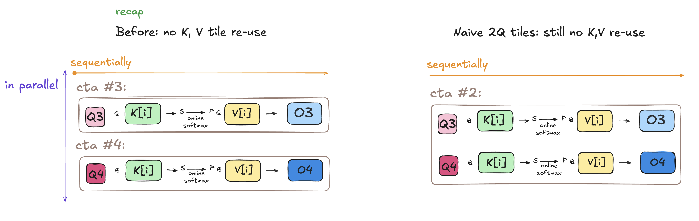</figure>
内核 4 给每个 CTA 分配一个 Q tile。因此，相邻两个 CTA，即同 batch/head 中分配到连续 Q tile 的 CTA，会独立遍历同一 K/V tile 序列，各自加载相同 K/V。既然操作数相同，就可以避免每个 Q tile/CTA 各加载一次，而在单 CTA 每轮 KV 迭代中复用。下一项优化就是让一个 CTA 处理两个 Q tile，加载的每份 K/V 同时供它们使用，将一次加载成本分摊到两份 Q tile 工作上。 

仅把两个 Q tile 放进同一 CTA，如上图左侧，还不够。如果朴素地让 CTA 先完成第一个 Q 的整个 KV 循环，再为第二个重复循环，仍然会把相同 K/V 加载两遍，无法直接复用 SMEM 中的数据。 

内核 5 只遍历一遍 K/V，让每个加载的 tile 同时服务两个 Q tile。 
<pre tabindex="0"><code>load Q0 and Q1 once

for each KV tile i:
    load once K(i) and V(i)

    use K(i) for Q0K(i) and Q1K(i)
    use V(i) for P0V(i) and P1V(i)
</code></pre>
对同样两个 Q tile，相比之前，K/V TMA 加载次数减少一半。这里直接复用 SMEM 中的 KV，不是依赖不同 CTA 之间数据仍驻留 L2 的 L2 复用。 

以下记号中，0/1 标识 Q stage，i 标识 K/V tile。例如 Q0K(i) = Q0 @ K(i)^T，P0V(i) = P0(i) @ V(i)。后续内核也沿用这套记号。 
<figure>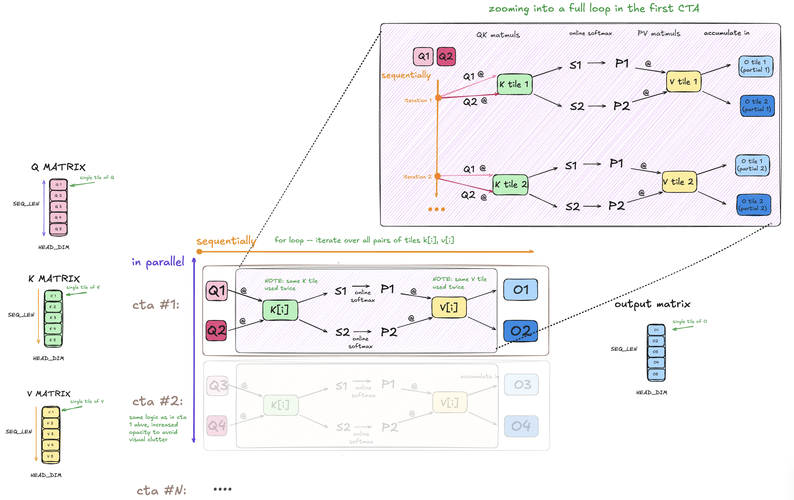</figure>
一个 CTA 现在拥有相邻两个 Q/O tile 的工作；在整个 KV 循环期间持有两个 Q tile，最后生成两个输出 tile。 

两个 Q stage 在 K/V 仍驻留 SMEM 时复用它们，但各自仍分别执行 QK、在线 Softmax 和 PV。每个 Q stage 保留自己的 S/P tile、O 累加器、行最大值和行和。 
<figure>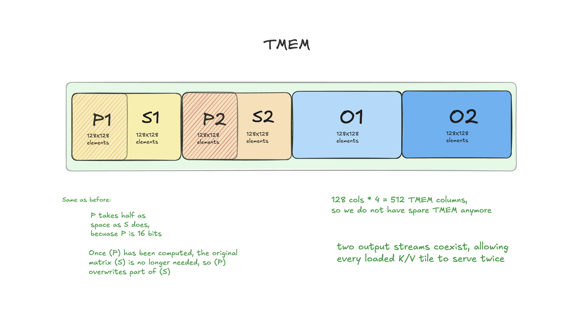</figure>
第二条 Q 工作流也需要独立的 TMEM 状态，因此布局变为上图所示。 

和之前一样，每个 BF16 P tile 在每个 32 bit TMEM 单元中打包两个值，覆盖其 FP32 S 分配区域的低半部分，见第 2 章。所以 P0 不需要 S0 之外的空间，P1 也不需要 S1 之外的空间。这依赖第 2 章的改动：如果 P 不写入已经失效的 S 缓冲区，而另占一块 TMEM，就无法以这种直接方式为两个 Q tile 存下 S/P/O，见<a href="#fn:12" id="fnref:12">脚注 12</a>。 

换个角度，内核 5 是在空间上使用 TMEM，即同一 KV 迭代内部，而非跨 KV 迭代在时间上使用。两条 Q/Output 流同时存活，在同轮迭代中复用 K/V，但尚未形成跨迭代的计算流水线。全部 512 个 TMEM 列都已用完，无法在当前两个 Q stage 槽之外，再为未来 KV 迭代保存完整的 S(i+1)/P(i+1) stage，见<a href="#fn:13" id="fnref:13">脚注 13</a>。 

这里尚未实现加载流水线。内核 5 增加双 Q 复用，但仍只有当前的一个 K 槽和一个 V 槽。 
<figure>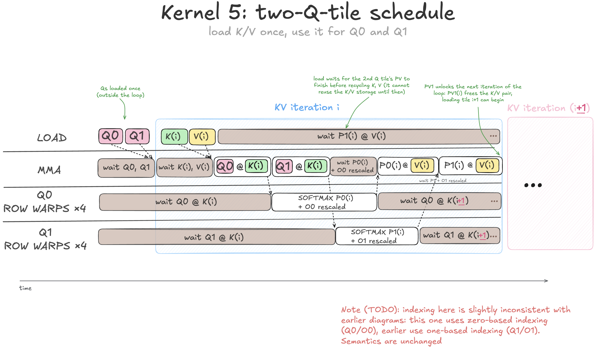</figure>
之前是 6 个 warp，见第 4 章；现在一个 CTA 有 10 个 warp： 
<pre tabindex="0"><code>warps 0..3:     row/softmax work for Q0
warps 4..7:     row/softmax work for Q1
warp 8:         TMA loads
warp 9:         QK and PV MMA issue
</code></pre>
两个行处理 warp 组彼此独立：MMA warp 处理 Q1K 时，Q0 的行处理可以开始。 

命名小注：我称它们为行处理 warp，而非 Softmax warp，因为它们不只执行 Softmax，还做 O 重缩放。第 4 章也是这个叫法，并非新概念。 

不过仍只有一个 MMA warp，因此 Q0K、Q1K、P0V、P1V 由一条有序 MMA 流发起，而不是两条并行 Tensor Core 流。增加一个 MMA warp 不会凭空增加硬件 Tensor Core 流水线，因为两者面向同一套硬件。 

tcgen05.mma 是异步的，一个发起者，即选定 lane，就足以提交 MMA。瓶颈通常在于 MMA 流没有工作可发，例如操作数尚未就绪。关键不是有没有另一个 MMA warp，而是调度是否提供足够工作，让现有 Tensor Core 流水线保持忙碌：操作数要足够快地生成，MMA 发起顺序也不应无谓阻塞已经就绪的工作。后面通过改善就绪时间和调度解决，而不是增加 MMA 发起者。因此这里不增加 MMA warp，此后的整个演进也始终只用一个。 

增加两个 Q stage 后，也要新增屏障。有些由两个 stage 共享，另一些则每 stage 独立： 
<ul><li data-block="B385">q_ready、kv_ready：两个 Q stage 共享。q_ready 在 KV 循环开始前使用一次；kv_ready 每轮迭代复用一次。 </li><li data-block="B386">qk_done[q]、softmax_done[q]、pv_done[q]：每个 Q stage 独立一组。 </li></ul>
每个 softmax_done[q] 预期 4 次到达，来自分配给该 Q stage 的 4 个行处理 warp。这些 warp 同时负责 Softmax/P 生成与 O 重缩放。4 个全部到达后，表示 P 已就绪，且旧 O 累加器可安全供 PV 使用。因此，该屏障同时代表 P-ready 和 O-safe，MMA 发起 PV 前等待它。 

如图所示，K/V 现在由两个 Q/O 工作项共享，所以必须确保两者都用完缓冲区，才能将其复用于下一个 K/V tile。因此只在 P1V 完成后复用 K/V 存储，见<a href="#fn:14" id="fnref:14">脚注 14</a>。 

内核检查点 

参见 <a href="https://github.com/IaroslavElistratov/b200-attention/blob/master/kernels/2_coarse-schedule/5_two_q_tiles.cu">5_two_q_tiles.cu</a>，并与内核 4 做 diff。 

它实现的正是刚才讨论的优化。 

现在请熟悉代码。 

当前性能 
<table><thead><tr><th style="text-align:right">内核</th><th>改动</th><th style="text-align:right">4k</th><th style="text-align:right">8k</th><th style="text-align:right">16k</th></tr></thead><tbody><tr><td style="text-align:right">1</td><td>基础实现</td><td style="text-align:right">14.2%</td><td style="text-align:right">14.1%</td><td style="text-align:right">13.7%</td></tr><tr><td style="text-align:right">2</td><td>P 存入 TMEM</td><td style="text-align:right">15.1%</td><td style="text-align:right">15.0%</td><td style="text-align:right">15.0%</td></tr><tr><td style="text-align:right">3</td><td>Swizzle</td><td style="text-align:right">25.9%</td><td style="text-align:right">25.9%</td><td style="text-align:right">26.2%</td></tr><tr><td style="text-align:right">4</td><td>Warp 分工</td><td style="text-align:right">26.6%</td><td style="text-align:right">26.4%</td><td style="text-align:right">26.5%</td></tr><tr><td style="text-align:right"><strong>5</strong></td><td>双 Q tile</td><td style="text-align:right"><strong>40.5%</strong></td><td style="text-align:right"><strong>40.3%</strong></td><td style="text-align:right"><strong>41.3%</strong></td></tr></tbody></table><h2 data-block="B394" id="chapter-6--load-pipeline">第 6 章：加载流水线 </h2><figure>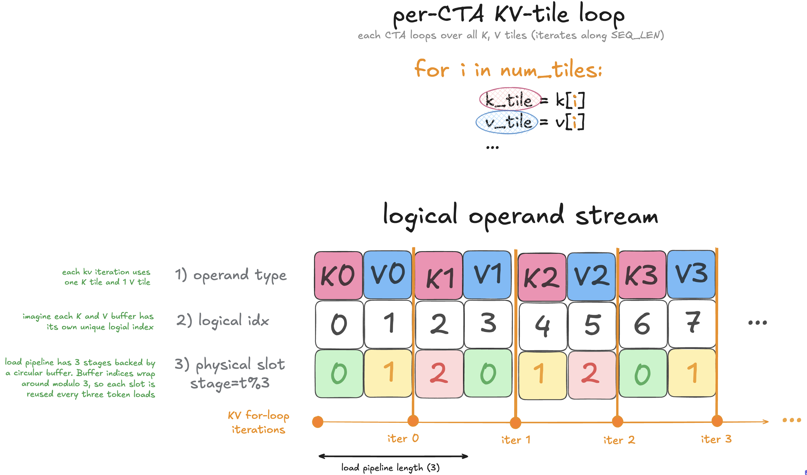</figure>
暂时不要急着读懂上图，先跟着文字走；需要时我会引导你回到图中。 

目前每轮加载 K(i)、V(i) 时会停顿，MMA warp 等待两者都加载完成后才能执行 QK。因此 QK 下游的 S -&gt; P，以及最终 PV，也都被阻塞，直到 K、V 两个操作数全部就绪。 

这里有两项明显低效之处： 
<ol><li>
QK 只需要 K，不需要 V。因此可以仅在 K 加载完成后就执行 QK，不必等待 V，减少加载等待。这还会提前解锁 QK 下游的 S -&gt; P，让 Softmax 更早开始，减少空闲。 
</li><li>
通过加载流水线，可以显著减少等待单次 K/V 加载的空闲时间。 
</li></ol>
第二项变化是本章的主要优化： 

我喜欢把它理解成生产者，即加载 warp，与消费者，即 MMA warp。流水线的思想是生产者提前加载消费者未来需要的操作数，让加载通常能在使用前完成。消费者真正轮到该操作数时，它很可能已就绪，MMA 可以直接使用而不必停顿。当未来 K 或 V 异步加载时，消费者忙于处理已经在 SMEM 中的操作数，从而重叠加载与计算。 

第一项变化使流水线粒度更细： 

我们把单独 K 或 V 视作流水线操作数，而不把 K(i)、V(i) 绑成一对，后者需要更大的物理 SMEM 缓冲区，见<a href="#fn:15" id="fnref:15">脚注 15</a>。三个物理流水线槽各存一个 K 或 V tile；KV[3] 是共享的三槽缓冲区，任意槽都可以存 K 或 V。因此，K、V 在逻辑上分开，但并非位于两套独立流水线。加载 warp 可以提前推进，而不用等待整对 K/V 都可复用。 

这也依赖第 2 章：P 不再占 K 的 SMEM 存储。因此 QK 后可以回收 K，而 P 继续留在 TMEM 供 PV 使用。 

更详细地说： 

整个 KV 循环只加载一次 Q0、Q1，因此只有每轮改变的 K/V 操作数参与流水线。 

加载流水线深度为 3，即 3 个物理缓冲区。 

KV 循环开始前预加载 K0、V0、K1，填满三个缓冲区。K0、V0 属于第一轮，K1 为下一轮提前加载。第一个消费者 MMA 是 Q0@K0，Q0 在循环前已经加载，因此只缺 K0。提前填充让生产者领先消费者。 

遍历 KV tile 时，每个 QK 或 PV 使用预加载的 K 或 V。第二个 Q stage 用完后，相应最后消费者 Q1K(i) 或 P1V(i) 发信号表示旧 token 不再需要。加载 warp 在自己的 token 循环中等待，然后复用该槽，发起对逻辑位置向前 3 个，即流水线深度，的未来操作数加载。现在请看上图，它展示代码如何实现。 

在三 token 流水线中，新 token 使用前还有两个 K/V token。每个 token 由两个 Q stage 消费，所以 MMA 流在使用新 token 前会处理 4 次完整 QK/PV 矩阵乘法。这让加载能在后台完成，通常在消费者真正需要前有足够时间，从而有效重叠加载与计算。 
<figure>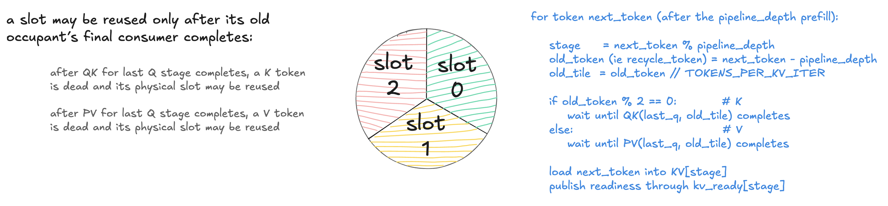</figure>
硬件缓冲区当然不是圆形。只是索引回绕，逻辑位置相差 pipeline_depth（3）的 token 映射到同一物理槽，所以可逻辑上视为环形缓冲区。数据并没有真的沿圆圈移动。 

下面更详细地解释本章前面的两幅图。 

token 标识逻辑 K 或 V 操作数；stage 将它映射到三个物理 SMEM 槽之一。stage 并不表示该槽已就绪或可安全覆盖。 

token t 与 t+3 使用同一物理槽。因此加载 t 前，加载者必须等旧 token t-3 被最后一个消费者用完。 

由于两个 Q tile 的 Q0、Q1 都复用同一 K/V，只有两个 Q tile 中最后一个完成使用后，才能回收相应 K 或 V token。 

因此： 
<ul><li data-block="B417">K token 的最后消费者是最后一个 Q 的 QK。 </li><li data-block="B418">V token 的最后消费者是最后一个 Q 的 PV。 </li></ul>
下面用具体例子解释这些计算的逻辑，见下图： 
<figure>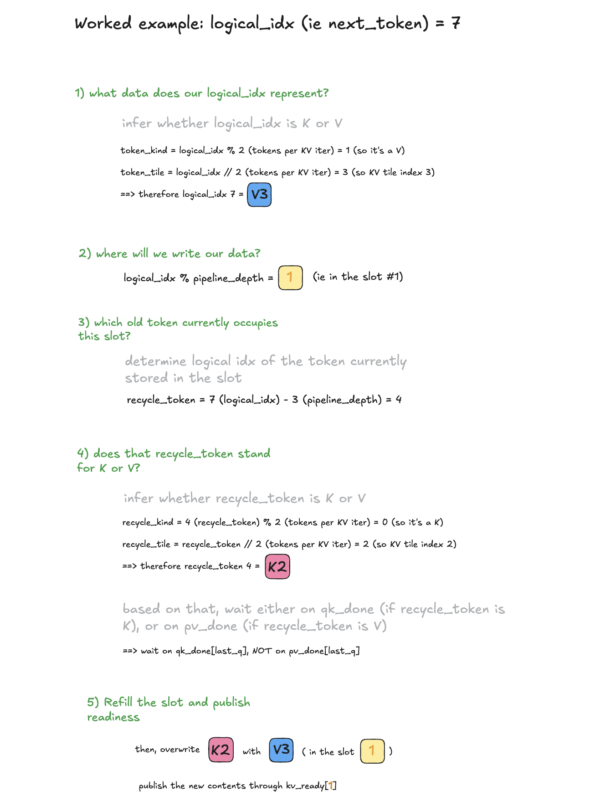</figure>
流水线推进过程的可视化，见下图： 
<figure>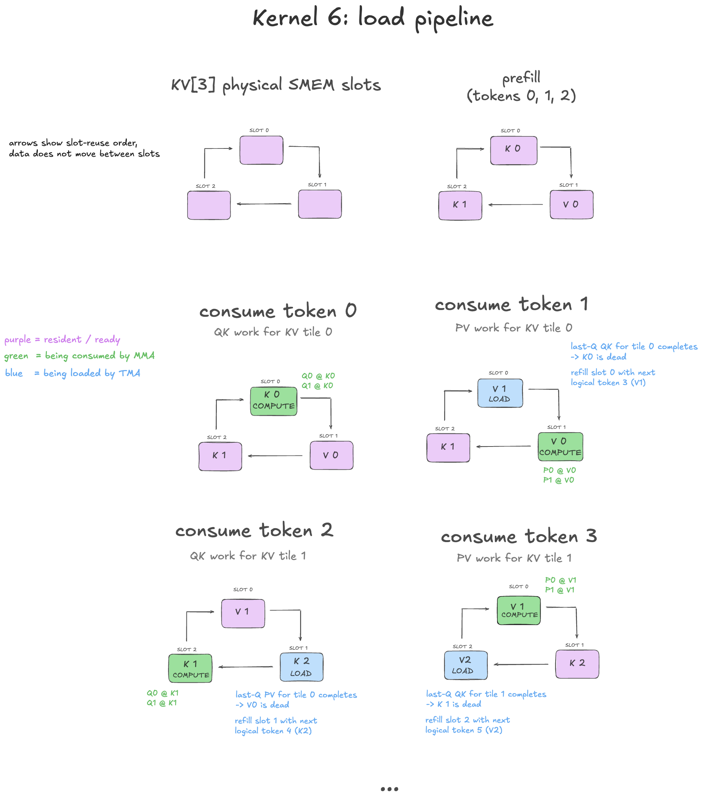</figure>

内核检查点 

参见 <a href="https://github.com/IaroslavElistratov/b200-attention/blob/master/kernels/2_coarse-schedule/6_load_pipeline.cu">6_load_pipeline.cu</a>，并与内核 5 做 diff。 

它实现的正是刚才讨论的优化。 

现在请熟悉代码。 

当前性能 
<table><thead><tr><th style="text-align:right">内核</th><th>改动</th><th style="text-align:right">4k</th><th style="text-align:right">8k</th><th style="text-align:right">16k</th></tr></thead><tbody><tr><td style="text-align:right">1</td><td>基础实现</td><td style="text-align:right">14.2%</td><td style="text-align:right">14.1%</td><td style="text-align:right">13.7%</td></tr><tr><td style="text-align:right">2</td><td>P 存入 TMEM</td><td style="text-align:right">15.1%</td><td style="text-align:right">15.0%</td><td style="text-align:right">15.0%</td></tr><tr><td style="text-align:right">3</td><td>Swizzle</td><td style="text-align:right">25.9%</td><td style="text-align:right">25.9%</td><td style="text-align:right">26.2%</td></tr><tr><td style="text-align:right">4</td><td>Warp 分工</td><td style="text-align:right">26.6%</td><td style="text-align:right">26.4%</td><td style="text-align:right">26.5%</td></tr><tr><td style="text-align:right">5</td><td>双 Q tile</td><td style="text-align:right">40.5%</td><td style="text-align:right">40.3%</td><td style="text-align:right">41.3%</td></tr><tr><td style="text-align:right"><strong>6</strong></td><td>加载流水线</td><td style="text-align:right"><strong>48.6%</strong></td><td style="text-align:right"><strong>48.6%</strong></td><td style="text-align:right"><strong>48.4%</strong></td></tr></tbody></table><h2 data-block="B426" id="chapter-7--compute-pipeline">第 7 章：计算流水线 </h2>
先回顾目前各内核的调度方式，这对理解下一项优化很重要。 
<figure>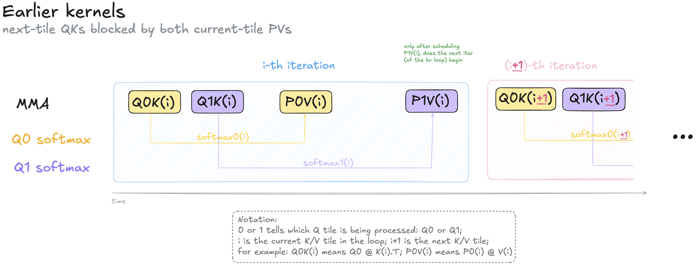</figure>
此前 MMA warp 以 KV 迭代为粒度工作：先发起 Q0K(i)、Q1K(i)，再发起 P0V(i)、P1V(i)，之后才推进到下一轮。 

因此，第一个 Q tile 的 PV 发起后，其行处理 warp，即 Softmax 和 O 重缩放，会闲下来，无法进入下一轮。因为 MMA warp 必须先发起第二个 Q tile 的 PV，才会到达 Q0K(i+1)，即第一个 Q tile 下一轮的 QK。 

这显然不理想：第一个 Q tile 的 QK(i+1)，尤其更重要的 Softmax(i+1)，都被堵在第二个 Q tile 的 PV(i) 后面。 

但正如第 5 章双 Q 优化所讨论，每个 CTA 的两条 Q 工作流大体独立，各有 S/P/O 等缓冲区。它们共享 K/V，但这不是迫使 Q0K(i+1) 等在 P1V(i) 后面的原因，见<a href="#fn:16" id="fnref:16">脚注 16</a>。因此，没有跨 Q stage 数据依赖阻止第一个 Q tile 提前进入下一轮，也没有要求 Q0K(i+1) 必须排在 P1V(i) 后面的依赖。 

我们希望第一个 Q tile 的 PV(i) 一经发起，就尽快发起其 QK(i+1)，随后进行 Softmax。这让第一个 Q 的 Softmax(i+1) 与第二个 Q 的 PV(i) 重叠。正如第一章所说，Softmax 是整个内核的主要瓶颈，能与 MMA 重叠越多越好。 
<figure>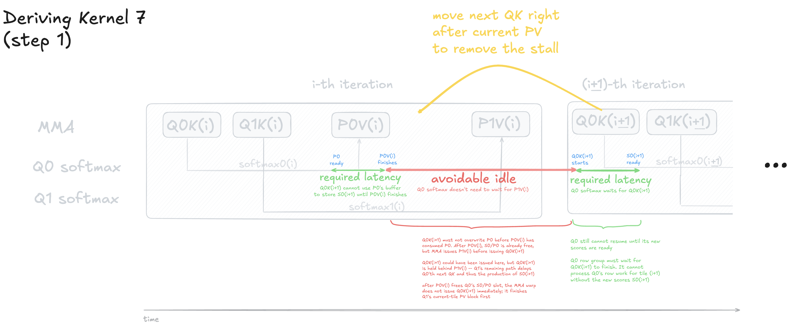</figure>
对于第一个 Q stage，只需在 K(i+1) 就绪后，把 QK(i+1) 放到其 PV(i) 紧后，概念上就实现了目标：解锁这条 Q 工作流，让它进入下一次 QK，不再被第二个 Q 的 PV 阻塞。 
<figure>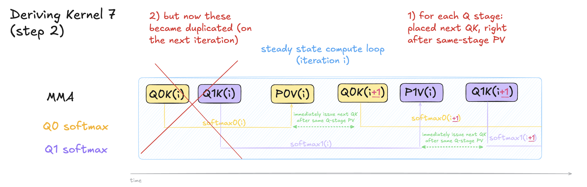</figure>
但若简单把第一个 Q stage 的 QK(i+1) 搬到第 i 轮内，就会重复发起：第 i 轮末尾一次，第 i+1 轮开头又一次。第二个 Q stage 也有同样问题。 

所以还需要对内核做下面几项修改。 
<figure>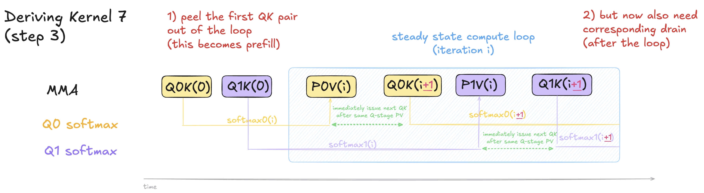</figure>
将每个 Q stage 的第一次 QK 从 for 循环剥离出来。类似内核 6 的加载流水线预填充，只是现在预填充的是计算流水线。 

这样，稳态循环就不会重复发起同一个下一 tile 的 QK。 

但由于循环前做了预填充，逻辑上在稳态循环后还要对应排空，完成两条 Q 工作流。因为最后一轮之后没有下一轮，若不排空，最后两个 PV tile 就不会执行。 
<figure>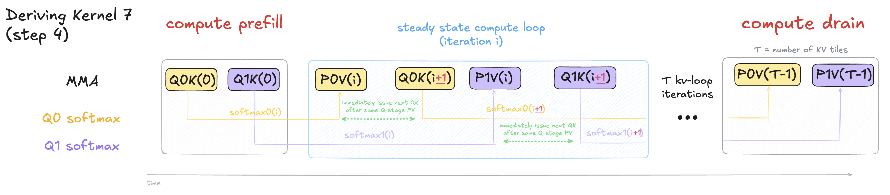</figure>
这就得到了本章最终设计。 

从视觉上看，像是把 QK、PV 顺序颠倒了，其实并没有。这里 q 是 Q stage 索引 0 或 1。稳态循环每轮先用 PqV(i) 完成当前 KV tile，再用 QqK(i+1) 开始下一个。对于任意单个 KV tile，顺序仍是 QqK(i) -&gt; softmax-q(i) -&gt; PqV(i)。我们只是移动了循环边界，tile 内部的顺序完全没变。 

内核检查点 

参见 <a href="https://github.com/IaroslavElistratov/b200-attention/blob/master/kernels/2_coarse-schedule/7_compute_pipeline.cu">7_compute_pipeline.cu</a>，并与内核 6 做 diff。 

它实现的正是刚才讨论的优化。 

现在请熟悉代码。 

当前性能 
<table><thead><tr><th style="text-align:right">内核</th><th>改动</th><th style="text-align:right">4k</th><th style="text-align:right">8k</th><th style="text-align:right">16k</th></tr></thead><tbody><tr><td style="text-align:right">1</td><td>基础实现</td><td style="text-align:right">14.2%</td><td style="text-align:right">14.1%</td><td style="text-align:right">13.7%</td></tr><tr><td style="text-align:right">2</td><td>P 存入 TMEM</td><td style="text-align:right">15.1%</td><td style="text-align:right">15.0%</td><td style="text-align:right">15.0%</td></tr><tr><td style="text-align:right">3</td><td>Swizzle</td><td style="text-align:right">25.9%</td><td style="text-align:right">25.9%</td><td style="text-align:right">26.2%</td></tr><tr><td style="text-align:right">4</td><td>Warp 分工</td><td style="text-align:right">26.6%</td><td style="text-align:right">26.4%</td><td style="text-align:right">26.5%</td></tr><tr><td style="text-align:right">5</td><td>双 Q tile</td><td style="text-align:right">40.5%</td><td style="text-align:right">40.3%</td><td style="text-align:right">41.3%</td></tr><tr><td style="text-align:right">6</td><td>加载流水线</td><td style="text-align:right">48.6%</td><td style="text-align:right">48.6%</td><td style="text-align:right">48.4%</td></tr><tr><td style="text-align:right"><strong>7</strong></td><td>计算流水线</td><td style="text-align:right"><strong>58.2%</strong></td><td style="text-align:right"><strong>58.5%</strong></td><td style="text-align:right"><strong>58.0%</strong></td></tr></tbody></table><h1 data-block="B446" id="part-iii--hot-loop-optimizations">第三部分：热循环优化 </h1><h2 data-block="B447" id="chapter-8--hardware-approximations">第 8 章：硬件近似 </h2>
本章没有特别适合画图的内容，所以改看一点伪代码。第 10 章将重新使用图示。 

目前多数优化改变的是调度，但逐行 Softmax 仍是主要瓶颈：S -&gt; P 中的 exp 对每个 Q stage、每个 KV tile、每一行、每个 8 分数块都要执行，PV 就在等它。这条路径上的额外工作会制约 Tensor Core。接下来几个内核，包括内核 8，开始降低热路径成本，基本目标就是让 Softmax 热路径中的 exp 更快。 

GPU 提供近似以 2 为底的指数指令 ex2.approx.ftz.f32。本章标题中的“近似”指硬件近似计算 exp2，见<a href="#fn:17" id="fnref:17">脚注 17</a>。为加速热路径，可以尝试用它替代此前使用的 __expf 内建函数。 

但在线 Softmax 需要的是 exp，而硬件指令算 exp2。利用 exp(x) = exp2(x * log2(e))，把原来送入 exp 的值乘以 log2(e)，转换为 exp2 所需单位，结果就等于所需的 exp(x)。这个恒等式本身是精确的。 

实际上，之前所有内核使用的 __expf 已经会降低为 ex2.approx.ftz.f32，再加一些稍后讨论的包装指令！原来我们一直在不知不觉地使用它。因此，本章直接用 asm 调用 ex2.approx.ftz.f32 看似多余，实际上却将性能提升约 10%。这似乎矛盾：既然已经使用 MUFU.EX2，内核 8 的加速来自哪里？ 

先给结论，再深入解释。__expf 确实降低为与 ex2.approx.ftz.f32 相同的 MUFU.EX2 核心，但周围还有额外的换底和下溢处理代码。提升性能的是去掉这些包装。 

有了整体理解，再看细节。编译器把 __expf 展开成大致如下的代码： 

<pre style="color:#f8f8f2;background-color:#272822;-moz-tab-size:4;-o-tab-size:4;tab-size:4;-webkit-text-size-adjust:none" tabindex="0"><code class="language-c" data-lang="c">// natural-exp argument originally passed to __expf
// float x = s * softmax_scale - rowmax;

// convert into base-2 exponent expected by exp2
// (see the math identity dicussed above)
float u = x * LOG2_E;

bool small = u &lt; -126.0f;

// preserve results that'd underflow
// inside FTZ exp2 instruction
if (small) {
    u *= 0.5f;
}

float y;
asm("ex2.approx.ftz.f32 %0, %1;" : "=f"(y) : "f"(u));

if (small) {
    y *= y;
}
</code></pre>

因此，__expf 展开后包含 ex2.approx.ftz.f32 核心及外围包装。对我们的场景，热循环中有两类可避免的工作： 
<ol><li data-block="B456">重复转换到 log2 基准。 </li><li data-block="B457">保留下溢行为的处理，包括谓词比较。 </li></ol>
之所以存在包装，是因为编译器无法推断更大范围的语义，只能保守地对热循环每次 expf 局部执行 exp2 所需的换底；EX2 核心周围的下溢处理也会为每次 __expf 生成。额外工作对性能有明显影响。 

内核 8 保持 MUFU 指数操作次数不变，但基本移除了整个 __expf 包装： 
<ol><li data-block="B460">把重复的 log2 换底提到热循环外，融合进已有的 S 缩放。 </li><li data-block="B461">移除下溢检查，转而依赖 FTZ。 </li></ol>
下面依次解释这两点。 

1）将重复的 log2 换底移出热循环 

此前直接以自然指数表达 Softmax：p = __expf(s * softmax_scale - rowmax);。 

编译器逐次局部处理 __expf，不会全局重写在线 Softmax，让指数输入一直处在适合 exp2 的单位。因此热循环中的每个值都重复换底。 

内核 8 手动完成这一改写： 

<pre style="color:#f8f8f2;background-color:#272822;-moz-tab-size:4;-o-tab-size:4;tab-size:4;-webkit-text-size-adjust:none" tabindex="0"><code class="language-c" data-lang="c">// fold the usual 1/sqrt(HEAD_DIM) attention
// scale together with log2(e)
softmax_scale_log2 = softmax_scale * log2(e);
// call ex2.approx.ftz directly
// (not the __expf which would add the wrapper)
p = fast_exp2(
        // scale S by that scaling factor, which includes log2,
        // so now the inputs are in exp2 input-friendly units;
        // subtract rowmax as usual
        s * softmax_scale_log2 - rowmax
        );
rescale = fast_exp2(old_rowmax - new_rowmax);
</code></pre>

rowmax 也必须采用 log2 单位。回忆第 1 章，我们对 TMEM 遍历两次，将 S 转成 P。第一次仍对原始 S 分数求最大值，不变。归约后，内核 8 将每行最大值这个标量乘以 softmax_scale * log2(e)，直接转成 exp2 输入单位。因此，上面减法的两边都处于 exp2 所需的单位： 

<pre style="color:#f8f8f2;background-color:#272822;-moz-tab-size:4;-o-tab-size:4;tab-size:4;-webkit-text-size-adjust:none" tabindex="0"><code class="language-c" data-lang="c">score:  s * softmax_scale * log2(e)
rowmax: already stored in those same units
</code></pre>

P、rowsum 和 O 并非存于 log2 空间。只有 rowmax 与传给 exp2 的已缩放 S 使用这种单位。 

2）移除下溢处理，依赖 FTZ 

其次，移除 __expf 的下溢处理，也就移除了相应比较和分支逻辑。 

与第一项不同，这是真正改变数值行为的近似。当结果落入 FP32 非正规数范围时，__expf 包装会尝试计算 exp2(u / 2)，再平方，以保留该结果。 

__expf 包装总要计算 if/else 的谓词。即使几乎所有情况下 S 足够大，不会用到下溢分支，我们仍须支付谓词比较的成本。 

要判断输入是否落在下溢范围，必须实际比较，不能跳过决定是否需要修正的检查。因此，无论分数是多少，每次 __expf 都执行比较指令。但两个带谓词的修正乘法，只有 exp2 结果低于 2^-126，即最小正规 FP32 值时才有意义。 

因此，内核 8 有意将非正规 P 和 rescale 冲为零，我们判断这在此处可以接受。编译器无法替我们做此决定，因为这不是保持语义的修改，编译器对此必须保守。 

不再保留非正规结果后，也就无需选择修正路径，可以去掉谓词和比较。直接使用 ex2.approx.ftz.f32 会跳过这套处理，直接将值置零，指令名中的 FTZ 就表示这一点。 

两项选择结合起来，移除了每次 __expf 的包装、换底、范围检查和带谓词的下溢处理。官方 FA4 也选择直接 FTZ。 

SASS 对比： 
<pre tabindex="0"><code>MUFU.EX2:             129 -&gt; 129
static instructions: 3296 -&gt; 2776
predicated inst:       368 -&gt; 110
FMUL:                   644 -&gt; 257
FSETP.GEU.AND:          129 -&gt; 0
</code></pre>
因此，内核 8 并未减少 MUFU 数量，而是降低了每次 MUFU 周围的工作成本。 

内核检查点 

参见 <a href="https://github.com/IaroslavElistratov/b200-attention/blob/master/kernels/3_hotloop_optimizations/1_approximations/8_hardware_approx_exp2.cu">8_hardware_approx_exp2.cu</a>，并与内核 7 做 diff。 

现在请熟悉代码。 

当前性能 
<table><thead><tr><th style="text-align:right">内核</th><th>改动</th><th style="text-align:right">4k</th><th style="text-align:right">8k</th><th style="text-align:right">16k</th></tr></thead><tbody><tr><td style="text-align:right">1</td><td>基础实现</td><td style="text-align:right">14.2%</td><td style="text-align:right">14.1%</td><td style="text-align:right">13.7%</td></tr><tr><td style="text-align:right">2</td><td>P 存入 TMEM</td><td style="text-align:right">15.1%</td><td style="text-align:right">15.0%</td><td style="text-align:right">15.0%</td></tr><tr><td style="text-align:right">3</td><td>Swizzle</td><td style="text-align:right">25.9%</td><td style="text-align:right">25.9%</td><td style="text-align:right">26.2%</td></tr><tr><td style="text-align:right">4</td><td>Warp 分工</td><td style="text-align:right">26.6%</td><td style="text-align:right">26.4%</td><td style="text-align:right">26.5%</td></tr><tr><td style="text-align:right">5</td><td>双 Q tile</td><td style="text-align:right">40.5%</td><td style="text-align:right">40.3%</td><td style="text-align:right">41.3%</td></tr><tr><td style="text-align:right">6</td><td>加载流水线</td><td style="text-align:right">48.6%</td><td style="text-align:right">48.6%</td><td style="text-align:right">48.4%</td></tr><tr><td style="text-align:right">7</td><td>计算流水线</td><td style="text-align:right">58.2%</td><td style="text-align:right">58.5%</td><td style="text-align:right">58.0%</td></tr><tr><td style="text-align:right"><strong>8</strong></td><td>硬件 exp2</td><td style="text-align:right"><strong>64.1%</strong></td><td style="text-align:right"><strong>64.1%</strong></td><td style="text-align:right"><strong>63.8%</strong></td></tr></tbody></table><h2 data-block="B483" id="chapter-9--software-approximations">第 9 章：软件近似 </h2>
本章同样没有特别适合画图的内容，因此看一点伪代码。下一章继续图解。 

内核 8 去除了每次硬件指数操作周围的额外包装，但全部 P 指数仍经过同一条 MUFU.EX2 流水线。 

内核 9 将部分指数工作从 MUFU 转移出去，改用普通 ALU/FMA 指令进行软件近似。 

我们没有减少 exp 计算次数；和之前一样，S 的每个值都要取指数。变化是将工作分散到两类硬件，减轻 MUFU 流水线压力。 

分配方式如下： 
<pre tabindex="0"><code>for each 16 P values:
    first 12 -&gt; hardware exp2
    final 4  -&gt; software exp2
</code></pre>
因此，25% 的 P 指数使用软件路径。选择仅取决于列位置，而不取决于 P 值本身。 

具体的 25% ALU、75% MUFU 比例由实验确定，不是硬性要求。软件 exp2 需要更多指令、临时值和寄存器；全部改成软件只会把瓶颈转移到其他资源。 

为什么多条软件指令可能比一条硬件指令快？因为软件 exp2 使用不同执行资源。硬件路径虽然短，但所有指数都争用相对有限的 MUFU 流水线。把部分工作移到普通 ALU，能让 GPU 用更多相互独立的资源完成工作。 

软件 exp2 详解 

上面的解释已经足够理解后续内容。 

如果希望了解近似数学，可选读附录“<a href="#how-software-exp2-works">软件 exp2 如何工作</a>”。 

辅助函数大致如下： 

<pre style="color:#f8f8f2;background-color:#272822;-moz-tab-size:4;-o-tab-size:4;tab-size:4;-webkit-text-size-adjust:none" tabindex="0"><code class="language-cpp" data-lang="cpp">float software_exp2_scalar(float x) {
    // polynomial coefficients
    float C3 = 0.077f;
    float C2 = 0.227f;
    float C1 = 0.695f;

    // input is in base-2 units, and we want to compute 2**x,
    // if x is below -127, that means 2**x will be extremely small,
    // so small that we don't care (FTZ like)
    x = fmaxf(x, -127.0f);

    int int_part = floor(x);
    float frac_part = x - int_part;

    // approximate 2^frac_part using three chained FMAs;
    // as an optimization, feed each result into the next FMA,
    // avoiding separate frac_part^2 and frac_part^3 computations
    float frac_exp2 = C3;
    frac_exp2 = fma(frac_exp2, frac_part, C2);
    frac_exp2 = fma(frac_exp2, frac_part, C1);
    frac_exp2 = fma(frac_exp2, frac_part, 1.0f);

    // expose the bits of our approximate 2^frac_part
    int frac_exp2_bits = __float_as_int(frac_exp2);

    // FP32 has 23 fraction bits, so 1 &lt;&lt; 23 is one exponent step
    int exponent_adjustment = int_part * (1 &lt;&lt; 23);

    // combine approximate 2^frac_part with 2^int_part
    int result_bits = frac_exp2_bits + exponent_adjustment;
    return __int_as_float(result_bits);
}
</code></pre>

算法改编自 FA4 的 ex2_emulation_2。这里为便于理解，简化为每次处理一个值；实际辅助函数用打包的 f32x2 指令，对两个值同时执行相同算法。 <a href="https://github.com/IaroslavElistratov/b200-attention/blob/master/kernels/approximations.cuh" title="actual helper">〔链接〕</a>

第 8 章的硬件 exp2 和本章的软件 exp 两条路径都是近似计算。这项优化只改变选定 P 值的计算方式，并不减少 exp 次数。 

内核检查点 

参见 <a href="https://github.com/IaroslavElistratov/b200-attention/blob/master/kernels/3_hotloop_optimizations/1_approximations/9_selective_software_approx_exp2.cu">9_selective_software_approx_exp2.cu</a>，并与内核 8 做 diff。 

现在请熟悉代码。 

当前性能 
<table><thead><tr><th style="text-align:right">内核</th><th>改动</th><th style="text-align:right">4k</th><th style="text-align:right">8k</th><th style="text-align:right">16k</th></tr></thead><tbody><tr><td style="text-align:right">1</td><td>基础实现</td><td style="text-align:right">14.2%</td><td style="text-align:right">14.1%</td><td style="text-align:right">13.7%</td></tr><tr><td style="text-align:right">2</td><td>P 存入 TMEM</td><td style="text-align:right">15.1%</td><td style="text-align:right">15.0%</td><td style="text-align:right">15.0%</td></tr><tr><td style="text-align:right">3</td><td>Swizzle</td><td style="text-align:right">25.9%</td><td style="text-align:right">25.9%</td><td style="text-align:right">26.2%</td></tr><tr><td style="text-align:right">4</td><td>Warp 分工</td><td style="text-align:right">26.6%</td><td style="text-align:right">26.4%</td><td style="text-align:right">26.5%</td></tr><tr><td style="text-align:right">5</td><td>双 Q tile</td><td style="text-align:right">40.5%</td><td style="text-align:right">40.3%</td><td style="text-align:right">41.3%</td></tr><tr><td style="text-align:right">6</td><td>加载流水线</td><td style="text-align:right">48.6%</td><td style="text-align:right">48.6%</td><td style="text-align:right">48.4%</td></tr><tr><td style="text-align:right">7</td><td>计算流水线</td><td style="text-align:right">58.2%</td><td style="text-align:right">58.5%</td><td style="text-align:right">58.0%</td></tr><tr><td style="text-align:right">8</td><td>硬件 exp2</td><td style="text-align:right">64.1%</td><td style="text-align:right">64.1%</td><td style="text-align:right">63.8%</td></tr><tr><td style="text-align:right"><strong>9</strong></td><td>软件 exp2</td><td style="text-align:right"><strong>69.3%</strong></td><td style="text-align:right"><strong>70.1%</strong></td><td style="text-align:right"><strong>70.6%</strong></td></tr></tbody></table><h2 data-block="B502" id="chapter-10--register-caching">第 10 章：寄存器缓存 </h2><figure>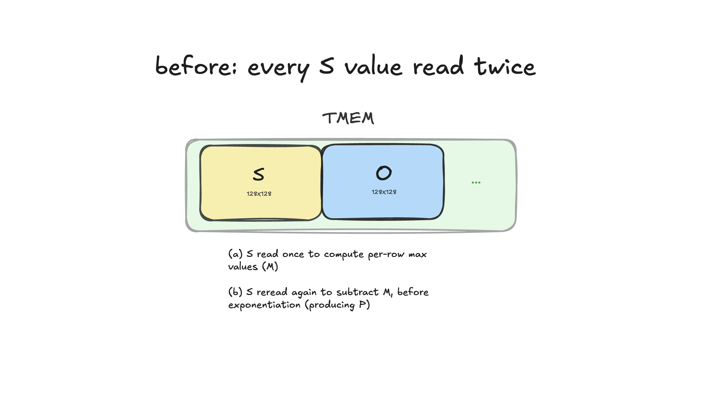</figure>
前面每个 Q stage 都遍历并读取 TMEM 中的 S 两次，见第 1 章。第一次计算 rowmax，为第二步提供数值稳定性；第二次减去 rowmax，再取指数。必须先算出 rowmax 才能相减，因此需要两次遍历相同 S。 

下一项优化是在寄存器中保留部分 S，减少第二遍的 TMEM 重读。 
<figure></figure>
为了缩短寄存器生命周期，我们： 
<ul><li data-block="B506">（a）第一次 TMEM 遍历缓存最近读到的 S。由于从低列向高列读取，最近读到的是高 96 列。 </li><li data-block="B507">（b）将 P 生成遍历，也就是原来的第二次 TMEM 遍历，改为从高列向低列推进，让最近缓存的值先被消费。 </li></ul><figure></figure>
从第 2 章起，此前一直把 P 放在 TMEM S 区域的低半部分。本章只缓存高 96 列，总共 128 列中的低 32 列之后还要重读。因此，不能再把高 96 列 P 写入低端 S，否则会在重读前破坏低 32 列 S。从第 10 章起，我们将 P 存入 S 的高半部分。 
<figure></figure>
还有一点：重读的低 32 列 S 只用于生成 1/4 的 P，其他 3/4 由寄存器缓存的 S 生成。 

因此，第二次 S 遍历仍存在，但每行只从 TMEM 重读 128 个分数中的 32 个，去掉了 3/4 的重复读取。 

内核检查点 

参见 <a href="https://github.com/IaroslavElistratov/b200-attention/blob/master/kernels/3_hotloop_optimizations/2_avoid_tmem_reread/10_cache96_reread32.cu">10_cache96_reread32.cu</a>，并与内核 9 做 diff。 

现在请熟悉代码。 

当前性能 
<table><thead><tr><th style="text-align:right">内核</th><th>改动</th><th style="text-align:right">4k</th><th style="text-align:right">8k</th><th style="text-align:right">16k</th></tr></thead><tbody><tr><td style="text-align:right">1</td><td>基础实现</td><td style="text-align:right">14.2%</td><td style="text-align:right">14.1%</td><td style="text-align:right">13.7%</td></tr><tr><td style="text-align:right">2</td><td>P 存入 TMEM</td><td style="text-align:right">15.1%</td><td style="text-align:right">15.0%</td><td style="text-align:right">15.0%</td></tr><tr><td style="text-align:right">3</td><td>Swizzle</td><td style="text-align:right">25.9%</td><td style="text-align:right">25.9%</td><td style="text-align:right">26.2%</td></tr><tr><td style="text-align:right">4</td><td>Warp 分工</td><td style="text-align:right">26.6%</td><td style="text-align:right">26.4%</td><td style="text-align:right">26.5%</td></tr><tr><td style="text-align:right">5</td><td>双 Q tile</td><td style="text-align:right">40.5%</td><td style="text-align:right">40.3%</td><td style="text-align:right">41.3%</td></tr><tr><td style="text-align:right">6</td><td>加载流水线</td><td style="text-align:right">48.6%</td><td style="text-align:right">48.6%</td><td style="text-align:right">48.4%</td></tr><tr><td style="text-align:right">7</td><td>计算流水线</td><td style="text-align:right">58.2%</td><td style="text-align:right">58.5%</td><td style="text-align:right">58.0%</td></tr><tr><td style="text-align:right">8</td><td>硬件 exp2</td><td style="text-align:right">64.1%</td><td style="text-align:right">64.1%</td><td style="text-align:right">63.8%</td></tr><tr><td style="text-align:right">9</td><td>软件 exp2</td><td style="text-align:right">69.3%</td><td style="text-align:right">70.1%</td><td style="text-align:right">70.6%</td></tr><tr><td style="text-align:right"><strong>10</strong></td><td>寄存器缓存</td><td style="text-align:right"><strong>72.9%</strong></td><td style="text-align:right"><strong>73.7%</strong></td><td style="text-align:right"><strong>73.6%</strong></td></tr></tbody></table><h2 data-block="B515" id="chapter-11--skip-o-rescale">第 11 章：跳过 O 重缩放 </h2>
本章没有特别适合画图的内容，因此看一点伪代码。下一章继续图解。 

普通 Softmax 能看到整行，只需一次找到最终 rowmax，减去它，再取指数。 

在线 Softmax 每次处理一个 K/V tile，无法预先知道最终 rowmax。逐 tile 才逐渐看到整行，后面的 tile 可能出现更大最大值。因此，与普通整行 Softmax 不同，在线 Softmax 必须决定： 
<ul><li data-block="B519">每遇到一个更大最大值，都立刻切换过去吗？ </li><li data-block="B520">还是可以继续使用旧 rowmax？ </li></ul>
前面各内核一旦发现更大最大值，就立刻采用： 
<pre tabindex="0"><code>new_rowmax = max(old_rowmax, tile_rowmax)
</code></pre>
然后将全部旧状态改写到新基准下： 
<pre tabindex="0"><code>old O      *= rescale
old rowsum *= rescale
</code></pre>
更新 rowsum 很便宜，但重缩放 O 需要再完整遍历 TMEM 中每行 128 个值。内核 10 每轮 KV 循环都执行 O 遍历，即便 scale 为 1。也就是说，最大值不变、rescale == 1 时，仍加载 128 个 O 值，乘以 1，再写回。这在数值上安全，却过于保守。 

内核 11 中，如果新 tile 最大值只比保留的 rowmax 略高，就继续使用旧 rowmax，不对 O、rowsum 做基准变换。只有差距足够大，才切换到新 rowmax，并把旧 O、rowsum 重缩放到新基准。 

跳过重缩放不会抹掉信息 

这一点我起初也没立即想明白，见<a href="#fn:18" id="fnref:18">脚注 18</a>。用一个小例子看看跳过 O 重缩放会发生什么，确认它不会导致信息丢失。 

假设决定为某个 tile 跳过 O 重缩放，具体阈值稍后讨论。暂设当前 tile 最大值比旧 rowmax 高 7.78。 

我们仍相对于旧 rowmax 计算 P： 
<pre tabindex="0"><code>P = exp2(scaled_S - kept_rowmax)
</code></pre>
因此，新的最大值产生： 
<pre tabindex="0"><code>exp2(7.78) ~= 219
</code></pre>
尽管跳过 O 重缩放，新最大值并未被抹掉，信息也未丢失。因为仍用旧 rowmax 计算 P，较大分数变成了约 219 倍的未归一化 P。这份差异就保存在更大的 P 中。 

更好的是，与选择重缩放的情况相比，整个内核最终结果完全不变。因为较大的 P 同时进入 Softmax 的两部分：分子 O 和分母 rowsum。 

相同的 P 值进入 Attention 的两部分： 
<pre tabindex="0"><code>O      += P @ V
rowsum += sum(P)
</code></pre>
所以，对于前面 219 的例子： 
<pre tabindex="0"><code>O      += 219 * V_new
rowsum += 219
</code></pre>
整个 K/V 循环后： 
<pre tabindex="0"><code>output = O / rowsum
</code></pre>
新分数在 O 和 rowsum 中仍被视为约 219 倍大。最终除法没有抹掉这个相对差异，只是消去 O、rowsum 共有的尺度。 

那为什么还要切换基准？ 

如果最终 O / rowsum 能处理共同尺度，似乎可以永远保留最初 rowmax。数学上，只要所有中间值不溢出，确实可以。例如旧 rowmax 已远落后于新值时： 
<pre tabindex="0"><code>gap = 20
largest P = exp2(20) = 1,048,576
</code></pre>
最终答案在数学上仍等价，但 P、rowsum、O 的中间值会变得很大。如果溢出，最后除以 rowsum 的归一化显然不能撤销溢出。 

逐行决策如何映射到 warp 级 TMEM O 遍历 

是否切换基准由每行独立决定，但 TMEM O 的加载与存储是 warp 集体操作。因此实际实现如下： 

<pre style="color:#f8f8f2;background-color:#272822;-moz-tab-size:4;-o-tab-size:4;tab-size:4;-webkit-text-size-adjust:none" tabindex="0"><code class="language-c" data-lang="c">// convert the current tile's raw rowmax into base-2 exponent units
tile_rowmax *= softmax_scale_log2;

// kept_rowmax is already stored in the same units
float candidate_rowmax = max(kept_rowmax, tile_rowmax);
float rowmax_gap = candidate_rowmax - kept_rowmax;
bool row_needs_rebase = rowmax_gap &gt;= REBASE_THRESH_LOG2;

float rescale = 1.0f;

// 1) if needed, rescale this row's state and start using the new rowmax
if (row_needs_rebase) {
    // this factor will be applied to both rowsum and O
    rescale = fast_exp2(kept_rowmax - candidate_rowmax);

    // move this row's scalar accumulator into new rowmax basis
    rowsum *= rescale;

    // use new rowmax when producing this P tile and future P tiles
    kept_rowmax = candidate_rowmax;
}

// 2) apply same rescale factor to O
//
// TMEM loads/stores are warp-collective. If any row needs rescaling,
// entire warp must process its 32x128 O slab.
// Rows that don't rebase still participate but with rescale 1
if (__any_sync(FULL_WARP_MASK, row_needs_rebase)) {
    float o8[8];

    // same O traversal used in earlier kernels
    for (int col = 0; col &lt; HEAD_DIM; col += 8) {
        int taddr = taddr_o_stage + trow + col;

        tcgen05::ld_32x32b_x8(taddr, o8);

        for (int i = 0; i &lt; 8; ++i) {
            o8[i] *= rescale;
        }

        tcgen05::st_32x32b_x8(taddr, o8);
    }

    asm("tcgen05.wait::st...");
    asm("tcgen05.fence::before_thread_sync...");
}

// P production and the later PV proceed as in earlier kernels,
// using kept_rowmax as the rowmax for this tile
</code></pre>

实际阈值 

从内核 8 起，指数输入使用以 2 为底的单位。内核 11 使用阈值 8，与官方 FA4 相同。据我理解，8 并不是数学上的突变点。对 BF16 P、FP32 累加器路径，12 或 15 这样更大的阈值在数值上也可能合理。8 是保守选择，已经能跳过多数有意义的 O 重缩放，并非溢出边界。 
<pre tabindex="0"><code>exp2(8) = 256
</code></pre>
因此，只要相对于当前保留 rowmax 计算出的最大未归一化 P 大致低于 256，就继续使用旧 rowmax。“相对于”是指取指数前先减去旧 rowmax。超过这一范围后，再切换到新 rowmax，并对旧状态改换基准。 

为建立直觉，看看 HEAD_DIM = 128 时，以 2 为底的阈值 8 对应内核中其他单位的什么值： 
<pre tabindex="0"><code>base-2 exponent gap:  8
natural-exp gap:      8 / log2(e) ~= 5.545
raw QK-score gap:     5.545 * sqrt(128) ~= 62.7
</code></pre>
62.7 是当前 tile 逐行最大值与 kept_rowmax 对应的原始 QK 分数之间的差。内核里没有任何地方使用 62.7，实际阈值是在 log2 基准下的 8。这个换算只是帮助理解：在改换基准前，原始 QK 分数允许多大余量。 

内核检查点 

参见 <a href="https://github.com/IaroslavElistratov/b200-attention/blob/master/kernels/3_hotloop_optimizations/3_skip_o_rescale/11_skip_o_rescale.cu">11_skip_o_rescale.cu</a>，并与内核 10 做 diff。 

现在请熟悉代码。 

当前性能 
<table><thead><tr><th style="text-align:right">内核</th><th>改动</th><th style="text-align:right">4k</th><th style="text-align:right">8k</th><th style="text-align:right">16k</th></tr></thead><tbody><tr><td style="text-align:right">1</td><td>基础实现</td><td style="text-align:right">14.2%</td><td style="text-align:right">14.1%</td><td style="text-align:right">13.7%</td></tr><tr><td style="text-align:right">2</td><td>P 存入 TMEM</td><td style="text-align:right">15.1%</td><td style="text-align:right">15.0%</td><td style="text-align:right">15.0%</td></tr><tr><td style="text-align:right">3</td><td>Swizzle</td><td style="text-align:right">25.9%</td><td style="text-align:right">25.9%</td><td style="text-align:right">26.2%</td></tr><tr><td style="text-align:right">4</td><td>Warp 分工</td><td style="text-align:right">26.6%</td><td style="text-align:right">26.4%</td><td style="text-align:right">26.5%</td></tr><tr><td style="text-align:right">5</td><td>双 Q tile</td><td style="text-align:right">40.5%</td><td style="text-align:right">40.3%</td><td style="text-align:right">41.3%</td></tr><tr><td style="text-align:right">6</td><td>加载流水线</td><td style="text-align:right">48.6%</td><td style="text-align:right">48.6%</td><td style="text-align:right">48.4%</td></tr><tr><td style="text-align:right">7</td><td>计算流水线</td><td style="text-align:right">58.2%</td><td style="text-align:right">58.5%</td><td style="text-align:right">58.0%</td></tr><tr><td style="text-align:right">8</td><td>硬件 exp2</td><td style="text-align:right">64.1%</td><td style="text-align:right">64.1%</td><td style="text-align:right">63.8%</td></tr><tr><td style="text-align:right">9</td><td>软件 exp2</td><td style="text-align:right">69.3%</td><td style="text-align:right">70.1%</td><td style="text-align:right">70.6%</td></tr><tr><td style="text-align:right">10</td><td>寄存器缓存</td><td style="text-align:right">72.9%</td><td style="text-align:right">73.7%</td><td style="text-align:right">73.6%</td></tr><tr><td style="text-align:right"><strong>11</strong></td><td>跳过 O 重缩放</td><td style="text-align:right"><strong>81.7%</strong></td><td style="text-align:right"><strong>83.0%</strong></td><td style="text-align:right"><strong>83.3%</strong></td></tr></tbody></table><h2 data-block="B550" id="chapter-12--split-correction-from-softmax">第 12 章：将修正与 Softmax 分离 </h2><figure></figure>
此前，同一组行处理 warp 负责： 
<ol><li data-block="B552">计算当前 tile 的 rowmax 和 O 重缩放因子。 </li><li data-block="B553">如果新 tile rowmax 超过累计 rowmax 达到阈值，就对 O 重缩放，见内核 11。 </li><li data-block="B554">从 S 中减去 rowmax，再取指数生成 P。 </li></ol>
因此，第（2）步延迟整组行处理工作（1）至（3）的完成。O 修正与 P 生成在同一组 warp 中串行执行。 
<figure></figure>
O 重缩放（2）不依赖未归一化 P 的计算（3），所以可移到独立 warp，与生成 P 的行处理 warp 并行。这样从 P 生成前移走 O 修正，让两条分支重叠，缓解主要瓶颈 P 生成。现在行处理 warp 主要做 Softmax，所以之后称为“Softmax warp”。 

PV 仍同时需要 P-ready 和 O-safe。每个 Q stage 用 p_ready_o_safe 屏障合并这两个条件。PV MMA 等待 8 次到达：4 次来自 Softmax warp，表示 P 就绪；4 次来自修正 warp，表示 O 安全。两条分支中较慢的一条决定 PV 何时能开始。 

注意我刻意说 O-safe，而非 O-rescaled，因为按第 11 章优化，有时跳过 O 重缩放，并不总会执行它。 

Softmax warp 仍计算 rescale，写入 SMEM，发出 stats_ready，然后继续生成 P。修正 warp 等待该信号，读取因子，检查是否有已发布 scale 不为 1，从而判断是否改换 O 基准；如果需要，就重缩放 O。 

仍由 Softmax warp 计算 rescale，而不是让修正 warp 计算，是因为前者的寄存器已经持有旧累计 rowmax 和新 tile rowmax。否则还得把这些状态传给修正 warp，并在那里重复基准选择逻辑。因此 Softmax 每行只发送一个最终 scale，修正端直接应用到 O。 

同一组 4 个修正 warp 由 Q0、Q1 共享。对每个 Q stage，它们读取 Softmax 发布的逐行 scale，重缩放相应 O tile。 

内核检查点 

参见 <a href="https://github.com/IaroslavElistratov/b200-attention/blob/master/kernels/3_hotloop_optimizations/4_early_pv/12_split_correction_from_softmax.cu">12_split_correction_from_softmax.cu</a>，并与内核 11 做 diff。 

现在请熟悉代码。 

当前性能 
<table><thead><tr><th style="text-align:right">内核</th><th>改动</th><th style="text-align:right">4k</th><th style="text-align:right">8k</th><th style="text-align:right">16k</th></tr></thead><tbody><tr><td style="text-align:right">1</td><td>基础实现</td><td style="text-align:right">14.2%</td><td style="text-align:right">14.1%</td><td style="text-align:right">13.7%</td></tr><tr><td style="text-align:right">2</td><td>P 存入 TMEM</td><td style="text-align:right">15.1%</td><td style="text-align:right">15.0%</td><td style="text-align:right">15.0%</td></tr><tr><td style="text-align:right">3</td><td>Swizzle</td><td style="text-align:right">25.9%</td><td style="text-align:right">25.9%</td><td style="text-align:right">26.2%</td></tr><tr><td style="text-align:right">4</td><td>Warp 分工</td><td style="text-align:right">26.6%</td><td style="text-align:right">26.4%</td><td style="text-align:right">26.5%</td></tr><tr><td style="text-align:right">5</td><td>双 Q tile</td><td style="text-align:right">40.5%</td><td style="text-align:right">40.3%</td><td style="text-align:right">41.3%</td></tr><tr><td style="text-align:right">6</td><td>加载流水线</td><td style="text-align:right">48.6%</td><td style="text-align:right">48.6%</td><td style="text-align:right">48.4%</td></tr><tr><td style="text-align:right">7</td><td>计算流水线</td><td style="text-align:right">58.2%</td><td style="text-align:right">58.5%</td><td style="text-align:right">58.0%</td></tr><tr><td style="text-align:right">8</td><td>硬件 exp2</td><td style="text-align:right">64.1%</td><td style="text-align:right">64.1%</td><td style="text-align:right">63.8%</td></tr><tr><td style="text-align:right">9</td><td>软件 exp2</td><td style="text-align:right">69.3%</td><td style="text-align:right">70.1%</td><td style="text-align:right">70.6%</td></tr><tr><td style="text-align:right">10</td><td>寄存器缓存</td><td style="text-align:right">72.9%</td><td style="text-align:right">73.7%</td><td style="text-align:right">73.6%</td></tr><tr><td style="text-align:right">11</td><td>跳过 O 重缩放</td><td style="text-align:right">81.7%</td><td style="text-align:right">83.0%</td><td style="text-align:right">83.3%</td></tr><tr><td style="text-align:right"><strong>12</strong></td><td>分离修正</td><td style="text-align:right"><strong>84.9%</strong></td><td style="text-align:right"><strong>85.8%</strong></td><td style="text-align:right"><strong>86.3%</strong></td></tr></tbody></table><h2 data-block="B566" id="chapter-13--early-pv">第 13 章：提前执行 PV </h2><figure></figure>
记住，由内核 10 的优化决定，P 从右向左生成，也就是从 TMEM 区域高端向低端写入。因此，右侧 P 比完整 P 更早就绪；绿色区域已生成时，红色区域还没有。 

内核 13 利用这一顺序：高 96 列 P 已生成、旧 O 安全后，就可以开始部分 PV MMA。无需等整个 P 就绪，先做 p_high96 @ V_slice1，等 P_low32 生成后再做 P_low32 @ V_slice2。 

其前提是：开始生成 P 分块前，已经求出了整个 S tile 的 rowmax，因此累计 rowmax/参考基准固定。后来生成低 32 列 P 不会改变 rowmax，也就不会改变已经生成的高 96 列 P。 

这个 P 的 32/96 切分看起来与第 10 章 S 寄存器缓存的 32/96 切分相呼应，但这不是本质要求。两项优化大体正交，只是在本实现中恰好对齐，见<a href="#fn:19" id="fnref:19">脚注 19</a>。 

图中省略了第二个 Q stage 的 P1，因为逻辑完全相同。 
<figure></figure>
第一个屏障释放后，全部高 96 列 P 已就绪，即其 6 个微块都已准备好，O 也安全。完整高 96 区域发布后，MMA 不必按 Softmax warp 生成顺序消费微块；也可以按 k = 7..2 发起，不会造成有意义的数值变化，见<a href="#fn:20" id="fnref:20">脚注 20</a>。我保留 k = 2..7 的顺序，只是因为对应 V SMEM 描述符递增更简洁，并非本质选择。 
<figure></figure>
用 p_high96 做矩阵乘法时，也要选中对应的 V 切片，即将 P 微块地址、V 描述符各偏移两个微块，见图中绿色部分。 

之后，Softmax warp 生成低 32 列 P，并发信号表示完整 P 就绪。再计算之前跳过的两个微块，即 P_low32 @ V_slice2，见红色部分。 

两次部分矩阵乘法都累加到同一 O tile。我们只是沿归约轴把 P、V 各拆成两块，合起来仍计算原来的完整 P@V。 

内核检查点 

参见 <a href="https://github.com/IaroslavElistratov/b200-attention/blob/master/kernels/3_hotloop_optimizations/4_early_pv/13_early_pv_96_32.cu">13_early_pv_96_32.cu</a>，并与内核 12 做 diff。 

现在请熟悉代码。 

当前性能 
<table><thead><tr><th style="text-align:right">内核</th><th>改动</th><th style="text-align:right">4k</th><th style="text-align:right">8k</th><th style="text-align:right">16k</th></tr></thead><tbody><tr><td style="text-align:right">1</td><td>基础实现</td><td style="text-align:right">14.2%</td><td style="text-align:right">14.1%</td><td style="text-align:right">13.7%</td></tr><tr><td style="text-align:right">2</td><td>P 存入 TMEM</td><td style="text-align:right">15.1%</td><td style="text-align:right">15.0%</td><td style="text-align:right">15.0%</td></tr><tr><td style="text-align:right">3</td><td>Swizzle</td><td style="text-align:right">25.9%</td><td style="text-align:right">25.9%</td><td style="text-align:right">26.2%</td></tr><tr><td style="text-align:right">4</td><td>Warp 分工</td><td style="text-align:right">26.6%</td><td style="text-align:right">26.4%</td><td style="text-align:right">26.5%</td></tr><tr><td style="text-align:right">5</td><td>双 Q tile</td><td style="text-align:right">40.5%</td><td style="text-align:right">40.3%</td><td style="text-align:right">41.3%</td></tr><tr><td style="text-align:right">6</td><td>加载流水线</td><td style="text-align:right">48.6%</td><td style="text-align:right">48.6%</td><td style="text-align:right">48.4%</td></tr><tr><td style="text-align:right">7</td><td>计算流水线</td><td style="text-align:right">58.2%</td><td style="text-align:right">58.5%</td><td style="text-align:right">58.0%</td></tr><tr><td style="text-align:right">8</td><td>硬件 exp2</td><td style="text-align:right">64.1%</td><td style="text-align:right">64.1%</td><td style="text-align:right">63.8%</td></tr><tr><td style="text-align:right">9</td><td>软件 exp2</td><td style="text-align:right">69.3%</td><td style="text-align:right">70.1%</td><td style="text-align:right">70.6%</td></tr><tr><td style="text-align:right">10</td><td>寄存器缓存</td><td style="text-align:right">72.9%</td><td style="text-align:right">73.7%</td><td style="text-align:right">73.6%</td></tr><tr><td style="text-align:right">11</td><td>跳过 O 重缩放</td><td style="text-align:right">81.7%</td><td style="text-align:right">83.0%</td><td style="text-align:right">83.3%</td></tr><tr><td style="text-align:right">12</td><td>分离修正</td><td style="text-align:right">84.9%</td><td style="text-align:right">85.8%</td><td style="text-align:right">86.3%</td></tr><tr><td style="text-align:right"><strong>13</strong></td><td>提前 PV</td><td style="text-align:right"><strong>87.2%</strong></td><td style="text-align:right"><strong>88.1%</strong></td><td style="text-align:right"><strong>88.4%</strong></td></tr></tbody></table><h1 data-block="B580" id="part-iv--persistent-kernels">第四部分：持久化内核 </h1><h2 data-block="B581" id="chapter-14--persistent">第 14 章：持久化 </h2>
我们的内核每个 SM 最多驻留一个 CTA，因为每 CTA 消耗的资源使一个 SM 同时只能容纳一个。B200 有 148 个 SM，因此任意时刻最多 148 个 CTA 工作。从第 5 章起，每个 CTA 独立消费两个 Q tile、遍历全部 KV tile，并生成两个输出 tile。 
<figure></figure>
把这称为一个“工作项”（work item），并抽象成图中形式。后续图以工作项为粒度。下一项优化改变的是 Attention 主体外部的生命周期，而不是主体本身，因此可以安全将主体抽象掉。 
<figure></figure>
此前，如果工作项数量大于 SM 数量，即无法一次处理完所有工作，每个 SM 就依次运行多个 CTA：一个完成其工作项并退出调度，另一个处理不同工作项的新 CTA 接替。 

这些就是工作的“波次”（waves）。 

可以根据总工作量和每 CTA 处理量计算波次数： 

以 SEQ_LEN = 4096 为例，对单个 batch、head，tile 边长为 128，Q、O 各有 4096 / 128 = 32 个 tile。每 CTA 处理两个，因此只有 32 / 2 = 16 个工作项。于是： 
<pre tabindex="0"><code>16 work items per batch-head
8 batches * 16 heads * 16 = 2048 total work items
</code></pre>
对于 SEQ_LEN = 16384，单个 batch、head 的 Q、O 各有 16384 / 128 = 128 个 tile。每 CTA 处理两个，因此有 128 / 2 = 64 个工作项。 
<pre tabindex="0"><code>64 work items per batch-head
2 batches * 16 heads * 64 = 2048 total work items
</code></pre>
对于基准使用的三个形状，都会发起 2048 个独立 CTA，约 148 个能同时驻留，因此大约执行 14 波：ceil(2048 / 148 个 SM) = 14 波。 

通常称之为波次，但 CUDA 并不会等某一波 148 个 CTA 全部同时完成。某个 CTA 一结束，等待中的另一个就可能进驻空出的 SM，所以各 CTA 的推进时间会错开。 

于是每个 SM 大约依次处理 14 个不同 CTA：前一个完成并释放资源，后一个驻留。但这 14 次都重复支付相同开销：TMEM 分配/释放、CTA 生命周期状态设置、指针偏移、屏障初始化、CTA 调度等。 

SEQ_LEN 越短，CTA 固定开销越重要 

4K、16K 形状都要“重复 14 次”。来自 FA4 论文的三个基准形状恰好各有 2048 个工作项，因此同样承担 14 波固定成本。 

但 KV 循环从 4K 的 32 轮增长到 16K 的 128 轮，所以 16K 每波包含 4 倍有效工作： 
<pre tabindex="0"><code>KV-loop iterations = len_kv / BLOCK_N = 4096 / 128 = 32
KV-loop iterations = len_kv / BLOCK_N = 16384 / 128 = 128
</code></pre>
输出工作项数量相同，但每项内部热循环工作量不同。短序列仍付 14 次相同初始化成本，KV 循环却更短，因此固定开销占比更高。与长序列相比，上述每 CTA 固定成本在较短的 4K 工作项中占总时间的比例更大。 
<figure></figure>
如果一个 CTA 不只处理一个工作项，就可以只付一次初始化成本，将它分摊到多项工作，理想情况下分摊越多越好。为尽量摊薄成本，我们让 CTA 一直存活，处理自己大约 14 个工作项的序列。 

注意，无法摊薄的是：两个 Q 的加载、KV 遍历、输出写回、work ID 和指针计算。这些确实因输出工作项而不同；即便同一 CTA 处理多项工作，每一项仍需重新执行。 

CTA 不会锁步执行，因此图中的箭头长度不同。一个 CTA 中工作项的完成时间可以相对于其他 CTA 的进展发生偏移。 

跨工作项复用屏障 

此前屏障在 CTA 启动时初始化一次，贯穿其生命周期。内核 14 让屏障跨多个工作项继续工作。 

我最初的朴素实现，在工作项之间停止所有 warp，等待全部工作完成，再将屏障失效并重新初始化，然后才开始下一项。PTX 要求失效这一步，因为对仍有效的屏障调用 mbarrier.init 是未定义行为；重新初始化前必须确保没有 warp 仍在使用它。这样正确，却在工作项之间制造硬停顿：所有 warp 等待最慢者，全部工作彻底排空后才能开始下一项。 

为避免每个工作项边界都重复失效和初始化，内核 14 仅在 CTA 启动时初始化所有屏障一次，随后跨工作项持续轮转屏障 phase。旧 work_done 同步让所有 warp 等最慢者、将当前工作排空，保障重初始化安全，并保守地禁止任何缓冲区在整个工作项排空前复用。内核 14 改为跨工作项沿用已有 K/V 回收交接，再为 Q SMEM 增加 q_free。结合不再重初始化屏障，就无需全 warp 的 work_done 同步。 

因此，每个缓冲区在当前工作项的真正最后消费者用完后，就可释放： 
<pre tabindex="0"><code>Q SMEM:
    final QK reads Q(i)
    -&gt; q_free
    -&gt; load Q(i+1)

K/V ring:
    final QK reads K stage
    -&gt; refill K stage

    final PV reads V stage
    -&gt; refill V stage
</code></pre>
这样，不再存在一个统一时刻，宣告 work_item(i) 结束、work_item(i+1) 开始。Softmax warp 仍在归一化并写 O(i) 时，加载 warp 已可加载下一份 Q/K/V；Q、K 就绪后，MMA warp 就能开始 QK(i+1)。 

因此，内核 14 同时引入持久化 CTA 生命周期与跨工作项流水线。 
<figure></figure>
如图所示，内核 14 中每个持久化 CTA 并不处理连续 work ID。 

代码只是 work_id += gridDim.x; // 148 CTAs。静态 grid-stride 分配把每个工作项交给 148 个持久化 CTA 之一。每工作项覆盖相邻两个 Q/O tile，所以 CTA 前进 148 个工作项时，tile 索引前进 296。CTA 0 先处理 tile 0-1，再处理 296-297，然后 592-593。 

我也试过给每个 CTA 分配连续范围的工作项。上述跨步方式整体更快，但结果依赖形状，我尚未单独确定具体原因。我的猜测是，当 CTA 在接近的时间处理相同 batch-head 的不同 Q 对时，共享 L2 中的 K/V 复用会有帮助。 

图中展示的是每个 CTA 拥有哪些工作项，而非硬执行边界。如前所述，不同 warp 角色仍可让前一工作项的尾部与后一项的开头重叠。 

内核检查点 

参见 <a href="https://github.com/IaroslavElistratov/b200-attention/blob/master/kernels/4_persistent/14_persistent.cu">14_persistent.cu</a>，并与内核 13 做 diff。 

现在请熟悉代码。 

当前性能 
<table><thead><tr><th style="text-align:right">内核</th><th>改动</th><th style="text-align:right">4k</th><th style="text-align:right">8k</th><th style="text-align:right">16k</th></tr></thead><tbody><tr><td style="text-align:right">1</td><td>基础实现</td><td style="text-align:right">14.2%</td><td style="text-align:right">14.1%</td><td style="text-align:right">13.7%</td></tr><tr><td style="text-align:right">2</td><td>P 存入 TMEM</td><td style="text-align:right">15.1%</td><td style="text-align:right">15.0%</td><td style="text-align:right">15.0%</td></tr><tr><td style="text-align:right">3</td><td>Swizzle</td><td style="text-align:right">25.9%</td><td style="text-align:right">25.9%</td><td style="text-align:right">26.2%</td></tr><tr><td style="text-align:right">4</td><td>Warp 分工</td><td style="text-align:right">26.6%</td><td style="text-align:right">26.4%</td><td style="text-align:right">26.5%</td></tr><tr><td style="text-align:right">5</td><td>双 Q tile</td><td style="text-align:right">40.5%</td><td style="text-align:right">40.3%</td><td style="text-align:right">41.3%</td></tr><tr><td style="text-align:right">6</td><td>加载流水线</td><td style="text-align:right">48.6%</td><td style="text-align:right">48.6%</td><td style="text-align:right">48.4%</td></tr><tr><td style="text-align:right">7</td><td>计算流水线</td><td style="text-align:right">58.2%</td><td style="text-align:right">58.5%</td><td style="text-align:right">58.0%</td></tr><tr><td style="text-align:right">8</td><td>硬件 exp2</td><td style="text-align:right">64.1%</td><td style="text-align:right">64.1%</td><td style="text-align:right">63.8%</td></tr><tr><td style="text-align:right">9</td><td>软件 exp2</td><td style="text-align:right">69.3%</td><td style="text-align:right">70.1%</td><td style="text-align:right">70.6%</td></tr><tr><td style="text-align:right">10</td><td>寄存器缓存</td><td style="text-align:right">72.9%</td><td style="text-align:right">73.7%</td><td style="text-align:right">73.6%</td></tr><tr><td style="text-align:right">11</td><td>跳过 O 重缩放</td><td style="text-align:right">81.7%</td><td style="text-align:right">83.0%</td><td style="text-align:right">83.3%</td></tr><tr><td style="text-align:right">12</td><td>分离修正</td><td style="text-align:right">84.9%</td><td style="text-align:right">85.8%</td><td style="text-align:right">86.3%</td></tr><tr><td style="text-align:right">13</td><td>提前 PV</td><td style="text-align:right">87.2%</td><td style="text-align:right">88.1%</td><td style="text-align:right">88.4%</td></tr><tr><td style="text-align:right"><strong>14</strong></td><td>持久化 CTA</td><td style="text-align:right"><strong>90.7%</strong></td><td style="text-align:right"><strong>90.3%</strong></td><td style="text-align:right"><strong>89.8%</strong></td></tr></tbody></table><h1 data-block="B614" id="minor-optimizations">小优化 </h1>
内核 14 是主要 14 阶段演进的终点。剩下四项是较小的局部优化，集中放在这里。仓库仍将它们分别编号为 15-18，方便逐项 diff。合起来，它们带来最后几个百分点的性能。 

延迟分数读取等待（<a href="https://github.com/IaroslavElistratov/b200-attention/blob/master/kernels/5_minor/15_wide_deferred_score_loads.cu">Deferred score acquisition</a>）。此前从 TMEM 读 S 使用 16 次加载，每次后面立即等待。现在改用 8 次更宽加载、不立即等待、4 条独立 rowmax 依赖链，并将一次统一等待推迟到 P 覆盖该 TMEM 区域前，让加载延迟与有效工作重叠。多数收益来自 4 条独立 rowmax 链；延迟等待也有帮助，而单独加宽加载几乎无效。 

拆分 rowsum 累加。P 已分成两部分生成：寄存器缓存分数产生的 96 列，以及 TMEM 重读分数产生的 32 列。不再让两部分都经过一条长 rowsum 依赖链，而是把缓存 96 列累加成两个部分和，重读 32 列用标量求和，最后只合并一次。 <a href="https://github.com/IaroslavElistratov/b200-attention/blob/master/kernels/5_minor/16_split_rowsum_accumulation.cu" title="Split rowsum accumulation">〔链接〕</a>

Phase 位掩码。每个屏障 stage 只需要 0/1 phase，但把它们放在运行时索引的小数组中，会使编译器将其放入线程局部内存。这里改用整数位掩码打包，让状态留在寄存器，消除 spill。 <a href="https://github.com/IaroslavElistratov/b200-attention/blob/master/kernels/5_minor/17_phasebits.cu" title="Phase bitmasks">〔链接〕</a>

<a href="https://github.com/IaroslavElistratov/b200-attention/blob/master/kernels/5_minor/18_tma_l2_promotion.cu">TMA L2 promotion</a>。每次 TMA 行读取只使用一个对齐 256B 区域中的 128B 半区，而邻近读取很快又需要另一半。我们要求 TMA 将完整 256B 取入 L2，使随后所需的另一半更可能已缓存。内核主体本身不变。 
<table><thead><tr><th>新增优化</th><th style="text-align:right">4k</th><th style="text-align:right">8k</th><th style="text-align:right">16k</th></tr></thead><tbody><tr><td>延迟分数读取等待</td><td style="text-align:right"><strong>92.3%</strong></td><td style="text-align:right"><strong>92.5%</strong></td><td style="text-align:right"><strong>92.0%</strong></td></tr><tr><td>拆分 rowsum 累加</td><td style="text-align:right"><strong>93.4%</strong></td><td style="text-align:right"><strong>93.7%</strong></td><td style="text-align:right"><strong>93.7%</strong></td></tr><tr><td>Phase 位掩码</td><td style="text-align:right"><strong>93.7%</strong></td><td style="text-align:right"><strong>94.0%</strong></td><td style="text-align:right"><strong>94.1%</strong></td></tr><tr><td>TMA L2 promotion</td><td style="text-align:right"><strong>94.4%</strong></td><td style="text-align:right"><strong>94.4%</strong></td><td style="text-align:right"><strong>94.1%</strong></td></tr></tbody></table><h1 data-block="B620" id="capstone-project--generate-videos">综合实践：生成视频！ </h1>
现在用刚构建的 Attention 内核做点酷的事情：生成视频。我强烈推荐尝试；看到自己理解的内核生成漂亮视频，会很有成就感。 

<a href="https://github.com/IaroslavElistratov/b200-attention/tree/master/capstone-project">综合实践项目</a>将本文最终内核，即 NVIDIA B200 上的稠密 BF16 Attention，接入 LTX-2.3 视频生成模型。 <a href="https://github.com/IaroslavElistratov/b200-attention/blob/master/kernels/5_minor/18_tma_l2_promotion.cu" title="our final kernel">〔链接1〕</a>

生成每段视频，模型会调用我们的 Attention 内核 1056 次。 

按云服务商不同，一小时 B200 算力大约需要 7 美元。足够设置仓库、下载权重，并生成多段视频。 

B200 生成一段 10.4 秒、249 帧视频大约需要 41 秒。运行时间取决于完整模型架构，而不只是我们的内核。 

不必花时间读视频模型集成代码，更值得把时间用于理解本文已解释过的内核及其优化。综合实践代码只是把内核接进视频模型并运行。 <a href="https://github.com/IaroslavElistratov/b200-attention/tree/master/kernels" title="kernel itself and its optimizations">〔链接〕</a>

基本步骤： 
<ul><li data-block="B628">租用算力，通过 SSH 登录机器，克隆<a href="https://github.com/IaroslavElistratov/b200-attention">仓库</a>，进入 b200-attention/capstone-project。 </li><li data-block="B629">按照<a href="https://github.com/IaroslavElistratov/b200-attention/blob/master/capstone-project/GETTING_STARTED.md">环境配置与生成说明</a>操作。 </li><li data-block="B630">欣赏自己已经理解、接近最先进性能的内核为你生成的漂亮视频，享受这份成就感。 </li></ul>
最后一条才是最主要的要求，o_0。 
<h1 data-block="B632" id="the-graveyard---and-some-hope-">失败尝试的墓地……以及一点希望 </h1>
嗯……我已经花了一段时间理解 FA4，并尝试超越它。 

我不仅试图解释这个内核，也提出并实现了可能几十个又几十个自己觉得新颖、有趣的优化想法，还不包括 agent 独立尝试的数千个其他想法。 

要改进如此高度优化的内核确实很难，真是“意料之外”呀 :) 

不过有几个想法似乎可能有效，但我决定先暂停研究，完成这篇文章。 

计划在后续独立文章中分享尝试过的几类想法、事后分析和经验。在进一步研究前，这里刻意不展开。 
<h1 data-block="B638" id="stay-in-touch-for-more-ml-sys">保持联系，获取更多 ML 系统内容 </h1>
所有内核和综合实践项目都在 <a href="https://github.com/IaroslavElistratov/b200-attention">B200 Attention 仓库</a>中。 

我逐步讲解代码的视频即将发布。 

也会很快发布一本免费电子书。 
<mark>更多 ML 系统文章、视频和代码即将发布。</mark>
关注：<a href="https://x.com/iaro_e">X</a> · <a href="https://www.linkedin.com/in/iaroslav-elistratov/">LinkedIn</a> · <a href="https://www.youtube.com/@IaroslavElistratov">YouTube</a> · <a href="https://github.com/IaroslavElistratov">GitHub</a>。 
<h1 data-block="B643" id="appendix">附录 </h1><h3 data-block="B644" id="citation">引用 </h3>
<pre style="color:#f8f8f2;background-color:#272822;-moz-tab-size:4;-o-tab-size:4;tab-size:4;-webkit-text-size-adjust:none" tabindex="0"><code class="language-bibtex" data-lang="bibtex">@misc{elistratov2026b200attention,
  author       = {Elistratov, Iaroslav},
  title        = {{B200 Attention} Explained: From Scratch to Near-{SOTA}
                  in 60 Diagrams ({CUDA}/{PTX})},
  year         = {2026},
  howpublished = {\url{https://iaroslavelistratov.github.io/b200-attention/}}
}
</code></pre>
<h3 data-block="B645" id="benchmark-calibration">基准校准 </h3>
FA4 使用连续 BSHD 布局计时，我的内核使用连续 BHLD。输入都已按各自预期布局准备好，因此计时均不包含输入布局转换。另外提供最终内核的 direct-BSHD 变体，无需转换复制就能直接消费并输出连续 BSHD，达到同次运行 stock FA4 的 92.1%-92.7%。 <a href="https://github.com/IaroslavElistratov/b200-attention/tree/master/benchmarks#input-layout-and-direct-bshd" title="direct-BSHD variant of the final kernel">〔链接〕</a>

我也试过 beta29，但测试中它的性能差了约 19%，见<a href="https://github.com/Dao-AILab/flash-attention/issues/2729#issuecomment-5560916926">相关讨论</a>。因此仍采用测试中更快的早期版本，避免仅因工具链问题拖慢 FA4 基线，就让我的内核显得更好。 

官方 stock FA4 beta4（CuTe DSL）与论文数值的对比： 
<table><thead><tr><th>校准</th><th style="text-align:right">4k</th><th style="text-align:right">8k</th><th style="text-align:right">16k</th></tr></thead><tbody><tr><td>FA4 论文 TFLOPS</td><td style="text-align:right">1532</td><td style="text-align:right">1579</td><td style="text-align:right">1601</td></tr><tr><td>实测 stock FA4 TFLOPS</td><td style="text-align:right">1484</td><td style="text-align:right">1528</td><td style="text-align:right">1554</td></tr><tr><td>实测 stock FA4 / 论文</td><td style="text-align:right">96.9%</td><td style="text-align:right">96.8%</td><td style="text-align:right">97.1%</td></tr></tbody></table>
这次校准使用 342 次 B200 调用，对每个形状取 stock FA4 结果的中位数。在我使用的 B200 上，官方 stock FA4 本身也仅达到论文所报 TFLOPs 的约 97%。因此，我主要与同次运行测得的 FA4 对比，而非与论文数字对比。 

<a href="https://github.com/IaroslavElistratov/b200-attention/tree/master/benchmarks">基准测试工具与复现说明</a>。 
<h3 data-block="B651" id="how-software-exp2-works">软件 exp2 如何工作 </h3>
第 9 章“软件近似”的可选背景知识。 <a href="#chapter-9--software-approximations" title="Chapter 9 – Software Approximations">〔链接〕</a>

内核 8 之后，指数输入已经使用以 2 为底的单位，我们计算 exp2(x)。 

数学上，exp2(x) = 2^x。 

因此，我们希望用 ALU 承担一部分 2^x 的计算。 

把 x 拆成整数部分和小数部分，分别求 2 的相应次幂，再相乘。由于 2^(a+b) = 2^a * 2^b，它等价于直接计算 2^x。 
<pre tabindex="0"><code>integer_part = floor(x)
// always between zero and one
// by our definition above
fractional_part = x - integer_part

2^x = 2^integer_part * 2^fractional_part
</code></pre>
例如： 
<pre tabindex="0"><code>x                   = -3.25
integer_part        = -4
fractional_part     = 0.75
</code></pre>
这样拆整数部分很方便，因为 FP32 本来就有以 2 为底的指数位域。因此，只需调整多项式结果的指数位，就能施加 2^integer_part。 

但 2^fractional_part 不能像整数部分那么方便地计算，因为 FP32 指数位域只能按整步变化，例如可移动 -4 步，不能移动 0.75 步。因此，对小数部分采用多项式近似。按定义，fractional_part 总在 0 与 1 之间，所以只需近似 2^x 曲线中 x ∈ [0,1) 的一小段。 

指数位处理 2^integer_part，多项式处理 2^fractional_part。 

使用一个三次多项式近似这段曲线： 
<pre tabindex="0"><code>2^fractional_part
    ~= 1
    + c1 * fractional_part
    + c2 * fractional_part^2
    + c3 * fractional_part^3
</code></pre>
可把多项式看成对弯曲程度逐渐增加的形状做加权混合。直线过于简单，二次项仍不够准确；三次多项式既足够灵活，求值又便宜： 
<pre tabindex="0"><code>1                    constant, flat component
fractional_part      straight-line component
fractional_part^2    quadratic curve
fractional_part^3    cubic curve
</code></pre>
系数 c1、c2、c3 控制各分量的贡献强度。它们并非简单从指数曲线上采样得到，而是离线拟合选择，使加权曲线在 0 到 1 的区间尽量接近 2^fractional_part。 

这里使用一个小优化。朴素实现会先算 fractional_part**2、fractional_part**3，再分别乘系数并相加；显式构造这些幂需要两个额外乘法。我们改为将一次乘加的结果连续送入下一次乘加，因此整个三次多项式只需 3 条 FMA 指令。 
<pre tabindex="0"><code>2^f ~= ((c3*f + c2)*f + c1)*f + 1
</code></pre>
返回<a href="#chapter-9--software-approximations">第 9 章：软件近似</a>。 
<h1 data-block="B666" id="acknowledgments">致谢 </h1>
感谢 FlashAttention-4 的作者、论文和开源 CuTe DSL 内核。感谢 CUTLASS、CuTe DSL 团队，以及所有为 CUTLASS Blackwell FMHA 示例和 CuTe DSL Blackwell FMHA 示例作出贡献的人。 <a href="https://arxiv.org/abs/2603.05451" title="FlashAttention-4 authors">〔链接1〕</a> <a href="https://github.com/Dao-AILab/flash-attention/blob/fa4-v4.0.0.beta4/flash_attn/cute/flash_fwd_sm100.py" title="open-source CuTe DSL kernel">〔链接2〕</a> <a href="https://github.com/NVIDIA/cutlass/tree/v4.4.1/examples/77_blackwell_fmha" title="CUTLASS Blackwell FMHA example">〔链接3〕</a> <a href="https://github.com/NVIDIA/cutlass/blob/v4.4.1/examples/python/CuTeDSL/blackwell/fmha.py" title="CuTe DSL Blackwell FMHA example">〔链接4〕</a>

以下博客直接启发我，为另一个内核尝试类似的写作形式： 
<ul><li>
Thien Tran：你的<a href="https://gau-nernst.github.io/tcgen05/">矩阵乘法博客</a>非常精彩，强烈推荐给每个人。 
</li><li>
Modular 团队：《Blackwell B200 上的矩阵乘法》。 <a href="https://www.modular.com/matrix-multiplication-on-blackwell" title="Matrix Multiplication on Blackwell B200">〔链接〕</a>
</li><li>
Aleksa Gordić：《剖析高性能矩阵乘法内核》。 <a href="https://www.aleksagordic.com/blog/matmul" title="Anatomy of high performance Matmul kernels">〔链接〕</a>
</li><li>
Jay Shah 与 Colfax 团队。 <a href="https://research.colfax-intl.com/cutlass-tutorial-writing-gemm-kernels-using-tensor-memory-for-nvidia-blackwell" title="Jay Shah &amp; Colfax team">〔链接〕</a>
</li><li>
Mark Saroufim：感谢你建立 GPU MODE 及其社区。 
</li></ul>
以下这些人在过去 7 年启发我投身深度学习和 ML 系统。 
<ul><li>
Philippe Tillet：我们关于我早期项目的交流给了我很大启发，深表感谢。 <a href="https://github.com/IaroslavElistratov/triton-autodiff" title="my earlier project">〔链接〕</a>
</li><li>
Edward Yang：你让我爱上 ML 系统。几年前读到你的 <a href="https://blog.ezyang.com/2019/05/pytorch-internals/">PyTorch internals</a> 博客，我非常喜欢；<a href="https://pytorch-dev-podcast.simplecast.com/episodes">torch dev podcast</a> 也听了大约 4 年。 
</li><li>
Horace He：感谢我们的交流，以及你对我早期项目的坦诚反馈。我很喜欢你的 <a href="https://www.thonking.ai/">Thonk From First Principles</a> 和 <a href="https://youtu.be/139UPjoq7Kw">Building ML Sys for a Trillion Trillion FLOPs</a>。希望以后能看到你更多博客，相信一定会很精彩。 
</li><li>
Aleksa Gordić：我还记得你的 GNN 项目和开源代码，转眼已经约 6 年，时间真快。上面引用的矩阵乘法博客也很棒。 
</li><li>
Alexander Amini：你的 MIT 6.S191 课程开启了我的编程生涯。 <a href="https://introtodeeplearning.com/" title="MIT 6.S191 lectures">〔链接〕</a>
</li><li>
Justin Johnson：你的密歇根大学课程非常出色。 
</li><li>
Yannic Kilcher：7 年前，你的视频让我爱上深度学习。 
</li><li>
Wen-mei Hwu 及 PMPP 一书的合著者：GPU 编程从这里开始。 
</li><li>
PyTorch 团队：感谢发布 Composability Syncs，这些年我一直很喜欢。 
</li></ul>

<ol><li id="fn:1">
不要随便在 YouTube 上看“学 CUDA”的视频。选择之一是观看链接<a href="https://www.youtube.com/playlist?list=PLRRuQYjFhpmvu5ODQoY2l7D0ADgWEcYAX">播放列表</a>的前 5 个视频，不用担心年代较早，它们讲授的 GPU 编程基础今天仍适用；或者阅读《Programming Massively Parallel Processors》（PMPP）的前几章。 <a href="#fnref:1" title="↩︎">[返回正文]</a>
</li><li id="fn:2">
Hopper 新增了独立硬件单元 TMA，其限制比 ldgsts 更多。ldgsts 可理解为广义 gather：warp 每线程都可计算不同内存偏移，需要寄存器保存地址计算结果，也要额外指令分别加载每线程元素。因此引入限制更多的替代方案，节省逐线程地址计算指令及保存地址的寄存器。MMA 本就只支持少数结构化 SMEM 布局，因此此处放弃任意逐线程寻址，并不造成太大限制。 <a href="#fnref:2" title="↩︎">[返回正文]</a>
</li><li id="fn:3">
这些微块形状来自 PTX 文档表 39。它以 M×N×K 定义 MMA 形状，其中 A 为 M,K，B 为 K,N，D 为 M,N： <a href="https://docs.nvidia.com/cuda/archive/13.0.0/parallel-thread-execution/#tcgen05-kind-shapes" title="Table 39">〔链接〕</a>

<pre style="color:#f8f8f2;background-color:#272822;-moz-tab-size:4;-o-tab-size:4;tab-size:4;-webkit-text-size-adjust:none" tabindex="0"><code class="language-text" data-lang="text">// These numbers count BF16 elements, not bytes.
For .kind::f16, no .ws, cta_group = 1, dense:
    - 64xNxK
    - 128xNxK
    - N = {8, 16, 24, ... 256}
    - K = 16
</code></pre>
 <a class="footnote-backref" href="#fnref:3" role="doc-backlink">↩︎</a></li><li id="fn:4">
可选的小推导：为什么 atom 是 (8,8)？PTX 以 128 bit 单元而非 BF16 元素定义 atom。对于 K-major、无 swizzle，PTX 表 53 将 atom 定义为 8×1，即 8 行、每行一个 128 bit 块。每个这样的块包含 8 个 BF16，因此 atom 形状为 (8,8) BF16 元素。 <a href="https://docs.nvidia.com/cuda/archive/13.0.0/parallel-thread-execution/#tcgen05-smem-swizzle-mode" title="PTX Table 53">〔链接1〕</a> <a href="#fnref:4" title="↩︎">[返回正文]</a>
</li><li id="fn:5">
这些是“未归一化”概率，因为在线 Softmax 的最终除以指数和发生在 KV for 循环之后，即遍历全部 KV tile 后。在此之前，严格说它们还不是概率 P，而是未归一化概率。为了简洁，有时直接称 P，但请记住这是未归一化 P。这是小细节，并非 Blackwell 特有，无需过度关注。 <a href="#fnref:5" title="↩︎">[返回正文]</a>
</li><li id="fn:6">
tcgen05.ld 支持更宽加载，例如 32 列，不仅是此处的 8 列。但存在权衡：沿 TMEM 列的循环次数会减少，保存更宽数据块所需寄存器却更多。这里宽度 8 的选择多少带有任意性。 <a href="#fnref:6" title="↩︎">[返回正文]</a>
</li><li id="fn:7">
P 复用 S 的 TMEM 缓冲区，因此下一次 QK 必须等 PV 消费完 P，才能复用 S/P 槽。P 由 S 生成，所以每块 S 很快就失效。后续实现保持 S/P 耦合，仍达到接近最先进的性能。相比之下，K 在 QK 后就已失效，而 P 必须一直存活到 PV，时间窗口长得多。 <a href="#fnref:7" title="↩︎">[返回正文]</a>
</li><li id="fn:8">
也可以用一次 tcgen05.ld.x16 加载 16 个 FP32 分数，再用一次 tcgen05.st.x8 写打包 P。这里只用两次 ld.x8，是为了复用现有宽 8 的加载辅助函数。 <a href="#fnref:8" title="↩︎">[返回正文]</a>
</li><li id="fn:9">
将 P 放在 S 的低半部而非高半部并非偶然：若写到高半部，会覆盖尚未读取的 S，除非把 TMEM 遍历改为从右向左。 <a href="#fnref:9" title="↩︎">[返回正文]</a>
</li><li id="fn:10">
NVIDIA 文档要求按所选 major mode，沿 leading dimension 展开 128 bit。但表中 (8,8) atom 的维度没有明确指出哪个是 M/N、哪个是 K。因此，以下是我从图推断的：M/N 画成纵向，K 画成横向，所以把 atom 形状理解为 (M/N,K)。 <a href="#fnref:10" title="↩︎">[返回正文]</a>
</li><li id="fn:11">
我称它们为“行处理 warp”，而非 Softmax warp，因为它们不只计算在线 Softmax，还负责 O 重缩放。 <a href="#fnref:11" title="↩︎">[返回正文]</a>
</li><li id="fn:12">
这也是使用两个 Q stage 而非例如三个的重要原因。理论上，单 CTA 处理更多 Q tile，可进一步摊薄 K/V 的 SMEM 加载；但 TMEM 已到上限，无法直接为第三个 Q 存 S/P/O。我尝试过缩短 S 生命周期，例如矩阵乘法结束后立刻把 S 写到 SMEM，并在 SMEM 生成 P，让后续 PV 直接从 SMEM 消费。这样 TMEM 可更长时间保持空闲，或许能容纳更多 Q stage。然而，TMEM 进出搬运的额外成本超过了三个 Q 所带来的 K/V 复用收益。 <a href="#fnref:12" title="↩︎">[返回正文]</a>
</li><li id="fn:13">
也就是说，TMEM 不够同时处理某轮的两个 Q tile，并执行 i+1 轮的部分矩阵乘法；这些乘法也需要预留 TMEM，而全部 512 列已经用满。 <a href="#fnref:13" title="↩︎">[返回正文]</a>
</li><li id="fn:14">
这比实际需要略严格：Q1K 后 K 已失效，本可不等 P1V 就复用。但内核 5 仍把 K、V 存储成对回收，而 V 必须存活到最后 PV，因此生产者，即加载 warp，仍等 P1V(i)。后续内核会改进。 <a href="#fnref:14" title="↩︎">[返回正文]</a>
</li><li id="fn:15">
若三阶段都存完整 K/V 对，就需要六个 tile 大小的 KV 槽。再加 Q0、Q1，共需 256 KiB SMEM，超过一个 SM 的 227 KiB 预算。 <a href="#fnref:15" title="↩︎">[返回正文]</a>
</li><li id="fn:16">
内核 6 已有多阶段 K/V 加载流水线，因此当 V(i) 仍供 P1V(i) 使用时，K(i+1) 应驻留在另一个 SMEM 缓冲区。 <a href="#fnref:16" title="↩︎">[返回正文]</a>
</li><li id="fn:17">
指令为 ex2.approx.ftz.f32。FTZ 表示把小于 FP32 正规数范围的值直接置零。除硬件近似计算 ex2.approx 本身外，这也是额外的近似来源。每个被冲为零的权重都小于 2^-126。 <a href="#fnref:17" title="↩︎">[返回正文]</a>
</li><li id="fn:18">
我猜是自己太习惯在线 Softmax 每个 tile 后都切换基准，以至于没想到质疑它，直到看到 FA4 源码。 <a href="#fnref:18" title="↩︎">[返回正文]</a>
</li><li id="fn:19">
这里有两个不同的 96/32 选择。内核 10 用它切分 S 缓存：高 96 列放寄存器，低 32 列从 TMEM 重读。内核 13 用它切分 P 发布：先高 96 列、开始 PV，再发布低 32 列。两项优化独立，并不本质依赖对方；提前 PV 本身也不要求 96/32 的 S 缓存。数学上可以在 P 生成 16、32、48、64 或 80 列时发布。本实现选择 96/32，也可以用其他比例。我试过 64/64 等切分，但性能更差。 <a href="#fnref:19" title="↩︎">[返回正文]</a>
</li><li id="fn:20">
除了浮点非结合性造成的小幅舍入差异。 <a href="#fnref:20" title="↩︎">[返回正文]</a>
</li></ol>
</section></article>

<!-- imported-translation:end -->

