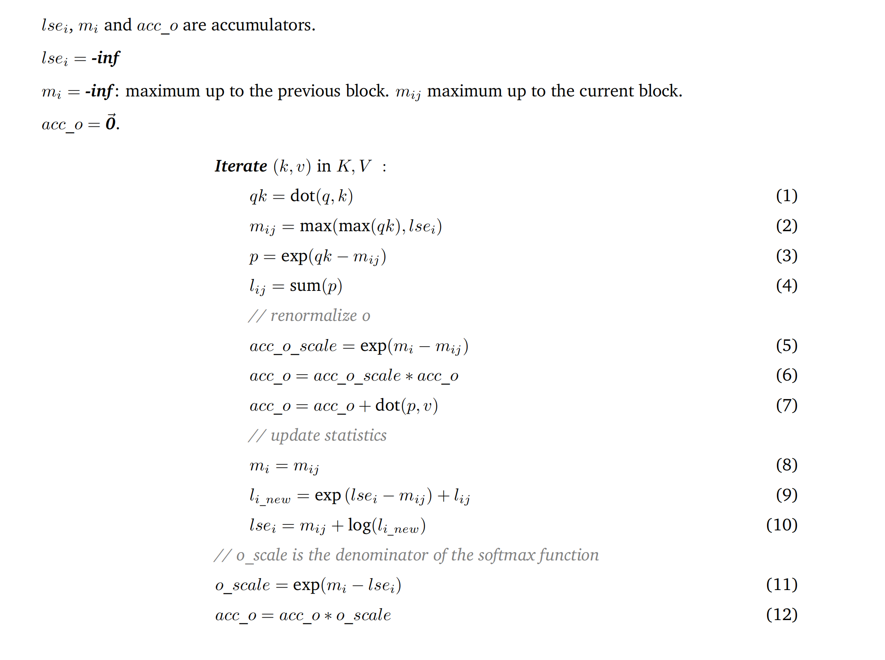

# FlashAttention 笔记

## Standard Self-Attention

对 $Q,K,V\in\mathbb R^{N\times d}$，令 $S=QK^T/\sqrt d$、$P=\operatorname{softmax}(S)$、$O=PV$，其中 softmax 按行进行。FlashAttention 将计算分块，避免把完整 $N\times N$ 的中间矩阵写入 HBM。[FlashAttention 原论文与算法](../../Papers/01_Attention/FlashAttention/github-reading.md)

### Safe Softmax

对一行分数 $x_1,\ldots,x_N$，稳定 softmax 为：

$$
p_i=\frac{e^{x_i-m}}{\ell},\qquad
m=\max_j x_j,\qquad \ell=\sum_j e^{x_j-m}.
$$

独立实现可以先求最大值、再求指数和、最后归一化；这涉及对分数的遍历，不代表必须读取 Q/K 三遍。Online softmax 将前两项统计合在一次扫描中。定义前缀状态 $m_i=\max_{j\le i}x_j$、$\ell_i=\sum_{j\le i}e^{x_j-m_i}$，则：

$$
\ell_i
=\left(\sum_{j=1}^{i-1}e^{x_j-m_{i-1}}\right)e^{m_{i-1}-m_i}+e^{x_i-m_i}
=\ell_{i-1}e^{m_{i-1}-m_i}+e^{x_i-m_i}.
$$

例如 $x=[0,\ln2]$，第一步 $(m_1,\ell_1)=(0,1)$，第二步得到 $(\ln2,1.5)$，概率为 $[1/3,2/3]$。最终概率需要完整分母；可以再次读取输入，也可以保留输入后归一化，不能无条件声称独立 softmax 不存在单次读取输入的实现。

## FlashAttention V1

Attention 只需概率对 V 的加权和，不必逐项输出全部概率。令前缀归一化结果为：

$$
o_i=\frac{\sum_{j=1}^{i}e^{x_j-m_i}V_j}{\ell_i}.
$$

将历史项统一到新的指数尺度，得到：

$$
o_i=\frac{\ell_{i-1}e^{m_{i-1}-m_i}o_{i-1}+e^{x_i-m_i}V_i}{\ell_i}.
$$

继续使用 $x=[0,\ln2]$，取 $V=[2,5]$，则 $o_1=2$，$o_2=(1\times\tfrac12\times2+1\times5)/1.5=4$。这与完整 softmax 的 $\tfrac13\times2+\tfrac23\times5$ 相同。

也可维护未归一化向量和 $u_i=\ell_i o_i$，每次只做重缩放与累加，最后计算 $O=u_N/\ell_N$。分块版本将单元素的更新推广到 tile；其数值状态相同，具体循环顺序与并行划分由 kernel 决定。

## FlashAttention V2

FlashAttention-2 减少非矩阵乘运算，沿 query 序列划分更多线程块，并调整 warp 工作分配以减少共享内存通信。前向中的 sliced-Q 划分让不同 warp 负责不同 query 行；这不是对所有阶段、所有实现一概“禁止 Split-K”。[论文](https://arxiv.org/abs/2307.08691)

旧 Triton 示例使用 LSE 保存分母信息：

$$
L_i=\log\sum_{j\le i}e^{x_j}=m_i+\log\ell_i.
$$

LSE 在这里是精确的 log-normalizer，不能只把它当作最大值的近似。切换到新尺度 $m_{new}$ 时，历史分母的贡献是：

$$
e^{L_{old}-m_{new}}
=e^{m_{old}-m_{new}}\ell_{old}.
$$

例如历史状态为 $m_{old}=0,\ell_{old}=2$，新尺度为 $\ln2$，历史分母贡献是 $e^{\ln2-\ln2}=1$。与新 tile 的指数和相加后，才能得到完整的新分母。

最终缩放因子为 $e^{m-L}=1/\ell$，不是 $m-L$ 本身。例如 $m=\ln2,\ell=1.5$，则 $L=\ln3$，缩放为 $2/3$。这一恒等式说明图中的输出归一化；不能仅凭旧实现截图把它归为 FlashAttention-2 的完整 kernel。[Triton 示例源码](https://github.com/Dao-AILab/flash-attention/blob/main/flash_attn/flash_attn_triton.py)
