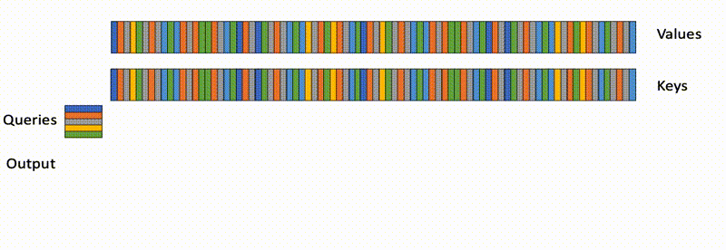
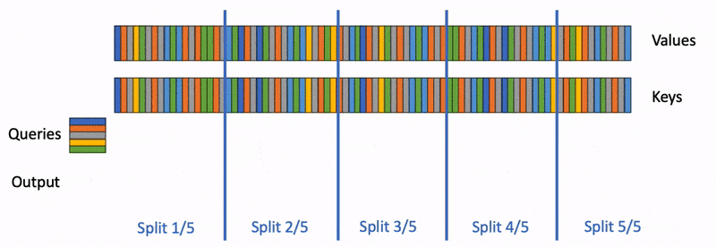

# Flash-Decoding for long-context inference

Flash-Decoding 在 KV 序列维度上划分任务，提高小 batch、长上下文 decode 的并行度，再合并各块的局部 attention 输出。[作者博文（2023-10-12）](https://crfm.stanford.edu/2023/10/12/flashdecoding.html)

## Multi-head attention for decoding

逐 token decode 通常只有一个新 query，但需要读取可见历史的 KV。只沿 batch、heads 和 query tiles 划分任务时，线程块数可能不足以利用全部 SM；具体并行度还取决于模型 head 配置与实现，不能仅由 batch size=1 推出固定的 GPU 利用率。



<a id="a-faster-attention-for-decoding-flash-decoding"></a>

## Flash-Decoding Design

FlashAttention 对 batch size 和 query length 进行了并行化加速，Flash-Decoding 在此基础上新增了一个并行化维度，keys/values 序列长度。KV 分块增加独立任务数，但最终收益仍取决于分块规模与归约开销。与 FlashAttention 类似，Flash-Decoding 几乎不用额外存储大量数据到全局内存，从而减少了内存开销。



Flash Decoding 主要包含以下三个步骤：

- 将 keys 和 values 分成较小的 block
- **使用 Flash Attention 并行计算 query 与 每个 block 的注意力（与 Flash Attention 的最大区别）**。对于每个 block 的每行，Flash Decoding 会额外记录 attention values 的 log-sum-exp，用于第三步 rescale。
- 对所有输出 blocks 进行 reduction 得到最终输出，需要用 log-sum-exp 来重新调整每个块的贡献。

实际应用中第一步不涉及 GPU 操作，需要对第 2 步第 3 步执行单独 kernels。最终的 reduction 会引入一些额外的计算，但总体上 Flash-Decoding 通过增加并行化的方式取得了更高的效率。

Split-KV 后按照各块的 LSE 重缩放输出。下面是合并逻辑示意，`max_logic`、`sum_exp`、`acc` 分别初始化为负无穷、0 和零向量，并假定各 split 含至少一个可见位置：

```python
        # This loop should be mapped to different blocks for parallel execution.
        for n in range(loop_n):
            k = ks[n]
            v = vs[n]

            output, lse = self.flash_attn_split_kv(q, k, v)

            # Compute the actual output by reducing over all the splits, using the log-sum-exp to scale the contribution of each split.

            new_max_logic = torch.max(max_logic, lse)

            old_scale = torch.exp(max_logic - new_max_logic)
            acc *= old_scale

            exp_logic = torch.exp(lse - new_max_logic)
            acc += exp_logic * output
            sum_exp = sum_exp * old_scale + exp_logic
            max_logic = new_max_logic

        return acc / sum_exp
```
