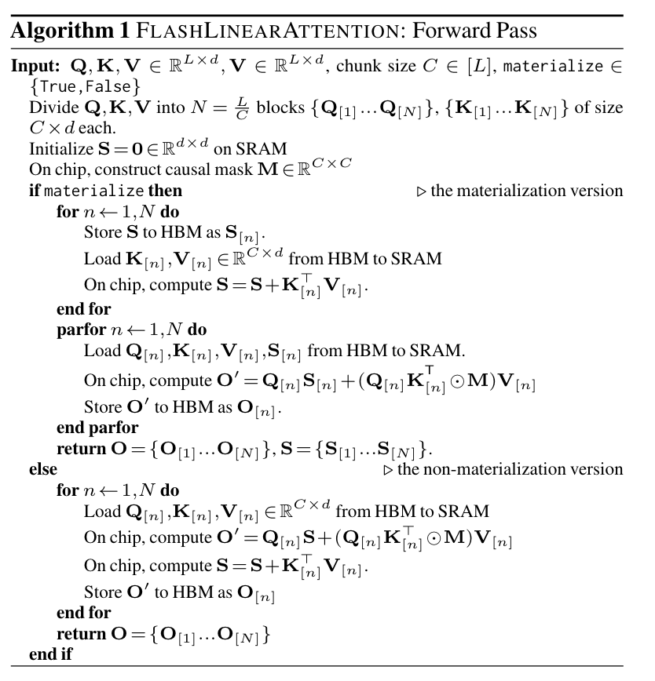
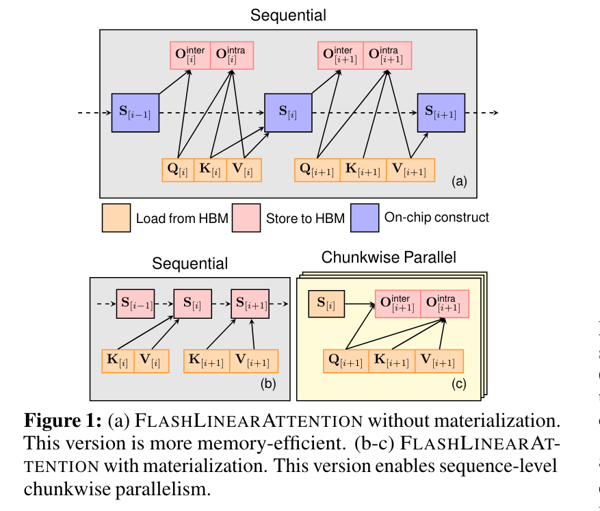
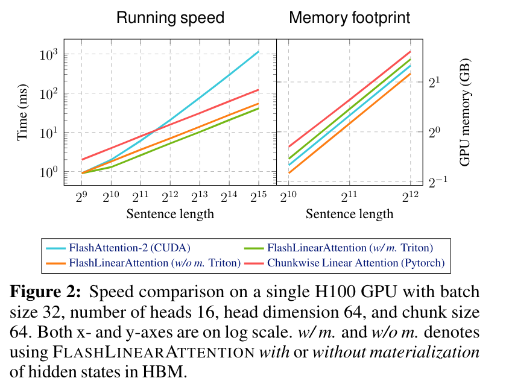
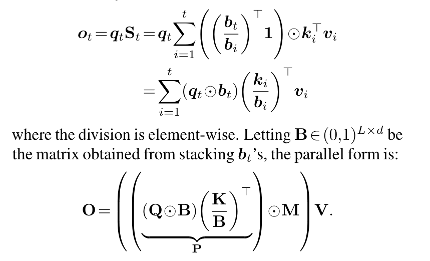
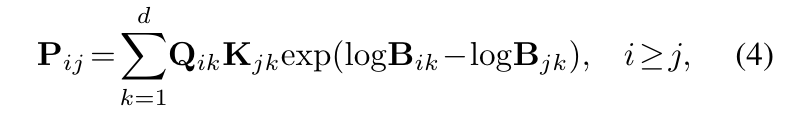
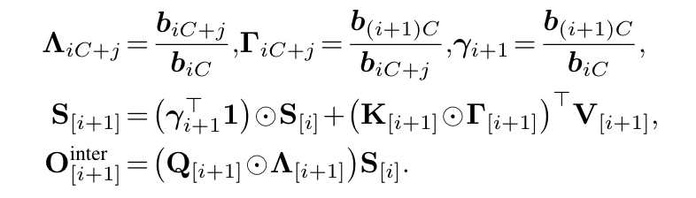
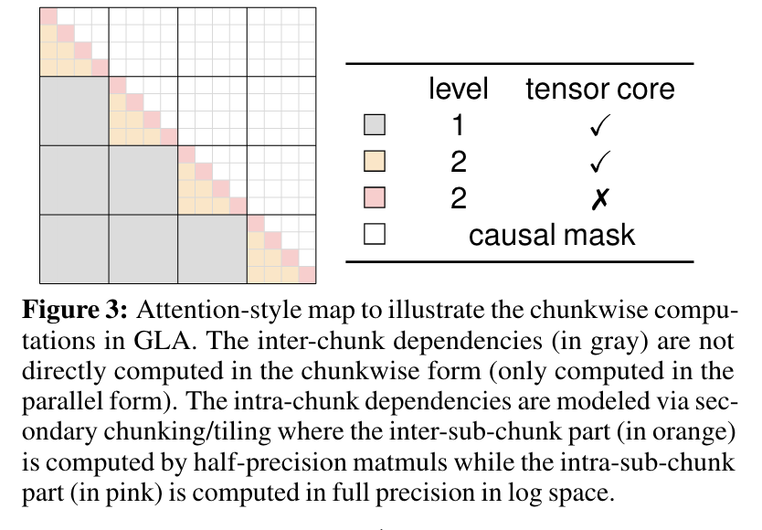
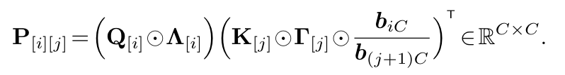
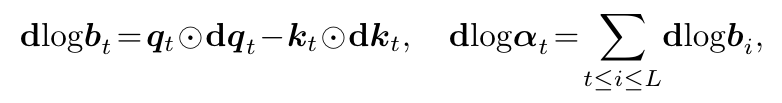
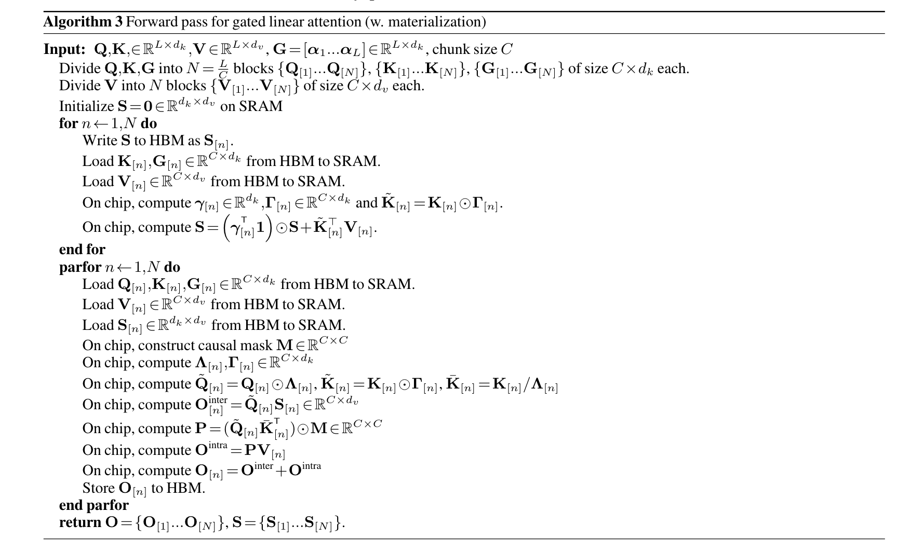

# Linear Attention

对固定特征维度，核形式的 attention 可以先聚合 K/V，再用 query 读取状态，避免显式计算完整的 token-pair 矩阵。使用行向量，若 $\kappa(q,k)=\phi(q)\phi(k)^T$，因果归一化形式为：

$$
o_t=\frac{\phi(q_t)\sum_{j=1}^{t}\phi(k_j)^Tv_j}{\phi(q_t)\sum_{j=1}^{t}\phi(k_j)^T}.
$$

分母非零时，可以维护 $S_t=S_{t-1}+\phi(k_t)^Tv_t$ 与 $z_t=z_{t-1}+\phi(k_t)^T$，输出 $o_t=\phi(q_t)S_t/(\phi(q_t)z_t)$。例如标量特征均为 1、两个 value 为 2 和 4，第二步 $S=6,z=2$，输出为 3；省略分母得到的是另一种递推定义。特征映射替代指数点积核时，也不能自动声称与原 softmax attention 等价。[GLA 论文 §2](zotero://select/library/items/QXN82QC9)

## Gated Linear Attention

$$
S_t = S_{t-1} + k_t^{T}v_t, o_t = q_tS_t, (1)
$$

这里的 $o_t=q_tS_t$ 是不含 softmax 概率归一化的线性递推，与上面的归一化核形式应分开。硬件实现需要同时考虑 SM 并行度、矩阵乘单元与 HBM/片上存储的数据流。



FLASHLINEARATTENTION 的 `materialize` 控制是否将各 chunk 的边界状态保存到 HBM：

| 路径 | 状态与输出的执行方式 | 主要取舍 |
| --- | --- | --- |
| `False` | 状态留在 SRAM，按 chunk 顺序计算输出并更新状态 | 减少状态写回，但没有 chunk 间的序列并行 |
| `True` | 先递推并保存各 chunk 的输入状态，再并行计算各 chunk 输出 | 增加状态存储，换取序列维度的并行 |

两条路径都可复用已经加载到片上的 Q/K/V。状态物化与反向中的重计算是相关但不同的选择，不能把 `materialize` 直接解释为“是否重算 S”。[论文 §3.3、Algorithm 1](zotero://select/library/items/QXN82QC9)





方程 (1) 中的线性递归没有衰减门或者遗忘门，在 RNN 中缺少衰减项使得模型难以“忘记”信息，这被假设为部分导致线性注意力在长上下文任务中不稳定的原因。最近的研究(RetNet)通过加入一个全局的、与数据无关的衰减因子 $\gamma \in (0, 1)$ 来解决这个问题。

<a id="gla-的递归和并行形式"></a>

### GLA Recurrence

**递归形式**

GLA 有一个二维遗忘门 $G_t \in (0,1)^{d_k\times d_v}$：

$$
S_t = G_t \odot S_{t-1} + k_t^{T}v_t,  (3)
$$

其中使用外积来获得 $G_t = \alpha_t^T \beta_t$，其中 $\alpha_t\in(0,1)^{1\times d_k}$、$\beta_t\in(0,1)^{1\times d_v}$。在实验中发现简单设置 $\beta_t = 1$ 就足够了，因此：

$$
S_t = (\alpha_t^T\mathbf1) \odot S_{t-1} + k_t^{T}v_t,
$$

其中 $\alpha_t$ 由输入的低秩投影和 sigmoid 等门控变换产生。以单维状态为例，旧状态为 4、遗忘门为 0.5、当前 $k_tv_t=3$，新状态为 5；门只衰减旧状态，不衰减本步新增项。

**并行形式**

将 (3) 展开可以得到：

$$
S_t = \sum_{i=1}^t ((\prod_{j=i+1}^t \alpha_j^T) \odot k_i^T)v_i 
$$

设 $b_t = \prod_{j=1}^t \alpha_j$，则：



但是这种形式在数值上是不稳定的，因为 $b_i$ 是在 $\alpha_j \in (0, 1)^{1 \times d}$ 中累积的 gate 值，当 t 很大时累积 gate 可能非常小，反而使 $K/B$ 变得非常大。为了解决这个问题使用对数计算 P:




<a id="gla-的-chunkwise-形式"></a>

### Chunkwise Form

上面推导了与线性注意力中的 chunkwise 形式类似的 GLA chunkwise 形式。对于块内 $O_{intra}$ 仍然是完全并行的方式，对于块间由：



直观地说，$A_{[i+1]}$ 编码了从一个块的开始出的累积衰减，这将用于传播来自前一个块 $S_{[i]}$ 的隐藏状态，而 $\Gamma_{[i+1]}$ 编码了块结束处的衰减，这将用于累计信息以添加到下一个隐藏状态 $S_{[i+1]}$ 中。 

### Hardware-Efficient GLA

**Secondary-level Chunking**

与普通线性注意力不同，GLA 中的块内计算无法使用 Tensor Core，因为涉及到对数运算（公式(4)）。为了更好地利用 Tensor Core，采用次级级别 Chunk 化方案，即一个块进一步划分为子块，然后以块状方式计算类似注意力的矩阵 $P \in \mathbb{R}^{L \times L}$。



子块之间的交互是通过半精度矩阵乘法计算的：



以上是对应于图 3 的橙色线条，对于块内子块部分（粉红色块），必须使用公式 (4) 并以全精度执行矩阵乘以确保稳定性。通过两级块化策略，非半精度矩阵乘法 FLOPs 总量大大减少。

**Memory-efficient $d\alpha_t$ computation**

直接保存每个 token 的二维状态需要 $L\times d_k\times d_v$ 个元素。门的梯度依赖旧状态与传回的状态梯度，不能把状态值 $S_t$ 当成其梯度。论文通过等价的梯度计算避免完整物化每步状态；图中 $d\alpha$ 的含义需与对 $\log\alpha$ 的梯度区分。[论文 §4.3、附录梯度推导](zotero://select/library/items/QXN82QC9)



下面按论文附录的两级 chunking 写成单 head 前向参考代码，$a=\log\alpha$，$\beta=1$。示例要求 `L % C == 0` 且 `C % c == 0`，没有实现尾块、混合精度或 GPU 调度：

```python
import torch

def gated_linear_attention_forward(Q, K, V, a, C, c):
    '''
    Q/K/V: query/key/value 
    a: log forget gate 
    C/c: chunk size , subchunk size 
    '''
    # L: sequence length , d: head dimension
    L, d_k = Q.shape
    d_v = V.shape[-1]

    assert L > 0 and C > 0 and c > 0 and L % C == 0 and C % c == 0
    assert K.shape == Q.shape and a.shape == Q.shape and V.shape[0] == L
    S = Q.new_zeros(d_k, d_v)
    O = torch.empty_like(V)

    # Cumulative log decay resets at each chunk boundary.
    B = torch.empty_like(a)
    for start in range(0, L, C):
        B[start:start + C] = a[start:start + C].cumsum(dim=0)

    for i in range(0, L // C):
        r = range(i * C, (i + 1) * C)  # (C, d) chunking
        bq, bk, bv, bb = Q[r], K[r], V[r], B[r]
        b = bb[-1, None]  # inter-chunk w/ matmul

        q, k, g = bq * (bb.exp()), bk * ((b - bb).exp()), b.exp()
        o = q @ S  # hidden state update
        S = g.t() * S + k.t() @ bv

        # intra-chunk (secondary chunking)
        for j in range(0, C // c):
            t = range(j * c, (j + 1) * c)  # (c, head_dim) subchunking
            q, k, v, b = bq[t], bk[t], bv[t], bb[t]
            p = Q.new_zeros(c, c)  # intra-subchunk w/o matmul

            for m in range(c):
                for n in range(m + 1):
                    p[m, n] = torch.sum(q[m] * k[n] * ((b[m] - b[n]).exp()))

            o[t] += p @ v  # inter-subchunk w/ matmul

            z = b[0, None]
            q = q * (b - z).exp()

            for u in range(0, j):
                y = range(u * c, (u + 1) * c)
                p = q @ (bk[y] * (z - bb[y]).exp()).t()
                o[t] += p @ bv[y]

        O[r] = o
    return O
```



