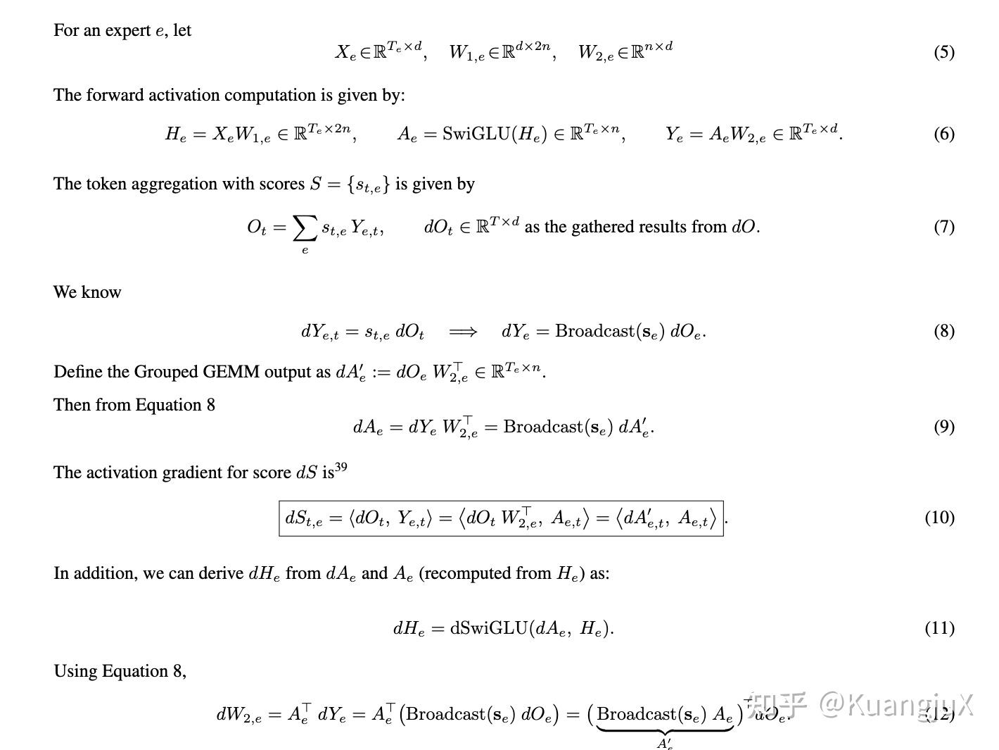
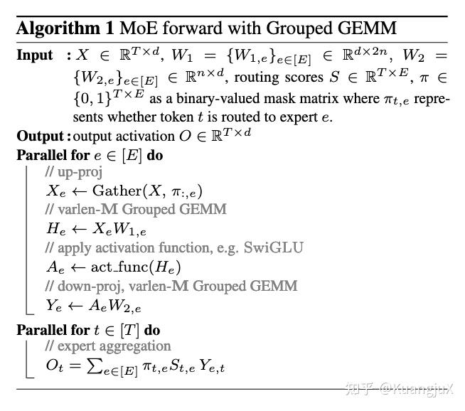
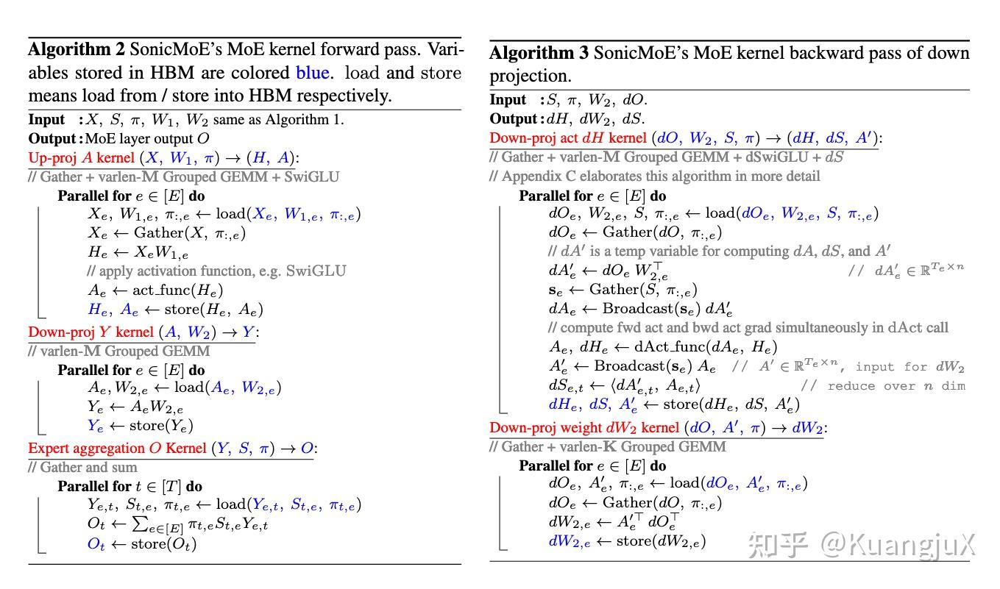
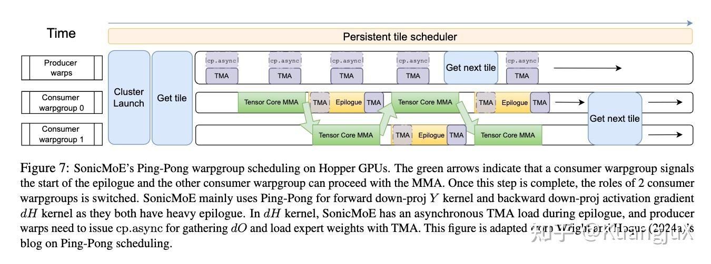

# MoE 数学与 SonicMoE：知乎原文归档

- 作者：KuangjuX。
- 来源：[MoE 笔记：从数学推导到 SonicMoE 的极致优化](https://zhuanlan.zhihu.com/p/1987208541124202922)。
- 原文发布／编辑时间：2025-12-27 23:22（北京时间）；归档：2026-10-22。

本文保存个人已发表的历史笔记；保留当时的结论、代码、截图和参考链接。正文从浏览器可读内容转为 Markdown，公式恢复为 TeX，图片存入同目录 `images/`。原文中的实现、性能数字与“当前”均按文章发表时理解；本次整理与校注写在独立笔记中。

[分篇笔记与归档目录](../../../Papers/external-notes.md)

## 引言

想象一下，你要解决一个非常复杂的问题，你有两种选择：

1. **雇佣一个“通才”**：这个通才什么都懂一点，但可能没有哪个领域是顶尖的。他需要学习所有领域的知识，这让他变得非常“庞大”和“昂贵”。
2. **雇佣一个“专家团队”**：这个团队里有多个专家，比如物理专家、化学专家、生物专家等。每个专家只精通自己的领域

现在，来了一个新问题。你不会让所有专家都去解决这个问题，这样太浪费资源了。你会先让一个“**接待员/调度员**”来判断这个问题属于哪个领域，然后把问题交给对应的一两个专家去解决。

在大型语言模型（LLM）中，这个思想就是 MoE：

- **“通才”**：对应一个标准的、巨大的前馈神经网络（Feed-Forward Network, FFN）。模型越大，参数越多，效果可能越好，但每次计算（处理一个词）都需要动用所有参数，计算成本极高。
- **“专家团队”**：这就是 **MoE 层**。它由两部分组成：
  - **多个专家（Experts）**：每个专家本身就是一个小型的 FFN。它们就是团队里的“物理专家”、“化学专家”。
  - **门控网络（Gating Network / Router）**：它就是那个“接待员/调度员”。它的作用是判断当前输入（比如一个词/token）应该由哪些专家来处理。

**MoE 的核心优势**：对于每个输入 token，我们**只激活少数几个专家**（比如从64个专家里选2个），而不是动用所有专家。这样一来，模型的总参数量可以非常大（因为有很多专家），但实际计算量却很小。这就实现了 **“用更少的计算量，驱动更大的模型”** 的目标。

## 混合专家模型（MoE）

### MoE 的数学推导

1. 门控网络（Gating Network）的决策：门控网络是一个简单的线性层，后面跟着一个 $Softmax$ 函数，它的作用是为了每个专家生成一个“权重”或“分数”。具体的计算为 $S = Softmax(x \cdot W_g)$ ，其中 $x$ 为输入 token， $W_g$ 为门控网络的权重矩阵，通过 softmax 操作转换为概率分布， $S$ 是一个向量， $S_i$ 代表门控网络第 $i$ 个专家处理 $x$ 的合适程度。
2. 选择专家（Top-K Routing）：我们不会把 $x$ 发给所有专家，实践中，我们只选择分数最高的 k 个专家，这个操作称为 **Tok-K Routing**。
3. 专家计算：每个专家 $E_i$ 本身就是一个标准的 FFN，FFN 通常包含两个线性层和一个激活函数： $E_i(x) = act\_func(x * W1_{1}) * W2_{i}$ ，其中 $W1_i$ 和 $W2_i$ 是第 i 个专家独有的权重矩阵。
4. 聚合专家输出：最后我们将被选中的 k 个专家的输出，按照门控网络给出的分数进行加权求和，得到最终的输出 $y$ ： $y = \sum(S_i * E_i(x))$ ，其中 i 是被选中的 Top-K 专家的索引。

对于一个输入 $x$ ，MoE 的计算流程是 $y = MoE(x) = \sum(S_i * E_i(x))$ 。

那么，对于 MoE 的反向传播来说，反向传播的起点是 $dOt$ ，即损失函数对最终输出 $Ot$ 的梯度，这个梯度由模型的下一层计算并传递回来。

MoE 的反向传播公式

### MoE forward with Grouped GEMM

MoE forward with Grouped GEMM

上面的代码是 MoE 在工程中的一种优化，它处理的不是单个 token $x$ ，而是一个批次的 $T$ 个 token。对于输入：

- $X \in \mathbb{R}^{(T \times d)}$ ：其中 T 是序列长度，d 是每个 token 的维度。
- $W_1 \in \{W_{1, e}\}_{e \in [E]} \in \mathbb{R}^{d \times 2n}$ ：所有专家的第一个线性层的权重集合，E 是专家总数，每个专家 e 都有一个自己的 权重矩阵 $W_{1, e}$ ，维度是 $d \times 2n$ 。
- $W_2 \in \{W_{2, e}\}_{e \in [E]} \in \mathbb{R}^{n \times d}$ ：所有专家的第二个线性层的权重集合，每个专家 e 都有一个自己的 权重矩阵 $W_{2, e}$ ，维度是 $n \times d$ 。
- $S \in \mathbb{R}^{(T \times E)}$ ：门控网络为 T 个 token 计算出的 E 个专家的分数矩阵， $S_{t, e}$ 表示第 t 个 token 对第 e 个专家的分数。
- $\pi \in \{0, 1\}^{T \times E}$ ：这是一个二进制掩码，它是 Top-K 选择的结果，如果 $\pi_{t, e} = 1$ 表示第 t 个 token 被路由到了第 e 个专家，反之则没有。

输出： $O \in \mathbb{R}^{(T \times d)}$

上面的伪代码中对每个专家 e 进行并行处理：

1. 首先， $\pi:,e$ 是掩码矩阵的第 `e` 列，这意味着这一列标记了所有应该发送到专家 e 的 token；`Gather` 操作根据 $\pi:,e$ 这个指令，从原始输入 X 中把所有被路由到专家 e 中的 token 拿出来，堆叠成一个新的矩阵 $X_e$ ，由于不用专家收到的 token 数量是不同的，因此 $X_e$ 是一个可变长度的矩阵。
2. 第二步，通过执行一个 **varlen-M Grouped GEMM** 用来执行一个可变维度的矩阵乘。
3. 第三步，对中间结果 $H_e$ 应用激活函数，例如 `SwiGLU` 或者 `ReLU`，这是一个逐元素的操作。
4. 第四步，针对 FFN 的第二次矩阵乘法，依然通过 **varlen-M Grouped GEMM** 进行执行。
5. 最终，通过对 T 维度进行并行聚合， $Y_{e}$ 是专家 e 的输出矩阵， $Y_{e, t}$ 指的是 $Y_{e}$ 中对应原始 token `t` 的那一行输出。在实现中，由于 `Gather` 打乱了 token 顺序，所以需要一个对应的 `Scatter` 操作，将 $Y_e$ 的结果根据原始索引放回到正确的位置上，并与权重 $S_{t, e}$ 相乘，然后累加起来，这个公式描述的是 `Scatter` 操作的最终数学效果。另外， $\pi_{t, e}$ 如果 token `t` 没有被路由到专家 `e`，这个值是 0，因此整个项就变成了 0。

### MoE 计算成本分析

以 `up-projection` 为例

1. **浮点数运算次数**：矩阵乘法 $A(m, k) * B(k, n)$ 的 FLOPs 大约是 $2 * m * k *n$ ，因此 $X_e * W_{1, e}$ 的 FLOPs 为 $2 * T_e * d * 2n$ 。
2. **内存传输字节数（IO）**：读取输入 $X_e$ ，字节数是 $T_e * d * 2$ ，读取权重 $W_{1, e}$ ，字节数是 $d * 2n * 2$ ，写入输出 $T_e * 2n * 2$

最终计算出 MoE 流程总的浮点数运算次数为 $2T_e \cdot 2n \cdot d + 2T_end$ ，总内存传输字节数为 $4T_en + 6nd + 4T_ed$ ，最终计算出计算强度（FLOPs/IO) 为 ：

$\frac{2T_e \cdot 2n \cdot d + 2T_end}{4T_en+6nd+4T_ed}$

现在可以引入两个重要的参数：

- 激活率(Activation Ratio)： $\rho = \frac{K}{E}$ ，K  表示每个 token 激活的专家数，E 是总专家数，它代表了计算的稀疏程度， $\rho$ 越小，计算越稀疏
- 粒度(Granularity)： $G = \frac{d}{n}$ ，d 是模型主维度，n 是专家 FFN 的中间维度，G 越大，意味着相比于主维度 d，专家的中间层 n 越小，这被称为**细粒度（fine-grained）**MoE，即每个专家更“瘦”一些。

最终计算强度可以被化简为：

$\frac{3}{\frac{2 + 2G}{d} + \frac{3}{T\rho}}$ ，这意味着：

1. **增加粒度 (increasing G)**: `G` 变大，意味着专家变“瘦” (`n` 变小)。虽然分子也变大，但分母中 `d` 是固定的，而 `n` 变小导致 IO 成本中与 `n` 相关的项（ $4T_en$ ， $6nd$ ）相对于 FLOPs 下降得更快。最终结果是**算术强度下降**。
2. **增加稀疏度 (decreasing ρ)**: `ρ` 变小，意味着每个专家处理的 token 数量 $T_e$ 变少。这导致分母中的 $\frac{3}{T\rho}$ 项急剧增大，从而使**算术强度下降**。

## SonicMoE: Accelerating MoE with IO and Tile-aware Optimizations

最近的一篇新论文 SonicMoE[1](https://zhuanlan.zhihu.com/p/1987208541124202922#ref_1) 提出了几个**重要的观察**：

1. **细粒度 MoE 需要更大的激活内存**，因为激活大小通常与激活的专家数量呈线性关系。
2. 由于专家数量细化，计算强度降低，但是 IO 成本增加。
3. 对于高度稀疏的 MoE 模型，Grouped GEMM 的分块量化效应会导致计算资源浪费，**细粒度**和**高稀疏性**都使得 MoE 更趋向于内存密集型。

SonicMoE 希望通过实现一个 hardware/model co-design 的算子解决这个问题：

1. 在不增加 FLOPs 的情况下，以尽可能小的激活内存占用实现 MoE 训练。
2. 通过 IO 和计算的 overlap 实现高计算吞吐量。
3. 消除 Sparse MoE 中 浪费的 FLOPs。

SonicMoE 中启动的 8 个 kernel 的计算流程

针对 SonicMoE 以上的几个观察，SonicMoE 设计了一系列 Kernel 用来解决这些问题，这些 Kernel 的 overview 如上所示。

为了解决 MoE 训练时，**因专家数量增多造成的激活内存爆炸的问题**，SonicMoE 经过一系列精巧的设计，成功地将激活内存的占用与专家粒度节藕，使其达到理论上的最优水平。

MoE 的总的 FLOPs 为 $(6+12) * T * n * K * d$ ，为了保持总计算量不变，这意味着 `n * K` 必须是常数，也就是说，如果想增加专家数量，就必须减少每个专家的容量。

在标准的 MoE 实现中，反向传播需要用到前向传播时的一些中间结果，也就是激活，其中一些关键激活的尺寸为 $T * K * d$ ，当为了模型性能去增加 K 时，内存占用就会线性增长，因此应当想办法避免缓存这些激活。

SonicMoE 通过三个关键的技术来解决这个问题：

1. 识别并避免缓存巨型激活：SonicMoE 在反向传播中，不依赖于存储在 HBM 的 $X_e$ 和 $Y$ 。
2. 通过 Operator Fusion 消除中间产物：**将 HBM load 和 Gather 融合成一个 Kernel**，这样在计算 $X_e$ 的时候可以直接从 $X$ 的位置读取数据，而不在内存中显式构建 $X_e$ 。
3. 数学等价替换，绕开依赖：由于 `dS` 和 `dH` 需要依赖 `Y`，但 SonicMoE 决定不存储 `Y`，而是用过一部分重计算来绕开依赖。

SonicMoE 中的前向传播和反向传播算法

### 算子融合

在 SonicMoE 中主要做了两个操作融合的技术：

1. 将 Gather 与 HBM Load 融合在一起
2. 将 SwiGLU 激活函数与 GEMM 中的 Epilogue 融合在一起

针对 Gather 融合，SonicMoE 通过 `cp.async` 指令将通过 Token Index 获取到的内容异步加载到 SMEM 中，随后可以做后续的操作。 SonicMoE 的 Grouped GEMM 接受 contiguously-packed 的输入或者非连续输入，对于后一种情况将输入 gather 的操作与从 GMEM 到 SMEM 的输入加载操作融合到一起对它们进行批量处理，并在 Tensor Core 上执行 GEMM。这包括 1) 获取每个专家的 Token Index 2) 使用这些 Token Index 通过 `cp.async` 收集激活值。对于第二步通过 prefetch 以及 producer 的协同获取来优化同步索引获取，下图展示了这一过程。

针对 Epilogue 融合，SonicMoE 选择在前向传播的时候在 GEMM Epilogue 后还在寄存器的时候直接做 SwiGLU 计算。同时，SonicMoE 一个**更具创新的融合方案**是将方向传播时候需要计算的三个关键梯度 `dH`，`dS`，`dSwiGLU` 全部融合到一个 Kernel 内部。 在之前的工作，例如 ScatterMoE[2](https://zhuanlan.zhihu.com/p/1987208541124202922#ref_2) 以及 MoMoE[3](https://zhuanlan.zhihu.com/p/1987208541124202922#ref_3) 等使用 `dS = <dO, Y>` 来计算 `dS`，而 SonicMoE 通过计算 `dS = <dA, A'>` 这个路径，这两个在数学中是等价的，但不需要再去存储 `Y` 在 HBM 中。

### 计算与 IO 的重叠优化

在 Hopper GPUs 上的 PingPong warpgroup 调度

SonicMoE 通过 Hopper 上面的 PingPong 机制来掩盖 MMA 计算延迟，具体来说：

- 计算 `dH` Epilogue 时候的 TMA load：在计算 `dH` kernel 的尾声， 我们需要加载 `H` 来计算 `dH`。在消费者中创建了一个专门的流水线用来异步加载 `H`，使其与 Epilogue 中的其他操作并行执行，上图中消费者中的 TMA 操作就展示了这个过程。
- 在前向 `Y` 计算与反向 $\tilde{X}$ 的时候的 TMA store：在 ScatterMoE 和 MoMoE 中都将 Scatter 与 HBM store 融合到了一起，而 SonicMoE 选择先用 TMA 将结果连续地存储到一个 HBM 的临时区域，然后再启动一个独立的 Kernel 来完成最终的 Scatter 操作。这是由于融合 Scatter-Store 需要**进行复杂的地址计算**，而在 Hopper 上这个存储指令是同步的，这是由于在 Hopper 架构中 TMA 操作只能处理结构化的 block 传输而无法处理分散的逐点写入（尽管 BlackWell GPU 中提供了异步的 `st.async.release.global` 指令，但重复的索引获取仍然会使 scatter 成为一个不太好的选择）。因此，这意味着必须等待数据完全写回才能开启下一次 MMA 计算，这会打破 PingPong 的节奏，因此尽管增加了了一个 Kernel，但由于避免了对主 GEMM 的阻塞，总的吞吐量反而会更高。

该图展示了异步 TMA 存储具有更高的内存带宽，并且可以自然地与 TensorCore MMA 操作重叠，而同步的 st.global 指令会阻塞下一个 TensorCore MMA 的执行，从而导致内核运行时间更长。

### Top-K 排序 Kernel 设计

MoE 需要通过一个 `topK` 为每个 token `t` 生成一个包含 `E` 的分数，然后再从分数里找出匹配度最高的 k 个，SonicMoE 观察发现在现有的 MoE 实现中，直接调用 PyTorch 的 `torch.topk` 函数，占据了整个路由计算时间的 40%，是一个非常显著的开销。这是由于 `torch.topk` 是一个通用性的 Kernel，很可能没有对 T 很大但 E 不大的特定场景做优化。

SonicMoE 设计了一个适用于 $E \leq 4096$ 以及 $K \leq 16$ 配置的内核，这个配置适用于大部分 MoE 的配置。SonicMoE TopK 使用**双调排序（Bitonic Sort）**作为核心算法，同时使用了 1）打包索引以保证排序稳定性 2）利用寄存器和 Warp-Shuffle 来提升内存效率 3）针对小规模排序的特殊优化手段来对 TopK 进行优化。

### 令牌舍入算法

Token rounding routing 算法

SonicMoE 发现，在训练非常稀疏的 MoE 模型的时候，每个专家分配到的 token 数量会变少，由于现代 GPU GEMM 是基于固定的 Tile 来执行的，如果 token 数量无法被 Tile 整除，就需要进行填充，会造成大的计算资源浪费。为了解决这个问题，SonicMoE 通过一种**令牌舍入的算法（Token Rounding Routing）**的算法，主动将分配给每个专家的 Token 数量舍入到最接近 Tile 大小的倍数。

具体来说，SonicMoE 实现了一个两步排序算法：

1. **计算初始分配和候选池**：首先执行标准的令牌选择路由，即每个令牌选择得分最高的 K 个专家，这会给每个专家 `e` 分配一个初始的令牌集合，数量为 $f_e$ 。同时，对于每个专家 `e` 对所有令牌的路由得分进行排序，创建了一个候选令牌池，其中除了包含算法选中的令牌外，其他可能适合该专家的令牌，并按得分高低排序。
2. **舍入决策与执行**：算法需要决定是向上舍入还是向下舍入，默认策略是就近舍入。如果向上舍入，就再选择 $\lceil f_e \rceil_{M_{tile}} - f_e$ ，否则就舍弃掉多余的。

### 实验与性能评估

不同模型规模下的峰值激活内存使用量

上图为 SonicMoE 在不同规模 MoE 模型下的峰值内存使用量，在 n = 256 的 7B 模型相比 ScatterMoE 减少了 45% 的内存使用量，与 MoMoE 相比更为显著。

H100 上不同 MoE Kernels 的前向与反向的 FLOPs

在 1.4B 和 7B 的配置中相比 ScatterMoE 以及 MoMoE 的 TFLOPs 提高了 40%。对于 30B 和 120B 差距进一步增大，因为 SonicMoE 在正向和反向传播中实现了超过 500 TFLOPs 的吞吐量，而其他 baselines 要么无法支持某些 n 值（MegaBlocks[4](https://zhuanlan.zhihu.com/p/1987208541124202922#ref_4)），要么性能显著下降（MoMoE）。SonicMoE 在正向传播中也比 DeepGEMM++ 要快。

## 参考

1. [^](https://zhuanlan.zhihu.com/p/1987208541124202922#ref_1_0)Guo W, Mishra M, Cheng X, et al. SonicMoE: Accelerating MoE with IO and Tile-aware Optimizations[J]. arXiv preprint arXiv:2512.14080, 2025.
2. [^](https://zhuanlan.zhihu.com/p/1987208541124202922#ref_2_0)Tan S, Shen Y, Panda R, et al. Scattered mixture-of-experts implementation[J]. arXiv preprint arXiv:2403.08245, 2024.
3. [^](https://zhuanlan.zhihu.com/p/1987208541124202922#ref_3_0)Bobby Costin, Timor Averbuch, Dhruv Pai, Nathan Chen, and Ben Keigwin. “MoMoE: Memory optimized Mixture of Experts”. In: Tilde Research Blog (July 2025). Blog post. URL: https://www.tilderesearch.com/blog/ momoe.
4. [^](https://zhuanlan.zhihu.com/p/1987208541124202922#ref_4_0)Gale T, Narayanan D, Young C, et al. Megablocks: Efficient sparse training with mixture-of-experts[J]. Proceedings of Machine Learning and Systems, 20

## 归档图片来源

图片保存自页面实际加载的显示版本，通常为 1440w；下表保留知乎原始图片链接。

| 本地图片 | 原文图片 |
| --- | --- |
| [moe-notes-01.jpg](images/moe-notes-01.jpg) | [知乎原图](https://pic2.zhimg.com/v2-3e138dbdf2279aff151f4854f633d765_r.jpg) |
| [moe-notes-02.jpg](images/moe-notes-02.jpg) | [知乎原图](https://pica.zhimg.com/v2-e14a910d4f9773affd0a37ede5870114_r.jpg) |
| [moe-notes-03.jpg](images/moe-notes-03.jpg) | [知乎原图](https://picx.zhimg.com/v2-bf360f60bba3129b6a5677098742fa2f_r.jpg) |
| [moe-notes-04.jpg](images/moe-notes-04.jpg) | [知乎原图](https://pic1.zhimg.com/v2-5002c5affa1c3f448e21e5dda7d633ba_r.jpg) |
| [moe-notes-05.jpg](images/moe-notes-05.jpg) | [知乎原图](https://pic3.zhimg.com/v2-e1218354bcf10713b45a6799cc6cff98_r.jpg) |
| [moe-notes-06.jpg](images/moe-notes-06.jpg) | [知乎原图](https://pic3.zhimg.com/v2-6bc8d11a5e53456935110ff7f2c6a6a0_r.jpg) |
| [moe-notes-07.jpg](images/moe-notes-07.jpg) | [知乎原图](https://pic1.zhimg.com/v2-164dd475480549b0c49d1f98b1ea7040_r.jpg) |
| [moe-notes-08.jpg](images/moe-notes-08.jpg) | [知乎原图](https://pic1.zhimg.com/v2-aceeb863f8e17daa70d2cd4d8b9d9ee4_r.jpg) |
| [moe-notes-09.jpg](images/moe-notes-09.jpg) | [知乎原图](https://pic3.zhimg.com/v2-2303838bc00401ef0eb620cf5975c216_r.jpg) |
| [moe-notes-10.jpg](images/moe-notes-10.jpg) | [知乎原图](https://pic3.zhimg.com/v2-622c3cb1646e3adb95f249c672bb1140_r.jpg) |
