# [译] tcgen05 入门：从零实现 B200 GEMM

[下载完整中文 PDF](./article.pdf)

<!-- imported-translation:start -->

<article><header class="mb-14"><!-- original-title -->
<time>2025 年 12 月 21 日</time>

完整中文译本｜原文作者：gau-nernst｜翻译与排版：2026-10-10。基于本地原稿完整翻译，保留全部图示、代码、表格与链接。图内英文与代码注释保持原样；正文中的“我”指原作者，性能数据、推测及限制均按原文保留，未进行 GPU 复测。

<a href="https://gau-nernst.github.io/tcgen05/">原文：tcgen05 for dummies</a>
</header><section>
<a href="https://docs.nvidia.com/cuda/parallel-thread-execution/#tensorcore-5th-generation-instructions"><code>tcgen05</code></a> 是一组 PTX 指令，用于编程 NVIDIA 最新的 Blackwell GPU（<code>sm100</code>，注意不要与消费级 Blackwell 的 <code>sm120</code> 混淆）上的 Tensor Core。写这篇文章时，我找不到用原生 CUDA C++ 配合 PTX 编写的 Blackwell 教程，尽管 Ampere 已有 <a href="https://alexarmbr.github.io/2024/08/10/How-To-Write-A-Fast-Matrix-Multiplication-From-Scratch-With-Tensor-Cores.html">alexarmbr</a> 和 <a href="https://www.spatters.ca/mma-matmul">spatters</a> 的教程，Hopper 也有 <a href="https://cudaforfun.substack.com/p/outperforming-cublas-on-h100-a-worklog">Pranjal</a> 的教程。那就自己写一篇吧，记录我学习 <code>tcgen05</code>，并在 <code>M=N=K=4096</code> 的问题规模下达到 CuBLAS 98% 速度的过程！

所有 B200 实验都在 <a href="https://modal.com/">Modal</a> 上完成。这个平台很适合运行短时函数，例如本文这样的 Blackwell 矩阵乘法内核。你可以使用 Modal，也可以选择其他提供 B200 的云平台，跟着文章一起实践。

代码地址：<a href="https://github.com/gau-nernst/learn-cuda/tree/3b90ac9b/02e_matmul_sm100/">https://github.com/gau-nernst/learn-cuda/tree/3b90ac9b/02e_matmul_sm100/</a>
<aside class="toc"><h2 data-block="B004">目录</h2><nav id="TableOfContents"><ol><li><a href="#recap-on-writing-a-performant-matmul-kernel">回顾：如何编写高性能矩阵乘法内核</a></li><li><a href="#basic-tcgen05-kernel">基础 tcgen05 内核</a><ol><li><a href="#tma-and-mbarrier-for-dummies">TMA 与 mbarrier 入门</a></li><li><a href="#acquire-release-semantics">Acquire-Release 语义</a></li><li><a href="#decipher-tcgen05">解读 tcgen05</a></li></ol></li><li><a href="#128-byte-global-load-and-swizzling">128 字节全局加载与 swizzle</a></li><li><a href="#pipelining">流水线</a></li><li><a href="#warp-specialization">Warp 专职分工（Warp specialization）</a></li><li><a href="#2-sm-mma">双 SM MMA（2-SM MMA）</a></li><li><a href="#persistent-kernel-with-static-scheduling">持久化内核：静态调度</a></li><li><a href="#closing-remarks">结束语</a></li></ol></nav></aside><h2 data-block="B005" id="recap-on-writing-a-performant-matmul-kernel">回顾：如何编写高性能矩阵乘法内核</h2>
矩阵 A（形状为 <code>MxK</code>）与 B（形状为 <code>KxN</code>）相乘，得到形状为 <code>MxN</code> 的输出 C。从数学上看，C 的每个元素都是 A 的一行与 B 的一列的点积。

<pre style="color:#f8f8f2;background-color:#272822;-moz-tab-size:4;-o-tab-size:4;tab-size:4" tabindex="0"><code class="language-python" data-lang="python">def matmul(A: Tensor, B: Tensor, C: Tensor, M: int, N: int, K: int):
    for m in range(M):
        for n in range(N):
            # initialize accumulator
            acc = 0

            # doing dot product along K
            for k in range(K):
                acc += A[m, k] * B[k, n]

            # store result
            C[m, n] = acc
</code></pre>

然而，几乎所有矩阵乘法实现都会采用某种分块（tiling）方式，而不是直接逐个计算点积。分块会选取 A 和 B 的一部分，对它们执行一次小矩阵乘法，再沿 K 维累加结果。实际上，这仍然可以看作点积，只不过粒度从单个元素变成了一个 tile。

<pre style="color:#f8f8f2;background-color:#272822;-moz-tab-size:4;-o-tab-size:4;tab-size:4" tabindex="0"><code class="language-python" data-lang="python">def tiled_matmul(A: Tensor, B: Tensor, C: Tensor, M: int, N: int, K: int):
    BLOCK_M = 128
    BLOCK_N = 128
    BLOCK_K = 64

    for m in range(0, M, BLOCK_M):
        for n in range(0, N, BLOCK_N):
            # initialize accumulator
            acc = torch.zeros(BLOCK_M, BLOCK_N)

            # doing mini matmuls along K
            for k in range(0, K, BLOCK_K):
                # select tiles of A and B
                A_tile = A[m:m+BLOCK_M, k:k+BLOCK_K]  # shape [BLOCK_M, BLOCK_K]
                B_tile = B[k:k+BLOCK_K, n:n+BLOCK_N]  # shape [BLOCK_K, BLOCK_N]
                acc += mini_matmul(A_tile, B_tile)    # shape [BLOCK_M, BLOCK_N]

            # store result
            C[m : m + BLOCK_M, n : n + BLOCK_N] = acc
</code></pre>
<figure>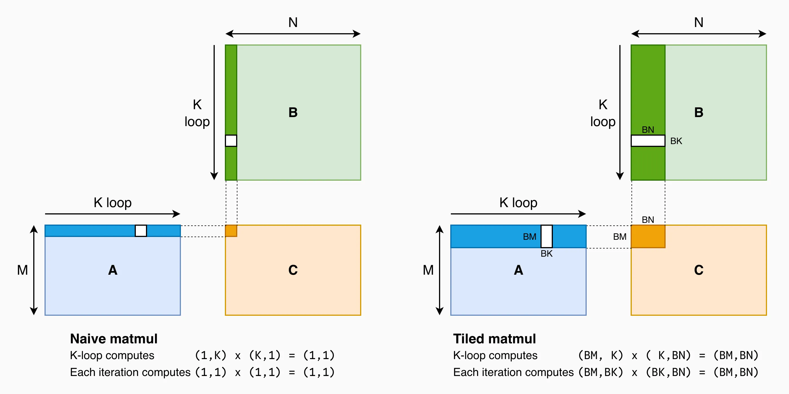<figcaption>
朴素矩阵乘法（左）与分块矩阵乘法（右）示意图。
</figcaption></figure>
分块矩阵乘法在现代处理器上优于朴素实现有很多充分的理由，但我先给一个简单得近乎粗暴的理由：Tensor Core 就是我们的小矩阵乘法引擎，因此按 Tensor Core 支持的形状对问题进行分块，是很自然的选择。实际实现可能包含多层分块，每一层都试图利用某些硬件特性。

上面的 Python 代码构成了矩阵乘法 GPU 内核的整体结构。m 和 n 两层循环在线程块之间并行执行：每个线程块负责一块 <code>BLOCK_M x BLOCK_N</code> 的输出，并读取 A 中的 <code>BLOCK_M x K</code> 区域和 B 中的 <code>K x BLOCK_N</code> 区域。在线程块内部，我们沿 K 维迭代，加载 A 和 B 的 tile，再使用 Tensor Core 执行矩阵乘加（MMA）。每一代 NVIDIA GPU 都有各自用于加载和计算的 PTX 指令。
<table><thead><tr><th>GPU 世代</th><th>加载</th><th>计算</th></tr></thead><tbody><tr><td>Ampere (sm80)</td><td><code>cp.async</code></td><td><code>mma</code></td></tr><tr><td>Hopper (sm90)</td><td><code>cp.async.bulk.tensor</code> (TMA)</td><td><code>wgmma.mma_async</code></td></tr><tr><td>Blackwell (sm100)</td><td><code>cp.async.bulk.tensor</code> (TMA)</td><td><code>tcgen05.mma</code></td></tr></tbody></table>
从概念上说，Blackwell 的矩阵乘法内核与前几代并没有很大不同。只要理解新的 PTX 指令，就能释放硬件的浮点算力。先来看第一条：驱动 TMA 的 <code>cp.async.bulk.tensor</code>。
<h2 data-block="B012" id="basic-tcgen05-kernel">基础 tcgen05 内核</h2><h3 data-block="B013" id="tma-and-mbarrier-for-dummies">TMA 与 mbarrier 入门</h3>
Tensor Memory Accelerator（TMA，张量内存加速器）是从 Hopper 开始引入的新硬件，能够以极少的寄存器占用和地址计算发起内存加载。此前，<code>cp.async</code> 每个线程最多只能发起 16 字节的加载。相比之下，TMA 仅用一个线程就能发起任意大小的加载。在 PTX 中，TMA 对应 <code>cp.async.bulk</code>（1D tile）和 <code>cp.async.bulk.tensor</code>（1D 到 5D tile）指令。

首先，我们需要创建一个 <a href="https://docs.nvidia.com/cuda/cuda-driver-api/group__CUDA__TENSOR__MEMORY.html">Tensor Map</a> 对象，编码 TMA 应如何将数据从全局内存搬到共享内存；也可以反向搬运，即从共享内存到全局内存。这一步需要在主机端使用 CUDA Driver API 完成。

<pre style="color:#f8f8f2;background-color:#272822;-moz-tab-size:4;-o-tab-size:4;tab-size:4" tabindex="0"><code class="language-cpp" data-lang="cpp">#include &lt;cudaTypedefs.h&gt;  // required for CUtensorMap
#include &lt;cuda_bf16.h&gt;

constexpr int BLOCK_M = 64;
constexpr int BLOCK_N = 64;
constexpr int BLOCK_K = 64;

constexpr int TB_SIZE = 128;

__global__
void kernel(
  const __grid_constant__ CUtensorMap A_tmap,
  const __grid_constant__ CUtensorMap B_tmap,
  nv_bfloat16 *C_ptr,
  int M, int N, int K
) {
  ...  // we will cover this later.
}

// forward declaration. we will cover this later.
void init_2D_tmap(
  CUtensorMap *tmap,
  const nv_bfloat16 *ptr,
  uint64_t global_height, uint64_t global_width,
  uint32_t shared_height, uint32_t shared_width
);

void launch(
  const nv_bfloat16 *A_ptr,
  const nv_bfloat16 *B_ptr,
        nv_bfloat16 *C_ptr,
  int M, int N, int K
) {
  // prepare tensor map objects on the host.
  CUtensorMap A_tmap, B_tmap;
  init_2D_tmap(&amp;A_tmap, A_ptr, M, K, BLOCK_M, BLOCK_K);
  init_2D_tmap(&amp;B_tmap, B_ptr, N, K, BLOCK_N, BLOCK_K);

  const dim3 grid(N / BLOCK_N, M / BLOCK_M);

  // 1 A tile [BLOCK_M, BLOCK_K] and 1 B tile [BLOCK_N, BLOCK_K]
  const int smem_size = (BLOCK_M + BLOCK_N) * BLOCK_K * sizeof(nv_bfloat16);

  kernel&lt;&lt;&lt;grid, TB_SIZE, smem_size&gt;&gt;&gt;(A_tmap, B_tmap, C_ptr, M, N, K);
}
</code></pre>

内核参数使用 <code>const __grid_constant__ CUtensorMap</code> 作为限定符和类型，再像普通参数一样传入内核。你可能已经注意到，这里假设 A 和 B 都是 K-major，因为它们的形状分别写作 <code>(M, K)</code> / <code>(BLOCK_M, BLOCK_K)</code> 和 <code>(N, K)</code> / <code>(BLOCK_N, BLOCK_K)</code>。这样会让后续处理更简单，也符合 PyTorch 中 <code>nn.Linear()</code> 的常见用法：连续存储的输入形状为 <code>(batch_size, in_features)</code>，连续存储的权重形状为 <code>(out_features, in_features)</code>，层的计算为 <code>Y = X @ W.T</code>。

<code>init_2D_tmap()</code> 是对 <code>cuTensorMapEncodeTiled()</code> 的简单封装，用于定义全局内存和共享内存的布局，也就是形状与步长。
<figure>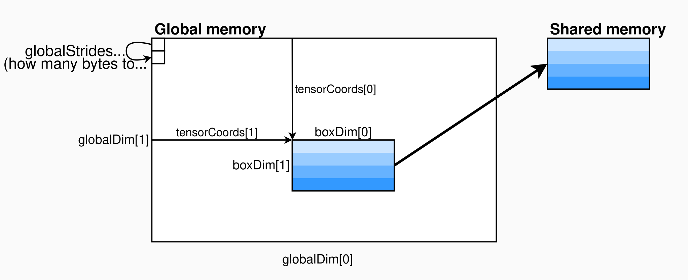<figcaption>
Tensor Map 对象涉及的参数。<code>globalDim</code>、<code>globalStrides</code> 和 <code>boxDim</code> 编码在 Tensor Map 对象内部；<code>tensorCoords</code> 则在运行时传给 <code>cp.async.bulk.tensor</code>，用来选择具体的 2D tile。
</figcaption></figure>
<pre style="color:#f8f8f2;background-color:#272822;-moz-tab-size:4;-o-tab-size:4;tab-size:4" tabindex="0"><code class="language-cpp" data-lang="cpp">void init_2D_tmap(
  CUtensorMap *tmap,
  const nv_bfloat16 *ptr,
  uint64_t global_height, uint64_t global_width,
  uint32_t shared_height, uint32_t shared_width
) {
  constexpr uint32_t rank = 2;

  // ordering of dims and strides is reverse of the natural PyTorch's order.
  // 1st dim is the fastest changing dim.
  uint64_t globalDim[rank] = {global_width, global_height};

  // global strides are in bytes.
  // additionally, the 1st dim is assumed to have stride of 1-element width.
  uint64_t globalStrides[rank-1] = {global_width * sizeof(nv_bfloat16)};

  // shape in shared memory
  uint32_t boxDim[rank]         = {shared_width, shared_height};
  uint32_t elementStrides[rank] = {1, 1};

  auto err = cuTensorMapEncodeTiled(
    tmap,
    CUtensorMapDataType::CU_TENSOR_MAP_DATA_TYPE_BFLOAT16,
    rank,
    (void *)ptr,
    globalDim,
    globalStrides,
    boxDim,
    elementStrides,
    // you can ignore the rest for now
    CUtensorMapInterleave::CU_TENSOR_MAP_INTERLEAVE_NONE,
    CUtensorMapSwizzle::CU_TENSOR_MAP_SWIZZLE_NONE,
    CUtensorMapL2promotion::CU_TENSOR_MAP_L2_PROMOTION_NONE,
    CUtensorMapFloatOOBfill::CU_TENSOR_MAP_FLOAT_OOB_FILL_NONE
  );
  // check the returned error code
}
</code></pre>

现在可以在内核中使用 Tensor Map 了。我不太喜欢 CUDA C++ 文档中的这一节，感觉写得过于冗长。接下来我们直接看 PTX 文档。
<ul><li data-block="B020">有趣的是，PTX 文档完全没有提到 TMA 这个名字，而是默认读者知道 <code>cp.async.bulk</code> 对应 TMA。不过，考虑到 PTX 会抽象掉硬件实现，这样做也有道理。</li><li data-block="B021">即便如此，在不同抽象层之间加上链接还是更有助于把知识串起来，就像 PTX 文档会直接引用 <a href="https://docs.nvidia.com/cuda/parallel-thread-execution/#tcgen05-canonical-layouts">CuTe 布局</a>一样。</li></ul>
TMA 运行在 <a href="https://docs.nvidia.com/cuda/parallel-thread-execution/#async-proxy">async proxy</a> 中。我不会假装自己理解 async proxy 的确切含义，但我的直观理解是：从 CUDA Core 编程的视角看，TMA 是一个独立的设备。这意味着，每当我们读取 TMA 写入的数据，或者写入将由 TMA 读取的数据，都必须遵循 PTX <a href="https://docs.nvidia.com/cuda/parallel-thread-execution/#memory-consistency-model">内存一致性模型</a>，并执行必要的内存同步。

这些术语听起来很吓人，我也不认为初学者直接啃 PTX 文档中的这些主题会很有帮助。你目前只需要知道，NVIDIA 提供了 <a href="https://docs.nvidia.com/cuda/parallel-thread-execution/#parallel-synchronization-and-communication-instructions-mbarrier">mbarrier</a>，让我们可以正确地与 TMA 同步。在内核里使用 TMA，大致如下。

<pre style="color:#f8f8f2;background-color:#272822;-moz-tab-size:4;-o-tab-size:4;tab-size:4" tabindex="0"><code class="language-cpp" data-lang="cpp">__device__ inline
void tma_2d_gmem2smem(int dst, const void *tmap_ptr, int x, int y, int mbar_addr) {
  asm volatile("cp.async.bulk.tensor.2d.shared::cta.global.mbarrier::complete_tx::bytes [%0], [%1, {%2, %3}], [%4];"
              :: "r"(dst), "l"(tmap_ptr), "r"(x), "r"(y), "r"(mbar_addr) : "memory");
}

__global__
void kernel(
  const __grid_constant__ CUtensorMap A_tmap,
  const __grid_constant__ CUtensorMap B_tmap,
  nv_bfloat16 *C_ptr,
  int M, int N, int K
) {
  const int tid = threadIdx.x;
  const int bid_n = blockIdx.x;
  const int bid_m = blockIdx.y;

  // select the input and output tiles
  const int off_m = bid_m * BLOCK_M;
  const int off_n = bid_n * BLOCK_N;

  // set up smem
  // alignment is required for TMA
  extern __shared__ __align__(1024) char smem[];
  const int A_smem = static_cast&lt;int&gt;(__cvta_generic_to_shared(smem));
  const int B_smem = A_smem + BLOCK_M * BLOCK_K * sizeof(nv_bfloat16);

  // set up mbarriers. to be covered
  #pragma nv_diag_suppress static_var_with_dynamic_init
  __shared__ uint64_t mbars[1];
  const int mbar_addr = static_cast&lt;int&gt;(__cvta_generic_to_shared(mbars));
  ...

  // main loop, iterate along K dim
  for (int iter_k = 0; iter_k &lt; K / BLOCK_K; iter_k++) {
    // only 1 thread in a threadblock issues TMA
    if (tid == 0) {
      // specify the offsets in global memory to select the 2D tile to be copied.
      // note that K dim goes first, since it's the contiguous dim.
      const int off_k = iter_k * BLOCK_K;
      tma_2d_gmem2smem(A_smem, &amp;A_tmap, off_k, off_m, mbar_addr);
      tma_2d_gmem2smem(B_smem, &amp;B_tmap, off_k, off_n, mbar_addr);

      // inform mbarrier how much data (in bytes) to expect.
      // (and the TMA-issuing thread also "arrives" at the mbarrier - to be covered)
      constexpr int cp_size = (BLOCK_M + BLOCK_N) * BLOCK_K * sizeof(nv_bfloat16);
      asm volatile("mbarrier.arrive.expect_tx.release.cta.shared::cta.b64 _, [%0], %1;"
                  :: "r"(mbar_addr), "r"(cp_size) : "memory");
    }

    // wait for TMA to finish. to be covered
    ...

    // issue tcgen05.mma. to be covered
    ...
  }
}
</code></pre>

这里还有很多内容需要展开，但我希望你先理解整体思路，再深入细节。发起 TMA 本身很简单，放上几条 <code>cp.async.bulk.tensor</code> 即可。更重要的是理解 <code>mbarrier</code>，以及如何正确使用它。
<ul><li data-block="B025">下文会频繁引用 PTX 指令。想进一步了解某条指令，直接打开 <a href="https://docs.nvidia.com/cuda/parallel-thread-execution/">PTX 文档</a>，用 Ctrl+F 搜索即可。</li></ul>
<code>mbarrier</code> 位于共享内存中，宽度为 64 位，即 8 字节。你可以把它当作不透明对象，因为 NVIDIA 可能在未来的架构中修改其内部位域实现。<code>mbarrier</code> 跟踪两个计数：arrival count（到达计数，大致表示有多少线程已经“到达”）和 tx-count（事务计数，用于跟踪传输字节数）。
<ul><li data-block="B027">初始化 <code>mbarrier</code> 时，需要设置预期到达计数。这个值通常是某个同步点的生产者线程数。对于 TMA，只有一个线程发起 TMA，因此我们将 <code>mbarrier</code> 的预期到达计数初始化为 1。</li><li data-block="B028">每次执行 arrive-on 操作，待到达计数都会递减。<code>mbarrier.arrive</code> 和 <code>tcgen05.commit.mbarrier::arrive::one</code> 都是此类操作的例子。</li><li data-block="B029">tx-count 更灵活。我们可以用 expect-tx 操作增加它，例如 <code>mbarrier.arrive.expect_tx</code>；这条指令同时也会递减待到达计数。也可以用 complete-tx 操作递减它，例如 <code>cp.async.bulk.shared::cta.global.mbarrier::complete_tx::bytes</code>。</li><li data-block="B030">只有当待到达计数和 tx-count 都降到零时，当前 phase（阶段）才算完成，<code>mbarrier</code> 对象随即进入下一个尚未完成的 phase。</li></ul>
把这些概念落实到代码中。下面是用于 TMA 同步的 <code>mbarrier</code> 初始化方式。

<pre style="color:#f8f8f2;background-color:#272822;-moz-tab-size:4;-o-tab-size:4;tab-size:4" tabindex="0"><code class="language-cpp" data-lang="cpp">  // only 1 thread initializes mbarrier
  if (tid == 0) {
    // initialize with 1, since only 1 thread issue TMA
    asm volatile("mbarrier.init.shared::cta.b64 [%0], %1;" :: "r"(mbar_addr), "r"(1));
    asm volatile("fence.mbarrier_init.release.cluster;");  // initialized mbarrier is visible to async proxy
  }
  __syncthreads();  // initialized mbarrier is visible to all threads in the threadblock
</code></pre>

注意，<code>__syncthreads()</code> 是一个内存屏障：它确保线程块内所有线程发起的内存访问，对同一线程块中的其他线程可见。这里所指的内存访问，就是在共享内存中初始化 <code>mbarrier</code>。

如上所示，我们已经知道如何发起 TMA 并向 <code>mbarrier</code> 发信号。等待 TMA 完成，等价于等待 <code>mbarrier</code> 完成当前 phase。不过，我们不直接使用 0、1、2、3……这样的 phase 编号，而是使用 phase parity，也就是 0 或 1 的奇偶位。

<pre style="color:#f8f8f2;background-color:#272822;-moz-tab-size:4;-o-tab-size:4;tab-size:4" tabindex="0"><code class="language-cpp" data-lang="cpp">  // initial phase parity to wait for
  int phase = 0;

  // main loop, iterate along K dim
  for (int iter_k = 0; iter_k &lt; K / BLOCK_K; iter_k++) {
    // issue TMA
    ...

    // wait for mbarrier to complete the current phase
    mbarrier_wait(mbar_addr, phase);

    // flip the phase parity, so that we wait for the correct parity in the next iteration
    phase ^= 1;

    // issue tcgen05.mma
    ...
  }
</code></pre>

<code>mbarrier_wait()</code> 本质上是在屏障上自旋等待。

<pre style="color:#f8f8f2;background-color:#272822;-moz-tab-size:4;-o-tab-size:4;tab-size:4" tabindex="0"><code class="language-cpp" data-lang="cpp">// https://github.com/NVIDIA/cutlass/blob/v4.2.1/include/cutlass/arch/barrier.h#L408
__device__ inline
void mbarrier_wait(int mbar_addr, int phase) {
  uint32_t ticks = 0x989680;  // this is optional
  asm volatile(
    "{\n\t"
    ".reg .pred P1;\n\t"
    "LAB_WAIT:\n\t"
    "mbarrier.try_wait.parity.acquire.cta.shared::cta.b64 P1, [%0], %1, %2;\n\t"
    "@P1 bra.uni DONE;\n\t"
    "bra.uni LAB_WAIT;\n\t"
    "DONE:\n\t"
    "}"
    :: "r"(mbar_addr), "r"(phase), "r"(ticks)
  );
}
</code></pre>

上面这段看起来有点吓人的代码，其实就是用 PTX 写的循环。
<ul><li data-block="B036"><code>.reg .pred P1;</code> 声明一个谓词寄存器，其值为 0 或 1。</li><li data-block="B037"><code>@P1</code> 表示<a href="https://docs.nvidia.com/cuda/parallel-thread-execution/#predicated-execution">谓词执行</a>：只有 <code>P1=1</code> 时，才会一致地跳转到 <code>DONE</code> 标签，也就是 warp 内所有活跃线程一起跳转。否则，就跳回 <code>LAB_WAIT</code>。</li></ul>
把这些部分放在一起，TMA 代码就是下面这样。

<pre style="color:#f8f8f2;background-color:#272822;-moz-tab-size:4;-o-tab-size:4;tab-size:4" tabindex="0"><code class="language-cpp" data-lang="cpp">  // set up mbarriers
  #pragma nv_diag_suppress static_var_with_dynamic_init
  __shared__ uint64_t mbars[1];
  const int mbar_addr = static_cast&lt;int&gt;(__cvta_generic_to_shared(mbars));

  if (tid == 0) {
    asm volatile("mbarrier.init.shared::cta.b64 [%0], %1;" :: "r"(mbar_addr), "r"(1));
    asm volatile("fence.mbarrier_init.release.cluster;");  // visible to async proxy
  }
  __syncthreads();  // visible to all threads in the threadblock

  // initial phase
  int phase = 0;

  // main loop, iterate along K dim
  for (int iter_k = 0; iter_k &lt; K / BLOCK_K; iter_k++) {
    // only 1 thread in a threadblock issues TMA
    if (tid == 0) {
      const int off_k = iter_k * BLOCK_K;
      tma_2d_gmem2smem(A_smem, &amp;A_tmap, off_k, off_m, mbar_addr);
      tma_2d_gmem2smem(B_smem, &amp;B_tmap, off_k, off_n, mbar_addr);

      constexpr int cp_size = (BLOCK_M + BLOCK_N) * BLOCK_K * sizeof(nv_bfloat16);
      asm volatile("mbarrier.arrive.expect_tx.release.cta.shared::cta.b64 _, [%0], %1;"
                  :: "r"(mbar_addr), "r"(cp_size) : "memory");
    }

    // wait for TMA to finish.
    mbarrier_wait(mbar_addr, phase);
    phase ^= 1;  // flip phase parity

    // issue tcgen05.mma. to be covered
    ...
  }
</code></pre>

现在看起来，使用 TMA 也没有那么麻烦，对吧？只需要几条 PTX 指令，再加上一些烦人的主机端配置。
<h3 data-block="B040" id="acquire-release-semantics">Acquire-Release 语义</h3>
在进入 <code>tcgen05</code> 之前，我想花一点时间介绍 Acquire-Release 语义。也许你还没注意到，我们其实已经大量使用了这种语义。
<ul><li data-block="B042"><code>mbarrier.try_wait.parity{.acquire}.cta.shared::cta.b64</code></li><li data-block="B043"><code>mbarrier.arrive.expect_tx{.release}.cta.shared::cta.b64</code></li></ul>
即使 <code>.acquire</code> 和 <code>.release</code> 是可选修饰符，指令默认就会采用正确的语义，我还是特意把它们显式写了出来。这源于我之前编写<a href="https://gau-nernst.github.io/amd-a2a/">多 GPU HIP 内核</a>的经历：跨 GPU 同步内存访问时，Acquire-Release 语义同样至关重要。我在<a href="https://gau-nernst.github.io/amd-a2a/#acquire-release-semantics">之前的博客</a>中作过更详细的解释，也可以参考 <a href="https://davekilian.com/acquire-release.html">Dave Kilian</a> 那篇写得很好的文章。

简单来说，Acquire-Release 配对保证：生产者线程中 Release 之前的所有操作，对消费者线程中 Acquire 之后的所有操作可见。在 TMA 的场景中，这意味着 <code>mbarrier_wait()</code> 一旦完成，也就是 <code>mbarrier.try_wait</code> 返回 1，我们就能确定 TMA 传输已经完成，后续访问共享内存的操作（例如 <code>tcgen05.mma</code>，或者简单的共享内存加载 <code>ld.shared</code>）都能看到最新数据。
<figure>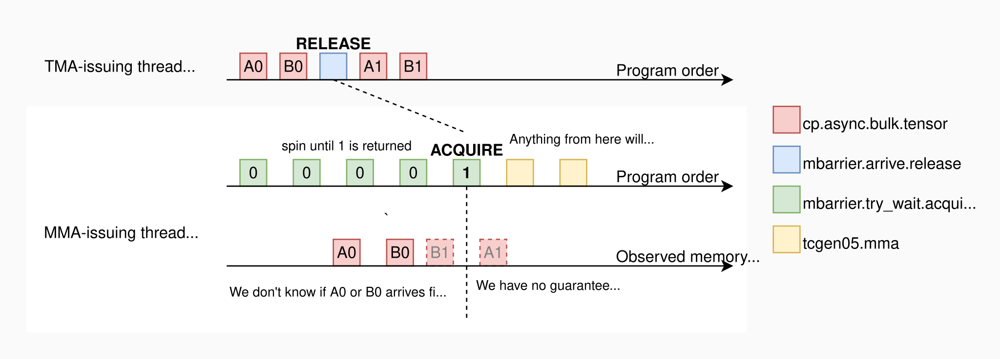<figcaption>
TMA 生产者与 <code>tcgen05</code> 消费者之间的 Acquire-Release 语义。
</figcaption></figure>
<a href="https://docs.nvidia.com/cuda/parallel-thread-execution/#parallel-synchronization-and-communication-instructions-mbarrier-test-wait-try-wait">PTX 文档</a>中 <code>mbarrier.try_wait</code> 一节也再次确认了这一点，可以搜索“The following ordering of memory operations…”这句话。
<blockquote>
在已完成的 phase 中，CTA 内参与线程按照程序顺序，在具有 release 语义的 <code>mbarrier.arrive</code> 之前请求的、使用同一 mbarrier 对象的全部 <code>cp.async.bulk</code> 异步操作，都已执行完成，并对执行等待指令的线程可见。
</blockquote><blockquote>
对于该线程按照程序顺序，在具有 release 语义的 <code>mbarrier.arrive</code> 之后、<code>mbarrier.test_wait</code> 之前请求的内存访问，不提供顺序或可见性保证。
</blockquote><h3 data-block="B050" id="decipher-tcgen05">解读 tcgen05</h3>
下表概括了不同 GPU 世代的 MMA 指令之间的一些区别。
<table><thead><tr><th>GPU 世代</th><th>MMA 指令</th><th>A/B 存储位置</th><th>C/D 存储位置</th><th>最大 BF16 MMA 形状（每个 CTA）</th></tr></thead><tbody><tr><td>Ampere (sm80)</td><td><code>mma</code></td><td>寄存器</td><td>寄存器</td><td><code>m16n8k16</code></td></tr><tr><td>Hopper (sm90)</td><td><code>wgmma.mma_async</code></td><td>共享内存</td><td>寄存器</td><td><code>m64n256k16</code></td></tr><tr><td>Blackwell (sm100)</td><td><code>tcgen05.mma</code></td><td>共享内存(*)</td><td>Tensor Memory</td><td><code>m128n256k16</code></td></tr></tbody></table>
(*) 在 Blackwell 上，A 也可以位于 Tensor Memory 中。
<ul><li data-block="B053">有意思的是，<code>MMA_K</code> 仍然是 32 字节，而 <code>MMA_M</code> 和 <code>MMA_N</code> 则显著增大。这很合理：这种变化提高了 MMA 指令的算术强度，确保更快的计算不会受到内存瓶颈限制。</li></ul>
我们已经知道如何用 TMA 将 A 和 B 加载到共享内存。由于 <code>tcgen05.mma</code> 直接操作共享内存，不需要再把它们加载到寄存器中，可以和 <code>ldmatrix</code> 说再见了。为了存放 MMA 结果，需要使用 <a href="https://docs.nvidia.com/cuda/parallel-thread-execution/#tensor-memory">Tensor Memory</a>：这是 Blackwell 中专门为此引入的一类新内存。Tensor Memory 的容量为 128x512，每个元素宽 32 位，正好可以存放 FP32 或 INT32 累加值。使用方式相当直接：
<ul><li data-block="B055">分配（<code>tcgen05.alloc</code>）以列为粒度。换句话说，每次分配总会包含全部 128 行。</li><li data-block="B056">释放（<code>tcgen05.dealloc</code>）。内核退出前必须释放此前分配的空间，内核不会替你自动释放。</li><li>各种内存访问方式：<ul><li data-block="B057"><code>tcgen05.ld</code>：从 Tensor Memory 加载到寄存器。后面编写 epilogue 时会用到。</li><li data-block="B058"><code>tcgen05.st</code>：从寄存器写入 Tensor Memory。</li><li data-block="B059"><code>tcgen05.cp</code>：从共享内存复制到 Tensor Memory。</li></ul></li></ul>
在代码中加入 Tensor Memory 的分配与释放后，如下所示。

<pre style="color:#f8f8f2;background-color:#272822;-moz-tab-size:4;-o-tab-size:4;tab-size:4" tabindex="0"><code class="language-cpp" data-lang="cpp">#pragma nv_diag_suppress static_var_with_dynamic_init
__shared__ uint64_t mbars[1];
__shared__ int tmem_addr[1];  // tmem address is 32-bit

if (tid == 0) {
  // lane0 of warp0 initializes mbarriers (1 thread)
  asm volatile("mbarrier.init.shared::cta.b64 [%0], %1;" :: "r"(mbar_addr), "r"(1));
  asm volatile("fence.mbarrier_init.release.cluster;");
} else if (warp_id == 1) {
  // one full warp allocates tmem
  // tcgen05.alloc returns tmem address in shared memory
  // -&gt; we provide an smem address to the instruction.
  const int addr = static_cast&lt;int&gt;(__cvta_generic_to_shared(tmem_addr));
  asm volatile("tcgen05.alloc.cta_group::1.sync.aligned.shared::cta.b32 [%0], %1;" :: "r"(addr), "r"(BLOCK_N));
}

// making not only initialized mbarriers, but also the allocated tmem,
// visible to all threads in the threadblock.
__syncthreads();

// read tmem address, which has the value of 0.
const int taddr = tmem_addr[0];

// main loop
...

// make sure epilogue finishes using tmem
...

// tmem deallocation is also issued by one full warp
if (warp_id == 0)
  asm volatile("tcgen05.dealloc.cta_group::1.sync.aligned.b32 %0, %1;" :: "r"(taddr), "r"(BLOCK_N));
</code></pre>
<ul><li data-block="B061">输出 tile 的形状为 <code>[BLOCK_M, BLOCK_N]</code>。假设 <code>BLOCK_M &lt;= 128</code>，我们就分配 <code>BLOCK_N</code> 列。</li><li data-block="B062">根据我的经验，<code>taddr</code> 总是零，至少在内核整个生命周期中只分配一次时是这样。因此，基本上可以忽略 <code>tcgen05.alloc</code> 返回的值，并假定它为 0。</li></ul>
接下来终于轮到期待已久的 MMA 指令。以下内容直接取自 <a href="https://docs.nvidia.com/cuda/parallel-thread-execution/#tcgen05-mma-instructions-mma">tcgen05.mma 的 PTX 文档</a>。

<pre style="color:#f8f8f2;background-color:#272822;-moz-tab-size:4;-o-tab-size:4;tab-size:4" tabindex="0"><code class="language-asm" data-lang="asm">tcgen05.mma.cta_group.kind   [d-tmem],  a-desc,  b-desc, idesc,
                             { disable-output-lane }, enable-input-d {, scale-input-d};
</code></pre>
<table><thead><tr><th>参数</th><th>说明</th></tr></thead><tbody><tr><td><code>d-tmem</code></td><td>前面获取的 Tensor Memory 地址，用于存放累加值。</td></tr><tr><td><code>a-desc</code> 和 <code>b-desc</code></td><td>共享内存描述符（64 位），描述 A 和 B 在共享内存中的布局。</td></tr><tr><td><code>idesc</code></td><td>指令描述符（32 位），编码 MMA 指令的各种属性，如数据类型、MMA 形状、稠密或稀疏等。</td></tr><tr><td><code>enable-input-d</code></td><td>一个谓词寄存器，指定是否累加，即执行 <code>D = A @ B</code>，还是 <code>D = A @ B + C</code>。</td></tr><tr><td><code>scale-input-d</code></td><td>可以忽略，对当前实现不重要。</td></tr></tbody></table>
<code>idesc</code> 比较简单，<a href="https://docs.nvidia.com/cuda/parallel-thread-execution/#tcgen05-instruction-descriptor">PTX 文档</a>提供了一张基本一看就懂的表。如果需要更多信息，可以直接参考它。

<pre style="color:#f8f8f2;background-color:#272822;-moz-tab-size:4;-o-tab-size:4;tab-size:4" tabindex="0"><code class="language-cpp" data-lang="cpp">  constexpr uint32_t i_desc = (1U &lt;&lt; 4U)   // dtype=FP32
                            | (1U &lt;&lt; 7U)   // atype=BF16
                            | (1U &lt;&lt; 10U)  // btype=BF16
                            | ((uint32_t)BLOCK_N &gt;&gt; 3U &lt;&lt; 17U)  // MMA_N
                            | ((uint32_t)BLOCK_M &gt;&gt; 4U &lt;&lt; 24U)  // MMA_M
                            ;
</code></pre>
<ul><li data-block="B065"><code>tcgen05</code> 支持很大的 MMA 形状，所以至少在当前阶段，我看不出有必要再沿 <code>BLOCK_M/BLOCK_N</code> 对 MMA 分块。也就是说，可以将 <code>BLOCK_M</code> 设为 128，而 <code>BLOCK_N</code> 可以取不超过 256 的合适值。</li></ul>
<code>a-desc</code> 和 <code>b-desc</code> 就有点奇怪了。先不解释它们，我们先看使用 <code>tcgen05.mma</code> 的整体结构。与 TMA 类似，<code>tcgen05.mma</code> 也只由一个线程发起。要跟踪一系列 <code>tcgen05.mma</code> 的完成情况，需要将 <code>tcgen05.commit</code> 与一个 <code>mbarrier</code> 对象配合使用。

<pre style="color:#f8f8f2;background-color:#272822;-moz-tab-size:4;-o-tab-size:4;tab-size:4" tabindex="0"><code class="language-cpp" data-lang="cpp">  // main loop, iterate along K dim
  for (int iter_k = 0; iter_k &lt; K / BLOCK_K; iter_k++) {
    // only 1 thread in a threadblock issues TMA
    if (tid == 0) {
      ...
    }

    // wait for TMA to finish.
    mbarrier_wait(mbar_addr, phase);
    phase ^= 1;  // flip phase parity

    // not sure if we need this. taken from DeepGEMM
    // https://github.com/deepseek-ai/DeepGEMM/blob/9b680f42/deep_gemm/include/deep_gemm/impls/sm100_bf16_gemm.cuh#L289
    asm volatile("tcgen05.fence::after_thread_sync;");

    // only 1 thread issues tcgen05.mma
    if (tid == 0) {
      auto make_desc =  -&gt; uint64_t {
        // to be implemented
        ...
      };

      // manually unroll 1st iteration to disable accumulation
      tcgen05_mma_f16(taddr, make_desc(A_smem), make_desc(B_smem), i_desc, iter_k);
      for (int k = 1; k &lt; BLOCK_K / MMA_K; k++) {
        // select MMA tile of A and B
        uint64_t a_desc = make_desc(A_smem + k * MMA_K);
        uint64_t b_desc = make_desc(B_smem + k * MMA_K);
        tcgen05_mma_f16(taddr, a_desc, b_desc, i_desc, 1);
      }

      // use the same mbarrier to track the completion of tcgen05.mma operations
      asm volatile("tcgen05.commit.cta_group::1.mbarrier::arrive::one.shared::cluster.b64 [%0];"
                  :: "r"(mbar_addr) : "memory");
    }

    // wait for MMA to finish
    mbarrier_wait(mbar_addr, phase);
    phase ^= 1;  // flip the phase
  }
</code></pre>

再回到共享内存描述符。我觉得 <a href="https://docs.nvidia.com/cuda/parallel-thread-execution/#tcgen05-shared-memory-descriptor">PTX 文档</a>对这一部分的说明既欠缺又令人困惑。你会遇到下面两个陌生概念，以及它们在 PTX 文档中的<a href="https://docs.nvidia.com/cuda/parallel-thread-execution/#tcgen05-leading-dimension-byte-offset-relative-offset">对应</a><a href="https://docs.nvidia.com/cuda/parallel-thread-execution/#tcgen05-stride-dimension-byte-offset">章节</a>。当前我们没有使用 swizzle，并且 A 和 B 都是 K-major，因此应查看对应这些条件的章节。
<table><thead><tr><th>概念</th><th>定义</th></tr></thead><tbody><tr><td>主维度字节偏移（LBO）</td><td>“在按 128 位元素类型归一化的矩阵中，8x2 tile 从第一列到第二列的步长。”</td></tr><tr><td>步幅维度字节偏移（SBO）</td><td>“从前 8 行到后 8 行的偏移。”</td></tr></tbody></table>
这些到底是什么东西？！我开始了一段小小的探索，试图理解这些神秘术语。Pranjal 的 Hopper 教程直接使用 <a href="https://github.com/pranjalssh/fast.cu/blob/38eb642e0c081231d6f695978be63604bd7c689b/examples/matmul/matmul_2.cuh#L45">128 字节 swizzle 的 TMA</a>，因此其中的共享内存描述符不适用于我们这种不使用 swizzle 的情况。
<ul><li data-block="B069">这里假设 <code>tcgen05</code> 的工作方式与 <code>wgmma</code> 大体类似。我之前没有 Hopper 的使用经验，也还没有仔细检查这个假设是否成立。</li><li data-block="B070">我本来可以直接采用 128B swizzle，让 Pranjal 的代码适用于当前场景。但我觉得，更重要的是理解所需的输入布局，以及如何将其编码到共享内存描述符中，而不受具体 swizzle 类型的限制。</li></ul>
我继续寻找能够解释这一点的资料。令人意外的是，只有 Modular 的 Blackwell GEMM 系列<a href="https://www.modular.com/blog/matrix-multiplication-on-nvidias-blackwell-part-2-using-hardware-features-to-optimize-matmul">第二篇博客</a>，明确讨论了一个隐藏的关键概念：Core Matrix。

<code>tcgen05.mma</code> 中存在一个隐含的 <code>8x16B</code> 单位，即 8 行、每行 16 字节。Modular 在博客中称其为 Core Matrix，我猜这个术语来自 <a href="https://research.colfax-intl.com/cutlass-tutorial-wgmma-hopper/">Colfax Research 的 WGMMA 文章</a>，但 PTX 文档中没有任何地方提到它。所以，当时乃至现在，我都不确定这个叫法是否准确。不管怎样，上面 LBO 和 SBO 定义中的“8x2 tile”“128 位元素类型”和“8 行”，指的都是这个 Core Matrix。
<ul><li data-block="B073">128 位等于 16 字节。</li><li data-block="B074">8x2 tile 和 8 行，显然都对应 Core Matrix 的 8 行。</li><li data-block="B075">8x2 tile 对应 32 字节的宽度，恰好等于 MMA 形状的 K 维大小；对 BF16 而言就是 <code>k16</code>。这是巧合吗？我想不是。</li><li data-block="B076">Core Matrix 的形状和大小也与 <code>ldmatrix</code> 一致。</li></ul>
这样就清楚多了，至少我当时是这么想的。此时，我对 LBO 和 SBO 的理解如下图所示。
<figure>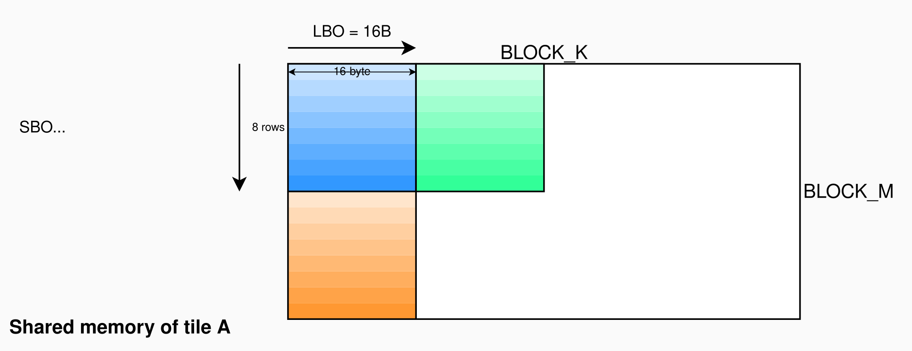<figcaption>
我最初对 LBO 和 SBO 的理解。每个小 tile 都是共享内存中较大线程块 tile 内的一个 Core Matrix。
</figcaption></figure>
对于形状为 <code>[BLOCK_M, BLOCK_K]</code> 的 BF16 tile，我们将其分成 <code>[8, 8]</code> 的子 tile。LBO 是“8x2 tile 从第一列到第二列的步长”，因此就是 16 字节。SBO 是“从前 8 行到后 8 行的偏移”，因此为 <code>8 x BLOCK_K x sizeof(nv_bfloat16)</code>，因为跨过 <code>[BLOCK_M, BLOCK_K]</code> tile 的完整 8 行需要这么多字节。我按这个思路写出了代码。

<pre style="color:#f8f8f2;background-color:#272822;-moz-tab-size:4;-o-tab-size:4;tab-size:4" tabindex="0"><code class="language-cpp" data-lang="cpp">auto make_desc =  -&gt; uint64_t {
  const int LBO = 16;
  const int SBO = 8 * BLOCK_K * sizeof(nv_bfloat16);
  return desc_encode(addr) | (desc_encode(LBO) &lt;&lt; 16ULL) | (desc_encode(SBO) &lt;&lt; 32ULL) | (1ULL &lt;&lt; 46ULL);
};
</code></pre>

然而，结果是错的！我继续深入 PTX 文档，发现了<a href="https://docs.nvidia.com/cuda/parallel-thread-execution/#tcgen05-canonical-layouts">规范布局</a>（Canonical layouts）的说明。其中一幅图如下。
<ul><li data-block="B081">到这一步时，我其实已经实现了 epilogue，以便检查最终结果的正确性。不过，为了保持文章叙述的连贯，epilogue 留到后面再讲。</li></ul><figure>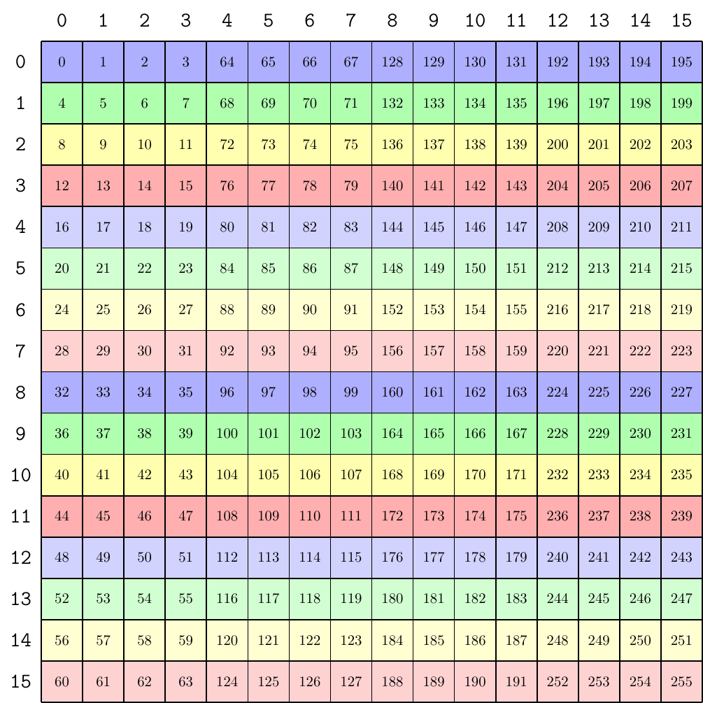<figcaption>
K-major、无 swizzle、TF32 数据类型的规范布局。来源：<a href="https://docs.nvidia.com/cuda/parallel-thread-execution/#tcgen05-k-no-swizzle-tf32">NVIDIA PTX 文档</a>。
</figcaption></figure>
图中的颜色、数字和网格分别代表什么，并不清楚。哪个是物理布局，哪个是逻辑布局？文档提到，上图中 <code>LBO=64*sizeof(tf32)</code>，<code>SBO=32*sizeof(tf32)</code>，但面对我这个 <code>[BLOCK_M, BLOCK_K]</code> tile，应该如何计算？也许是我固执地不愿学习 CuTe 的布局代数及其布局图示方式，才看不懂这幅图。

我回到 Modular 的博客，注意到这样一句话。
<blockquote>
其中，每一列 Core Matrix（8x1）都需要在共享内存中连续存放。
</blockquote>
这一刻我恍然大悟！每个 <code>8x16B</code> tile 必须连续存放，也就是占据连续的 128B。这带来一个重要结论：我们需要改变 A 和 B 在共享内存中的布局。
<figure>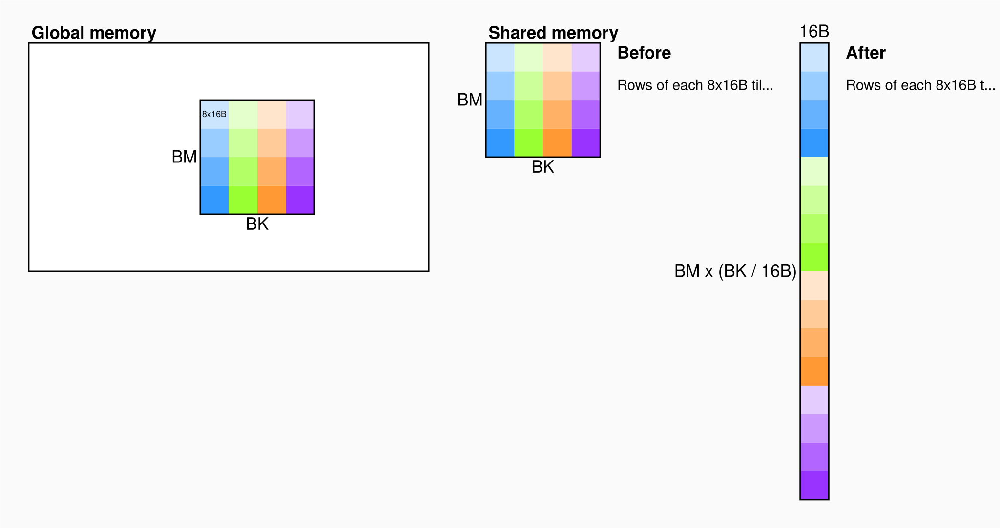<figcaption>
更新后的 A、B 共享内存布局。注意，每个 8x16B tile 现在都占据一段连续内存。
</figcaption></figure>
现在有多个 <code>[BLOCK_M, 16B]</code> 切片，因此不能再直接发起一次 2D TMA。一个简单的办法是多次发起 2D TMA，准确地说是 BLOCK_K / 16B 次。这也是 Modular 博客采用的方式。

<pre style="color:#f8f8f2;background-color:#272822;-moz-tab-size:4;-o-tab-size:4;tab-size:4" tabindex="0"><code class="language-cpp" data-lang="cpp">  // host: encode 2D tensor map for A and B
  // (only A is shown below)
  constexpr uint32_t rank = 2;
  uint64_t globalDim[rank]       = {8, M};  // 8 is eight BF16 elements = 16 bytes
  uint64_t globalStrides[rank-1] = {K * sizeof(nv_bfloat16)};  // in bytes
  uint32_t boxDim[rank]          = {8, BLOCK_M};

  // device: issue multiple 2D TMAs
  for (int k = 0; k &lt; BLOCK_K / 8; k++) {
    // select K global offset
    const int off_k = iter_k * BLOCK_K + k * 8;

    // A_smem and B_smem are raw shared address, with type int.
    // each TMA copies [BLOCK_M, 16B] of A -&gt; (BLOCK_M * 16) bytes.
    // we index into the destination appropriately.
    tma_2d_gmem2smem(A_smem + k * BLOCK_M * 16, &amp;A_tmap, off_k, off_m, mbar_addr);
    tma_2d_gmem2smem(B_smem + k * BLOCK_N * 16, &amp;B_tmap, off_k, off_n, mbar_addr);
  }
</code></pre>

另一种方法是使用 3D TMA。
<table><thead><tr><th>Tile 形状（<code>boxDim</code>）</th><th>全局内存步长</th><th>说明</th></tr></thead><tbody><tr><td><code>[BLOCK_M, BLOCK_K]</code></td><td><code>[K, 1]</code></td><td>线程块 tile 在全局内存中的原始布局。</td></tr><tr><td><code>[BLOCK_M, BLOCK_K / 8, 8]</code></td><td><code>[K, 8, 1]</code></td><td>将最后一个维度拆开。</td></tr><tr><td><code>[BLOCK_K / 8, BLOCK_M, 8]</code></td><td><code>[8, K, 1]</code></td><td>交换前两个维度。</td></tr></tbody></table>
注意，在 TMA 中，共享内存目标隐含采用给定形状的自然连续布局；我们没有在任何地方指定共享内存的步长。因此，<code>[BLOCK_K / 8, BLOCK_M, 8]</code> 恰好就是所需的布局：由连续的 <code>[BLOCK_M, 8]</code> tile 构成。到这里你也能看出，Tensor Map 中的 <code>globalStrides</code> 并不要求单调递增。

<pre style="color:#f8f8f2;background-color:#272822;-moz-tab-size:4;-o-tab-size:4;tab-size:4" tabindex="0"><code class="language-cpp" data-lang="cpp">  // host: encode 3D tensor map for A and B
  // (only A is shown below)
  // everything is in reverse order of what is shown in the table above.
  constexpr uint32_t rank = 3;
  uint64_t globalDim[rank]       = {8, M, K / 8};
  uint64_t globalStrides[rank-1] = {K * sizeof(nv_bfloat16), 16};  // in bytes
  uint32_t boxDim[rank]          = {8, BLOCK_M, BLOCK_K / 8};

  // device: issue a single 3D TMA
  const int off_k = iter_k * BLOCK_K;
  tma_3d_gmem2smem(A_smem, &amp;A_tmap, 0, off_m, off_k / 8, mbar_addr);
  tma_3d_gmem2smem(B_smem, &amp;B_tmap, 0, off_n, off_k / 8, mbar_addr);
</code></pre>

发起 3D TMA 与发起 2D TMA 没有太大区别。更多细节可以查阅 PTX 文档。

再回到神秘的 LBO 和 SBO，现在终于可以说清楚了。
<figure>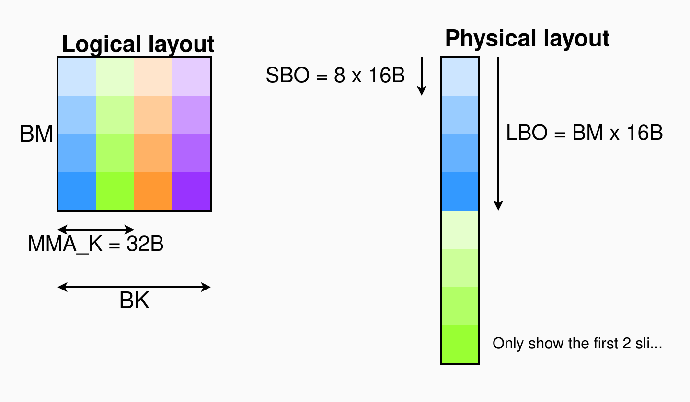<figcaption>
我对 LBO 和 SBO 的更新理解。LBO 用于移动到下一个切片或列，而 SBO 用于选择同一切片中的下一个 8x16B tile。
</figcaption></figure>
记住，<code>MMA_K</code> 始终为 32 字节，因此需要两个宽 16 字节的切片。每条 MMA 指令都需要知道这两个切片的数据在哪里；不同资料也会把切片称为“列”。<code>MMA_M</code> 可以小于 <code>BLOCK_M</code>，不过为了简化，我们始终令 <code>BLOCK_M = MMA_M = 128</code>。

至此，我们有了发起 <code>tcgen05.mma</code> 的完整代码。

<pre style="color:#f8f8f2;background-color:#272822;-moz-tab-size:4;-o-tab-size:4;tab-size:4" tabindex="0"><code class="language-cpp" data-lang="cpp">  if (warp_id == 0 &amp;&amp; elect_sync()) {
    auto make_desc =  -&gt; uint64_t {
      const int LBO = height * 16;
      const int SBO = 8 * 16;
      return desc_encode(addr) | (desc_encode(LBO) &lt;&lt; 16ULL) | (desc_encode(SBO) &lt;&lt; 32ULL) | (1ULL &lt;&lt; 46ULL);
    };

    // manually unroll 1st iteration to disable accumulation
    tcgen05_mma_f16(taddr, make_desc(A_smem, BLOCK_M), make_desc(B_smem, BLOCK_N), i_desc, iter_k);
    for (int k = 1; k &lt; BLOCK_K / MMA_K; k++) {
      // select the [BLOCK_M, 32B] tile for MMA,
      // which consists of two [BLOCK_M, 16B] tiles.
      uint64_t a_desc = make_desc(A_smem + k * BLOCK_M * 32, BLOCK_M);
      uint64_t b_desc = make_desc(B_smem + k * BLOCK_N * 32, BLOCK_N);
      tcgen05_mma_f16(taddr, a_desc, b_desc, i_desc, 1);
    }
    asm volatile("tcgen05.commit.cta_group::1.mbarrier::arrive::one.shared::cluster.b64 [%0];"
                :: "r"(mbar_addr) : "memory");
  }
</code></pre>

完成基础内核的最后一块拼图，是用 <code>tcgen05.ld</code> 编写 epilogue，也就是结果写回阶段。Tensor Memory 的一个特殊之处是，每个 warp 只能访问其中一部分。使用 <code>MMA_M=128</code> 和 <code>.cta_group::1</code> 时，我们的内核对应 <a href="https://docs.nvidia.com/cuda/parallel-thread-execution/#tcgen05-data-path-layout-d">Layout D</a>。
<figure>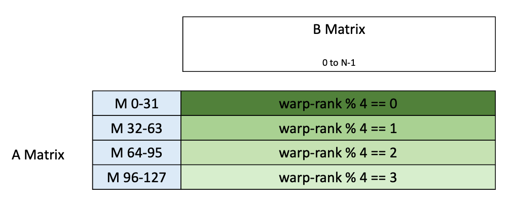<figcaption>
tcgen05 数据通路 Layout D。来源：<a href="https://docs.nvidia.com/cuda/parallel-thread-execution/#tcgen05-data-path-layout-d">NVIDIA PTX 文档</a>。
</figcaption></figure>
这意味着，虽然发起 TMA 和 MMA 只需要一个 warp，我们的内核仍然至少需要 4 个 warp。每个 warp 都有几种 <code>tcgen05.ld</code> <a href="https://docs.nvidia.com/cuda/parallel-thread-execution/#tcgen05-memory-layout">形式</a>可选，这里选择最简单的 <code>.32x32b</code>。
<figure>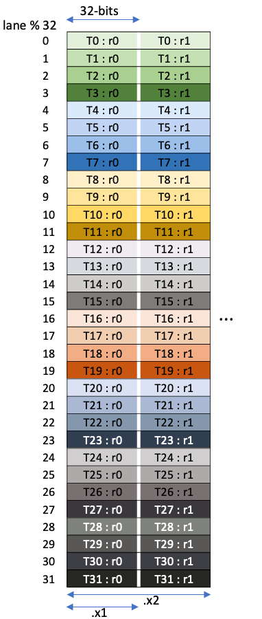<figcaption>
tcgen05 的 <code>.32x32b</code> 矩阵片段。来源：<a href="https://docs.nvidia.com/cuda/parallel-thread-execution/#tcgen05-matrix-fragments-shape-3232b">NVIDIA PTX 文档</a>。
</figcaption></figure>
使用 <code>.x8</code> 倍率时，每个线程加载 8 个连续的 FP32 累加值，再将其转换并打包成 8 个 BF16 值，共 16 字节。这样就能使用 16 字节存储指令，尽管这些写入仍然不是合并访问。

<pre style="color:#f8f8f2;background-color:#272822;-moz-tab-size:4;-o-tab-size:4;tab-size:4" tabindex="0"><code class="language-cpp" data-lang="cpp">  // this is required before tcgen05.ld and after tcgen05.mma
  // to form correct execution ordering.
  // see https://docs.nvidia.com/cuda/parallel-thread-execution/#tcgen05-memory-consistency-model-canonical-sync-patterns-non-pipelined-diff-thread
  asm volatile("tcgen05.fence::after_thread_sync;");

  // load 8 columns from tmem at a time -&gt; store 16 bytes per thread to smem
  for (int n = 0; n &lt; BLOCK_N / 8; n++) {
    // https://docs.nvidia.com/cuda/parallel-thread-execution/#tcgen05-data-path-layout-d
    // Layout D
    float tmp[8];
    const int row = warp_id * 32;
    const int col = n * 8;
    const int addr = taddr + (row &lt;&lt; 16) + col;  // 16 MSBs encode row, 16 LSBs encode column.
    asm volatile("tcgen05.ld.sync.aligned.32x32b.x8.b32 {%0, %1, %2, %3, %4, %5, %6, %7}, [%8];"
                : "=f"(tmp[0]), "=f"(tmp[1]), "=f"(tmp[2]), "=f"(tmp[3]),
                  "=f"(tmp[4]), "=f"(tmp[5]), "=f"(tmp[6]), "=f"(tmp[7])
                : "r"(addr));

    // wait for the completion of tcgen05.ld
    asm volatile("tcgen05.wait::ld.sync.aligned;");

    // cast and pack
    nv_bfloat162 out[4];
    for (int i = 0; i &lt; 4; i++)
      out[i] = __float22bfloat162_rn({tmp[i * 2], tmp[i * 2 + 1]});

    // 16-byte per thread write (uncoalesced)
    nv_bfloat16 *out_ptr = C_ptr + (off_m + tid) * N + (off_n + n * 8);
    reinterpret_cast&lt;int4 *&gt;(out_ptr)[0] = reinterpret_cast&lt;int4 *&gt;(out)[0];
  }

  // ensure all threads finish reading data from tmem before deallocation
  __syncthreads();
  if (warp_id == 0)
    asm volatile("tcgen05.dealloc.cta_group::1.sync.aligned.b32 %0, %1;" :: "r"(taddr), "r"(BLOCK_N));
</code></pre>

第一个版本的 <code>tcgen05</code> 内核就完成了！完整代码见 <a href="https://github.com/gau-nernst/learn-cuda/blob/3b90ac9b/02e_matmul_sm100/matmul_v1.cu">matmul_v1.cu</a>。
<ul><li data-block="B102">这里略过了一条小指令：<a href="https://docs.nvidia.com/cuda/parallel-thread-execution/#parallel-synchronization-and-communication-instructions-elect-sync">elect.sync</a>。我们不必静态指定第一个线程发起 TMA 和 MMA，即 <code>if (tid == 0)</code>，而是可以用这条指令让 GPU 自行“选举”一个线程。我还没有深入研究它能否带来明显加速，以及如果能，原因是什么。我在 <a href="https://github.com/deepseek-ai/DeepGEMM/blob/9b680f42/deep_gemm/include/deep_gemm/impls/sm100_bf16_gemm.cuh#L106">DeepGEMM</a> 中看到了这种用法，因此觉得照着做应该不错。</li><li data-block="B103">也可以使用 TMA 将 C 写回全局内存，我最初就是这样实现的。不过，后来发现直接从寄存器执行普通的全局内存存储更快。</li></ul>
对 <code>M=N=K=4096</code> 运行一些基准测试。
<table><thead><tr><th>内核名称</th><th>TFLOPS</th></tr></thead><tbody><tr><td>CuBLAS (PyTorch 2.9.1 + CUDA 13)</td><td>1506.74</td></tr><tr><td>v1a（基础 tcgen05 + 2D 16B TMA）</td><td>254.62</td></tr><tr><td>v1b (3D 16B TMA)</td><td>252.81</td></tr></tbody></table>
唉，速度还不到 CuBLAS 的 20%。在 Modal 上，用更大的问题规模时，我从 CuBLAS 得到的最高性能约为 1700 TFLOPS，因此这里约 1500 TFLOPS 并不差。更有意思的是，只发起一次的 3D TMA，反而比多次发起的 2D TMA 更慢。这说明，并不是所有布局都能让 TMA 引擎发挥良好性能。

虽然速度还不理想，但到这里我已经很满意了：我们成功理解了 <code>tcgen05</code> 的许多新组件，以及它们之间如何配合。
<table><thead><tr><th>概念</th><th>要点</th></tr></thead><tbody><tr><td><code>mbarrier</code></td><td>初始化及其同步 TMA 与 <code>tcgen05.mma</code> 的语义。</td></tr><tr><td>Tensor Memory</td><td>分配与释放，以及 Tensor Memory 地址的编码和选择。</td></tr><tr><td><strong>TMA</strong></td><td>主机端编码 Tensor Map；设备端用 <code>cp.async.bulk.tensor</code> 发起 TMA，并通过 <code>mbarrier</code> 同步。</td></tr><tr><td><strong>MMA</strong></td><td>准备正确的输入布局及共享内存描述符，发起 <code>tcgen05.mma</code>，并通过 <code>mbarrier</code> 同步。</td></tr><tr><td>Epilogue（结果写回）</td><td>从 Tensor Memory 取出结果。</td></tr></tbody></table><h2 data-block="B107" id="128-byte-global-load-and-swizzling">128 字节全局加载与 swizzle</h2>
我大致知道，应该使用 TMA 支持的最大 swizzle 粒度：128 字节。接下来就研究它。这里不会全面展开 swizzle 的原理，更详细的解释可以参考其他文章。

Swizzle 是一种避免共享内存 bank 冲突的技术：它将特定访问模式要加载的数据分散到全部 32 个内存 bank 中。我之前做过一个 <a href="https://gau-nernst.github.io/bank-conflict/">Bank Conflict Visualizer</a> 来演示这一点。它默认展示 BF16 情况下 <code>ldmatrix</code>（<code>8x16B</code>）的访问模式，该模式存在 bank 冲突。Swizzle 通常会将列索引与行索引进行 XOR，使同一行中的元素在各列之间发生置换，并且不同行采用不同的置换。

2026-04-08 更新：本节已修订，以正确描述 TMA 的 swizzle 行为。

TMA 的 swizzle 以 16 字节为粒度。不同 swizzle 模式指定要重排的数据块大小；严格说并不完全如此，后面会进一步解释。例如，<code>CU_TENSOR_MAP_SWIZZLE_128B</code> 表示一个 128 字节的数据块内有 8 个 16 字节单元，这 8 个单元根据行索引进行置换。可视化如下。
<figure>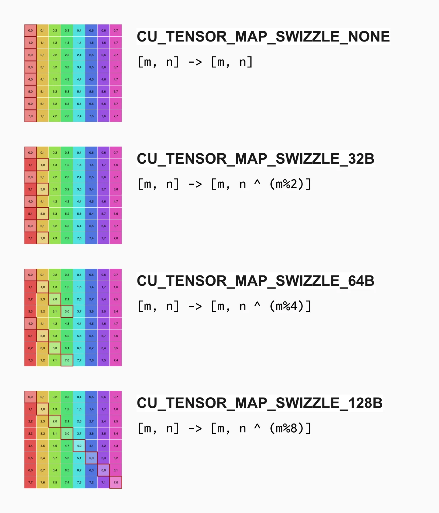<figcaption>
TMA 支持的几种 swizzle 模式。
</figcaption></figure>
要在我的交互式可视化工具中复现上面的 swizzle 模式，可以使用以下设置：
<ul><li data-block="B114">将 BLOCK_M 和 BLOCK_N 都设为 8。</li><li data-block="B115">将元素大小设为 16 字节。</li><li data-block="B116">将访问组高度设为 8。</li><li data-block="B117">将访问组宽度设为 1。</li></ul>
然后使用图中给出的 swizzle 函数。

上图准确展示了数据如何重新分布，但它与 TMA 描述符编码的逻辑布局并不完全对应。<a href="https://docs.nvidia.com/cuda/cuda-c-programming-guide/index.html#table-swizzle-pattern-properties-and-requirements">CUDA 文档</a>指出，对于 32B/64B/128B swizzle，共享内存 box 的最内层维度分别不能超过 32B/64B/128B；实际使用时，最好恰好等于这个大小。但是，无论采用哪种 swizzle 模式，用于 swizzle 的“行索引”都是每经过 128B 才递增一次，也就是覆盖全部 32 个内存 bank 后才递增。如果画出共享内存的物理二维 tile，会是下面这样。
<figure>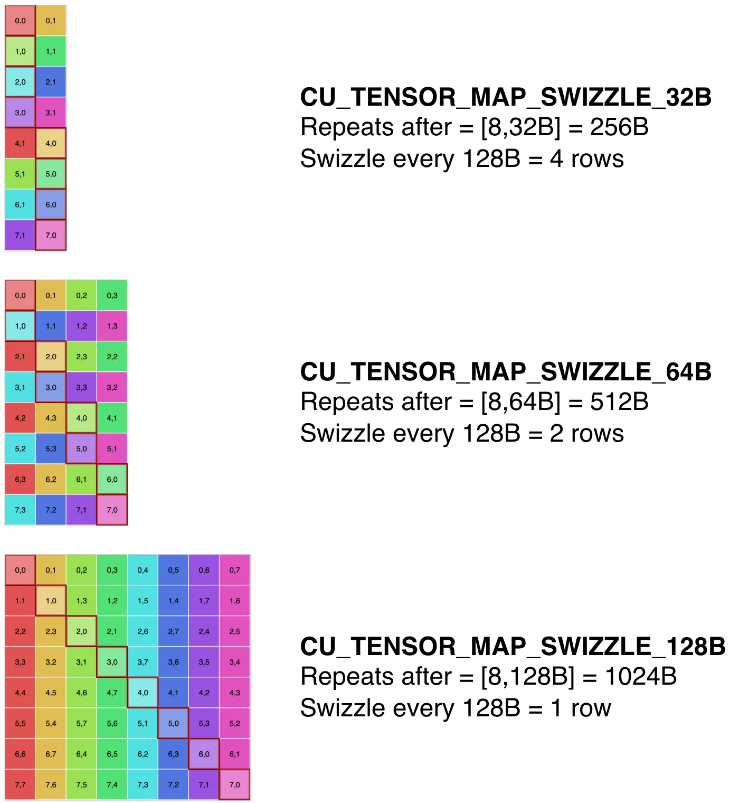<figcaption>
不同 swizzle 模式下的共享内存物理布局。
</figcaption></figure>
注：要验证 TMA 使用的 swizzle 模式，可以发起一次启用 swizzle 的 TMA 加载，再执行一次不启用 swizzle 的 TMA 存储，然后检查返回结果。代码比较冗长，因此没有放在这里，但实现应该很直接。

修改代码之前，需要理解 <code>tcgen05.mma</code> 如何解释经过 swizzle 的共享内存。共享内存描述符的<a href="https://docs.nvidia.com/cuda/parallel-thread-execution/#tcgen05-shared-memory-descriptor">第 61-63 位</a>指定 swizzle 模式，但我们仍不确定共享内存应该采用什么布局。回到<a href="https://docs.nvidia.com/cuda/parallel-thread-execution/#tcgen05-canonical-layouts">规范布局一节</a>，可以看到下面这张表。
<table><thead><tr><th>Swizzle 模式</th><th>应用 swizzle 前的规范布局</th><th>对前一列布局应用的 swizzle</th></tr></thead><tbody><tr><td>无</td><td><code>((8,m),(16B,2k)):((1x16B,SBO),(1,LBO))</code></td><td><code>Swizzle&lt;0, 4, 3&gt;</code></td></tr><tr><td>32B</td><td><code>((8,m),(16B,2k)):((2x16B,SBO),(1,16B))</code></td><td><code>Swizzle&lt;1, 4, 3&gt;</code></td></tr><tr><td>64B</td><td><code>((8,m),(16B,2k)):((4x16B,SBO),(1,16B))</code></td><td><code>Swizzle&lt;2, 4, 3&gt;</code></td></tr><tr><td>128B</td><td><code>((8,m),(16B,2k)):((8x16B,SBO),(1,16B))</code></td><td><code>Swizzle&lt;3, 4, 3&gt;</code></td></tr></tbody></table>
我对 CuTe 布局的了解很有限，但还是试着拆解一下其中的内容。
<ul><li data-block="B124">我将 <code>T</code> 替换成了 <code>16B</code>，觉得这样更清楚。</li><li data-block="B125">先看 None，也就是不使用 swizzle 的情况，对应我们的 v1 内核。它的形状是 <code>((8,m),(16B,2k))</code>，即冒号前的部分；步长是 <code>((1x16B,SBO),(1,LBO))</code>，即冒号后的部分。</li><li data-block="B126"><code>((8,m),(16B,2k))</code> 是一个复合元组，可以理解为一个较大的 <code>[8*m, 16B*2k]</code> tile，其中包含多个较小的 <code>[8, 16B]</code> tile。而这些 <code>[8, 16B]</code> tile，正是 Core Matrix！</li><li data-block="B127">注意大小为 <code>8</code> 的那个维度的步长，也就是移动到下一行所需的距离。<code>SWIZZLE_NONE</code> 的步长是 <code>16B</code>，对应我们之前得到的结论：每个 <code>8x16B</code> tile 都必须在内存中连续。</li><li data-block="B128">对于 <code>SWIZZLE_32B</code>，这个步长变成了 <code>2x16B</code>，强烈暗示物理布局中存在一个 32 字节宽的单位。对 <code>SWIZZLE_64B</code> 和 <code>SWIZZLE_128B</code> 也能作出类似观察！</li></ul>
再次强调，这些布局代数里有 90% 我都不理解，描述时很可能也用了不准确的术语。但我们大致知道，使用 <code>SWIZZLE_32B</code> / <code>SWIZZLE_64B</code> / <code>SWIZZLE_128B</code>，会使某个东西分别变成 32 / 64 / 128 字节宽。它很可能就是 2D TMA tile 的宽度，因为使用 <code>SWIZZLE_128B</code> 要求 TMA 最内层维度为 128 字节。
<figure>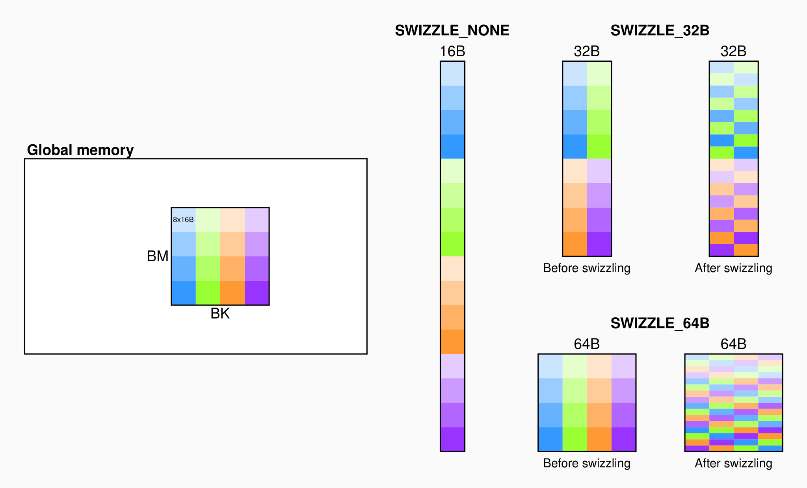<figcaption>
我对启用 swizzle 时 tcgen05 所需共享内存布局的理解。为了方便观察，图中同时展示了 swizzle 前后的布局。
</figcaption></figure>
用文字来说：不使用 swizzle 时，<code>tcgen05</code> 要求每个 <code>8x16B</code> tile 占据连续内存；使用 32B swizzle 时，则要求每个 <code>8x32B</code> tile 占据连续内存，并在每个连续块内部重排 16 字节单元。64B 和 128B swizzle 同理。换句话说，对于 128B swizzle，我们关注的是 <code>8x128B</code> tile。
<ul><li data-block="B132">上图没有画出 128B swizzle，因为画起来太繁琐，也太占空间。不过，希望你已经能够在脑海中想象出来。</li></ul>
代码改动很直接。编码 Tensor Map 时，将最内层的两个维度从 <code>8x16B</code> 改为 <code>8x128B</code>，并将 swizzle 设置为 <code>SWIZZLE_128B</code>。

<pre style="color:#f8f8f2;background-color:#272822;-moz-tab-size:4;-o-tab-size:4;tab-size:4" tabindex="0"><code class="language-diff" data-lang="diff">  // for 2D TMA
  constexpr uint32_t rank = 2;
- uint64_t globalDim[rank]       = {8, M};
- uint64_t globalStrides[rank-1] = {K * sizeof(nv_bfloat16)};  // in bytes
- uint32_t boxDim[rank]          = {8, BLOCK_M};
+ uint64_t globalDim[rank]       = {64, M};
+ uint64_t globalStrides[rank-1] = {K * sizeof(nv_bfloat16)};  // in bytes, unchanged
+ uint32_t boxDim[rank]          = {64, BLOCK_M};

  // for 3D TMA
  constexpr uint32_t rank = 3;
- uint64_t globalDim[rank]       = {8, M, K/8};
- uint64_t globalStrides[rank-1] = {K * sizeof(nv_bfloat16), 16};  // in bytes
- uint32_t boxDim[rank]          = {8, BLOCK_M, BLOCK_K/8};
+ uint64_t globalDim[rank]       = {64, M, K/64};
+ uint64_t globalStrides[rank-1] = {K * sizeof(nv_bfloat16), 128};  // in bytes
+ uint32_t boxDim[rank]          = {64, BLOCK_M, BLOCK_K/64};

  // for both 2D TMA and 3D TMA
  auto err = cuTensorMapEncodeTiled(
    ...
-   CUtensorMapSwizzle::CU_TENSOR_MAP_SWIZZLE_NONE,
+   CUtensorMapSwizzle::CU_TENSOR_MAP_SWIZZLE_128B,
    ...
  );
</code></pre>

在内核中，对 TMA 的发起方式作少量调整。布局已经编码在 Tensor Map 中，因此只需要重新计算正确的偏移和循环次数。

<pre style="color:#f8f8f2;background-color:#272822;-moz-tab-size:4;-o-tab-size:4;tab-size:4" tabindex="0"><code class="language-diff" data-lang="diff">  // issue TMA
  if constexpr (TMAP_3D) {
    const int off_k = iter_k * BLOCK_K;
-   tma_3d_gmem2smem(A_smem, &amp;A_tmap, 0, off_m, off_k / 8, mbar_addr);
-   tma_3d_gmem2smem(B_smem, &amp;B_tmap, 0, off_n, off_k / 8, mbar_addr);
+   tma_3d_gmem2smem(A_smem, &amp;A_tmap, 0, off_m, off_k / 64, mbar_addr);
+   tma_3d_gmem2smem(B_smem, &amp;B_tmap, 0, off_n, off_k / 64, mbar_addr);
  } else {
-   for (int k = 0; k &lt; BLOCK_K / 8; k++) {
-     const int off_k = iter_k * BLOCK_K + k * 8;
-     tma_2d_gmem2smem(A_smem + k * BLOCK_M * 16, &amp;A_tmap, off_k, off_m, mbar_addr);
-     tma_2d_gmem2smem(B_smem + k * BLOCK_N * 16, &amp;B_tmap, off_k, off_n, mbar_addr);
-   }
+   for (int k = 0; k &lt; BLOCK_K / 64; k++) {
+     const int off_k = iter_k * BLOCK_K + k * 64;
+     tma_2d_gmem2smem(A_smem + k * BLOCK_M * 128, &amp;A_tmap, off_k, off_m, mbar_addr);
+     tma_2d_gmem2smem(B_smem + k * BLOCK_N * 128, &amp;B_tmap, off_k, off_n, mbar_addr);
+   }
  }
</code></pre>

对于 MMA，有两个关键改动。首先是共享内存描述符：<code>(2ULL &lt;&lt; 61ULL)</code> 编码 128 字节 swizzle。无需再编码 LBO，因为 PTX 默认它为 1。不过，我甚至都没有尝试理解 swizzle 情况下的 LBO 到底是什么意思，哈哈。

<pre style="color:#f8f8f2;background-color:#272822;-moz-tab-size:4;-o-tab-size:4;tab-size:4" tabindex="0"><code class="language-cpp" data-lang="cpp">  auto make_desc =  -&gt; uint64_t {
    const int SBO = 8 * 128;  // size of the 8x128B tile
    return desc_encode(addr) | (desc_encode(SBO) &lt;&lt; 32ULL) | (1ULL &lt;&lt; 46ULL) | (2ULL &lt;&lt; 61ULL);
  };
</code></pre>

第二个改动更需要动一点脑筋：如何选取正确的共享内存地址。别忘了，数据现在已经被 swizzle 了。以 64B swizzle 为例，因为实在没有足够空间画出 128B 的情况。
<figure>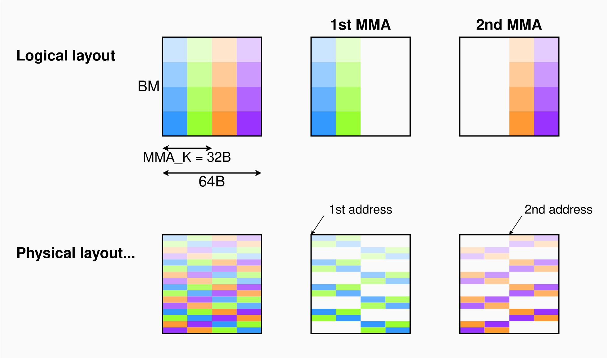<figcaption>
使用 64 字节 swizzle 时，共享内存中 MMA tile 的可视化。<code>BLOCK_M</code> 和 <code>MMA_M</code> 本应为 128，即 16 个 <code>8x16B</code> 单位；为了让图更紧凑，这里将它们设为 32，即 4 个 <code>8x16B</code> 单位。
</figcaption></figure>
每个 MMA tile 的物理布局看起来相当复杂。如果忽略“1st address”和“2nd address”箭头，就很难弄清如何为这些 tile 正确编码共享内存描述符。回忆一下，我们只能向描述符提供一个共享内存地址。也许最合理的办法，就是只看第一行，然后相信硬件已经接好了其余线路。这就是“1st address”和“2nd address”的来源，而事实证明，这正是正确的理解方式！

实际代码现在有两层嵌套循环：外层在 <code>[BLOCK_M, BLOCK_K]</code> 这个线程块 tile 上，遍历 <code>[BLOCK_M, 128B]</code> 子块，也许可以称为 TMA tile；内层再在 <code>[BLOCK_M, 128B]</code> 上遍历 <code>[BLOCK_M, 32B]</code> 的 MMA tile。

<pre style="color:#f8f8f2;background-color:#272822;-moz-tab-size:4;-o-tab-size:4;tab-size:4" tabindex="0"><code class="language-cpp" data-lang="cpp">  // manually unroll 1st iteration to disable accumulation
  {
    tcgen05_mma_f16(taddr, make_desc(A_smem), make_desc(B_smem), i_desc, iter_k);
    for (int k2 = 1; k2 &lt; 64 / MMA_K; k2++) {
      uint64_t a_desc = make_desc(A_smem + k2 * 32);
      uint64_t b_desc = make_desc(B_smem + k2 * 32);
      tcgen05_mma_f16(taddr, a_desc, b_desc, i_desc, 1);
    }
  }
  // k1 selects the (BLOCK_M, 64) tile.
  // k2 selects the (BLOCK_M, 16) tile, whose rows are swizzled.
  for (int k1 = 1; k1 &lt; BLOCK_K / 64; k1++)
    for (int k2 = 0; k2 &lt; 64 / MMA_K; k2++) {
      uint64_t a_desc = make_desc(A_smem + k1 * BLOCK_M * 128 + k2 * 32);
      uint64_t b_desc = make_desc(B_smem + k1 * BLOCK_N * 128 + k2 * 32);
      tcgen05_mma_f16(taddr, a_desc, b_desc, i_desc, 1);
    }
  asm volatile("tcgen05.commit.cta_group::1.mbarrier::arrive::one.shared::cluster.b64 [%0];"
              :: "r"(mbar_addr) : "memory");
</code></pre>

支持 128B swizzle 的改动就这些，完整代码见 <a href="https://github.com/gau-nernst/learn-cuda/blob/3b90ac9b/02e_matmul_sm100/matmul_v2.cu">matmul_v2.cu</a>。再次运行基准测试。
<table><thead><tr><th>内核名称</th><th>TFLOPS</th></tr></thead><tbody><tr><td>CuBLAS (PyTorch 2.9.1 + CUDA 13)</td><td>1506.74</td></tr><tr><td>v1a（基础 tcgen05 + 2D 16B TMA）</td><td>254.62</td></tr><tr><td>v1b (3D 16B TMA)</td><td>252.81</td></tr><tr><td>v2a (2D 128B TMA)</td><td>681.20</td></tr><tr><td>v2b (3D 128B TMA)</td><td>695.43</td></tr></tbody></table>
速度大幅提升！比 v1 快了 2.7 倍，尚未加入流水线就达到了 CuBLAS 46% 的速度。我们可以继续优化了，但我还有两点想补充。

我们真的需要理解 swizzle 吗？注意，代码里没有任何手动计算 swizzle 的地方。我们只是在 Tensor Map 编码时设置 <code>CU_TENSOR_MAP_SWIZZLE_128B</code>，并在共享内存描述符中把第 61-63 位设为 2。换句话说，只要 TMA 与 <code>tcgen05.mma</code> 对 swizzle 的实现保持一致，即使硬件换了一种实现方式，代码也不需要改变，并且仍然正确。
<ul><li data-block="B143">就个人感受而言，128B swizzle 更像是在使用更宽的 tile，从 16 字节变成 128 字节，而不只是做 swizzle。若想让 <code>tcgen05.mma</code> 使用 128B 宽的 tile，就必须启用 128B swizzle。</li></ul>
加速来自消除了 bank 冲突吗？Swizzle 通常被视为避免 bank 冲突的技术，但第一个内核真的存在 bank 冲突吗？回忆一下，第一个内核中的每个 <code>8x16B</code> tile 都连续存放，恰好覆盖全部 32 个 bank！因此，即使是第一个内核，理论上也不应存在 bank 冲突。
<ul><li data-block="B145">这个分析假设 <code>tcgen05.mma</code> 每次从共享内存中加载一个 <code>8x16B</code> tile。众所周知，<code>ldmatrix.x4</code> 就是这样工作的，虽然 PTX 文档没有说明，但不能保证 <code>tcgen05.mma</code> 也采用同样的访问模式。例如，为 AMD MI300 编写矩阵乘法的人就知道，该 GPU 使用<a href="https://github.com/nod-ai/amd-shark-ai/blob/v3.9.0/docs/amdgpu_kernel_optimization_guide.md#avoiding-lds-bank-conflicts">另一种访问模式</a>，而且读写的模式还不相同。我们可以用 ncu 验证，但 Modal 不提供 ncu 访问权限。</li><li data-block="B146">我能想到的一个可能原因很简单：TMA 最内层维度更大时，全局内存加载更快。对 3D TMA 而言，v1 和 v2 的整体形状都是 <code>[BLOCK_M, BLOCK_K]</code>。这进一步说明，TMA 引擎对某些访问模式可能比其他模式更高效。为 TMA 做微基准测试应该是个有趣的项目，也许已经有人做过，只是我不知道。同样，这个解释也可以用 ncu 验证。</li></ul><h2 data-block="B147" id="pipelining">流水线</h2>
下一步自然是实现流水线。这里先采用“Ampere 风格”：N 级流水线意味着始终有 N 个阶段的全局内存到共享内存加载处于进行中，每个阶段各自拥有一个共享内存缓冲区。整体结构如下。

<pre style="color:#f8f8f2;background-color:#272822;-moz-tab-size:4;-o-tab-size:4;tab-size:4" tabindex="0"><code class="language-cpp" data-lang="cpp">template &lt;int BLOCK_N, int BLOCK_K, int NUM_STAGES&gt;
__global__
__launch_bounds__(TB_SIZE)
void kernel(
  const __grid_constant__ CUtensorMap A_tmap,
  const __grid_constant__ CUtensorMap B_tmap,
  nv_bfloat16 *C_ptr,
  int M, int N, int K
) {
  ...

  // use lambda for convenience.
  auto load = [&amp;](int iter_k) {
    ... // issue TMA here
  };
  auto compute = [&amp;](int iter_k) {
    ... // issue tcgen05.mma here
  };

  // prefetch N-1 stages
  for (int stage = 0; stage &lt; NUM_STAGES; stage++)
    load(stage);

  // main loop, iterate along K dim
  for (int iter_k = 0; iter_k &lt; K / BLOCK_K; iter_k++) {
    // prefetch the next stage -&gt; N stages in flight now
    load(iter_k + NUM_STAGES - 1);

    // wait for the current load stage to finish
    ...

    // N-1 load stages in flight now,
    // but we are also doing 1 compute stage.
    compute(iter_k);

    // wait for the current compute stage to finish
    // so that the buffer is freed up for the next prefetch.
    ...
  }
}
</code></pre>

我们需要能够等待某个指定的 TMA 加载阶段。方法很简单：每个 TMA 阶段使用一个 <code>mbarrier</code>。大部分代码改动没什么特别之处，可以直接查看 <a href="https://github.com/gau-nernst/learn-cuda/blob/3b90ac9b/02e_matmul_sm100/matmul_v3.cu">matmul_v3.cu</a>。
<table><thead><tr><th>内核名称</th><th>TFLOPS</th></tr></thead><tbody><tr><td>CuBLAS (PyTorch 2.9.1 + CUDA 13)</td><td>1506.74</td></tr><tr><td>v2b (3D 128B TMA)</td><td>695.43</td></tr><tr><td>v3（流水线）</td><td>939.61</td></tr></tbody></table>
这次加速也不错，达到 35%，不过没有上一次那么显著。
<h2 data-block="B151" id="warp-specialization">Warp 专职分工（Warp specialization）</h2>
之前我已经多次遇到 Warp specialization 这个概念。它最初由 CUTLASS 引入，用来编写高性能 Hopper GEMM。思路很简单：既然发起 TMA 和 MMA 各只需要一个线程，那就分别安排一个专职 warp！每个 warp 执行自己的主循环，避免在循环内部反复判断 <code>if (warp_id == 0)</code>。

<pre style="color:#f8f8f2;background-color:#272822;-moz-tab-size:4;-o-tab-size:4;tab-size:4" tabindex="0"><code class="language-cpp" data-lang="cpp">  const int num_iters = K / BLOCK_K;
  if (warp_id == 0 &amp;&amp; elect_sync()) {
    // TMA warp
    for (int iter_k = 0; iter_k &lt; num_iters; iter_k++)
      ...
  }
  else if (warp_id == 1 &amp;&amp; elect_sync()) {
    // MMA warp
    for (int iter_k = 0; iter_k &lt; num_iters; iter_k++)
      ...
  }
</code></pre>

在 Blackwell 上，Hopper 也一样，Tensor Core 相对于程序员编写的线程是异步运行的。因此，我们可以发起多条 <code>tcgen05.mma</code>，而不必等待它们完成就进入下一阶段。不过，仍需小心确保：只有当 MMA 不再使用当前阶段的缓冲区时，TMA 才能开始向其中复制数据。
<figure>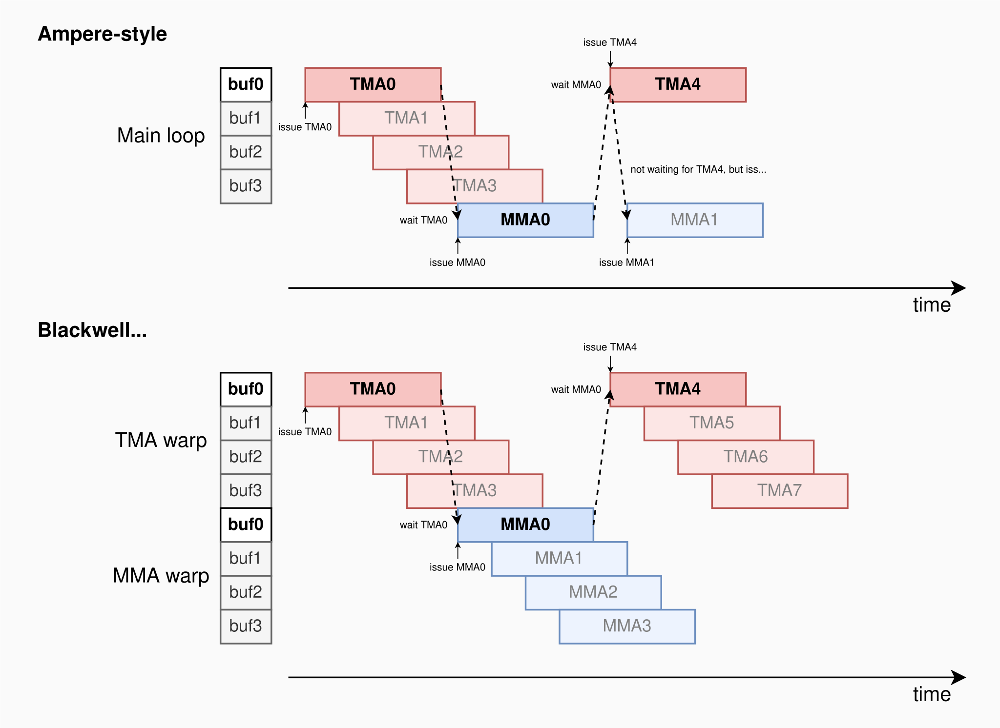<figcaption>
Ampere 上的 4 级流水线（上）与采用 warp specialization 的 Blackwell 4 级流水线（下）。
</figcaption></figure>
为了独立等待不同的 MMA 阶段，我们使用多个 <code>mbarrier</code> 对象，就像之前分别等待各个 TMA 阶段一样。

<pre style="color:#f8f8f2;background-color:#272822;-moz-tab-size:4;-o-tab-size:4;tab-size:4" tabindex="0"><code class="language-cpp" data-lang="cpp">  // set up mbarrier
  // we have NUM_STAGES mbars for TMA
  //         NUM_STAGES mbars for MMA
  #pragma nv_diag_suppress static_var_with_dynamic_init
  __shared__ uint64_t mbars[NUM_STAGES * 2];
  const int tma_mbar_addr = static_cast&lt;int&gt;(__cvta_generic_to_shared(mbars));
  const int mma_mbar_addr = tma_mbar_addr + NUM_STAGES * 8;

  if (warp_id == 0 &amp;&amp; elect_sync()) {
    for (int i = 0; i &lt; NUM_STAGES; i++) {
      // MMA warp checks the completion of TMA using tma_mbar
      // there is only 1 thread issuing TMA, hence init mbar with 1.
      mbarrier_init(tma_mbar_addr + i * 8, 1);

      // TMA warp checks the completion of MMA using mma_mbar
      // there is only 1 thread issuing MMA, hence init mbar with 1.
      mbarrier_init(mma_mbar_addr + i * 8, 1);
    }
    asm volatile("fence.mbarrier_init.release.cluster;");  // visible to async proxy
  }
</code></pre>

TMA warp 和 MMA warp 的实际代码会选取正确的 <code>mbarrier</code> 来等待和发信号。这部分没什么特别之处，稍后可以查看完整代码。
<ul><li data-block="B157">可能需要特别注意的一点是：开始时，TMA 不应该等待 MMA。这是因为在 <code>phase = 0</code> 时，共享缓冲区本来就可供 TMA 使用，可以直接开始复制数据。处理方法很简单：将 TMA warp 用来检查 MMA 完成情况的 phase 翻转即可。</li></ul>
<pre style="color:#f8f8f2;background-color:#272822;-moz-tab-size:4;-o-tab-size:4;tab-size:4" tabindex="0"><code class="language-cpp" data-lang="cpp">  // inside the code for TMA warp
  // wait for MMA
  const int stage_id = iter_k % NUM_STAGES;
  mbarrier_wait(mma_mbar_addr + stage_id * 8, phase ^ 1);
</code></pre>
<ul><li data-block="B158">等待错误的 phase 会造成死锁，因为 TMA 和 MMA 会彼此等待。</li><li data-block="B159">我最初按照 <a href="https://github.com/deepseek-ai/DeepGEMM/blob/9b680f42/deep_gemm/include/deep_gemm/impls/sm100_bf16_gemm.cuh#L184">DeepGEMM</a> 的方式这样实现。不过回头看，更简单的办法是让 TMA warp 和 MMA warp 分别用自己的变量跟踪 <code>phase</code> parity。这样，在 TMA warp 中初始化 <code>mma_phase = 1</code>，在 MMA warp 中初始化 <code>tma_phase = 0</code> 即可。意图也会更清楚，因为单独一个 <code>phase</code> 变量在内核的不同位置可能指代不同的事情。</li></ul>
对于 epilogue，我最初使用 <code>__syncthreads()</code> 等待 TMA warp 和 MMA warp 结束，然后再执行结果写回。

<pre style="color:#f8f8f2;background-color:#272822;-moz-tab-size:4;-o-tab-size:4;tab-size:4" tabindex="0"><code class="language-cpp" data-lang="cpp">  // warp specialization
  if (warp_id == 0 &amp;&amp; elect_sync()) {
    // TMA warp
    for (int iter_k = 0; iter_k &lt; num_iters; iter_k++)
      ...
  }
  else if (warp_id == 1 &amp;&amp; elect_sync()) {
    // MMA warp
    for (int iter_k = 0; iter_k &lt; num_iters; iter_k++)
      ...
  }

  // wait for all warps to reach here
  __syncthreads();

  // epilogue code
  ...
</code></pre>

然而，正确性问题一直出现。仔细检查后，我才意识到，<code>__syncthreads()</code> 并不保证 MMA 已完成，只保证最后一条 <code>tcgen05.mma</code> 已经发起。要正确等待最后一轮 MMA，必须使用 <code>mbarrier</code>。一种方法是计算最后一轮 MMA 对应哪个 <code>mbarrier</code>，以及它当前的 phase。更简单的方法是额外使用一个 <code>mbarrier</code>，并在主循环之后对它执行一次 <code>tcgen05.commit</code>。我选择了后者。

<pre style="color:#f8f8f2;background-color:#272822;-moz-tab-size:4;-o-tab-size:4;tab-size:4" tabindex="0"><code class="language-cpp" data-lang="cpp">  // set up mbarrier
  // we have NUM_STAGES mbars for TMA
  //         NUM_STAGES mbars for MMA
  //                  1 mbar for mainloop
  #pragma nv_diag_suppress static_var_with_dynamic_init
  __shared__ uint64_t mbars[NUM_STAGES * 2 + 1];
  const int tma_mbar_addr = static_cast&lt;int&gt;(__cvta_generic_to_shared(mbars));
  const int mma_mbar_addr = tma_mbar_addr + NUM_STAGES * 8;
  const int mainloop_mbar_addr = mma_mbar_addr + NUM_STAGES * 8;

  if (warp_id == 0 &amp;&amp; elect_sync()) {
    for (int i = 0; i &lt; NUM_STAGES; i++) {
      mbarrier_init(tma_mbar_addr + i * 8, 1);
      mbarrier_init(mma_mbar_addr + i * 8, 1);
    }

    // epilogue warps check for the completion of mainloop using mainloop_mbar
    // there is only 1 thread issuing TMA, hence init mbar with 1.
    mbarrier_init(mainloop_mbar_addr, 1);

    asm volatile("fence.mbarrier_init.release.cluster;");  // visible to async proxy
  }

  // other initial kernel setup
  ...

  // warp specialization
  if (warp_id == 0 &amp;&amp; elect_sync()) {
    // TMA warp
    for (int iter_k = 0; iter_k &lt; num_iters; iter_k++)
      ...
  }
  else if (warp_id == 1 &amp;&amp; elect_sync()) {
    // MMA warp
    for (int iter_k = 0; iter_k &lt; num_iters; iter_k++)
      ...

    // signal when tcgen05 finishes with the main loop
    asm volatile("tcgen05.commit.cta_group::1.mbarrier::arrive::one.shared::cluster.b64 [%0];"
                :: "r"(mainloop_mbar_addr) : "memory");
  }

  // wait for mainloop to finish
  __syncthreads();
  mbarrier_wait(mainloop_mbar_addr, 0);  // implied using phase = 0
</code></pre>

这里的 <code>__syncthreads()</code> 是可选的。我的考虑是，它能避免另外两个没有负责发起 TMA 或 MMA 的 warp，在最后一条 <code>tcgen05.mma</code> 发起之前，就无谓地在 <code>mbarrier</code> 上自旋。我还觉得，它可能防止 TMA warp 和 MMA warp 内出现分歧，因为 C++ 程序本身没有阻止未被选举的线程继续执行。不过，nvcc 和 ptxas 也许已经插入了必要的保护，也可能这是某种我不了解的 CUDA 语义。总之，这些只是我的猜测，我并没有花精力验证。

<a href="https://github.com/gau-nernst/learn-cuda/blob/3b90ac9b/02e_matmul_sm100/matmul_v4.cu">matmul_v4.cu</a> 又带来了约 29% 的加速！现在已经相当接近 CuBLAS 了。
<table><thead><tr><th>内核名称</th><th>TFLOPS</th></tr></thead><tbody><tr><td>CuBLAS (PyTorch 2.9.1 + CUDA 13)</td><td>1506.74</td></tr><tr><td>v3（流水线）</td><td>939.61</td></tr><tr><td>v4（Warp 专职分工）</td><td>1208.83</td></tr></tbody></table><h2 data-block="B164" id="2-sm-mma">双 SM MMA（2-SM MMA）</h2>
Blackwell 还有一个很酷的功能：两个线程块的 Tensor Core 可以协作计算同一个 MMA tile。数据组织方式如下。
<figure>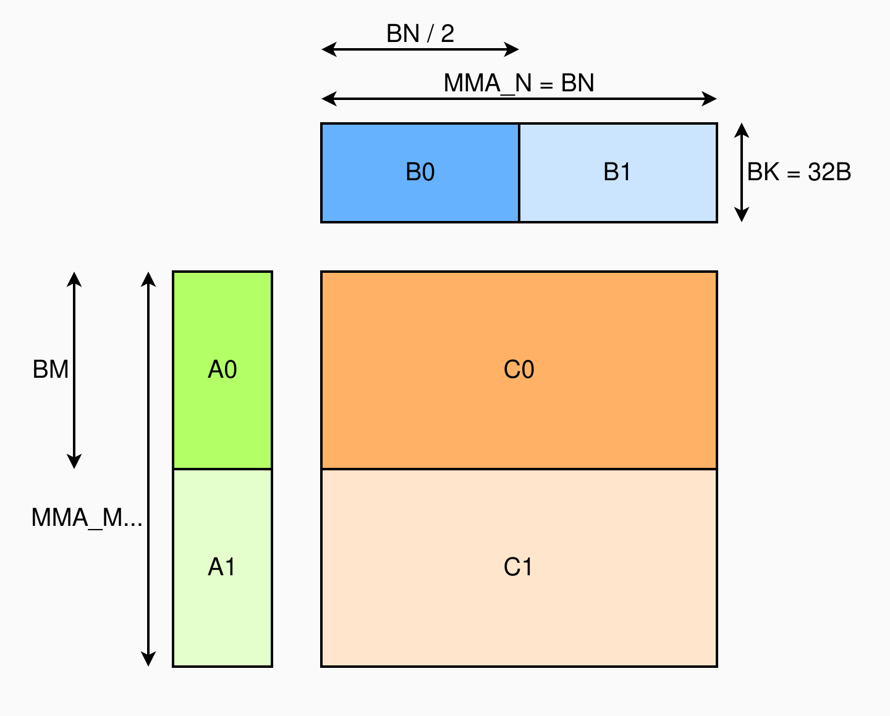<figcaption>
双 SM MMA 的数据组织。A0、B0、C0 位于 CTA0，A1、B1、C1 位于 CTA1。
</figcaption></figure>
每个 CTA，也就是线程块的另一种说法，提供 A tile 和 B tile 的一半，同时保存输出的一半。<code>MMA_M</code> 最大可以达到 256，是普通单 SM MMA 的两倍，而 <code>BLOCK_M</code> 仍为 128。<code>MMA_N</code> 的上限不变，仍然最大为 256，但现在每个 CTA 只需要保存一半的 B tile。如果让我猜测其工作方式：每个 CTA 的 Tensor Core 仍像往常一样加载本地 A tile，因为计算 C0 不需要 A1，反之亦然；但 B tile 的一半来自本地共享内存，另一半来自 Peer CTA 的共享内存。Peer CTA 是 PTX 文档使用的正式术语。
<ul><li data-block="B168">有意思的是，至少据我所知，上面的图在 PTX 文档中既没有出现，也没有得到暗示。但其他资料有所解释，例如 Modular Blackwell 系列的<a href="https://www.modular.com/blog/matrix-multiplication-on-nvidias-blackwell-part-3-the-optimizations-behind-85-of-sota-performance">第二篇博客</a>，以及 <a href="https://research.colfax-intl.com/cutlass-tutorial-gemm-with-thread-block-clusters-on-nvidia-blackwell-gpus/">Colfax 的 Blackwell 文章</a>。</li></ul>
要让两个 SM 协同工作，启动内核时需要启用 <a href="https://docs.nvidia.com/cuda/cuda-c-programming-guide/index.html#thread-block-clusters">Threadblock clusters</a>，也就是线程块集群。

<pre style="color:#f8f8f2;background-color:#272822;-moz-tab-size:4;-o-tab-size:4;tab-size:4" tabindex="0"><code class="language-cpp" data-lang="cpp">__global__
__cluster_dims__(2, 1, 1)
__launch_bounds__(TB_SIZE)
void kernel(
  const __grid_constant__ CUtensorMap A_tmap,
  const __grid_constant__ CUtensorMap B_tmap,
  nv_bfloat16 *C_ptr,
  int M, int N, int K
) {
  // CTA rank in a cluster
  int cta_rank;
  asm volatile("mov.b32 %0, %%cluster_ctarank;" : "=r"(cta_rank));
  ...
}
</code></pre>

要确定当前线程块的 CTA rank，可以直接读取 <code>%cluster_ctarank</code> 寄存器。不过，至少根据我使用双 CTA 集群的经验，两个连续的线程块会组成一个集群。因此，或许直接使用 <code>cta_rank = blockIdx.x % 2</code> 就足够了。当然，也可以启动包含更多 CTA 的较大集群，但我还没找到值得尝试的理由：双 SM MMA 只需要两个 CTA。

在这个双 SM MMA 内核中，只有一个 CTA 发起 MMA。因此，同步结构如下。
<figure>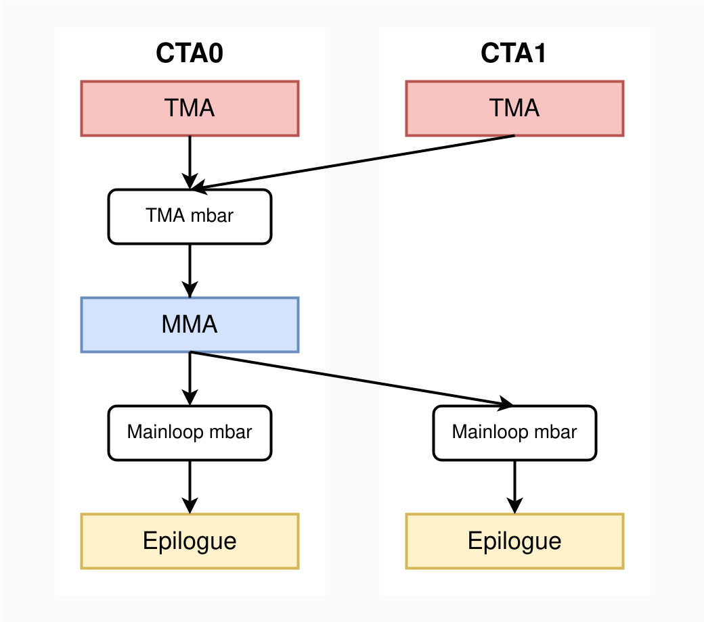<figcaption>
双 SM MMA 设计中的同步模式。只有 CTA0 发起 MMA。为使图示简洁，省略了 TMA 通过 MMA <code>mbarrier</code> 等待 MMA 的路径。
</figcaption></figure>
可以看到，两个 CTA 的 TMA 都向 CTA0 的 TMA <code>mbarrier</code> 报告完成进度。这样，负责为两个 CTA 发起 MMA 的 CTA0 MMA warp，只用自己的本地 <code>mbarrier</code>，就能等待两边的 TMA 都完成。对应的指令修改如下。

<pre style="color:#f8f8f2;background-color:#272822;-moz-tab-size:4;-o-tab-size:4;tab-size:4" tabindex="0"><code class="language-diff" data-lang="diff">    // clear the cluster rank bit of shared memory address
    // https://github.com/NVIDIA/cutlass/blob/v4.3.1/include/cute/arch/copy_sm100_tma.hpp#L113-L115
-   const int mbar_addr = tma_mbar_addr + stage_id * 8;
+   const int mbar_addr = (tma_mbar_addr + stage_id * 8) &amp; 0xFEFFFFFF;  // this is on CTA0

    // change to .shared::cluster
-   asm volatile("mbarrier.arrive.expect_tx.release.cta.shared::cta.b64 _, [%0], %1;"
+   asm volatile("mbarrier.arrive.expect_tx.release.cta.shared::cluster.b64 _, [%0], %1;"
                :: "r"(mbar_addr), "r"(A_size + B_size) : "memory");
</code></pre>
<ul><li data-block="B174">发起 TMA 的方式没有大改，因为每个 CTA 仍然将数据加载到自己的共享内存。变化只是将进度报告给哪个 <code>mbarrier</code>。对于 B，每个 CTA 只加载一半的 B tile。</li><li data-block="B175">严格来说，应该用 <a href="https://docs.nvidia.com/cuda/parallel-thread-execution/#data-movement-and-conversion-instructions-mapa">mapa</a> 指令，把本地共享内存地址映射到另一个 CTA 的地址。不过，我在 CUTLASS 代码中找到了这个位掩码技巧，于是直接照用了。</li></ul>
如果按内核执行顺序讲，现在应该讨论 MMA 发起代码的变化。但这一部分值得单独展开，所以先处理其他细节。上图中，CTA0 的 MMA warp 会通知两个 CTA 中的 mainloop <code>mbarrier</code>，让它们跟踪 MMA 的完成情况。这称为 multicast，也就是把同一条信息发送到多个目标。虽然图中因空间有限没有画出，CTA0 MMA 也会向两个 CTA 中的 MMA <code>mbarrier</code> 多播完成信号。

<pre style="color:#f8f8f2;background-color:#272822;-moz-tab-size:4;-o-tab-size:4;tab-size:4" tabindex="0"><code class="language-diff" data-lang="diff">-   asm volatile("tcgen05.commit.cta_group::1.mbarrier::arrive::one.shared::cluster.b64 [%0];"
-               :: "r"(mma_mbar_addr + stage_id * 8) : "memory");
+   constexpr int16_t cta_mask = (1 &lt;&lt; 2) - 1;  // 0b11 in binary
+   asm volatile("tcgen05.commit.cta_group::2.mbarrier::arrive::one.shared::cluster.multicast::cluster.b64 [%0], %1;"
+               :: "r"(mma_mbar_addr + stage_id * 8), "h"(cta_mask) : "memory");
</code></pre>
<ul><li data-block="B177">一个自然的问题是：指令怎么知道远端共享内存地址？好在 <a href="https://docs.nvidia.com/cuda/parallel-thread-execution/#tcgen-async-sync-operations-commit">PTX 文档</a>对此给出了解释，可以查看 <code>.cta_group::2</code> 相关段落。</li></ul><blockquote>
<code>mbar</code>rier 信号会被多播到每个目标 CTA 共享内存中与 <code>mbar</code> 相同的偏移位置。
</blockquote><ul><li data-block="B179">根据前面从 CUTLASS 借来的技巧，即 <code>&amp; 0xFEFFFFFF</code>，我们知道共享内存地址中有一个位域，用于表明地址指向远端区域。因此，硬件很可能遍历 <code>cta_mask</code>，并设置相应位域来得到远端地址；也可能它只查看部分低位。</li><li data-block="B180">由此产生一个重要要求：不同 cluster rank 中，共享内存对象的布局必须完全一致。即便 CTA1 不使用 TMA <code>mbarrier</code>，也不能将这块内存挪作他用，因为那可能改变其他对象的布局。</li></ul>
再回到发起 MMA 的问题。双 SM MMA 由 <code>.cta_group::2</code> 修饰符表示，因此只需要调整指令和共享内存描述符。指令描述符现在编码一个更大的 tile：<code>MMA_M = 256</code>，而 <code>MMA_N</code> 可调。共享内存描述符一开始让我困惑：输入数据分布在两个 CTA 中，该如何正确编码？回忆一下，每个共享内存描述符只能接收一个地址，而 <code>tcgen05.mma</code> 对 A 和 B 也各只接收一个描述符，不可能显式指定分布在两边的 A、B 半块。
<ul><li data-block="B182">对于 A 和 B 应有的共享内存布局，以及如何为 MMA 编码或选择这些布局，PTX 文档说明得很少，或者是我没找到正确章节。这让我想起之前被 LBO 和 SBO 绕晕的经历。我提出过各种假设：也许要在不同 CTA rank 上复制完整的 B，这样每边都能拿到全部数据，但那又有什么意义？也许要手动用远端共享内存地址发起 MMA，但这也不可能，因为共享内存描述符只保留地址的最低 18 位。这些猜测当然都不对。</li></ul>
幸运的是，GPU-MODE Discord 上的 <code>firadeoclus</code> 帮我澄清了这一点。他确认，只需要使用本地共享内存地址，硬件就会从远端共享内存中相同偏移的位置取数据。这与前面带 multicast 的 <code>tcgen05.commit</code> 类似，也进一步说明：不同 cluster rank 中，共享内存对象的布局必须相同。

最终，发起 MMA 的代码其实没有太大变化，因为构造共享内存描述符时，仍然使用本地缓冲区。还有一些不太容易自然插入叙述的小细节：
<ul><li data-block="B185">同一内核中的 <code>tcgen05</code> 指令必须统一使用 <code>.cta_group::1</code> 或统一使用 <code>.cta_group::2</code>。因此，上面没有提到的其他 <code>tcgen05</code> 指令，例如 <code>tcgen05.alloc</code>，也必须改用 <code>.cta_group::2</code>。</li><li data-block="B186">在 cluster 作用域内，与 <code>__syncthreads()</code> 对应的是 <code>barrier.cluster.arrive.release.aligned</code> 和 <code>barrier.cluster.wait.acquire.aligned</code> 这一对指令。它们应在 <code>mbarrier</code> 和 Tensor Memory 初始化后，以及 Tensor Memory 释放前使用。实际上，我在这个内核释放 Tensor Memory 时没有使用 cluster barrier，正确性检查也通过了，但这确实引入了竞态条件。</li><li data-block="B187">从本节开头的数据组织图可以看出，同一个集群的两个 CTA 沿 M 维排列。因此，需要调整 block ID 的映射。注意，这并不是唯一可行的安排方式。</li></ul>
<pre style="color:#f8f8f2;background-color:#272822;-moz-tab-size:4;-o-tab-size:4;tab-size:4" tabindex="0"><code class="language-diff" data-lang="diff">  // bid runs along N-mode first
- const int bid_m = bid / grid_n;
- const int bid_n = bid % grid_n;

  // bid must run along M-mode first so that .cta_group::2 works correctly
+ constexpr int GROUP_M = 2;
+ const int bid_m = bid / (grid_n * GROUP_M) * GROUP_M + (bid % GROUP_M);
+ const int bid_n = (bid / GROUP_M) % grid_n;
</code></pre>

完整实现见 <a href="https://github.com/gau-nernst/learn-cuda/blob/3b90ac9b/02e_matmul_sm100/matmul_v5.cu">matmul_v5</a>。坦白说，只有 8% 的加速有点令人失望。
<table><thead><tr><th>内核名称</th><th>TFLOPS</th></tr></thead><tbody><tr><td>CuBLAS (PyTorch 2.9.1 + CUDA 13)</td><td>1506.74</td></tr><tr><td>v4（Warp 专职分工）</td><td>1208.83</td></tr><tr><td>v5 (2-SM MMA)</td><td>1302.29</td></tr></tbody></table><h2 data-block="B189" id="persistent-kernel-with-static-scheduling">持久化内核：静态调度</h2>
到目前为止，我们其实一直在盲目优化：没有做性能剖析，也没有收集指标来定位瓶颈。现在该花些精力剖析当前内核了。遗憾的是，Modal 不提供 ncu 访问权限。不过，我们还有另一招：内核内部性能剖析（Intra-kernel profiling）。

我以前写过这种技术，并在 AMD Distributed 竞赛中使用过。思路很简单：读取时钟寄存器，记录内核中各类事件的开始和结束时间，然后将数据转换成 Chrome trace，用 UI Perfetto 可视化。这篇博客已经很长了，就不再展开。内核中的用法见 <a href="https://github.com/gau-nernst/learn-cuda/blob/3b90ac9b/02e_matmul_sm100/profiler.h">profiler.h</a> 和 <a href="https://github.com/gau-nernst/learn-cuda/blob/3b90ac9b/02e_matmul_sm100/matmul_v5.cu">matmul_v5.cu</a>，主机端导出见 <a href="https://github.com/gau-nernst/learn-cuda/blob/3b90ac9b/02e_matmul_sm100/main.py#L45">main.py#L45</a>。

对采用 warp specialization 的双 SM 内核，可以得到下面这份 Chrome trace。
<figure>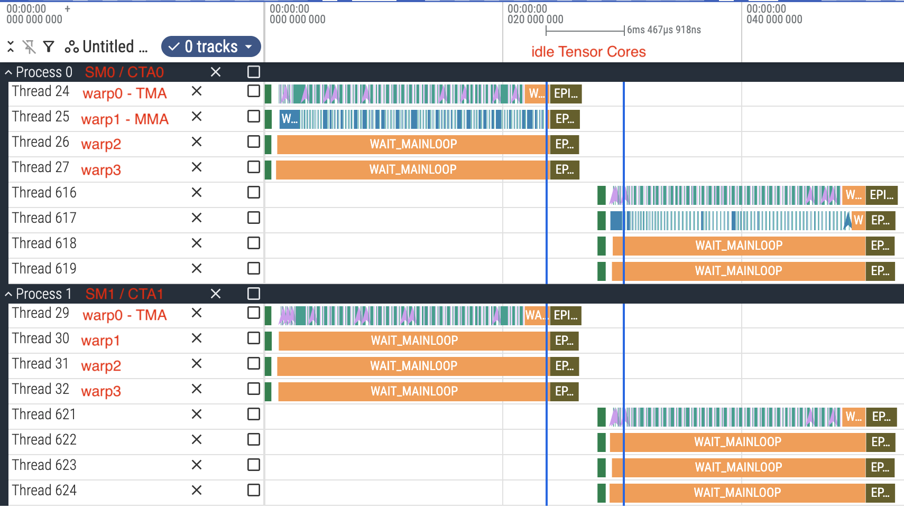<figcaption>
v5 内核的内部性能剖析。来源：<a href="https://github.com/gau-nernst/learn-cuda/raw/3b90ac9b/02e_matmul_sm100/trace_v5.json.gz">profile_v5.json.gz</a>。
</figcaption></figure><ul><li data-block="B194">可以通过图注中的链接下载 Chrome trace，再用 <a href="https://ui.perfetto.dev/">https://ui.perfetto.dev/</a> 交互式查看。</li></ul>
很明显，epilogue 和新线程块的初始设置占据了相当一部分内核运行时间，妨碍了 Tensor Core 利用率：执行 epilogue 时，Tensor Core 处于空闲状态。典型解决方案是持久化内核（Persistent kernel）：只启动 148 个线程块，等于 Modal B200 上的 SM 数量；每个线程块依次处理多个输出 tile，而不是一个线程块只处理一个输出 tile。这样做有两个好处：
<ol><li data-block="B196">整个内核运行期间，每个 SM 只需初始化一次，而不必为每个输出 tile 都初始化一次。</li><li data-block="B197">让 epilogue 与 TMA、MMA 重叠：当 epilogue warp 执行 tmem-&gt;rmem、数据类型转换和 rmem-&gt;gmem 时，TMA warp 与 MMA warp 可以继续处理下一个输出 tile。</li></ol>
和之前一样，我们使用 <code>mbarrier</code> 正确协调各个 warp。继续之前，先回顾 TMA&lt;-&gt;MMA 的同步设计：使用两组 <code>mbarrier</code>，分别向两个方向传递共享缓冲区所有权的状态。从某种意义上说，这就是环形缓冲区，或者环形队列：TMA 向队列放入新数据，MMA 消费这些数据，并在使用后释放资源。

这个思路也可以扩展到当前的 mainloop-&gt;epilogue 同步。现在需要协调的是 Tensor Memory 缓冲区：mainloop 是生产者，epilogue 是消费者。也许不对 Tensor Memory 使用双缓冲也行，让下一个输出 tile 的 MMA 等待上一个 tile 的 epilogue 完成即可。但考虑到 Tensor Memory 空间很充裕，共有 512 列，而 <code>BLOCK_N</code> 最大只有 256，我还是决定使用双缓冲。
<ul><li data-block="B200">严格来说，这里的生产者是 MMA warp，但我更愿意称它为 mainloop。第一，这组生产者与消费者的运行频率不同，是按输出 tile，而不是按输入 tile 协作；第二，我希望清楚地区分这两组生产者与消费者。</li></ul>
整体设计如下。

<pre style="color:#f8f8f2;background-color:#272822;-moz-tab-size:4;-o-tab-size:4;tab-size:4" tabindex="0"><code class="language-cpp" data-lang="cpp">  if (warp_id == 0 &amp;&amp; elect_sync()) {
    // TMA warp
    // iterate over output tiles
    for (int this_bid = bid; this_bid &lt; num_tiles; this_bid += num_bids) {
      // mainloop: iterate along K-dim
      for (int iter_k = 0; iter_k &lt; num_iters; iter_k++) {
        // wait for MMA of the current shared buffer
        ...
        // issue TMA (producer for TMA&lt;-&gt;MMA pair)
        ...
        // signal TMA done
        ...
      }
    }
  }
  else if (cta_rank == 0 &amp;&amp; warp_id == 1 &amp;&amp; elect_sync()) {
    // MMA warp (CTA0 only)
    // iterate over output tiles
    for (int this_bid = bid; this_bid &lt; num_tiles; this_bid += num_bids) {
      // wait for epilogue of the current tmem buffer
      ...

      // mainloop: iterate along K-dim
      // (producer for mainloop&lt;-&gt;epilogue pair)
      for (int iter_k = 0; iter_k &lt; num_iters; iter_k++) {
        // wait for TMA of the current shared buffer
        ...
        // issue MMA (consumer of the TMA&lt;-&gt;MMA pair)
        ...
        // signal MMA done
        ...
      }

      // signal mainloop done
      ...
    }
  }
  else if (warp_id &gt;= 2) {
    // epilogue warps
    // iterate over output tiles
    for (int this_bid = bid; this_bid &lt; num_tiles; this_bid += num_bids) {
      // wait for mainloop of the current tmem buffer
      ...
      // perform epilogue (consumer of the mainloop&lt;-&gt;epilogue pair)
      ...
      // signal epilogue done
      ...
    }
  }
</code></pre>
<ul><li data-block="B202">两组生产者与消费者分别是 TMA&lt;-&gt;MMA 和 mainloop&lt;-&gt;epilogue。它们采用相同的同步机制，也就是 <code>mbarrier</code>，但传递数据所用的缓冲区类型不同：前者用共享内存，后者用 Tensor Memory。</li><li data-block="B203">复杂度增加了，因为 MMA warp 需要同时协调 TMA&lt;-&gt;MMA 和 mainloop&lt;-&gt;epilogue 两组关系，细节也更容易出错。例如，现在不能再用 <code>stage_id = iter_k % NUM_STAGES</code> 来选择主循环中的共享内存缓冲区，因为 TMA 和 MMA 的状态需要跨输出 tile 持续推进。务必留意这些细节。</li><li data-block="B204">注意，现在有了专职 epilogue warp，而不再复用 TMA warp 和 MMA warp 来执行 epilogue。这是必要的，因为 epilogue 必须能独立于 TMA 和 MMA 运行。因此，内核总共需要 6 个 warp：1 个负责 TMA，1 个负责 MMA，4 个负责 epilogue。别忘了，至少需要 4 个 epilogue warp 才能访问完整的 Tensor Memory。</li></ul>
<a href="https://github.com/gau-nernst/learn-cuda/blob/3b90ac9b/02e_matmul_sm100/matmul_v6.cu">matmul_v6.cu</a> 带来了下面这张漂亮的时间线。
<figure>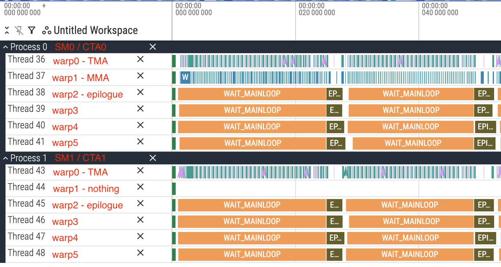<figcaption>
v6 内核的内部性能剖析。来源：<a href="https://github.com/gau-nernst/learn-cuda/raw/3b90ac9b/02e_matmul_sm100/trace_v6.json.gz">profile_v5.json.gz</a>。
</figcaption></figure>
从上面的 trace 看，epilogue 与 TMA/MMA 的重叠还不完美，也许是剖析器本身带来的影响，但 TMA 和 Tensor Core 的空闲时间已经显著减少。最终，我们达到了 CuBLAS 98% 的速度！
<table><thead><tr><th>内核名称</th><th>TFLOPS</th></tr></thead><tbody><tr><td>CuBLAS (PyTorch 2.9.1 + CUDA 13)</td><td>1506.74</td></tr><tr><td>v5 (2-SM MMA)</td><td>1302.29</td></tr><tr><td>v6（持久化内核，静态调度）</td><td>1475.93</td></tr></tbody></table><h2 data-block="B208" id="closing-remarks">结束语</h2>
回顾一下各轮迭代。
<table><thead><tr><th>内核名称</th><th>TFLOPS</th></tr></thead><tbody><tr><td>CuBLAS (PyTorch 2.9.1 + CUDA 13)</td><td>1506.74</td></tr><tr><td>v1a（基础 tcgen05 + 2D 16B TMA）</td><td>254.62</td></tr><tr><td>v1b (3D 16B TMA)</td><td>252.81</td></tr><tr><td>v2a (2D 128B TMA)</td><td>681.20</td></tr><tr><td>v2b (3D 128B TMA)</td><td>695.43</td></tr><tr><td>v3（流水线）</td><td>939.61</td></tr><tr><td>v4（Warp 专职分工）</td><td>1208.83</td></tr><tr><td>v5 (2-SM MMA)</td><td>1302.29</td></tr><tr><td>v6（持久化内核，静态调度）</td><td>1475.93</td></tr></tbody></table>
我们还没能超过 CuBLAS，但这本来就不是这次探索的目标。我只是想理解 <code>tcgen05</code> 的基础用法，以及稍微进阶一点的用法，这一点已经做到了。如果再加几个技巧后能超过 CuBLAS，我也不会惊讶。毕竟，我们甚至还没有加入用于改善 L2 利用率的 threadblock swizzle，也没有使用 Blackwell 的 <a href="https://docs.nvidia.com/cuda/cuda-c-programming-guide/index.html#cluster-launch-control">Cluster Launch Control</a>。这就留给有兴趣的读者作为练习吧。

最后也记录一些个人观察。得益于专用硬件及对应指令，我确实觉得 Blackwell 的 Tensor Core 编程比前几代更容易。一旦大致知道获得高算力需要满足什么条件，设计空间其实比较有限。多数时候可以在 tile 层面思考，而不是线程层面。因此，除了 epilogue 中一点简单的地址计算，基本不需要为了各线程的地址大费脑筋；甚至连 swizzle 都不需要自己计算！不过，我认为将 <code>tcgen05</code> 与 CUDA Core 操作混合时，例如 attention，可能会遇到一些挑战，因为 generic proxy 与 async proxy 之间的同步很可能代价不低。Flash Attention 4 应该是值得研究的案例。

最后，感谢以下项目与资料：
<ul><li data-block="B213"><a href="https://github.com/deepseek-ai/DeepGEMM">DeepGEMM</a>：它是我设计内核结构和使用某些 PTX 指令时的主要参考。我相信知乎上一定有解释这个代码库的文章，只是我还不知道在哪里。</li><li data-block="B214"><a href="https://www.modular.com/matrix-multiplication-on-blackwell">Modular Blackwell 系列</a>：它补充解释了许多 <code>tcgen05</code> 重要概念，而这些说明在其他资料中有所缺失。</li></ul></section><nav class="mt-24 flex overflow-hidden rounded-xl bg-black/[3%] text-lg leading-[1.2]! *:flex *:w-1/2 *:items-center *:p-5 *:font-medium *:no-underline dark:bg-white/[8%] [&amp;&gt;*:hover]:bg-black/[2%] dark:[&amp;&gt;*:hover]:bg-white/[3%]"><a class="ltr:pr-3 rtl:pl-3" href="https://gau-nernst.github.io/cutedsl-tma/">←Using TMA in CuteDSL</a><a class="justify-end pl-3 ltr:ml-auto rtl:mr-auto" href="https://gau-nernst.github.io/amd-a2a/">My first Multi-GPU kernel: Writing All-to-all for AMD MI300X→</a></nav></article>

<!-- imported-translation:end -->

