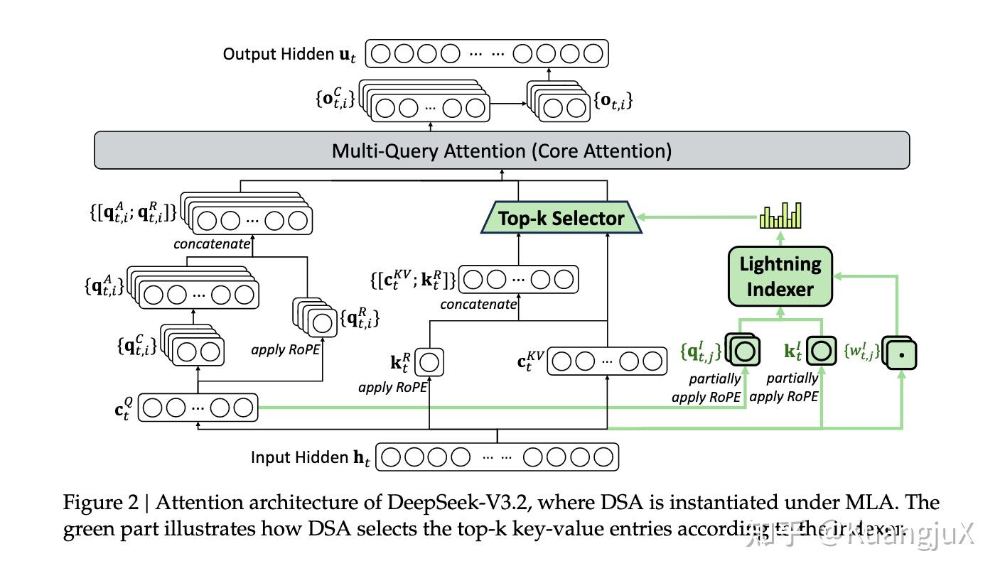
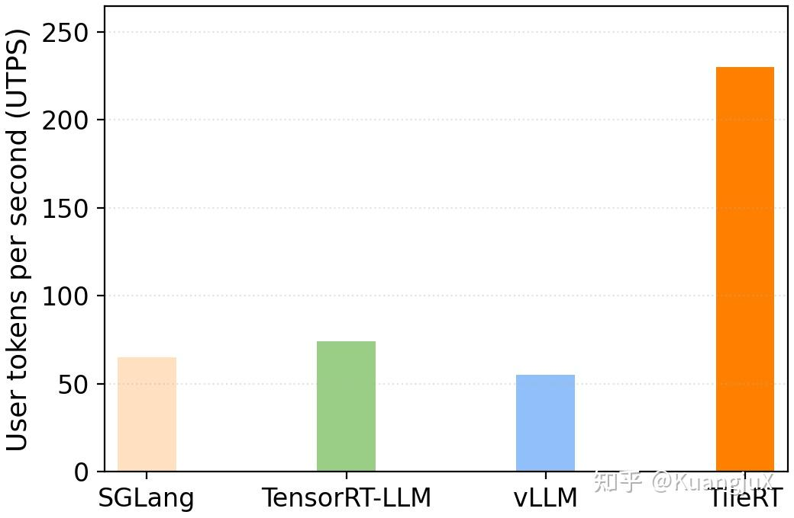

# 2025 年度 LLM 研究总结：知乎原文归档

- 作者：KuangjuX。
- 来源：[2025 LLM 科技总结](https://zhuanlan.zhihu.com/p/1994788371738949558)。
- 原文发布／编辑时间：2026-01-21 21:04（北京时间）；归档：2026-10-22。

本文保存个人已发表的历史笔记；保留当时的结论、代码、截图和参考链接。正文从浏览器可读内容转为 Markdown，公式恢复为 TeX，图片存入同目录 `images/`。原文中的实现、性能数字与“当前”均按文章发表时理解；本次整理与校注写在独立笔记中。

最近正好实验室要做一个年终总结，讲一下 2025 年相关方向的新工作，于是也借此机会顺便写了篇 Blog 来作为整个 2025 的结束。接下来可能我对我关注的方向各选一到两个工作来介绍（太多了可能介绍不过来）。

[分篇笔记与归档目录](../../../Papers/external-notes.md)

## Linear Attention（线性注意力）[1](https://zhuanlan.zhihu.com/p/1994788371738949558#ref_1)

### Kimi Linear Attention

Kimi Linear Attention 是月之暗面今年推出的一个线性注意力算法，目标在于在长序列的场景下，同时实现全注意力级别的效果和线性注意力的效率。Kimi Linear 通过 Kimi Delta Attention（KDA）—— 一种优化的线性注意力机制，解决传统线性注意力“表达能力弱，长序列干扰”的问题。

之前的线性注意力的问题在于为了实现线性复杂度，牺牲了注意力的全局关联性，同时用累计状态存储 KV Cache，会使得就信息不断干扰新信息，导致长序列任务准确率下降。

同时采取混合注意力的方法，经常在受限的规模或者在复杂的 benchmark 的情况下难以部署，因此 Kimi Linear Attention 希望提出既保留线性注意力的效率，又能达到全注意力的效果，同时还可以进行工业部署。

**线性注意力原理**

线性注意力的主要观点是，由于计算 $QK^T$ 的时候，要做 $n \times m$ 次内积，当 n = m 的时候，复杂度就是 $O(n^2)$ 。因此线性注意力希望将注意力的权重改为**先对 K、V 做变换，再和 Q 计算**。这个变换依赖**正定核函数**的性质。

我们可以把注意力权重的 softmax 看作一种**核函数**（衡量 qi​ 和 kj​ 的相似度）：

$A_{i, j} = softmax(\frac{q_ik_j^T}{\sqrt{d_k}}) \approx exp(\frac{q_ik_j^T}{\sqrt{d_k}})$

这里的 $exp(\cdot)$ 就是一个**正定核函数**，满足「可因式分解」的关键性质：

$k(q_i, k_j) = \phi(q_i)\phi(k_j)^T$

其中 $\phi(\cdot)$ 是一个**特征映射函数**—— 把 $d_k$ ​ 维的向量映射到更高维的空间。

因此，交换矩阵乘法顺序，可得： $(\phi(Q)\phi(K)^T)V = \phi(Q)(\phi(K)^TV)$ 因此，由于 $\phi(K)^T$ 是一个 $d' \times m$ 的矩阵（ $d'$ 是特征映射后的维度）， $V$ 是 $m \times d_V$ ， $\phi(Q)$ 是一个 $n \times d'$  矩阵，总复杂度为 $O(n \cdot d' \cdot d_V)$ 。因此，只要 $d'$ 是一个与序列长度无关的函数，整个计算复杂度就和序列长度 $n$ 成线性关系。

线性注意力还有一个更直观的视角，就是用**全局状态**替代**注意力矩阵**，我们可以把 $\Phi(K)^TV$ 看成一个全局累计状态 $S$ 。此时线性注意力的输出可以写成 $O = \phi(q_i)S$ 。对于长序列，我们可以流式计算 S：每来一个新的 $(k_j, v_j)$ ，就更新 $S = S + \phi(k_j)v_j^T$ ，这就是线性注意力能高效处理超长序列的核心原因。

**Kimi Delta Attention**

KDA 的本质是给线性注意力的**「状态累加」**加**「智能调控」**，解决早期线性注意力「表达弱、长序列干扰」的痛点。

在上一节中提到全局累计状态 $S = \sum_{j=1}^{m}\phi(k_j)v_j^T$ ，流式更新时， $S_t = S_{t-1} + \phi(k_t)v_t^T$ ，这个累加状态**没有遗忘机制**，且新的键值对的**贡献强度固定**，无法根据任务动态调整，表达能力受限。

而 DeltaNet 使用梯度下降更新修正 $S$ ，公式为：

$S_t = S_{t-1} - \beta \nabla_{S_{t-1}} \mathcal{L}(S_{t-1})$其中 $\mathcal{L}(S)$ 是重构损失， $\beta$ 是学习率，但 DeltaNet 的全局标量遗忘门还是太粗糙，无法对不同特征维度做精细化调控。KDA 进一步通过**维度级别的遗忘**和**动态更新机制**：

$S_t = (I - \beta_tk_tk_t^T)Diag(\alpha_t)S_{t-1} + \beta_tk_tv_t^T$ $o_t = S_t^Tq_t$通过细粒度遗忘门 $Diag(\alpha_t)$ 解决了早期线性注意力**全局遗忘太粗糙**的问题，通过 $(I - \beta_tk_tk_t^T)$ 的动态注入，新信息只会在**未被遗忘的维度**上生效，避免无效信息的干扰。

**Kimi-Linear Overview**

Kimi-Linear 通过 KDA 线性注意力 + 全注意力的混合架构，同时搭配 NoPE 编码，MoE 通道混合等关键组件，实现**效果与效率的最优平衡**。

Kimi Linear 架构

Kimi Linear 通过 3:1 的 KDA：全注意力层的机构混合，KDA 负责长序列的流式处理，控制计算内存成本；全注意力层负责全局信息的跨位置流动，避免线性注意力的信息孤岛，提升复杂推理能力。

推荐一些线性注意力相关的文章：

- 苏神对线性注意力的介绍《线性注意力简史：从模仿、创新到反哺》：

- [@Dao](https://www.zhihu.com/people/bda29934cdf311090b1c12e7ef7cc827)

   大佬对线性注意力的图解：

[@yzhangcs](https://www.zhihu.com/people/8d5f4c3b705ef7df799b680515700468)

 作者本人对 Kimi Linear 的介绍：

## Sparse Attention（稀疏注意力）

针对稀疏注意力我将会主要介绍一个基于模式匹配的稀疏注意力方案 DuoAttention[2](https://zhuanlan.zhihu.com/p/1994788371738949558#ref_2)，以及 DeepSeek-V3.2[3](https://zhuanlan.zhihu.com/p/1994788371738949558#ref_3) 提出的动态稀疏注意力方案 DSA（DeepSeek Sparse Attention）。关于稀疏注意力的模式，有一篇 Attention Survey[4](https://zhuanlan.zhihu.com/p/1994788371738949558#ref_4) 已经将不同模式的稀疏注意力整理的很好了，不过由于篇幅所限，我在这篇文章中就不讲这么多了。

关于 DuoAttention，我在之前已经写过一篇文章进行详细介绍，同时基于 CuTeDSL[5](https://zhuanlan.zhihu.com/p/1994788371738949558#ref_5) 进行了实现并集成在了 SGLang 里面，因此在这篇文章中我将不再详细介绍 DuoAttention 的细节：

另外推荐一篇文章介绍 Attention Sink：

## DeepSeek-V3.2

DeepSeek-V3.2 主要创新性在于提出了 **DSA（DeepSeek Sparse Attention）**，DSA 是一种可以在训练中学习的稀疏注意力算法，相比原有的固定模式的稀疏注意力，可以在训练中被使用。

### DeepSeek Sparse Attention

DSA 包含两个组件，一个**闪电索引器（lighting indexer）**和一个**细粒度词元选择器（fine-grained token selection mechanism)**。

DeepSeek Sparse Attention 架构图

首先针对 Lighting Indexer，DeepSeek 给出了一个数学公式如下：

$I_{t,s} = \sum^{H^I}_{j=1}w_{t,j}^{I} \cdot ReLU(q_{t, j}^{I} \cdot k_{s}^{I})$ 其中：

- $H_I$ ​：索引器的头数，数量较少，是保证效率的关键；
- $h_t \in \mathbb{R}^d$ ：当前的 query token 向量， $h_s \in \mathbb{R}^d$ ：前置的 token 向量；
- $q_{t, j}^{I} \in \mathbb{R}^{d_I}$ 、 $w_{t, j}^{I} \in \mathbb{R}$ ：由 query token $h_t$ 生成的查询向量和权重；
- $k_s^{I} \in \mathbb{R}^{d_I}$ ​：由前置 token $h_s$ ​ 生成的键向量；
- $ReLU$ ：作为激活函数，选择它的核心原因是**提升计算吞吐量**。

在 DSA 中，首先通过输入的 $h_t$ 投影得到 $c_t^Q$ ，这是通过 **MLA（Multi-head Latent Attention）**得到的，这个 $c_t^Q$ 同时为 DSA Indexer 和 MQA 同时提供输入，随后在 Lighting Indexer 阶段通过以下步骤进行计算：

- 从 $c_t^Q$ ​ 中**部分投影**得到 $q_t^{I}$ （对应论文的 $q_{t, j}^{I}$ ​）；
- 从所有前置 token 的 $c_t^{KV}$ ​（MLA 的 latent key-value 向量）中**部分投影**得到 $k_t^I$ （对应论文的 $k_s^I$）；
- 从 $c_t^{Q}$ ​中投影得到 $w_{t}^I$ ​（对应论文的 $w_{t, j}^I$ ）；
- 对 $q_t^I$ ​和 $k_t^I$ **部分施加 RoPE 位置编码**，再计算内积 + ReLU + 加权求和，得到索引分数（图中 “柱状图” 是分数的可视化）。

最终得到的计算分数 $I_{t, s}$ 被输入作为下一个细粒度 Top-K 选择。

这里有几个值得注意的点，这里的 $H_I \ll H$ ，同时选择 ReLU 可以提高吞吐量，同时该模块对精度的要求较低，可以使用 FP8 进行计算。

第二步是做 Token 的细粒度选择，在论文中给出了一个公式：

$u_t = Attn(ht, \{c_t | I_{t, s} \in Top-k(I_t,:)\})$ 这里 $I_{t, s}$ 代表的含义为，t 位置的 token 认为 s 位置的 token 的重要程度，得到的分数越高，重要性越强。DSA 通过筛选排名前 k 的分数对应的 token 位置，记为 $S_{topk} = \{ s_1, s_2,...,s_k\}$ ，随后 DSA 保留对应的 MLA 隐向量并丢弃所有其他位置的向量。

通过这一机制，DSA 将注意力就按的复杂度从 $o(L^2)$ 降到了 $O(KL)$ ，其中 K 是一个预设的，远小于 L 的一个常数，这种动态的基于内容分数的选择机制相比于固定的稀疏模式提供了更大的灵活度。

## MegaKernel（巨型内核）

MegaKernel 整体要解决的问题是传统的 LLM 推理框架（vLLM[6](https://zhuanlan.zhihu.com/p/1994788371738949558#ref_6)，SGLang[7](https://zhuanlan.zhihu.com/p/1994788371738949558#ref_7)）在 GPU 执行流程中引入了大量的无效空隙，例如，GPU 在连续的内核之间会插入**内核屏障（kernel barrier）**，强制要求前一个内核的所有线程块全部结束后后一个内核才会启动，导致大量**流水线气泡（pipeline bubbles）。**同时，在小参数模型或者小批量场景即使使用 CUDA Graph，启动开销也是不可忽略的开销，另外，更严重的是**尾效应（tail effect）**，当内核的线程块数量超过 GPU SM 数量的时候，执行后期会出现大量 SM 空闲。例如，B200 GPU 有 148 个 SM，若一个内核需执行 512 个线程块，当执行到第 4 轮（148×3=444 个线程块完成）时，仅剩 68 个线程块在运行，此时有 80 个 SM 完全空闲，资源浪费率超过 54%。最后，传统框架以**算子**为单位管理依赖关系，导致计算与通信难以细粒度重叠。如，矩阵乘法（MatMul）后接全归约（AllReduce）时，AllReduce 的每个线程块仅依赖 MatMul 对应线程块的输出，但传统模式必须等待整个 MatMul 算子完成才能启动 AllReduce，浪费了 50% 以上的通信带宽。

因此，MegaKernel 通过 “一次启动、全程执行” 的设计，彻底消除多次内核启动开销；同时通过 SM 级任务动态分配，将线程块均匀分散到所有 SM，避免尾效应导致的空闲。

使用 MegaKernel 的主要原因在于像 vLLM 以及 SGLang 这些推理框架能够大幅提升高并发场景的吞吐量，但是在低延迟以及小批量场景中存在短板，在小 batch size 的情况下像内核屏障和启动开销将会成为影响程序执行性能的痛点。

### Mirage Persistent Kernel[8](https://zhuanlan.zhihu.com/p/1994788371738949558#ref_8)

MPK 的一个主要目的是自动将多 GPU 模型推理转化为单个 MegaKernel，通过所重新设计计算表示与运行时系统解决上述问题，其核心思想可以概括为：**以 GPU 流多处理器（SM）为粒度拆分任务，用细粒度依赖调度替代粗粒度内核同步。**MPK 这个项目主要是依赖于 Mirage[9](https://zhuanlan.zhihu.com/p/1994788371738949558#ref_9) 这个编译器做的。

MPK 编译器工作流

MPK 这篇论文提出了 `tGraph` 这个概念，以 SM 为最小单位，将模型的计算和通信拆成了 SM-level Task 和 Event。Task 表示的是单个 SM 可独立执行的最小单元，例如矩阵乘法子块，注意力子块以及 AllReduce 子块传输，Event 代表任务间的同步信号，仅当所有前置任务完成时激活，触发下游任务执行。

MPK 通过一系列关键的优化，例如：

- 分页共享内存：将共享内存划分为固定页面，任务按需申请 / 释放，支持跨任务数据预取与零拷贝复用；
- 跨任务软件流水线：重叠当前任务的计算阶段与下一个任务的数据预加载阶段，隐藏访存延迟；
- 内核内通信：多 GPU 场景下，用 NVSHMEM 实现跨 GPU 通信任务，与计算任务细粒度重叠（无需启动 NCCL 内核）。

将整个模型 fuse 成一个 MegaKernel。

MPK 讲一个内核级计算转换成 SM 级 tGraph

最终平均实现 1 - 1.7 倍的性能提升，且在低延迟场景（小 bs）、多 GPU 扩展场景中优势最突出，本质是通过细粒度调度消除了传统框架的结构性开销。

MPK 性能评估

### Look Ma, No Bubbles! Designing a Low-Latency Megakernel for Llama-1B[10](https://zhuanlan.zhihu.com/p/1994788371738949558#ref_10)

同时，Hazy Research Lab 也发布了一篇 Blog 利用 ThunderKittens[11](https://zhuanlan.zhihu.com/p/1994788371738949558#ref_11) 做了这个工作，将 Llama-1B[12](https://zhuanlan.zhihu.com/p/1994788371738949558#ref_12) fuse 成了一个巨型内核。理论上来说 Hazy Research Lab 是第一个做这个工作的，MPK 应该在很大程度上参考了这篇工作。这篇 Blog 的整体思路应该是和 MPK 差不多的，但是 MPK 是将整个的思路做到了他们的 mirage 上，而这篇 Blog 则是采用 ThunderKittens 这个 DSL 来进行实现。

相比于 MPK，MegaKernels 可能算是一个比较实验性的实现，并没有对太多的 DNN Workload 进行评估，主要在单卡 H100/B200 针对 Llama-1B 进行评估，在 bsz=1 的情况下相比于 vLLM 和 SGLang 有巨大的提升。

### TileRT[13](https://zhuanlan.zhihu.com/p/1994788371738949558#ref_13)

另外，TileRT 也是我非常喜欢的一个工作：

TileRT 相比于上面两个工作可能更聚焦于某一类场景，比如在低延迟以及小批量的实时交互场景。如果说 MPK 和 Megakernels 则是针对技术创新的尝试，而 TileRT 则更进一步想将这类技术为 LLM 推理打造一个端到端的系统。

而 TileRT 也是使用 User tokens per second（UTPS）作为评估手段与 SGLang，vLLM，TensorRT-LLM 进行了评估。当前这个项目还没有发布 Technical Report，期待一下～

### SonicMoE[14](https://zhuanlan.zhihu.com/p/1994788371738949558#ref_14)

SonicMoE 理论上应该不算严格的 MegaKernel，不过像这种非常细粒度的 Fused Kernel 我都归到这一类，我之前写过一篇文章讲解 SonicMoE：

在这篇文章中就不再写了。

## Deep Learning Compiler（深度学习编译器）

### Tawa[15](https://zhuanlan.zhihu.com/p/1994788371738949558#ref_15)

Tawa 这篇 paper 主要的目的为了解决在 Triton 在 Hopper 架构上的 Auto Warp Specialization。Tawa 的目标是希望用户无需修改 Triton 代码，而通过引入新的 IR 抽象来进行编译优化实现。

Tawa 从 Triton 前端编译到 MLIR 中间表示

Tawa 通过提出了一个名为***异步引用（asynchronous reference, aref）***的 IR 抽象，封装线程束间的通信语义，屏蔽硬件细节。

ARef 用来建模线程束间异步通信，屏蔽 TMA、mbarrier 等底层细节，是实现自动同步的基础。同时 ARef 包含数据缓冲区和硬件 mbarrier 状态，用来表示是否可读或者可写。同时有以下的核心操作：

- `put(a, v)`：生产者将数据 `v` 写入 aref `a`，仅当 empty 状态有效时执行，写完后切换为 full 状态。
- `get(a)`：消费者从 aref `a` 读取数据，仅当 full 状态有效时执行，读完后切换为「借用中」（均无效）。
- `consumed(a)`：消费者使用数据后释放缓冲区，切换为 empty 状态，允许生产者复用。

Tawa 通过对 MLIR 计算图的依赖关系将代码自动划分为**生产者**和**消费者**，依据一系列的规则将其进行分区构建并进行循环分发以及 aref 的插入，aref 插入的语句如上图所示。

最后，在代码生成阶段，aref 语句也被映射为一系列的硬件代码：

- `create_aref`：分配 SMEM 缓冲区和 mbarrier；
- `put`：展开为「检查 empty mbarrier → TMA 异步加载 → 置位 full mbarrier」；
- `get`：展开为「等待 full mbarrier → 读取 SMEM 缓冲区 → 清除 mbarrier 状态」；
- `consumed`：展开为「置位 empty mbarrier」；

最终的成果表明在短序列（L &lt; 4K) 时的优势不明显，而在长序列时数据移动占比提升，Tawa 的流水线重叠效果凸显。

## RL（强化学习）

最近读了 Seer[16](https://zhuanlan.zhihu.com/p/1994788371738949558#ref_16) 这篇 paper 也入门了下强化学习。RL 相比于 SFT（监督学习）的一个区别在于 SFT 是需要一个标准答案来不断训练的，而 RL 是不需要标准答案，只需要“奖励信号”让智能体自己探索最优方式。因此针对一些复杂任务，例如思维链推理和长文本生成等复杂任务，SFT 容易出现逻辑断裂或者不完整的内容，而 RL 可以通过多轮试错让模型学会生成更连贯、更深入的响应。

因此，RL 几乎不会作为大模型的预训练方法而是在 SFT pretrain 之后的 post-train 阶段进行使用。RL 的工作流大概分为五个阶段：

- 准备阶段：初始化基础模型与挑选覆盖目标场景的 Prompt 集以及确定 RL 算法。
- Rollout 阶段：对每个 Prompt 生成 G 个响应。
- 奖励阶段阶段：把“主观好坏”转化为模型能理解的数值，对每个响应给出具体的分数。
- 经验收集与模型更新：基于响应和分数，调整模型参数，让模型下次更可能生成高分响应，更少生成低分响应。
- 权重同步阶段：把更新后的模型参数同步到推理模型中，让下一轮 Rollout 用新模型生成响应，形成闭环。

当前 RL 的主要瓶颈在 Rollout 阶段：

- 耗时占比极高：rollout 阶段消耗 63%-87% 的 RL 总迭代时间，是制约训练速度的关键。
- 内存波动剧烈：长文本生成（如思维链推理，最长达 98K token）导致 KVCache 内存占用从数百 MB 动态增长至数十 GB，迫使系统缩减批次大小或抢占任务，引发昂贵的重新预填充开销，硬件利用率低下。
- 长尾延迟严重：生成长度呈长尾分布，少数超长请求在 rollout 后期独占 GPU 资源，导致大量节点闲置，长尾阶段耗时占比可达总时间的 50%。

现有的一些方案也有一些局限性：

- 异步 RL 牺牲算法保真度：通过重叠 rollout 与训练阶段提升效率，但引入离线学习（off-policy）问题，导致模型性能下降、调试困难，无法保证结果可复现。
- 传统推测解码（SD）不适应 RL 场景：依赖静态草稿模型，难以应对 RL 中目标模型的持续更新（模型漂移），且草稿生成的计算开销和内存占用在大批量场景下不可行。
- 分组级调度僵化：将请求组视为不可拆分的整体，忽略组内响应的相似性，无法实现细粒度负载均衡。

### Seer: Online Context Learning for Fast Synchronous LLM Reinforcement Learning

Seer 这篇 paper 主要是聚焦同步 RL System 的 Rollout 阶段的优化。

**Divided Rollout**

传统的方案，在 Rollout 阶段将"把一个 prompt 生成 8 个响应"当成一个大的任务交给一个 GPU 运行，如果是超长文本，就会霸占 GPU，且内存从几百 MB 涨到几十 GB。Seer 通过先将 「1 个 prompt+8 个响应」 拆成 8 个独立请求，随后每个响应按照固定长度拆成 chunk，每个 chunk 进行单独调度。同时使用全局 KV Cache，一个 chunk 计算完之后，缓存暂时存起来，下一个片段可以在任意 GPU 上跑，不需要进行重新计算。

这里的 Global KV Cache 采取 DRAM/SSD 的双层存储，用来平衡访问速度和存储容量，这项技术继承于前作 MoonCake。KV Cache 服务器会根据请求缓冲区的队列信息，提前将对应的 KV Cache 从 SSD 或者远端 DRAM 预取到目标实例的本地 DRAM 或 HBM 中。

**Context-Aware Scheduling**

传统的调度不知道哪个请求长、哪个短，按顺序排队。结果短请求很快跑完，长请求最后才跑，霸占 GPU 形成长尾。而 Seer 首先通过**投机请求探测**来确定不同组的响应时长，随后通过**动态长度估计**来不断更新不同组的上下文，最后依靠 LFS（最长作业优先调度）优先调度预估长度长的请求片段，同时让长请求和短请求混合跑，避免长尾效应。

**Adaptive Grouped Speculative Decoding**

RL 算法，例如 GPRO 等，同一 prompt 生成的多个响应具有强模式相似性，可聚合为动态草稿资源，替代静态草稿模型。Seer 介绍了 DGDS（分布式分组草稿服务器），跨实例聚合组内所有响应的 token 序列。同时 Seer 根据系统并法度来对猜测长度进行动态调整，在短请求密集时少猜，在长请求密集时多猜。这样相比无加速以及使用静态投机解码的 RL 能够提高吞吐量与提高预测准确率。

**性能评估**

Seer 针对 Moonlight，Qwen2-VL-72B，Kimi-K2 进行了性能评估，使用 veRL 并与 Seer 共享相同的推理引擎（vLLM）以及 RL 算法（GRPO）。

最终 Seer 在吞吐量方面全面提升 74%-97%，同时长尾效应锐减 75%-93%：

## 计算-通信重叠

今年在实习的时候也接触到了一些 compute-communication overlap 相关的事情，也学习了一些关于 DeepEP[17](https://zhuanlan.zhihu.com/p/1994788371738949558#ref_17) 在通信上的优化和技巧，当时我写了一篇文章：

本来是想写成一个系列的，结果后面因为时间的原因这个项目也没有继续做下去。

DeepEP 总的来说是为了对齐 DeepSeek 提出的 group-limited gated 算法，针对非对称域带宽转发（如 NVLink 到 RDMA）优化内核，兼顾训练和推理。

DeepEP 是设计了一套接口，分别为节点内（intranode）和节点间（internode）共同设计，同时在节点间还分为高吞吐量和低延迟的不同设计。高吞吐量模式（Normal Kernel）面向大批次、长序列的吞吐型场景，主要在训练和推理 Prefill 阶段，而低延迟模式（Low Latency Kernel）主要面向推理的 Decode 阶段。

在节点内只设计了 Normal Kernel 原因在于基于 NVLink 的通信延迟已经足够低了，而在节点间 RDMA 跨节点通信的延迟远高于 NVLink，因此在 Normal Kernel 阶段通过域转发、批量传输将 RDMA 带宽拉满，而在 Low Latency 阶段则是将 RDMA 绕过 SM 进行后台异步传输从而将通信延迟隐藏在计算阶段。

**节点内通信**

在节点内将 GPU SM 设定为偶数，默认为使用 20 个 SM，其他 112 个 SM 作为计算使用，DeepEP 通过将计算任务（MoE 前向/反向）放在 `compute_stream` 中，NVLink 通信任务放在 `comm_stream` 中，两个流并行执行，随后通过 CUDA Event 标记流任务的完成，实现计算与通信的依赖管理，且不阻塞 CPU。 同时 DeepEP 将 Top-K 计算和稀疏通信融合成一个 CUDA Kernel，可以消除 CPU-GPU 交互的间隙。

DeepEP 对 MoE 的节点内通信场景，相比 NCCL 的 All-to-All 实现了吞吐量更高、延迟更低、资源占用更优的优势。根据 DeepEP 在节点内的数据，在 Dispatch 阶段可以达到 153 GB/s，在 Combine 阶段可以达到 158 GB/s，几乎接近 H800 160GB/s 的理论上限。

DeepEP 针对 MoE 有以下几个优化：

- MoE 中每个 Token 仅路由到 Top-K 个 Expert，通过生成 `is_token_in_rank` 矩阵，仅传输目标 Rank 的 Token，过滤无效数据，相比之下 NCCL All-to-All 则是采用了全量传输。
- DeepEP 通过 FP8 低精度传输，将数据宽度从 2B 降到 1B，同等 NVLink 带宽下传输量翻倍。
- DeepEP 通过 SM 精细化调度，通过 SM 专用化，使得将计算 SM 和通信 SM 分离，而 NCCL 的通信 Kernel 则会抢占 SM，计算任务需要等待通信完成。

**节点间通信**

节点间通信分为 Normal kernel 和 Low Latency kernel。

Normal Kernel 首先通过节点内 NVLink 完成 8 卡 Token 聚合，生成节点级 Token，仅通过一次 RDMA 传输传输到目标节点，同时在聚合阶段基于 Top-K 生成 `is_token_in_remote_node` 传输，仅保留目标 Expert 的 Token，过滤掉所有无效数据。

同时，DeepEP 也在节点间通信做了一些硬件特有的优化，尽管 NVSHMEM 直接实现了 IBGDA 的基础能力，但无法直接适配 MoE 稀疏、分层转发的通信需求。比如 NVSHMEM 的 IBGDA 仅实现发送队列，接收逻辑复用共享队列，无法精准管控 RDMA 接收数据的范围，DeeoEP 通过修改 NVSHMEM 让 RDMA 每个通信通道能独立管理已接收/待处理的 RDMA 数据，避免跨节点聚合数据和节点内数据的队列混叠。

Low Latency Kernel 通过 Hook 函数将通信流程卸载到后台运行，不占用 GPU SM 资源，在 Decode 阶段对 SM 的利用率不高，但是对 SM 的响应延迟极高，通过将通信卸载到后台，避免了调度阻塞，让通信与计算完全并行，实现端到端的低延迟。

暂时写那么多，后面想起来再补充...

## 参考

1. [^](https://zhuanlan.zhihu.com/p/1994788371738949558#ref_1_0)Team, Kimi, et al. "Kimi linear: An expressive, efficient attention architecture." arXiv preprint arXiv:2510.26692 (2025). [https://arxiv.org/pdf/2510.26692](https://arxiv.org/pdf/2510.26692)
2. [^](https://zhuanlan.zhihu.com/p/1994788371738949558#ref_2_0)Xiao, Guangxuan, et al. "Duoattention: Efficient long-context llm inference with retrieval and streaming heads." arXiv preprint arXiv:2410.10819 (2024). [https://arxiv.org/pdf/2410.10819](https://arxiv.org/pdf/2410.10819)
3. [^](https://zhuanlan.zhihu.com/p/1994788371738949558#ref_3_0)Liu, Aixin, et al. "Deepseek-v3. 2: Pushing the frontier of open large language models." arXiv preprint arXiv:2512.02556 (2025). [https://arxiv.org/pdf/2512.02556](https://arxiv.org/pdf/2512.02556)
4. [^](https://zhuanlan.zhihu.com/p/1994788371738949558#ref_4_0) Zhang, J., Su, R., Liu, C., Wei, J., Wang, Z., Zhang, P., Wang, H., Jiang, H., Huang, H., Xiang, C., & others. Efficient Attention Methods: Hardware-efficient, Sparse, Compact, and Linear Attention.  [https://attention-survey.github.io/files/Attention_Survey.pdf](https://attention-survey.github.io/files/Attention_Survey.pdf)
5. [^](https://zhuanlan.zhihu.com/p/1994788371738949558#ref_5_0)CUDA Templates and Python DSLs for High-Performance Linear Algebra [https://github.com/NVIDIA/cutlass](https://github.com/NVIDIA/cutlass)
6. [^](https://zhuanlan.zhihu.com/p/1994788371738949558#ref_6_0)A high-throughput and memory-efficient inference and serving engine for LLMs [https://github.com/vllm-project/vllm](https://github.com/vllm-project/vllm)
7. [^](https://zhuanlan.zhihu.com/p/1994788371738949558#ref_7_0)SGLang is a high-performance serving framework for large language models and multimodal models. [https://github.com/sgl-project/sglang](https://github.com/sgl-project/sglang)
8. [^](https://zhuanlan.zhihu.com/p/1994788371738949558#ref_8_0)Cheng, Xinhao, et al. "Mirage Persistent Kernel: A Compiler and Runtime for Mega-Kernelizing Tensor Programs." arXiv preprint arXiv:2512.22219 (2025). [https://arxiv.org/pdf/2512.22219](https://arxiv.org/pdf/2512.22219)
9. [^](https://zhuanlan.zhihu.com/p/1994788371738949558#ref_9_0)Wu, Mengdi, et al. "Mirage: A {Multi-Level} Superoptimizer for Tensor Programs." 19th USENIX Symposium on Operating Systems Design and Implementation (OSDI 25). 2025. [https://www.usenix.org/system/files/osdi25-wu-mengdi.pdf](https://www.usenix.org/system/files/osdi25-wu-mengdi.pdf)
10. [^](https://zhuanlan.zhihu.com/p/1994788371738949558#ref_10_0)Look Ma, No Bubbles! Designing a Low-Latency Megakernel for Llama-1B [https://hazyresearch.stanford.edu/blog/2025-05-27-no-bubbles](https://hazyresearch.stanford.edu/blog/2025-05-27-no-bubbles)
11. [^](https://zhuanlan.zhihu.com/p/1994788371738949558#ref_11_0)Tile primitives for speedy kernels [https://github.com/HazyResearch/ThunderKittens](https://github.com/HazyResearch/ThunderKittens)
12. [^](https://zhuanlan.zhihu.com/p/1994788371738949558#ref_12_0)meta-llama/Llama-3.2-1B [https://huggingface.co/meta-llama/Llama-3.2-1B](https://huggingface.co/meta-llama/Llama-3.2-1B)
13. [^](https://zhuanlan.zhihu.com/p/1994788371738949558#ref_13_0)Tile-Based Runtime for Ultra-Low-Latency LLM Inference [https://github.com/tile-ai/TileRT](https://github.com/tile-ai/TileRT)
14. [^](https://zhuanlan.zhihu.com/p/1994788371738949558#ref_14_0)Guo, Wentao, et al. "SonicMoE: Accelerating MoE with IO and Tile-aware Optimizations." arXiv preprint arXiv:2512.14080 (2025). [https://arxiv.org/pdf/2512.14080](https://arxiv.org/pdf/2512.14080)
15. [^](https://zhuanlan.zhihu.com/p/1994788371738949558#ref_15_0)Chen, Hongzheng, et al. "Tawa: Automatic Warp Specialization for Modern GPUs with Asynchronous References." arXiv preprint arXiv:2510.14719 (2025). [https://arxiv.org/pdf/2510.14719](https://arxiv.org/pdf/2510.14719)
16. [^](https://zhuanlan.zhihu.com/p/1994788371738949558#ref_16_0)Qin, Ruoyu, et al. "Seer: Online context learning for fast synchronous llm reinforcement learning." arXiv preprint arXiv:2511.14617 (2025). [https://arxiv.org/pdf/2511.14617](https://arxiv.org/pdf/2511.14617)
17. [^](https://zhuanlan.zhihu.com/p/1994788371738949558#ref_17_0)DeepEP: an efficient expert-parallel communication library [https://github.com/deepseek-ai/DeepEP](https://github.com/deepseek-ai/DeepEP)

## 归档图片来源

图片保存自页面实际加载的显示版本，通常为 1440w；下表保留知乎原始图片链接。

| 本地图片 | 原文图片 |
| --- | --- |
| [work-summary-01.jpg](images/work-summary-01.jpg) | [知乎原图](https://picx.zhimg.com/v2-6e05316b4b47e03f2ca38e796810f5a5_r.jpg) |
| [work-summary-02.jpg](images/work-summary-02.jpg) | [知乎原图](https://pic4.zhimg.com/v2-0e1ffabe9e2e5c83398f47709bf8dab9_r.jpg) |
| [work-summary-03.jpg](images/work-summary-03.jpg) | [知乎原图](https://pic4.zhimg.com/v2-905d8675d06ff6bcaaacd2ee287b1fcf_r.jpg) |
| [work-summary-04.jpg](images/work-summary-04.jpg) | [知乎原图](https://picx.zhimg.com/v2-896af55f93dc02ea166f251b4dfa446b_r.jpg) |
| [work-summary-05.jpg](images/work-summary-05.jpg) | [知乎原图](https://pic1.zhimg.com/v2-c9d289bde0a7c71435b7627877eca72e_r.jpg) |
| [work-summary-06.jpg](images/work-summary-06.jpg) | [知乎原图](https://pic2.zhimg.com/v2-6fd8fe9071d1f7756e4ffb3d2784c12f_r.jpg) |
| [work-summary-07.jpg](images/work-summary-07.jpg) | [知乎原图](https://pic3.zhimg.com/v2-aae0f884440aa4890abad1a6b4701730_r.jpg) |
| [work-summary-08.jpg](images/work-summary-08.jpg) | [知乎原图](https://pic1.zhimg.com/v2-f76850bb07e003fb8be065af35dcbb68_r.jpg) |
| [work-summary-09.jpg](images/work-summary-09.jpg) | [知乎原图](https://pic3.zhimg.com/v2-c28f3b8a8f217a82258a313c497250a0_r.jpg) |
| [work-summary-10.jpg](images/work-summary-10.jpg) | [知乎原图](https://pic3.zhimg.com/v2-dae74c9045982e26d6e477348907b6d4_r.jpg) |
| [work-summary-11.jpg](images/work-summary-11.jpg) | [知乎原图](https://pic1.zhimg.com/v2-29edfa07db63e4bc99f9435b3465a1b6_r.jpg) |
| [work-summary-12.jpg](images/work-summary-12.jpg) | [知乎原图](https://pic4.zhimg.com/v2-44bebfd4f12181db1daffeece58eaa95_r.jpg) |
| [work-summary-13.jpg](images/work-summary-13.jpg) | [知乎原图](https://picx.zhimg.com/v2-8c394d66cb6da5a6648a888cf4cb374d_r.jpg) |
| [work-summary-14.jpg](images/work-summary-14.jpg) | [知乎原图](https://pica.zhimg.com/v2-8fe35217cd4394245b856cdb275ca4f2_r.jpg) |
