# [译] 深度学习所需的矩阵微积分

[下载完整中文 PDF](./article.pdf)

<!-- imported-translation:start -->

<i>由以下网站提供：<a href="http://explained.ai">explained.ai</a></i> 

<!-- original-title -->
完整中文译本 · 原作者：Terence Parr、Jeremy Howard 正文、表格文字、推导说明及附录均已翻译；公式和图内英文保留原样。本文中的“我们”指原作者。原文的符号约定与推导保持不变，未将译文改写为新的数学教材。 原文：<a href="https://explained.ai/matrix-calculus/index.html">The Matrix Calculus You Need For Deep Learning</a> · 翻译与排版：2026-10-10

<a href="https://www.linkedin.com/in/terence-parr/">Terence Parr</a> 与 <a href="http://www.fast.ai/about/#jeremy">Jeremy Howard</a>

（以下简介沿用原文：Terence 是 Google 的技术负责人，曾任<a href="https://www.usfca.edu/arts-sciences/graduate-programs/data-science">旧金山大学数据科学硕士项目</a>的计算机／数据科学教授。你也许知道他是 ANTLR 解析器生成器的作者。更多资料可参见 Jeremy 的<a href="http://course.fast.ai">fast.ai 课程</a>，以及旧金山大学数据研究所的<a href="https://www.usfca.edu/data-institute/certificates/deep-learning-part-one">线下深度学习课程</a>.)

如有评论、建议或纠错，请联系 <a href="mailto:terence@parr.us">Terence</a>。

<a href="https://arxiv.org/abs/1802.01528">可打印版本</a>（此 HTML 由 <a href="https://github.com/parrt/bookish">bookish</a> 根据标记文本生成）。原站也提供一份<a href="https://explained.ai/matrix-calculus/矩阵微积分译文.pdf">中文版本</a>（其内容未经原作者核实）。

<b>摘要</b>

本文尝试讲清理解深度神经网络训练所需的全部矩阵微积分知识。我们只假设你掌握了微积分入门课程的内容，并在需要时提供链接，帮助你复习必要的数学知识。请注意：在开始实践、学习训练和使用深度学习模型之前，你<b>不必</b>先读懂本文。本文面向已经熟悉神经网络基础、希望进一步理解其数学原理的读者。如果读到某处卡住了，不必担心：回头重读上一节，试着写下几个例子，亲手推算。如果仍有疑问，我们很乐意在 <a href="http://forums.fast.ai/c/theory">forums.fast.ai 的 Theory 板块</a>回答。<b>注意</b>：文末的<a href="#reference">速查部分</a>汇总了本文讨论的关键矩阵微积分法则和术语。

<h2>目录</h2><ul><li class="toc-h2"><a href="#intro">引言</a></li><li class="toc-h2"><a href="#sec:1.2">回顾：标量求导法则</a></li><li class="toc-h2"><a href="#sec:1.3">向量微积分与偏导数入门</a></li><li class="toc-h2"><a href="#sec:1.4">矩阵微积分</a></li><li class="toc-h3"><a href="#sec:1.4.1">雅可比矩阵的推广</a></li><li class="toc-h3"><a href="#sec:1.4.2">向量逐元素二元运算的导数</a></li><li class="toc-h3"><a href="#sec:1.4.3">涉及标量扩展的导数</a></li><li class="toc-h3"><a href="#sec:1.4.4">向量求和归约</a></li><li class="toc-h3"><a href="#sec:1.4.5">链式法则</a></li><li class="toc-h4"><a href="#sec:1.4.5.1">单变量链式法则</a></li><li class="toc-h4"><a href="#sec:1.4.5.2">单变量全导数链式法则</a></li><li class="toc-h4"><a href="#sec:1.4.5.3">向量链式法则</a></li><li class="toc-h2"><a href="#sec:1.5">神经元激活值的梯度</a></li><li class="toc-h2"><a href="#sec:1.6">神经网络损失函数的梯度</a></li><li class="toc-h3"><a href="#sec:1.6.1">对权重的梯度</a></li><li class="toc-h3"><a href="#sec:1.6.2">对偏置的导数</a></li><li class="toc-h2"><a href="#sec:1.7">总结</a></li><li class="toc-h2"><a href="#reference">矩阵微积分速查</a></li><li class="toc-h3"><a href="#sec:1.8.1">梯度与雅可比矩阵</a></li><li class="toc-h3"><a href="#sec:1.8.2">向量的逐元素运算</a></li><li class="toc-h3"><a href="#sec:1.8.3">标量扩展</a></li><li class="toc-h3"><a href="#sec:1.8.4">向量归约</a></li><li class="toc-h3"><a href="#sec:1.8.5">链式法则</a></li><li class="toc-h2"><a href="#notation">符号说明</a></li><li class="toc-h2"><a href="#sec:1.10">参考资源</a></li></ul>

<h2 data-translation="B026" id="intro">引言</h2>

我们大多数人上一次接触微积分还是在学校里，但导数是机器学习的关键组成部分。深度神经网络尤其如此：它们通过优化损失函数来训练。随手翻开一篇机器学习论文，或 <a href="http://pytorch.org">PyTorch</a> 这样的库的文档，微积分就会像逢年过节的远房亲戚一样，突然闯回你的生活。而且，出现的还不只是普通的标量微积分：你需要的是把<a href="https://en.wikipedia.org/wiki/Linear_algebra">线性代数</a>与<a href="https://en.wikipedia.org/wiki/Multivariable_calculus">多元微积分</a>拉到一起的<i>矩阵微分学</i>。

不过……“需要”也许不太准确。Jeremy 的课程表明，借助现代深度学习库内置的自动微分，只掌握少量标量微积分知识，也能成为一流的深度学习实践者。但是，如果你真的想理解这些库底层发生了什么，并读懂讨论最新模型训练技术的学术论文，就需要了解矩阵微积分中的一部分知识。

例如，神经网络中单个计算单元的激活值，通常先由连接权重向量 w 与输入向量 x 的点积（线性代数中的运算），再加上一个标量偏置（阈值）得到：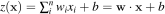。函数 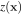 称为该单元的<i>仿射函数</i>，其后接一个<a href="https://goo.gl/7BXceK">整流线性单元</a>，将负值截断为零：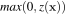。这样的计算单元有时称为“人工神经元”，如下图所示：

<a href="assets/bdefde230f7e-neuron.png">
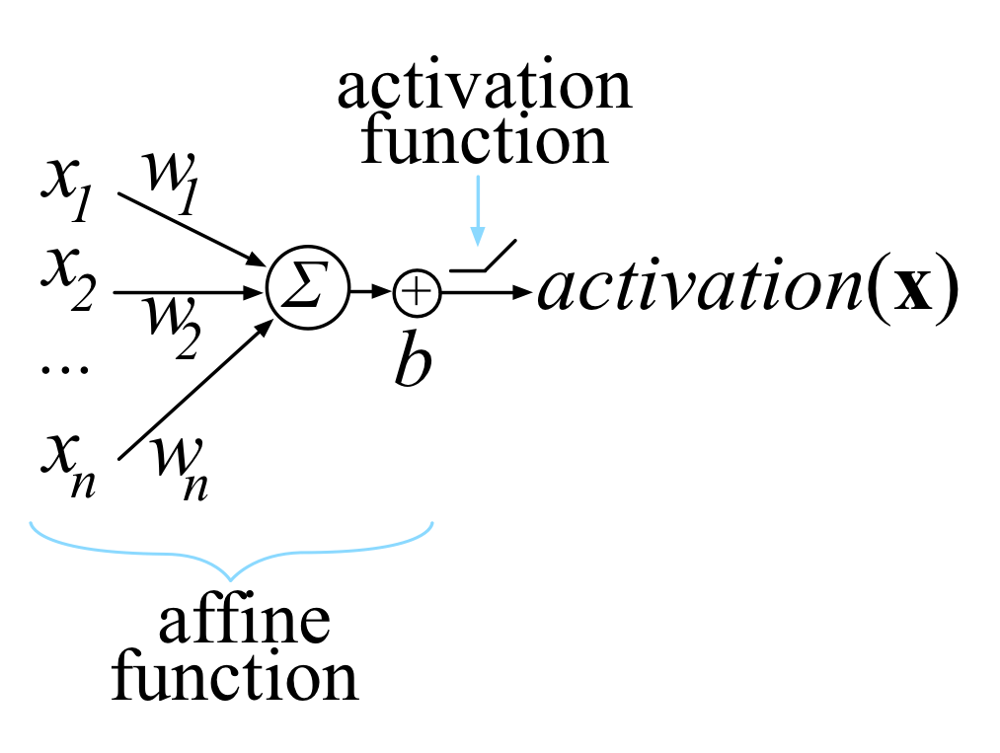
</a>

神经网络由许多这样的单元组成，神经元被组织成多个称为<i>层</i>的集合。一层中各单元的激活值，成为下一层各单元的输入。最后一层中一个或多个单元的激活值，就是网络输出。

<i>训练</i>这个神经元，意味着选择权重 w 和偏置 b，使其对全部 N 个输入 x 都产生期望输出。为此，我们最小化一个<i>损失函数</i>：它对所有输入向量 x，比较网络最终的  与 （x 的期望输出）。为了最小化损失，我们使用某种梯度下降方法，例如普通的<a href="https://en.wikipedia.org/wiki/Stochastic_gradient_descent">随机梯度下降</a>（SGD）、带动量的 SGD，或 <a href="https://en.wikipedia.org/wiki/Stochastic_gradient_descent#Adam">Adam</a>。这些方法都需要  对模型参数 w 和 b 的偏导数（梯度）。我们的目标是逐步调整 w 和 b，使所有输入 x 上的总体损失不断减小。

只要仔细一些，就可以对常见损失函数（均方误差）的标量形式求导，从而得到梯度：

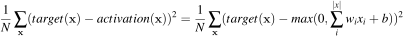

但这还只是一个神经元，而神经网络必须同时训练所有层中全部神经元的权重和偏置。由于存在多个输入，以及可能存在的多个网络输出，我们确实需要函数对向量求导的一般法则，甚至需要向量值函数对向量求导的法则。

本文将逐步推导一些重要的向量偏导数计算法则，尤其是那些对训练神经网络有用的法则。这个领域称为<i>矩阵微积分</i>。好消息是，我们只需要其中很小的一部分，也就是本文介绍的内容。网上关于多元微积分和线性代数的资料很多，但它们通常作为两门独立的本科课程讲授，因此大多数资料也将二者分开讨论。真正讨论矩阵微积分的网页，往往只罗列法则而缺少解释，或者只讲了部分内容。由于符号密集，对基础概念的讨论又很少，除了少数数学专业读者之外，其他人通常很难读懂。（文末有一份附带评述的资源清单。）

这里，我们会通过重新推导、重新发现一些关键法则来解释矩阵微积分。你会发现，它其实并没有那么难！需要学习的不是几十条新规则，而只是几个关键概念。希望这篇短文能帮助你快速入门与神经网络训练相关的矩阵微积分。我们假设你已经熟悉神经网络结构和训练的基础知识；如果还不熟悉，请先完成 <a href="http://course.fast.ai">Jeremy 课程</a>的第一部分，再回来阅读。（请注意，与许多更偏学术的学习路径不同，我们强烈建议<i>先</i>在实践中学习训练和使用神经网络，<i>再</i>研究背后的数学。有了具体背景，数学会容易理解得多；而且，成为有效的实践者，并不需要先彻底掌握这些微积分知识。）

<i>关于符号的说明</i>：Jeremy 的课程完全使用代码而非数学符号解释概念，因为代码中不熟悉的函数很容易检索和实验。本文则相反，会使用大量数学符号，因为目标之一就是帮助你理解深度学习论文和书籍中的记号。<a href="#notation">文末</a>有一张简明符号表，同时列出了可用于进一步搜索的词语或短语。

<h2 data-translation="B037" id="sec:1.2">回顾：标量求导法则</h2>

希望你还记得下面这些主要的标量求导法则。如果记忆有些模糊，可以看看<a href="https://www.khanacademy.org/math/ap-calculus-ab/ab-derivative-rules">可汗学院关于标量求导法则的视频</a>。

<table style="">
<thead>
<tr>
<th align="center" data-translation="B039" valign="top" width="20%">法则</th><th align="center" valign="top">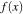</th><th align="center" data-translation="B040" valign="top" width="30%">对 x 的标量导数记法</th><th align="center" data-translation="B041" valign="top">示例</th>
</tr>
</thead>
<tbody>
<tr>
<td align="center" data-translation="B042" valign="top"><b>常数</b></td><td align="center" data-translation="B043" valign="top">c</td><td align="center" valign="top">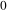</td><td align="center" valign="top"> 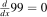</td>
</tr>
<tr>
<td align="center" data-translation="B044" valign="top"><b>常数倍</b></td><td align="center" data-translation="B045" valign="top">cf</td><td align="center" valign="top"></td><td align="center" valign="top"></td>
</tr>
<tr>
<td align="center" data-translation="B046" valign="top"><b>幂法则</b></td><td align="center" valign="top">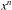 </td><td align="center" valign="top">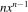</td><td align="center" valign="top">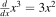</td>
</tr>
<tr>
<td align="center" data-translation="B047" valign="top"><b>和法则</b></td><td align="center" valign="top">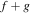</td><td align="center" valign="top"></td><td align="center" valign="top"></td>
</tr>
<tr>
<td align="center" data-translation="B048" valign="top"><b>差法则</b></td><td align="center" valign="top">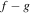</td><td align="center" valign="top">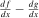</td><td align="center" valign="top">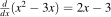</td>
</tr>
<tr>
<td align="center" data-translation="B049" valign="top"><b>乘积法则</b></td><td align="center" data-translation="B050" valign="top">fg</td><td align="center" valign="top">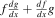</td><td align="center" valign="top"></td>
</tr>
<tr>
<td align="center" data-translation="B051" valign="top"><b>链式法则</b></td><td align="center" valign="top">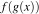</td><td align="center" data-translation="B052" valign="top">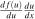，令 </td><td align="center" valign="top">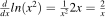</td>
</tr>
</tbody>
</table>

此外还有三角函数、指数函数等的求导法则，可以在<a href="https://www.khanacademy.org/math/differential-calculus">可汗学院微分学课程</a>中找到。

对于只有一个参数的函数 ，你经常会看到用 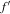 和 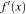 简写 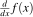。我们不推荐这种记法，因为它没有明确指出求导所针对的变量。

可以把 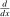 看成一个算子：它把一个单参数函数映射到另一个函数。也就是说， 将  映射为它对 x 的导数，也就是 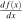。同样，如果 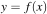，那么 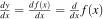。把求导视为一种算子，有助于化简复杂的导数，因为这个算子具有分配性质，并允许我们把常数提出去。例如，在下面的等式中，我们可以提出常数 9，再把求导算子分别作用到括号中的各项上。

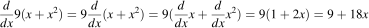

这样一来，对 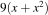 求导就转化成了一点算术运算，以及对 x 和  求导，后两者比原式容易处理得多。

<h2 data-translation="B057" id="sec:1.3">向量微积分与偏导数入门</h2>

神经网络层并不是单个单参数函数 。因此，接下来看看具有多个参数的函数，例如 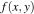。比如，xy（即 x 与 y 相乘）的导数是什么？换句话说，稍微改变变量时，乘积 xy 会怎样变化？答案取决于改变的是 x 还是 y。我们每次只对一个变量（参数）求导，因此这个双参数函数有两个不同的<i>偏导数</i>（分别对 x 和 y）。偏导数使用的算子是 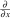，而不是 ；其中的符号是变体的 d，不是希腊字母 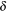。所以，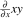 和 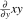 就是 xy 的偏导数，英文常简称为 <i>partials</i>。对于单参数函数，算子  与  等价（假定函数足够光滑）。不过，最好使用 ，明确表示这里指的是标量导数。

对 x 求偏导，其实就是普通的标量求导，只需将式中的其他变量都视为常数。考虑函数 。它对 x 的偏导数记作 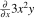。从  的角度看，有三个常数：3、2 和 y。因此，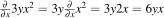。对 y 求偏导时，则把 x 当作常数：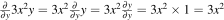。继续阅读之前，最好自己推导一下，否则后文可能难以理解。如需帮助，可以观看<a href="https://www.khanacademy.org/math/multivariable-calculus/multivariable-derivatives/partial-derivative-and-gradient-articles/a/introduction-to-partial-derivatives">可汗学院的偏导数视频</a>。

为了说明我们讨论的是向量微积分，而不只是多元微积分，来看看如何处理刚才为  算出的偏导数  和 （也就是  和  的另一种写法）。不要让它们零散地放着，而是将它们组织成一个行向量。这个向量称为  的<i>梯度</i>，记为：

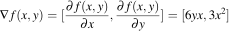

所以， 的梯度就是由其偏导数组成的向量。梯度属于向量微积分的范畴，处理的是把 n 个标量参数映射为一个标量的函数。现在再大胆一点，考虑同时对多个函数求导。

<h2 data-translation="B062" id="sec:1.4">矩阵微积分</h2>

从一个函数的导数转向多个函数的导数，我们就从向量微积分进入了矩阵微积分。来计算两个函数的偏导数，每个函数都有两个参数。保留上一节的 ，再引入 。g 的梯度有两个分量，每个参数对应一个偏导数：

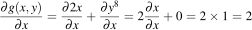

以及

由此得到梯度 。

梯度向量将一个特定标量函数的所有偏导数组织在一起。如果有两个函数，也可以把它们的梯度逐行堆叠成矩阵。这样得到的就是<i>雅可比矩阵</i>（Jacobian matrix，简称 Jacobian），其中每一行都是一个梯度：

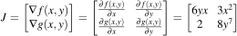

欢迎来到矩阵微积分的世界！

<b>注意，雅可比矩阵有多种表示方式。</b>我们使用所谓的<a href="https://en.wikipedia.org/wiki/Matrix_calculus#Layout_conventions">分子布局</a>，但许多论文和软件采用<i>分母布局</i>。后者就是分子布局雅可比矩阵的转置（沿主对角线翻转）：

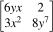

<h3 data-translation="B069" id="sec:1.4.1">雅可比矩阵的推广</h3>

到目前为止，我们看的是雅可比矩阵的具体例子。为了给出更一般的定义，先把多个参数合并成一个向量参数：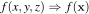。（文献中有时也用 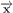 表示向量。）像 x 这样的粗体小写字母表示向量，像 x 这样的斜体字母表示标量。xi 是向量 x 的第 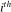 个元素，使用斜体是因为单个向量元素是标量。还需要约定向量 x 的方向。我们默认所有向量都是大小为 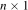 的列向量：

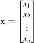

对于多个标量值函数，也可以像处理参数那样，把它们组合成一个向量。令 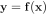 是由 m 个标量值函数组成的向量，每个函数都接受一个长度为  的向量 x；其中  表示 x 中元素的基数（数量）。与上一节一样，f 中的每个函数 fi 都返回一个标量：

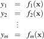

例如，上一节的  和  可以写成：

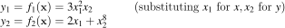

常见的情形是 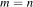，因为向量 x 中的每个元素都对应一个标量函数结果。例如，考虑恒等函数 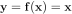：

在这个例子中，函数和参数的数量均为 。一般而言，雅可比矩阵汇集了全部  个可能的偏导数（m 行、n 列），也就是将 m 个对 x 的梯度堆叠起来：

每个  都是一个长度为 n 的行向量，因为偏导数所针对的向量 x 长度为 。对 x 求偏导时，雅可比矩阵的宽度是 n，因为有 n 个可以改变的参数，每个都可能影响函数值。因此，对于 m 个方程，雅可比矩阵总有 m 行。将这些可能的形状画出来，有助于理解：

恒等函数  的雅可比矩阵（其中 ）涉及 n 个函数，每个函数都有 n 个参数，统一放在向量 x 中。因此，雅可比矩阵是方阵，因为 ：

继续之前，请确保自己能推导上面的每一步。如果卡住了，就单独考虑矩阵中的每个元素，应用普通的标量求导法则。这是一个普遍有用的技巧：先把向量表达式拆成一组标量表达式，再计算所有偏导数，最后将结果适当地组合成向量和矩阵。

还要仔细区分矩阵是纵向的 x，还是横向的 ；其中  表示 x 的转置。同时，也要注意区分标量值函数  与函数向量（或向量值函数）。

<h3 data-translation="B079" id="sec:1.4.2">向量逐元素二元运算的导数</h3>

向量的逐元素二元运算，例如向量加法 ，非常重要，因为许多常见向量运算（如向量乘以标量）都可以表示为逐元素二元运算。所谓“逐元素二元运算”，就是将算子作用于两个向量的第一个元素，得到输出的第一个元素；再作用于第二个元素，得到输出的第二个元素，依此类推。例如，NumPy 或 TensorFlow 默认就是这样应用基本数学运算符的。深度学习中常见的例子有  和 （后者返回由 1 和 0 组成的向量）。

可以用  概括逐元素二元运算，其中 。（提醒一下： 是 x 中元素的数量。）符号  表示任意逐元素运算符（例如 ），而不是函数复合运算符 。将方程  展开到标量层面，就得到：

这里将 n 个（而不是 m 个）方程竖着排列，是为了强调逐元素运算的结果是大小为  的向量。

根据上一节的思路可知，对 w 的雅可比矩阵在一般情况下是如下方阵：

而对 x 的雅可比矩阵为：

看上去相当复杂，但幸运的是，雅可比矩阵常常是对角矩阵，也就是除了主对角线之外，其他位置全为零的矩阵。这会极大地简化计算，因此我们仔细看看：对于逐元素运算，雅可比矩阵何时会化为对角矩阵？

在对角雅可比矩阵中，所有非对角元素都为零：，其中 。（注意，这里是对 wj 而不是 wi 求偏导。）这些非对角元素在什么条件下为零？正是在 fi 和 gi 对 wj 而言都是常数时，即 。无论使用什么运算符，只要这些偏导数为零，整个运算结果对该变量的导数就为零，即 ，因为常数的偏导数是零。

当 fi 和 gi 不依赖于 wj 时，这些偏导数就为零。我们知道，逐元素运算意味着 fi 仅是 wi 的函数，gi 仅是 xi 的函数。例如， 计算的是  之和。因此， 化为 ，我们的目标也变成 。当  时，对 wj 求偏导的算子会将  和  视为常数，所以非对角位置的偏导数为零。（严格来说， 是对记号的一种滥用，因为 fi 和 gi 的参数是向量，而不是单个元素。我们本应写成类似  的形式，但这会让式子更加混乱；程序员通常也习惯函数重载，因此下文仍沿用这一记法。）

后面我们会利用这种简化，并将“ 和  分别最多只访问 wi 和 xi”这一约束称为<i>逐元素对角条件</i>。

在这一条件下，雅可比矩阵的对角元素为 ：

（大号的“0”是一种简写，表示所有非对角元素都为 0。）

更简洁地，可以写成：

以及

其中， 构造一个对角元素取自向量 x 的矩阵。

由于经常进行简单的向量算术，逐元素二元运算中的一般函数  往往就是向量 w 本身。只要这个一般函数就是向量本身， 就化为 。例如，向量加法  满足逐元素对角条件，因为  对应的标量方程  可以简化为 ，其偏导数为：

由此得到 ，也就是单位矩阵，因为每个对角元素都为 1。I 表示维度适当的方形单位矩阵：对角线全为 1，其余位置全为零。

由于  化为  这一特例十分简单，你应该能够自行推导常见向量逐元素二元运算的雅可比矩阵：

算子  和  分别表示逐元素乘法和除法； 有时称为<i>哈达玛积</i>（Hadamard product）。逐元素乘除没有统一的标准记号，所以这里采用与一般二元运算记法一致的方式。

<h3 data-translation="B098" id="sec:1.4.3">涉及标量扩展的导数</h3>

将标量与向量相乘或相加时，我们隐式地把标量扩展为向量，再执行逐元素二元运算。例如，标量 z 加到向量 x 上得到 ，实际就是 ，其中  且 。（记号  表示长度适当的全 1 向量。）z 是任意不依赖于 x 的标量；这一点很有用，因为此时对任意 xi 都有 ，从而简化偏导数计算。（在这里的讨论中，把变量 z 当作常数就可以。）类似地，标量乘法  实际上是 ，其中  表示两个向量的逐元素乘法（哈达玛积）。

对于向量与标量的加法、乘法，对向量 x 的偏导数可以用逐元素法则计算：

这是因为函数  和  显然满足雅可比矩阵的逐元素对角条件： 最多只涉及 xi，而  只涉及向量  的第  个值。

利用通常的标量偏导数法则，可以得到向量与标量相加时雅可比矩阵的对角元素：

所以，。

不过，对标量参数 z 求偏导，得到的是一个列向量，而不是对角矩阵。该向量的元素为：

因此，。

向量与标量相乘时，雅可比矩阵的对角元素需要用到标量求导的乘积法则：

所以，。

对标量参数 z 的偏导数是一个列向量，其元素为：

由此得到 。

<h3 data-translation="B110" id="sec:1.4.4">向量求和归约</h3>

将向量元素求和是深度学习中的重要操作，例如网络损失函数中就会用到。它也能帮助我们简化向量点积及其他将向量归约为标量的运算的求导。

令 。注意，这里特意将参数保留为向量 x，因为每个函数 fi 都可能使用向量中的全部值，而不只是 xi。求和针对的是函数的<b>结果</b>，而不是参数。向量求和的梯度（大小为  的雅可比矩阵）为：

（梯度各分量内部的求和容易混淆，因此一定要保持符号一致。）

来看看简单函数  的梯度。求和内部的函数就是 ，于是梯度为：

由于在  时有 ，可以化简为：

注意，结果是全 1 的行向量，而非列向量，所以梯度为 。（ 中的上标 T 表示该向量的转置，在这里就是将列向量变成行向量。）务必始终理清所有向量和矩阵的形状，否则就无法计算复杂函数的导数。

再看一个例子：向量乘以常数标量之后，对结果求和。若 ，则 。梯度为：

对标量变量 z 的导数为 ：

<h3 data-translation="B119" id="sec:1.4.5">链式法则</h3>

仅靠目前介绍的基本矩阵微积分法则，还无法计算非常复杂函数的偏导数。例如，对于  这样的嵌套表达式，若不先将其展开为等价的标量形式，就无法直接求导。我们需要一种能将基本向量法则组合起来的方法，可以称之为<i>向量链式法则</i>。遗憾的是，有多种求导法则都叫“链式法则”，因此必须明确我们说的是哪一种。本节的目标之一，就是清楚地定义并命名三种不同的链式法则，说明它们各自适用的情形。先从<i>单变量链式法则</i>开始：求标量函数对标量的导数。然后介绍<i>全导数</i>这一重要概念，并据此定义一个名称略显冗长的法则：<i>单变量全导数链式法则</i>。最后，我们就能完整地讨论神经网络所需的向量链式法则。

从概念上说，链式法则是一种分治策略（类似快速排序）：将复杂表达式拆成导数更容易计算的子表达式。它的威力在于，我们可以分别处理每个简单子表达式，再把中间结果组合起来，依然得到正确的整体结果。

当我们需要对包含嵌套子表达式的表达式求导时，链式法则就派上用场了。例如，处理  就需要链式法则。最外层对中间结果求 sin，而内层子表达式则对 x 求平方。具体来说，这里需要单变量链式法则，下面详细讨论。

<h4 data-translation="B123" id="sec:1.4.5.1">单变量链式法则</h4>

先给出这个嵌套表达式的导数：。不需要是数学天才，也能看出结果中有两个熟悉的标量求导成分： 和 。看来，只要把外层表达式的导数乘以内层表达式的导数，也就是“把各部分串起来”，就能得到答案。确实如此。本节将说明其一般原理，并给出适用于单变量深层嵌套表达式的计算流程。

链式法则通常用嵌套函数来定义，例如单变量链式法则中的 。（也会看到用函数复合  定义的形式，含义相同。）有些资料将导数简写为 ，但这掩盖了我们引入中间变量  的事实，稍后会看到这一点。最好明确写出  的<a href="http://m.wolframalpha.com/input/?i=chain+rule">单变量链式法则</a>，以免对错误的变量求导。我们推荐以下形式：

使用单变量链式法则时，遵循以下步骤：

<ol>
<li data-translation="B127">为嵌套子表达式，以及二元和一元运算的子表达式引入中间变量。例如， 是二元运算； 和其他三角函数通常是一元运算，因为只有一个操作数。这一步将所有方程规范化为单个运算或单次函数调用。</li>
<li data-translation="B128">计算各中间变量对其参数的导数。</li>
<li data-translation="B129">将各中间变量的导数相乘，得到整体结果。</li>
<li data-translation="B130">如果最终导数表达式中仍引用了中间变量，就代回它们的原始表达式。</li>
</ol>

第三步把中间结果串成一条“链”，这正是“链式法则”名称的由来。将中间导数相乘，是各种链式法则共有的主题。

用这个流程处理 ：

<ol>
<li>引入中间变量。令表示子表达式（是以下表达式的简写：）。由此得到：

这些子表达式的排列顺序不影响答案，但我们建议按嵌套结构由内向外展开。这样，每个表达式及其导数都只依赖之前已经计算出的量。

</li>
<li data-translation="B134">计算导数。

</li>
<li data-translation="B135">组合。

</li>
<li data-translation="B136">代回。

</li>
</ol>

注意，分别计算各个中间变量的导数有多么简单！链式法则保证这种做法成立，并告诉我们如何组合中间结果，得到 。

可以用单位约消来理解链式法则的组合步骤。设 y 的单位是英里，x 表示油箱中的加仑数，u 的单位也是加仑，那么  可以理解为 。分母和分子中的 gallon 会相互约消。

理解单变量链式法则的另一种方式，是把整个表达式画成数据流图或运算链（对编译器开发者而言，就是<a href="https://en.wikipedia.org/wiki/Abstract_syntax_tree">抽象语法树</a>）：

函数参数 x 的变化先经过平方运算，再经过 sin 运算，最终改变结果 y。可以将  理解为“把变化从 x 传到 u”，将  理解为“把变化从 u 传到 y”。从 x 到 y 需要经过一个中间环节。按照惯例，链式法则通常从输出变量向参数方向书写，即 。但若从 x 到 y 的角度看，反过来写成等价的  会更直观。

<b>单变量链式法则的适用条件。</b>注意，从 x 到根节点 y 只有一条数据流路径。x 的变化只能通过一种方式影响输出 y，这就是应用单变量链式法则的条件。另一个更容易记住、但不那么严密的说法是：所有中间子表达式函数（如  和 ）都不超过一个参数。考虑 ，引入中间变量 u 后，它变成 。下一节会看到，在  中，从 x 到 y 有多条路径。处理这种情况需要单变量全导数链式法则。

给对自动微分感兴趣的读者补充一点：论文和库文档会使用<i>前向微分</i>与<i>反向微分</i>（用于反向传播算法）这些术语。从数据流的角度看，我们正在做前向微分，因为它沿着正常的数据流方向进行。反向微分则沿相反方向，追问输出的变化如何关联到函数参数 x。由于反向微分能同时确定所有函数参数对应的变化，对于参数很多的函数，其导数计算会高效得多。前向微分则需要依次考虑每个参数的变化如何影响函数输出 y。下表着重展示这两种方法计算偏导数的顺序。

<table style="">
<thead>
<tr>
<th align="center" data-translation="B143" valign="top">从 x 到 y 的前向微分</th><th align="center" data-translation="B144" valign="top">从 y 到 x 的反向微分</th>
</tr>
</thead>
<tbody>
<tr>
<td align="center" valign="top"></td><td align="center" valign="top"></td>
</tr>
</tbody>
</table>

自动微分超出了本文的范围，这里只是为今后的文章作铺垫。

许多读者可以在脑中算出 ，但我们的目标是建立一套即使面对非常复杂的表达式也能使用的流程。这也正是 PyTorch 等库中<a href="https://en.wikipedia.org/wiki/Automatic_differentiation">自动微分</a>的工作方式。因此，按这种方式手工求导，也是在学习如何为 PyTorch 中的自定义神经网络定义函数。

面对深层嵌套表达式，可以把使用链式法则想象成编译器将  这样的嵌套函数调用，展开为一串调用的过程。函数 fi 的返回结果被存入一个称为寄存器的临时变量，再作为参数传给 。下面把我们的流程应用于  这样的深层嵌套方程，看看实际效果：

<ol>
<li data-translation="B148">引入中间变量。

</li>
<li data-translation="B149">计算导数。

</li>
<li data-translation="B150">组合四个中间值。

</li>
<li data-translation="B151">代回。

</li>
</ol>

下面展示从 x 到 y 的运算链中的数据流：

至此，我们可以用链式法则处理单变量 x 的嵌套表达式导数，但前提是 x 只能通过一条数据流路径影响 y。为了处理更复杂的表达式，接下来需要扩展这一方法。

<h4 data-translation="B154" id="sec:1.4.5.2">单变量全导数链式法则</h4>

单变量链式法则的适用范围有限，因为所有中间变量都必须是单变量函数。不过，它展示了链式法则的核心机制：将中间子表达式的导数相乘。要处理  这样的更一般表达式，我们需要扩展这条基本法则。

当然，我们一眼就能看出 ，但这用的是标量加法求导法则，而非链式法则。如果尝试直接应用单变量链式法则，就会得到错误答案。事实上，前面的链式法则在这里并不适用，因为求导算子  不适用于中间变量中的多元函数，例如 ：

不妨硬试一下，看看会发生什么。如果假装  且 ，那么得到的是 ，而不是正确答案 。

由于  有多个参数，偏导数就登场了。我们先不加辨别地对所有方程使用偏导算子，看看结果：

糟糕！偏导数  在这里给出了错误结果，因为这种用法违反了偏导数的一个关键假设：对 x 求偏导时，其他变量不能随着 x 一起变化，否则就不能把它们当作常数。然而， 显然是 x 的函数，因此会随 x 变化。由于 ，所以 。看看  的数据流图，就会发现从 x 到 y 有多条路径，这表明我们必须同时考虑对 x 的直接依赖，以及通过  产生的间接依赖：

x 既作为加法的操作数，也作为平方运算的操作数影响 y。下面的方程描述对 x 作微小调整如何影响输出：

于是有 ，可读作：“y 的变化，是原来的 y 与调整 x 后的 y 之间的差。”

如果令 ，则 。将 x 增加 1，即 ，则有 。y 的变化不是  可能让我们误以为的 ，而是 ！

这时就需要<a href="https://en.wikipedia.org/wiki/Total_derivative">全导数</a>“法则”了。其基本含义是：计算  时，必须将 x 的变化对 y 的变化产生的所有可能贡献加起来。对 x 求全导数时，假设所有变量（如本例中的 ）都是 x 的函数，因此可能随 x 改变。若  既直接依赖 x，又通过中间变量  间接依赖它，则其全导数为：

使用这个公式，就得到正确答案：

这就是我们所称的<i>单变量全导数链式法则</i>的一次应用：

全导数假设所有变量都可能存在相互依赖；偏导数则将除 x 之外的所有变量视为常数。

这里的符号有一个微妙之处。所有导数都写成偏导数，因为 f 和 ui 是多变量函数。这与 <a href="http://mathworld.wolfram.com/TotalDerivative.html">MathWorld 的记法</a>一致，但不同于 <a href="https://en.wikipedia.org/wiki/Total_derivative">Wikipedia</a>，后者使用 （也许是为了强调等式的全导数性质）。我们将继续使用偏导数记号，以便与下一节讨论的向量链式法则保持一致。

实际使用时，只要记住：对 x 求全导数时，其他变量也可能是 x 的函数，所以它们的贡献也要加进来。等式左侧看起来像普通偏导数，右侧实际上计算的是全导数。不过，许多临时变量通常只依赖一个参数，这时单变量全导数链式法则就退化为单变量链式法则。

考虑一个嵌套子表达式，例如 。引入三个中间变量：

以及相应偏导数：

其中， 和  都包含  项，用来计入全导数的贡献。

还要注意，全导数公式始终对  这些项<b>求和</b>，而不是相乘。你可能以为求和是因为原式（例如 ）本身把两项相加，其实不是。全导数之所以相加，是因为它表示所有 x 对 y 变化的贡献的加权和。例如，即使用  代替 ，全导数链式法则仍然把各偏导项相加。（ 可以化简为 ，但为了演示，这里不合并这些项。）中间变量和偏导数如下：

而全导数的形式仍然相同：

中间变量所用的运算符改变时，变化的是偏导数（权重），而不是公式本身。

微积分基础较好的读者可能会疑惑：为什么连  中的  这种非嵌套子表达式，也要积极地引入中间变量？原因有三点：（i）简化后的子表达式通常很容易求导；（ii）这样可以简化链式法则；（iii）这一流程与神经网络库中的自动微分机制一致。

进一步使用中间变量，就可以把单变量全导数链式法则化为最终形式。目标是去掉前面那个显得突兀的 ：

只需引入一个新的临时变量，作为 x 的别名：，就能做到。于是公式化为最终形式：

当所有中间变量都是单变量函数时，这条全导数链式法则就退化为单变量链式法则。因此，只记住这个更一般的公式，就能覆盖两种情况。先埋个伏笔：注意，这个求和很像向量点积 ，或者向量乘法 。

继续之前，提醒一下网上的术语用法。遗憾的是，在微积分讨论中，本节这条基于全导数的链式法则通常被称为“多变量链式法则”，这个名称很容易造成误解！只有中间变量才是多元函数；整个函数（如 ）仍是只接受一个参数 x 的标量函数。导数和参数都是标量，而不是“多元链式法则”这个名字可能让人联想到的向量。（在不涉及矩阵微积分的课堂上，“多元链式法则”大概不会造成歧义。）为了减少混淆，我们用“单变量全导数链式法则”这个名称，明确区分它与简单的单变量链式法则 。

<h4 data-translation="B180" id="sec:1.4.5.3">向量链式法则</h4>

理解全导数链式法则之后，就可以处理函数向量和向量变量的链式法则了。令人意外的是，这条更一般的法则，看起来与标量的单变量链式法则同样简洁。与其直接给出公式，不如亲自重新推导，以便牢固掌握。先计算一个向量函数对标量的导数，例如 ，看看能否从中抽象出一般公式。

引入两个中间变量  和 ，每个 fi 对应一个，使 y 更像 ：

向量 y 对标量 x 的导数是一个列向量，其各元素可用单变量全导数链式法则计算：

现在，我们仅靠标量法则就得到了答案，只不过把导数组织成了向量。接下来尝试从这一结果抽象出向量形式：目标是将下面由标量运算组成的向量，改写为一次向量运算。

将  各项拆开，并把  各项单独组成一个向量，就得到矩阵与向量的乘法：

这意味着，一个雅可比矩阵等于另外两个雅可比矩阵的乘积，很有意思。来核对一下结果：

太好了！结果与标量方法相同。对于函数向量和单个参数，这条向量链式法则看来是正确的，而且确实与单变量链式法则相呼应。比较向量法则：

与单变量链式法则：

要使公式适用于多个参数或向量 x，只需将式中的 x 换成向量 x。这样， 和最终得到的雅可比矩阵  就从列向量变成了矩阵。完整的<i>向量链式法则</i>为：

相比单变量链式法则，向量公式的妙处在于：保持同样简洁的符号形式，同时自动计入全导数。雅可比矩阵包含了 fi 对 gj、以及 gi 对 xj 的所有可能组合。为完整起见，下面展开这两个雅可比矩阵：

其中 、、。所得雅可比矩阵大小为 （一个  矩阵乘以一个  矩阵）。

即使在  这个公式中，也常能进一步简化，因为在许多应用里，雅可比矩阵是方阵（），且非对角元素为零。神经网络中的数学通常处理的是以向量为输入的函数，而不是一组任意函数组成的向量。例如，神经元的仿射函数包含  项，激活函数为 ；下一节将讨论它们的导数。

前面已经看到，对向量 w 和 x 的逐元素运算会产生对角矩阵，其元素为 ，因为 wi 仅依赖 xi，不依赖  时的 xj。这里也一样：当 fi 仅是 gi 的函数，且 gi 仅是 xi 的函数时，有：

在这种情况下，向量链式法则简化为：

因此，雅可比矩阵化为对角矩阵，每个对角元素都是相应单变量链式法则的计算结果。

经过这一大段数学推导，终于得到回报：你只需要掌握向量链式法则，因为单变量公式都是它的特例。下表汇总了为得到雅可比矩阵而需要相乘的各个组成部分。

<h2 data-translation="B197" id="sec:1.5">神经元激活值的梯度</h2>

现在，我们已经具备所需的全部工具，可以计算神经网络中单个计算单元的典型激活值对模型参数 w 和 b 的导数：

（这表示一个采用全连接权重和整流线性单元激活函数的神经元。当然，也存在卷积等其他仿射函数，以及指数线性单元等其他激活函数，它们遵循类似的逻辑。）

先暂时放下 max，专注于计算  和 。（回忆一下，神经网络通过优化权重和偏置来学习。）我们还没有讨论点积的导数 ，但可以利用链式法则，避免再记一条新规则。（注意，这里使用 y 而非 y，因为结果是标量，不是向量。）

点积  就是逐元素乘积的和：。（记住线性代数形式  也可能有所帮助。）我们知道如何计算  和  的偏导数，但还没有讨论  的偏导数。这需要链式法则，因此可以像使用单变量链式法则时那样，引入中间向量变量 u：

将 y 改写之后，就能认出两个偏导数已经知道的子表达式：

向量链式法则告诉我们，将这些偏导数相乘：

为了核对结果，可以将点积完全展开为标量函数：

于是：

很好！标量计算的结果与向量链式法则的结果一致。

现在令 ，也就是 max 激活函数调用内部的完整表达式。我们要计算两个不同的偏导数，但这次不需要链式法则：

接下来处理神经元激活值  的偏导数。对标量 z 应用 ，就是将所有负的 z 值视为 0。max 函数的导数是分段函数。当  时，导数为 0，因为 z 是常数；当  时，max 的导数就是 z 的导数，也就是 ：

补充说明如何将标量函数广播到各元素上。当 max 的一个或两个参数是向量时，例如 ，我们将单变量函数 max 广播到各个元素。这是逐元素一元运算的一个例子。明确写出就是：

对于广播后的版本，其导数对应一个由 0 和 1 组成的向量，其中：

要计算  的导数，由于存在嵌套子表达式 ，需要使用链式法则。按照既定流程，引入中间标量变量 z 表示仿射函数，得到：

向量链式法则给出：

可以将其改写为：

再将  代回：

这个等式符合直觉。当激活函数将仿射函数输出 z 截断为 0 时，对任意权重 wi 的导数都为零。当  时，max 函数仿佛消失了一样，剩下的就是 z 对权重的导数。

接着计算神经元激活值对 b 的导数，得到：

现在利用这些偏导数，处理整个损失函数。

<h2 data-translation="B218" id="sec:1.6">神经网络损失函数的梯度</h2>

训练神经元，需要对损失函数（也称“代价函数”）关于模型参数 w 和 b 求导。本例采用均方误差作为损失函数。由于训练使用多个向量输入（例如多张图像）及相应的标量目标（例如每张图像对应一个分类），我们需要引入更多符号。令：

其中 ，再令：

其中 yi 是标量。于是代价函数变为：

按照链式法则流程，引入以下中间变量：

先计算对 w 的梯度。

<h3 data-translation="B224" id="sec:1.6.1">对权重的梯度</h3>

根据前面的结果，我们知道：

以及

于是，整体梯度为：

为了理解这个等式，可以代入误差项 ，得到：

注意，这个计算是在 X 中的所有 xi 上取加权平均。权重就是误差项，即对每个输入 xi，目标输出与神经元实际输出之间的差。所得梯度总体上指向代价或损失增大的方向，因为较大的 ei 会突出对应的 xi 的贡献。假设只有一个输入向量 ，梯度就是 。误差为 0 时，梯度为零，损失也就达到了最小值。如果  是一个较小的正差值，梯度就是沿  方向迈出的一小步；如果  很大，梯度就是沿该方向迈出的一大步。如果  为负，梯度方向就反过来，意味着代价增大的方向是负方向。

当然，我们希望减小而不是增大损失，因此<a href="https://en.wikipedia.org/wiki/Gradient_descent">梯度下降</a>的递推公式沿负梯度方向更新当前位置（标量学习率为 ）：

由于梯度指向代价增大的方向，我们要沿相反方向更新 w。

<h3 data-translation="B232" id="sec:1.6.2">对偏置的导数</h3>

为了优化偏置 b，还需要对 b 的偏导数。再次列出中间变量：

前面已经计算了方程  对偏置的偏导数：

对于 v，偏导数为：

而代价函数本身的偏导数为：

和之前一样，可以代入误差项：

因此，偏导数就是根据激活情况取误差值或零，再对它们求平均。更新神经元偏置时，沿代价增大的相反方向作小幅调整：

实际中，将 w 与 b 合并为一个向量参数更方便，这样不必分别处理两个偏导数：。这也需要调整输入向量 x，但能简化激活函数。在 x 的末尾补上一个 1，得到  后， 就变为 。

至此，神经网络损失函数的优化推导就完成了：我们已经得到执行梯度下降所需的两个偏导数。

<h2 data-translation="B241" id="sec:1.7">总结</h2>

希望你一路读到了这里。你已经在理解矩阵微积分的道路上迈出了重要一步！下一节提供速查资料，汇总本文的全部法则。也请看看后面附带评述的资源链接。

接下来，可以学习对矩阵而不只是对向量求偏导。例如，阅读 <a href="https://atmos.washington.edu/~dennis/MatrixCalculus.pdf">Matrix calculus</a> 中关于矩阵微分的部分。

<b>致谢。</b>感谢 <a href="https://www.usfca.edu/faculty/yannet-interian">Yannet Interian</a>（旧金山大学数据科学硕士项目教师）和 <a href="http://www.cs.usfca.edu/~duminsky/">David Uminsky</a>（数据科学硕士项目教师兼主任）帮助完善本文的符号记法。

<h2 data-translation="B245" id="reference">矩阵微积分速查</h2>
<h3 data-translation="B246" id="sec:1.8.1">梯度与雅可比矩阵</h3>

二元函数的<i>梯度</i>是一个长度为 2 的行向量：

以向量为输入的向量值函数，其<i>雅可比矩阵</i>是一个包含全部可能标量偏导数的  矩阵（，）：

恒等函数  的雅可比矩阵为 I。

<h3 data-translation="B250" id="sec:1.8.2">向量的逐元素运算</h3>

使用  这样的运算符（例如 ），定义向量 w 和 x 上的一般<i>逐元素运算</i>：

对 w 的雅可比矩阵为（对 x 的情形类似）：

如果满足<i>逐元素对角条件</i>，即  和  分别最多只访问 wi 和 xi，则雅可比矩阵化为对角矩阵：

以下是一些逐元素运算的例子：

<h3 data-translation="B255" id="sec:1.8.3">标量扩展</h3>

将标量 z 加到向量 x 上得到 ，实际上就是 ，其中  且 。

标量乘法得到：

<h3 data-translation="B258" id="sec:1.8.4">向量归约</h3>

向量求和对其中一个向量的偏导数为：

对于 ：

对于  和 ，得到：

向量点积为 。代入  并使用向量链式法则，得到：

类似地，。

<h3 data-translation="B264" id="sec:1.8.5">链式法则</h3>

<i>向量链式法则</i>是一般形式，其他法则都是它的退化情形。当 f 是单变量 x 的函数，且所有中间变量 u 都是单变量函数时，适用单变量链式法则。当部分或全部中间变量是多变量函数时，适用单变量全导数链式法则。其他情况下，则使用向量链式法则。

<table style="">
<thead>
<tr>
<th align="center" data-translation="B266" valign="top">单变量法则</th><th align="center" data-translation="B267" valign="top">单变量全导数法则</th><th align="center" data-translation="B268" valign="top">向量法则</th>
</tr>
</thead>
<tbody>
<tr>
<td align="center" valign="top"></td><td align="center" valign="top"></td><td align="center" valign="top"></td>
</tr>
</tbody>
</table>

<h2 data-translation="B269" id="notation">符号说明</h2>

像 x 这样的粗体小写字母表示向量，像 x 这样的斜体字母表示标量。xi 是向量 x 的第  个元素，使用斜体是因为单个向量元素是标量。 表示“向量 x 的长度”。

 中的上标 T 表示该向量的转置。

 相当于一个 for 循环：让 i 从 a 遍历到 b，将所有 xi 相加。

记号  表示名为 f、参数为 x 的函数。

I 表示维度适当的方形“单位矩阵”：主对角线全为 1，其他位置全为零。

 构造一个对角元素取自向量 x 的矩阵。

点积  是逐元素乘积的和：。也可以将其看作 。

求导  是将单参数函数映射到另一个函数的算子。也就是说， 把  映射为它对 x 的导数，即 。另外，如果 ，那么 。

函数对 x 的偏导数 ，就是将其他所有变量保持不变后，进行普通的标量求导。

f 对向量 x 的梯度 ，将一个特定标量函数的全部偏导数组织起来。

雅可比矩阵通过逐行堆叠，将多个函数的梯度组织成一个矩阵：

下面的记号表示：当  时，y 取值 a；当  时，取值 b。

<h2 data-translation="B282" id="sec:1.10">参考资源</h2>

<a href="http://www.wolframalpha.com/input/?i=D%5B%7Bx%5E2,+x%5E3%7D.%7B%7B1,2%7D,%7B3,4%7D%7D.%7Bx%5E2,+x%5E3%7D,+x%5D">Wolfram Alpha</a> 可以进行符号矩阵代数运算；另外，还有一个很不错的专用<a href="http://www.matrixcalculus.org/">矩阵微积分求导工具</a>。

在网上查找资料时，请搜索“matrix calculus”，而不是“vector calculus”。下面是对 <a href="https://www.google.com/search?q=matrix+calculus&amp;oq=matrix+calculus">Google 搜索</a>中靠前结果的一些评述：

<ul>
<li><a href="https://en.wikipedia.org/wiki/Matrix_calculus">https://en.wikipedia.org/wiki/Matrix_calculus</a>

Wikipedia 的条目其实相当不错，对不同布局约定也有清楚的说明。回忆一下，我们采用分子布局：雅可比矩阵中的变量横向排列，函数纵向排列。Wikipedia 对<a href="https://en.wikipedia.org/wiki/Total_derivative">全导数</a>的解释也很好，但要注意，其记号与本文略有不同。我们始终使用 ，而不是 dx。

</li>
<li><a href="http://www.ee.ic.ac.uk/hp/staff/dmb/matrix/calculus.html">http://www.ee.ic.ac.uk/hp/staff/dmb/matrix/calculus.html</a>

这个网页有一节讨论矩阵微分，给出了一些有用的恒等式，作者采用分子布局。读完本文后，如果想进一步了解矩阵求导与向量求导的区别，可以从这里开始。

</li>
<li><a href="https://www.colorado.edu/engineering/CAS/courses.d/IFEM.d/IFEM.AppC.d/IFEM.AppC.pdf">https://www.colorado.edu/engineering/CAS/courses.d/IFEM.d/IFEM.AppC.d/IFEM.AppC.pdf</a>

这是《有限元方法导论》课程讲义的一部分，作者应该是 <a href="https://www.colorado.edu/engineering/CAS/courses.d/IFEM.d">Carlos A. Felippa</a>。他采用分母布局，因此其雅可比矩阵是本文记法的转置。

</li>
<li><a href="http://www.ee.ic.ac.uk/hp/staff/dmb/matrix/calculus.html">http://www.ee.ic.ac.uk/hp/staff/dmb/matrix/calculus.html</a>

这个网页列出了大量不同向量和矩阵的实用导数，是一份很好的速查表。基本没有解释，只是一组法则。

</li>
<li><a href="https://www.math.uwaterloo.ca/~hwolkowi/matrixcookbook.pdf">https://www.math.uwaterloo.ca/~hwolkowi/matrixcookbook.pdf</a>

另一份速查资料，主要讨论一般矩阵运算，比上一项有更多说明。

</li>
<li><a href="https://www.comp.nus.edu.sg/~cs5240/lecture/matrix-differentiation.pdf">https://www.comp.nus.edu.sg/~cs5240/lecture/matrix-differentiation.pdf</a>

一组有用的幻灯片。

</li>
</ul>

如果想进一步了解神经网络，以及优化和反向传播背后的数学，我们强烈推荐 <a href="http://neuralnetworksanddeeplearning.com/chap1.html">Michael Nielsen 的书</a>。

如果你特别关注卷积神经网络，可以阅读 <a href="https://arxiv.org/pdf/1603.07285.pdf">《深度学习卷积运算指南》（A guide to convolution arithmetic for deep learning）</a>。

本文引用了<a href="https://en.wikipedia.org/wiki/Total_derivative">全导数</a>法则。这是一个重要概念，其含义只是：对 x 求导时，必须考虑所有依赖于 x 的变量对 x 的导数。

<!-- imported-translation:end -->

