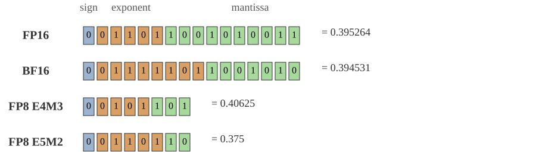
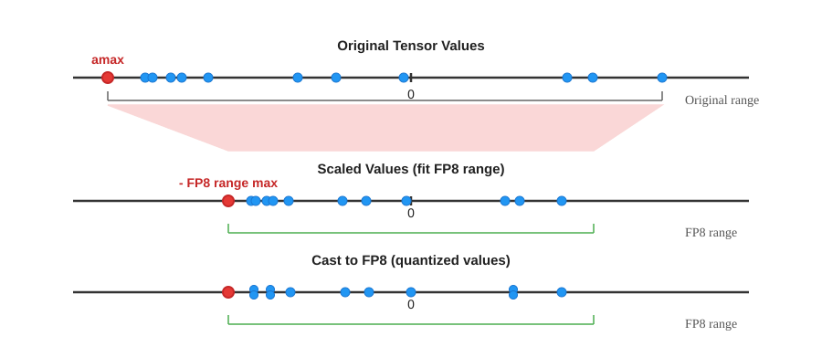
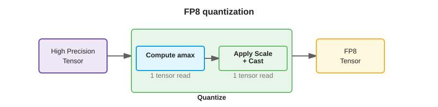
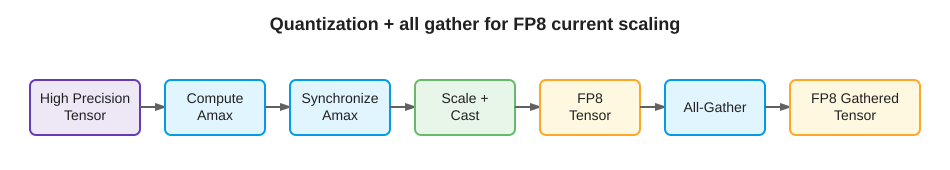

# FP8 Current Scaling：量化、缩放与精度边界

[量化专题](index.md)

## 为什么要量化

模型中的权重是学习得到的参数，激活值是各层产生的中间结果，梯度用于计算参数更新。这些数字组成的多维数组称为张量，入门时可以先把张量理解为一组数字。

量化把高精度数值映射到较少的可表示数值上，以减少存储与数据搬运，并利用硬件支持加速计算。FP32、BF16、FP8 分别用 32、16、8 位表示一个数；只比较元素存储，100 万个 FP32 数约占 4 MB，FP8 数约占 1 MB，另需缩放等元数据。这不意味着整个训练的显存或耗时也缩小到四分之一。

代价是舍入误差。例如，把 1.23456 按“保留两位小数”处理，得到 1.23。FP8 的实际规则是二进制浮点舍入，不能把它等同于固定保留几位小数。

## FP8 的两种格式

| 格式 | 符号位 / 指数位 / 尾数位 | 最大有限值的绝对值 | 文档中的默认用途 |
| --- | --- | ---: | --- |
| E4M3 | 1 / 4 / 3 | 448 | 前向传播的权重和激活 |
| E5M2 | 1 / 5 / 2 | 57344 | 反向传播中需要量化的梯度 |

E4M3 支持 NaN；E5M2 还支持正负无穷。默认混合策略称为 `Format.HYBRID`，可通过 recipe 配置。

浮点数类似科学计数法：符号表示正负，指数决定数量级，尾数区分同一数量级内的细节。E5M2 的范围更宽，但尾数更少、精度更粗。FP8 的可表示数不是均匀分布的：例如 E4M3 在 [32, 64) 中包含 32、36、40、44、48 等数，44.8 就无法精确保存。

*[Figure 1](https://docs.nvidia.com/deeplearning/transformer-engine/features/low_precision_training/fp8_current_scaling/fp8_current_scaling.html#fp8-data-type)：不同格式表示同一个目标值 0.3952 时，位分配和得到的近似值不同；可直观看到尾数减少带来的精度取舍。*

## Current Scaling：先看当前数据，再决定比例

[Transformer Engine 2.20.2](https://docs.nvidia.com/deeplearning/transformer-engine/features/low_precision_training/fp8_current_scaling/fp8_current_scaling.html#scaling-factors) 的 current scaling 每次量化先计算当前张量的最大绝对值 `amax`，再缩放并转换为 FP8。每个张量共享一个 FP32 缩放因子；不是整个模型共用一个因子，也不依赖历史 `amax`。转换采用就近舍入，恰好处于中点时选择尾数最低位为偶数的表示，即 RTNE。

*[Figure 3](https://docs.nvidia.com/deeplearning/transformer-engine/features/low_precision_training/fp8_current_scaling/fp8_current_scaling.html#scaling-factors)：从上到下依次是原始值、缩放到 FP8 范围后的值、转换为 FP8 的值。缩放调整范围，最后的 Cast 才把值舍入到离散的可表示数上。*

对包含有限数值、且不全为零的张量 $X$，记 $F_{\max}$ 为所选 FP8 格式的最大有限正数，$Q$ 为舍入到该格式的操作：

$$
a=\max_i|x_i|,\qquad
\alpha=\frac{F_{\max}}{a},\qquad
q_i=Q(\alpha x_i),\qquad
\hat{x}_i=q_i s,\quad s=\frac{a}{F_{\max}}=\frac1\alpha.
$$

$x_i$ 是原始元素，$q_i$ 是 FP8 数值，$\hat{x}_i$ 是还原的近似值。文档中的 `x = x_fp8 * s` 描述的是这种表示关系；考虑舍入后，应理解为原值约等于还原值。**量化时乘的 $\alpha$ 与还原时乘的 $s$ 互为倒数。** 其他资料或 API 也可能把 $\alpha$ 称为 scale，阅读时应先确认方向。

例如，取 $X=[-1000,100,1000]$，使用 E4M3，则 $a=1000$，$\alpha=0.448$，$s=1000/448\approx2.23214$：

| 原始值 $x$ | 缩放后的值 $\alpha x$ | FP8 数值 $q$ | 还原值 $\hat{x}=qs$ |
| ---: | ---: | ---: | ---: |
| -1000 | -448 | -448 | -1000 |
| 100 | 44.8 | 44 | 约 98.2143 |
| 1000 | 448 | 448 | 1000 |

误差来自 44.8 舍入为 44；反量化回高精度也不能找回丢失的信息。实际实现还需处理全零张量等边界，不能直接将上面的简化公式用于除零情形。

## 缩放会不会把误差放大

暂时忽略缩放因子自身的浮点误差。令 $y=x/s$，FP8 舍入后得到 $q=y+\varepsilon$，则：

$$
\hat{x}-x=s\varepsilon,\qquad
\frac{|\hat{x}-x|}{|x|}=\frac{|\varepsilon|}{|y|}\quad(x\ne0).
$$

还原会把绝对误差乘以 $s$，但数值本身也按相同比例还原，因此相对误差保持不变。

例如，上例中，缩放空间的误差为 $44-44.8=-0.8$，还原后的误差约为 $-1.7857$。相对误差分别为 $0.8/44.8$ 和 $1.7857/100$，都约为 1.79%。这解释了缩放的作用，却不能据此保证模型效果。

还有两条边界：

- **同一张量内的跨度过大。** 例如 $[0.001,0.002,1000]$ 乘以 0.448 后变为 $[0.000448,0.000896,448]$，小值可能下溢为零。小数本身不必然精度差，关键是缩放后处于哪段表示范围。
- **中间数值误差不等于任务指标损失。** 例如真实的 $1000-999=1$，若两个输入量化成相同的近似值，结果会变成 0。输入误差小，也可能产生很大的结果相对误差；误差能否被模型容忍需要实验验证。

## 成本与多 GPU 使用

- 量化通常读张量两遍：先求 `amax`，再缩放和转换，存在额外访存开销。
- 硬件支持范围为 Ada 及以后，SM 8.9+。Ada / Hopper 的列向使用需要物理转置；Blackwell 的对应行向、列向使用可共享物理存储。见[转置处理](https://docs.nvidia.com/deeplearning/transformer-engine/features/low_precision_training/fp8_current_scaling/fp8_current_scaling.html#transpose-handling)。
- 跨节点汇集的相关张量需先同步全局 `amax`，再用一致比例量化，才能执行量化后的 all-gather。

*[Figure 4](https://docs.nvidia.com/deeplearning/transformer-engine/features/low_precision_training/fp8_current_scaling/fp8_current_scaling.html#scaling-factors)：两个子步骤各需一次张量读取，这也是量化本身会产生额外访存成本的原因。*

All-gather 是让参与设备都拿到汇集数据。例如两张卡分别有 $[-10,20]$ 和 $[-100,5]$，局部 `amax` 是 20 和 100；先取全局最大值 100，再统一按 $448/100$ 缩放。这里同步的是待汇集数据所需的比例，不是让整个模型的所有张量都共用一个 scale。

*[Figure 7](https://docs.nvidia.com/deeplearning/transformer-engine/features/low_precision_training/fp8_current_scaling/fp8_current_scaling.html#distributed-training)：注意顺序：Compute Amax → Synchronize Amax → Scale + Cast → All-Gather；应在量化前确定参与汇集的数据共享的比例。*

## 实现接口与精度边界

PyTorch 中，`Float8CurrentScaling` 配置 recipe，`te.autocast` 配合 TE 层使用；`Float8CurrentScalingQuantizer` 可单独量化张量，返回值支持 `dequantize()`。见[Quantizer 示例](https://docs.nvidia.com/deeplearning/transformer-engine/features/low_precision_training/fp8_current_scaling/fp8_current_scaling.html#examples)；示例未经 GPU 运行验证。

[FP8 训练](https://docs.nvidia.com/deeplearning/transformer-engine/features/low_precision_training/introduction/introduction.html)通常是混合精度训练：部分运算用 FP8，敏感运算或状态保留 BF16 / FP32。参数存储精度、矩阵乘法输入精度、累加精度和输出精度是不同选择，不能仅凭“FP8”判断整个训练的数值行为。

Current scaling 文档没有给出完整的 BF16 / FP32 效果对照实验。它解释了量化机制，不能单独证明任意模型都能无损训练或推理。单个元素的表示误差、训练 loss 的差异和最终任务指标的变化，也不能直接互换。
