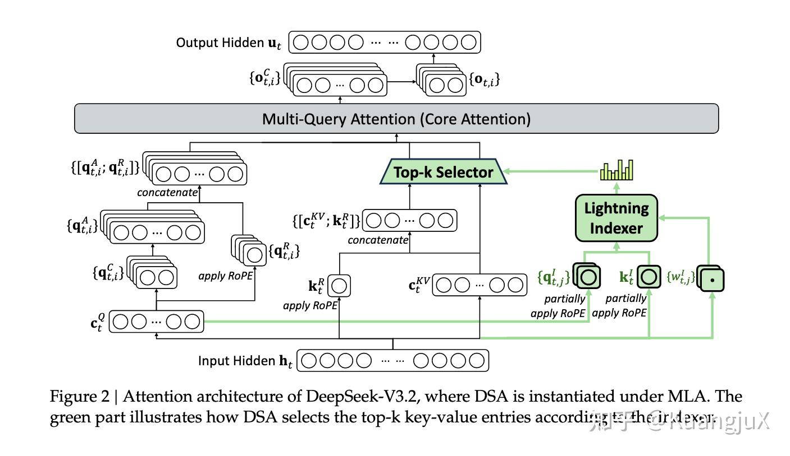
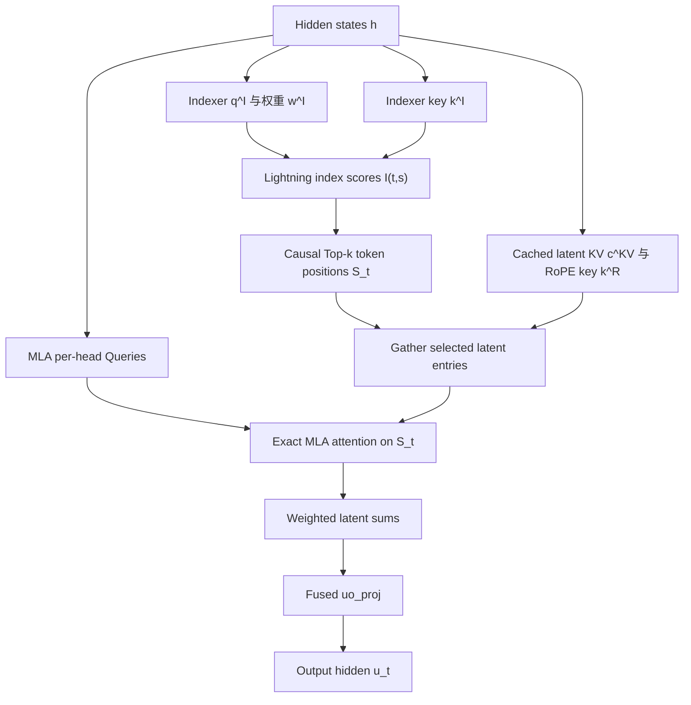
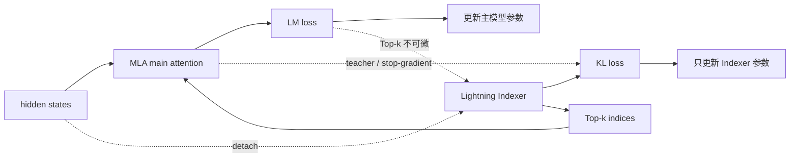

---
tags:
  - papers/LLM
  - topics/sparse-attention
  - topics/MLA
  - topics/indexer
aliases:
  - "DSA"
  - "DeepSeek Sparse Attention"
  - "Lightning Indexer"
date: 2026
---

# DeepSeek Sparse Attention (DSA) 算法流程

> 主要来源：[DeepSeek-V3.2](https://arxiv.org/abs/2512.02556)，第 2.1 节与附录 A
>
> MLA 来源：[DeepSeek-V2: A Strong, Economical, and Efficient Mixture-of-Experts Language Model](https://arxiv.org/abs/2405.04434)
>
> 对比笔记：[MSA Indexer 与 DSA Lightning Indexer 的差别](../MiniMax-MSA/msa.md#msa-vs-dsa)

> Kernel 实现：[DSA Sparse Attention：Kernel 实现与公开性能](../../../Projects/01_Attention/FlashMLA/dsa-sparse-attention.md)

## DSA 解决什么问题 {#_1-dsa-解决什么问题}

设序列长度为 $L$。普通 dense attention 的主注意力需要处理所有因果 token pairs，复杂度为：

$$
O(L^2).
$$

DSA 的目标是让昂贵的 MLA 主注意力只读取固定数量 $k$ 的 KV entries：

$$
O(Lk),\qquad k=2048\ll L.
$$

为此，它额外运行一个计算更便宜的 Indexer。Indexer 本身仍然要给 token pairs 打分，因此仍含 $O(L^2)$ 项，但它使用较少的检索 heads、较小的打分表示，并可采用 FP8。DSA 并没有从渐近意义上消灭平方项，而是把昂贵的平方计算替换成系数很小的检索计算。

---

## 符号表 {#_2-符号表}

| 符号 | 含义 |
|---|---|
| $h_t\in\mathbb R^d$ | 位置 $t$ 的输入 hidden state |
| $H_I$ | Lightning Indexer 的 query/scorer head 数 |
| $d_I$ | 每个 Indexer head 的维度 |
| $q_{t,j}^I$ | query token $t$ 的第 $j$ 个 index-query |
| $w_{t,j}^I$ | 第 $j$ 个 index-query 的标量权重 |
| $k_s^I$ | 历史 token $s$ 的 index-key |
| $I_{t,s}$ | Indexer 对 token pair $(t,s)$ 的标量分数 |
| $\mathcal S_t$ | query $t$ 选中的 Top-k token 位置集合 |
| $c_s^{KV}$ | MLA 将 token $s$ 的 K/V 信息联合压缩后的 latent code |
| $k_s^R$ | decoupled RoPE 的共享 key 部分 |
| $a_{t,s,i}$ | 主注意力第 $i$ 个 Query head 的真实 logit |
| $p_{t,s,i}$ | 在 $\mathcal S_t$ 上 softmax 后的主注意力概率 |
| $u_t$ | 注意力层最终输出 |

---

## 总体数据流 {#_3-总体数据流}



DSA 架构图，引用自 [2025 年度 LLM 研究总结](../../../Foundations/05_Model_Architecture_and_Reasoning/Research-Reviews/llm-2025.md)。主注意力只读入选位置，不代表从 KV cache 永久删除其他位置；后续 query 仍可能选中它们。



选择阶段只交出地址，主分支仍需在这些地址上计算每个 head 的注意力。这一分工让主分支节省计算，也引入了索引扫描和离散 gather 的成本。[DeepSeek-V3.2 §2.1](https://arxiv.org/abs/2512.02556)。

---

## Forward：Lightning Indexer 如何选择 token {#_4-forward-lightning-indexer-如何选择-token}

### 产生多头 index-query 和共享 index-key {#_4-1-产生多头-index-query-和共享-index-key}

对 query token $h_t$，Indexer 产生：

$$
\left\{q_{t,j}^{I}\in\mathbb R^{d_I}\right\}_{j=1}^{H_I},
\qquad
\left\{w_{t,j}^{I}\in\mathbb R\right\}_{j=1}^{H_I}.
$$

对每个历史 token $h_s$，Indexer 产生：

$$
k_s^{I}\in\mathbb R^{d_I}.
$$

可以把 $q_{t,j}^{I}$ 看成不同的低成本检索视角，把 $w_{t,j}^{I}$ 看成 query 根据当前内容动态决定每个视角的重要程度。

### 计算 token-pair index score {#_4-2-计算-token-pair-index-score}

论文公式 (1)：

$$
I_{t,s}
=
\sum_{j=1}^{H_I}
w_{t,j}^{I}
\operatorname{ReLU}
\left(q_{t,j}^{I}\cdot k_s^{I}\right).
$$

逐步理解：

1. 每个 Indexer head 计算一个 dot product；
2. ReLU 将负相关项截为 0，论文选择它主要是出于吞吐考虑；
3. 用 query-dependent $w_{t,j}^I$ 加权；
4. 对 $H_I$ 个 scorer heads 求和，得到一个标量 $I_{t,s}$。

因此，虽然 Lightning Indexer 内部是 multi-head，最终却不是每个 head 一份 Top-k，而是每个 query token 只有一张 token 排名表。

因果 attention 只允许 $s\le t$；未来位置必须在 Top-k 前被 mask 掉。

### Top-k token selection {#_4-3-top-k-token-selection}

$$
\mathcal S_t
=
\left\{
s\mid
I_{t,s}\in
\operatorname{TopK}(I_{t,:},k)
\right\},
\qquad k=2048.
$$

Top-k 只需要比较 index scores，不需要先对整条序列做 softmax。它的输出是整数 token indices，因此对普通反向传播不可微。

### Gather latent KV entries {#_4-4-gather-latent-kv-entries}

论文把被选中的主分支数据写作：

$$
\{c_s\mid s\in\mathcal S_t\}.
$$

这里的 $c_s$ 不是普通 MHA 的一个 Key，也不是一个 Value，而是 token $s$ 的 **MLA latent KV entry**。工程上还要配套读取该 token 的 decoupled RoPE key 部分 $k_s^R$。

选择单位是 token 位置，读取的是该位置的压缩表示。

---

## 什么是 latent KV entry {#_5-什么是-latent-kv-entry}

### MLA 先联合压缩 K 与 V {#_5-1-mla-先联合压缩-k-与-v}

MLA 不直接为每个 token 缓存所有 heads 的普通 K/V，而是先下投影：

$$
c_s^{KV}=W^{DKV}h_s,
\qquad
c_s^{KV}\in\mathbb R^{d_c}.
$$

$c_s^{KV}$ 联合编码同一 token 的 Key/Value 信息，不合并多个 token，也不同于检索分支的 $k_s^I$。

### MHA-mode 可以把 latent 展开成 per-head K/V {#_5-2-mha-mode-可以把-latent-展开成-per-head-k-v}

第 $i$ 个主注意力 head 可以从 latent 恢复 content Key 和 Value：

$$
k_{s,i}^{C}=W_i^{UK}c_s^{KV},
\qquad
v_{s,i}^{C}=W_i^{UV}c_s^{KV}.
$$

如果真的先执行这两次上投影，再运行普通 multi-head attention，就是 MLA 的 MHA-mode 表达。

### 实际 cache 还包含 decoupled RoPE key {#_5-3-实际-cache-还包含-decoupled-rope-key}

为了让低秩压缩与 RoPE 兼容，MLA 将位置相关部分分离出来。可以把每个 token 的逻辑 KV entry 理解为：

$$
\left[c_s^{KV};k_s^R\right].
$$

- $c_s^{KV}$：共享的压缩 content KV；
- $k_s^R$：应用 RoPE 后的位置 key 部分，也在 heads 间共享。

DSA 选中 token $s$ 后，主注意力需要读取这两部分。

---

## MLA 的 MQA-mode 如何避免展开 K/V {#_6-mla-的-mqa-mode-如何避免展开-k-v}

选中 token 后，如果先展开所有 heads 的 K/V，就会重新引入大张量的读取与存储。MLA 的 MQA-mode 利用线性代数把上投影吸收到 Query 和输出两侧，让多个 heads 直接读取同一 latent entry；这是稀疏 gather 能够摊销的前提之一。[DeepSeek-V3.2 §2.1、Figure 2](https://arxiv.org/abs/2512.02556)。

### `uk_proj` 吸收到 Query 侧 {#_6-1-uk-proj-吸收到-query-侧}

普通 content score 为：

$$
(q_{t,i}^{C})^\top k_{s,i}^{C}
=
(q_{t,i}^{C})^\top W_i^{UK}c_s^{KV}.
$$

利用结合律：

$$
(q_{t,i}^{C})^\top W_i^{UK}c_s^{KV}
=
\left((W_i^{UK})^\top q_{t,i}^{C}\right)^\top c_s^{KV}.
$$

定义 absorbed query：

$$
q_{t,i}^{A}
=
(W_i^{UK})^\top q_{t,i}^{C}.
$$

于是无需显式构造 $k_{s,i}^{C}$，第 $i$ 个 Query head 可以直接与所有 heads 共享的 $c_s^{KV}$ 做 dot product。

### 加上 decoupled RoPE 后的真实 attention logit {#_6-2-加上-decoupled-rope-后的真实-attention-logit}

对选中位置 $s\in\mathcal S_t$，第 $i$ 个主 Query head 的真实 attention logit 可写成：

$$
a_{t,s,i}
=
\frac{
(q_{t,i}^{A})^\top c_s^{KV}
+
(q_{t,i}^{R})^\top k_s^{R}
}{\sqrt{d_{attn}}}.
$$

然后只在 selected support 上归一化：

$$
p_{t,s,i}
=
\frac{\exp(a_{t,s,i})}
{\sum_{u\in\mathcal S_t}\exp(a_{t,u,i})},
\qquad s\in\mathcal S_t.
$$

这里才是主模型真正使用的 attention score / probability。它与 Indexer score $I_{t,s}$ 是两个不同量。

### `uv_proj` 与 `o_proj` 吸收到输出侧 {#_6-3-uv-proj-与-o-proj-吸收到输出侧}

如果显式恢复每个 head 的 Value，输出是：

$$
o_{t,i}
=
\sum_{s\in\mathcal S_t}
p_{t,s,i}W_i^{UV}c_s^{KV}.
$$

因为 $W_i^{UV}$ 是线性的：

$$
o_{t,i}
=
W_i^{UV}
\left(
\sum_{s\in\mathcal S_t}
p_{t,s,i}c_s^{KV}
\right).
$$

先在 latent 空间聚合：

$$
z_{t,i}
=
\sum_{s\in\mathcal S_t}
p_{t,s,i}c_s^{KV}.
$$

再把 $W_i^{UV}$ 与按 head 分块后的 output projection $W_i^O$ 融合：

$$
W_i^{UO}=W_i^O W_i^{UV},
$$

$$
u_t
=
\sum_i W_i^{UO}z_{t,i}.
$$

代码中常见的 `uo_proj` 对应的就是这类融合输出映射。

`uo_proj` 的输入是加权 latent output，不是 Indexer score 或 attention logit。

### 为什么它不是 vanilla MQA {#_6-4-为什么它不是-vanilla-mqa}

vanilla MQA 让所有 Query heads 直接共用一组普通 K/V。MLA MQA-mode 共享的是 latent memory $[c_s^{KV};k_s^R]$，但每个 Query head 仍然拥有：

- 不同的 $q_{t,i}^{A}$；
- 不同的 $q_{t,i}^{R}$；
- 不同的 softmax 分布 $p_{t,:,i}$；
- 不同的 $W_i^{UO}$ 输出映射。

所以“所有 heads 共享 latent entry”不意味着所有 heads 的注意力行为相同。

---

## 三种“分数/表示”不能混为一谈 {#_8-三种-分数-表示-不能混为一谈}

Indexer 分数决定位置；主 attention logits 决定这些位置上的概率；概率加权 latent KV 后才得到 `uo_proj` 的输入。下面用一次前向连接这三类数据。

### 一次推理如何连接选择与主分支

```python
def dsa_forward(h_t, t, index_cache, mla_cache, k=2048):
    # Lightning Indexer
    q_idx, w_idx = index_query_proj(h_t)          # [H_I, d_I], [H_I]
    k_idx = index_cache.visible_keys(t)           # [t, d_I]

    pair_scores = relu(q_idx @ k_idx.T)           # [H_I, t]
    index_scores = (w_idx[:, None] * pair_scores).sum(dim=0)
    selected = causal_topk(index_scores, k)        # integer token positions

    # Gather MLA latent entries selected by DSA
    c_kv, k_rope = mla_cache.gather(selected)

    # Exact main attention, one distribution per MLA Query head
    q_absorbed, q_rope = mla_query_proj(h_t)
    logits = (q_absorbed @ c_kv.T + q_rope @ k_rope.T) * attn_scale
    probs = softmax(logits, dim=-1)

    # Aggregate in latent space, then recover final hidden output
    latent_outputs = probs @ c_kv
    u_t = uo_proj(latent_outputs)
    return u_t
```

这段伪代码只表达数据依赖；`attn_scale` 对应前述主分支缩放，省略投影内部细节和短前缀有效长度处理，不代表官方 kernel 的布局或融合边界。


## Backward：为什么需要单独训练 Indexer {#_9-backward-为什么需要单独训练-indexer}

### Top-k 切断 LM gradient {#_9-1-top-k-切断-lm-gradient}

主前向依赖：

```text
I_t,: → integer Top-k indices S_t → gather latent KV → main output → LM loss
```

Top-k 输出离散整数下标。只要排名不变，小幅修改 $I_{t,s}$ 不改变 $\mathcal S_t$；跨越排名边界时结果又跳变。因此 language modeling loss 无法通过普通链式法则训练 Lightning Indexer。

### 用主注意力构造教师分布 {#_9-2-用主注意力构造教师分布}

DSA 将主 attention 信息跨所有 attention heads 聚合，再沿历史序列轴做 L1 normalization，得到一份共享教师分布：

$$
p_{t,:}\in\mathbb R^t.
$$

之所以跨所有 heads 聚合，是因为 DSA 最终也只产生一份供所有 Query heads 共用的 Top-k token list。

Indexer 学习的目标是：

$$
\operatorname{Softmax}(I_{t,:})
\approx
p_{t,:}.
$$

### 两个损失训练两条路径 {#_9-3-两个损失训练两条路径}



前向上两者互相依赖：Indexer 决定主模型看到哪些 token，主模型又给 Indexer 提供教师分布。反向上则刻意隔离：

| 损失 | 更新对象 | 为什么到不了另一侧 |
|---|---|---|
| LM loss | 主模型 | Top-k 不可微，无法到达 Indexer |
| Indexer KL $\mathcal L_I$ | Lightning Indexer | Indexer 输入 detach；教师分布不参与反传 |

---

### 训练循环中的两条梯度路径

```python
main_output, main_attention = dsa_or_dense_attention(...)
lm_loss = language_modeling_loss(main_output, labels)

teacher = aggregate_heads_and_normalize(main_attention).detach()
student = softmax(index_scores_on_current_support)
indexer_loss = kl_divergence(teacher, student)

# 梯度边界：
# lm_loss      -> main model only
# indexer_loss -> indexer only, because indexer input / teacher are detached
```

---


## 训练阶段一：Dense Warm-up {#_10-训练阶段一-dense-warm-up}

DeepSeek-V3.2 从已经扩展到 128K context 的 DeepSeek-V3.1-Terminus checkpoint 继续训练。新加入的 Lightning Indexer 还没有选择能力，因此先执行短暂 dense warm-up。

### 前向方式 {#_10-1-前向方式}

- 主分支继续运行 dense attention，不让随机 Indexer 控制路由；
- 冻结除 Lightning Indexer 之外的全部模型参数；
- 对第 $t$ 个 query，将主注意力量跨所有 heads 求和；
- 沿序列维做 L1 normalization，得到 $p_{t,:}$。

### 训练目标 {#_10-2-训练目标}

论文公式 (3)：

$$
\mathcal L_I
=
\sum_t
D_{KL}
\left(
p_{t,:}
\;\middle\|\;
\operatorname{Softmax}(I_{t,:})
\right).
$$

教师在前，Indexer 分布在后。直观上，主注意力认为重要但 Indexer 低估的 token 会受到更强惩罚。

### 配置 {#_10-3-配置}

| 项目 | 取值 |
|---|---|
| 学习率 | $10^{-3}$ |
| 步数 | 1000 steps |
| 每步数据 | 16 sequences $\times$ 128K tokens |
| 总 token 数 | 约 2.1B |
| 可训练参数 | 仅 Lightning Indexer |
| 主注意力 | Dense |

这个阶段的目标不是让主模型适应稀疏性，而是先让 Indexer 学会模仿一个稳定的 dense teacher。

---

## 训练阶段二：Sparse Training {#_11-训练阶段二-sparse-training}

Warm-up 后正式启用 Top-2048 token selection，并让主模型适应稀疏 support。

### 前向方式 {#_11-1-前向方式}

对每个 query token：

$$
\mathcal S_t
=
\left\{
s\mid I_{t,s}\in\operatorname{TopK}(I_{t,:},2048)
\right\}.
$$

主 MLA attention 只读取 $\mathcal S_t$ 对应的 latent KV entries。教师与学生也只在 selected support 上比较。

### Indexer loss {#_11-2-indexer-loss}

论文公式 (4)：

$$
\mathcal L_I
=
\sum_t
D_{KL}
\left(
p_{t,\mathcal S_t}
\;\middle\|\;
\operatorname{Softmax}(I_{t,\mathcal S_t})
\right).
$$

这里 $p_{t,\mathcal S_t}$ 表示主注意力在 selected support 上形成的教师目标。

### 支撑集缩小后的监督代价 {#_11-3-支撑集缩小后的监督代价}

主模型与 Indexer 沿前述两条梯度路径分别更新，但教师也缩到了已选集合。因此当前 KL 只能对齐集合内的分布，不能直接指出未被主分支读取的重要 token。这是由监督支撑集推得的限制；warm-up 提供初始选择能力，之后的质量仍需由稀疏训练和任务评估判断。

### 配置 {#_11-4-配置}

| 项目 | 取值 |
|---|---|
| 学习率 | $7.3\times10^{-6}$ |
| 稀疏预算 | 每个 query 选择 2048 个 KV tokens |
| 步数 | 15,000 steps |
| 每步数据 | 480 sequences $\times$ 128K tokens |
| 总 token 数 | 943.7B |
| 主模型更新 | 仅 LM loss |
| Indexer 更新 | 仅 KL loss |

---

## 从训练切换到推理 {#_13-从训练切换到推理}

推理执行前述 forward，移除教师分布构造、KL 和 backward；主 attention 本身仍然存在。线上新增成本来自 Indexer 扫描、Top-k 和 gather，而非蒸馏损失。

## 复杂度与效率边界 {#_14-复杂度与效率边界}

### Lightning Indexer {#_14-2-lightning-indexer}

Indexer 仍对 token pairs 评分：

$$
O(L^2 H_I d_I).
$$

它能更快的关键不是复杂度阶数，而是：

- $H_I$ 较小；
- $d_I$ 较小；
- 可以使用 FP8；
- 打分函数由 dot product、ReLU、标量加权和组成；
- 相比完整 MLA，不需要执行大规模 per-head softmax 与 Value aggregation。

### token-level selection 的硬件代价 {#_14-3-token-level-selection-的硬件代价}

DSA 的 2048 个位置可能高度离散，所选位置越分散，地址处理与 gather 越难摊薄。MLA 的紧凑 latent cache 和所有主 Query heads 共享一份选择，让一次取回的 entry 可供多个 heads 使用；跨 query 的复用则取决于选择重合和 kernel 调度，不能由 DSA 定义保证。

因此 MQA-mode 提供了有利的存储与复用条件，但实际收益仍需包含 Indexer、Top-k、gather 和主 attention 的完整测量。抽象的稀疏选择算法并不要求所有模型采用 MLA。

---

## 相关笔记

- [MSA Indexer 与 DSA Lightning Indexer 的差别](../MiniMax-MSA/msa.md#msa-vs-dsa)
- [MiniMax Sparse Attention (MSA)](../MiniMax-MSA/msa.md)
- [MSA 中的 KL 对齐与局部知识蒸馏](../MiniMax-MSA/msa.md#msa-kl)
