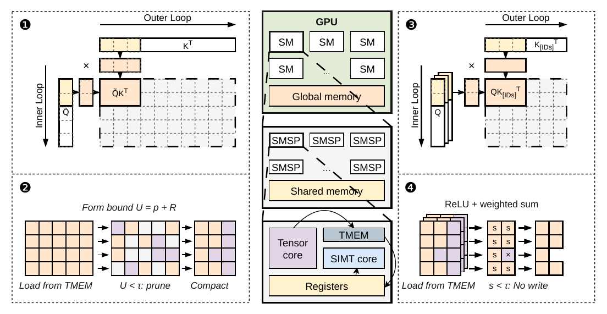

---
tags:
  - papers/LLM
  - topics/sparse-attention
  - topics/indexer
aliases:
  - "DoSA"
  - "Dots Sparse Attention"
date: 2026-10-20
---

# DoSA：用安全上界减少 Indexer 的完整打分

> [DoSA: Dots Sparse Attention，v1](https://arxiv.org/abs/2610.13990v1)。
>
> [Zotero 原文与完整批注](zotero-reading.md) · [整体流程高亮（第 2 页）](zotero://open-pdf/library/items/Y75KTIVE?page=2&annotation=LBKERZAW) · [DSA 前置笔记](../DeepSeek-DSA/deepseek-sparse-attention-dsa.md)
>
> 源码对照：[dots-sparse-attention，`8c578e0`](https://github.com/KuangjuX/dots-sparse-attention/tree/8c578e0e94e392dece8394489ff957b7e27b7a02)。预算与 seed 策略取自此版本代码。

## 1. 目标：减少“为了选少量 token 而给全部 token 完整打分”的成本

DSA 的主 attention 只访问选中的 token，但 indexer 仍可能给每个可见 key 计算全部 head 的分数。DoSA 改变这段执行流程：先证明哪些 key 不可能入选，仅为尚不能排除的候选完整打分，最终仍按原始 scorer 选择 Top-K。

核心洞察是：**排除一个候选，只需证明它的最高可能分数也不够高，不必先求出真实分数。** “精确”指满足论文证书、数值和候选存储条件时，保持原 indexer 的 Top-K 语义；并列 ID 要逐一相同，还需要一致的 tie-break 总序。

以下流程针对 prefill。论文 §3 的 decoding 路径保留完整 FP8 打分，主要用近期选择的 key 建立门槛以减少写回和选择工作，不能直接套用 prefill 的省略 head 筛选描述。

## 2. 完整流程

1. **用 seed 建立门槛。**  
   选至少 K 个不同、可见的 key，按原始全部 head 完整打分，取第 K 高分作为门槛 $\tau$，并保留 seed 的 Top-K 结果。门槛在本次扫描和精算期间固定。

2. **对其余 key 计算安全上界，排除不可能入选者。**  
   先计算部分保留 head 的点积，再为省略的 head 构造界：
   - **正权重 head：估计加分量的上界。** 复用已算 head 的结果，再加残差贡献的上界；无需逐 key 计算残差点积。
   - **负权重 head：估计扣分量的下界。** 将选中的省略负权重 head 的 query 按权重绝对值预先合并，对每个 key 计算合并 query 的点积，再过 ReLU。它给出可以安全扣除的量；扣分下界为正时，比完全忽略负贡献得到更紧的总分上界。

   **总分上界 = 已算 head 的真实贡献 + 省略正权重部分的加分上界 − 省略负权重部分的扣分下界。**

   **仅当 $U<\tau$ 时排除；$U\ge\tau$ 时保留。** 实现还需确保数值界保守、证书有效；无法可靠排除时保留。

3. **对幸存候选完整打分，再选最终 Top-K。**  
   用全部原始 head 计算真实分数，低于门槛的继续排除；其余记录与 **seed 中保留的 Top-K** 合并，按完整分数选出最终 K 个。上界只决定是否需要精算，不用于最终排名。

论文附录 A.2 Algorithm 1 写成对全部 seed 与幸存候选取 Top-K；只保留 seed 的 Top-K 即可完成最终选择。若要求并列时选中相同 ID，seed 内部选择和最终选择也须遵循同一总序。

**门槛为何安全？** 例如 K=2，seed 分数为 9、6、2，门槛是 6。全体可见 key 中已知至少两个分数不低于 6，因此上界为 5 的 key 不可能入选。seed 分数低只会令门槛低、幸存者多；不会因此错误排除赢家。门槛为 6 且上界恰好为 6 的 key 必须保留。

原论文 Figure 2，第 3 页。图中省略了 seed 初始化和最终 Top-K，可结合上述三步阅读。[查看原图所在页](zotero://open-pdf/library/items/Y75KTIVE?page=3)。

## 3. 正、负权重究竟作用在哪里

固定一个 query，DSA 的 indexer score 为：

$$
s(k)=\sum_{h=1}^{H}w_h[q_h^\top k]_+,\qquad [x]_+=\max(x,0).
$$

各 query head 共享同一个 index-key。ReLU 输出非负，但权重 $w_h$ 可正可负，所以一个 head 可以加分，也可以扣分。这里不是主 attention 的 softmax 概率。

例如两项激活值分别为 4、3，权重分别为 2、−1，则总分为 $2\times4-1\times3=5$。负权重与负点积不同：负点积先经过 ReLU 变为零，即使权重为负也不会扣分。

### 3.1 正权重：复用已算结果，加上残差最多可能贡献的量

对省略的正权重 head，选一个保留 head 作为锚点，分解为：

$$
q_h=\beta_h q_j+d_h,\qquad \beta_h\ge0.
$$

利用 ReLU 的性质及点积的范数界：

$$
[q_h^\top k]_+
\le \beta_h[q_j^\top k]_+ + \|d_h\|_2\|k\|_2.
$$

右边复用了已算的锚点激活。残差向量及其范数在 query 准备阶段计算；逐 key 筛选只用残差界和 key 范数，不计算 $d_h^\top k$。

**例子：** 已保留 $q_j=(1,0)$，省略 $q_h=(2,1)$，取 $\beta_h=2$，则 $d_h=(0,1)$。对于 $k=(3,4)$，已知锚点点积为 3，残差范数为 1，key 范数为 5，所以省略 head 激活的上界为 $2\times3+1\times5=11$；真实激活为 10。若该 head 权重为 2，则其加分上界为 22，实际加分为 20。

这是单锚点范数界的直观解释。论文还用联合残差界利用多个省略正 head 的几何关系，使总余量更紧（§2.3、附录 A.1）；这里不展开其推导。

### 3.2 负权重：合并 query，安全地少扣一点

令 $N$ 为省略的负权重 head 集合，选其中的子集 $A$，在 query 准备阶段合并：

$$
a_A=\sum_{h\in A}|w_h|q_h.
$$

逐 key 计算：

$$
L_N(k)=[a_A^\top k]_+
\le \sum_{h\in N}|w_h|[q_h^\top k]_+.
$$

右侧是真实扣分量，左侧是其下界。因为“先加起来再 ReLU”不大于“逐项 ReLU 再相加”，从总分上界中减去左侧仍然安全。概念上，一个聚合方向的点积可以代替多个负 head 的独立点积；实现会额外处理量化与数值保护，不能把概念公式中的一次点积直接当作全部 kernel 开销。

**例子：** 两个省略 head 为 $q_1=(1,0)$、$q_2=(0,1)$，权重均为 −1。合并得到 $a_A=(1,1)$。对 $k=(3,4)$，原本分别算两个点积，真实扣分为 $3+4=7$；聚合点积为 7，扣分下界恰好精确。若此前加分上界为 12，则总分上界从 12 收紧到 5；seed 门槛为 6 时便可排除。

如果改为 $k=(3,-2)$，真实扣分为 $3+0=3$，聚合结果为 $[3-2]_+=1$。只扣 1 仍安全，但更松，因为第二个 head 的负点积在聚合 ReLU 前抵消了部分正贡献。

为减少这种抵消，论文使用 seed 样本估计激活频率，选激活频率至少一半的省略负 head 进入 $A$。这是提高界紧度的启发式；即使新 key 的激活模式不同，下界仍安全。

**统一理解：加分往多了算，扣分往少了算，因此最终得到总分上界。** 所谓“负 head 取下界”，准确地说是取非负扣分量的下界；带上负号后，它是该部分带符号贡献的上界。

## 4. 本地实现怎样对应这个流程

以下对应固定提交的 [backend.py](https://github.com/KuangjuX/dots-sparse-attention/blob/8c578e0e94e392dece8394489ff957b7e27b7a02/src/dosa/backend.py)，属于源码事实。

| 阶段 | 入口与状态变化 |
|---|---|
| 选择 seed | `_gather` 复用当前 layer/request 的有效 prior，否则 `_cold_prior` 对四个均匀分布的代表 query 完整打分，以其 Top-2048 的出现次数选出 12,288 个 seed；有 prior 时可利用此前近期 query 的选择频次 |
| 建立门槛 | `_seed` 对每个当前 query 与全部 seed 完整打分，生成独立的 `seed_tau` 和 seed Top-2048；复用的是 key ID 提示，不是历史 query 的分数 |
| 准备界 | `_body` 抽取 seed 区域内 128 个位置，统计激活模式；`planner.plan128` / `direct_abs.plan128` 准备保留 head、折叠权重和辅助向量 |
| 筛选 | `_emit` 从内部重排的 seed 区域之后扫描 key，以安全上界和固定 `safe_tau` 比较，输出候选位图 |
| 压缩候选 | `compact_candidates_live_nk` 将位图变成 ID 流；四 query 一组，至少两个 query 保留且处于共同可见范围的 key 可走共享流 |
| 精算与写回 | `exact_paged_solo_live_nk` / `exact_paged_common_live_nk` 计算全部原始 head，只写出真实分数达到门槛的记录 |
| 最终选择 | `select_dense5` 与 `complete_h32_fused_large` 完成 Top-K，并用原始分数处理紧凑编码的边界候选；错误状态触发精确 recovery |

当前配置为 H32/H64、D128、K2048。保留 head 预算分别为 14/16/20 或 14/16/28，另有两行 FP8 辅助向量。不能把这两行称为新增的模型 head，也不能假定所有预算分支与论文公式采用完全相同的中间表示。

## 5. 少算多少，以及如何理解实验

DoSA 仍读取并扫描全部 key，只是多数 key 不再计算全部 head。假设 100 个 key 原本都计算 32 个 head，基线为 3,200 次点积；若筛选按每 key 16 次点积估算，5 个幸存者再完整计算 32 个 head，则是 $100\times16+5\times32=1760$ 次。**这是教学估算**，未计 seed、准备、压缩、数值保护和数据搬运，不是实际测速。

因此“筛掉约 97% 的候选”不等于“少做约 97% 的总计算”。收益还来自减少分数写回和最终选择输入。

以下为论文作者报告，未在本机复测：

| 评估问题 | 设置与结果 | 能说明什么 |
|---|---|---|
| 完整 indexer 是否加速 | GLM-5.2，英文/中文/代码，5 种长度、4 种 prefill chunk，共 60 个配置；相对 SGLang 1.12–2.74×，相对 LiteTopK 1.17–1.69×（§4.2） | 包含 query/key 准备的整体 indexer 收益，不是整模型加速 |
| 是否降低长输入等待时间 | 约 1M tokens，TP8；GLM-5.2 与 DeepSeek-V3.2 的 TTFT 相对 SGLang 分别加速 1.86×、1.94×（§4.3） | 是首 token 延迟收益，不是后续逐 token 生成速度 |
| 负聚合是否重要 | 移除负聚合后，幸存率从 2.65% 升到 95.06%（附录 D.2） | 在该实验配置中，负贡献对于收紧界非常关键 |

短上下文、seed 门槛低、head 之间难以复用、负 head 激活模式不一致时，省下的精算可能不足以抵消筛选开销。DoSA 的精确选择保证与它能否显著加速，是两个需要分别检验的问题。
