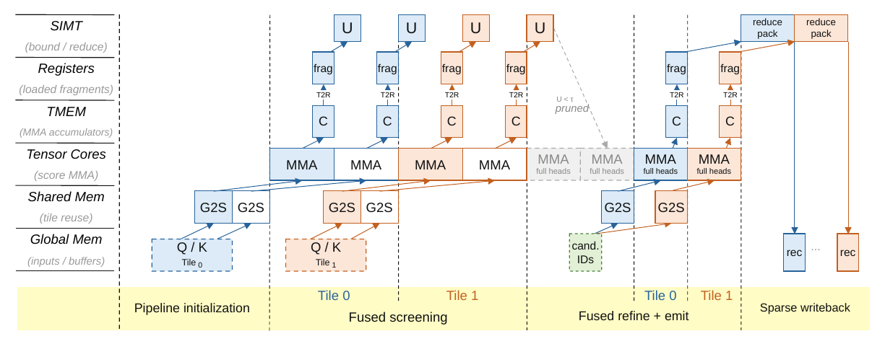

---
tags:
  - papers/LLM
  - topics/sparse-attention
  - topics/indexer
aliases:
  - "DoSA"
  - "Dots Sparse Attention"
date: 2026-10-20
---

# DoSA：用安全上界减少 Indexer 的完整打分

> [DoSA: Dots Sparse Attention，v1](https://arxiv.org/abs/2610.13990v1)。
>
> [Zotero 原文与完整批注](zotero-reading.md) · [整体流程高亮（第 2 页）](zotero://open-pdf/library/items/Y75KTIVE?page=2&annotation=LBKERZAW) · [DSA 前置笔记](../DeepSeek-DSA/deepseek-sparse-attention-dsa.md)
>
> 源码对照：[dots-sparse-attention，`8c578e0`](https://github.com/KuangjuX/dots-sparse-attention/tree/8c578e0e94e392dece8394489ff957b7e27b7a02)。预算与 seed 策略取自此版本代码。

## 1. 目标：减少“为了选少量 token 而给全部 token 完整打分”的成本

DSA 的主 attention 只访问选中的 token，但 indexer 仍可能给每个可见 key 计算全部 head 的分数。DoSA 改变这段执行流程：先证明哪些 key 不可能入选，仅为尚不能排除的候选完整打分，最终仍按原始 scorer 选择 Top-K。

核心洞察是：**排除一个候选，只需证明它的最高可能分数也不够高，不必先求出真实分数。** “精确”指满足论文证书、数值和候选存储条件时，保持原 indexer 的 Top-K 语义；并列 ID 要逐一相同，还需要一致的 tie-break 总序。

以下流程针对 prefill。论文 §3 的 decoding 路径保留完整 FP8 打分，主要用近期选择的 key 建立门槛以减少写回和选择工作，不能直接套用 prefill 的省略 head 筛选描述。

### 1.1 为什么上下文越长，indexer 占比越高

DSA 的 indexer 从全部可见历史 token 中选候选，主 attention 只访问选中的固定数量 token。固定处理 4K 个新 query、每个 query 选择 Top-2048 时：

| 历史上下文 | 每个 query 的 indexer 候选数量 | 每个 query 的主 attention 访问数量 |
|---|---:|---:|
| 128K | 约 128K | 2048 |
| 512K | 约 512K | 2048 |
| 1M | 约 1M | 2048 |

固定 query chunk 下，全 head indexer 的工作随历史长度增长，主 attention 的计算规模基本稳定。对整个长度为 $L$ 的 causal prefill，省略 head 数和维度等常数，indexer 的候选对数约为 $L(L+1)/2$，主 attention 的访问对数至多约为 $LK$。例如长度从 128K 增到 1M，前者约增加 64 倍，后者约增加 8 倍；这是逻辑工作量比例，不是延迟预测。

attention 的绝对耗时并非不增加，而是 indexer 增长更快。GLM-5.2 的 indexer 占 prefill GPU 时间从 128K 的 23.6% 增到约 1M 的 73.0%（§4.3、Figure 1）；这个比例不包含 CPU tokenization 和请求传输，不能直接当作 TTFT 占比。

## 2. 完整流程

1. **用 seed 建立门槛。**  
   选至少 K 个不同、可见的 key，按原始全部 head 完整打分，取第 K 高分作为门槛 $\tau$，并保留 seed 的 Top-K 结果。门槛在本次扫描和精算期间固定。

2. **对其余 key 计算安全上界，排除不可能入选者。**  
   先计算部分保留 head 的点积，再为省略的 head 构造界：
   - **正权重 head：估计加分量的上界。** 复用已算 head 的结果，再加残差贡献的上界；无需逐 key 计算残差点积。
   - **负权重 head：估计扣分量的下界。** 将选中的省略负权重 head 的 query 按权重绝对值预先合并，对每个 key 计算合并 query 的点积，再过 ReLU。它给出可以安全扣除的量；扣分下界为正时，比完全忽略负贡献得到更紧的总分上界。

   **总分上界 = 已算 head 的真实贡献 + 省略正权重部分的加分上界 − 省略负权重部分的扣分下界。**

   **仅当 $U<\tau$ 时排除；$U\ge\tau$ 时保留。** 实现还需确保数值界保守、证书有效；无法可靠排除时保留。

3. **对幸存候选完整打分，再选最终 Top-K。**  
   用全部原始 head 计算真实分数，低于门槛的继续排除；其余记录与 **seed 中保留的 Top-K** 合并，按完整分数选出最终 K 个。上界只决定是否需要精算，不用于最终排名。

论文附录 A.2 Algorithm 1 写成对全部 seed 与幸存候选取 Top-K；只保留 seed 的 Top-K 即可完成最终选择。若要求并列时选中相同 ID，seed 内部选择和最终选择也须遵循同一总序。

**门槛为何安全？** 例如 K=2，seed 分数为 9、6、2，门槛是 6。全体可见 key 中已知至少两个分数不低于 6，因此上界为 5 的 key 不可能入选。seed 分数低只会令门槛低、幸存者多；不会因此错误排除赢家。门槛为 6 且上界恰好为 6 的 key 必须保留。

原论文 Figure 2，第 3 页。图中省略了 seed 初始化和最终 Top-K，可结合上述三步阅读。[查看原图所在页](zotero://open-pdf/library/items/Y75KTIVE?page=3)。

## 3. 正、负权重究竟作用在哪里

固定一个 query，DSA 的 indexer score 为：

$$
s(k)=\sum_{h=1}^{H}w_h[q_h^\top k]_+,\qquad [x]_+=\max(x,0).
$$

各 query head 共享同一个 index-key。ReLU 输出非负，但权重 $w_h$ 可正可负，所以一个 head 可以加分，也可以扣分。这里不是主 attention 的 softmax 概率。

例如两项激活值分别为 4、3，权重分别为 2、−1，则总分为 $2\times4-1\times3=5$。负权重与负点积不同：负点积先经过 ReLU 变为零，即使权重为负也不会扣分。

### 3.1 正权重：复用已算结果，加上残差最多可能贡献的量

对省略的正权重 head，选一个保留 head 作为锚点，分解为：

$$
q_h=\beta_h q_j+d_h,\qquad \beta_h\ge0.
$$

利用 ReLU 的性质及点积的范数界：

$$
[q_h^\top k]_+
\le \beta_h[q_j^\top k]_+ + \|d_h\|_2\|k\|_2.
$$

右边复用了已算的锚点激活。残差向量及其范数在 query 准备阶段计算；逐 key 筛选只用残差界和 key 范数，不计算 $d_h^\top k$。

**例子：** 已保留 $q_j=(1,0)$，省略 $q_h=(2,1)$，取 $\beta_h=2$，则 $d_h=(0,1)$。对于 $k=(3,4)$，已知锚点点积为 3，残差范数为 1，key 范数为 5，所以省略 head 激活的上界为 $2\times3+1\times5=11$；真实激活为 10。若该 head 权重为 2，则其加分上界为 22，实际加分为 20。

这是单锚点范数界的直观解释。论文还用联合残差界利用多个省略正 head 的几何关系，使总余量更紧（§2.3、附录 A.1）；这里不展开其推导。

### 3.2 负权重：合并 query，安全地少扣一点

令 $N$ 为省略的负权重 head 集合，选其中的子集 $A$，在 query 准备阶段合并：

$$
a_A=\sum_{h\in A}|w_h|q_h.
$$

逐 key 计算：

$$
L_N(k)=[a_A^\top k]_+
\le \sum_{h\in N}|w_h|[q_h^\top k]_+.
$$

右侧是真实扣分量，左侧是其下界。因为“先加起来再 ReLU”不大于“逐项 ReLU 再相加”，从总分上界中减去左侧仍然安全。概念上，一个聚合方向的点积可以代替多个负 head 的独立点积；实现会额外处理量化与数值保护，不能把概念公式中的一次点积直接当作全部 kernel 开销。

**例子：** 两个省略 head 为 $q_1=(1,0)$、$q_2=(0,1)$，权重均为 −1。合并得到 $a_A=(1,1)$。对 $k=(3,4)$，原本分别算两个点积，真实扣分为 $3+4=7$；聚合点积为 7，扣分下界恰好精确。若此前加分上界为 12，则总分上界从 12 收紧到 5；seed 门槛为 6 时便可排除。

如果改为 $k=(3,-2)$，真实扣分为 $3+0=3$，聚合结果为 $[3-2]_+=1$。只扣 1 仍安全，但更松，因为第二个 head 的负点积在聚合 ReLU 前抵消了部分正贡献。

为减少这种抵消，论文使用 seed 样本估计激活频率，选激活频率至少一半的省略负 head 进入 $A$。这是提高界紧度的启发式；即使新 key 的激活模式不同，下界仍安全。

**统一理解：加分往多了算，扣分往少了算，因此最终得到总分上界。** 所谓“负 head 取下界”，准确地说是取非负扣分量的下界；带上负号后，它是该部分带符号贡献的上界。

### 3.3 保留哪些 head

论文 §2.2 先给定保留预算 $r$，再按当前 query 的 head 权重选择集合。保留只意味着在筛选阶段直接计算，不修改模型参数或删除其余 head。

| 条件 | 选择规则 |
|---|---|
| 正权重 head 数量不超过 $r$ | 保留全部正 head，再用高优先级负 head 填满剩余名额 |
| 正权重 head 数量超过 $r$ | 按 $w_h\|q_h\|_2$ 选择最强的 $r$ 个正 head |

例如 H=8、r=4：有三个正 head 时，保留三个正 head 和一个负 head；有五个正 head，强度依次为 9、7、5、3、1 时，保留前四个。强度只依赖 query 和权重，不需要先对所有 key 完整打分。

负 head 的优先级为：

$$
\text{priority}_h=|w_h|\|q_h\|_2\min(p_h,1-p_h).
$$

$p_h$ 是 seed 样本中该 head 的点积大于零的比例。频率接近 0 时，倾向不纳入负聚合；接近 1 时，倾向纳入负聚合；接近 0.5 时，固定的聚合集合更难匹配不同 key 的激活状态。因此优先直接计算强度大、激活状态又多变的负 head。

例如三个负 head 的强度均为 10，激活频率为 0.95、0.50、0.05，则优先级为 0.5、5、0.5；只有一个名额时选中间那个。附录 B.2 证明的是优化样本归一化松弛界的替代目标，并未证明实际幸存者最少或延迟最低。[原文批注](zotero://open-pdf/library/items/Y75KTIVE?page=3&annotation=ZBI26MRW)

### 3.4 增加保留数量是否划算

增加保留 head，让所有被筛选 key 多做点积，但可能省下更多候选的全 head 精算。固定初始化和辅助行数时，附录 B.3 的逻辑点积模型给出：

$$
\text{淘汰率提升}>\frac{\Delta r}{H}.
$$

例如 H=32，预算由 14 增到 16，每 100 个被筛选 key 多算 200 次点积；若额外淘汰 7 个候选，就少算 $7\times32=224$ 次精算点积，抵过新增计算。对应的提升门槛是 6.25 个百分点。H=8 时同样增加两个 head，需要超过 25 个百分点的提升。

这个模型不包含准备、访存、Tensor Core 填充、候选整理和 recovery，也不保证更换锚点与聚合集合后淘汰率单调提高。它说明小 head 数下可节省的空间较小，而不是直接预测 kernel 延迟。

## 4. 本地实现怎样对应这个流程

以下对应固定提交的 [backend.py](https://github.com/KuangjuX/dots-sparse-attention/blob/8c578e0e94e392dece8394489ff957b7e27b7a02/src/dosa/backend.py)，属于源码事实。

| 阶段 | 入口与状态变化 |
|---|---|
| 选择 seed | `_gather` 复用当前 layer/request 的有效 prior，否则 `_cold_prior` 对四个均匀分布的代表 query 完整打分，以其 Top-2048 的出现次数选出 12,288 个 seed；有 prior 时可利用此前近期 query 的选择频次 |
| 建立门槛 | `_seed` 对每个当前 query 与全部 seed 完整打分，生成独立的 `seed_tau` 和 seed Top-2048；复用的是 key ID 提示，不是历史 query 的分数 |
| 准备界 | `_body` 抽取 seed 区域内 128 个位置，统计激活模式；`planner.plan128` / `direct_abs.plan128` 准备保留 head、折叠权重和辅助向量 |
| 筛选 | `_emit` 从内部重排的 seed 区域之后扫描 key，以安全上界和固定 `safe_tau` 比较，输出候选位图 |
| 压缩候选 | `compact_candidates_live_nk` 将位图变成 ID 流；四 query 一组，至少两个 query 保留且处于共同可见范围的 key 可走共享流 |
| 精算与写回 | `exact_paged_solo_live_nk` / `exact_paged_common_live_nk` 计算全部原始 head，只写出真实分数达到门槛的记录 |
| 最终选择 | `select_dense5` 与 `complete_h32_fused_large` 完成 Top-K，并用原始分数处理紧凑编码的边界候选；错误状态触发精确 recovery |

当前配置为 H32/H64、D128、K2048。保留 head 预算分别为 14/16/20 或 14/16/28，另有两行 FP8 辅助向量。不能把这两行称为新增的模型 head，也不能假定所有预算分支与论文公式采用完全相同的中间表示。

上述版本先按正 head 数量所在区间排序 query，再每八个 query 一组，以组内最大的正 head 数量选择预算，并非逐个在线测速：

| 组内最多正 head 数量 | H32 预算 | H64 预算 |
|---|---:|---:|
| 不超过 14 | 14 | 14 |
| 15–16 | 16 | 16 |
| 超过 16 | 20 | 28 |

每个 query 再在组预算内选择具体 head。例如一个 H32 组使用预算 14，只有 10 个正 head 的 query 会保留 10 正、4 负。正 head 超过最高档时，也不再增加预算，而是对部分正 head 构造上界。128 个 seed 样本用于激活频率估计，不用于在线搜索最优预算。

## 5. Figure 2 与 Figure 3：把剪枝变成 GPU 收益

### 5.1 四个阶段的计算分工

Figure 2 只画 seed 初始化与最终 Top-K 之间的执行主体。

| 阶段 | 输入、工作与输出 | 主要执行单元 |
|---|---|---|
| ❶ 筛选点积 | 保留 head 和辅助向量与 key 相乘，产生构造上界所需的点积 | Tensor Cores |
| ❷ 求界、剪枝与压缩 | 组合上界，比较门槛，将幸存决定整理为候选 ID | SIMT 线程 |
| ❸ 完整点积 | 根据候选 ID 读取 key，计算全部原始 head 的点积 | Tensor Cores |
| ❹ 归约与稀疏写回 | 执行原始 ReLU、权重归约，只写出达到门槛的真实分数记录 | SIMT 线程 |

❶ 和 ❸ 的矩阵乘法输出都不是最终分数：筛选点积还要组合成上界，完整点积还要经过原始非线性及归约。灰色 tile 表示避免的计算，紫色 tile 表示避免的写回；四种算法工作不等于四个 kernel。

不同 query 可以选择不同原始 head：把各自选中的向量及对应权重按计划整理后，仍可组成规则矩阵。逻辑上，$G$ 个 query、每 query 的 $r$ 个保留 head 与 $a$ 行辅助向量，面对 $B$ 个 key，可以看作：

$$
[G(r+a),D]\times[D,B]\longrightarrow[G(r+a),B].
$$

随后按 query 划分结果，SIMT 为每个 query-key 对形成一个上界。例如 $G=2,r=2,a=1,D=128,B=64$，逻辑乘法为 $[6,128]\times[128,64]$，结果分成 $[2,3,64]$，形成 $[2,64]$ 个上界。这是一行辅助向量的教学形状；实际 FP8 路径有两行辅助向量并存在 tile 填充，不能将它当作 launch 配置。

### 5.2 数据流与流水线

原论文 Figure 3，第 5 页。蓝色、橙色表示各阶段中连续的 tile，展示加载与计算的重叠。[对应批注](zotero://open-pdf/library/items/Y75KTIVE?page=5&annotation=3RUNHVYY)

跟踪筛选阶段的一块数据：

1. Q/K 从 Global Memory 经 **G2S** 搬到 Shared Memory。
2. Tensor Cores 执行 **MMA**，累加结果 **C** 位于图示的 TMEM 中。
3. 经 **T2R** 将结果取到线程寄存器的 fragment。
4. SIMT 组合安全上界并比较门槛，形成幸存位图。
5. 候选 ID 驱动精算阶段读取 key；完整点积结果经过同样的 TMEM→寄存器路径，再做归约、过滤与记录打包。

论文将异步加载/MMA 发起和消费结果的上界计算分给不同 warp 角色，利用缓冲重叠后续 tile 的加载与当前 tile 的计算。异步工作仍有就绪和同步依赖；图中横向位置及方框宽度不代表实测耗时，也不足以确定具体 warp 数、barrier 协议或 kernel 边界。

### 5.3 候选整理与共享精算

初次筛选仍按 tile 扫描剩余 key，输出紧凑位图。例如 ID 为 0–4 的 key，保留位为 [0,1,0,1,1]，压缩后得到候选 ID [1,3,4]。compact 是候选任务整理，不是删除或压缩 KV cache 本体。

独立 query 的候选可能重叠。每四个 query 一组：某 key 被至少两个 query 保留，且位于全组共同可见范围，就进入共享流，其余候选进入独立流。例如 q0 保留 A/B，q1 保留 B/C，q2 保留 B，q3 保留 D；若 B 对全组可见，B 的一次加载可以服务成组精算。

为保持规则执行，可能多算 q3-B，随后仍按 q3 的真实分数和门槛过滤。复用的是 key 数据，不是不同 query 的分数。**最少点积不一定对应最低延迟：共享搬运和矩阵利用率也影响性能。**

### 5.4 精算后过滤和紧凑记录

门槛为 6 时，上界 9、真实分数 4 的候选仍必须精算才能排除，但可以省掉其分数写回和后续选择；真实分数为 7 的候选则写出记录。

记录使用紧凑的单调分数编码与精确 key ID。编码可能将不同原始分数合并为同一码，因此选择边界处需要使用原始分数区分候选。最终还要合并 seed 记录；粗编码与筛选上界都不能直接替代原始 score 的最终排名。

## 6. 少算多少，以及如何理解实验

DoSA 仍读取并扫描全部 key，只是多数 key 不再计算全部 head。假设 100 个 key 原本都计算 32 个 head，基线为 3,200 次点积；若筛选按每 key 16 次点积估算，5 个幸存者再完整计算 32 个 head，则是 $100\times16+5\times32=1760$ 次。**这是教学估算**，未计 seed、准备、压缩、数值保护和数据搬运，不是实际测速。

因此“筛掉约 97% 的候选”不等于“少做约 97% 的总计算”。收益还来自减少分数写回和最终选择输入。

以下为论文作者报告，未在本机复测：

| 评估问题 | 设置与结果 | 能说明什么 |
|---|---|---|
| 完整 indexer 是否加速 | GLM-5.2，英文/中文/代码，5 种长度、4 种 prefill chunk，共 60 个配置；相对 SGLang 1.12–2.74×，相对 LiteTopK 1.17–1.69×（§4.2） | 包含 query/key 准备的整体 indexer 收益，不是整模型加速 |
| 是否降低长输入等待时间 | 约 1M tokens，TP8；GLM-5.2 与 DeepSeek-V3.2 的 TTFT 相对 SGLang 分别加速 1.86×、1.94×（§4.3） | 是首 token 延迟收益，不是后续逐 token 生成速度 |
| 负聚合是否重要 | 移除负聚合后，幸存率从 2.65% 升到 95.06%（附录 D.2） | 在该实验配置中，负贡献对于收紧界非常关键 |

短上下文、seed 门槛低、head 之间难以复用、负 head 激活模式不一致时，省下的精算可能不足以抵消筛选开销。DoSA 的精确选择保证与它能否显著加速，是两个需要分别检验的问题。

### 6.1 哪些 workload 更容易受益

论文最充分的证据来自**长上下文 prefill、较多 indexer head、固定 token Top-K**：GLM-5.2 使用 32 个 head，DeepSeek-V3.2 使用 64 个 head，K 为 2,048。完整 indexer 微基准使用真实模型激活，覆盖英文、中文和代码，key 长度为 128K、256K、512K、768K、约 1M，query chunk 为 4K、8K、16K、32K。

长上下文增加可避免的完整打分，而 seed、query 准备等开销更容易被摊薄。论文英文输入、16K query chunk 的结果中，长度从 128K 增到约 1M，相对 SGLang 的加速从 1.19× 增到 2.58×；固定约 1M 长度，将 chunk 从 4K 增到 32K，加速从 2.47× 增到 2.69×。在这些配置中，长度带来的变化比 chunk 大小更明显，不能据此认定所有模型都遵循同一比例。

剪枝也取决于层内几何结构：21 个 indexer 层中有 20 个剪枝率超过 95%，三个领域的平均剪枝率约 97.2%–97.5%，较弱的第 1 层约为 89%–93%。这组结果中，层间差异比领域间差异更突出。（原文 §4.2、Figure 6。）

附录 B.3 将剪枝难度拆成三个量：真实 Top-K 门槛为 $\tau^\star$，seed 门槛为 $\tau$，候选真实分数为 $s$、上界为 $U$。定义候选距真实门槛的间隔 $\Delta=\tau^\star-s$、seed 门槛差距 $b=\tau^\star-\tau$、上界松弛 $\delta=U-s$，则：

$$
U<\tau \quad\Longleftrightarrow\quad \Delta>\delta+b.
$$

例如真实门槛 10、seed 门槛 8，候选真实分数 3、上界 6，间隔 7 大于上界松弛 3 与门槛差距 2 之和，可以排除。**更好的 seed 缩小 $b$，更紧的界缩小 $\delta$；大量分数挤在 Top-K 边界附近时，即便两者都不错，也可能保留较多候选。**

### 6.2 测量口径限制了结论范围

完整 indexer 微基准包含 query/key 准备，使用真实激活回放与预热后的 CUDA event 计时。端到端 TTFT 则测量清空 prefix cache 后的单请求，TP8，GLM-5.2 与 DeepSeek-V3.2 的 chunk 分别为 32K、16K。因此论文的 TTFT 数字不能直接解释为并发吞吐、prefix cache 命中场景或 decode TPOT 的改善。

Decode 实验让等长请求共同填满约 1M 的 cache；每请求 256K、512K、约 1M 时，indexer 加速分别为 1.06×、1.11×、1.26×。它采用完整 FP8 打分、选择与压缩路径；这些数字不能当作 prefill 上界剪枝的收益，也不是整模型逐 token 延迟的加速。（原文 §4.2、Figure 5。）

附录 D.4 的逐层回放排除了 query/key 准备，不能与完整 indexer 表直接混用。该附录还披露了候选容量修复后的局部重测与约 1M 配置下额外 9.94 GiB 的 workspace；完整矩阵没有全部重跑。候选暂存空间和溢出处理因此也是部署成本的一部分。超出模型声明上下文长度的实验可以说明计算扩展性，不能独立证明任务质量。

### 6.3 收益不只来自剪枝

§4.4 的 LOFT SciFact 消融采用 16K query、896K key，并对 21 个 indexer 层取平均：

| 变体 | 时间 | 相对内部 Base 的时间下降 |
|---|---:|---:|
| Base：无筛选、无稀疏写回 | 76.2 ms | — |
| Full：只有稀疏写回 | 58.4 ms | 23.4% |
| Dense：只有筛选 | 47.7 ms | 37.4% |
| DoSA：两者结合 | 40.2 ms | 47.3% |

最后一行相当于内部 Base 的约 1.90×，不是相对 SGLang 的数字。即使完整分数已经算出，避免无用写回及减少 Top-K 输入也能带来收益，这解释了 Figure 2 为什么单独强调紫色部分。

附录 D.2 中，移除负聚合不仅令幸存率从 2.65% 升到 95.06%，相对延迟还升到 9.507×，其中包含候选容量溢出引发的 recovery。不能把这解释成仅仅多做点积的线性代价。把所有负 head 都加入聚合也不如按激活概率筛选：幸存率为 4.06%，相对延迟为 1.120×。

## 7. 推广到 token 打分后做 block-max 的选择

本节是基于安全界的推论，不是论文已验证的 blockwise 实现。此前核对的 WeLM 实现版本为 ed6355f82e6bd65fedc683fbf8a7cd3a067f9b6e，其路径先计算 token 分数，再对可见 token 做 page/block max，最后选择 block。

若 block $b$ 的分数为 $S_b=\max_{i\in b}s_i$，且每个 token 都有安全上界 $U_i\ge s_i$，那么：

$$
\overline S_b=\max_{i\in b}U_i\ge S_b.
$$

因此可以保留 DoSA 的整体思路，但门槛必须对应 **block Top-K**：

1. 完整计算至少 $K_b$ 个不同可见 block 的分数，建立 block 门槛 $\tau_b$。同一 block 内取很多 seed token，不能充当多个 block 的见证。
2. 为其他 block 计算 token 上界并取 max；若 $\overline S_b<\tau_b$，排除整个 block。
3. 对幸存 block 中可能影响入选结果的 token 精算，得到需要保留的 block 分数，再与 seed block 合并选择 Top-$K_b$。

例如门槛为 6，一个 block 的 token 上界为 [3,5,4]，整个 block 都可排除；另一个为 [2,8,3]，只需精算第二个 token。若真实分数为 7，该 block 的最大值就是 7；若真实分数为 5，则整个 block 都达不到门槛，不需要求出落选 block 的精确最大值。若接口要求输出所有 block 的精确分数，这种跳过方式便不满足接口。

性能取决于幸存者的分布：一个 token 的上界过大就会让整个 block 幸存。整块精算可能多做很多无用点积，token 级精算则增加不规则 gather 与任务整理。WeLM 示例中的 H8/H16、BF16、64-token page、Top-32 block，也不同于论文 H32/H64、FP8、Top-2048 token 的路径。**可证明筛选安全，不等于可以直接复用现有 kernel 或取得同样加速。**

## 8. 精确性依赖数值保护与完整的候选管理

实数公式保证安全界，还需要实现中的浮点误差保护。例如真实分数 6.1、门槛 6，理论上界 6.2；若计算误差将上界降到 5.9，就会错误排除应保留的候选。因此保护量必须覆盖当前 FP8、缩放与累加路径的误差，不能仅凭公式称实现无损。

异常缩放、非有限值、候选缓冲区容量不足等情况，都不能静默丢弃记录。需要 recovery 时，必须覆盖可能错误排除的完整可见域，不能只对当前候选缓冲区重新排序。紧凑分数编码的边界也需要回到原始分数处理。

若真实分数相同，多个集合都可能是合法 Top-K；要求与基线返回完全相同的 ID，还需要一致的 tie-breaking 规则。（原文附录数值保护与实现讨论；相关代码入口见第 4 节。）
