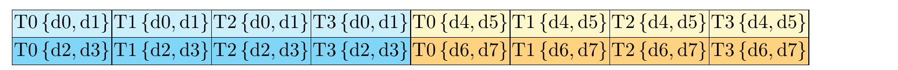
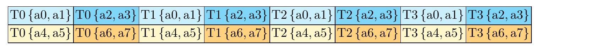
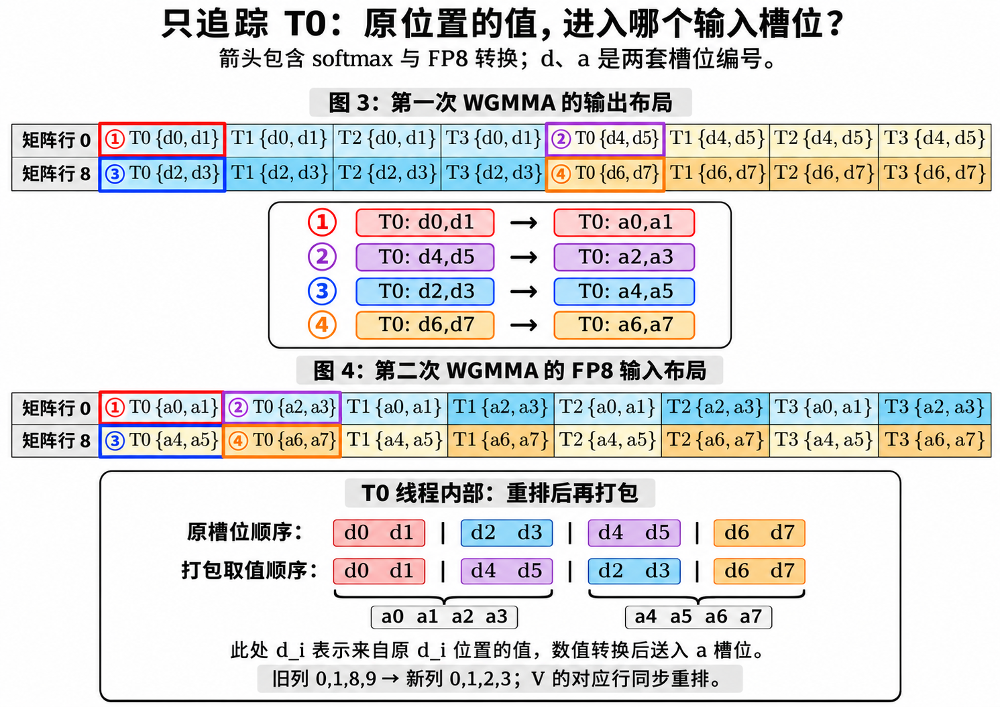
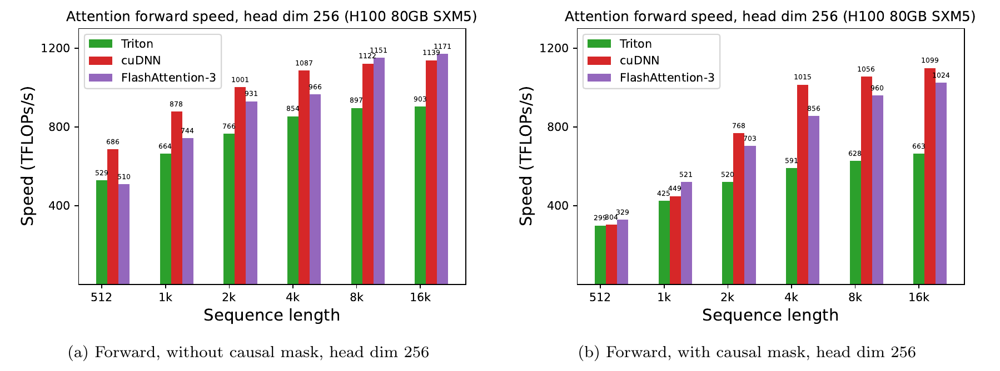

---
tags:
  - papers/LLM
  - topics/attention
  - topics/gpu-kernel
aliases:
  - FA3 FP8
---

# FlashAttention-3：FP8 数据流、布局转换与精度优化

FA3 的 FP8 路径同时解决三个问题：让两次矩阵乘使用 FP8 Tensor Core，让中间结果以较低成本满足下一次 WGMMA 的布局要求，以及控制量化误差。**Q、K、P、V 作为矩阵乘操作数可以使用 FP8，但 attention 的整个计算过程不是 FP8。**

[论文 v2](https://arxiv.org/abs/2407.08608v2) · [Zotero](zotero://select/library/items/MNPEHW5Y) · [PDF](zotero://open-pdf/library/items/HTMXSCYS) · [Attention 索引](../index.md)

## 1. FP8 加速了什么，为什么还需要专门优化

标准 attention 的两个矩阵乘是 $S=QK^T/\sqrt d$ 和 $O=PV$，中间通过按行 softmax 得到 $P$。FlashAttention 将它们分块融合，通过 online softmax 避免把完整的 $S$、$P$ 写回 HBM。

Hopper 上 FP8 Tensor Core 的理论矩阵乘吞吐是 FP16 的两倍，但 softmax、数据搬运、布局转换与同步不会随之自动加速。因此，仅把 QKV 改成 FP8，无法保证 attention 整体获得两倍速度。

FA3 将 producer warpgroup 的搬运工作与 consumer warpgroup 的计算重叠，并进一步重叠 GEMM 与 softmax；FP8 路径还需要处理 V 的共享内存布局、P 的寄存器布局及量化误差。来源：论文 §3.1–3.3，PDF 第 4–9 页。

### 1.1 QKPV 的精度边界

下面将数学上的完整概率矩阵记为 $P$，将 online softmax 当前 tile 中、尚待最终归一化的指数值记为 $\widetilde P$。实际 kernel 传给第二次矩阵乘的是后者的低精度表示。

| 数据或阶段 | FP8 路径中的角色 |
| --- | --- |
| Q、K | FP8 矩阵乘输入；缩放因子用于恢复 logits 的尺度 |
| 第一次 GEMM 的 S 累加器 | 使用 FP32 类型的寄存器片段 |
| mask、最大值、指数、行和等 softmax 运算 | 在高于 FP8 的精度下完成；所分析实现的核心状态使用 float |
| 第二次 GEMM 的 $\widetilde P$ | softmax 后转换成 FP8，并调整寄存器布局 |
| V | FP8 矩阵乘输入；共享内存布局须满足 FP8 WGMMA |
| O 的累加器 | FP32 类型，结合 online softmax 更新与最终归一化 |
| 写回的 O | 所分析官方接口中，FP8 输入对应 BF16 输出 |

这里的“FP32 累加器”指接口与保存结果的类型，不能据此推断 Tensor Core 内部的每一步乘加都等同于普通 IEEE FP32 运算。输出类型依据后文固定版本的 [flash_api.cpp，第 859 行](https://github.com/Dao-AILab/flash-attention/blob/1dc8232fe209e2c48b1d3e677f26d68e4b856212/hopper/flash_api.cpp#L859)。

```text
Q、K 的 FP8 tile ──WGMMA──▶ FP32 S 片段
                                │ scale、mask、online softmax
                                ▼
                         FP32 的 P̃ 片段
                                │ 寄存器重排、FP8 转换与打包
                                ▼
                         FP8 的 P̃ 操作数 ─┐
                                          ├─WGMMA─▶ FP32 O 累加器
V 的 FP8 tile ──共享内存布局转换───────────┘               │
                                                最终归一化、写回 BF16
```

上图是 AI 教学示意，突出依赖关系；实际执行会将不同 tile 的加载、转换和计算流水化。

## 2. V 为什么需要在 kernel 内转置

通常 QKV 的 head dimension 连续存储。对于 $\widetilde P V$，GEMM 的归约维度却是 KV 序列维度，而 FP8 WGMMA 要求相应操作数满足 K-major 布局。这里的 K 指 **GEMM 的归约维度**，不是 Key 张量的名字。

例如 V 的逻辑形状为 $[N,d]=[16,8]$：常见输入布局中每个 token 的 8 个通道相邻；PV 的归约则沿 16 个 token 展开。需要改变的是硬件读取这些元素的存储布局，attention 中 V 的数学含义不变。

FA3 在 kernel 内通过以下路径转换 V：

```text
HBM 中的 V → TMA 加载到共享内存
           → LDSM 读入寄存器
           → 调整 FP8 字节顺序
           → STSM 写入满足 WGMMA 的共享内存布局
```

TMA 加载本身不能完成这里所需的连续维度转换。LDSM/STSM 以 16-bit 单元处理，而两个 FP8 数值恰好占 16 bit，因此还需要字节级调整。转换由 producer 执行，可与 consumer 对其他 tile 的 WGMMA 重叠。来源：论文 §3.3，PDF 第 7–8 页。

官方实现中的 `Transpose_V = Is_FP8 && !V_colmajor` 决定是否走该路径；`transpose_V` 中可看到两次 `__byte_perm`，选择器分别为 `0x6420`、`0x7531`。这些是 **V 转置过程**中的字节操作，不能直接当成 P 寄存器重排的指令序列。参见 [mainloop，第 722–739 行](https://github.com/Dao-AILab/flash-attention/blob/1dc8232fe209e2c48b1d3e677f26d68e4b856212/hopper/mainloop_fwd_sm90_tma_gmma_ws.hpp#L722)。

## 3. 两张 WGMMA 图究竟在画什么

第一次 WGMMA 的 FP32 输出布局与第二次 WGMMA 的 FP8 A 操作数布局不同。图中的**空间位置表示矩阵坐标**，`T0` 表示拥有该元素的线程，`d0` 或 `a0` 表示该指令对应的线程内片段槽位。



论文图 3，FP32 累加器布局；来源：§3.3，PDF 第 8 页。



论文图 4，FP8 A 操作数布局；来源：[PDF 第 8 页](zotero://open-pdf/library/items/HTMXSCYS?page=8)。

**d 和 a 是两套独立编号，不是同一批数据的永久名字。** 图 3 的 `d2` 并不因此必须进入图 4 的 `a2`。原图分别描述两种指令接口的布局，所以各自从 0 编号；它们本身不是一张已经标明所有数据流箭头的转换图。

### 3.1 只追踪 T0：原槽位编号不等于矩阵的逐行顺序

用 $p_i$ 固定表示原 `d_i` 矩阵位置经过 online softmax 后的值。这样可以同时保留“值来自哪里”和“值将进入哪个新槽位”两种信息。

以图示 tile 的局部坐标为准，T0 持有：

| 原槽位 | 矩阵行 | 原矩阵列 | softmax 后的值 |
| --- | --- | --- | --- |
| `d0,d1` | 0 | 0,1 | `p0,p1` |
| `d2,d3` | 8 | 0,1 | `p2,p3` |
| `d4,d5` | 0 | 8,9 | `p4,p5` |
| `d6,d7` | 8 | 8,9 | `p6,p7` |

因此，T0 的线性片段顺序与矩阵行归属分别是：

```text
片段槽位：  0   1   2   3 │ 4   5   6   7
保存的值： p0  p1  p2  p3 │p4  p5  p6  p7
矩阵行：    0   0   8   8 │ 0   0   8   8
```

这里说槽位“连续”，指 fragment 的线性索引顺序，不保证编译后使用连续编号的物理寄存器。寄存器也不是按论文图上的二维位置摆放的。

如果直接按前四个、后四个值打包，每包都会混入两个不同矩阵行的值；而目标 FP8 A 布局要求 T0 的前四个槽位属于行 0，后四个属于行 8。

### 3.2 交换的是槽位内容，矩阵中的行归属不变

在配合 V 置换的路径中，所需取值顺序为：

```text
原顺序：p0 p1 p2 p3 │ p4 p5 p6 p7
                    ↓ 交换槽位 2↔4、3↔5
新顺序：p0 p1 p4 p5 │ p2 p3 p6 p7
矩阵行： 0  0  0  0 │  8  8  8  8
目标位：a0 a1 a2 a3 │ a4 a5 a6 a7
```

每个 FP32 值先占 32 bit；量化后每个值占 8 bit，四个 FP8 值可打包进一个 32-bit 寄存器。于是，图示 T0 的这八个值会形成两个 FP8 打包寄存器。



AI 补充图解，依据论文图 3、4。箭头追踪原位置的值，包含 softmax 和 FP8 转换；图中 `d_i` 在取值顺序处用于标识来源，不表示把原始 logits 直接送入 PV。

原 `d4,d5` 的值仍属于矩阵行 0，只是进入新接口的 `a2,a3`。实现可以先交换 FP32 片段，也可以直接按 `p0,p1,p4,p5` 与 `p2,p3,p6,p7` 转换打包；必要的是结果排列，具体指令由实现和编译器决定。

### 3.3 列确实变了，为什么 PV 还能保持正确

图中 T0 的行 0 原来持有列 `0,1,8,9`，目标布局中这些值占据新列 `0,1,2,3`。这是一种 **P 列置换**。在图示的 16 列片段中，新列依次取自以下旧列：

```text
新列位置： 0  1  2  3  4  5   6   7  8  9  10  11  12  13  14  15
原列编号： 0  1  8  9  2  3  10  11  4  5  12  13   6   7  14  15
```

为保持乘法正确，FA3 让 V 的对应行使用相同置换。若新位置 $j$ 取旧位置 $\pi(j)$，则：

$$
P'_{r,j}=P_{r,\pi(j)},\qquad V'_{j,c}=V_{\pi(j),c},
$$

$$
\sum_j P'_{r,j}V'_{j,c}
=\sum_j P_{r,\pi(j)}V_{\pi(j),c}
=\sum_k P_{r,k}V_{k,c}.
$$

这里也适用于 $\widetilde P$。AI 数值例子：取一行 $P=[1,2,3,4]$、V 的一列 $[10,20,30,40]^T$，原乘积为 $300$。按旧位置 `[0,2,1,3]` 同时重排，得到 $[1,3,2,4]\cdot[10,30,20,40]=300$；若只重排 P，则结果变为 $290$。此例只解释配对置换，不代表真实 16 列模式。

这样可以保留各线程已经持有的 P 值，避免为这一步 P 布局转换进行跨线程交换。代价转移到配套的 V 布局处理上。来源：论文 §3.3，PDF 第 8 页及脚注 9。这里的“不需要 shuffle”仅针对该路径的 P 布局转换，不代表 softmax 或整个 kernel 没有线程间通信。

## 4. 官方源码怎样实现这一步

以下源码固定于官方仓库提交 [`1dc8232fe209`](https://github.com/Dao-AILab/flash-attention/commit/1dc8232fe209e2c48b1d3e677f26d68e4b856212)，用于解释可复核的实现；它不是论文发表时的历史快照。

### 4.1 `!V_colmajor`：先重排 FP32 片段，再转换 FP8

在 [mainloop，第 1155–1160 行](https://github.com/Dao-AILab/flash-attention/blob/1dc8232fe209e2c48b1d3e677f26d68e4b856212/hopper/mainloop_fwd_sm90_tma_gmma_ws.hpp#L1155) 中，调用顺序是：

1. `online_softmax(tSrS)`：将 logits 片段变成当前 tile 的指数值，同时维护行统计量。
2. 当 `Is_FP8 && !V_colmajor` 时，调用 `permute_Cregs_fp8(tSrS)`。
3. `convert_layout_acc_Aregs` 配合 `make_tensor`，建立 PV 所用的片段视图；建立视图本身不等同于搬运所有数据。
4. `convert_type_out` 执行数值类型转换，形成 FP8 的 `tOrP`。
5. 将该操作数用于后续 PV 的 WGMMA。

`permute_Cregs_fp8` 的核心在 [utils.h，第 489–504 行](https://github.com/Dao-AILab/flash-attention/blob/1dc8232fe209e2c48b1d3e677f26d68e4b856212/hopper/utils.h#L489)：它先通过 `recast<uint2>` 把每两个 FP32 槽位看作一组 64-bit 数据，再交换两组的位置。`recast` 不把浮点数数值转换成整数，只改变访问这些位的方式。

对第一个八元素组，两个交换对象的 CuTe 坐标分别是 `(0,1,0)` 和 `(0,0,1)`，对应 `d2,d3` 与 `d4,d5`。因此，它完成的正是上面的：

```text
{p2,p3} ↔ {p4,p5}
```

这段逻辑遍历片段中的各组，循环可在编译期展开。只看源码不能断言最终机器码一定有几个寄存器 move；确认指令数量还需要具体实例的编译结果。

### 4.2 `V_colmajor`：不能套用“不需要跨线程交换”的结论

同一段 mainloop 在 `Is_FP8 && V_colmajor` 时，不调用上述 `permute_Cregs_fp8`，而是在 FP8 转换之后调用 `permute_Aregs_fp8(tOrP)`。

后者在 [utils.h，第 455 行起](https://github.com/Dao-AILab/flash-attention/blob/1dc8232fe209e2c48b1d3e677f26d68e4b856212/hopper/utils.h#L455)，使用 `__shfl_sync` 与 `__byte_perm` 完成线程间与字节内的重新分配。

| 条件 | P 的处理顺序 | 是否涉及 P 的跨线程重排 |
| --- | --- | --- |
| FP8 且 `!V_colmajor` | FP32 片段重排 → FP8 转换；配合 V 的变换 | 上述 P 转换步骤保持值在线程内 |
| FP8 且 `V_colmajor` | FP8 转换 → `permute_Aregs_fp8` | 有 shuffle |

V 转置实现中还可能为减少 bank conflict 而置换其输出通道方向，并在输出阶段恢复；不要把它与这里保持 PV 等价所需的 **P 列／V 行配对置换**混为一件事。

## 5. 如何控制 FP8 量化误差

### 5.1 Block quantization：避免一个 outlier 决定整张张量的尺度

FP8 可表示范围与有效精度有限。若一个张量只用一个 scale，少量大值会迫使普通值使用较粗的量化间隔。论文按计算 tile 对 Q、K、V 使用分块尺度：Q 块为 $B_r\times d$，K、V 块为 $B_c\times d$，每块一个尺度，便于与 FlashAttention 分块计算对齐。来源：论文 §3.3，PDF 第 8–9 页。

采用“反量化乘回”的约定，令 $Q\approx s_Q\widehat Q$、$K\approx s_K\widehat K$，其中带帽变量是 FP8 表示，则：

$$
QK^T\approx (s_Qs_K)\widehat Q\widehat K^T.
$$

尺度必须在 softmax 前恢复到 logits 上，并与 attention 自身的 $1/\sqrt d$ 因子协调。AI 数值例子：$\widehat Q=[1,2]$、$\widehat K=[3,4]$，$s_Q=2$、$s_K=3$，低精度数值的点积是 $11$；乘回尺度得到 $66$，等于 $[2,4]\cdot[9,12]$。该例取可精确表示的数，只验证尺度关系。

V 的尺度也要进入对应的输出贡献：若每个 KV tile 的 $s_V$ 不同，必须在正确的 tile 范围应用，不能随意只在总输出末尾乘一个全局数。

**论文方案与接口能力要分开看。** 上述固定源码的公开 forward API 接受形状为 `(batch_size, num_heads_k)` 的 Q/K/V descale；这不能直接等同于论文的“每个 tile 一个 scale”。参见 [flash_api.cpp，第 1115–1144 行](https://github.com/Dao-AILab/flash-attention/blob/1dc8232fe209e2c48b1d3e677f26d68e4b856212/hopper/flash_api.cpp#L1115)。

### 5.2 Incoherent processing：在量化前打散异常大的通道

分块缩放仍可能受块内 outlier 影响。论文对 Q、K 施加相同的正交变换 M，将集中在少数维度的大值扩散到多个维度；具体采用随机符号与归一化 Hadamard 变换，可用 $O(d\log d)$ 的快速变换实现。来源：论文 §3.3，PDF 第 9 页。

因为 $MM^T=I$，在尚未量化的精确算术下：

$$
(QM)(KM)^T=QMM^TK^T=QK^T.
$$

AI 数值例子：取 $Q=[10,0]$、$K=[2,0]$，原点积为 $20$。使用

$$
M=\frac{1}{\sqrt2}\begin{bmatrix}1&1\\1&-1\end{bmatrix},
$$

得到 $QM=[10/\sqrt2,10/\sqrt2]$、$KM=[2/\sqrt2,2/\sqrt2]$，点积仍为 $20$，但 Q 中原本集中的 10 分散成了两个约 7.07。实际方案还加入随机符号，以降低数据与固定变换对齐的风险。

这一步在量化前作用于 Q、K 的特征维度，不需要为维持上述恒等式而旋转 V。恒等式也不保证 FP8 量化后没有误差；它说明可以在不改变精确点积的前提下，改善待量化的数据分布。论文提到可将预处理与 RoPE 等前序操作融合，但不能据此声称调用任意 FA3 接口都会自动执行 Hadamard 变换。

## 6. 性能相比 FP16 提升多少

论文报告 FP16 attention 吞吐最高约 **740 TFLOPs/s**，FP8 接近 **1.2 PFLOPs/s**。这两个峰值之比约为 $1200/740\approx1.62$，但它们不是一个已控制相同 shape 的端到端计时对，不能直接记成“所有输入快 1.62 倍”。论文中的“1.5–2.0 倍”主要指 FA3 FP16 相对 FA2 的加速，也不是 FP8 相对 FP16 的结论。来源：摘要、§4.1–4.2。



论文图 7，head dimension 256，比较 FP8 FA3、cuDNN 与 Triton；来源：[PDF 第 11 页](zotero://open-pdf/library/items/HTMXSCYS?page=11)。它本身不是 FP8 与 FP16 的配对对比图。

| 图中序列长度标签 | FA3 FP8 非 causal，TFLOPs/s | FA3 FP8 causal，TFLOPs/s |
| --- | ---: | ---: |
| 512 | 510 | 329 |
| 1k | 744 | 521 |
| 2k | 931 | 703 |
| 4k | 966 | 856 |
| 8k | 1151 | 960 |
| 16k | 1171 | 1024 |

实验使用 H100 80GB SXM5、700 W、1830 MHz、CUDA 12.3；比较环境包括 cuDNN 9.1.1.17、CUTLASS 3.5、FlashAttention 2.5.8、PyTorch 2.3.0，计时重复 100 次取平均。hidden dimension 为 2048，head dimension 覆盖 64、128、256。来源：§4、附录 C。

解释结果时还有两个边界：

- 附录说明 FP8 测试在较长序列上采用 4224、8448、16896 等长度，使工作分配适配 132 个 SM；图中相应标签写作 4k、8k、16k。不能直接把这些柱与 FP16 的 4096、8192、16384 当作完全相同的工作量比较延迟。
- 论文测量版本的 FP16 kernel 有 persistent load balancing，而 FP8 kernel 当时尚未采用。短序列、causal 等场景的收益因此还受到调度与工作分配影响。来源：PDF 第 12 页脚注 10。

## 7. 精度损失多少，怎样读论文中的 RMSE

论文 §4.3 用相对于 FP64 参考输出的 RMSE 衡量误差，并通过合成 outlier 数据检查精度方案：输入包含标准正态项，以及概率为 0.1% 的大方差正态项。论文记为 $\mathcal N(0,1)+\mathcal N(0,100)\cdot\mathrm{Bernoulli}(0.001)$；后一正态分布的方差为 100，即标准差为 10。

| 方法 | 输出 RMSE |
| --- | ---: |
| Baseline FP16 | $3.2\times10^{-4}$ |
| FlashAttention-2 FP16 | $1.9\times10^{-4}$ |
| FlashAttention-3 FP16 | $1.9\times10^{-4}$ |
| Baseline FP8 | $2.4\times10^{-2}$ |
| FlashAttention-3 FP8 | $9.1\times10^{-3}$ |
| FA3 FP8，去掉 block quantization | $9.3\times10^{-3}$ |
| FA3 FP8，去掉 incoherent processing | $2.4\times10^{-2}$ |

来源：论文表 3，[PDF 第 12 页](zotero://open-pdf/library/items/HTMXSCYS?page=12)。Baseline FP8 采用 per-tensor 缩放、FP32 累加器与 FP16 softmax。

这组数据支持以下解读：

- 相对 baseline FP8，FA3 FP8 的 RMSE 降至约 $1/2.64$。
- 相对 FA3 FP16，FA3 FP8 的 RMSE 仍约为 $47.9$ 倍；降低 FP8 误差不等于达到 FP16 精度。
- 在该合成分布中，去掉 incoherent processing 的退化更明显；这不是所有真实模型中两项技术贡献大小的通用排序。

RMSE 的 $0.0091$ 是该实验输出的绝对误差指标，**不能解释成模型准确率下降 0.91%**。表 3 没有给出端到端语言模型的困惑度或任务准确率变化，因而不能从它推断部署某个模型的质量损失。
