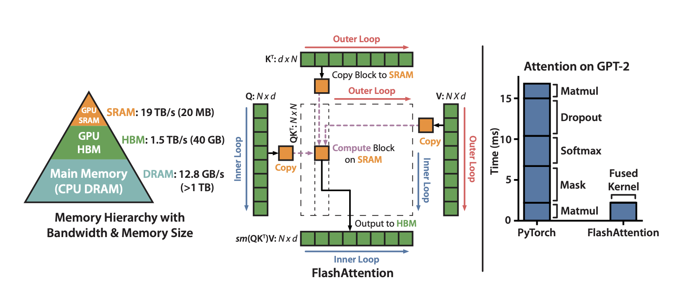
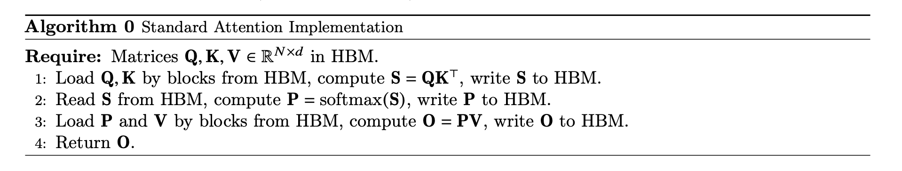
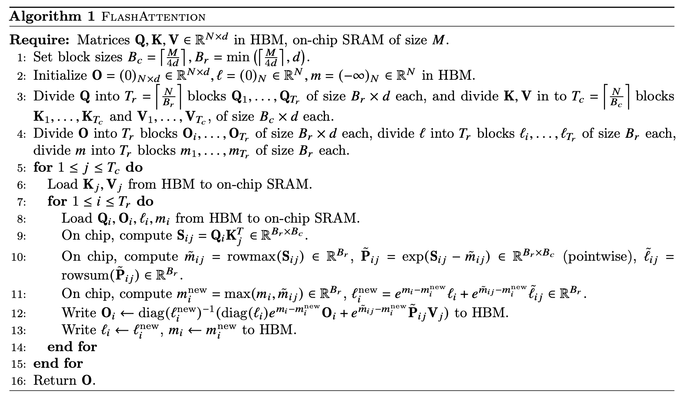
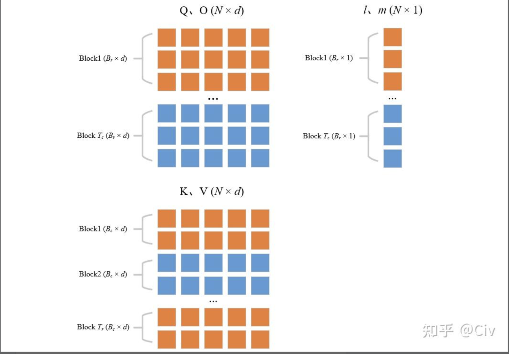
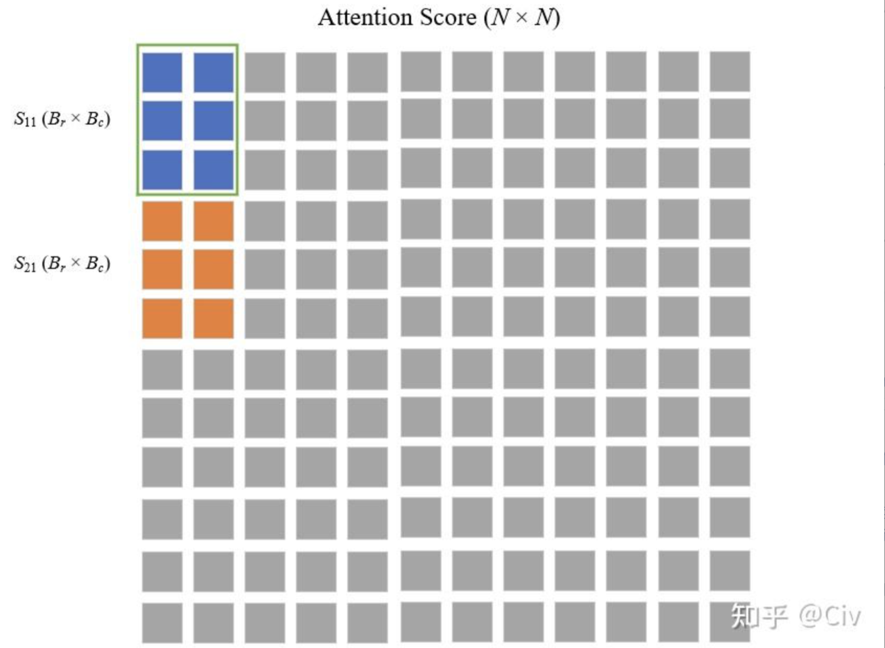

# FLASHATTENTION: Fast and Memory-Efficient Exact Attention with IO-Awareness：历史笔记

[所属主题](../index.md) · [GitHub 历史笔记目录](../../github-issues.md)

- 论文：[原文](https://arxiv.org/abs/2205.14135)
- 原记录：[Issue #33](https://github.com/KuangjuX/Papers-and-Learning-Notes/issues/33)

## 阅读线索与覆盖范围

原笔记主要参考其列出的知乎文章，覆盖访存动机、稳定 softmax 和 Algorithm 1 的前半段。在线归一化更新、输出更新、反向传播和实验没有写完；本次不将它补成完整论文精读。

## 校注（AI）

旧笔记 L9 的 `O_i K_j^T` 是变量笔误：分块分数应由 **Q_i K_j^T** 得到。可对照下方 Algorithm 1 原截图。原笔记开头的标准注意力公式省略了缩放因子，不能与完整 scaled dot-product attention 的定义混同；访存瓶颈结论也需结合其硬件与问题规模理解。

依据：[论文原文](https://arxiv.org/abs/2205.14135)。校注仅核对上面列出的具体问题，其余历史内容尚未逐项复核。

相关基础笔记：[FlashAttention 的 online softmax 与版本演进](../../../Foundations/01_Attention/FlashAttention.md)。

## 历史阅读笔记

原笔记参考：[知乎文章](https://www.zhihu.com/question/611236756/answer/3132304304)。

首先需要明确 Self-Attention 的计算过程：
三个矩阵 $Q, K, V \in R^{N \times d}$，Self-Attension 计算如下：

- $S = QK^T \in R^{N \times N}$ (1)
- $P = softmax(S) \in R^{N \times N}$ (2)
- $O = PV \in R^{N \times d}$ (3)

Self-Attention 中(1) 和 (3) 的计算最密集，(1) 和 (3) 中的矩阵乘法复杂度为 $O(dN^2)$。但 Attention 的瓶颈主要在访存上，优化 FLOPS 对于性能影响不大，因此 FlashAttention 的主要思路是优化 MAC（Memory Access Cost）。

标准的 Attention 算法对于 (1) 需要从 HBM 读取 2 次，写入 1 次，对于 (2) 需要从 HBM 读取一次，写入一次，对于 (3) 需要从 HBM 读取 2 次写入一次。为了减少对于 HBM 的读写，FlashAttention 分块将数据送入 SRAM。但分块后需要计算 softmax，而 softmax 需要读取一行作为分母，因此难点主要在分块算 softmax。

$softmax(x_i) = \frac{e^{x_i}}{\sum_{j=1}^{B} e^{x_j}}$ (4)
为了避免溢出，大多数深度学习框架都使用的 softmax 的稳定版本：

- $m(x) = max([x_1, x_2, ... x_B])$ (5)
- $f(x) = [e^{x_1 - m(x)}, ... e^{x_B - m(x)}]$ (6)
- $l(x) = \sum_{i} f(x_i)$ (7)
- $softmax(x) = \frac{f(x)}{l(x)}$ (8)

随后描述了一种分块算法，例如对于一行进行切割 $[x_(1), x_(2)]$，可以先求得局部的 softmax 再动态更新进而求全局的，但我真的不想写那么多数学公式了......

然后 FlashAttention 给出了如下算法：

- L1: 根据 SRAM 的大小选择合适的分块大小 $B_c$ 和 $B_r$。
- L2:初始化一些变量
- L3 & L4:  将矩阵 $Q, O$ 沿着行方向切分成 $T_r$ 块，将向量 $l, m$ 切成 $T_r$ 块，将 $K, V$ 沿着行方向切成 $T_c$ 块。

- L5: 外循环遍历 K，V
- L6: 将遍历的 $K_j, V_j$ 从 HBM 读入 SRAM。
- L7: 内循环遍历
- L8: 内循环变量读入 SRAM
- L9: 使用当前遍历的 $Q_i, K_j$，计算分块的 Attention Score = $O_iK_{j}^{T} \in R^{B_r \times B_c}$

- L10：对于分块的 Attention Score，计算每一行的最大值，指数项，求和项
- L11: 更新 $m_i, l_i$
