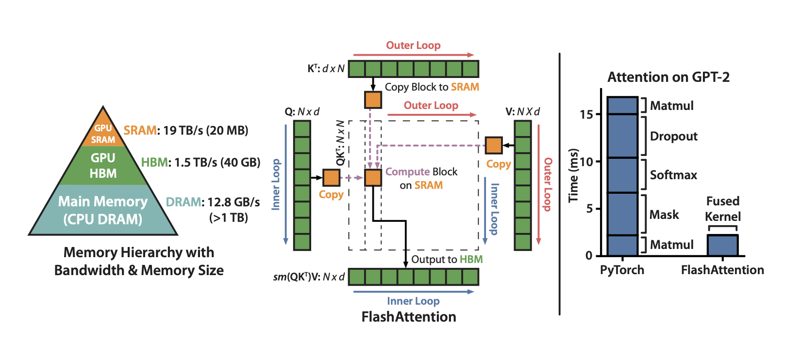
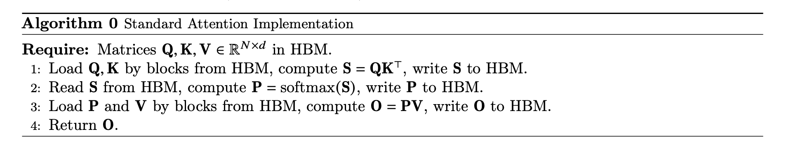
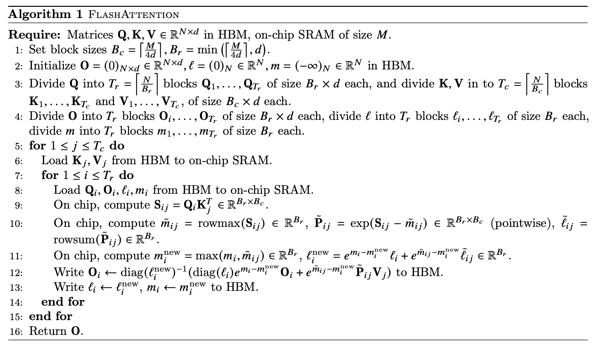
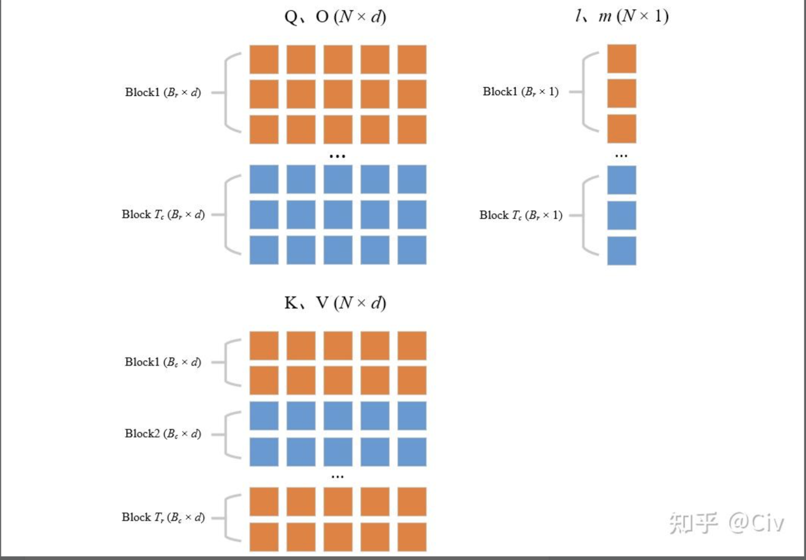
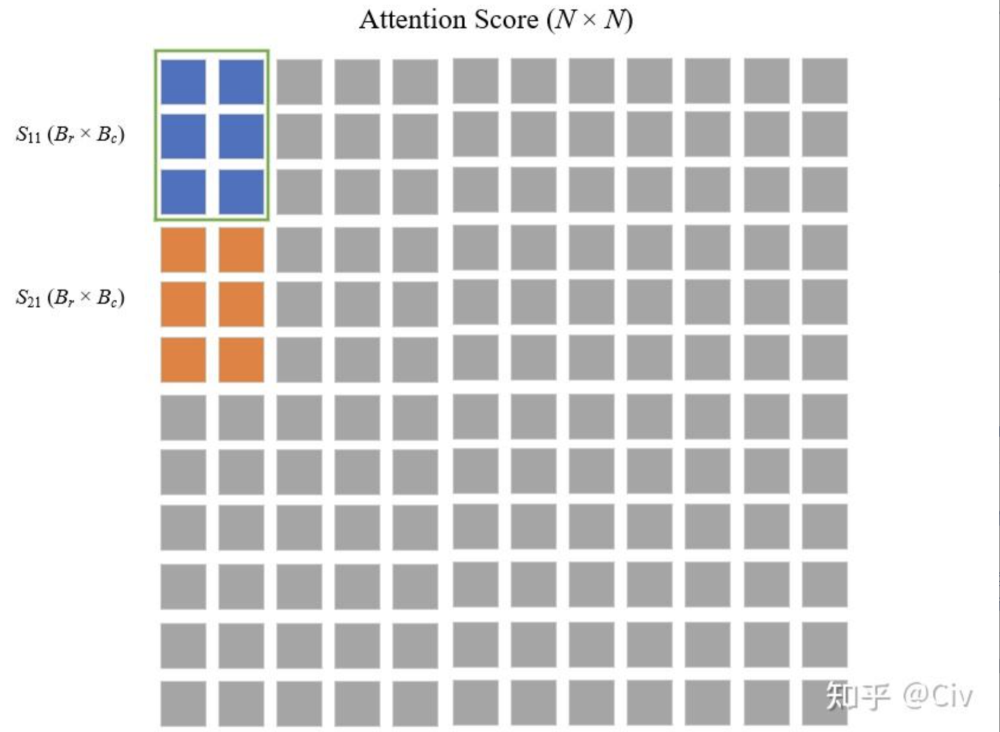

# FLASHATTENTION: Fast and Memory-Efficient Exact Attention with IO-Awareness：阅读笔记

[所属主题](../index.md)

- 论文：[原文](https://arxiv.org/abs/2205.14135)

原笔记参考：[知乎文章](https://www.zhihu.com/question/611236756/answer/3132304304)。

## 从显式物化注意力矩阵的成本开始

Self-Attention 的计算过程是：
三个矩阵 $Q, K, V \in \mathbb{R}^{N \times d}$，Self-Attention 计算如下：

- $S = QK^T/\sqrt{d} \in \mathbb{R}^{N \times N}$ (1)
- $P = softmax(S) \in \mathbb{R}^{N \times N}$ (2)
- $O = PV \in \mathbb{R}^{N \times d}$ (3)

Self-Attention 中(1) 和 (3) 的计算最密集，(1) 和 (3) 中的矩阵乘法复杂度为 $O(dN^2)$。若把 $N\times N$ 的分数和概率矩阵物化到 HBM，中间张量读写会成为显著成本。FlashAttention 的出发点是减少这部分 IO；具体是否受带宽限制仍取决于硬件和问题规模。

标准的 Attention 算法对于 (1) 需要从 HBM 读取 2 次，写入 1 次，对于 (2) 需要从 HBM 读取一次，写入一次，对于 (3) 需要从 HBM 读取 2 次写入一次。为了减少对于 HBM 的读写，FlashAttention 分块将数据送入 SRAM。但分块后需要计算 softmax，而 softmax 需要读取一行作为分母，因此难点主要在分块算 softmax。

## 分块后如何保持同一个 softmax

$softmax(x_i) = \frac{e^{x_i}}{\sum_{j=1}^{B} e^{x_j}}$ (4)
为了避免溢出，大多数深度学习框架都使用的 softmax 的稳定版本：

- $m(x) = max([x_1, x_2, ... x_B])$ (5)
- $f(x) = [e^{x_1 - m(x)}, ... e^{x_B - m(x)}]$ (6)
- $l(x) = \sum_{i} f(x_i)$ (7)
- $softmax(x) = \frac{f(x)}{l(x)}$ (8)

分块后保存每块的最大值 $m$ 和指数和 $l$；合并两块时，先把指数尺度统一到新的最大值，再相加，而不是平均两个局部 softmax。

例如两块分别包含分数 $[0]$ 与 $[\ln 2]$。局部状态为 $(m_1,l_1)=(0,1)$、$(m_2,l_2)=(\ln2,1)$。统一到 $m=\ln2$ 后，指数和为 $l=e^{0-m}+e^{\ln2-m}=1.5$，两个位置的权重为 $1/3$、$2/3$，与整行 softmax 一致。对输出的加权和也做同样的尺度修正，就无需保存整行概率。

完整递推见 [online softmax 与 FlashAttention 版本演进](../../../Foundations/01_Attention/FlashAttention.md)。

## 沿 Algorithm 1 跟踪一次分块计算

论文 Algorithm 1：

- L1: 根据 SRAM 的大小选择合适的分块大小 $B_c$ 和 $B_r$。
- L2:初始化一些变量
- L3 & L4:  将矩阵 $Q, O$ 沿着行方向切分成 $T_r$ 块，将向量 $l, m$ 切成 $T_r$ 块，将 $K, V$ 沿着行方向切成 $T_c$ 块。

- L5: 外循环遍历 K，V
- L6: 将遍历的 $K_j, V_j$ 从 HBM 读入 SRAM。
- L7: 内循环遍历
- L8: 内循环变量读入 SRAM
- L9: 使用当前遍历的 $Q_i, K_j$，计算分块的 Attention Score = $Q_iK_{j}^{T}/\sqrt{d} \in \mathbb{R}^{B_r \times B_c}$

- L10：对于分块的 Attention Score，计算每一行的最大值，指数项，求和项
- L11: 更新 $m_i, l_i$

这些步骤解释前向的分块数据流；原版 Algorithm 1 的 K/V 外循环组织不应直接套用到所有后续 FlashAttention 版本。
