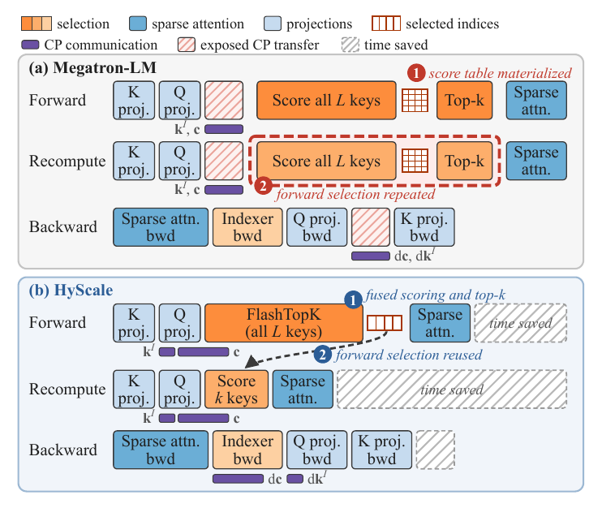
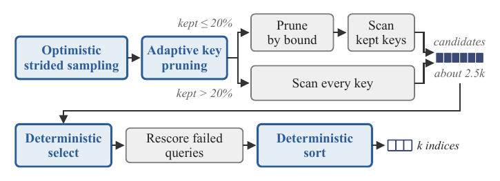

---
tags:
  - papers/LLM
  - topics/sparse-attention
  - topics/distributed-training
aliases:
  - HyScale
  - FlashTopK
---

# HyScale: Scaling Long-Context Training for Learned Sparse Attention

## Background

Learned sparse attention 先用轻量 indexer 为可见 token 或 block 打分，选择 top-k，再只读取入选位置的 KV 执行 attention。主 attention 已经稀疏，但寻找这些位置仍需扫描长上下文：省略 head 数与维度等常数，单个 query 的 selection 工作量随上下文长度 $L$ 增长，sparse attention 则只处理 $k$ 个入选条目。[HyScale v3，§2.1–2.3，第 2–3 页][background]

作者在 512 张 H20 上分析 GLM-5.1 的训练：每卡 8K tokens、完整激活重计算、1M 上下文时，首个流水线阶段排除 pipeline wait 后，selection 占 step 时间的 **47%**，是 sparse attention 的 **6.6 倍**。这里的 selection 包含前向、重计算和反向，不能把该比例直接当作整个模型前向的占比。[§2.3，Figure 2][background]

主要浪费来自两处。首先，分离的 scoring 与 top-k kernel 将每卡 $n$ 个 query 对全部 $L$ 个 key 的分数写成 $n\times L$ 表，再读回选出少量位置。论文中 $n=8\mathrm{K}$、$L=1\mathrm{M}$、$k=2048$ 时，单层每卡的完整分数表为 **32 GiB**，选中索引仅 **64 MiB**。其次，完整激活重计算会在反向前再次运行 scoring 和 top-k，尽管这一轮重计算的输入与前向相同，选择结果并未改变。[§2.3，Figure 3][background]

HyScale 的依据是：离散 top-k 本身不可微，论文所讨论的 indexer 损失只使用**选中位置的分数**，sparse attention 也只消费选中 KV。因此未选中位置的完整分数表不需要保留到反向；前向可以边打分边筛选，重计算可以直接复用索引、只恢复所需分数。这不意味着 indexer 没有梯度：它仍通过选中分数上的损失学习。[§2.4、附录 B][insight]

原论文 Figure 3，第 3 页：FlashTopK 消除完整分数表，selection replay 消除重复搜索；紫色通信可与不依赖该数据的计算重叠。图中时间轴不按实测时长绘制。[§2.3][background]

## FlashTopK

FlashTopK 沿用采样阈值驱动的融合选择框架：扫描 key 时在片上完成分数计算和过滤，只把通过阈值的候选写到缓冲区，再从候选中做精确 top-k。阈值过低会增加写回与后续选择工作，甚至使缓冲区溢出；训练中还要处理上下文并行（CP）、未训练权重和确定性要求。[§3.2，第 4–5 页][flashtopk]

1. **从当前 query 的上下文估计阈值。** 每张 GPU 将全局 $L$ 个 key 分为 $M=\min(\max(2048,L/128),8192)$ 个等长段，各取中间 key，供所有本地 query 共同打分。对 query $t$，只使用其可见窗口内的 $m_t$ 个样本；窗口有 $L_t$ 个 key 时，取样本中第 $\lceil 2.5k m_t/L_t\rceil$ 高分估计全窗口第 $2.5k$ 高分。这样目标是留下约 $2.5k$ 个候选，且无需等待邻近 query 的选择结果。
2. **按收益决定是否使用上界剪枝。** 每 16 个 query 抽取一个，与 256 个样本 key 估计 DoSA 上界的幸存比例。不超过 **20%** 时启用剪枝，将任意一个相邻 query 可能保留的 key 标记到八 query 一组的位图，再压缩、完整打分；否则直接扫描所有 key。两条路径都融合真实分数过滤，因此跳过剪枝仍能避免完整分数表写回。
3. **检查候选完整性并恢复失败 query。** 默认每个 query 有 16K 个候选槽。候选少于 $\min(k,L_t)$，或缓冲区溢出时，重新对该 query 的全部可见 key 打分和选择。恢复 kernel 每次都会启动，没有失败时立即返回；最多 64 个失败 query 走局部恢复，超过 64 个则重算全部 query。各分支读取 GPU 上的标志，不需要主机同步。
4. **固定集合与顺序。** Atomic append 允许候选以不确定顺序写入。若第 k 高分处存在超过剩余名额的同分项，仅对这部分项按位置执行 radix select，保留位置较小者；最后对选出的 k 项按分数排序，同分按位置打破平局。既固定选中集合，也固定下游 attention 的累加顺序。[§3.2、附录 C，第 14 页][implementation]

采样与完整扫描使用一致的打分算术；上界余量也覆盖舍入误差。采样阈值使用样本分数范围内的 256 个桶。近似发生在阈值估计，最终排名仍依据真实分数，不能把上界或桶编号直接当作最终分数。[附录 C][implementation]

原论文 Figure 13，第 14 页：两条扫描路径都进入候选选择，失败恢复之后再固定最终顺序。[附录 C][implementation]

## 与 DoSA 的关系

用户认为 FlashTopK 与 DoSA 思路接近；两篇论文支持这一判断：FlashTopK 明确采用 DoSA 的分数上界，主要改动集中在**阈值获取、自适应剪枝与确定性**。[用户判断出处](https://github.com/KuangjuX/Papers-and-Learning-Notes/issues/104#issuecomment-6907923737)；[HyScale §3.2、附录 C][flashtopk]

DoSA 的 seed 阈值有下界保证。设 $S$ 是可见 key 全集 $\Omega$ 的子集，至少含 k 个不同 key；$\tau_k(S)$ 是 seed 的第 k 高完整分数，$s_i$ 是真实分数，$U_i$ 是其安全上界，则：

$$
\tau_k(S)\le\tau_k(\Omega),\qquad
s_i\le U_i<\tau_k(S)\Longrightarrow i\notin\operatorname{TopK}(\Omega).
$$

所以 seed 质量差只会降低阈值、增加幸存候选，不会因此错误排除赢家；最终还需完整保存候选并正确处理数值误差及溢出。FlashTopK 则放弃“阈值必为下界”，用当前上下文的分位数估计控制候选规模，再由候选不足检测与恢复保证精确选择。[DoSA v1，§2.2、§2.5、附录 A.2][dosa-method]；[DoSA 主笔记](../DoSA/dosa.md)

HyScale 对比的 DoSA 路径从邻近 query 的已选 key 获取 seed。分块 prefill 可复用这些结果，而 CP 中不同 GPU 同时计算 query，邻居选择尚未产生。**这一限制针对邻居采样路径，不是 DoSA 数学方法不能使用 CP 的证明**：DoSA §2.2 允许任意满足条件的可见 seed 子集。FlashTopK 解决的是邻居依赖，以及改用普通 seed 后安全阈值可能太松的性能问题。[HyScale §3.2，C1][flashtopk]；[DoSA §2.2][dosa-method]

DoSA 上界通过直接计算部分 head、给省略的正贡献加安全余量、利用负贡献收紧总分上界，来减少完整打分。未训练权重可能令这个界很松，于是“先算上界，再给大部分 key 完整打分”反而更贵。FlashTopK 的自适应开关针对这项成本；**剪枝收益下降不等于上界失去正确性**。[DoSA §2.3–2.5][dosa-method]；[HyScale §3.2，C2][flashtopk]

## Selection Replay

算子级 selective recomputation 通常只能选择保存一个算子的全部输出，或重跑整个算子。即使保留 top-k 索引，若 scoring 仍按原接口完整执行，就会为恢复 k 个分数而重新计算全部 $L$ 个位置。Selection replay 将重计算粒度缩小到入选条目。[§3.3，第 5–6 页，Figure 5][replay]

默认的 **index replay** 在前向保存每个 query 的 top-k 索引；重计算时加载这些索引，用 gather-and-score kernel 只恢复对应分数，再在同一集合上执行 sparse attention，之后反向流程保持原有依赖。省略固定的 head 数和维度后，单 query 的 selection 重计算由 $O(L)$ 降为 $O(k)$。**Score replay** 还保存入选分数，连这部分重算也省去，但需要更多存储。作者默认使用 index replay，因为 1M GLM-5.1 中少量分数重算不足 step 时间的 1%，且相对 score replay 每卡少占约 5 GiB。[§3.3][replay]

索引可卸载到 pinned host memory：前向选择结束后在独立 stream 上拷往主机，与 sparse attention 重叠；重计算进入 attention layer 时拷回，与投影重叠。它复用的是**同一次前向、相同输入的确定选择**，不同于 DoSA 为新 query 提供历史 key ID 作为 seed，也不同于跨层或跨训练步沿用选择。[§3.3][replay]

Replay 的适用前提是损失只需要入选条目的分数。论文在 DSA token 选择及 CSA、QSA block 选择上验证这一做法。若换成需要全部位置分数的训练目标，现有索引与入选分数是否足够，需要重新分析其反向依赖，不能仅由 top-k 不可微推出。[§2.1、§3.3、附录 B][replay]

## System Implementation

Selection 加速后，CP 通信与 sparse kernel 的访存成本更加突出。HyScale 利用 selection 和 attention 消费不同数据的事实，将 indexer keys 与 KV states 的通信拆开：数据就绪即发起传输，仅在第一个消费者执行前等待。前向和重计算中，indexer-key all-gather 与 query projection 重叠，KV-state all-gather 与 query projection、selection 重叠；反向中，KV 梯度的 reduce-scatter 与 indexer backward 重叠，indexer-key 梯度的 reduce-scatter 与 query projection backward 重叠。[§3.4.1，第 6 页][system]

Sparse kernels 则把两个相邻 query 放入同一 thread block，处理两者选择集合的并集。每层一次预处理构造并集，按“仅第一个 query 使用、共同使用、仅第二个 query 使用”排列，供 sparse attention 前向、反向和 indexer 反向复用。两个 query 各自 mask 掉不属于自己的部分，共享 key 只加载一次；反向先累加两者对共享 key 的梯度，再做一次 atomic update。[§3.4.2，Figure 6，第 6–7 页][system]

这一设计用额外 masked 计算换取更少的 L2 流量与原子更新。作者在 GLM-5.1 的 78 层中选取 21 层，对 128K、192K tokens 的真实文档测得：相邻 query 的 top-2048 平均重合 **71%**。该统计支持这组负载中的复用机会，不能当作所有层、权重阶段和文档都固定具有的重合率。[§3.4.2][system]

## Evaluation

以下均为作者报告。基线使用 Megatron Core 0.19.2 与 cuDNN DSA backend，HyScale 在同一代码基础上替换 attention layer。除特殊说明外，使用 BF16、zigzag all-gather CP、完整激活重计算，并启用 index replay 及索引卸载。[§4.1，第 7 页][setup]

| 实验范围 | 配置与上下文 | 相对 Megatron-LM 的加速 | 来源 |
|---|---|---:|---|
| GLM-5.1 完整模型 | 512×H20；256K / 512K / 1M | 1.23× / 1.44× / 2.07× | [§4.2，Figure 7][evaluation] |
| DeepSeek-V4-Flash CSA 层 | 32×H800，CP32；1M | 2.01× | [§4.5，Figure 10b][generality] |
| Qwen3.8-Flash-Next QSA 层 | 32×H800，CP32；1M | 1.57× | [§4.5，Figure 10b][generality] |

完整模型实验从发布权重开始，global batch 固定为 4M tokens，每卡 8K tokens。256K、512K、1M 分别采用 PP8×CP32×DP2×EP64、PP8×CP64×EP64、PP4×CP128×EP128。两套系统均强制均衡 MoE 路由，使用无动量 SGD 和 Megatron-LM distributed optimizer，step time 取第 4–10 步平均。该节报告 step time、MFU 与峰值显存，未报告长期训练收敛曲线或最终模型质量对比。[§4.2，Figure 7 图注][evaluation] CSA 与 QSA 则是依据对应论文在 Megatron-LM 中实现的**单层实验**，不是完整模型训练加速。[§4.5][generality]

在 1M 的完整模型运行中，首个流水线阶段的前向 selection 从 **35.9 s 降为 20.8 s**，selection 重计算从 **37.0 s 降为 1.0 s**；pipeline wait 从 106.6 s 降为 51.7 s。启用索引卸载后，两套系统的峰值 GPU 显存接近。这些分项说明性能收益包含 selection、重计算和流水线等待的变化，不能把端到端 2.07× 全部记作 FlashTopK 单算子的贡献。[§4.2，Figure 7–8][evaluation]

消融在 H20 上测试一个 GLM-5.1 attention layer：1M 上下文、128 卡、CP128，每卡 8K queries，层时间包含前向、重计算和反向。依次加入 FlashTopK、selection replay、系统优化后，层时间分别降至基线的 **63%、45%、34%**，即依次节省基线层时间的 37、18、11 个百分点。每项在前一项基础上测量，并非独立收益；最后的系统优化还包含 CP layout/sequence boundary 缓存、算子融合及避免 KV 重排等 §3.4.3 的优化，不能全部归因于通信重叠或双 query kernel。[§4.4，Figure 10a][ablation]

FlashTopK 与 DoSA 的直接比较在单张 H20 上进行，覆盖 GLM-5.1 的 256K、512K、1M 上下文选择负载，每次 8K queries、top-2048。作者依据代码将 DoSA 从 Blackwell FP8 移植为 H20 BF16，比较时不使用 CP；DoSA 不启用确定性排序，FlashTopK 保留该排序。已训练权重下，FlashTopK 为 DoSA 的 **1.04–1.10×**；未训练权重下为 **1.34–1.58×**。这些结果支持该移植与负载条件下的比较，不能直接外推为原生 Blackwell FP8 实现的性能排名。[§4.6，Figure 11，第 9–10 页][efficiency]

[background]: https://arxiv.org/html/2610.32057v3#S2
[insight]: https://arxiv.org/html/2610.32057v3#S2.SS4
[flashtopk]: https://arxiv.org/html/2610.32057v3#S3.SS2
[implementation]: https://arxiv.org/html/2610.32057v3#A3
[dosa-method]: https://arxiv.org/html/2610.13990v1#S2
[replay]: https://arxiv.org/html/2610.32057v3#S3.SS3
[system]: https://arxiv.org/html/2610.32057v3#S3.SS4
[setup]: https://arxiv.org/html/2610.32057v3#S4.SS1
[evaluation]: https://arxiv.org/html/2610.32057v3#S4.SS2
[ablation]: https://arxiv.org/html/2610.32057v3#S4.SS4
[generality]: https://arxiv.org/html/2610.32057v3#S4.SS5
[efficiency]: https://arxiv.org/html/2610.32057v3#S4.SS6
