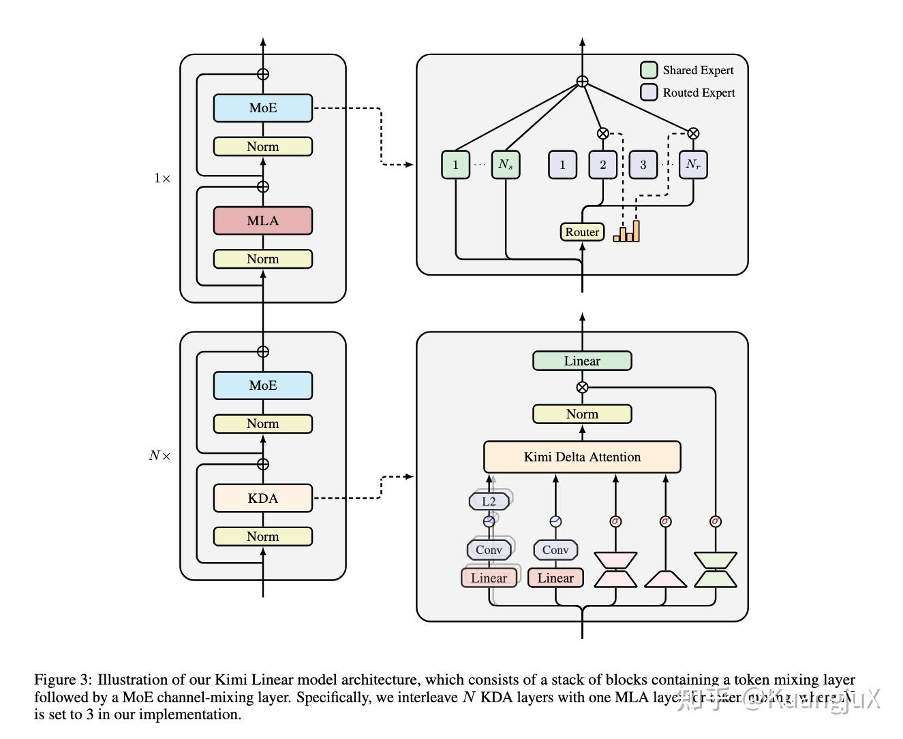

# Kimi Linear：状态更新与混合注意力

Kimi Linear 用 Kimi Delta Attention（KDA）维护固定大小的状态，并以 3:1 的比例混合 KDA 与全注意力层。核心取舍是：状态压缩减少长序列的存储与计算，但有限状态中的旧信息会相互干扰，需要控制记忆的保留和更新。[论文 §2–4](https://arxiv.org/html/2510.26692v1)

## 线性状态如何替代历史 KV

对核形式的注意力，若相似度可写成 $\phi(q)^T\phi(k)$，可以先累计 key/value，再用 query 读取。采用列向量约定，因果形式为：

$$
S_t=S_{t-1}+\phi(k_t)v_t^T,\qquad
z_t=z_{t-1}+\phi(k_t),\qquad
o_t=\frac{S_t^T\phi(q_t)}{z_t^T\phi(q_t)}.
$$

分母非零时，该式保留了核权重的归一化。例如标量特征均为 1，两个 value 为 2、4，则 $S_2=6,z_2=2$，输出为 3；省去分母会得到 6。指数点积核与 softmax 权重也不能直接画等号：softmax 还包含逐行分母，有限维特征映射通常只近似指数核。

若特征宽度 $d'$ 和 value 宽度 $d_v$ 固定，状态大小为 $d'\times d_v$，长度为 $n$ 的更新与读取约需 $O(nd'd_v)$ 运算。它避免保存逐 token KV，但所有历史信息挤入同一个状态；简单相加既不能主动遗忘旧关联，也不能修正已经写入的错误关联。

## KDA：先控制旧状态衰减，再修正当前关联

DeltaNet 将状态看作关联记忆：用重构损失 $\frac12\|S^Tk_t-v_t\|^2$ 的梯度更新，纠正当前 key 对应的 value。Gated DeltaNet 在此基础上加入**标量**遗忘门；KDA 改为按 key 特征维度控制的对角门。[论文 §2.2、§3 式 (1)](https://arxiv.org/html/2510.26692v1#S3)

$$
S_t=(I-\beta_tk_tk_t^T)\operatorname{Diag}(\alpha_t)S_{t-1}
    +\beta_tk_tv_t^T,\qquad o_t=S_t^Tq_t.
$$

这里 $S_t\in\mathbb R^{d_k\times d_v}$，$\alpha_t$ 控制旧状态各行的保留程度，$\beta_t$ 控制修正强度。先令 $\bar S_t=\operatorname{Diag}(\alpha_t)S_{t-1}$，更新便是 $S_t=\bar S_t+\beta_tk_t(v_t-\bar S_t^Tk_t)^T$。门作用于旧状态；新写入项不受“只有未遗忘维度才能写入”的限制。KDA 的输出使用上述递推定义，也不直接沿用前节核注意力的归一化公式。

例如取 $d_k=2,d_v=1$，$S_{t-1}=[2,4]^T$、$\alpha_t=[0,1]^T$、$k_t=[1,0]^T$、$v_t=3$、$\beta_t=1$，先得到 $\bar S_t=[0,4]^T$，再写入后得到 $S_t=[3,4]^T$。第一维的旧内容虽已清除，新内容仍可写入；取 $q_t=[1,0]^T$ 时输出 3。这是用于说明更新顺序的算例。

## 用混合层保留直接访问历史的能力

Kimi Linear 以三层 KDA 配一层全注意力，配合 MLA、NoPE 和 MoE 组件。KDA 承担大部分状态更新，全注意力层提供直接的跨位置交互；因此整个模型的缓存与复杂度不能只按 KDA 单层计算。[论文 §4](https://arxiv.org/html/2510.26692v1#S4)

架构图及原始讨论见 [2025 年度 LLM 研究总结](../../../Foundations/05_Model_Architecture_and_Reasoning/Research-Reviews/llm-2025.md)。混合比例与状态更新定义解释了设计选择，并不单独证明与全注意力在所有任务上等效。
