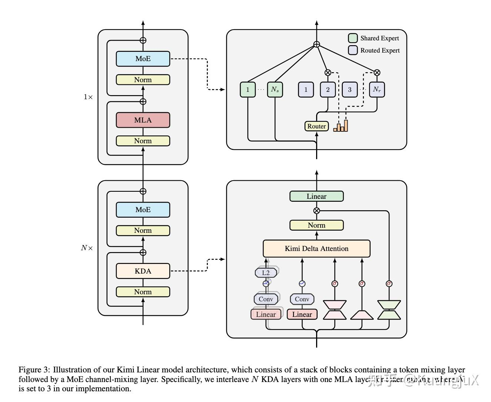

# Kimi Linear：状态更新与混合注意力

来源：[2025 年度 LLM 研究总结](../../../Foundations/05_Model_Architecture_and_Reasoning/Research-Reviews/llm-2025.md)。

问题是线性状态的记忆容量与表达能力；设计同时包含 KDA 的状态更新和 KDA／全注意力混合层，不能只记住“把矩阵乘法交换顺序”。

## 要点与边界

- KDA 与全局注意力层的架构比例为 3:1，见[论文](https://arxiv.org/abs/2510.26692)的 KDA 与 architecture 部分。
- 旧笔记把 softmax 权重近似写为未归一化的指数核：归一化分母不能省略，有限维特征映射也不自动等价于精确 softmax。下方作为历史表述保留。
- 原文混用了“DeltaNet”和“Gated DeltaNet”；全局遗忘门应结合论文具体递推定义区分。

## 机制与实现

### Linear Attention（线性注意力）[1](https://zhuanlan.zhihu.com/p/1994788371738949558#ref_1)

#### Kimi Linear Attention

Kimi Linear Attention 是月之暗面今年推出的一个线性注意力算法，目标在于在长序列的场景下，同时实现全注意力级别的效果和线性注意力的效率。Kimi Linear 通过 Kimi Delta Attention（KDA）—— 一种优化的线性注意力机制，解决传统线性注意力“表达能力弱，长序列干扰”的问题。

之前的线性注意力的问题在于为了实现线性复杂度，牺牲了注意力的全局关联性，同时用累计状态存储 KV Cache，会使得就信息不断干扰新信息，导致长序列任务准确率下降。

同时采取混合注意力的方法，经常在受限的规模或者在复杂的 benchmark 的情况下难以部署，因此 Kimi Linear Attention 希望提出既保留线性注意力的效率，又能达到全注意力的效果，同时还可以进行工业部署。

**线性注意力原理**

线性注意力的主要观点是，由于计算 $QK^T$ 的时候，要做 $n \times m$ 次内积，当 n = m 的时候，复杂度就是 $O(n^2)$ 。因此线性注意力希望将注意力的权重改为**先对 K、V 做变换，再和 Q 计算**。这个变换依赖**正定核函数**的性质。

我们可以把注意力权重的 softmax 看作一种**核函数**（衡量 qi​ 和 kj​ 的相似度）：

$A_{i, j} = softmax(\frac{q_ik_j^T}{\sqrt{d_k}}) \approx exp(\frac{q_ik_j^T}{\sqrt{d_k}})$

这里的 $exp(\cdot)$ 就是一个**正定核函数**，满足「可因式分解」的关键性质：

$k(q_i, k_j) = \phi(q_i)\phi(k_j)^T$

其中 $\phi(\cdot)$ 是一个**特征映射函数**—— 把 $d_k$ ​ 维的向量映射到更高维的空间。

因此，交换矩阵乘法顺序，可得： $(\phi(Q)\phi(K)^T)V = \phi(Q)(\phi(K)^TV)$ 因此，由于 $\phi(K)^T$ 是一个 $d' \times m$ 的矩阵（ $d'$ 是特征映射后的维度）， $V$ 是 $m \times d_V$ ， $\phi(Q)$ 是一个 $n \times d'$  矩阵，总复杂度为 $O(n \cdot d' \cdot d_V)$ 。因此，只要 $d'$ 是一个与序列长度无关的函数，整个计算复杂度就和序列长度 $n$ 成线性关系。

线性注意力还有一个更直观的视角，就是用**全局状态**替代**注意力矩阵**，我们可以把 $\Phi(K)^TV$ 看成一个全局累计状态 $S$ 。此时线性注意力的输出可以写成 $O = \phi(q_i)S$ 。对于长序列，我们可以流式计算 S：每来一个新的 $(k_j, v_j)$ ，就更新 $S = S + \phi(k_j)v_j^T$ ，这就是线性注意力能高效处理超长序列的核心原因。

**Kimi Delta Attention**

KDA 的本质是给线性注意力的**「状态累加」**加**「智能调控」**，解决早期线性注意力「表达弱、长序列干扰」的痛点。

在上一节中提到全局累计状态 $S = \sum_{j=1}^{m}\phi(k_j)v_j^T$ ，流式更新时， $S_t = S_{t-1} + \phi(k_t)v_t^T$ ，这个累加状态**没有遗忘机制**，且新的键值对的**贡献强度固定**，无法根据任务动态调整，表达能力受限。

而 DeltaNet 使用梯度下降更新修正 $S$ ，公式为：

$S_t = S_{t-1} - \beta \nabla_{S_{t-1}} \mathcal{L}(S_{t-1})$其中 $\mathcal{L}(S)$ 是重构损失， $\beta$ 是学习率，但 DeltaNet 的全局标量遗忘门还是太粗糙，无法对不同特征维度做精细化调控。KDA 进一步通过**维度级别的遗忘**和**动态更新机制**：

$S_t = (I - \beta_tk_tk_t^T)Diag(\alpha_t)S_{t-1} + \beta_tk_tv_t^T$ $o_t = S_t^Tq_t$通过细粒度遗忘门 $Diag(\alpha_t)$ 解决了早期线性注意力**全局遗忘太粗糙**的问题，通过 $(I - \beta_tk_tk_t^T)$ 的动态注入，新信息只会在**未被遗忘的维度**上生效，避免无效信息的干扰。

**Kimi-Linear Overview**

Kimi-Linear 通过 KDA 线性注意力 + 全注意力的混合架构，同时搭配 NoPE 编码，MoE 通道混合等关键组件，实现**效果与效率的最优平衡**。

Kimi Linear 架构

Kimi Linear 通过 3:1 的 KDA：全注意力层的机构混合，KDA 负责长序列的流式处理，控制计算内存成本；全注意力层负责全局信息的跨位置流动，避免线性注意力的信息孤岛，提升复杂推理能力。

推荐一些线性注意力相关的文章：

- 苏神对线性注意力的介绍《线性注意力简史：从模仿、创新到反哺》：

- [@Dao](https://www.zhihu.com/people/bda29934cdf311090b1c12e7ef7cc827)

   大佬对线性注意力的图解：

[@yzhangcs](https://www.zhihu.com/people/8d5f4c3b705ef7df799b680515700468)

 作者本人对 Kimi Linear 的介绍：
