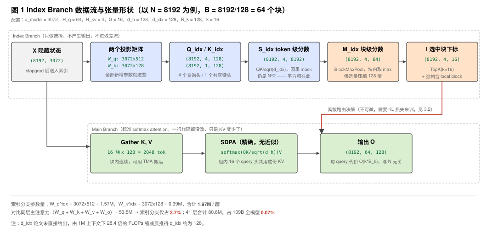
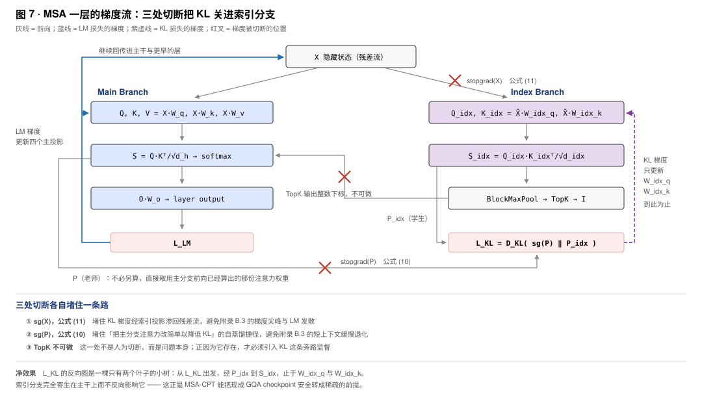

---
tags:
  - papers/LLM
aliases:
  - "MSA"
  - "MiniMax Sparse Attention"
  - "MSA KL"
  - "MSA Knowledge Distillation"
  - "MSA KV-outer Forward"
  - "MSA vs DSA Indexer"
date: 2026
---

# MiniMax Sparse Attention (MSA)

长上下文 attention 的成本来自越来越多的 query–key 配对。减少配对数可以节省计算，但直接让每个 head 各选少量 token，会把规整矩阵乘变成大量离散读取；如果选择本身也很昂贵，主注意力省下的时间还可能被索引器吃掉。MSA 要解决的是如何同时控制选择成本、保留检索能力，并让稀疏计算适合 GPU 执行。

它保留 GQA 主分支，用轻量索引器为每个 query、每个 GQA 组选择连续 KV 块。块选择让同组 heads 复用数据，辅助 KL 训练离散路由器，KV-outer 再把跨 query 的复用转化为 GPU 工作。三者分别处理选择粒度、可训练性和执行效率；代价包括较粗的检索预算、全历史索引扫描，以及重排和合并局部结果的开销。

[Xunhao Lai 等，MiniMax Sparse Attention，v2][paper]；[官方推理内核](https://github.com/MiniMax-AI/MSA)；[MiniMax-M3](https://huggingface.co/MiniMaxAI/MiniMax-M3)。

## 用组内共享和连续块保留 KV 复用

GQA 用 $H_q$ 个 query heads 和 $H_{kv}$ 个 KV heads，每个 KV head 服务 $G=H_q/H_{kv}$ 个 query heads。同组原本读取同一份 K/V；如果稀疏化后各 head 独立选择，加载的数据就难以继续组内复用。MSA 因而让同组 heads 共用一份选择结果，同时保留组间独立选择，避免所有组只能读取同一批位置。

仅有组内共享还不够：离散 token 列表仍会带来不连续的访问。MSA 再将选择单位设为连续 KV 块，用较粗的检索粒度换取批量加载。**共享的是集合，不是 attention 权重**：组内每个 head 仍使用自己的 query 计算 logits 和 softmax。论文 §2.3、§3.1。

| 符号 | 含义 | 主实验配置 |
|---|---|---|
| $N$ | 序列长度 | 随实验变化 |
| $H_q,H_{kv},G$ | Query heads、KV heads、组大小 | 64、4、16 |
| $d_h$ | 主注意力 head dimension | 128 |
| $B_k$ | 连续 KV 块大小 | 128 tokens |
| $B=\lceil N/B_k\rceil$ | 候选块数 | 随 $N$ 变化 |
| $k$ | 每个 query/group 的选择预算 | 16 块，最多 2048 tokens |
| $d_{\mathrm{idx}}$ | 索引向量维度 | 下文算例取 128 |

用从零开始的 token/block 编号，块 $b$ 为

$$
\mathcal B_b=\{bB_k,\ldots,\min((b+1)B_k,N)-1\}.
$$

query $i$、组 $r$ 的块列表记为 $\mathcal I_i^{(r)}$，实际参与注意力的 token 集合为

$$
\mathcal T_i^{(r)}=
\left(\bigcup_{b\in\mathcal I_i^{(r)}}\mathcal B_b\right)\cap\{0,\ldots,i\}.
$$

例如 $N=2^{20}$ 时有 8192 个候选块，每个 query 产生 4 份、每份最多 16 块的列表；4 组可以选择不同位置，并非总共只选 16 块。所有 query heads 都参与计算，被筛选的是 KV 序列位置。

这一表示同时减少路由元数据和 Top-k 候选数：16 个块编号即可表示最多 2048 个 token，候选数由 $N$ 降到 $B$。代价也很具体：组内 heads 无法各选一份列表，而一个块中即使只有一个 token 相关，也要占用整块预算。块大小是否值得设为 128，需要看同一 token 预算下的质量变化。

### 块大小的质量代价

附录 C.1 保持选中 token 总预算不变，改变 $B_k$；这些实验使用较少训练迭代和部分评测集：

| 指标 | Block 32 | Block 64 | Block 128 |
|---|---:|---:|---:|
| TAU2 PPL ↓ | 1.176 | 1.176 | 1.176 |
| AgentCompany PPL ↓ | 1.266 | 1.276 | 1.266 |
| RULER-8K | 72.5 | 72.8 | 73.8 |
| RULER-32K | 66.1 | 65.3 | 64.6 |

PPL 接近，但 RULER-32K 从 66.1 降至 64.6，说明较大块仍可能损失检索质量。这组消融支持在该设置下采用 128 的质量取舍；它没有单独量化块大小带来的 kernel 加速，硬件收益还需结合后面的执行分析。

## 用轻量打分找出值得读取的块

### 两个投影、逐 token 打分、块内取最大值

固定窗口可能漏掉远处的重要信息，因此 MSA 采用随 query 内容变化的块列表。论文附录 B.6 用相同稀疏预算比较“强制首块加 local window”与动态选择，固定模式在所评测 agent 任务上的 PPL 更高。这支持为内容相关检索支付索引成本，但索引器不能重复一遍昂贵的主注意力。

MSA 只增加 Q/K 两个投影：每组生成一个 index query，而各组共享历史 token 的 index key。这样既能表达组间不同的检索偏好，又不必按所有主 query heads 分别扫描和缓存索引表示：

$$
Q^{\mathrm{idx}}=XW_q^{\mathrm{idx}}
\in\mathbb R^{N\times H_{kv}\times d_{\mathrm{idx}}},\qquad
K^{\mathrm{idx}}=XW_k^{\mathrm{idx}}
\in\mathbb R^{N\times1\times d_{\mathrm{idx}}}.
$$

相较每组独立存 index key，共享 key head 将索引缓存减少 $H_{kv}$ 倍；主分支 K/V 仍按 GQA 组保存。索引器先度量 token 相关性，再把分数归约为块分数：

$$
S_{i,j}^{\mathrm{idx},(r)}=
\frac{Q_i^{\mathrm{idx},(r)}(K_j^{\mathrm{idx}})^\top}{\sqrt{d_{\mathrm{idx}}}},
\qquad
M_{i,b}^{\mathrm{idx},(r)}=
\max_{j\in\mathcal B_b,\;j\le i}S_{i,j}^{\mathrm{idx},(r)}.
$$

没有可见 token 的块分数为 $-\infty$。按 $M$ 选择 Top-k，同时强制保留 query 所在块，占用一个选择名额。论文 §3.1，式 (5)–(7)。

以 $N=8192,d_{\mathrm{model}}=3072,d_{\mathrm{idx}}=128$ 为例：

| 步骤 | 形状变化 | 具体含义 |
|---|---|---|
| 索引 query 投影 | $(8192,3072)\times(3072,512)\to(8192,4,128)$ | 每组一份 query |
| 索引 key 投影 | $(8192,3072)\times(3072,128)\to(8192,1,128)$ | 跨组共享 key |
| Token 打分 | `einsum("ird,jd->irj")` → $(8192,4,8192)$ | 收缩特征轴，产生被检索位置轴 |
| 因果 mask、块内 max | $(8192,4,64,128)\to(8192,4,64)$ | 最后一轴是块内 token |
| Top-k | $(8192,4,64)\to(8192,4,16)$ | 输出块编号 |

这里的 score 形状描述数学计算，不要求分配完整张量。BF16 全分数矩阵在此例中需要 512 MiB，而 INT32 选择结果只需 2 MiB；融合 kernel 计算一个 tile 后立即做块内归约，避免物化完整 $N\times H_{kv}\times N$ 分数。



图为笔记自绘，依据论文 §3.1；其中 $d_{\mathrm{idx}}=128$ 用于形状演算。

### 为什么取 max，而不先平均 key

块内的相关信息可能只集中在一个 token。设两个 128-token 块的打分为：

| 块 | Token 分数 | Max | Mean |
|---|---|---:|---:|
| A | 一个 $8.0$，其余 127 个为 $-1.0$ | 8.0 | $(8-127)/128\approx-0.93$ |
| B | 全部为 $0.5$ | 0.5 | 0.5 |

Max 保留 A 中的强匹配，mean 会偏向 B。MoBA 使用的均值 key 打分满足

$$
q\cdot\left(\frac1{B_k}\sum_{j\in\mathcal B_b}k_j\right)
=\frac1{B_k}\sum_{j\in\mathcal B_b}(q\cdot k_j),
$$

因此均值方法可以先压缩 key，再打分；max 不具备这种交换性，必须计算 token 级分数后归约。这里的取舍是保留块内强匹配，同时承担更多扫描计算。**在 head 数、维度等条件相同时**，max 路径的打分量约多 $B_k$ 倍；MSA 与 MoBA 的投影和训练方式也不同，不能把这个比例当作两种方法的整体成本差。上面的算例解释了 max 的检索倾向，并不构成 max 在所有任务上更优的实验结论。

### Local block 保留近邻，但块内仍要屏蔽未来位置

纯粹依赖内容分数可能漏掉最近邻上下文，尤其在索引器尚未稳定时。MSA 强制保留 query 自身所在的 local block；不过“块被选中”只决定是否读取，并没有解除自回归的可见性约束。取 query $i=5000$，它的 local block 为 $\lfloor5000/128\rfloor=39$。该块覆盖 4992–5119，但只有 4992–5000 的 9 个 token 可见；块 40 以后全部不可见。若选中 15 个完整历史块和 local block，则

$$
|\mathcal T_i^{(r)}|=15\times128+9=1929.
$$

因此 2048 是每组 token 预算上限；序列开头可见块不足 $k$ 时，实际选择数还会更少。

更强的先验会占用更多固定选择名额。附录 C.2 移除“强制首块和大 local window”后，多数质量指标接近，模型仍能学到 prefix/local 模式，但 RULER-32K 从 65.8 降到 61.5。最终配方只强制 incomplete self block，让其余名额由内容决定；这一消融并不证明所有强制规则都能无损移除。

首 token 自发成为 attention sink，也不意味着必须引入额外 sink 参数。附录 B.5 为每个 head 加入参与 softmax 竞争的可学习 sink logit：它在部分 heads 吸收了注意力质量，却未完全消除首 token 的 sink，agent 任务 PPL 也没有一致改善。因此最终结构不采用它。“是否增加 sink logit”与“是否强制选择首块”是两种不同的设计问题。

### 主分支只改变支撑集，保留标准注意力

选块已经解决了读取范围，主分支可以继续使用标准 scaled dot-product attention。这样保留各 head 在已选位置内分配权重的能力，也让后续 kernel 复用 QK、softmax 和 PV 的计算结构。对组 $r$ 中的 head $h$，主分支为

$$
O_i^{(h)}=
\operatorname{softmax}_{j\in\mathcal T_i^{(r)}}
\left(\frac{Q_i^{(h)}(K_j^{(r)})^\top}{\sqrt{d_h}}\right)
V^{(r)}[\mathcal T_i^{(r)}].
$$

沿用上例，同组 16 个 heads 的矩阵计算为

$$
Q_{\mathrm{group}}^{16\times128}
(K_{\mathrm{sel}}^{1929\times128})^\top
\to S^{16\times1929}
\xrightarrow{\mathrm{softmax}}P^{16\times1929},
\qquad
P V_{\mathrm{sel}}^{1929\times128}\to O_{\mathrm{group}}^{16\times128}.
$$

全层主投影分别得到 $Q:(8192,64,128)$、$K/V:(8192,4,128)$；各组输出汇合为 $(8192,64,128)$，展平后乘 $W_o:(8192,3072)$，回到残差流形状 $(8192,3072)$。上述 gather 是数学表示，实际 kernel 可将选择、加载和 attention 融合。

主分支在选中集合上执行标准 softmax；相对 full attention 的近似来自集合筛选。论文 §3.1，式 (8)。

## 用主注意力训练索引器 {#msa-kl}

### Top-k 阻断 LM 梯度，KL 提供局部监督

两个索引投影必须学会哪些位置值得保留，但它们对主分支的影响只经过 Top-k 编号：分数变化而排名未变时，路由不变；跨越排名边界时，路由跳变。因此普通 LM loss 无法沿这条离散选择路径训练索引器。

MSA 用同一层主分支的注意力概率提供另一个监督信号。由于一份列表要服务整个 GQA 组，教师取组内各 head 的概率平均，让索引器拟合这组 heads 的共同需求；选择与主 attention 仍使用不同的打分。论文 §3.2。

在同一个 $\mathcal T_i^{(r)}$ 上，令教师为 $P$、学生为 $P^{\mathrm{idx}}$，上述目标可写成：

$$
P_{i,j}^{(r)}=
\frac1G\sum_{h\in\mathcal H_r}
\frac{\exp S_{i,j}^{(h)}}{\sum_{u\in\mathcal T_i^{(r)}}\exp S_{i,u}^{(h)}},
\qquad
P_{i,j}^{\mathrm{idx},(r)}=
\frac{\exp S_{i,j}^{\mathrm{idx},(r)}}{\sum_{u\in\mathcal T_i^{(r)}}\exp S_{i,u}^{\mathrm{idx},(r)}}.
$$

$$
\mathcal L_{\mathrm{KL}}=
\frac1{NH_{kv}}\sum_i\sum_r
D_{\mathrm{KL}}\!\left(
\operatorname{stopgrad}(P_{i,\cdot}^{(r)})
\;\|\;P_{i,\cdot}^{\mathrm{idx},(r)}\right).
$$

概率平均让每个 head 等权贡献：一个 head 在某位置给出 0.8，$G=16$ 时，对教师分布贡献 $0.8/16=0.05$。它不是“每个被关注位置至少得到 $1/G$”，也不等价于先平均 logits 再 softmax。

固定教师 $P$，对学生 logits $z$ 有

$$
D_{\mathrm{KL}}(P\|P^{\mathrm{idx}})
=-\sum_jP_j\log P_j^{\mathrm{idx}}-H(P),
\qquad
\frac{\partial D_{\mathrm{KL}}}{\partial z_j}=P_j^{\mathrm{idx}}-P_j.
$$

例如教师为 $[0.8,0.2]$、学生为 $[0.5,0.5]$，梯度为 $[-0.3,0.3]$，梯度下降会提高第一个位置的 logit。这里是单个 query/group 的 KL；总损失还带有平均和系数。

监督定义在 **token 分数**上，因而可以校准整个支撑集；若只经过块级 max 传梯度，每块只有 argmax token 获得该归约路径的梯度。论文没有对 KL 方向做专项消融，不能凭逐项比较 forward/reverse KL 就推导性能优劣。

### 两处 detach 隔离训练目标

辅助 KL 的目标是改进索引器，但不加限制时，优化器也可以通过改变主干来降低 KL。仅 detach 教师概率还不够：KL 仍能经索引投影回到隐藏状态 $X$，再进入主干。MSA 因而同时截断教师路径和索引输入路径：

$$
Q^{\mathrm{idx}}=\operatorname{stopgrad}(X)W_q^{\mathrm{idx}},\qquad
K^{\mathrm{idx}}=\operatorname{stopgrad}(X)W_k^{\mathrm{idx}}.
$$

| 路径 | 梯度边界 | 更新对象 |
|---|---|---|
| LM loss → 主注意力 | Top-k 编号不可导 | 主投影和模型主干 |
| KL → 教师分布 | 教师 detach | 不更新主分支 Q/K |
| KL → 索引投影 → 输入 | 输入 $X$ detach | 仅更新 $W_q^{\mathrm{idx}},W_k^{\mathrm{idx}}$ |



图为笔记自绘，依据论文式 (10)–(11)。附录 B.3 报告：不截断输入时，较大 KL 系数会引发主干梯度尖峰和 LM loss 发散；稳定系数下也观察到短上下文指标退化。作者将后者解释为主干通过简化教师注意力分布来降低 KL，而不是索引器检索能力改善。

这种隔离使 LM 与 KL 分别更新主干和索引器，但并没有固定教师：主干仍由 LM loss 更新，索引器仍需持续跟踪变化的注意力分布。它属于层内、位置级自蒸馏；教师在推理时仍负责主计算，不需要额外部署 teacher LLM。移动的教师目标也带来了冷启动问题。

### 先用 dense warmup 建立有效监督

训练早期主分支注意力熵迅速下降。若此时让随机索引器控制读取范围，主分支可能只看到无关位置，由它产生的监督也随之变差。Warmup 因而先保持主分支 dense，让索引器在完整因果上下文上对齐教师；之后才启用块选择，将 KL 支撑集缩至 $\mathcal T_i^{(r)}$。论文附录 B.4 的 Figure 10 展示早期熵变化，Figure 11 则报告加入 warmup 后，所测短上下文能力和长上下文检索改善。

Warmup 的成本是一段无法享受主分支稀疏收益的 dense 训练。主实验为这段初始化分配了如下预算：

| 训练路线 | Warmup | 总训练预算 |
|---|---|---|
| MSA-PT | 40B tokens，约 1.3% | 从头训练 3T tokens |
| MSA-CPT | 40B tokens，占续训 10% | 从 2.6T dense checkpoint 续训 400B |

**由支撑集可推出的限制**：稀疏阶段若漏掉一个重要块，当前 teacher 也没有计算该块，KL 不能直接指出这次遗漏。低 KL 只说明已选集合内分布接近，需结合 block recall（理想 Top-k 块命中比例）、score recall（选块覆盖的主注意力概率质量）及长上下文任务表现判断检索质量。两种 recall 的评估需另有参考主注意力分布；保住高概率块时，score recall 可以高于 block recall。

早期 pilot 还尝试给索引分支增加 $V^{\mathrm{idx}}$ 和独立输出，让它通过对 LM 输出的贡献获得梯度。这样增加了训练信号，也引入 value 聚合和输出投影的成本。附录 C.3 在采用 warmup 的完整设置下比较有无这条路径，收益随任务变化，无一方持续占优，因此最终保留 KL、移除 Index Value Head。这里的 LM 梯度来自额外输出路径，Top-k 编号本身仍不可导。

上述训练稳定性证据的规模也需要区分：附录 B 主要使用 10.53B 总参数、1.47B 激活参数的 16 层 pilot，主实验和附录 C.3 的设置不能与之混用。

### 将训练机制接入一层 MSA

这些机制分别规定了数据路由、参数梯度和训练阶段。Algorithm 1 将它们接成以下依赖：

```text
X ── 主投影 ── Q/K/V ───────────────────────┐
└── detach ── 索引投影 ── Qidx/Kidx ── 选块 ─┴─ sparse attention ── Wo ── output
                         └── 与 detach(Q/K) 在选中 token 上计算 KL ── L_KL
```

训练循环组装 $\mathcal L=\mathcal L_{\mathrm{LM}}+\lambda\sum_{\mathrm{layers}}\mathcal L_{\mathrm{KL}}$；论文未明确给出 $\lambda$。教师只需要 Q/K logits，不需要 V；warmup 的 dense 路由在层外按日程控制。推理保留索引投影与选块，移除 KL。索引 Q/K 的 RoPE/normalization 未在该算法中明确，不能从主分支的 RoPE 配置推定。

### 复用 LSE，避免单独计算 KL forward

KL 又引入了概率归一化的计算。如果为它重新执行独立 forward，就会重复主 attention 已经做过的部分工作。论文 §4.3 因而让主分支随 forward 写出 LSE，并保存索引器 per-block LSE，再对选中块归约得到索引分支总 LSE。由

$$
P_j=\exp(S_j-\mathrm{LSE}),\qquad
\mathrm{LSE}=\log\sum_j\exp S_j
$$

即可在 backward 重建概率，主分支先按 head 重建再组内平均，随后形成 $P^{\mathrm{idx}}-P$。例如 logits 为 $[\log2,\log6]$，$\mathrm{LSE}=\log8$，重建概率为 $[1/4,3/4]$。

这种复用以保存 LSE 标量和选块归约代替单独的 KL-forward kernel，辅助梯度仍在 backward 中计算。Backward 还有另一个不均衡来源：不同 KV tiles 关联的 query 数差异很大。论文用 persistent grid 和全局 atomic work counter 分派工作，避免少量热门 tile 决定完成时间。

## 计算成本：主分支线性，索引分支仍为平方项

固定块预算控制了主分支成本，但它没有消除“在完整历史里找到这些块”的工作。索引器只用少量 heads 和较小向量降低扫描系数，因此判断收益时必须将两条路径相加。论文 §3.3 的因果注意力 FLOPs 模型为

$$
F_{\mathrm{GQA}}=2H_qd_hN^2,
\qquad
F_{\mathrm{MSA}}=
\underbrace{H_{kv}d_{\mathrm{idx}}N^2}_{\text{索引打分}}
+\underbrace{4H_qd_hNkB_k}_{\text{稀疏主注意力}}.
$$

该式不计投影、Top-k 比较和索引构建等开销；主分支用固定 $kB_k$ 预算估算，未扣除序列开头和 local 块中的不可见 token。下表以 $d_{\mathrm{idx}}=128$ 演算，**这是算例假设，不能由 FLOPs 比值唯一确定模型配置**。

| $N$ | GQA FLOPs | 索引打分 FLOPs | 稀疏主注意力 FLOPs | 两项之和相对 GQA 的降幅 |
|---|---:|---:|---:|---:|
| 8192 | $1.100\times10^{12}$ | $3.436\times10^{10}$ | $5.498\times10^{11}$ | 约 1.88× |
| $2^{20}$ | $1.801\times10^{16}$ | $5.629\times10^{14}$ | $7.037\times10^{13}$ | 约 28.44× |

在 $N=8192,d_{\mathrm{model}}=3072$ 时，两项索引投影另需

$$
2Nd_{\mathrm{model}}(H_{kv}+1)d_{\mathrm{idx}}
\approx3.221\times10^{10}\ \mathrm{FLOPs}.
$$

加入这部分后，相对上述 GQA attention FLOPs 的比值约为 1.78×；它仍是算术量比较，不是 1.78× 实测加速，也不是整模型 FLOPs 比值。

两个索引矩阵每层增加

$$
d_{\mathrm{model}}(H_{kv}+1)d_{\mathrm{idx}}
=3072\times5\times128=1{,}966{,}080
$$

个参数，约为主注意力四个投影矩阵 53.5M 参数的 3.7%。按 41 层计约 80.6M，占 109B 模型约 0.074%。参数占比小，并不意味着运行成本占比小：在上述 1M 算例中，索引打分占两项 attention FLOPs 的 $8/9\approx88.9\%$。

令两项 FLOPs 相等，得到交叉长度

$$
N^*=\frac{4H_qd_hkB_k}{H_{kv}d_{\mathrm{idx}}}=131072.
$$

超过 128K 后，索引打分成为这个 FLOPs 模型中的较大项；当 $N\to\infty$，理论 FLOPs 降幅趋于 $2H_qd_h/(H_{kv}d_{\mathrm{idx}})=32$。这是固定配置下的算术量极限，不能解释为实测速度上限或已经确定的硬件瓶颈。

FLOPs 分析解释了长上下文下的节省空间，但没有回答不规则读取、选择和合并需要多少时间。能否兑现这一节省，取决于 GPU 执行顺序及其额外开销。

## 把计算节省转化为 GPU 执行收益 {#msa-code}

源码对应 [KuangjuX/MSA-SM90，提交 `80434d7`][code-root]：下面的 forward 路径面向 **SM100**，与论文 H800 实验不是同一硬件实现。它接收调用方生成的 Q/K/V 和 index Q/K，实现打分、选块与稀疏 forward；模型投影、位置编码、KL/backward、warmup 和训练循环不在此 kernel 包中。返回 LSE 不等于实现了完整 KL 训练层。

下文 $T_q,T_k$ 分别表示 batch 内 packed query/KV token 总数，$H_{\mathrm{idx}}$ 表示 index query head 数；匹配论文结构时它等于 $H_{kv}$。

### 选块只需要顺序，省去概率归一化

索引器在这里要输出块编号，不需要概率值；计算完整 softmax 只会增加与排序无关的工作。Softmax 保序，且同一 query/group 的所有候选共用归一化常数，因此按 raw score 排序与按 softmax 概率排序得到相同 Top-k。例如 $[2,0,1]$ 与其 softmax 都选择位置 0、2 作为前二名；块内 max 也保留这个排序关系。选块时可跳过 softmax 的 exp/sum，训练 KL 的归一化另行处理。论文 §4.1。

块粒度把候选数缩至 $N/B_k$，而 $k=16$ 又很小，通用排序的固定开销可能不划算。论文为这一规模使用每线程小顶堆：warp lanes 分片扫描，缓存 heap root，再用 $k$ 轮 shuffle 合并。在 Table 1 的 FP32 输入 $N=128K,B=1024,k=16$ 上，延迟从 `torch.topk` 的 3970 μs 降到 779 μs，约 5.1×；这是该选择 kernel 的证据，不是整条 attention 路径的加速。

固定版本代码保留相同的选块职责，但采用另一微算法：转置 `[H,K,Q]→[H,Q,K]`，多级 bit histogram 找阈值，候选 insertion sort，最后按块编号 bitonic 排序。见 [selector 流程][code-topk-kernel] 与 [最终排序][code-topk-sort]。因此论文 heap kernel 的测量不能直接作为这个 SM100 实现的性能结论。

要把这一选择接入程序，打分路径只需提供约定布局的块级 score。该版本有两条入口：

| 路径 | 计算与输出 | 源码 |
|---|---|---|
| Dense proxy FMHA | `output_maxscore=True` 在 QK mainloop 内取 KV tile 最大值；输出 FP32 `[Hidx,max_k_tiles,Tq]`，无效位置初始化为 `-inf` | [分配与分派][code-maxscore]、[tile 归约][code-maxloop] |
| FP4 Indexer | `fp4_indexer_block_scores` 用 block-scaled FP4 MMA，输出 128-token page 的 FP32 max score | [FP4 接口][code-fp4] |

下面是调用关系示意，`...` 省略 planner 参数：

```python
proxy_plan = fmha_sm100_plan(..., output_maxscore=True)
_, max_score = fmha_sm100(
    proxy_q, proxy_k_pages, proxy_v_pages, proxy_plan,
    output_o=False, output_maxscore=True,
)
indices = sparse_topk_select(
    max_score.contiguous(), topk=16, num_valid_pages=num_pages,
)
```

[`sparse_topk_select`][code-topk] 的契约为：输入连续 FP32 score，`topk==16`、`max_k_tiles<12288`；输出 INT32 `[Tq,Hidx,16]`，按块编号升序，有效编号之后以 `-1` 填充。`max_k_tiles` 可能按对齐要求大于实际页数；若有效候选不足，Top-k 可能取到同为 `-inf` 的 padding tile。因此需要传入真实 `num_valid_pages`，把越界编号替换为 `-1`，避免随后访问无效页表项。

**强制 local 的实现差异**：论文要求每个 query 保留 $\lfloor i/B_k\rfloor$；此 selector 的 `force_begin_blocks`、`force_end_blocks` 默认为 0，只能强制全局首尾块。长 prefill 中每个 query 的 local block 不同，不能用全局尾块代替，调用方需逐 query 保证该语义。

<a id="411-equations-13-16q-outer-与-kv-outer"></a>

### KV-outer：以 KV 复用换取 query gather {#msa-kv-outer}

选出较少 KV 并不保证每次加载都划算。在 Q-outer 顺序下，每个 query 遍历自己的块列表；多个 query 即使选中同一个块，也会在不同任务中请求相同 K/V，而且单个位置只有 $G=16$ 行 query heads，MMA 的行维较小。

MSA 改为固定 `(KV block,KV head)`，聚集所有选择该块的 queries 后共同计算。同一次 K/V 加载由多个位置复用，共享 operand 的 queries 也可以拼成更大的 MMA。但这个顺序同时引入了两项工作：先从块列表反查 queries，再把分散在不同块上的同一 query 输出合并回来。论文 §4.2 针对 **query/KV 等长的 sparse prefill** 设计这条路径。

### Reverse index：将 q2k 转成 k2q CSR

Top-k 输出回答“一个 query 选择哪些块”，KV-outer 则需要“一个块被哪些 query 选择”。若在每个 block 开始计算时重新扫描所有列表，索引开销会反复发生，因此先将选择关系反转并压成 CSR。下面用同一组、$k=2$ 的小例子说明：

```text
q2k                         k2q
q0 → [0,1]                  block 0 → [q0,q1]
q1 → [0,2]       反转        block 1 → [q0,q2]
q2 → [1,2]       ───→       block 2 → [q1,q2,q3]
q3 → [2,3]                  block 3 → [q3]

row_ptr   = [0,2,4,7,8]
q_indices = [0,1, 0,2, 1,2,3, 3]
```

CSR（压缩稀疏行）把每个 block 的 query 列表存成连续切片：`q_indices[row_ptr[b]:row_ptr[b+1]]`。例如 block 2 对应 `[4:7]`，取出 `[1,2,3]`；相邻 row pointer 的差就是该块热度。`row_ptr` 长度为行数加一，末元素为有效边数 $\mathrm{nnz}$。

每个 KV head 独立保存一套 CSR。无 padding 时每组 $\mathrm{nnz}=T_qk$；存在 `-1` 时有效边数更少，空间为 $O(B+T_qk)$，无需保存完整 $B\times T_q$ 邻接矩阵。

[`build_k2q_csr`][code-index-utils] 的生产实现用五阶段 GPU pipeline：

| 阶段 | 输出或职责 |
|---|---|
| `build_row_map` | Packed row 与 `(batch,block)` 的映射 |
| `hist` | 各 KV block 的 query 计数 |
| `row_prefix` | 计数前缀和，生成 `row_ptr` |
| `tile_prefix_smem` | 并行 scatter 的写入起点 |
| `scatter` | 将 query id 写入对应 row，可附带调度元数据 |

这次转换需要额外 GPU 工作和元数据存储，换来按块直接找到相关 queries 的入口。[五阶段实现接口][code-builder] 中，`return_schedule=True` 还能同时生成 `scheduler_metadata`、`qsplit_indices` 和 `split_counts`，把反转过程中获得的计数用于后续工作划分。[融合调度输出][code-builder-schedule]。

### 拆开热门块，同时拼接共享 KV 的 queries

CSR 让每块的 query 列表连续存放，却没有让各块的工作量相等：sink 等热门块可能被几乎所有 queries 选中。若一个 block 固定交给一个 CTA，少量长 row 就会拖延整体执行。论文沿 gathered-query 维拆分热门块，每 chunk 最多约 $2kB_k$ 个 query positions；源码由 scheduler 选择 `target_q_per_cta`，生成

```text
[kv_head, row, q_begin, q_count, batch, kv_block]
```

六元组，并预先分配各 query 的 partial slot，避免多个任务竞争同一输出地址。[Scheduler][code-scheduler]。

拆分以增加任务数缓解长尾，也会让热门块在多个 CTA 中重复加载 K/V，因此复用收益应按一个 query chunk 内的摊销理解。Chunk 内还需解决 MMA 行数不足的问题。

同一个 block 的 queries 共享 K/V operand，可以把位置轴与组内 head 轴一起展开。$G=16,d_h=B_k=128$ 时：

$$
Q^{16\times128}K^\top\to S^{16\times128}
\quad\longrightarrow\quad
Q_{cat}^{128\times128}K^\top\to S^{128\times128},
$$

右侧由 8 个 query positions × 16 heads 组成 128 行，改善 MMA 的行维利用率；不足一个 tile 的部分需要 mask。一般拼接数为 $\lceil128/G\rceil$。Q-outer 下，不同位置通常选择不同 KV 子集，不能直接这样拼接。

### K1/K2：局部 attention 与全局 softmax 合并

[K1 `SparseAttentionForwardSm100`][code-k1] 按 work item 加载 KV block、从 CSR gather queries、拼接 MMA rows，再执行 QK → causal mask → online softmax → PV，将结果写入预分配 slot。QK/PV 使用 FP32 accumulator，partial 存储精度由接口参数控制。

这种任务划分使一个 query 的不同块落到不同 CTA。各 CTA 只知道局部 softmax 分母，直接相加或平均局部输出会改变结果。K1 因而除局部输出外，还保存代表该块概率质量的 LSE；K2 用它恢复跨所有选中块的归一化。对 partial $s$ 的 token 集合 $\mathcal J_s$，K1 保存

$$
L_s=\log\sum_{j\in\mathcal J_s}\exp S_j,
\qquad
O_s=\sum_{j\in\mathcal J_s}\exp(S_j-L_s)V_j.
$$

K2 用数值稳定的 LSE 归约合并：

$$
a=\max_sL_s,\qquad
L=a+\log\sum_s\exp(L_s-a),\qquad
O=\sum_s\exp(L_s-L)O_s.
$$

例如两个 partial 的未归一化概率质量分别为 2、6，$O_1=3,O_2=7$，则 $L_1=\log2,L_2=\log6$，合并输出为 $\frac28\times3+\frac68\times7=6$，不能直接平均为 5。

展开权重可得

$$
\sum_s\exp(L_s-L)O_s
=\sum_s\sum_{j\in\mathcal J_s}\exp(S_j-L)V_j,
$$

即所有选中 token 上的同一次 softmax。这条恒等式说明改变遍历顺序不必增加集合筛选之外的数学近似；浮点结果仍受 partial 精度与归约顺序影响。代码对应 [LSE 归约][code-combine-lse]、[输出加权][code-combine-o]、[K2 调用][code-combine-call]。

代价是将 partial outputs 和 LSE 写入 HBM，再由 K2 读取，以及额外的 kernel 启动。论文使用 Programmatic Dependent Launch 隐藏其中部分启动延迟，但不会消除中间数据流量；这部分成本需要计入 KV 复用的收益比较。

### 复用收益能否覆盖重排与合并成本

KV-outer 没有减少已选 token 上的 QK/PV 计算，而是改变这些计算需要搬运的数据。两种顺序的计算量相同：

$$
F=4H_qNd_hkB_k.
$$

按每元素 2 bytes、忽略索引元数据和部分调度开销，论文估算：

$$
\begin{aligned}
\mathrm{IO}_{Q\text{-outer}}
&=\underbrace{4H_qNd_h}_{Q\text{ 读}+O\text{ 写}}
+\underbrace{4H_{kv}NkB_kd_h}_{K/V\text{ 读}},\\
\mathrm{IO}_{KV\text{-outer}}
&=\underbrace{4H_{kv}Nd_h}_{K/V\text{ 读}}
+\underbrace{4H_qNkd_h}_{Q\text{ 读}+O_{buf}\text{ 写}}
+\underbrace{2H_qN(k+1)d_h}_{O_{buf}\text{ 读}+O\text{ 写}}.
\end{aligned}
$$

因此主要项给出的算术强度为

$$
\mathrm{AI}_{Q\text{-outer}}\approx G=16,
\qquad
\mathrm{AI}_{KV\text{-outer}}\approx\frac23B_k=85.3\ \mathrm{FLOPs/byte}.
$$

约 5.3 倍是这个 IO 模型的算术强度差异。KV-outer 用 query gather、partial buffer 和 combine 换掉按 $B_k$ 放大的 K/V 重读；真实收益还取决于块复用、CTA 切分和缓存命中。

### 模型接口如何连接稀疏执行

模型传入的 Q/K/V、块列表和请求长度，要连接到上述 CSR → scheduler → K1 → K2 执行链。入口分派先决定是否使用这条 prefill 路径：[`fmha_sm100_plan`][code-plan] 在 `kv_block_num>0`，且满足 `mode=="prefill"` 或 `mode=="auto" && max_q_len>32` 时进入 CuTe sparse adapter。其余情况走 csrc JIT，短 Q sparse 会展开为 per-token segments。

主入口 [`sparse_atten_func`][code-interface] 的关键张量为：

| 张量 | 形状或约束 |
|---|---|
| `q` | `[Tq,Hq,128]` |
| `k,v` | `[Tk,Hkv,128]`，或 paged `[pages,Hkv,128,128]` |
| `q2k` | `[Hkv,Tq,k]`，INT32，batch-local block 编号 |
| `k2q_row_ptr` | `[Hkv,total_rows+1]` |
| `k2q_q_indices` | `[Hkv,Tq*k]` 容量，内容为 batch-local query 编号 |
| `O_partial,LSE_partial` | `[k,Tq,Hq,128]`、`[k,Tq,Hq]` |
| `O_out,LSE_out` | BF16 `[Tq,Hq,128]`、可选 FP32 `[Tq,Hq]` |

默认 scale 为 $1/\sqrt{128}$，支持 $G\in\{1,2,4,8,16\}$；生产 CSR builder 固定 `blk_kv=128`，支持 $k\in\{4,8,16,32\}$，范围比上述 Top-k wrapper 宽。[接口约束][code-interface]、[builder 校验][code-builder]。

Adapter 将 `[Tq,Hkv,k]` 转置为 q2k；若传入 `[Tq,Hq,k]`，则每隔 $G$ 个 heads 只抽一个代表，**不验证其余 heads 是否具有相同列表**，组内共享由调用方保证。[转换代码][code-adapter]。

选择编号需去重，`-1` 位于尾部；`cu_seqlens_q/k` 连接 batch-local 编号与 packed 张量，paged KV 还依赖 `page_table`、`seqused_k` 和 query offset。Causal mask 根据实际位置与有效长度处理块内可见性。[索引格式][code-index-utils]、[mask][code-mask]。

### Decode 与量化对应不同的成本条件

上述优化依赖足够多 queries 共享 KV。Decode 通常只有少量新 query，反向索引与合并的固定开销可能不再容易摊销，因而不能直接套用 prefill 的复用推导。固定版本也保留了不同的执行路径：

| 路径 | 实现范围 |
|---|---|
| csrc JIT | Dense/paged FMHA、max-score、Top-k，以及基于 `kv_block_indexes` 的短 Q sparse variant |
| CuTe sparse prefill | CSR、scheduler、K1/K2 |
| CuTe paged FP8 decode | Dense split-KV；传非空 q2k 的 sparse decode 分支仍抛出 `NotImplementedError` |

对应 [csrc variant 分派][code-maxscore]、[CuTe decode 限制][code-decode]。块很小、复用率低、query 数不足或 partial-buffer 流量过大时，reverse index 和 combine 开销可能抵消 KV-outer 的优势。

SM100 代码还支持 BF16/FP8 主分支、部分 BF16 Q + FP8 KV staging，以及 packed NVFP4 KV。FP4 indexer 使用 E2M1 数值，MXFP4 配 E8M0 group scale、NVFP4 配 E4M3 group scale，输出仍为 FP32 score。这些是部署扩展：量化可能改变 Top-k 排序，不能视为论文实数打分的 bit-exact 实现。[主接口][code-interface]、[FP4 Indexer][code-fp4]、[NVFP4 KV 路径][code-nvfp4]。

## 长上下文下，计算节省兑现了多少

前面的消融分别检查了块大小、局部先验和训练机制；整体实验还需要回答，这些设计组合起来后能保留多少模型能力，并获得多少实际加速。论文 §5 的主模型为 109B 总参数、6B 激活参数的 MoE，41 层，前 3 层使用 dense FFN、后 38 层使用 MoE；隐藏维度 3072，主注意力配置见开头，RoPE 维度 64。比较包含从头训练 MSA-PT 与从 GQA checkpoint 转换的 MSA-CPT。

| 问题与设置 | 结果 | 证据范围 |
|---|---|---|
| 相同 head 配置、1M 上下文的 attention FLOPs | 相对 GQA 减少 28.4× | 理论算术量，§5.4、Figure 4 |
| H800，1M 上下文 attention 路径延迟 | Prefill 加速 14.2×；decode 加速 7.6× | 不等于整模型吞吐倍数 |
| MSA-CPT，额外约 140B tokens 长上下文训练后，在 128K 评测 | HELMET 45.93 vs full 46.53；RULER 72.12 vs full 72.00 | Table 3，总分差 −0.60 / +0.12 |

在相同 head 配置下，28.4× 的 FLOPs 降幅最终对应 14.2× prefill 加速，表明大量算术工作被省去，但不能等比例变成延迟收益。论文 §5.4 将差距归因于索引构建、Top-k、reverse index、query gather、负载均衡以及不规则访存；这些恰是前面各项设计新引入的工作。

这组整体结果验证了 MSA 执行方案的收益，但没有把每项开销的占比或 KV-outer 单独带来的加速分离出来。Decode 的 7.6× 又属于不同 query 数和复用条件，不能由 prefill 的算术强度比值推算。质量方面，Table 3 支持的是 MSA-CPT 经长上下文扩展后、在所测 HELMET/RULER 设置下接近 full attention，而非所有任务无损。

## 与 DSA 的比较：序列粒度和共享范围 {#msa-vs-dsa}

MSA 为了块内连续加载而接受较粗的选择粒度；DSA 展示了另一种取舍：保留逐 token 选择，用所有主 heads 共享一份列表来摊薄离散读取。比较二者时，需要同时看序列粒度与共享范围，不能只用“更细粒度”概括。

DSA 的 Lightning Indexer 对 token pair 输出一个跨 index heads 汇总的分数：

$$
I_{t,s}=\sum_{j=1}^{H_I}w_{t,j}^I\,\operatorname{ReLU}
\left(q_{t,j}^I\cdot k_s^I\right),\qquad
\mathcal S_t=\operatorname{TopK}_s(I_{t,s},2048).
$$

例如两个 index heads 的内积为 $[2,-1]$、权重为 $[0.5,1]$，汇总分数为 $0.5\times2+1\times0=1$。这些 scorer heads 最终合成一份清单，所有主 query heads 共用选中的 MLA latent KV entries，各自计算 attention 权重。[DeepSeek-V3.2 §2.1、附录 A](https://arxiv.org/abs/2512.02556)；投影细节见 [DSA 主笔记](../DeepSeek-DSA/deepseek-sparse-attention-dsa.md)。

| 维度 | MSA | DeepSeek-V3.2 的 DSA |
|---|---|---|
| 主注意力 | GQA | MLA MQA-mode |
| Index query/key | 每组一个 query、一个共享 key | 多个 scorer queries、一个共享 key |
| 打分 | Scaled dot product → block max，保留组轴 | Weighted ReLU(dot) → 跨 scorer heads 求和 |
| Top-k 对象 | 每组 16 个连续 128-token 块 | 2048 个独立 token |
| 每 query 的列表数 | $H_{kv}$ 份 | 1 份 |
| KL 教师 | 组内 heads 概率平均 | 跨全部主 heads 汇总后归一化 |
| 读取与复用 | 连续普通 K/V，组内及跨位置复用 | 离散压缩 latent，所有 heads 复用 |

若相关信息散落在许多不同块中，DSA 可分别选出 2048 个位置；MSA 每组最多选 16 个区域，但各组可以覆盖不同区域。因此 DSA 在序列轴更细，MSA 在 group 轴保留更多独立选择。MSA 的 2048 是**每组上限**，四组合计的不同 token 数取决于列表重叠。

DSA 的共享教师对应其唯一清单，训练目标也是 $D_{\mathrm{KL}}(p_{t,:}\|\operatorname{softmax}I_{t,:})$。其 dense warmup 冻结其余模型、仅训练 Indexer，约 1000 steps/2.1B tokens；MSA warmup 中主干继续训练，主实验为 40B tokens。两者均保留全历史索引打分，不能由固定选择预算推断整体线性复杂度。

Token 选择本身并不在数学上要求 MQA；DeepSeek 的实例采用 MLA MQA-mode，在所有 heads 间复用被 gather 的 latent，摊薄离散读取成本。它与普通 MQA 的区别是共享压缩 $c_s^{KV}$，通过矩阵吸收保留 per-head query 和输出映射，而非直接共用普通 K/V 投影。

[paper]: https://arxiv.org/abs/2606.13392v2
[code-root]: https://github.com/KuangjuX/MSA-SM90/tree/80434d7f67877c6570ca19cac444b84bc9855dac
[code-topk-kernel]: https://github.com/KuangjuX/MSA-SM90/blob/80434d7f67877c6570ca19cac444b84bc9855dac/python/fmha_sm100/csrc/include/sparse_topk_select.cuh#L58-L89
[code-topk-sort]: https://github.com/KuangjuX/MSA-SM90/blob/80434d7f67877c6570ca19cac444b84bc9855dac/python/fmha_sm100/csrc/include/sparse_topk_select.cuh#L711-L768
[code-maxscore]: https://github.com/KuangjuX/MSA-SM90/blob/80434d7f67877c6570ca19cac444b84bc9855dac/python/fmha_sm100/api.py#L852-L893
[code-maxloop]: https://github.com/KuangjuX/MSA-SM90/blob/80434d7f67877c6570ca19cac444b84bc9855dac/python/fmha_sm100/csrc/include/sm100_fmha_fwd_mainloop_tma_warpspecialized.hpp#L912-L957
[code-fp4]: https://github.com/KuangjuX/MSA-SM90/blob/80434d7f67877c6570ca19cac444b84bc9855dac/python/fmha_sm100/cute/fp4_indexer_interface.py#L745-L810
[code-topk]: https://github.com/KuangjuX/MSA-SM90/blob/80434d7f67877c6570ca19cac444b84bc9855dac/python/fmha_sm100/api.py#L1179-L1290
[code-plan]: https://github.com/KuangjuX/MSA-SM90/blob/80434d7f67877c6570ca19cac444b84bc9855dac/python/fmha_sm100/api.py#L510-L568
[code-interface]: https://github.com/KuangjuX/MSA-SM90/blob/80434d7f67877c6570ca19cac444b84bc9855dac/python/fmha_sm100/cute/interface.py#L600-L717
[code-builder]: https://github.com/KuangjuX/MSA-SM90/blob/80434d7f67877c6570ca19cac444b84bc9855dac/python/fmha_sm100/cute/src/sm100/prepare_k2q_csr.py#L4-L110
[code-adapter]: https://github.com/KuangjuX/MSA-SM90/blob/80434d7f67877c6570ca19cac444b84bc9855dac/python/fmha_sm100/sparse_fmha_adapter.py#L205-L222
[code-index-utils]: https://github.com/KuangjuX/MSA-SM90/blob/80434d7f67877c6570ca19cac444b84bc9855dac/python/fmha_sm100/cute/sparse_index_utils.py#L331-L411
[code-mask]: https://github.com/KuangjuX/MSA-SM90/blob/80434d7f67877c6570ca19cac444b84bc9855dac/python/fmha_sm100/cute/src/common/mask.py#L93-L120
[code-builder-schedule]: https://github.com/KuangjuX/MSA-SM90/blob/80434d7f67877c6570ca19cac444b84bc9855dac/python/fmha_sm100/cute/src/sm100/prepare_k2q_csr.py#L139-L179
[code-scheduler]: https://github.com/KuangjuX/MSA-SM90/blob/80434d7f67877c6570ca19cac444b84bc9855dac/python/fmha_sm100/cute/src/sm100/prepare_scheduler.py
[code-k1]: https://github.com/KuangjuX/MSA-SM90/blob/80434d7f67877c6570ca19cac444b84bc9855dac/python/fmha_sm100/cute/src/sm100/fwd/atten_fwd.py#L56-L113
[code-combine-lse]: https://github.com/KuangjuX/MSA-SM90/blob/80434d7f67877c6570ca19cac444b84bc9855dac/python/fmha_sm100/cute/src/sm100/fwd/combine.py#L767-L820
[code-combine-o]: https://github.com/KuangjuX/MSA-SM90/blob/80434d7f67877c6570ca19cac444b84bc9855dac/python/fmha_sm100/cute/src/sm100/fwd/combine.py#L903-L948
[code-combine-call]: https://github.com/KuangjuX/MSA-SM90/blob/80434d7f67877c6570ca19cac444b84bc9855dac/python/fmha_sm100/cute/interface.py#L1530-L1549
[code-decode]: https://github.com/KuangjuX/MSA-SM90/blob/80434d7f67877c6570ca19cac444b84bc9855dac/python/fmha_sm100/cute/interface.py#L1553-L1579
[code-nvfp4]: https://github.com/KuangjuX/MSA-SM90/blob/80434d7f67877c6570ca19cac444b84bc9855dac/python/fmha_sm100/cute/interface.py#L1810-L1943
