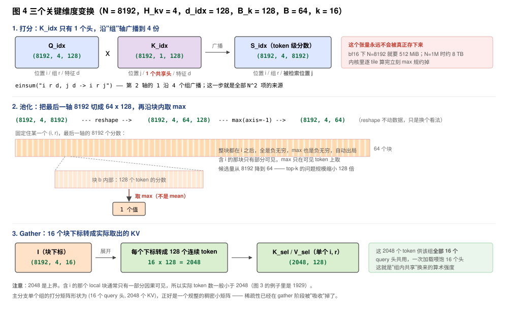
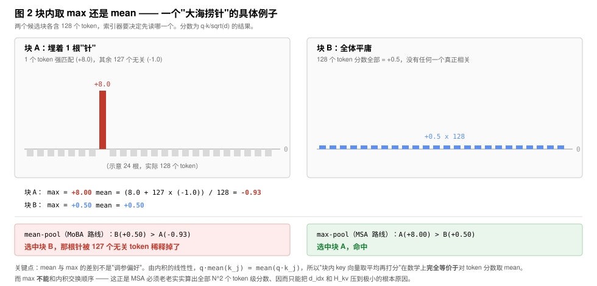
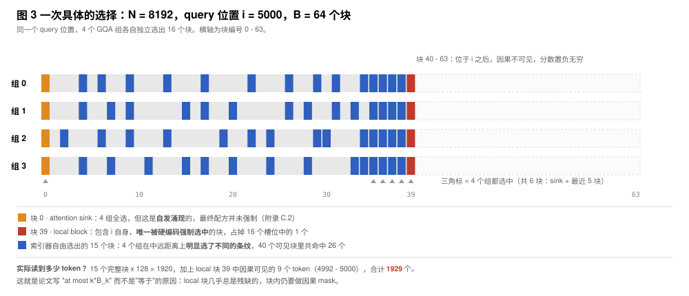
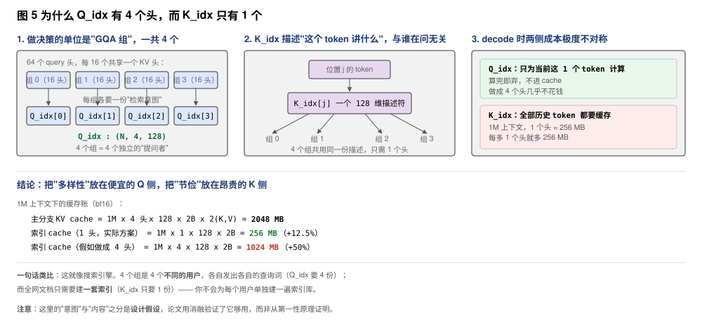
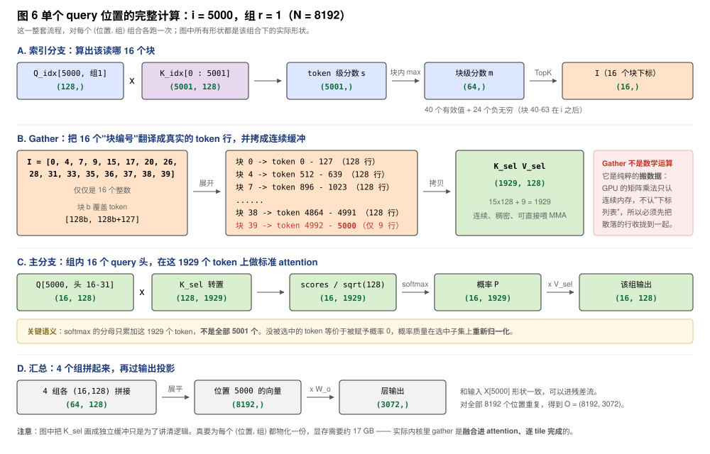
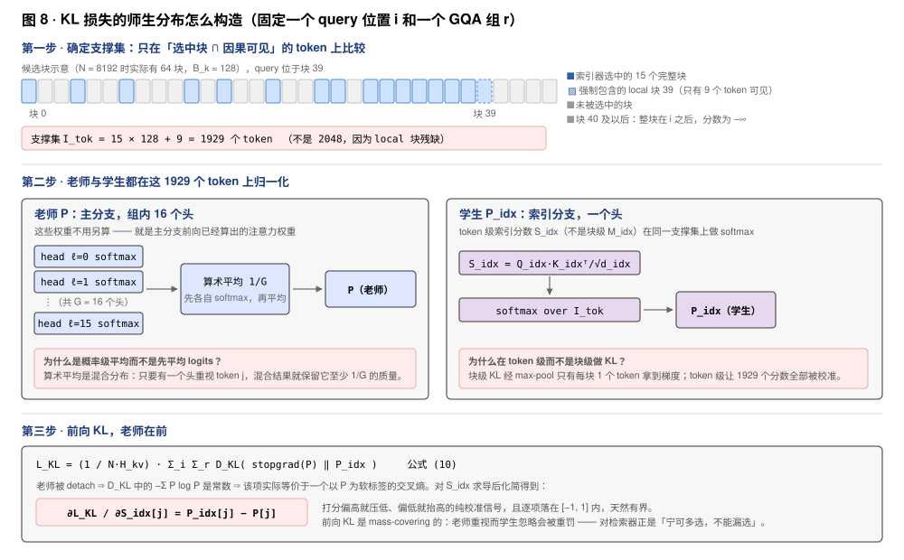
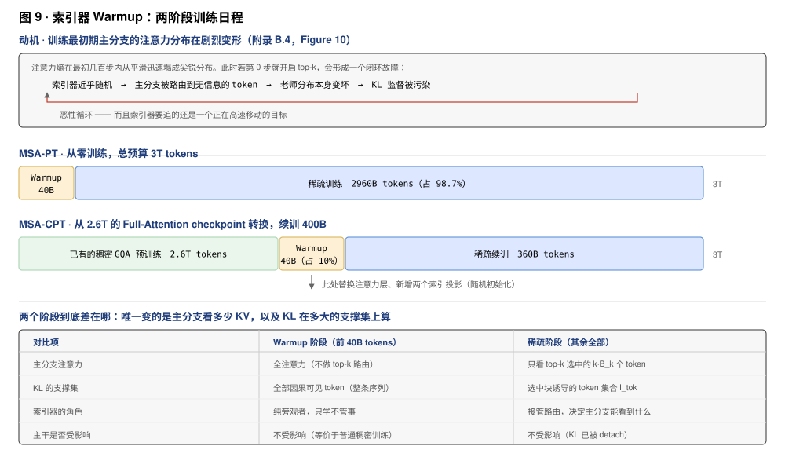
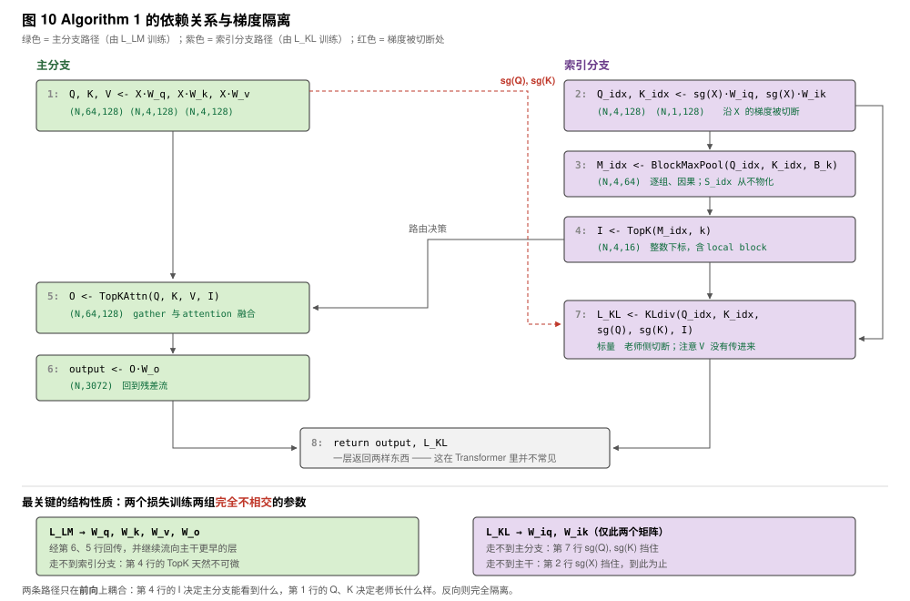

---
tags:
  - papers/LLM
aliases:
  - "MSA"
  - "MiniMax Sparse Attention"
  - "MSA KL"
  - "MSA Knowledge Distillation"
  - "MSA KV-outer Forward"
  - "MSA vs DSA Indexer"
date: 2026
---

# MiniMax Sparse Attention (MSA)

长上下文注意力需要同时处理两个成本：在完整历史中找到有用位置，以及在这些位置上计算主注意力。MSA 保留 GQA 的主计算形式，增加轻量索引分支，为每个 query 的每个 GQA 组选择少量连续 KV 块；训练和 GPU kernel 围绕这一选择粒度设计。

[Xunhao Lai 等，MiniMax Sparse Attention，v2](https://arxiv.org/abs/2606.13392v2)；[推理内核](https://github.com/MiniMax-AI/MSA)；[模型](https://huggingface.co/MiniMaxAI/MiniMax-M3)。

## 从 GQA 出发，确定稀疏选择的粒度

### 因果注意力与 GQA

标准因果注意力对第 $t$ 个位置的 query，要和前面所有位置 $i \le t$ 的 key 做内积、算 softmax、再加权求和 value：

$$\boldsymbol{o}_t^{(h)} = \sum_{i \le t} \alpha_{t,i}^{(h)} \boldsymbol{v}_i^{(h)}, \qquad \alpha_{t,i}^{(h)} = \frac{\exp\left(\langle \boldsymbol{q}_t^{(h)}, \boldsymbol{k}_i^{(h)} \rangle / \sqrt{d_h}\right)}{\sum_{j \le t} \exp\left(\langle \boldsymbol{q}_t^{(h)}, \boldsymbol{k}_j^{(h)} \rangle / \sqrt{d_h}\right)}$$

代价是 $\Theta(2 H_q N^2 d_h)$ FLOPs，随 $N$ **平方增长**。

**GQA（Grouped-Query Attention）**：用 $H_q$ 个 query 头，但把 KV 头数减少到 $H_{kv}$，相邻的 $G = H_q / H_{kv}$ 个 query 头**共享同一个 KV 头**。每个 KV 头定义一个 **GQA 组**。主实验中 $H_q = 64$、$H_{kv} = 4$，所以 $G = 16$。

> 平方增长的根源只有一句话：**每个 query 必须看完前面所有 key**。MSA 选择的降本路径是让 query 只看一部分 key。问题随之而来：**看哪一部分？谁来决定？**

---

### 先选择，再在选中位置上计算

先把稀疏注意力拆成位置选择和主注意力计算，便于分别分析二者的成本。

#### 核心公式

$$\mathcal{I}_i = \text{Index}_\phi\left(\boldsymbol{q}_i,\ \boldsymbol{K}_{\le i}\right), \qquad \boldsymbol{o}_i = \text{Attn}\left(\boldsymbol{q}_i,\ \boldsymbol{K}[\mathcal{I}_i],\ \boldsymbol{V}[\mathcal{I}_i]\right)$$

拆成两步：

- **第一步「选」（Index Branch）**：给定当前 query $\boldsymbol{q}_i$ 和它能看到的所有 key $\boldsymbol{K}_{\le i}$，通过函数 $\text{Index}_\phi$ 输出一个**下标集合** $\mathcal{I}_i$，表示"我决定只看这些位置"。
- **第二步「算」（Main Branch）**：在 $\mathcal{I}_i$ 对应的 key/value 上做**完全标准的** softmax 注意力。

> **容易忽略的重点**：第二步在选定支持集上计算标准 softmax attention；选择支持集本身已经改变了 full attention 的结果。它不是线性注意力那种替代品，也不是对 softmax 做数学简化，就是原封不动的 scaled dot-product attention，只是参与运算的 KV 变少了。这正是论文说的"最大化复用已有软硬件基础设施"——主分支还是 FlashAttention 那套骨架。

#### 符号逐个解释

**$\mathcal{I}_i \subseteq \{1, \dots, i\}$**：上界是 $i$ 而不是 $N$，这就是**因果性约束**。一个 token 只能选自己和前面的位置，不能选未来，保证稀疏化后模型仍是自回归的。

**$\phi$**：索引函数的参数。论文特意区分了两种情况：

| 类型 | $\phi$ | 选择依据 | 例子 |
|------|--------|----------|------|
| 固定规则索引器 | 为空 | 位置，与内容无关 | 滑动窗口、attention sink |
| 可训练索引器 | 可学习 | 当前 query 的**内容** | MSA、NSA、MoBA、DSA |

MSA 属于后者，它的 $\phi$ 就是两个投影矩阵 $\boldsymbol{W}^\text{idx}_q$ 和 $\boldsymbol{W}^\text{idx}_k$。

> 这个区分是附录 B.6 消融的直接动机：作者拿 MSA 和一个 **FLOPs 完全相等**的滑动窗口基线对比，预算一模一样，唯一区别是"选哪些 token 由位置决定还是由内容决定"。结果滑动窗口困惑度明显更差 —— **动态选择本身是有价值的，省钱不能靠拍脑袋定规则**。

**每个头可以选不同集合**：论文提到实际应写成 $\mathcal{I}_i^{(h)}$，由"位置 $i$ + 头 $h$"共同确定，公式里省略头下标只为简洁。这个细节引出了全文最核心的设计张力（见下）。

#### 这个框架真正的意义：一张"设计表格"

所有稀疏注意力方法本质上都在回答同样三个问题，区别只在填法：

| 设计维度 | 可选项 | MSA 的选择 |
|----------|--------|-----------|
| 选择的**粒度** | 单个 token / 连续块 | 块，$B_k = 128$ |
| 选择的**共享范围** | 每头独立 / 每 GQA 组共享 / 全部头共享 | 每 GQA 组独立 |
| 索引器**怎么来** | 固定规则 / LM 损失训练 / 辅助损失训练 | 辅助 KL 损失训练 |

论文第 6 章的相关工作就是在这张表上给各家方法定位：

- **DSA**：token 级选择，所有 query 头共享一套下标
- **MoBA**：块级但块很大，且只靠语言建模梯度训练索引器
- **NSA**：三条并行分支（压缩注意力 + 选择注意力 + 滑动窗口）
- **MSA**：**块级粒度 + 每 GQA 组独立选择**两件事同时做

#### 一个必须留意的隐藏成本

框架里有个陷阱：**索引器自己也要花钱**。

注意 $\text{Index}_\phi$ 的输入是 $\boldsymbol{K}_{\le i}$，也就是**完整的历史上下文**。它必须把所有候选扫一遍才能挑出 top-k，所以索引这步的复杂度仍是 $O(N)$ per query，整体还是 $N^2$。

第 3.3 节的 FLOPs 公式把这件事写得很直白：

$$F_\text{MSA}(N) = \underbrace{H_{kv} d_\text{idx} N^2}_{\text{索引分支，仍是平方}} + \underbrace{4 H_q d_h N k B_k}_{\text{主分支，线性}}$$

对比 GQA 的 $F_\text{GQA}(N) = 2 H_q d_h N^2$：

- **平方项没有消失**，只是系数从 $2 H_q d_h$（64 头 × 128 维）压到了 $H_{kv} d_\text{idx}$（4 组 × 很小的索引维度）
- **主分支实现了质变**：每个 query 的代价从 $O(N)$ 变成固定的 $O(k B_k) = 2048$

> 这解释了为什么 MSA 要把索引分支做到极致轻量——只加两个投影矩阵、key 只用一个共享头、推理时连 softmax 都不算（第 4.1 节 exp-free 选择）。**全是被这个公式逼出来的**：索引器设计得太重，省下的钱会被它自己吃掉。

---

### 选择张量的三个轴：query、GQA 组与 KV 块

这是个很容易混淆的点，单独记一下。

#### 选的确实是序列维度上的索引

$\mathcal{I}_i$ 里装的是 **KV 序列维度上的下标**：

- 在 2.2 的抽象框架里 → token 位置下标，$\mathcal{I}_i \subseteq \{1, \dots, i\}$
- 在 MSA 实际实现里 → **块**下标，$\mathcal{I}_i^{(r)} \subseteq \{1, \dots, B\}$，其中 $B = \lceil N / B_k \rceil$

所以一次选择的产物是 16 个块编号，比如 `[0, 3, 47, 512, ..., 当前块]`，每个编号背后是 128 个连续的 KV token。

#### 是"针对序列 + 针对组"，不是"选头"

选择结果确实**同时随 query 位置和头而变**（记号 $\mathcal{I}_i^{(h)}$ 就是在强调这点）。但"针对头做选择"这个说法有歧义，容易读成"MSA 在挑选哪些头参与计算"——**不是的**。

> **所有 64 个 query 头每一步都照常计算，一个都不省。稀疏化完全发生在 KV 侧。**
>
> 更准确的表述：**头维度是"谁在提问"的轴，序列维度才是"被筛掉"的轴**。query 侧是稠密的（每个位置、每个头都算），只是每个提问者能看到的 KV 变少了。

而且在 MSA 里，提问者的粒度不是单个头，而是 **GQA 组**（公式 3）：

$$\mathcal{I}_i^{(r)} = \mathcal{I}_i^{(h)} = \mathcal{I}_i^{(h')}, \quad h, h' \in \mathcal{H}_r$$

同组的 $G = 16$ 个 query 头**共用一份选择结果**。全模型每层每个位置只有 **4 份**不同的清单，不是 64 份。

#### 完整的形状图景

索引分支的中间产物是一个三维张量：

$$M^\text{idx} \in \mathbb{R}^{N \times H_{kv} \times B}$$

三个轴分别是「query 位置」「GQA 组」「候选 KV 块」。在最后一个轴上取 top-k，得到形状 $(N, H_{kv}, k)$ 的选择结果。

代入 1M 上下文：$N = 1\text{M}$、$H_{kv} = 4$、$B = 1\text{M}/128 = 8192$ 个候选块、$k = 16$。也就是**每个 query 位置产生 4 份清单，每份从 8192 个块里挑 16 个**，命中的 2048 个 token 服务于该组的 16 个 query 头。

#### 为什么共享单位是"组"

**往上看（为什么不是每头独立）**：同组的 16 个 query 头本来就共用同一份 $K^{(r)}, V^{(r)}$（这是 GQA 的定义）。既然 KV 共享，让选择也共享就能做到"一次 KV 块加载，喂饱 16 个 query 头的矩阵乘"。反之若 64 头各选各的，需要 64 次独立 gather，每次加载的 KV 块只服务一个头，算术强度掉到 $1/16$。

**往下看（为什么不干脆全部共享）**：附录 A 的可视化显示，**不同组确实会选出不同的长距离条纹**，只在局部对角线和 sink 列上一致。组间差异是有信息量的，砍掉会损失检索能力。DSA 走的就是全共享路线，MSA 把"每组独立选 + 块级粒度"列为自己的核心差异点。

#### 架构里的佐证

这个"组为单位"的设计到处留有痕迹：

- 索引 query 投影是 $Q^\text{idx} \in \mathbb{R}^{N \times H_{kv} \times d_\text{idx}}$，**每组一个**索引查询头
- 索引 key 投影只有 $K^\text{idx} \in \mathbb{R}^{N \times 1 \times d_\text{idx}}$，**全模型共享一个**索引键头
- KL 损失的 teacher 分布 $P^{(r)}$ 是**对组内 $G$ 个头的注意力分布做概率级平均**再当监督信号——因为一份清单要同时服务这 $G$ 个头，它该对齐的是这些头的"平均口味"，而不是某一个头

---

### 组内共享与按块选择的两项取舍

在选择—计算框架上，MSA 加入两条工程约束：组内共享索引，以及按连续 KV 块选择。

#### 出发点：理想粒度跑不快

论文开篇一句话点题：

> Per-head token-level selection offers the finest granularity, but such fine-grained computation is difficult to map efficiently to GPU matrix operations.

**每头独立 + token 级选择**在表达能力上是最优的：每个头各自挑最相关的单个 token，一个字节的预算都不浪费。但它在 GPU 上是灾难，因为 GPU 快的前提是**大块规整的矩阵乘法**，而这种选法产生的是 64 份互不相同的、离散跳跃的地址列表。

所以 2.3 做了两次"故意变粗"，各解决一个硬件问题。

#### 约束一：组内共享索引（沿"头"轴变粗）

设 $\mathcal{H}_r$ 表示第 $r$ 个 KV 头服务的 $G$ 个 query 头，组内共享索引集合：

$$\mathcal{I}_i^{(r)} = \mathcal{I}_i^{(h)} = \mathcal{I}_i^{(h')}, \quad h, h' \in \mathcal{H}_r \tag{3}$$

**买到了什么**：一次 KV 块加载可以喂饱 $G = 16$ 个 query 头的计算，算术强度提升 16 倍。清单数量从每位置 64 份降到 4 份。

**代价**：组内 16 个头被迫看同一批 KV。论文用 KL 损失里对组内做**概率级平均**的 teacher 来缓解——既然要共享，就对齐组内的平均注意力模式。

#### 约束二：按块选择（沿"序列"轴变粗）

把 KV 序列切成固定大小的连续块（公式 4）：

$$\mathcal{B}_b = \{(b-1)B_k + 1, \dots, \min(b B_k, N)\}, \quad b = 1, \dots, B, \quad B = \lceil N / B_k \rceil$$

$\min(b B_k, N)$ 处理最后一块不满的边界情况。选择集合从 token 下标变成块下标：$\mathcal{I}_i^{(r)} \subseteq \{1, \dots, B\}$。

主分支在选中块的**因果可见 token** 上做注意力——注意"因果可见"这个限定：query $i$ 所在的那个块只有前半部分可见，块内仍需 mask。

**买到了什么**（论文原话是 reduces routing overhead and makes sparse attention more regular）：

| 收益 | 说明 |
|------|------|
| **访存连续** | 128 个 token 的 KV 在显存里连续，可以合并访存 / 用 TMA 批量搬运；token 级则是散点 gather |
| **top-k 问题缩小 $B_k$ 倍** | 1M 上下文下候选从 1M 个 token 变成 8192 个块，这是第 4.1 节能设计专用小 $k$ 内核的前提 |
| **路由元数据变小** | 16 个块下标就覆盖 2048 个 token |
| **对齐 MMA 形状** | $B_k = 128$ 正好匹配 tensor core 的 128 宽 MMA tile |

其中第二条尤其关键，它是第 4.1 节能写专用 top-k 内核的前提。论文明确指出，正因为 $B$ 和 $k$ 都被压得很小，才**落在通用 top-k 内核的甜区之外**——radix select 需要靠大 $B$ 摊销多趟分桶，bitonic sort 是 $O(B \log^2 B)$，两者在小规模下都不划算。于是作者写了个每线程寄存器小顶堆的专用实现，实测比 `torch.topk` 快 **5.1×**。

**代价**：粒度变粗可能"搭便车"。哪怕一个块里只有 1 个 token 真正相关，也得整块 128 个一起算进来，剩下 127 个是浪费掉的预算。

**实测代价有多大**：附录 C.1 在保持选中 token 总数不变的前提下扫了块大小，结论是影响有限——PPL 几乎不变，RULER-8K 甚至微涨，只有 RULER-32K 从 66.1 降到 64.6：

| Benchmark | Block 32 | Block 64 | Block 128 |
|-----------|----------|----------|-----------|
| TAU2 PPL ↓ | 1.176 | 1.176 | 1.176 |
| AgentCompany PPL ↓ | 1.266 | 1.276 | 1.266 |
| RULER-8K | 72.5 | 72.8 | **73.8** |
| RULER-32K | **66.1** | 65.3 | 64.6 |

论文据此采用 $B_k = 128$。这些质量结果来自对应消融设置，不能推导成所有任务上都没有损失。

#### 小结：两次变粗的定位

| | 沿哪个轴变粗 | 从 → 到 | 解决的硬件问题 |
|---|---|---|---|
| 约束一 | 头 | 64 份清单 → 4 份 | 算术强度太低（MMA 吃不饱） |
| 约束二 | 序列 | token 下标 → 块下标 | 访存不连续 + top-k 候选太多 |

两条约束合起来定义了 MSA 的搜索空间：**在 $(N, H_{kv}, B)$ 这个三维张量上，为每个 (query 位置, GQA 组) 挑 $k$ 个块**。第 3 章要回答的就是剩下的问题——这个选择具体怎么算、怎么训。

## 索引如何产生、如何训练，以及节省多少计算

### 索引分支需要满足的设计约束

论文 §3 为索引分支规定了三项设计约束：

> The Index Branch **adds only two projection matrices** to standard GQA, **operates at block granularity**, and **makes selections independently for each GQA group**.

| 设计约束 | 对应机制 | 可量化的结果 |
|------|---------|-------------|
| 只加两个投影矩阵 | 公式 (5) | 每层 1.97M 参数，占注意力参数 **3.7%**，占全模型 **0.07%** |
| 块粒度运作 | 公式 (6)(7) | top-k 候选从 $N$ 降到 $N/128$；KV 读取连续 |
| 每个 GQA 组独立选择 | $Q^\text{idx}$ 有 $H_{kv}$ 个头 | 每位置 4 份清单而非 1 份或 64 份 |

同时导言也划清了两个分支的职责边界：**Index Branch 只输出下标，Main Branch 只做标准 attention**。论文 §2 定义了"在 $(N, H_{kv}, B)$ 张量上为每个「query 位置 + GQA 组」挑 $k$ 个块"这个形状，论文 §3.1 描述下标的计算，§3.2 描述索引分支的训练。

---

### 从投影到块选择与主注意力

#### 整体数据流


三个公式对应图中三次形状变换：

$$Q^\text{idx} = X W^\text{idx}_q \in \mathbb{R}^{N \times H_{kv} \times d_\text{idx}}, \qquad K^\text{idx} = X W^\text{idx}_k \in \mathbb{R}^{N \times 1 \times d_\text{idx}} \tag{5}$$

$$S^{\text{idx},(r)}_{i,j} = \frac{Q^{\text{idx},(r)}_i \left(K^\text{idx}_j\right)^\top}{\sqrt{d_\text{idx}}}, \qquad M^{\text{idx},(r)}_{i,b} = \max_{\substack{j \in \mathcal{B}_b \\ j \le i}} S^{\text{idx},(r)}_{i,j} \tag{6}$$

$$\mathcal{I}^{(r)}_i = \operatorname*{TopK}_{b \in \{1,\dots,B\}}\left(M^{\text{idx},(r)}_{i,\cdot},\ k\right) \tag{7}$$

以 $N = 8192$ 为例的形状链条：

| 步骤 | 张量 | 形状 | 说明 |
|------|------|------|------|
| 输入 | $X$ | $(8192, 3072)$ | 隐藏状态，进索引前先 stopgrad |
| 投影 | $Q^\text{idx}$ | $(8192, 4, 128)$ | 每个 GQA 组一个索引查询头 |
| 投影 | $K^\text{idx}$ | $(8192, 1, 128)$ | 全模型**共享一个**索引键头 |
| 打分 | $S^\text{idx}$ | $(8192, 4, 8192)$ | token 级，$N^2$ 项就在这一步 |
| 池化 | $M^\text{idx}$ | $(8192, 4, 64)$ | 块内取 max，候选量压缩 $B_k = 128$ 倍 |
| 选择 | $\mathcal{I}$ | $(8192, 4, 16)$ | TopK + 强制 local block |

#### 逐步维度推导



约定：省略 batch 轴，$N = 8192$，$d_\text{model} = 3072$，$H_q = 64$，$H_{kv} = 4$，$G = 16$，$d_h = 128$，$d_\text{idx} = 128$，$B_k = 128$，$B = 64$，$k = 16$。

**Step 0 · 输入**

$$X \in \mathbb{R}^{8192 \times 3072}$$

8192 个 token，每个用 3072 维向量表示。

**Step 1 · 主分支投影（对照用，后面 gather 要用到）**

$$Q = X W_q,\quad W_q \in \mathbb{R}^{3072 \times 8192} \;\Rightarrow\; Q \in \mathbb{R}^{8192 \times 8192} \xrightarrow{\text{view}} (8192,\, 64,\, 128)$$

$$K = X W_k,\quad W_k \in \mathbb{R}^{3072 \times 512} \;\Rightarrow\; K \xrightarrow{\text{view}} (8192,\, 4,\, 128), \qquad V \text{ 同理}$$

输出维 8192 = $H_q \times d_h = 64 \times 128$，512 = $H_{kv} \times d_h = 4 \times 128$。所谓"多头"只是把一个长向量切成若干段，投影矩阵本身是一整块。

**Step 2 · 索引投影（公式 5）**

$$Q^\text{idx} = \text{stopgrad}(X)\, W^\text{idx}_q,\quad W^\text{idx}_q \in \mathbb{R}^{3072 \times 512} \;\Rightarrow\; (8192,\, 4,\, 128)$$

$$K^\text{idx} = \text{stopgrad}(X)\, W^\text{idx}_k,\quad W^\text{idx}_k \in \mathbb{R}^{3072 \times 128} \;\Rightarrow\; (8192,\, 1,\, 128)$$

三条轴的语义：**位置 / 组 / 特征**。$K^\text{idx}$ 的中间轴是 1，即全模型共享一个索引键头。

**Step 3 · 打分（公式 6 前半）**

$$S^\text{idx} = \frac{Q^\text{idx} \left(K^\text{idx}\right)^\top}{\sqrt{128}}: \quad (8192,\, 4,\, 128) \times (8192,\, 128) \;\longrightarrow\; (8192,\, 4,\, 8192)$$

einsum 写法：`einsum("ird,jd->irj")`。特征轴 $d$ 被内积吃掉，换来一条新的"被检索位置 $j$"轴。$K^\text{idx}$ 的单头沿组轴**广播**成 4 份。

> **这个张量永远不会被真正物化**。bf16 下 $8192 \times 4 \times 8192 \times 2\text{B} = 512$ MiB；$N = 1\text{M}$ 时约 **8 TB**。内核里是逐 tile 算完立刻 max 规约掉的。

**Step 4 · 因果 mask**

$$S^{\text{idx},(r)}_{i,j} \leftarrow -\infty \quad \text{当 } j > i$$

**Step 5 · 块内 max-pool（公式 6 后半）**

$$(8192,\, 4,\, 8192) \xrightarrow{\text{reshape}} (8192,\, 4,\, \underbrace{64}_{B},\, \underbrace{128}_{B_k}) \xrightarrow{\max(\text{axis}=-1)} (8192,\, 4,\, 64)$$

reshape 只是换个看法，不搬动数据。整块位于 $i$ 之后的块全是 $-\infty$，max 也是 $-\infty$，自动出局。

**Step 6 · TopK（公式 7）**

$$(8192,\, 4,\, 64) \xrightarrow{\text{TopK}(k=16)} \mathcal{I} \in \mathbb{Z}^{8192 \times 4 \times 16}$$

只保留下标丢弃数值。int32 下仅 2 MiB——和 512 MiB 的 $S^\text{idx}$ 形成鲜明对比，**这就是索引分支的全部产出**。

**Step 7 · Gather**

固定某个 $(i, r)$，从 $K[:, r, :] \in \mathbb{R}^{8192 \times 128}$ 中取出 16 个块共 2048 行：

$$K_\text{sel},\ V_\text{sel} \in \mathbb{R}^{2048 \times 128}$$

**Step 8 · 主分支注意力（公式 8）**

组 $r$ 的 16 个 query 头一起算：

$$\underbrace{Q[i, \mathcal{H}_r, :]}_{(16,\, 128)} \times \underbrace{K_\text{sel}^\top}_{(128,\, 2048)} \;\longrightarrow\; \underbrace{\text{scores}}_{(16,\, 2048)} \xrightarrow{\text{softmax}} \times \underbrace{V_\text{sel}}_{(2048,\, 128)} \;\longrightarrow\; (16,\, 128)$$

**稀疏性到这一步已经消失了**——主分支面对的是一个规整的稠密小矩阵。

**Step 9 · 汇总与输出投影**

$$O \in \mathbb{R}^{8192 \times 64 \times 128} \xrightarrow{\text{view}} (8192,\, 8192) \times W_o^{(8192 \times 3072)} \;\longrightarrow\; (8192,\, 3072)$$

形状回到与 $X$ 一致，可以进残差流。

#### 各步 FLOPs 分解（$N = 8192$）

| 步骤 | 公式 | FLOPs |
|------|------|-------|
| $Q^\text{idx}$ 投影 | $2 N d_\text{model} H_{kv} d_\text{idx}$ | $2.58 \times 10^{10}$ |
| $K^\text{idx}$ 投影 | $2 N d_\text{model} d_\text{idx}$ | $0.64 \times 10^{10}$ |
| 打分 $S^\text{idx}$（含因果减半） | $H_{kv} d_\text{idx} N^2$ | $3.44 \times 10^{10}$ |
| max-pool / TopK | 比较操作 | 可忽略 |
| 主分支注意力 | $4 H_q d_h N k B_k$ | $54.97 \times 10^{10}$ |
| **MSA 合计** | | $\mathbf{61.6 \times 10^{10}}$ |
| GQA 全注意力 | $2 H_q d_h N^2$ | $109.9 \times 10^{10}$ |

$N = 8192$ 时只快 **1.8×**——因为 $k B_k / N = 2048/8192 = 25\%$，稀疏度才 4 倍。**MSA 的收益完全来自长上下文**，短序列上几乎没有意义。

#### 形状与共享范围的五项检查

1. **$S^\text{idx}$ 的第 3 轴是"被检索位置 $j$"，不是特征维**。特征维在内积里被消掉了。
2. **`reshape` 不搬数据**，只是重新解释同一块内存的下标方式。
3. **$K^\text{idx}$ 的 "1" 是"共享"，不是"缺失"**。它会被广播到 4 个组。
4. **2048 是上界不是精确值**。local 块通常残缺（图 3 的例子里实际是 1929）。
5. **稀疏性在 gather 之后就消失了**。主分支拿到的是稠密的 $(16, 2048)$ 小矩阵——所有"不规则"都被压在了 gather 那一步，这正是第 4 章内核优化的着力点。

#### 两个投影矩阵的参数成本

论文说"只加两个投影矩阵"，代入主实验配置（$d_\text{model} = 3072$，$H_{kv} = 4$，$d_\text{idx} = 128$）：

$$|W^\text{idx}_q| = 3072 \times (4 \times 128) = 1{,}572{,}864, \qquad |W^\text{idx}_k| = 3072 \times 128 = 393{,}216$$

每层合计 **1.97M**。对比同层主注意力的四个矩阵：

| 矩阵 | 形状 | 参数量 |
|------|------|--------|
| $W_q$ | $3072 \times (64 \times 128)$ | 25.17M |
| $W_k$ | $3072 \times (4 \times 128)$ | 1.57M |
| $W_v$ | $3072 \times (4 \times 128)$ | 1.57M |
| $W_o$ | $(64 \times 128) \times 3072$ | 25.17M |
| **合计** | | **53.5M** |

索引分支占注意力参数的 **3.7%**；41 层合计 80.6M，占 109B 全模型的 **0.07%**。

> 但**参数便宜不等于计算便宜**。索引分支的 FLOPs 是 $H_{kv} d_\text{idx} N^2$，在 1M 上下文下占 MSA 注意力总算力的约 **88%**（见 3.3）。这个反差是理解第 4 章内核设计动机的钥匙：0.07% 的参数吃掉了 88% 的算力。

#### 块内取 max 与 mean 的区别



**一个具体例子**。两个候选块各含 128 个 token：

- **块 A**：1 个 token 强匹配（分数 $+8.0$），其余 127 个无关（$-1.0$）
- **块 B**：128 个 token 全部平庸（$+0.5$）

$$\text{块 A：} \quad \max = +8.00, \qquad \text{mean} = \frac{8.0 + 127 \times (-1.0)}{128} = -0.93$$

$$\text{块 B：} \quad \max = +0.50, \qquad \text{mean} = +0.50$$

用 mean 排序会选中块 B，**那根针被 127 个无关 token 稀释掉了**。用 max 排序则命中块 A。长上下文检索（RULER 这类）恰恰全是"大海捞针"，这个差别是致命的。

**和 MoBA 的关系比表面看起来更精确**。MoBA 的做法是"块内 key 向量取平均再打分"，而由内积的线性性：

$$\boldsymbol{q}_i \cdot \left(\frac{1}{B_k}\sum_{j \in \mathcal{B}_b} \boldsymbol{k}_j\right) = \frac{1}{B_k}\sum_{j \in \mathcal{B}_b} \left(\boldsymbol{q}_i \cdot \boldsymbol{k}_j\right)$$

**"块均值 key 打分"在数学上完全等价于"token 分数取 mean"**。所以 MoBA 与 MSA 索引器的差别可以精确地归结为一个算子：mean 还是 max。

而这个算子的选择直接决定了计算量：

| | 池化算子 | 能否与内积交换 | 打分 FLOPs |
|---|---|---|---|
| MoBA | mean | **能**（线性） | 先求 $B$ 个均值向量，只需 $O(N B d)$ |
| MSA | max | **不能**（非线性） | 必须物化全部 token 分数，$O(N^2 d)$ |

max 不能提前折叠，这就是 MSA 的索引器比 MoBA 贵 $B_k = 128$ 倍的根源，也是**为什么 $d_\text{idx}$ 和 $H_{kv}$ 必须被压到极小**——省下来的预算全花在了"不肯做近似"上。

#### 按组独立选择时如何满足因果性



取 $N = 8192$（$B = 64$ 块）、query 位置 $i = 5000$，走一遍：

1. **定位 local block**：$\lfloor 5000 / 128 \rfloor = 39$，块 39 覆盖 token 4992–5119
2. **因果 mask**：块 40–63 整块位于 $i$ 之后 → 分数置 $-\infty$；块 39 只有 4992–5000 共 **9 个** token 可见
3. **打分池化**：每组得到 40 个有效块分数（其余 24 个为 $-\infty$）
4. **TopK**：每组选 16 块，其中块 39 被强制包含，索引器自由支配剩下 15 个
5. **Gather**：$15 \times 128 + 9 = \mathbf{1929}$ 个 token，**不是 2048**

第 5 步解释了论文为什么写 "at most $k B_k$" 而不是"等于"：**local 块几乎总是残缺的，块内仍要做因果 mask**。

图 3 还展示了两件事：

- 4 个组在中远距离上明显选了**不同的条纹**，40 个可见块里共命中 26 个——这就是"每组独立选择"的实际效果（对应附录 A 的可视化）
- 4 组共同选中的只有 6 块：**块 0（sink）+ 最近 5 块**。注意块 0 是**自发涌现**的，最终配方并没有强制它（附录 C.2）

#### 设计点：$Q$ 有 4 个头，$K$ 只有 1 个



这个不对称是刻意的，反映两侧承担的语义不同：

- **Query 侧必须区分组**，因为"每组独立选择"正是 MSA 的核心卖点，不同组要能表达不同的检索偏好（图 3 的不同条纹）
- **Key 侧只是在回答"这个 token 大致讲什么"**——一个与"谁在问"无关的内容描述符，没必要为每组各存一份

共享 key 头还有推理期的实惠：索引器的 KV cache 每 token 只需存**一个** 128 维向量，而不是 4 个，索引 cache 直接省 4 倍。

#### Main Branch：在选中集合上计算注意力



$$O^{(h)}_i = \operatorname{softmax}\left(\frac{Q^{(h)}_i \left(K^{(r)}[\mathcal{I}^{(r)}_i]\right)^\top}{\sqrt{d_h}}\right) V^{(r)}[\mathcal{I}^{(r)}_i] \tag{8}$$

就是标准 SDPA，只是 KV 换成 gather 出来的子集。索引集合组内共享，但**每个头保留自己的 query 投影**——共享的是"读哪些资料"，不是"怎么读"。

单 query 代价从 $O(N)$ 降到 $O(k B_k)$，**且不随序列长度变化**。$N$ 从 8K 涨到 1M，主分支每个 query 读的 token 数始终是约 2048。

---

### 用主注意力监督索引分支 {#msa-kl}

3.1 解决了"怎么选"，但留下一个致命问题：**这个选法根本没法用普通的语言建模损失训练**。3.2 的四个机制全是为了补上这个洞。

#### 核心难题：TopK 不可微

回顾 Step 6：$\mathcal{I} = \text{TopK}(M^\text{idx}, k)$ 的输出是**整数下标**。整数没有梯度——把某个块分数从 3.7 挪到 3.8，只要排名没变，输出一个比特都不变；一旦排名跨过临界点，输出又是**跳变**的。这种函数的导数处处为 0（除了测度为零的跳变点），链式法则到此彻底断链。

后果是：$W^\text{idx}_q$ 和 $W^\text{idx}_k$ 从 $\mathcal{L}_\text{LM}$ 那里**一滴梯度都收不到**，永远停留在随机初始化状态。

> **打个比方**：索引器像一个帮你选参考书的图书管理员。他选错了书，你的论文分数会变低——但分数本身**不会告诉他哪本书该换成哪本**。你需要一个直接评价"选书质量"的信号。

#### 机制一：KL 对齐损失——给索引器造一个专属老师




思路：既然 LM 损失给不了信号，就**直接告诉索引器"主分支实际最关注哪些 token"**，让它去模仿。

**第一步 · 确定支撑集**。记 $\mathcal{I}^{(r)}_{i,\text{tok}}$ 为选中块诱导出的因果可见 token 集合。$i = 5000$ 的例子里就是那 1929 个 token。师生**在同一个支撑集上**比较。

**第二步 · 构造老师与学生**（公式 9）：

$$P^{\text{idx},(r)}_{i,j} = \frac{\exp\left(S^{\text{idx},(r)}_{i,j}\right)}{\sum_{u \in \mathcal{I}^{(r)}_{i,\text{tok}}} \exp\left(S^{\text{idx},(r)}_{i,u}\right)}, \qquad P^{(r)}_{i,j} = \frac{1}{G} \sum_{\ell \in \mathcal{H}_r} \frac{\exp\left(S^{(\ell)}_{i,j}\right)}{\sum_{u \in \mathcal{I}^{(r)}_{i,\text{tok}}} \exp\left(S^{(\ell)}_{i,u}\right)}$$

**第三步 · 前向 KL**（公式 10）：

$$\mathcal{L}_\text{KL} = \frac{1}{N H_{kv}} \sum_{i=1}^{N} \sum_{r=1}^{H_{kv}} D_\text{KL}\left(\text{stopgrad}(P^{(r)}_{i,\cdot}) \,\big\|\, P^{\text{idx},(r)}_{i,\cdot}\right)$$

四个值得单独记的细节：

**① 老师是组内 $G$ 个头的概率级平均，不是 logits 平均。**

先各自 softmax 再算术平均，得到的是一个**混合分布**。它的好处是：某个头在 token $j$ 上的概率会以 $1/G$ 的权重贡献给混合分布。例如该头给出 0.8、$G=16$ 时，它贡献 0.05；不能将其误读为每个被关注位置都至少得到 $1/G$ 的概率。若改成先平均 logits，不同头的 logit 尺度差异会让强势头淹没其他头。

这也呼应了 2.3 的约束——一份清单要同时服务 $G$ 个头，它该对齐的就是这些头的**并集口味**而非某一个头。

**② KL 方向是 $D_\text{KL}(P \| P^\text{idx})$，老师在前。**

教师 $P$ 被 stop-gradient，因此最小化这项 KL 对 Index Branch 等价于最小化 soft-label cross entropy：

$$D_\text{KL}(P \| P^\text{idx}) = -\sum_j P_j \log P_j^\text{idx} - H(P)$$

若学生 logits 为 $z_j=S_{i,j}^\text{idx}$，最关键的梯度是：

$$\frac{\partial D_\text{KL}(P \| P^\text{idx})}{\partial z_j}=P_j^\text{idx}-P_j$$

所以教师认为重要、学生低估的位置会被提高 index logit；学生高估的位置则会被压低。当 $P_j$ 较大而 $P_j^\text{idx}$ 很小时，前向 KL 会产生显著惩罚，这符合稀疏检索不希望漏掉重要位置的直觉。

需要避免一个常见但不严谨的论证：不能把 forward-KL 和 reverse-KL 的**单个位置项**直接比较倍数，因为 KL 只有对完整分布求和后才保证非负，reverse-KL 的单项可以为负。论文也没有报告 KL 方向的专项消融；这里最可靠的依据是完整目标和上面的 $P^\text{idx}-P$ 梯度。

**③ KL 建在 token 级分数 $S^\text{idx}$ 上，不是块级分数 $M^\text{idx}$。**

如果对块级分数算 KL，由于 $M^\text{idx}$ 是 max-pool 的结果，每个块只有**取到最大值的那 1 个 token** 能拿到梯度，另外 127 个完全不被校准。放在 token 级，1929 个分数全部得到监督。

**④ 老师复用了主分支已有的归一化信息。**

$P^{(r)}$ 需要的归一化常数就是主分支前向已经算出的 LSE。4.3 节把这些 LSE 直接写到显存，使实现能够跳过一个独立、重复计算 softmax 的 KL-forward kernel，再在自定义 backward 中根据 logits 与 LSE 重建概率并注入梯度。

#### 机制二：梯度截断——把 KL 关进索引分支


$$Q^\text{idx} = \text{stopgrad}(X) W^\text{idx}_q, \qquad K^\text{idx} = \text{stopgrad}(X) W^\text{idx}_k \tag{11}$$

一层里一共有**三处切断**，各堵一条路：

| 切断位置 | 堵住的路径 |
|---|---|
| $\text{stopgrad}(X)$（公式 11） | KL 梯度经索引投影渗回残差流、再污染整个主干 |
| $\text{stopgrad}(P)$（公式 10） | KL 梯度反向流进主分支的 $W_q, W_k$ |
| TopK 本身不可微 | LM 梯度流进索引分支（这条是天然断的，不是设计出来的） |

三处合起来的净效果：$\mathcal{L}_\text{KL}$ **只更新 $W^\text{idx}_q$ 和 $W^\text{idx}_k$ 这两个矩阵**，成为每层索引器的纯局部监督信号。

附录 B.3 记录了不截断时的两种翻车方式：

| 失败模式 | 现象 |
|---|---|
| **梯度尖峰** | KL 系数稍大，尖峰传进主干，几百步内梯度范数爆炸、LM loss 发散 |
| **自蒸馏作弊** | 即使系数调到稳定区间，短上下文 benchmark 仍缓慢退化 |

第二个尤其阴险：主干发现降低 KL 有一条捷径——**把主分支的注意力分布变得更平滑、更好模仿，而不是把索引器变聪明**。相当于学生考不好，学校的对策是让老师把题出简单点。KL 数字确实降了，模型能力却被牺牲了。截断之后这条捷径被彻底堵死。

#### 机制三：索引器 Warmup



**动机**（附录 B.4，Figure 10）：训练最初期主分支的注意力熵**急剧下降**，分布在几百步内从平滑塌成尖锐。此时若第 0 步就开 top-k，会形成一个闭环故障：

$$\text{索引器近乎随机} \rightarrow \text{主分支被路由到无信息 token} \rightarrow \text{老师分布本身变坏} \rightarrow \text{KL 监督被污染}$$

而且索引器要追的还是一个**正在高速移动的目标**。

**做法**：前 $T_\text{warm}$ 步**两个分支都跑全注意力**，索引器用 KL 对齐**全序列**的主分支分布，纯当旁观者只学不管事。之后才切到稀疏，KL 改为只在 $\mathcal{I}_\text{tok}$ 上算。

两阶段的差别只有两点：

| 对比项 | Warmup 阶段 | 稀疏阶段 |
|---|---|---|
| 主分支注意力 | 全注意力，不做 top-k 路由 | 只看选中的 $k B_k$ 个 token |
| KL 的支撑集 | 全部因果可见 token | 选中块诱导的 $\mathcal{I}_\text{tok}$ |
| 索引器角色 | 纯旁观者 | 接管路由 |

主实验中两条路线的 warmup 都是 **40B tokens**，但占比差别很大：

- **MSA-PT**：3T 总预算里的 40B，占 **1.3%**，其余 2960B 全程稀疏
- **MSA-CPT**：从 2.6T 的 dense checkpoint 出发续训 400B，warmup 占 **10%**

对 CPT 尤其关键：新加的两个索引投影是随机初始化的，必须先对齐好，再让它去接管一个已经训好的主干的路由权。

#### 稀疏阶段的支撑集盲区

打开 Top-k 后，Main Branch 和 KL 都只计算已选 token。如果 Indexer 漏掉一个真正重要的 block，当前 step 的 teacher 没有计算那个 block，KL 因而不能直接告诉 Indexer“你漏了它”。

所以 sparse 阶段的 KL 更擅长：

- 维持 warmup 已建立的对齐；
- 调整已选 support 内的相对重要性；
- 跟踪训练过程中 Main attention 的变化。

这也是为什么不能只看 KL loss，还要同时看 block recall、score recall 和长上下文任务表现。

这是对监督支撑集的推论：KL 只约束已经选中的位置，不能直接校正未进入当前支撑集的 block。

#### 机制四：强制 Local Block（以及被砍掉的先验）

早期版本强制选中两类块：序列首块（attention sink）+ 固定大小的局部窗口。附录 C.2 的消融发现**这些先验不需要硬编码**——去掉后模型自己照样学出来，指标几乎不变（RULER-32K 从 65.8 降到 61.5 是唯一较明显的差距）。

所以最终配方**只强制包含 query 自身所在的那个 incomplete self block**，不强制首块，也不强制大局部窗口。

> 附录 A 的可视化印证了这点：即使不强制，学出来的索引器仍在所有层所有头上给首块很高的选择概率。**sink 是自发涌现的，不是被规定的**（图 3 里 4 个组都选中块 0，正是这个现象）。

#### Algorithm 1 逐行解剖



原文（`sg` = `stopgrad`）：

```
Require: hidden states X (N, d_model); block size B_k, number of selected blocks k

1: Q, K, V      <- X W_q, X W_k, X W_v            // (N,H_q,d_h), (N,H_kv,d_h), (N,H_kv,d_h)
2: Q_idx, K_idx <- sg(X) W_idx_q, sg(X) W_idx_k   // (N,H_kv,d_idx), (N,1,d_idx); detached
3: M_idx        <- BlockMaxPool(Q_idx, K_idx, B_k) // (N,H_kv,B); per-group, causal
4: I            <- TopK(M_idx, k)                  // 选中块下标；含 local block
5: O            <- TopKAttn(Q, K, V, I)            // (N,H_q,d_h)
6: output       <- O W_o                           // (N,d_model)
7: L_KL         <- KLdiv(Q_idx, K_idx, sg(Q), sg(K), I)  // 在 I 诱导的 token 上
8: return output, L_KL
```

整体损失由训练循环拼装：$\mathcal{L} = \mathcal{L}_\text{LM} + \lambda \sum_\text{layers} \mathcal{L}_\text{KL}$（论文未给出 $\lambda$ 取值）。

##### 逐行要点

| 行 | 操作 | 输出形状（N=8192） | 值得注意的地方 |
|---|---|---|---|
| 1 | 主分支投影 | (8192,64,128) 等 | 与第 2 行**互相独立**，可并行 |
| 2 | 索引投影 | (8192,4,128) / (8192,1,128) | `sg(X)`：**切断点一** |
| 3 | 块级打分 | (8192,4,64) | 签名里**没有 S_idx**——融合的显式声明 |
| 4 | 选块 | (8192,4,16) | 整数；`local block included` 折叠进 TopK |
| 5 | 稀疏注意力 | (8192,64,128) | gather 与 attention **融合成一个算子** |
| 6 | 输出投影 | (8192,3072) | O 需先展平成 (8192, 8192) |
| 7 | 辅助损失 | 标量 | `sg(Q), sg(K)`：**切断点二** |
| 8 | 返回 | 两个值 | 层要往外吐辅助损失，非常规设计 |

##### 五个从措辞里读出来的信息

**① 第 3 行的接口允许融合打分与块内归约。**

`BlockMaxPool(Q_idx, K_idx, B_k)` 直接吃 $Q^\text{idx}, K^\text{idx}$ 吐出 $(N, H_{kv}, B)$，中间那个 $(N, H_{kv}, N)$ 的 $S^\text{idx}$ **在接口层面就不存在**。接口本身不能证明内部没有物化；但按 FP16/BF16、4 个 index heads 估算，1M 上下文的中间分数约为 8 TB，融合计算与块内归约才是可行的实现方式。第 5 行的 `TopKAttn` 同理，把 gather 藏进了算子内部。

**② 第 7 行没有传 V。**

`KLdiv(Q_idx, K_idx, sg(Q), sg(K), I)` 的参数表里只有 Q 和 K。因为老师分布 $P^{(r)}$ 只需要**注意力权重**，不需要注意力输出。这也解释了 4.3 节为什么能把 KL 前向完全省掉——它需要的归一化常数 LSE，主分支前向已经算过了。

**③ 第 2 行的 `sg` 与第 7 行的 `sg` 堵的是两条不同的路。**

第 2 行挡住"KL 梯度经索引投影渗回残差流"，第 7 行挡住"KL 梯度反向流进主分支投影"。少任何一个，附录 B.3 的两种翻车方式就会复现。

**④ Warmup 不在算法里。**

Algorithm 1 描述的是 warmup **之后**的稳态。Warmup 期间第 5 行是全注意力、第 7 行在整条序列上算 KL——那是训练循环级别的日程，不是层级别的逻辑，所以被排除在外。同理，`λ` 和跨层求和也交给了训练循环（见标题：*assembled by the training loop*）。

**⑤ 推理保留索引投影，去掉 KL 与梯度管理。**

第 2 行的索引投影仍需产生 $Q^\text{idx},K^\text{idx}$，只是 `sg` 不再影响推理计算；第 7 行的 KL 则不需要。推理保留第 1–6 行，第 3–4 行直接用 raw score 做 exp-free 选择（论文 §4.1）。

##### 最关键的结构性质：两个损失训练两组不相交的参数

| 损失 | 更新哪些参数 | 为什么走不到另一侧 |
|---|---|---|
| $\mathcal{L}_\text{LM}$ | $W_q, W_k, W_v, W_o$（并继续流向主干） | 第 4 行 TopK 天然不可微 |
| $\mathcal{L}_\text{KL}$ | **仅** $W^\text{idx}_q, W^\text{idx}_k$ | 第 7 行 `sg(Q),sg(K)` + 第 2 行 `sg(X)` |

两条路径**只在前向上耦合**：第 4 行的 $\mathcal{I}$ 决定主分支能看到什么，第 1 行的 $Q, K$ 决定老师长什么样。反向则完全隔离。

这构成一种**无梯度干扰的协同演化**：主干照常按语言建模目标进化，索引器一路追踪它当前的注意力模式。代价是二者形成"移动靶"关系——这正是必须引入 warmup 的深层原因。

##### 与第 4 章内核的对应

算法里三行重活各自对应第 4 章一节：

| 算法行 | 对应内核 | 第 4 章小节 |
|---|---|---|
| 3 + 4 | exp-free 打分 + 寄存器小顶堆 TopK | 4.1 |
| 5 | KV-outer 稀疏注意力、热点块切分、两阶段 combine | 4.2 |
| 7 | LSE 融合、持久化负载均衡 | 4.3 |

##### 一个论文没写清楚的地方

Algorithm 1 没有提及 RoPE。主分支的 $Q, K$ 显然要加（模型 RoPE 维度 64），但**索引分支的 $Q^\text{idx}, K^\text{idx}$ 是否加 RoPE，正文与算法均未说明**。这会影响索引器能否感知相对位置，是复现时需要查开源内核确认的细节。

#### 小结：四个机制各自堵哪个洞

| 机制 | 解决的问题 |
|---|---|
| KL 对齐损失 | TopK 不可微 → 索引器收不到任何梯度 |
| 梯度截断 | KL 渗进主干 → 梯度尖峰 + 自蒸馏作弊 |
| 索引器 Warmup | 冷启动时目标高速移动 + 随机选择污染监督 |
| 强制 Local Block | 退化选择漏掉最近邻上下文 |

这四条合起来说明了一件事：**3.1 把索引分支做得极轻（只有两个矩阵），代价就是它弱到无法自学；3.2 必须专门造一整套监督机制去喂它**。轻量化与可训练性之间的这个张力，是整个第 3 章设计的来源。

---

#### 与传统知识蒸馏的区别

| 维度 | 传统知识蒸馏 | MSA 的 KL 对齐 |
|---|---|---|
| 教师 | 通常是独立大模型 | 同一层的 Main Branch |
| 学生 | 通常是较小模型 | 轻量 Index Branch |
| 对齐对象 | 词表输出概率 | 上下文位置概率 |
| 目的 | 压缩整个模型 | 训练不可导的 Top-k 路由器 |
| 教师状态 | 常被冻结 | 持续被 LM loss 更新，但对 KL detach |
| 推理时教师 | 通常移除 | Main Branch 仍负责正式 attention |
| 推理时 KL | 不需要 | 不需要 |

因此 MSA 不需要在部署时额外运行一个 teacher LLM。

#### 如何联合解释 KL 与召回指标

`msa_kl_loss` 低，只表示**在当前 KL 支撑集上**，Indexer distribution 接近 Main attention distribution。它不等价于：

- Top-k 只错了某个百分比；
- block recall 很高；
- 模型输出误差很小；
- 没有漏掉支撑集外的重要 block。

更可靠的联合判断是：

```text
KL loss
+ block recall
+ score recall
+ long-context retrieval evaluation
+ LM loss / gradient norm
```

其中：

- **Block recall**：Main Branch 理想 Top-k blocks 中，有多少被 Indexer 找到；
- **Score recall**：找到的 blocks 覆盖了多少 Main attention probability mass；
- score recall 高于 block recall 并不矛盾：可能漏了若干低质量 block，但保住了最重要的 attention mass。

### 固定选择预算以后，成本还剩什么

$$F_\text{GQA}(N) = 2 H_q d_h N^2, \qquad F_\text{MSA}(N) = \underbrace{H_{kv} d_\text{idx} N^2}_{\text{索引分支}} + \underbrace{4 H_q d_h N k B_k}_{\text{主分支}} \tag{12}$$

论文说 FLOPs 差距在 $k B_k \ll N$ 且 $H_{kv} d_\text{idx} \ll H_q d_h$ 时随 $N$ 增长。

#### 反推 $d_\text{idx}$ 并验证 28.4×

论文正文没有给出 $d_\text{idx}$，但可以从 28.4× 反推。代入 $H_q=64$、$H_{kv}=4$、$d_h=128$、$k B_k = 2048$、$N = 1\text{M}$，取 $d_\text{idx} = 128$：

| 项 | FLOPs |
|---|---|
| $F_\text{GQA}$ | $2 \times 64 \times 128 \times N^2 = 1.638 \times 10^{16}$ |
| MSA 索引分支 | $4 \times 128 \times N^2 = 5.12 \times 10^{14}$ |
| MSA 主分支 | $4 \times 64 \times 128 \times N \times 2048 = 6.71 \times 10^{13}$ |
| MSA 合计 | $5.79 \times 10^{14}$ |
| **比值** | **28.3×** ✓ 与论文的 28.4× 吻合 |

#### 两个重要推论

**推论一：1M 上下文下，索引分支占了 MSA 注意力 FLOPs 的约 88%。**

$5.12 \times 10^{14}$ vs $6.71 \times 10^{13}$——主分支反而是小头。这解释了为什么第 4.1 节要不惜工本地优化索引路径（exp-free top-k、专用堆排序、共享 key 头）：**真正的瓶颈已经从"算注意力"转移到了"选注意力"**。

**推论二：两项的交叉点正好在 128K。**

令 $H_{kv} d_\text{idx} N^2 = 4 H_q d_h N k B_k$，解得

$$N^* = \frac{4 H_q d_h k B_k}{H_{kv} d_\text{idx}} = \frac{4 \times 64 \times 128 \times 2048}{4 \times 128} = 131072 = 128\text{K}$$

- $N < 128\text{K}$：主分支占主导，稀疏化收益直接
- $N > 128\text{K}$：索引分支占主导，MSA **整体仍是 $O(N^2)$**

这是理解 MSA 边界的关键：它**没有把复杂度降到线性**，只是把平方项的系数压小了 $\frac{2 H_q d_h}{H_{kv} d_\text{idx}} = 32$ 倍。所以加速比不会无限增长，最终会收敛到 32× 这个天花板附近——28.4× 已经相当接近了。

> 想再往上走，就得动索引分支本身（更小的 $d_\text{idx}$、分层索引、或者让索引器也稀疏化）。论文的 Outlook 提到"更丰富的索引器打分函数"是未来方向，但那是往质量方向走，不是往这个复杂度天花板方向走。

## 把稀疏集合映射到高效 GPU 执行

<a id="411-equations-13-16q-outer-与-kv-outer"></a>

### 让共享 KV 的 queries 一起计算：KV-outer forward {#msa-kv-outer}

> 论文中的术语是 **KV-outer**，不是 KV-owner。`outer` 表示把 `(KV block, KV head)` 放在 kernel 的外层遍历维度。
>

KV-outer 不改变 MSA 的数学语义，只改变稀疏 attention 在 GPU 上的**循环顺序和工作分配方式**：

```text
Q-outer：固定 query，逐个读取它选择的 KV blocks

KV-outer：固定 KV block，找出所有选择它的 queries 并一起计算
```

论文选择 KV-outer 的根本原因是：

> **MSA 的多个 query 经常选择相同的 KV block。固定 KV block 后，可以让一批 queries 复用同一次 K/V tile 加载，并把它们拼成更大的 Tensor Core MMA。**

#### 1. 从一个选择例子看重复读取

假设四个 query 的 Top-k 结果是：

```text
q0 -> block A, C
q1 -> block A, D
q2 -> block A, C
q3 -> block A, B
```

Q-outer 的访问顺序是：

```text
q0: load A, C
q1: load A, D
q2: load A, C
q3: load A, B
```

block A 被重复读取 4 次，block C 被重复读取 2 次。真实 MSA 中 attention sink、local blocks 和其他热门语义块都可能产生这种复用机会。

KV-outer 先把 q2k 关系反转为 k2q：

```text
A -> q0, q1, q2, q3
B -> q3
C -> q0, q2
D -> q1
```

然后加载 block A 的 K/V tile，把 `q0...q3` gather 进来共同计算。严格地说，热门 block 可能被 scheduler 拆给多个 CTA，因此不是“全局永远只读取一次”，而是：

> **每次 K/V tile 加载可以在一批 gathered queries 之间摊销。**

#### 2. Q-outer 的 I/O 为什么太高

设：

- $H_q$：query head 数；
- $H_{kv}$：KV head 数；
- $G=H_q/H_{kv}$：GQA ratio；
- $N$：序列长度；
- $d_h$：head dimension；
- $B_k$：KV block size；
- $k$：每个 query/group 选择的 block 数。

两种遍历顺序执行相同数量的 attention 计算：

$$\mathrm{FLOPs}=4H_qNd_hkB_k. \tag{13}$$

论文按每个元素 2 bytes 估算 Q-outer 的 I/O：

$$
\mathrm{IO}_{Q\text{-outer}}
=
\underbrace{2\cdot2\cdot H_qNd_h}_{\mathrm{read}(Q)+\mathrm{write}(O)}
+
\underbrace{2\cdot2\cdot H_{kv}NkB_kd_h}_{\mathrm{read}(K+V)}.
\tag{14}
$$

长序列下第二项占主导：每个 query 都重新 gather 自己选择的 $kB_k$ 个 K/V token。因此算术强度近似为：

$$
\frac{\mathrm{FLOPs}}{\mathrm{IO}}
\approx
\frac{H_q}{H_{kv}}
=G.
$$

主实验配置中 $G=64/4=16$，所以 Q-outer 的算术强度约为 16。

#### 3. KV-outer 用较小的 Q/partial 流量替换大量重复 K/V 流量

KV-outer 的 FLOPs 不变，但 I/O 变成：

$$
\begin{aligned}
\mathrm{IO}_{KV\text{-outer}}
={}&
\underbrace{2\cdot2\cdot H_{kv}Nd_h}_{\mathrm{read}(K+V)} \\
&+
\underbrace{2\cdot2\cdot H_qNkd_h}_{\mathrm{read}(Q)+\mathrm{write}(O_{buf})} \\
&+
\underbrace{2\cdot H_qN(k+1)d_h}_{\mathrm{read}(O_{buf})+\mathrm{write}(O)}.
\end{aligned}
\tag{16}
$$

最关键的变化是 K/V 读取项：

$$
O(NkB_kd_h)
\quad\longrightarrow\quad
O(Nd_h).
$$

代价是增加了 query gather、partial output 写回和 combine，但这些流量按 $d_h$ 计，而被避免的重复 K/V 流量按 $B_kd_h$ 计。由于 $B_k=128$，这个交换非常划算。

论文得到：

$$
\frac{\mathrm{FLOPs}}{\mathrm{IO}}
\approx
\frac{2}{3}B_k.
$$

代入主实验配置：

$$
\text{Q-outer}\approx G=16,
\qquad
\text{KV-outer}\approx\frac{2}{3}\times128=85.3.
$$

KV-outer 的估计算术强度约为 Q-outer 的 $85.3/16\approx5.3$ 倍。这个数字**不是 wall-clock 加速比**，只说明每搬运一个字节可以执行更多计算，更有机会利用 Tensor Core，而不是被 HBM 带宽限制。

#### 4. KV-outer 使 Query Concatenation 成为可能

固定一个 KV head 后，一个 query 位置只贡献 $G=16$ 个 query heads。单独处理时 score GEMM 大致是：

$$
\underbrace{Q}_{16\times128}
\times
\underbrace{K^\top}_{128\times128}
\longrightarrow
\underbrace{S}_{16\times128}.
$$

MMA 的 $M$ 维只有 16，Tensor Core tile 填不满。

Q-outer 下，不同 query 通常选择不同 KV 子集，不能简单沿序列维拼接。但在 KV-outer 中，当前 gathered queries 都选择了**同一个 KV block**，共享相同的 $K$ operand。

论文把：

$$
\left\lceil\frac{128}{G}\right\rceil
=
\frac{128}{16}
=8
$$

个 query positions 拼接起来。每个位置贡献 16 个 heads：

$$
8\times16=128,
$$

最终形成规整的：

$$
Q_{cat}^{128\times128}(K_{block}^{128\times128})^\top,
$$

即 $128\times128$ score MMA。一次连续 K/V block 加载可以喂给更多计算，矩阵形状也更适合 Tensor Core。

#### 5. 从 q2k 到 k2q：KV-outer 需要 Reverse Sparse Index

Top-k 原始输出回答：

```text
对于 query q，它选择了哪些 KV blocks？
```

即：

$$
(i,r)\longrightarrow\mathcal I_i^{(r)}.
$$

KV-outer kernel 需要反过来回答：

```text
对于 (KV block, KV head)，有哪些 queries 选择了它？
```

因此 forward 前需要构造类似 CSR 的 reverse index：

```text
q2k Top-k indices
        ↓ histogram / prefix sum / scatter
k2q reverse sparse index
        ↓
KV-outer scheduler
```

这会带来额外的索引构造和 query gather 开销，但换来了 K/V tile 复用和更大的 MMA。

#### 6. KV-outer 为什么必须使用 Two-phase Forward

一个 query 选择的 $k=16$ 个 blocks 可能被 16 个不同 CTA 分别处理。单个 CTA 只看到其中一个 block，不能直接得到所有 selected tokens 上的全局 softmax。

所以 forward 分成两个 kernel。

**K1：计算每个 block/chunk 的局部 attention。** 对 partial $s$：

$$
L_s=\log\sum_{j\in\mathcal J_s}\exp S_j,
$$

$$
O_s
=
\sum_{j\in\mathcal J_s}\exp(S_j-L_s)V_j.
$$

写入 HBM buffer：

$$
O_{buf}[s,i,h],
\qquad
LSE_{buf}[s,i,h].
$$

**K2：对一个 query 的所有 partials 做精确合并。**

$$
L=\log\sum_s\exp L_s,
\qquad
w_s=\exp(L_s-L),
$$

$$
O=\sum_sw_sO_s.
$$

将 $w_sO_s$ 展开：

$$
\sum_s\sum_{j\in\mathcal J_s}\exp(S_j-L)V_j,
$$

正好等于所有 selected tokens 上的一次全局 softmax。因此 two-phase 只是执行分解，**没有引入额外的 attention 数值近似**。

#### 7. 热门 KV block 的负载均衡

不同 block 的 query 数可能相差几个数量级：

- sink block 可能被几乎所有 query 选择；
- 普通远程 block 可能只被少量 query 选择。

如果一个 `(KV block, KV head)` 固定映射到一个 CTA，热门 block 会形成严重长尾。论文的 scheduler 因此沿 gathered-query 维把热门 tile 切成多个 chunk，每个 chunk 最多约 $2kB_k$ 个 queries，并分发给多个 CTA。

Scheduler 还会预先给每个 `(query, chunk)` 分配 $O_{buf}$ slot，使 K1 可以直接写入预定位置，不需要对输出做 atomic accumulation；K2 根据每个 query 的 slot count 合并有效 partials。

#### 8. 收益与代价总结

| 维度 | Q-outer | KV-outer |
|---|---|---|
| 外层遍历 | Query | `(KV block, KV head)` |
| 主要复用对象 | Q | K/V block |
| 不规则读取 | K/V gather | Query gather |
| 热门 K/V block | 被多个 queries 重复读取 | 在 gathered queries 间摊销 |
| 算术强度 | $\approx G=16$ | $\approx\frac{2}{3}B_k=85.3$ |
| Score MMA | 单位置只有 $M=16$ | 8 个位置拼成 $M=128$ |
| Softmax | 可在 query 内直接完成 | 需要 partial + exact combine |
| 额外成本 | 较低 | reverse index、scheduler、HBM buffer、K2 |

所以论文的取舍不是“KV-outer 没有代价”，而是：

> **用 reverse index、query gather 和 two-phase combine 的额外成本，换取更少的重复 K/V 流量、更高的算术强度和更饱满的 Tensor Core MMA。**

这个分析针对论文第 4.2 节的 **sparse prefill（query length 与 KV length 相等）**，不能直接假设 decoding 阶段采用完全相同的调度方式。


### 这项设计的适用边界

#### 论文推导针对 sparse prefill

第 4.2 节明确讨论 query length 与 KV length 相等的 sparse prefill。Decode 时通常只有一个或少量新 query token：

- 可供拼接的 query positions 很少；
- reverse-index 形态和复用模式不同；
- latency 而非大规模 throughput 可能成为主要目标。

因此不能从论文这段推导直接断言 decode 也应使用完全相同的 KV-outer scheduler。

#### KV-outer 不是永远更优

如果出现以下情况，额外成本可能抵消复用收益：

- $B_k$ 很小，使 $\frac23B_k$ 不再明显大于 $G$；
- query 数很少，无法形成 query concatenation；
- selection 几乎没有 block reuse；
- reverse-index/scheduler 开销占比过高；
- partial buffer 的 HBM 流量成为瓶颈。

MSA 的选择与参数是协同设计的：

$$
B_k=128,
\qquad
k=16,
\qquad
G=16.
$$

较大的 $B_k$ 提供 K/V 数据复用和较高算术强度；较小的 $k$ 控制 partial-buffer 与 combine 开销；$G=16$ 则使 8 个 query positions 正好拼成 128-row MMA。

### 从 LSE 重建 KL 梯度

softmax probability 可以写为：

$$
P_j^{\mathrm{main}}=\exp(S_j^{\mathrm{main}}-\mathrm{LSE}_{\mathrm{main}}),
$$

$$
P_j^{\mathrm{idx}}=\exp(S_j^{\mathrm{idx}}-\mathrm{LSE}_{\mathrm{idx}}).
$$

论文的优化是：

1. Main sparse-attention forward 顺便输出最终 $\mathrm{LSE}_{\mathrm{main}}$；
2. Index forward 保存 per-block LSE，再对 Top-k blocks 归约得到 $\mathrm{LSE}_{\mathrm{idx}}$；
3. KL backward 根据 logits 和两个 LSE 重建概率；
4. 直接形成 $dS^{\mathrm{idx}}\propto P^{\mathrm{idx}}-P^{\mathrm{main}}$。

因此可以跳过一个独立、重复计算 softmax 的 KL-forward kernel。这里省掉的是**专门的 KL forward 计算阶段**；训练系统仍通过自定义 backward 注入相应的辅助梯度。

由于不同 KV tiles 对应的 query 数量高度不均匀，KL backward 使用 persistent grid 和全局 atomic work counter 做动态负载均衡。

对应论文 §4.3；上面的概率重建需对组内主注意力 heads 求平均，才得到该组的教师分布。

## 源码实现：张量、接口与论文边界 {#msa-code}

代码版本：[KuangjuX/MSA-SM90，`80434d7`](https://github.com/KuangjuX/MSA-SM90/tree/80434d7f67877c6570ca19cac444b84bc9855dac)。仓库名称含 SM90，但此版本下面分析的执行路径面向 SM100；不能与论文的 H800 实验直接等同。

当前仓库不是完整的可训练 MSA layer，而是面向 NVIDIA SM100 的 forward/inference kernel 包。它完整覆盖的核心链路是：

```text
index/proxy QK score
→ block max score
→ Top-k block index
→ q2k 转 k2q CSR
→ sparse scheduler
→ K1：每个 KV block/chunk 的 partial attention
→ K2：利用 LSE 精确合并 partial outputs
```

以下论文组件不在仓库中：

- `X → Q/K/V/O` 和 `X → Qidx/Kidx` 的模型投影；
- Index Branch 输入的 `stopgrad(X)`；
- KL loss、teacher distribution 和 backward；
- indexer warmup、训练循环和模型 loss 组装；
- 论文使用的完整 H800 训练/推理 kernel；
- 论文 109B 模型、数据和权重。

因此，最准确的定位是：

> 当前仓库实现了 MSA 的 SM100 稀疏 forward/inference 执行底座及量化扩展，但没有实现论文 Algorithm 1 所描述的完整训练层。

### 论文符号和代码张量

设：

- $T_q=\sum\texttt{qo\_segment\_lens}$：batch 内 packed query token 总数；
- $T_k=\sum\texttt{kv\_segment\_lens}$：batch 内 packed KV token 总数；
- $H_q$：query head 数；
- $H_{kv}$：KV head 数；
- $G=H_q/H_{kv}$：每个 GQA group 的 query head 数；
- $D=128$：当前 production sparse kernel 支持的 head dimension；
- $B_k=\texttt{blk\_kv}=128$：论文和 production CSR builder 的 KV block size；
- $k=\texttt{topK}$：每个 query、每个 GQA group 选中的 KV block 数。

| 论文符号 | 代码名称与形状 | 说明 |
|---|---|---|
| $\mathbf Q$ | `q [Tq, Hq, 128]` | packed query |
| $\mathbf K,\mathbf V$ | `[Tk,Hkv,128]` 或 `[pages,Hkv,128,128]` | dense 或 paged KV |
| $\mathbf Q^{\mathrm{idx}}$ | proxy/index Q，由调用方生成 | 仓库不包含 $W_q^{\mathrm{idx}}$ |
| $\mathbf K^{\mathrm{idx}}$ | proxy/index K，由调用方生成 | 仓库不包含 $W_k^{\mathrm{idx}}$ |
| $\mathbf M^{\mathrm{idx}}$ | `max_score [Hidx,max_k_tiles,Tq]`, FP32 | 每个 query 对每个 KV tile 的最大 score |
| $\mathcal I$ | `kv_block_indexes [Tq,H*,topK]` | query 到 KV block 的选择结果 |
| q2k | `[Hkv,Tq,topK]` | group-shared、batch-local block index |
| reverse $\mathcal I$ | `k2q_row_ptr [Hkv,total_rows+1]` | CSR row pointer |
| reverse $\mathcal I$ | `k2q_q_indices [Hkv,Tq*topK]` | 每个 KV block 对应的 query indices |
| $\mathbf O_{\mathrm{buf}}$ | `O_partial [topK,Tq,Hq,D]` | K1 输出的局部归一化结果 |
| $\operatorname{LSE}_{\mathrm{buf}}$ | `LSE_partial [topK,Tq,Hq]` | K1 输出的局部 log-sum-exp |
| $\mathbf O$ | `O_out [Tq,Hq,D]`, BF16 | K2 合并后的输出 |
| $\operatorname{LSE}$ | `LSE_out [Tq,Hq]`, FP32 | K2 合并后的全局 LSE |

公开 sparse forward 的输入输出约束见 [`cute/interface.py`](https://github.com/KuangjuX/MSA-SM90/blob/80434d7f67877c6570ca19cac444b84bc9855dac/python/fmha_sm100/cute/interface.py#L600-L704)，partial buffer 的实际分配见 [`cute/interface.py`](https://github.com/KuangjuX/MSA-SM90/blob/80434d7f67877c6570ca19cac444b84bc9855dac/python/fmha_sm100/cute/interface.py#L1470-L1484)。

### Algorithm 1 的实现覆盖范围

论文 Algorithm 1 描述的是“一层 MSA 的训练 forward 与辅助 KL loss”。下面的“状态”严格区分完整实现、部分实现和仓库外。

| 行 | 论文动作 | 代码对应 | 状态 |
|---|---|---|---|
| 1 | `X → Q,K,V` | public API 直接接收 `q,k,v` | **仓库外**：没有模型 projection |
| 2 | `stopgrad(X) → Qidx,Kidx` | dense proxy/FP4 indexer 接收已生成的 index Q/K | **仓库外**：没有 projection 和 detach |
| 3 | `BlockMaxPool(Qidx,Kidx,Bk)` | dense FMHA `output_maxscore`；或 `fp4_indexer_block_scores` | **已实现/工程重命名** |
| 4 | `TopK(Midx,k)`，强制 local block | `sparse_topk_select` | **Top-k 已实现；逐 query local 不完整** |
| 5 | `TopKAttn(Q,K,V,I)` | adapter → CSR → scheduler → K1 → K2 | **已实现，forward-only** |
| 6 | `O Wo` | 无 | **仓库外** |
| 7 | `KLdiv(...)` | 只有可选 LSE 输出，没有 KL kernel/backward | **未实现** |
| 8 | 返回 `output, LKL` | 返回 `O` 和可选 LSE | **部分实现** |

实际 sparse Main Branch 入口为 [`sparse_atten_func`](https://github.com/KuangjuX/MSA-SM90/blob/80434d7f67877c6570ca19cac444b84bc9855dac/python/fmha_sm100/cute/interface.py#L600-L625)，高层 API adapter 为 [`sparse_fmha`](https://github.com/KuangjuX/MSA-SM90/blob/80434d7f67877c6570ca19cac444b84bc9855dac/python/fmha_sm100/sparse_fmha_adapter.py#L271-L406)。

## 模型与 kernel 的接口契约

### Head shape、缩放与 causal mask

代码对应：

- 默认 softmax scale 是 `1 / sqrt(head_dim_qk)`：[`api.py`](https://github.com/KuangjuX/MSA-SM90/blob/80434d7f67877c6570ca19cac444b84bc9855dac/python/fmha_sm100/api.py#L841-L850)；
- sparse forward 默认同样使用 `q.shape[-1] ** -0.5`：[`cute/interface.py`](https://github.com/KuangjuX/MSA-SM90/blob/80434d7f67877c6570ca19cac444b84bc9855dac/python/fmha_sm100/cute/interface.py#L706-L717)；
- `G = Hq/Hkv` 必须属于 `{1,2,4,8,16}`：[`cute/interface.py`](https://github.com/KuangjuX/MSA-SM90/blob/80434d7f67877c6570ca19cac444b84bc9855dac/python/fmha_sm100/cute/interface.py#L701-L704)；
- 当前 SM100 sparse main kernel 只支持 `D=128`：[`fwd/atten_fwd.py`](https://github.com/KuangjuX/MSA-SM90/blob/80434d7f67877c6570ca19cac444b84bc9855dac/python/fmha_sm100/cute/src/sm100/fwd/atten_fwd.py#L56-L86)；
- causal mask 使用实际 query 位置和 KV 有效长度，不会因为选中了一个 block 就允许访问未来 token：[`common/mask.py`](https://github.com/KuangjuX/MSA-SM90/blob/80434d7f67877c6570ca19cac444b84bc9855dac/python/fmha_sm100/cute/src/common/mask.py#L93-L120)。

实现不会显式构造 `N×N` attention matrix，而是 tiled online softmax。


### Adapter 如何表达组内共享

论文规定同一 GQA group 的所有 query heads 共享选择结果：

$$
\mathcal I_i^{(r)}
=
\mathcal I_i^{(h)}
=
\mathcal I_i^{(h')},
\qquad
h,h'\in\mathcal H_r.
$$

代码用 q2k 的 `Hkv` 轴表达这一语义：

```text
q2k [Hkv, Tq, topK]
```

adapter 接受两种输入：

- `[Tq,Hkv,topK]`：直接 transpose；
- `[Tq,Hq,topK]`：每隔 `qhead_per_kv` 抽一个代表 head。

实现见 [`_convert_kv_block_indexes_to_q2k`](https://github.com/KuangjuX/MSA-SM90/blob/80434d7f67877c6570ca19cac444b84bc9855dac/python/fmha_sm100/sparse_fmha_adapter.py#L205-L222)。

重要边界：adapter **不会验证**同一 group 里其余 query heads 的 indices 是否相同。如果调用方传入 Hq 级 indices，组内共享契约由调用方负责。

### Block size 与 Top-k 的支持范围

代码中对应 `page_size/blk_kv`。production CSR builder 硬限制：

```text
blk_kv == 128
topK ∈ {4,8,16,32}
```

见 [`prepare_k2q_csr.py`](https://github.com/KuangjuX/MSA-SM90/blob/80434d7f67877c6570ca19cac444b84bc9855dac/python/fmha_sm100/cute/src/sm100/prepare_k2q_csr.py#L4-L22) 和输入校验 [`prepare_k2q_csr.py`](https://github.com/KuangjuX/MSA-SM90/blob/80434d7f67877c6570ca19cac444b84bc9855dac/python/fmha_sm100/cute/src/sm100/prepare_k2q_csr.py#L68-L94)。

这不是论文一般公式的完整参数化版本，而是对论文部署配置 `Bk=128` 的硬件特化。

### 索引投影由调用方提供

仓库没有：

- hidden states `X`；
- `Wq_idx/Wk_idx`；
- projection layer；
- RoPE/normalization 的模型级实现；
- `stopgrad(X)`。

仓库只消费调用方准备好的 proxy/index Q、K。若要严格匹配论文，上游应该生成：

```text
Qidx: [Tq,Hkv,didx]
Kidx: [Tk,1,didx]
```

FP4 indexer 接口允许更一般的 head ratio，因此“API 接受”不等于“严格符合论文模型结构”。

### 两条 block score 生成路径

$$
M_{i,b}^{\mathrm{idx},(r)}
=
\max_{\substack{j\in\mathcal B_b\\j\le i}}
S_{i,j}^{\mathrm{idx},(r)}.
$$

仓库有两条实现路径。

#### 路径 A：Dense proxy FMHA

`fmha_sm100(..., output_maxscore=True)` 在 dense QK mainloop 中对每个 KV tile 取最大值：

- Python 输出张量分配为 `[Hidx,max_k_tiles,Tq]`，无效位置初始化为 `-inf`：[`api.py`](https://github.com/KuangjuX/MSA-SM90/blob/80434d7f67877c6570ca19cac444b84bc9855dac/python/fmha_sm100/api.py#L852-L862)；
- `output_maxscore` 会选择 max-score kernel variant：[`api.py`](https://github.com/KuangjuX/MSA-SM90/blob/80434d7f67877c6570ca19cac444b84bc9855dac/python/fmha_sm100/api.py#L874-L893)；
- CUDA mainloop 对 tile score 做归约并可只输出 score：[`sm100_fmha_fwd_mainloop_tma_warpspecialized.hpp`](https://github.com/KuangjuX/MSA-SM90/blob/80434d7f67877c6570ca19cac444b84bc9855dac/python/fmha_sm100/csrc/include/sm100_fmha_fwd_mainloop_tma_warpspecialized.hpp#L912-L957)。

这等价于 block max 的结果语义，但工程上复用了 dense FMHA mainloop，并不是独立命名的 `BlockMaxPool` operator。

#### 路径 B：FP4 Indexer

`fp4_indexer_block_scores` 使用 block-scaled FP4 MMA，直接得到每个 128-token page 的 FP32 max score。入口在 [`fp4_indexer_interface.py`](https://github.com/KuangjuX/MSA-SM90/blob/80434d7f67877c6570ca19cac444b84bc9855dac/python/fmha_sm100/cute/fp4_indexer_interface.py#L745-L810)。

FP4 是仓库的工程扩展。其输出可近似论文的实数 index score，但量化以后不保证 bit-exact 的 Top-k 排序。

### Top-k 接口与强制 local block

并规定 local block 永远包含在 `I` 中。

公开实现为 [`sparse_topk_select`](https://github.com/KuangjuX/MSA-SM90/blob/80434d7f67877c6570ca19cac444b84bc9855dac/python/fmha_sm100/api.py#L1179-L1290)：

```python
kv_block_indexes = sparse_topk_select(
max_score,
topk=16,
num_valid_pages=num_pages,
)
```

契约：

- 输入 `max_score [Hidx,max_k_tiles,Tq]`, FP32、contiguous；
- wrapper 当前只允许 `topk == 16`；
- 输出 `[Tq,Hidx,16]`, INT32；
- block indices 按数值升序，而不是按 score 排序；
- 无效或越界 block 输出为尾部 `-1`；
- `max_k_tiles < 12288`。

#### 论文 Top-k 微算法与当前代码不同

论文 §4.1 描述的是：

```text
每个 warp lane 分片扫描
→ lane-local k-element min-heap
→ register 缓存 heap root
→ k-round shuffle merge
```

当前代码使用：

```text
[H,K,Q] transpose 为 [H,Q,K]
→ 多级 bit histogram 定位 threshold bin
→ threshold candidates insertion sort
→ warp bitonic 按 block index 升序排序
```

设计说明见 [`sparse_topk_select.cuh`](https://github.com/KuangjuX/MSA-SM90/blob/80434d7f67877c6570ca19cac444b84bc9855dac/python/fmha_sm100/csrc/include/sparse_topk_select.cuh#L58-L89)，histogram threshold 见 [`sparse_topk_select.cuh`](https://github.com/KuangjuX/MSA-SM90/blob/80434d7f67877c6570ca19cac444b84bc9855dac/python/fmha_sm100/csrc/include/sparse_topk_select.cuh#L187-L295)，最终排序见 [`sparse_topk_select.cuh`](https://github.com/KuangjuX/MSA-SM90/blob/80434d7f67877c6570ca19cac444b84bc9855dac/python/fmha_sm100/csrc/include/sparse_topk_select.cuh#L711-L768)。

结论：两者的 Top-k 集合语义相同，但当前仓库不是论文 H800 heap kernel 的逐行实现。

#### Forced local block 的语义差异

论文要求对每个 query 强制加入它所在的 block：

$$
b_{\mathrm{local}}(i)
=
\left\lfloor\frac{i}{B_k}\right\rfloor.
$$

公开 selector 默认：

```python
force_begin_blocks = 0
force_end_blocks = 0
```

它能强制：

- 全局开头的若干 blocks，适合 sink；
- 当前有效序列全局末尾的若干 blocks，适合 decode tail/local window。

但在长 prefill 中，不同 query 的 local block 不同，因此全局 `force_end_blocks` 不等价于论文的 per-query local block。严格复现论文时，调用方必须逐 query 显式保证 local block 位于 `kv_block_indexes` 中。

### 选中支撑集上的主注意力

代码对应 `SparseAttentionForwardSm100` K1 加 `combine` K2：

- K1 kernel 定义：[`fwd/atten_fwd.py`](https://github.com/KuangjuX/MSA-SM90/blob/80434d7f67877c6570ca19cac444b84bc9855dac/python/fmha_sm100/cute/src/sm100/fwd/atten_fwd.py#L56-L113)；
- K1 使用 k2q CSR/worklist 读取某个 KV block 对应的 queries；
- QK 和 PV 使用 FP32 accumulator；
- online softmax 在每个 block/chunk 内生成 `O_partial/LSE_partial`；
- K2 使用 LSE identity 恢复全部 selected blocks 上的精确 softmax；
- K2 调用：[`cute/interface.py`](https://github.com/KuangjuX/MSA-SM90/blob/80434d7f67877c6570ca19cac444b84bc9855dac/python/fmha_sm100/cute/interface.py#L1530-L1549)。

“精确”只针对已经选中的 token 集合。与 dense full attention 的近似误差来自 block selection，而不是 K1/K2 的 softmax 计算。

### KL 训练仍需由模型侧实现

当前仓库没有：

- `Pidx/P` 构造；
- group-average teacher；
- KL forward/backward；
- `stopgrad`；
- KL coefficient 和模型 loss 组装。

仓库能够返回普通 LSE 或 temperature LSE：[`cute/interface.py`](https://github.com/KuangjuX/MSA-SM90/blob/80434d7f67877c6570ca19cac444b84bc9855dac/python/fmha_sm100/cute/interface.py#L614-L676)。这些是实现 KL 可能需要的中间量，但仅有 LSE 不能视为已经实现论文的 KL 训练。

### kernel 成本与整模型 FLOPs 的边界

代码结构确实对应两项：

```text
dense/lightweight index score
+
固定 topK × blk_kv 的 sparse main attention
```

但仓库本身没有 `didx` projection 或完整模型，无法单独复现论文的 end-to-end FLOPs 数值。


### 最终模型为何不需要 Index Value Head

论文附录讨论过额外的 Index Branch value/output head，最终设计将其移除。

仓库没有 `Vidx/Oidx/Wo_idx`。当前 indexer 只生成 block score，这与论文最终部署设计一致，但不包含论文消融实验所使用的 value-head 训练实现。

## 从 public API 到 GPU kernel 的完整调用链

### Plan 分派

高层入口是 `fmha_sm100_plan`。当：

```text
kv_block_num > 0
且 sparse_kernel_mode == "prefill"
或 auto 模式下 max_q_len > 32
```

会进入 CuTe sparse prefill adapter：[`api.py`](https://github.com/KuangjuX/MSA-SM90/blob/80434d7f67877c6570ca19cac444b84bc9855dac/python/fmha_sm100/api.py#L510-L542)。

否则继续使用 csrc JIT 路径。短 Q sparse 会在 csrc planner 内展开成 per-token segments：[`api.py`](https://github.com/KuangjuX/MSA-SM90/blob/80434d7f67877c6570ca19cac444b84bc9855dac/python/fmha_sm100/api.py#L562-L568)。

### Max-score 生成

典型 proxy 路径：

```python
proxy_plan = fmha_sm100_plan(..., output_maxscore=True)
_, max_score = fmha_sm100(
proxy_q, proxy_k_pages, proxy_v_pages, proxy_plan,
output_o=False,
output_maxscore=True,
)
```

这一步是轻量 index/proxy QK 的全上下文扫描，而不是 Main Branch 的 full-attention output。

### Top-k

```python
kv_block_indexes = sparse_topk_select(
max_score.contiguous(),
16,
num_valid_pages=num_pages,
)
```

`num_valid_pages` 应显式传入，否则 padding tiles 可能产生不安全的 page index。wrapper 文档也将它标为 strongly recommended：[`api.py`](https://github.com/KuangjuX/MSA-SM90/blob/80434d7f67877c6570ca19cac444b84bc9855dac/python/fmha_sm100/api.py#L1195-L1209)。

### Hq/Hkv indices 转为 q2k

adapter 将：

```text
kv_block_indexes [Tq,H*,topK]
```

转换为：

```text
q2k [Hkv,Tq,topK]
```

见 [`sparse_fmha_adapter.py`](https://github.com/KuangjuX/MSA-SM90/blob/80434d7f67877c6570ca19cac444b84bc9855dac/python/fmha_sm100/sparse_fmha_adapter.py#L205-L222)。

### q2k 转 k2q CSR

公共格式定义：[`sparse_index_utils.py`](https://github.com/KuangjuX/MSA-SM90/blob/80434d7f67877c6570ca19cac444b84bc9855dac/python/fmha_sm100/cute/sparse_index_utils.py#L4-L25)。

```text
q2k [Hkv,Tq,topK]
↓
k2q_row_ptr [Hkv,total_rows+1]
k2q_q_indices [Hkv,Tq*topK]
```

生产 builder 的入口与校验见 [`build_k2q_csr`](https://github.com/KuangjuX/MSA-SM90/blob/80434d7f67877c6570ca19cac444b84bc9855dac/python/fmha_sm100/cute/sparse_index_utils.py#L331-L411)。

底层五阶段 CUDA pipeline：

```text
build_row_map
→ hist
→ row_prefix
→ tile_prefix_smem
→ scatter
```

见 [`prepare_k2q_csr.py`](https://github.com/KuangjuX/MSA-SM90/blob/80434d7f67877c6570ca19cac444b84bc9855dac/python/fmha_sm100/cute/src/sm100/prepare_k2q_csr.py#L29-L37)。

### CSR 到底是什么

CSR 是 **Compressed Sparse Row，压缩稀疏行**。它不是一种新的 attention 算法，而是一种把稀疏关系存进连续数组的数据结构。

MSA 的 Top-k 最自然地产生 q2k 关系：

```text
query q0 → KV blocks [0, 1]
query q1 → KV blocks [0, 2]
query q2 → KV blocks [1, 2]
query q3 → KV blocks [2, 3]
```

这适合回答：

> 对于 query `q`，它选择了哪些 KV blocks？

但 KV-outer kernel 需要反过来回答：

> 对于 KV block `b`，有哪些 queries 选择了它？

因此代码把 q2k 反转为 k2q：

```text
KV block 0 → queries [0, 1]
KV block 1 → queries [0, 2]
KV block 2 → queries [1, 2, 3]
KV block 3 → queries [3]
```

#### 把选择关系看成稀疏矩阵

对于一个 KV head，可以定义二值矩阵：

$$
A_{b,q}
=
\begin{cases}
1, & \text{query }q\text{ 选择了 KV block }b,\\
0, & \text{否则}.
\end{cases}
$$

上面的例子对应：

$$
A=
\begin{bmatrix}
1&1&0&0\\
1&0&1&0\\
0&1&1&1\\
0&0&0&1
\end{bmatrix}.
$$

行是 KV block，列是 query。矩阵绝大多数位置为零，因此不值得显式存储整个 $B\times T_q$ 矩阵。

#### CSR 的两个核心数组

CSR 只保存非零元素的位置：

```text
k2q_row_ptr = [0, 2, 4, 7, 8]
k2q_q_indices = [0, 1, 0, 2, 1, 2, 3, 3]
```

其中：

- `k2q_row_ptr[b]` 是 block `b` 的 query 列表在 `k2q_q_indices` 中的起点；
- `k2q_row_ptr[b+1]` 是终点；
- block `b` 的 query 数量为 `row_ptr[b+1] - row_ptr[b]`；
- block `b` 的 query 列表是半开区间
`q_indices[row_ptr[b]:row_ptr[b+1]]`。

逐行展开：

| KV block `b` | CSR 切片 | 得到的 queries |
|---:|---|---|
| 0 | `q_indices[0:2]` | `[0,1]` |
| 1 | `q_indices[2:4]` | `[0,2]` |
| 2 | `q_indices[4:7]` | `[1,2,3]` |
| 3 | `q_indices[7:8]` | `[3]` |

所以 `row_ptr` 的长度永远是“行数加一”。最后一个元素同时等于非零关系总数 `nnz`。

#### 为什么 MSA 必须做这次反转

如果直接按 q2k 执行 Q-outer attention：

```text
取 query 0 → 加载 blocks 0、1
取 query 1 → 再次加载 blocks 0、2
取 query 2 → 再次加载 blocks 1、2
```

热门 K/V block 会被重复读取，而且不同 query 的选择很不规则。

转换成 k2q CSR 后可以执行 KV-outer：

```text
加载 KV block 0 一次
→ gather queries 0、1
→ 一起做 QK/PV

加载 KV block 2 一次
→ gather queries 1、2、3
→ 一起做 QK/PV
```

这样做的主要收益是：

1. 同一个 K/V block 可以被多个 queries 复用；
2. gathered queries 可以拼成更饱满的 tensor-core MMA tile；
3. CSR 只存 Top-k 产生的有效边，空间约为 $O(T_qk)$，而不是 $O(BT_q)$；
4. `row_ptr[b+1]-row_ptr[b]` 直接给出 block 热度，scheduler 可以据此切分热门 row。

#### 代码中的实际形状

概念上，每个 KV head 都有一个独立的稀疏矩阵。代码将这些 CSR 并排存放：

```text
q2k_indices: [Hkv, Tq, topK]
k2q_row_ptr: [Hkv, total_rows + 1]
k2q_q_indices: [Hkv, Tq * topK]
```

其中 `q2k_indices` 中的 block id 和 `k2q_q_indices` 中的 query id 都是 batch-local 编号；`cu_seqlens_q/k` 和内部 row map 负责把 varlen batch 映射到 packed tensors。

在没有 `-1` padding 时，每个 query 恰好选择 `topK` 个 blocks，因此：

$$
\operatorname{nnz}=T_q\times k.
$$

有 `-1` padding 或无效选择时，实际有效 `nnz` 可以更少。

#### CSR builder 的五个阶段

production builder 不是在 CPU 上建立 Python list，而是在 GPU 上执行：

1. `build_row_map`：建立 packed row 与 `(batch,block)` 的映射；
2. `hist`：统计每个 KV block 被多少 queries 选择；
3. `row_prefix`：对计数做 prefix sum，生成 `row_ptr`；
4. `tile_prefix_smem`：计算并行 scatter 的写入起点；
5. `scatter`：把 query id 写入对应 CSR row，并可同时生成调度信息。

因此，文档中的“CSR 流程”完整含义是：

```text
Top-k 给出的 query→block 邻接表
→ GPU histogram/prefix/scatter
→ block→query 的压缩邻接表
→ KV-outer sparse attention scheduler
```

### Scheduler

一个 k2q row 的 query 数可能差异很大。scheduler 会：

- 选择 `target_q_per_cta`；
- 把热门 row 切成多个 query chunks；
- 给每个 `(query,kv_head)` partial 分配 split slot；
- 生成六元组 work item：

```text
[kv_head, row, q_begin, q_count, batch, kv_block]
```

相关实现位于 [`prepare_scheduler.py`](https://github.com/KuangjuX/MSA-SM90/blob/80434d7f67877c6570ca19cac444b84bc9855dac/python/fmha_sm100/cute/src/sm100/prepare_scheduler.py)。当 `return_schedule=True` 时，CSR builder 可以融合生成 `scheduler_metadata`、`qsplit_indices` 和 `split_counts`：[`prepare_k2q_csr.py`](https://github.com/KuangjuX/MSA-SM90/blob/80434d7f67877c6570ca19cac444b84bc9855dac/python/fmha_sm100/cute/src/sm100/prepare_k2q_csr.py#L139-L179)。

### K1：KV-outer Partial Attention

K1 的一个 CTA 固定处理：

```text
(batch, kv_head, kv_block, query chunk)
```

执行过程：

```text
加载一次 K/V block
→ 从 CSR gather queries
→ 将 query positions × GQA heads 拼成 MMA rows
→ QK
→ causal mask
→ online softmax
→ PV
→ 写入预分配的 O_partial/LSE_partial slot
```

K1 主类：[`fwd/atten_fwd.py`](https://github.com/KuangjuX/MSA-SM90/blob/80434d7f67877c6570ca19cac444b84bc9855dac/python/fmha_sm100/cute/src/sm100/fwd/atten_fwd.py#L56-L113)。

### Query Concatenation

同一个 KV head 对应 `G` 个 query heads。内核将：

$$
\left\lceil\frac{128}{G}\right\rceil
$$

个 query positions 与每个 position 的 `G` 个 heads 拼成 128 个 MMA rows。

例如论文配置 `Hq=64,Hkv=4,G=16`：

```text
8 query positions × 16 query heads = 128 MMA rows
```

这既保持 group-shared selection，又能提高 tensor-core 利用率。

### K2：利用 LSE 精确合并

对 query 的各个 partial split，设 K1 输出为 `(Os,LSEs)`。K2 计算：

$$
\begin{aligned}
a
&=\max_s\operatorname{LSE}_s, \\
\operatorname{LSE}
&=a+\log\sum_s\exp\!\left(\operatorname{LSE}_s-a\right), \\
\mathbf O
&=\sum_s
\exp\!\left(\operatorname{LSE}_s-\operatorname{LSE}\right)
\mathbf O_s.
\end{aligned}
$$

对应代码：

- stable LSE reduction：[`fwd/combine.py`](https://github.com/KuangjuX/MSA-SM90/blob/80434d7f67877c6570ca19cac444b84bc9855dac/python/fmha_sm100/cute/src/sm100/fwd/combine.py#L767-L820)；
- weighted partial O accumulation：[`fwd/combine.py`](https://github.com/KuangjuX/MSA-SM90/blob/80434d7f67877c6570ca19cac444b84bc9855dac/python/fmha_sm100/cute/src/sm100/fwd/combine.py#L903-L948)；
- Python 调用：[`cute/interface.py`](https://github.com/KuangjuX/MSA-SM90/blob/80434d7f67877c6570ca19cac444b84bc9855dac/python/fmha_sm100/cute/interface.py#L1532-L1542)。

该合并在实数运算下是 softmax 的分块恒等式；实际浮点执行仍会受精度和归约顺序影响。

## Prefill、Decode 与 C++/CuTe 两条执行栈

### csrc JIT 栈

主要提供：

- dense FMHA；
- paged FMHA；
- max-score 输出；
- `sparse_topk_select`；
- 短 Q/per-token sparse variant。

variant 分派依据 `kv_block_indexes/max_score/out` 是否存在：[`api.py`](https://github.com/KuangjuX/MSA-SM90/blob/80434d7f67877c6570ca19cac444b84bc9855dac/python/fmha_sm100/api.py#L874-L893)。

### CuTe-DSL 栈

主要提供：

- block-sparse prefill；
- q2k→k2q CSR 和 scheduler；
- K1/K2；
- BF16/FP8/NVFP4/FP4 路径；
- paged FP8 decode wrapper。

### Decode 边界

必须区分：

1. csrc 短 Q 路径可以依据 `kv_block_indexes` 使用 sparse variant；
2. CuTe paged FP8 decode 当前是 dense split-KV，非空 q2k 并未完整实现。

因此不能笼统地说“CuTe decode 已经实现论文 sparse decode”。

## 量化路径与论文关系

### BF16/FP8 Main Branch

CuTe sparse forward 支持 BF16、FP8 E4M3，以及部分 BF16 Q + FP8 K/V staging 组合。QK/PV 的 MMA dtype 可以分别选择，最终输出为 BF16。

### FP4 Indexer

仓库提供 FP4 block score indexer：

- MXFP4：E2M1 value + E8M0 group scale；
- NVFP4：E2M1 value + E4M3 group scale；
- block score 输出仍为 FP32。

这是论文公式之外的工程扩展，用更低精度近似 index score。

### NVFP4 K/V Main Branch

仓库还能消费 packed NVFP4 K/V 和 block/global scales。该路径属于 SM100 部署扩展，不应反向解释为论文 Algorithm 1 中定义的训练数值格式。

## 模型接入时必须满足的语义约束

模型侧调用此版本 kernel 时，论文语义与实现接口共同要求：

1. `Qidx` 形状是 `[Tq,Hkv,didx]`；
2. `Kidx` 使用一个跨 group 共享的 index key head；
3. Index Branch 输入执行 `stop_gradient(X)`；
4. index Q/K 使用与模型位置一致的 normalization/RoPE；
5. score 使用正确的 `1/sqrt(didx)` scaling；
6. 每 128 个 KV tokens 做 causal block max；
7. 每个 GQA group 独立选择，group 内 heads 共享 indices；
8. 每个 query 的 local block 必须显式加入并占用一个 slot；
9. indices 必须去重、batch-local、升序，`-1` 只能位于尾部；
10. `num_valid_pages` 必须正确，避免 padding/OOB blocks；
11. `cu_seqlens_q/k`、page table、`seqused_k` 和 causal offset 必须一致；
12. 训练时在仓库外实现 KL teacher、detach、warmup 和 backward；
13. 不应把 FP4 indexer 的结果视为论文实数 index score 的 bit-exact 实现；
14. 不应把 SM100 benchmark 直接与论文 H800 数字混用。

## 实验配置与效率结果

| 配置项 | 取值 |
|--------|------|
| 模型规模 | 109B 总参数 / 6B 激活参数（MoE） |
| 层数 | 41 层（前 3 层 dense，其余 38 层 MoE） |
| 隐藏维度 $d_\text{model}$ | 3072 |
| Query 头数 $H_q$ | 64 |
| KV 头数 $H_{kv}$ | 4 |
| GQA 组大小 $G = H_q / H_{kv}$ | **16** |
| 头维度 $d_h$ | 128（RoPE 维度 64） |
| KV 块大小 $B_k$ | **128** |
| 每组选中块数 $k$ | **16** |
| 每 query 注意力预算 $k B_k$ | **2048 tokens** |
| 训练预算 | 3T tokens |
| 训练路线 | MSA-PT（从头训） / MSA-CPT（从 full-attention checkpoint 转换） |

| 指标 | 结果 |
|------|------|
| 1M 上下文单 token 注意力 FLOPs | 相比 GQA 降低 **28.4×** |
| 1M 上下文 prefill 实测加速（H800） | **14.2×** |
| 1M 上下文 decode 实测加速（H800） | **7.6×** |
| Top-k 内核 vs `torch.topk` | 最高 **5.1×** |
| HELMET-128K / RULER-128K | 与 full attention 差距 **-0.60 / +0.12** |

实测加速小于理论 FLOPs 缩减，因为稀疏注意力额外引入了索引构建、top-k 选择、反向索引物化、query gather、负载均衡等开销，且访存模式不如 dense 规整。

配置与结果对应论文 §5、Table 1 及附录消融。注意力 FLOPs 缩减、attention 路径加速和整模型吞吐是不同口径；索引器仍需扫描候选历史，不能仅凭固定选择预算声称整体变为线性复杂度。

## 与 DSA 的比较：选择粒度与共享范围 {#msa-vs-dsa}

两者都是“轻量 Indexer 先选候选，主注意力再做精确 softmax”，但它们把选择能力放在了不同维度：

- **DSA 在序列轴更细**：逐 token 选择 2048 个 latent KV entries，但所有主注意力 Query heads 共用同一份 token 清单；
- **MSA 在 head/group 轴更细**：每个 GQA group 独立选择，但一次选择整个 128-token KV block。

因此，“DSA 比 MSA 更细粒度”只是在说 **token vs block**，不是说 DSA 在所有维度上都更精细。

### DSA Lightning Indexer：所有 Query heads 共选 tokens

#### 打分函数

对 query token $h_t$，Lightning Indexer 产生 $H_I$ 个 index-query 向量和对应权重；对历史 token $h_s$ 产生一个 index-key 向量：

$$
q_{t,j}^{I}\in\mathbb R^{d_I},
\qquad
w_{t,j}^{I}\in\mathbb R,
\qquad
k_s^{I}\in\mathbb R^{d_I}.
$$

一个 token pair 最终只有一个标量 index score：

$$
I_{t,s}
=
\sum_{j=1}^{H_I}
w_{t,j}^{I}\,
\operatorname{ReLU}
\left(q_{t,j}^{I}\cdot k_s^{I}\right).
$$

ReLU 是吞吐导向的选择；论文还强调 Indexer head 数较少，并可以用 FP8 实现。

#### 直接做 token-level Top-k

DSA 不做 block pooling，而是直接选择分数最高的 $k=2048$ 个历史 token：

$$
\mathcal S_t
=
\operatorname{TopK}_s(I_{t,s},2048).
$$

然后读取这些 token 对应的 MLA latent KV entries，再运行主注意力。

#### 选择结果如何共享

$H_I$ 个 Indexer heads 会先经过加权、ReLU 和求和，坍缩成一个 $I_{t,s}$。因此每个 query token 最终只有一份 $\mathcal S_t$：

- 所有 MLA Query heads 共用同一份 2048-token 清单；
- 每个主 Query head 仍计算自己不同的 attention logits 和 softmax；
- 共享的是 selected token set，不是主注意力概率。

官方 DeepSeek-V3.2 将 DSA 实例化在 MLA 的 MQA-mode 下，使同一份 latent KV entry 能被所有 Query heads 共同读取和复用。

### 核心差别总表

| 维度 | MSA Indexer | DSA Lightning Indexer |
|---|---|---|
| 主注意力基础 | 标准 GQA | MLA 的 MQA-mode |
| Indexer 输入 | stop-gradient hidden states | 从 hidden states 派生；稀疏训练时输入 detach |
| Query 侧 Indexer | $H_{kv}$ 个头，一 GQA group 一个 | $H_I$ 个轻量 scorer heads |
| Key 侧 Indexer | 1 个共享 $K^{idx}$ head | 1 个共享 $k_s^I$ 表示 |
| token pair 打分 | scaled dot product | weighted sum of ReLU(dot product) |
| Indexer heads 如何汇总 | 不汇总，保留 $H_{kv}$ 份 group scores | 汇总成一个标量 $I_{t,s}$ |
| Top-k 对象 | KV blocks | 单个 tokens / latent KV entries |
| 主配置预算 | $16\times128=2048$ tokens/group | 2048 tokens/query |
| 选择清单数量 | 每个 query 有 $H_{kv}$ 份 | 每个 query 只有 1 份 |
| 主 heads 如何共享 | 每个 GQA group 内共享 | 所有 Query heads 共享 |
| 被读取的 KV | 对应 GQA group 的普通 K/V blocks | MLA latent KV entry，加 decoupled RoPE key 部分 |
| 局部先验 | 强制 local incomplete block | 正文公式未描述类似的强制块规则 |
| 稀疏阶段主 attention | 每个组在所选块内精确 SDPA | 所有 heads 在同一所选 token set 上精确 MLA attention |
| Indexer 渐近复杂度 | 仍含 $O(N^2)$ token 打分 | 仍含 $O(N^2)$ token 打分 |

### 为什么说 DSA 更“细粒度”

设需要从一个 128-token 块中读取一个真正重要的 token。

#### DSA

DSA 可以只选择那一个 token：

```text
block = [无关, 无关, 重要, 无关, ...]
                       ↑
                 只读取这个 entry
```

它的 2048 个预算单位对应 2048 个独立位置，可以散落在整个长上下文中。

#### MSA

MSA 的 max-pool 也能发现那个重要 token，但一旦该块入选，就要读取整个因果可见块：

```text
block = [无关, 无关, 重要, 无关, ...]
         └──────── 整块进入主注意力 ────────┘
```

因此在相同 2048-token 上限下：

- DSA 最多可以覆盖 2048 个互不相邻的 token；
- MSA 只能覆盖约 16 个不同区域，但每个区域有连续 128-token 上下文。

DSA 在**序列位置轴**更精细，也更少把预算浪费在同块无关 token 上；MSA 的连续块则更利于规整访存、批量加载和 Tensor Core 计算。

### 但 MSA 在 head/group 轴更精细

假设一个 query 的不同语义子空间需要不同资料：

```text
GQA group 0 → 代码定义
GQA group 1 → 最近对话
GQA group 2 → 文档开头的约束
GQA group 3 → 远处的报错日志
```

MSA 可以给四个 group 四份不同 block 清单。DSA 的 Lightning Indexer 虽然内部有多个 scorer heads，但它们最终被求和成单一 $I_{t,s}$，所有 MLA Query heads 使用同一份 Top-k token set。

所以应使用二维描述：

| 选择轴 | 更精细的一方 | 原因 |
|---|---|---|
| 序列位置轴 | DSA | 单 token 选择，而不是 128-token block |
| head/group 轴 | MSA | 每个 GQA group 独立选择，而不是所有 heads 共用一份清单 |

这能避免一句“DSA 更细”造成的误解。

### DSA 是否数学上必须使用 MQA

**不是。**“先计算一个相关性分数，再选择 token”这个 DSA 原型，本身并不要求 MQA；完全可以构造 per-head 或 per-group 的 DSA 变体。

但是 DeepSeek-V3.2 的官方实现选择 MLA MQA-mode，原因是 kernel 级效率：

1. DSA 的 token 选择非常离散；
2. 如果不同 Query head 选择不同 token，会产生大量不同 gather 列表；
3. 同一 latent entry 被多个 Query heads 共享，才能摊薄不规则 KV 读取成本；
4. MLA 可以通过矩阵吸收，在不展开 per-head K/V cache 的情况下保留 per-head 行为。

这里也不能把 MLA MQA-mode 等同于 vanilla MQA：

- vanilla MQA 直接让所有 Query heads 共用同一组普通 K/V heads；
- MLA MQA-mode 共享的是压缩 latent $c_s^{KV}$，每个 Query head 仍有自己的 absorbed query 与输出映射。

因此更准确的说法是：

> DSA 原型不被 MQA 数学约束；DeepSeek-V3.2 为了让 token-level 稀疏读取具有足够的跨 head 复用，将它实现为 MLA MQA-mode。

### KL 监督也体现了不同的共享粒度

#### MSA：per-GQA-group 教师

对第 $r$ 个 GQA group，MSA 将组内 $G$ 个主 attention heads 的概率分布平均，得到该组的教师分布：

$$
P_{i,j}^{(r)}
=
\frac{1}{G}
\sum_{\ell\in\mathcal H_r}
P_{i,j}^{(\ell)}.
$$

第 $r$ 个 Indexer Query head 只需要拟合第 $r$ 组的教师，因此能够学出 group-specific selection。

#### DSA：跨全部 heads 的共享教师

DSA 将主注意力量跨所有 attention heads 求和，再沿序列轴做 L1 normalization，得到一份共享目标 $p_{t,:}$：

$$
\mathcal L_I
=
\sum_t
D_{KL}
\left(
p_{t,:}
\,\|\,
\operatorname{Softmax}(I_{t,:})
\right).
$$

这与它最终只有一份 Top-k token list 是一致的：Indexer 必须学习所有 heads 的综合需求。

#### Warm-up 的一个重要差别

- **MSA**：warm-up 时主分支保持 dense，Indexer 在全序列上追踪主分支；MSA-PT/CPT 的主实验 warm-up 为 40B tokens。
- **DSA**：dense warm-up 只训练 Indexer，冻结其余全部模型参数；仅 1000 steps、约 2.1B tokens，随后进入 2048-token sparse training。

### 对 kernel 的含义

#### MSA 的硬件取舍

块选择带来连续 K/V 数据：

- 一个入选 block 可用连续加载；
- 同组 16 个 Query heads 共用该 block；
- KV-outer 调度还能跨 query positions 复用热门 K/V blocks；
- 代价是一个重要 token 会把同块其余 token 一起带进来。

#### DSA 的硬件取舍

token 选择提高了信息密度，但地址更离散：

- 2048 个 entry 可能分散在整条上下文；
- 需要 gather 非连续 latent entries；
- 所有 Query heads 共享相同 entry，提供了关键的跨 head 复用；
- MLA latent cache 比展开后的 per-head K/V 小，降低了 gather 流量。

两者可以看成两种硬件友好策略：

> MSA 用“连续 block + group 内复用”换规整性；DSA 用“压缩 latent + 所有 heads 复用”支撑 token-level 稀疏性。

### 一个统一例子

假设上下文有 128K tokens，目标预算约为 2048 tokens。

#### MSA

```text
query token t
  ├─ GQA group 0 → 16 blocks → 最多 2048 tokens
  ├─ GQA group 1 → 16 blocks → 最多 2048 tokens
  ├─ GQA group 2 → 16 blocks → 最多 2048 tokens
  └─ GQA group 3 → 16 blocks → 最多 2048 tokens
```

四份列表可能重叠，也可能覆盖不同区域。这里的“2048”是每组上限，不代表四组合计一定读取 8192 个不同 token。

#### DSA

```text
query token t
  └─ one Top-2048 token list
       ├─ MLA query head 0 使用
       ├─ MLA query head 1 使用
       ├─ ...
       └─ 所有 query heads 使用
```

一份列表服务所有 heads，但每个 head 在列表内部仍计算不同的主 attention logits。

DSA 的投影与训练配置见 [DeepSeek-V3.2](https://arxiv.org/abs/2512.02556) 与 [DSA 主笔记](../DeepSeek-DSA/deepseek-sparse-attention-dsa.md)。
