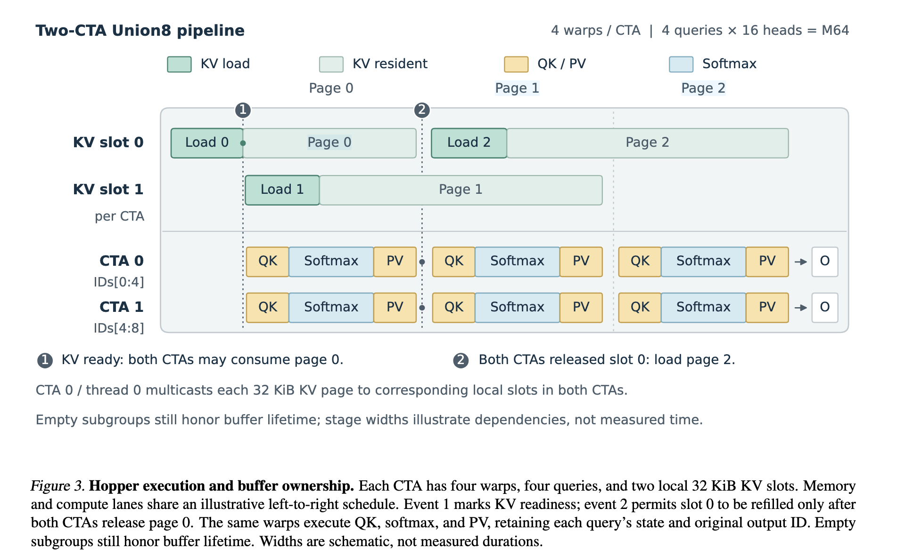

---
tags:
  - papers/LLM
  - topics/sparse-attention
  - topics/gpu-kernel
aliases:
  - PageWeaver
date: 2026-10-22
---

# PageWeaver：在线 Query 分组与共享 KV 的稀疏 Attention

> 来源：[PageWeaver: KV-Guided Query Unions for Sparse Attention](https://arxiv.org/abs/2610.11201v1)，Zhiyuan Li、Zihan Li、Zefang Yuan、Lei Wang、Hao Wang，SenseTime，2026-10-08，v1。
>
> 本文依据论文正文及附录 A、B 整理，是对论文的 **AI 解读**。正文记录论文的方法、实现与实验；用于解释算法的数值例子明确标为教学构造，阅读疑问单列在文末。
>
> [Zotero 原文与完整批注](zotero-reading.md) · [打开 PDF](zotero://open-pdf/library/items/SBISCM3P) · [Attention 论文索引](../index.md)

## 1. 背景与核心洞察：稀疏集合相同，执行成本可以不同

动态稀疏 attention 为每个 Query 选出少量 KV pages，但选中的 Query–page 关系是不规则的，而 Tensor Core 以规则矩阵 tile 执行。即使有效的 Query–KV 交互数量相同，不同的 Query 分组也会产生不同的 page union、无效计算槽位和 KV 搬运量。

Query Union 已经用于将多个 Query 的所选 pages 合并遍历，通过成员掩码保留每个 Query 的独立支持集。PageWeaver 进一步利用 **已经选好的 page 集合之间的重叠关系，在线改变哪些 Query 一起执行**，并让每个 Query 的完整 attention 输出始终归属于一个 CTA。

论文不改变 Top-K selector，不增加或删除任何 Query 的有效 KV 交互。主要流程为：

```text
已有的每 Query Top-K pages
        ↓
请求内、prefill chunk 内的窗口化贪心 regroup
        ↓
Query ID 排列 π（不物理重排 Q）
        ↓
按新的组构造去重 page union 与成员掩码
        ↓
两个 CTA 执行 Union8：每个 CTA 负责四个 Query
        ↓
按原始 Query ID 写回 O
```

**选择组大小**与**选择组成员**是两个不同问题：Union4→Union8 研究共享粒度；online regroup 研究固定八 Query 执行组中应放哪些成员。来源：§1–3，PDF 第 1–3 页。

## 2. 固定支持集与 Query Union

固定一个请求和一个 KV head，其关联的多个 Q heads 共享所选 page 集合。记：

| 符号 | 含义 |
| --- | --- |
| $S_i$ | Query 位置 $i$ 选中的有效、去重后的逻辑 page 集合 |
| $P$ | 一个 page 的 token 数 |
| $c_i$ | Query 的原始因果位置 |
| $L_i$ | 有效上下文长度 |
| $G$、$g$ | 执行组及组内 Query 位置数；论文实测 $g=8$ |
| $W$ | regroup 的候选窗口大小；在线实现使用 64 或 128 |
| $\pi(r)$ | 执行槽位 $r$ 对应的原始 Query ID |

这里的“八个 Query”指八个 Query 位置，不能与八个 Q heads 混淆。

### 2.1 每个 Query 仍计算自己的稀疏 attention

论文式 (1)–(2) 定义：

$$
A_i=\{t:\lfloor t/P\rfloor\in S_i,\ 0\le t<L_i,\ t\le c_i\},
\qquad
o_i=\frac{\sum_{t\in A_i}\exp(q_i^\top k_t/\sqrt d)v_t}
{\sum_{t\in A_i}\exp(q_i^\top k_t/\sqrt d)}.
$$

公式省略了 head 下标。Page 选择、有效长度和因果位置共同决定实际可见 token。无效 ID 不引入交互，重复 page 不重复计算概率质量，空支持集输出零。

**教学例子：** 若 $P=4$、$S_i=\{0,2\}$、$L_i=11$、$c_i=9$，则 $A_i=\{0,1,2,3,8,9\}$。即使其他组员需要 page 1，也不能让这个 Query 关注 token 4–7。

### 2.2 Union 共享遍历，成员掩码保持语义

组 $G$ 的共同遍历范围为：

$$
U_G=\bigcup_{i\in G}S_i,\qquad M_{i,p}=\mathbf 1[p\in S_i].
$$

例如 $S_0=\{1,4,7\}$、$S_2=\{1,4,9\}$，union 为 $\{1,4,7,9\}$。加载 page 9 时，$q_0$ 对它的成员掩码为零；加载 page 7 时，$q_2$ 对它的成员掩码为零。两行的 softmax 分母与输出累积互不混用。

论文式 (3) 用逻辑 page 复用率刻画分组：

$$
\rho_Q(\mathcal G)=\frac{\sum_i|S_i|}{\sum_{G\in\mathcal G}|U_G|}.
$$

上例原来共有六次 Query–page 选择，共同遍历四个 pages，因而复用率为 $6/4=1.5$。这是逻辑结构指标，不等于实测 HBM 流量的减少倍数。

来源：[§3.1，第 2 页](zotero://open-pdf/library/items/SBISCM3P?page=2)。

## 3. Online regroup：窗口内逐组贪心选择

### 3.1 Algorithm 1 的步骤

Regroup 在同一个请求、同一个 KV head 对应的 Query 集合内进行，窗口不跨当前 prefill chunk。它在每次调用时根据当前 Top-K 集合重新生成 ID，不复用旧请求的分组。

对每个窗口，维护尚未分配的 Query 集合 $R$。新组先取原始 ID 最小的 Query 作为 seed；之后反复选取使当前 union 新增 pages 最少的候选：

$$
j^*=\operatorname*{arg\,min}_{j\in R}\bigl(|S_j\setminus U|,j\bigr).
$$

比较按字典序进行：先比较新增 page 数，再用原始 Query ID 打破平局。每次加入候选后更新 $U$，所以下一次比较的是候选与**当前整组 union**的关系，不只是与 seed 的关系。

```python
# 与论文 Algorithm 1 对应的教学伪代码；S 已是有效、去重的 page 集合。
permutation = []
for window in request_local_windows(current_prefill_chunk, W):
    if context_exceeds_bitmap_capacity:
        permutation.extend(window)  # 回退原始顺序
        continue

    remaining = set(window)
    while remaining:
        seed = min(remaining)
        group = [seed]
        union = set(S[seed])
        remaining.remove(seed)

        while len(group) < 8 and remaining:
            chosen = min(remaining, key=lambda j: (len(S[j] - union), j))
            group.append(chosen)
            union |= S[chosen]
            remaining.remove(chosen)

        permutation.extend(group)
```

每组完成后重新选择 seed，并重置 union；不足八个 Query 的尾组仍必须覆盖剩余 Query。最终排列在每个请求内是双射，每个 Query 恰好出现一次。

### 3.2 逐步例子：更新 union 为什么重要

**以下是阅读讨论中的教学构造，不是论文的实测输入。为便于手算，令 $g=3$；论文实际使用 $g=8$。**

| Query | 所选 pages |
| --- | --- |
| $q_0$ | {1, 2} |
| $q_1$ | {8, 9} |
| $q_2$ | {2, 3} |
| $q_3$ | {3, 4} |
| $q_4$ | {8, 10} |
| $q_5$ | {9, 10} |

**第一组：** seed 为 $q_0$，初始 $U=\{1,2\}$。

| 候选 | 新增 pages | 代价 |
| --- | --- | ---: |
| $q_1$ | {8, 9} | 2 |
| $q_2$ | {3} | 1 |
| $q_3$ | {3, 4} | 2 |
| $q_4$ | {8, 10} | 2 |
| $q_5$ | {9, 10} | 2 |

先选 $q_2$，更新 $U=\{1,2,3\}$。此时 $q_3$ 只增加 page 4，代价从 2 降为 1；其他候选仍增加两个 pages。因此再选 $q_3$，得到第一组 $[q_0,q_2,q_3]$，union 为 $\{1,2,3,4\}$。

**第二组：** 剩余 $q_1,q_4,q_5$。以 $q_1$ 为 seed，初始 union 为 $\{8,9\}$；$q_4,q_5$ 都只增加 page 10，按 ID 先选 $q_4$。更新后 $q_5$ 的新增量为零，最终得到 $[q_1,q_4,q_5]$，union 为 $\{8,9,10\}$。

最终排列是：

$$
\pi=[0,2,3,1,4,5].
$$

| 分组方式 | 第一组 union | 第二组 union | 总逻辑 page 访问数 |
| --- | --- | --- | ---: |
| 原顺序 $[0,1,2]$、$[3,4,5]$ | {1, 2, 3, 8, 9} | {3, 4, 8, 9, 10} | $5+5=10$ |
| Regroup $[0,2,3]$、$[1,4,5]$ | {1, 2, 3, 4} | {8, 9, 10} | $4+3=7$ |

有效选择关系始终是六个 Query 各选两个 pages，共十二条边。改变的是共同遍历的组织方式，没有改变任何 $S_i$。这个例子说明贪心目标如何工作，不代表它在任意输入上都能改善原顺序。

### 3.3 GPU 实现和边界

一个 regroup CTA 负责一个窗口：W64 启动 64 个线程，W128 启动 128 个线程，每个线程对应一个 Query。其 Top16 pages 被编码为 **512-bit bitmap，即 16 个 32-bit words**；不是一个 word 对应一个 Top-K 元素。

新增量通过各 word 的位运算与 population count 求和：

```text
delta(j) = sum(popcount(bitmap[j][w] & ~union_bitmap[w]))
```

Warp reduction 加 shared-memory winner reduction 选择最小的“代价、原始 ID”二元组，再更新 union。不同窗口并行；同一组的下一轮选择依赖上一轮更新后的 union。论文给出的总分组算术复杂度为 $O(NW\lceil B/32\rceil)$，其中 $N$ 是 Query 数，$B$ 是 bitmap 的 page 容量。

例如把上例的 page 1、2 编成置位的 bitmap，再与 $q_2$ 的 page 2、3 做差，剩下的只有 page 3，popcount 得到 1。

当前容量为 512 个逻辑 pages，H200 的 page size 为 128，对应 65,536 tokens。超过容量时使用原始 ID 排列。输出仅为 int32 Query ID 数组，不物理复制或重排 Q 张量。

来源：[§3.3、Algorithm 1、§4.1，第 3–4 页](zotero://open-pdf/library/items/SBISCM3P?page=4)。

## 4. Union preparation 与 Two-CTA Union8 kernel

### 4.1 从 ID 排列生成执行元数据

Regroup 的输出是 $\pi$。后续 union-preparation kernel 按这些 ID 读取原始 Top-K 行，去重形成每组的 page 列表，并生成成员掩码。

两类坐标必须分清：

- 成员掩码的 bit 对应新的**执行槽位**。
- Q 的读取、因果位置、请求映射和输出地址使用**原始 Query ID**。

因此执行槽位 $r$ 读取 $q_{\pi(r)}$，应用该 Query 原来的支持集和因果位置，并写入 $o_{\pi(r)}$。精确算术下，这保持原 attention 的语义；FP8 量化与计算顺序带来的数值差异需要单独检查。

### 4.2 为什么是 M64 与 Union8

H200 配置中，一个 KV head 对应 16 个本地 Q heads。每个 CTA 处理四个 Query 位置，形成 $4\times16=64$ 行，匹配 M64 Tensor Core tile；一个 cluster 含两个 128-thread CTA，共同遍历八个 Query 的 page union。

| 层次 | 粒度与职责 |
| --- | --- |
| 执行组 | 八个 Query 共享 page union 与 KV 搬运 |
| CTA 0 | 负责组内 `IDs[0:4]`，四个 Query 的完整 attention |
| CTA 1 | 负责组内 `IDs[4:8]`，四个 Query 的完整 attention |
| 单个 Query/head 行 | 独立的成员掩码、因果掩码、softmax 和输出状态 |

论文先按贪心顺序确定八个组员，再由两个 CTA 分别处理前四个和后四个；没有报告组建后再次优化这两个子组划分的步骤。

作者比较了相同算术配置下的 Union4 与 Union8，并根据完整调用时间选用 Union8。实验加速比为 1.075×；论文明确指出这不证明组大小的普遍最优性，没有给出 Union5 的评测。

### 4.3 Figure 3：multicast、双缓冲与状态归属



原论文 Figure 3，PDF 第 5 页；图片来自阅读时提供的原图截图。深绿色表示 KV 搬运，浅绿色表示 KV 驻留，黄色表示 QK/PV，蓝色表示 softmax。横轴展示依赖顺序，宽度不是实测耗时。[查看图及高亮批注](zotero://open-pdf/library/items/SBISCM3P?page=5)。

**缓冲区是 per CTA 的。** 每个 CTA 各有两个本地 32 KiB KV slots。CTA 0 的 thread 0 发起 multicast，把一个 KV page 分发到两个 CTA 对应的本地槽；每边仍保存自己的副本。两个槽合计每 CTA 64 KiB，仅指 KV staging，并非整个 kernel 的 shared-memory 总用量。

沿图从左到右：

1. **Load 0 → slot 0。** 事件①表示 page 0 已准备好，两个 CTA 才能消费它。
2. **计算 page 0，同时 Load 1 → slot 1。** 当前页计算与下一页搬运可以重叠。
3. **两个 CTA 都释放 slot 0。** 事件②表示这个槽可以覆盖；只等其中一个 CTA 完成是不够的。
4. **Load 2 → slot 0，同时计算 page 1。** 两个槽交替复用，继续推进流水线。

“KV 已就绪”与“槽可以覆盖”是两个不同条件。某个 CTA 的四个 Query 都没有选中当前 page 时，可以跳过算术，但仍须遵守缓冲区生命周期协议。

**每个 Query 的完整累加过程留在同一个 CTA。** 图中每页都有 QK→Softmax→PV，但不是每页单独归一化后直接相加。CTA 跨 page 保留 FP32 running softmax 统计及输出累加状态，完成全部遍历后直接写回原始 Query 行。因此不需要跨 CTA 合并同一个 Query 的 page-partial outputs，也不需要额外的输出重排 pass。

图注强调：

> “The same warps execute QK, softmax, and PV.”

也就是说，不同颜色不代表分别由专门的 QK warp、softmax warp、PV warp 执行。图里两条 CTA 时间线对齐，也不构成它们总能同时完成的保证。

### 4.4 共享搬运与子组计算是不同成本

整个八 Query 组的逻辑搬运代理指标是 $|U_G|$，但两个 CTA 的计算轮次更接近论文式 (4)：

$$
C_4=\sum_{G\in\mathcal G}\bigl(|U_{G_0}|+|U_{G_1}|\bigr),
$$

其中 $G_0,G_1$ 是两个四 Query 子组。一个 CTA 可以跳过自己没有任何成员需要的 page。

**辅助例子：** 若两个子组各需要 16 个 pages，其中 8 个重叠，则整个 union 为 24 个 pages，而两个子组的有效 page 轮次之和为 32。若两个子组完全不重叠，union 为 32，跨子组没有逻辑加载复用。即使如此，也不能简单推断每个 CTA 都必须做 32 轮算术，因为空子组可以跳过计算。

因此，减少整个 union 不必然同时减少两个子组的计算轮次或平衡负载。论文在局限性中明确承认，当前贪心目标只优化八 Query union，没有联合优化上述计算指标。

### 4.5 实际算术路径

H200 路径接收 BF16 Q 和 FP8 E4M3 KV：Q 按 head-row 量化后执行 FP8 QK；softmax 统计保持 FP32；概率经过缩放再转为 E4M3，用于 FP8 PV，补偿尺度进入归一化，最终输出 BF16。

原顺序 Union8 与 regrouped Union8 使用相同算术配置。保持支持集不变并不消除父 kernel 的 FP8 近似。

来源：[§3.2、§4.1–4.3，第 3–5 页](zotero://open-pdf/library/items/SBISCM3P?page=4)。

## 5. 与其他方法的关系

以下区别依据论文 §2–4；相关工作与实际计时基线分开理解。

| 方法或路径 | 主要组织方式 | 与 PageWeaver 的关系 |
| --- | --- | --- |
| 稀疏 selector，例如 MSA block indexer | 决定每个 Query 选择哪些 KV blocks/pages | PageWeaver 接收已有选择结果，不替换 selector |
| LiteDSA / LiteTopK 的 Query Union | 相邻 Query 的索引取并集，通过成员掩码保留支持集 | Query Union 已有先例；PageWeaver 增加有界、每次调用付费的组员重选 |
| MSA 的 KV-outer | 按 page 聚集需要它的 Query，生成并合并部分结果 | 展示从 page 侧发现复用的思路；PageWeaver 最终保留 Query 完整输出归属 |
| 本文的 direct KV-page pair | 对有共同 Query 的 pages 配对，构造共同/独占 Query 列表，最后 combine | 作者实现的设计对照方案，不能等同于官方 MSA kernel |
| DTC-SpMM | 根据稀疏行的列集合相似性和缓存复用做重排 | 相似性分组已有先例；本文强调动态支持集下的在线成本与原始因果坐标 |
| FlashInfer、native SM90 | 论文评测的兼容 attention 实现 | 用于完整调用性能比较，不是只改一个分组参数的对照 |

### 5.1 为什么没有最终采用直接 KV-page 配对执行

令 $R_p$ 为选择 page $p$ 的 Query 集合。对两个 pages $a,b$，$R_a\cap R_b$ 给出共同消费者。直接 page-pair 路径让共同 Query 在局部状态中累加两个 pages，再写一次 partial；独占 Query 仍要覆盖其有效交互。

这种方式需要反转 Query–page 关系、构建工作列表、写回部分结果，并由 combine kernel 完成每个 Query。论文的该实现为 16K Queries 选择的 padded partial workspace 约为 1 GiB。它在人工构造的交错支持集上显示出复用机会，但在所考察的模型捕获输入上输给 Union8。

PageWeaver 因此使用 page 关系寻找适合一起执行的 Query，同时保留 Query-owned accumulation。这个实验同时改变了 work lists、producer 映射和 workspace；附录 B 提醒，不能把结果当成只改变 output ownership 的单变量消融。

### 5.2 Native 与 FlashInfer 基线的身份和口径

H200 native 是 SGLang 的 **SM90 Q8KV8 sparse prefill** 实现，论文固定到 [PR #37236](https://github.com/sgl-project/sglang/pull/37236) 的提交 `62bae6102875a4ecb16d764df4f7622fe7fd0347`，不是一个标为官方 MSA SM100 的对照项。其接口被适配到固定 runtime，但论文说明未改变设备算法。

FlashInfer 是所测的兼容完整算子路径；论文没有在正文中给出足以唯一定位该路径的 API/配置细节。相同 FP8 KV 输入不意味着 Q 和概率矩阵 P 的算术路径相同，因此跨 backend 的加速不能全部归因于 regroup 或组大小。

B300 的 native 不能未经确认就沿用 H200 的 SM90 版本身份；正文与附录没有同样清晰地给出它的具体源码定位。

## 6. Evaluation：基础 kernel、regroup 与服务收益分开看

### 6.1 设置与计时边界

主平台是 H200，模型为 MiniMax-M3，Top16、head dimension 128、每个本地 KV head 对应 16 个 Q heads、page size 128，KV 为 FP8 E4M3。使用固定 SGLang CUDA 12.9 镜像。

完整算子调用计入实时 preparation、量化、packing、metadata、attention，以及所需的 combine/output processing；CUDA Graph replay 不计编译和可复用分配。重放次数表示计时重复，不增加独立输入样本数。

| 实验 | 输入与重复 |
| --- | --- |
| 基础 kernel | 同一个请求的六份 captures：L3/L32/L59，前缀 0/16K；每轮 20 次 graph replay，共 7 轮 |
| 在线 regroup | 一个构造的 64K 输入的五份 captures：L39/r0–3、L43/r1；另有一个 16K L51 control；11 轮，每轮 50 次 |
| H200 整模型 prefill | 每个 8K/32K/64K 桶五条固定 prompts；并发 1/4；每个 arm/cell 三个测量 blocks |
| B300 辅助实验 | TP4/rank0 的八份 captures，四个层、两个 chunks；7 轮轮换 graph/eager 测量 |

来源：[Table 1、§5.1，第 5 页](zotero://open-pdf/library/items/SBISCM3P?page=5)。

### 6.2 Figure 4：基础 Union8 的收益

| 对比 | 结果 | 解释边界 |
| --- | --- | --- |
| Union8 / FlashInfer | 几何平均加速 1.701× | 六份捕获输入上的完整实现对比；Q/P 算术可能不同 |
| Union8 / native SM90 | 几何平均加速 2.662× | 相对固定 native 实现，不代表所有 sparse-attention 后端 |
| Union8 / Union4 | 相同算术配置下几何平均加速 1.075× | 更直接隔离组大小的收益；测试输入输出逐位一致，但不证明八 Query 普遍最优 |

这些首先说明基础 Union8 的性能，不是在线 regroup 的增量收益。[§5.2，第 6 页；Figure 4，第 7 页](zotero://open-pdf/library/items/SBISCM3P?page=7)。

### 6.3 Figure 5：直接 KV-page 执行的机会与代价

人工交错支持集上，direct KV-page union 相对 FlashInfer 的完整调用延迟在 32K 从 1.588 ms 降为 1.340 ms（降低 15.6%），在 64K 从 3.172 ms 降为 2.852 ms（降低 10.1%）。但模型 captures 上 Union8 更快；低重叠的 L43/r1 64K 输入上，page union 为 1.827 ms，Union8 为 1.368 ms。

人工案例证明这种复用模式可能存在，不说明它在自然输入中的出现频率。发现非局部复用后，还必须支付工作列表和部分输出处理的成本。[§5.3、Figure 5，第 6–7 页](zotero://open-pdf/library/items/SBISCM3P?page=7)。

### 6.4 Figure 6：在线收益必须扣掉分组成本

论文分别测量原顺序完整调用 $T_0$、使用预先算好的 grouped IDs 的调用 $T_{\mathrm{fixed}}$、包含在线分组的调用 $T_{\mathrm{online}}$：

$$
S_{\mathrm{exec}}=T_0-T_{\mathrm{fixed}},\qquad
C_{\mathrm{online}}=T_{\mathrm{online}}-T_{\mathrm{fixed}},\qquad
S_{\mathrm{net}}=T_0-T_{\mathrm{online}}.
$$

只有 $S_{\mathrm{net}}>0$ 才有净收益。$C_{\mathrm{online}}$ 是完整路径的操作性差值，不一定等于单独测量 grouping kernel 的耗时。

五份 64K captures 实际包含 15,272 个当前 Queries 和 49,152-token 前缀，总上下文 64,424 tokens。W128 相对原顺序 Union8 降低完整调用延迟 **3.26%–7.66%**；16K control 降低 4.11%。W64/W128 单独 grouping 耗时约为 19.3–19.5 / 34.6–34.9 μs。L39/r1 上 W64 优于 W128，搜索窗口不是越大越好。

**论文中的具体实例：L43/r1，W128。**

| 指标 | 数值 |
| --- | ---: |
| 原顺序逻辑 union visits | 102,429 |
| Regroup 后逻辑 union visits | 89,426，减少 12.70% |
| $T_0$ | 1.36633 ms |
| $T_{\mathrm{fixed}}$ | 1.27037 ms |
| $T_{\mathrm{online}}$ | 1.30792 ms |
| 执行节省 | 95.96 μs |
| 在线额外成本 | 37.55 μs |
| 最终净节省 | 58.41 μs |

同一输入单独 grouping 为 34.65 μs，不能代替表中的 37.55 μs。Page visits 的减少也不能直接当作 HBM bytes 的减少。[§3.4、§5.4；Figure 6，第 8 页](zotero://open-pdf/library/items/SBISCM3P?page=8)。

### 6.5 Figure 7：完整模型中，regroup 的额外收益较小

服务实验轮换 native、原顺序 Union8、online W128 + Union8 三条路径；固定 TP8/DP2、attention-TP4，有效 prefill chunk 为 16K，禁用 radix cache 和 CUDA Graphs，每个请求生成一个 token。W128 用于所有 57 个稀疏层，没有按层选择策略。

| 对比 | 观测结果 |
| --- | --- |
| 最终路径 vs native | 输入 token 吞吐中位数提高 7.88%–14.36% |
| Regroup vs 原顺序 Union8，32K/64K | 额外中位数收益 +0.47%–0.73% |
| Regroup vs 原顺序 Union8，8K，并发 1/4 | 分别为 −0.56% / −1.31% |

大部分最终优势已经存在于原顺序 Union8。服务比较不包含 FlashInfer，不能宣称相对所有服务 backend 最优。三个技术重复也不建立跨文档的统计显著性。

64K/C4 某轮原 Union8 出现较慢 block，使配对增幅出现约 +32.36% 的离群点；论文保留该结果，而没有把它描述为稳定收益。64K 桶五个独立 prompts 中有两个超过 bitmap 容量，相关 chunks 使用原始 ID 回退。[§5.5、Figure 7，第 6、8 页](zotero://open-pdf/library/items/SBISCM3P?page=8)。

### 6.6 Figure 8：B300 上没有超过更强的已有路径

B300 使用 CUDA 13/SM103、直接 FP8 Q、page size 64，且完整调用包含拷贝到稳定 descriptor workspace 的成本。W128 在 L20/L32 上相对原 Union8 有 1.068–1.156× eager 加速，但 native 仍然更快。

例如 L20 第二个 chunk，原 Union8/W128/native 分别为 1.497/1.295/0.592 ms。L3 第一个 chunk 则为 0.475/0.500/0.547 ms：原 Union8 已经最好，regroup 反而增加耗时。

八个测试输入中，两个在线窗口都没有超过 native 与原 Union8 中较快的路径。没有 B300 服务实验。两平台的输入、native 算法、Q 格式、page size 和 descriptor 成本都不同，不能把差异单独归因于硬件。[§5.7、Figure 8，第 8–9 页](zotero://open-pdf/library/items/SBISCM3P?page=9)。

### 6.7 附录 A：离线分组只展示执行潜力

在同一 L43/r1 诊断输入上，以下时间均排除了 CPU 分组搜索与 H2D：

| 路径 | 执行延迟 |
| --- | ---: |
| 原顺序 | 1.371 ms |
| Identity IDs | 1.382 ms |
| Random IDs | 1.832 ms |
| 固定 W512 affinity IDs | 1.234 ms |
| W512，物理重排 Q/Top-K 并恢复输出 | 1.315 ms |
| Global hash + W512 | 1.298 ms |
| 固定 W2048 IDs | 1.185 ms |

结果支持直接 ID 访问可以避免物理搬运开销，同时表明随意重排会损害执行。W2048 对应 CPU 搜索约 1.50 秒，因此 1.185 ms 不是可部署的在线完整调用耗时，也不是全局最优分组的证明。[Figure 9、附录 A，第 11 页](zotero://open-pdf/library/items/SBISCM3P?page=11)。

## 7. 正确性与论文明确的局限

实现检查包括请求内排列双射、成员关系保持、因果/尾页、无效与重复 IDs、空支持集、packed requests，以及新输入的 graph replay；GPU grouping IDs 与 CPU 贪心参考匹配。六份在线 H200 captures 与原 Union8 输出逐位一致，但这个结论限于测试输入。

Table 2 相对同一 Triton reference 的全输出 NRMS 为：Union8 2.246%–3.967%，FlashInfer 2.288%–4.077%，native SM90 6.258%–9.120%。这些是数值误差比较，不是下游任务准确率。只生成一个 token 的服务测试验证执行与吞吐，不能证明长上下文生成质量。

论文列出的限制包括：选定 captures 的代表性有限；固定 bitmap 容量限制长上下文 regroup；贪心目标没有覆盖四 Query 子组计算成本与负载平衡；服务重复、阶段归因、最强兼容服务基线与最终生成质量仍需补充。论文没有报告训练 backward 或训练端到端加速。

来源：[§5.6–5.7、Limitations，第 7–9 页](zotero://open-pdf/library/items/SBISCM3P?page=9)。

## 8. 阅读后的疑问

以下是阅读讨论中的问题，不是论文结论或已验证方案：

- **局部贪心是否会损害后续组？** 论文未给出全局最优或不劣于原顺序的保证。教学反例取 $g=2$：$S_0=\{1,2,3,4\}$、$S_1=\{1,2,6,7\}$、$S_2=\{1,2,3,5\}$、$S_3=\{3,5,8,9\}$。原顺序两组的 union 总量为 $6+6=12$；贪心先配 $q_0,q_2$，剩余 $q_1,q_3$，总量反而为 $5+8=13$。这是简化规则的反例，不是论文八 Query 实测案例。
- **是否应该先构造四 Query 子组，再配对成八 Query 搬运组？** 这更直接对应两个 CTA 的计算边界，但论文没有评估，也不能由结构直觉推出更快。
- **迁移到其他 head 布局或训练是否仍然有效？** 论文的十六 Q heads、本地 M64、FP8 路径与 prefill 证据不能自动覆盖其他布局和 backward。
