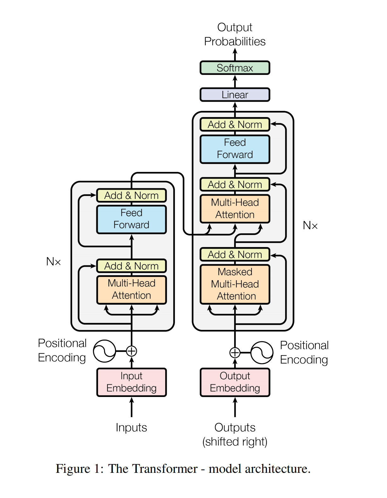
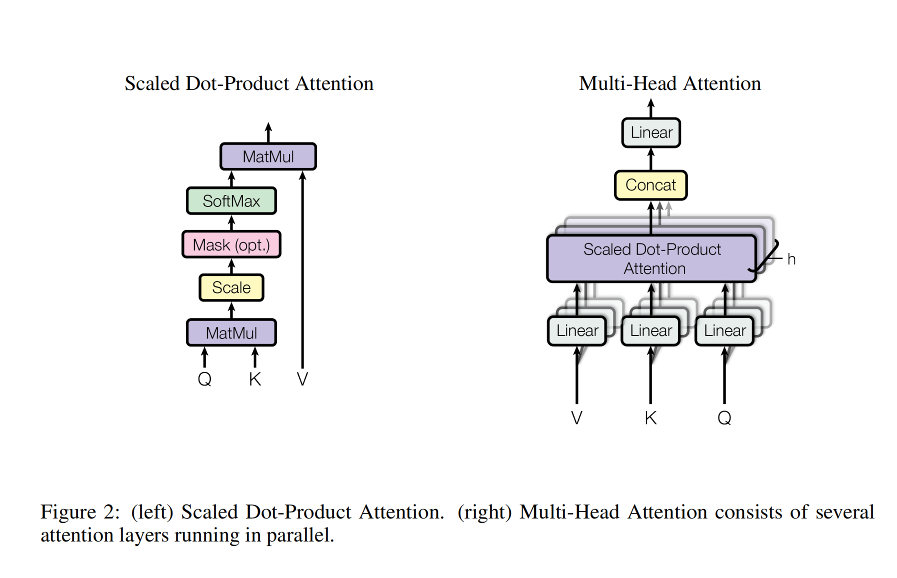
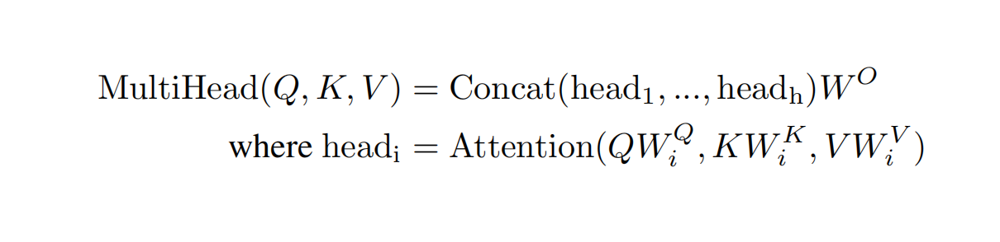

# Attention is all you need：历史笔记

[所属主题](../index.md) · [GitHub 历史笔记目录](../../github-issues.md)

- 论文：[原文](https://arxiv.org/abs/1706.03762)
- 原记录：[Issue #32](https://github.com/KuangjuX/Papers-and-Learning-Notes/issues/32)

## 阅读线索与覆盖范围

保留 encoder–decoder、scaled dot-product attention、多头注意力和位置编码的初读记录。原 encoder/decoder 英文摘录按论文 §3.1 做了中文转述；训练设置与完整实验尚未记录。

## 校注（AI）

按原论文 §3.2，批量计算中的 Q、K、V、O 是矩阵或张量，单个位置的 query/key/value 才是向量；§3.2.3 的三种用法是 encoder self-attention、decoder masked self-attention、encoder–decoder attention。原笔记“比其他模型都要快”缺少评测范围，不能作为任意模型与任务上的结论。见[论文原文](https://arxiv.org/html/1706.03762v7)。

依据：[论文原文](https://arxiv.org/abs/1706.03762)。校注仅核对上面列出的具体问题，其余历史内容尚未逐项复核。

相关基础笔记：[Transformer](../../../Foundations/05_Model_Architecture_and_Reasoning/Transformer.md)。

## 历史阅读笔记

### Abstract

序列转录依赖于循环包含 encoder 和 decoder，提出了一个简单的模型 Transformer，仅仅依赖于 attention，没有使用循环和卷积。

### Introduction

主流模型 RNN 是一个时序模型，$h_t$ 由 $h_{t-1}$ 和当前的词所决定，是一步一步计算的过程，难以并行。同时早期 $h_t$ 的历史信息也会被丢掉。提出的 Transformer 不再依赖于循环卷积，只用 attention，并行度比较高。

### Background

提出 MultiHead Attention 代替卷积神经网络的多通道。

### Model Architecture

大部分 neural sequence transduction 模型有 encoder-decoder 架构。encoder 原始输入 -> 长度为 n 的机器学习向量，decoder： 编码器输出/解码器输出 -> 长度为 m 序列，是一个自回归的架构。

- **Encoder（AI 中文转述，原论文 §3.1）**：原始配置堆叠 6 层，每层先做多头自注意力，再做逐位置的前馈网络。各子层使用残差连接，并在相加后做 LayerNorm；统一的表示宽度为 512。
- **Decoder（AI 中文转述，原论文 §3.1）**：同样堆叠 6 层，在自注意力与前馈网络之外加入面向 encoder 输出的 attention。自注意力使用因果掩码，配合右移的目标输入，预测只能使用已知的历史位置。

原英文摘录仍可在 [Issue #32](https://github.com/KuangjuX/Papers-and-Learning-Notes/issues/32) 查看。

#### Attention

Attention 函数输入 query, key, value pairs 输出一个向量 outputs，其中 Q, K, V, O 都是向量，Transformer 使用了 Scaled Dot-Product Attention:
$$Attention(Q,K,V) = softmax(\frac{QK^T}{\sqrt{d_k}})V$$

##### Multi-Head Attention

##### Applications of Attention

Transformer 有三个 Attention。

#### Positional Encoding

语义会发生变化，因此需要加入时序信息，在输入中加入时序信息。

### Conclusion

仅仅使用 self-attention 的模型 Transformer 比其他模型都要快。
