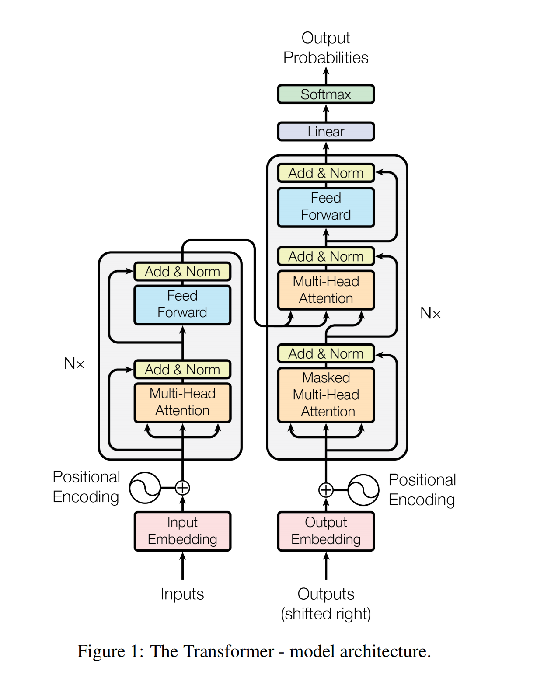
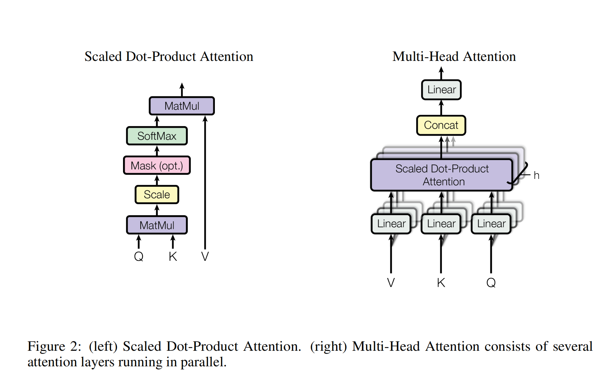
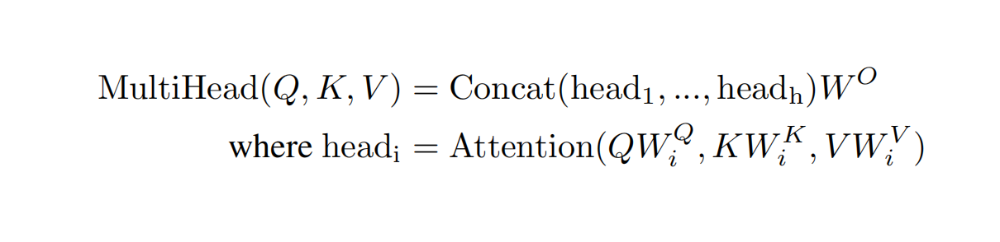

# Attention is all you need：阅读笔记

[所属主题](../index.md)

- 论文：[原文](https://arxiv.org/abs/1706.03762)

Transformer 用 attention 连接序列位置，减少训练时对逐步循环计算的依赖。理解其结构，需要区分 encoder 内部、decoder 历史和 encoder 到 decoder 三条信息路径。

## 先看 encoder–decoder 的数据流

大部分 neural sequence transduction 模型有 encoder-decoder 架构。encoder 原始输入 -> 长度为 n 的机器学习向量，decoder： 编码器输出/解码器输出 -> 长度为 m 序列，是一个自回归的架构。

- **Encoder（AI 中文转述，原论文 §3.1）**：原始配置堆叠 6 层，每层先做多头自注意力，再做逐位置的前馈网络。各子层使用残差连接，并在相加后做 LayerNorm；统一的表示宽度为 512。
- **Decoder（AI 中文转述，原论文 §3.1）**：同样堆叠 6 层，在自注意力与前馈网络之外加入面向 encoder 输出的 attention。自注意力使用因果掩码，配合右移的目标输入，预测只能使用已知的历史位置。

## 从 Q、K、V 计算输出

批量计算时，$Q\in\mathbb{R}^{n_q\times d_k}$、$K\in\mathbb{R}^{n_k\times d_k}$、$V\in\mathbb{R}^{n_k\times d_v}$，输出 $O\in\mathbb{R}^{n_q\times d_v}$。单个位置的 query/key/value 才是向量。Transformer 使用 Scaled Dot-Product Attention（原论文 §3.2）：
$$Attention(Q,K,V) = softmax(\frac{QK^T}{\sqrt{d_k}})V$$

例如 $n_q=n_k=2,d_k=d_v=1$，令所有 Q/K 为 0，$V=[2,4]^T$，不加掩码时每行概率都是 $[1/2,1/2]$，输出都是 3。若使用因果掩码，第一行只能读第一个位置，输出变为 2；第二行仍输出 3。

### 多个头使用不同投影

### 三处 attention 的信息来源

encoder self-attention 的 Q/K/V 都来自 encoder；decoder masked self-attention 使用 decoder 的历史位置；encoder–decoder attention 用 decoder 产生 Q，用 encoder 输出产生 K/V。三者共享计算形式，但可见信息不同。

## 用位置编码补充序列顺序

单靠内容相似度不能表达序列的位置顺序，因此模型在输入表示中加入位置编码。注意力的并行计算降低了对循环状态的依赖，但自回归生成仍按输出位置逐步进行。

相关基础笔记：[Transformer](../../../Foundations/05_Model_Architecture_and_Reasoning/Transformer.md)。论文中的速度与质量结论属于其评测设置，不能推广为所有模型和任务上都更快。
