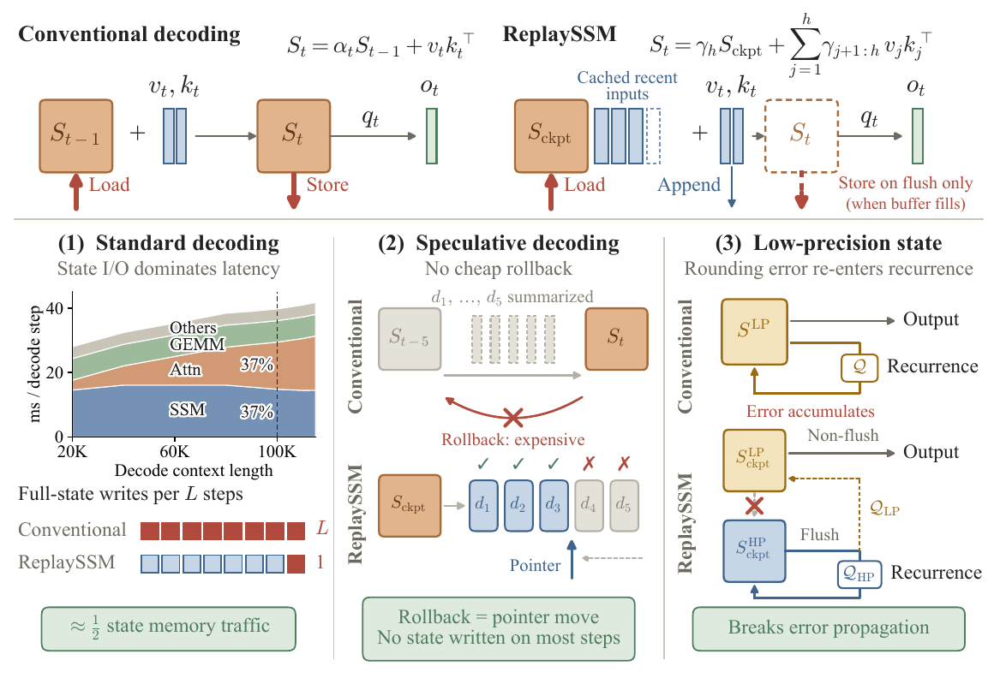
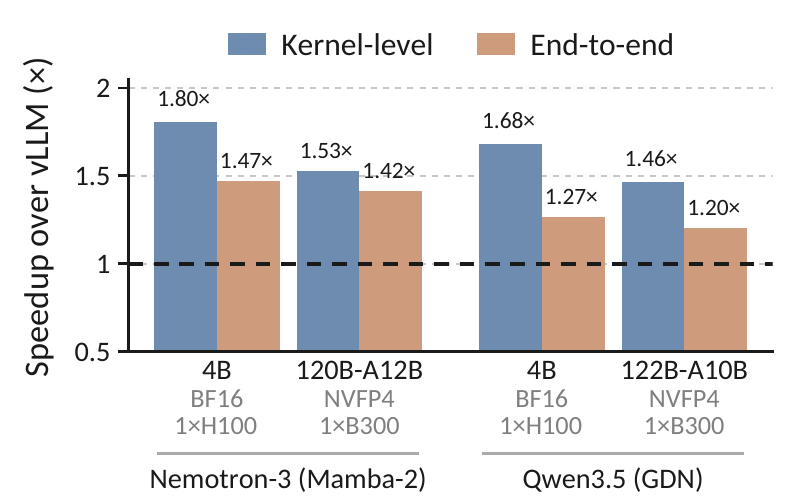
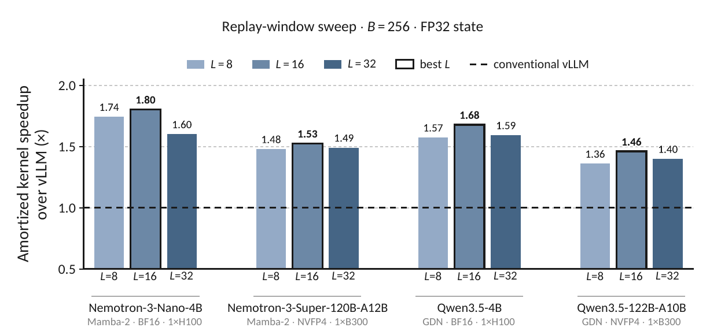
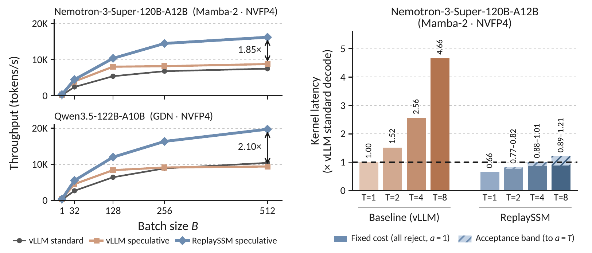
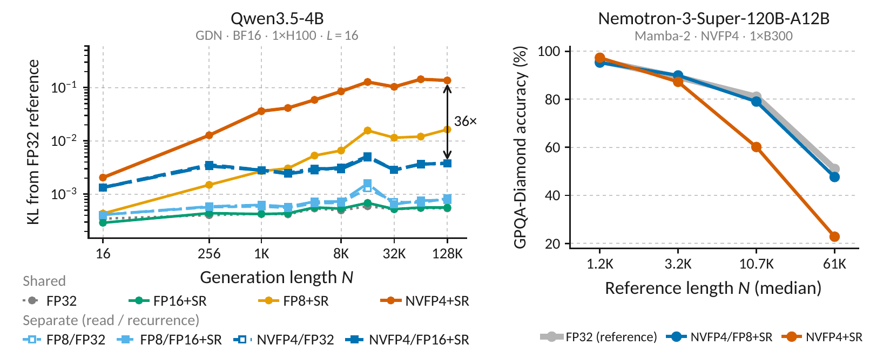

---
tags:
  - SSM
  - 推理优化
  - 投机解码
aliases:
  - ReplaySSM
  - Cache SSM Inputs, Not State
---

# ReplaySSM：缓存输入，减少状态写回

SSM 将历史压缩成固定大小的 recurrent state，避免了 Transformer KV Cache 随上下文增长的存储开销。但固定大小并不意味着更新便宜：常规 decode 每一步都要从 HBM 读取状态、更新状态、计算输出，再将整个状态写回。ReplaySSM 保留一个较早的 checkpoint 和最近一小段 SSM 输入，将完整状态的写回推迟到窗口刷新时，并利用这些输入直接计算输出、支持投机回滚。[论文 v1，§2–6](https://arxiv.org/html/2610.13778v1)

## 背景：固定状态为什么仍然限制 decode

以一个 Mamba-2 value head 为例，状态矩阵 $S_t\in\mathbb{R}^{d_v\times d_k}$，输入 $v_t\in\mathbb{R}^{d_v}$，key 和 query 为 $k_t,q_t\in\mathbb{R}^{d_k}$，衰减系数为标量 $\alpha_t$。省略输出 gate 和 skip connection 后，递推为：

$$
S_t=\alpha_t S_{t-1}+v_tk_t^\top,\qquad o_t=S_tq_t.
$$

这里沿用论文记号，将博客中的 $\Delta_t$ 缩放吸收到 $v_t$ 中。外积更新和矩阵向量乘的计算量都不高，却要搬运完整状态。FP32 状态下，单 head 每步仅状态读写就有 $8d_vd_k$ bytes，而计算约为 $5d_vd_k$ FLOPs，算术强度约为 0.63 FLOP/byte。增加 batch 会同时增加状态流量与计算量，不能靠跨请求复用同一状态来提高这个比值。在足够大的服务 batch 下，状态访存因而成为主要成本。[论文 Appendix C.1，p.21](https://arxiv.org/pdf/2610.13778v1#page=21)

在混合模型中，少量 attention 层也不一定主导延迟。例如 Nemotron-3-Super 有 40 层 Mamba-2、8 层 attention，论文测得 SSM 到约 100K 上下文仍是显著开销；更长上下文时，持续增长的 KV Cache 流量才会使 attention 更突出。这是具体模型的结果，不能推广为所有 SSM decode 都受带宽限制。

状态压缩还带来两个与投机解码有关的困难：

- **缺少低成本回滚路径。** KV Cache 可以缩短有效前缀，丢弃被拒绝 draft 的条目；只有当前 SSM 状态时，没有对应的历史条目可供截断。论文中的常规 vLLM 投机路径为每个 draft 位置保存完整状态快照，拒绝后恢复对应快照，增加了状态写入与显存占用。“SSM 不能回滚”应理解为这种表示缺少便宜的回滚机制，而非数学上绝对不能恢复状态。
- **验证需要每个位置的输出。** 常规递推沿 $T$ 个 draft 逐个更新状态，不能只计算窗口末尾的状态就完成验证。但顺序依赖也不等于所有等价算法都无法并行；ReplaySSM 正是通过改变输出的计算方式，避免逐个物化这些中间状态。[论文 §3、§5](https://arxiv.org/html/2610.13778v1)



*原论文 Fig. 1，p.2，Liou 等，CC BY 4.0。上方比较逐步写回与缓存输入；下方分别对应状态流量、投机回滚和低精度误差反馈。左下延迟分解来自 Nemotron-3-Super-120B-A12B-NVFP4，batch size 256、单 B300，不能视作所有模型的固定占比。[原图](https://arxiv.org/pdf/2610.13778v1#page=2)*

## 核心思路：保留 checkpoint，缓存最近输入

设 $S_0$ 为最近一次写回的 checkpoint，buffer 保存此后的 $h$ 组输入 $(\alpha_j,v_j,k_j)$。定义衰减乘积 $\gamma_{i:j}=\prod_{r=i}^{j}\alpha_r$，空乘积为 1。展开递推可得：

$$
S_h=\gamma_{1:h}S_0+\sum_{j=1}^{h}\gamma_{j+1:h}v_jk_j^\top.
$$

因此，checkpoint 与最近输入已经足以表示当前状态。这里的 replay 只重做 SSM 的局部状态计算，使用已投影好的向量和衰减系数，不重新运行历史 token 的整个模型。

**$S_0$ 与 $S_1,S_2$ 一样大，节省的首先是写回流量。** 常规标准解码通常只维护一份不断覆盖的当前状态，并不永久保存所有历史状态。ReplaySSM 仍要保存完整 checkpoint，还额外保存 buffer，普通解码的常驻容量甚至可能增加；它减少的是一个窗口内将完整状态反复写入 HBM 的次数。投机解码则进一步避免每个 draft 一份完整快照，此时也能降低状态存储容量。[论文 §4、Appendix C.3](https://arxiv.org/pdf/2610.13778v1#page=22)

标准解码每 $L$ 步刷新一次 checkpoint。忽略双方相同的当前输入读取和输出写入，FP32 状态、BF16 的 $v,k$、FP32 的 $\alpha$ 下，单条 buffer 记录大小为 $r=2d_v+2d_k+4$ bytes。一个窗口的流量为：

$$
\begin{aligned}
M_{\mathrm{conv}} &= 8L d_vd_k,\\
M_{\mathrm{replay}} &= 4(L+1)d_vd_k
+\frac{(L-1)(L+2)}{2}r.
\end{aligned}
$$

两边都读取 $L$ 次完整状态；完整状态写入从 $L$ 次降到一次，代价是逐渐增加的 buffer 读写。该计数采用论文的优化：flush 步直接把当前输入合入 checkpoint，不再将它单独写入 buffer。以 $d_v=64,d_k=128,L=16$ 为例，流量比约为 0.58，而不是严格的 0.5；实际共享 key 的 head group 还能摊薄 key 的流量。

缓存输入也改变了每一步必须产生的结果。下一步可以继续从 checkpoint 与 buffer 计算，因而当前步可以只输出 $o_t$，不一定要生成完整 $S_t$；在投机解码中，接受或拒绝输入则变成维护 buffer 的有效前缀。下面分别展开这两点。

## 算法：从构造状态到直接计算输出

### 标准解码与 output-only

常规 Mamba-2 每步的路径是：从 HBM 加载 $S$，计算 $S\leftarrow\alpha S+vk^\top$，读出 $o=Sq$，再将 $S$ 写回 HBM。ReplaySSM 先将当前输入加入 buffer，然后可以选择两条等价路径：

$$
\begin{aligned}
\text{state-and-output:}\quad
&S_h=\gamma_{1:h}S_0+\sum_{j=1}^{h}\gamma_{j+1:h}v_jk_j^\top,
\quad o_h=S_hq_h;\\
\text{output-only:}\quad
&o_h=\gamma_{1:h}(S_0q_h)
+\sum_{j=1}^{h}\gamma_{j+1:h}v_j(k_j^\top q_h).
\end{aligned}
$$

两者的关键区别是乘法结合顺序：$(vk^\top)q$ 先生成一个 $d_v\times d_k$ 的矩阵，再读出向量；$v(k^\top q)$ 先算一个标量，再缩放 $v$。实数运算下结果相同，浮点实现中存在运算重排造成的舍入差异，不能要求逐 bit 一致。

output-only 的标准解码流程可以写成：

```text
持久数据：checkpoint S0；最近输入 buffer；有效长度 h；窗口 L
每步输入：(alpha, v, k, q)
1. 将 (alpha, v, k) 加入 buffer，h 增加 1。
2. 根据衰减乘积，从 S0 和 buffer 直接计算当前输出 o。
3. 若 h 达到 L：重建当前状态并写回 S0，清空 buffer，令 h = 0。
4. 返回 o，继续模型后续的 gate、skip 等计算。
```

这是便于解释的数据流；flush 步的输出计算与状态重建可以复用工作。论文 Algorithm 1 为展示基本方法，使用的是先重建片上状态再读出输出的路径；标准解码的 output-only 推导见 Appendix C.4，不能把 Algorithm 1 本身描述成完全不物化状态。[论文 §4、§5.2、Appendix C.4，pp.5–6、22](https://arxiv.org/pdf/2610.13778v1#page=22)

### 重算的代价为什么可能值得

重放确实增加计算，不能只看减少的写入。若当前输入之前已有 $h$ 条记录，保留主要项，state-and-output 路径约需 $2(h+3)d_vd_k$ FLOPs，而 output-only 约需：

$$
2d_vd_k+2(h+1)(d_v+d_k).
$$

checkpoint 的矩阵向量乘仍然存在；被削减的是每条缓存输入构造外积状态的成本，从 $O(d_vd_k)$ 变成内积与向量加权的 $O(d_v+d_k)$。同组 value heads 共享 $k,q$ 时，内积还可以只计算一次。flush 仍需真正重建状态，所以“只算输出”不能消除所有重放成本。[论文 Appendix C.4]

用资源下界解释重算与访存的取舍（AI 推导）：若一步搬运 $M$ bytes、执行 $F$ FLOPs，带宽上限为 $B_{\mathrm{mem}}$，匹配所用精度和执行单元的计算吞吐上限为 $P$，则有资源下界：

$$
t\geq\max\!\left(\frac{M}{B_{\mathrm{mem}}},\frac{F}{P}\right).
$$

这不是无条件的运行时间等式。同一份数据必须先加载再计算；GPU 只能利用不同 warp 或独立数据块的工作隐藏部分延迟。并行度不足、启动开销或依赖等待，都可能使实际延迟明显高于这个下界。因此，额外计算能否被原来的访存等待所容纳，需要实验判断，不能仅凭“memory-bound”保证。

窗口越长，checkpoint 写入越少，但 buffer 的累计读取和重放工作越多。论文的窗口扫描验证了这种取舍，见后面的 Evaluation；$L=16$ 是该实验配置的选择，不是普遍最优值。

### 投机解码：直接验证输出，提交有效前缀

常规快照路径从最后已接受的状态出发，依次处理 $T$ 个验证位置；每个位置都更新状态、产生输出、保存完整快照。ReplaySSM 将本轮验证输入写到同一个 buffer 的已提交前缀之后，但暂不推进 committed pointer。

设步骤开始时已有 $h$ 条已提交记录，本轮验证 $T$ 个位置。令 $V,K$ 分别按列保存全部 $h+T$ 条 value 和 key，$Q=[q_1,\ldots,q_T]$ 保存本轮 query。Mamba-2 的全部输出可以写为：

$$
O=S_0QD+V\bigl(W\odot(K^\top Q)\bigr).
$$

其中 $D_{ss}=\gamma_{1:h+s}$；当 $j\leq h+s$ 时，$W_{js}=\gamma_{j+1:h+s}$，否则为 0。这个因果掩码保证 draft 位置 $s$ 只能读到自己及之前的输入。$K^\top Q$ 是缓存 key 与本轮 query 的矩阵乘法，随后用带权结果组合 $V$；每个位置不再需要单独物化完整状态。[论文 Eq. (6)、§5.2，p.6](https://arxiv.org/pdf/2610.13778v1#page=6)

具体的数据流为：

1. 在 $h$ 条已提交记录之后追加本轮 $T$ 条输入，保持 $h$ 不变。
2. 从同一个 checkpoint 和带因果掩码的 buffer 计算所有验证输出。
3. 若 $h+T>L$，只将原先的 $h$ 条已提交记录合入 checkpoint，并从逻辑 buffer 中移除；本轮 draft 保留，不参与此次 flush。
4. 采样确定本轮实际提交长度 $a$ 后，将有效前缀推进 $a$ 条。未 flush 时新长度为 $h+a$，已 flush 时为 $a$；拒绝部分留在无效区域，下一轮覆盖即可。

**flush 必须排除尚未确认的 draft。** 否则拒绝的更新已经进入 checkpoint，单纯移动 buffer 指针就无法恢复正确状态。论文采用容量 $L+T$ 的 ring buffer，给最多 $L$ 条已提交记录和本轮 $T$ 条输入留出空间；flush 条件只依赖步骤开始时已知的 $h,T$，不必等待本轮 acceptance。[论文 Algorithm 2、§5.1、Appendix D.1]

作者博客使用总容量 $L$、提前一轮检查 $h+2T>L$ 的记号；论文 v1 使用容量 $L+T$ 和 $h+T>L$。两者的容量定义不同，不能将博客的容量与论文的触发条件直接拼在一起。[作者博客 §5.3](https://dao-lab.ai/blog/2026/replayssm/)

### Gated DeltaNet 的额外依赖

Qwen3.5 使用的 Gated DeltaNet（GDN）还包含擦除项，$\beta_t$ 控制写入强度，不能直接照搬 Mamba-2 的原始 $v$ 缓存：

$$
\begin{aligned}
S_t&=\alpha_tS_{t-1}(I-\beta_tk_tk_t^\top)+\beta_tv_tk_t^\top,\\
u_t&=\beta_t\bigl(v_t-\alpha_tS_{t-1}k_t\bigr),\\
S_t&=\alpha_tS_{t-1}+u_tk_t^\top.
\end{aligned}
$$

改写后，buffer 缓存校正向量 $u_t$，可按同样的衰减外积形式重放。但 $u_t$ 依赖先前状态，投机窗口中的校正项不能全部独立生成；论文通过一个 $T\times T$ 三角系统求解它们，再计算输出。由此可见，“验证不再逐个物化状态”并不意味着所有 SSM 的计算依赖都消失了。[论文 §2.1、Appendix B.2–B.3](https://arxiv.org/pdf/2610.13778v1#page=17)

## Kernel Design：共享内积与 ring buffer

Mamba-2 的一组 value heads 共享 key 和 query。若每个处理状态分块的线程块都计算 $k_j^\top q$，不仅重复工作，还会增加主 kernel 的寄存器压力。作者博客描述了独立的 precompute kernel：每组计算一次内积，写入临时 scratch buffer，供主 SSM kernel 读取。这也引入一次 kernel 启动和临时数据读写，不能只根据 FLOPs 减少就断言总延迟一定更低；博客中的 GDN 路径没有使用同一个共享内积 kernel。[作者博客 §5.4](https://dao-lab.ai/blog/2026/replayssm/)

ring buffer 解决的是保留 draft 时的数据搬移。flush 移除旧的 committed prefix 后，本轮输入成为新的逻辑起点；不需要把它们物理复制到数组开头。接受长度确定后，仅更新有效长度和 ring origin。连续批处理中的不同请求具有不同 buffer 位置与接受长度，避免逐行搬移尤其有用。

为适配 CUDA Graph，论文将 flush 决策保存在逐请求的设备端数据中，由 kernel 读取：可在 decode kernel 内分支，或让独立 flush kernel 中不需要刷新的行直接退出。接受数 $a$ 也由设备端 commit kernel 消费，更新指针并设置下一步的 flush 标志，避免每一步把接受数传回 CPU 后再决定调度。[论文 Appendix D.2，p.25](https://arxiv.org/pdf/2610.13778v1#page=25)

## Evaluation：省下的流量何时转化为收益

以下数值统一采用论文 **arXiv:2610.13778v1**。博客与论文的模型范围、窗口和部分结果不同，例如博客包含双卡 550B 配置，论文主实验为四个单卡模型；不能将两者的最大加速比当成同一组实验。

### 实验设置与基线

| 模型 | SSM 类型 | 权重精度 | 硬件 | SSM / Attention 层数 |
| --- | --- | --- | --- | ---: |
| Nemotron-3-Nano-4B | Mamba-2 | BF16 | 1×H100 80GB | 21 / 4 |
| Nemotron-3-Super-120B-A12B | Mamba-2 | NVFP4 | 1×B300 | 40 / 8 |
| Qwen3.5-4B | GDN | BF16 | 1×H100 80GB | 24 / 8 |
| Qwen3.5-122B-A10B | GDN | NVFP4 | 1×B300 | 36 / 12 |

全部性能实验使用 **FP32 SSM 状态**、BF16 激活，单 GPU、无 tensor parallel；B300 的功率上限为 1100W。双方在同一 vLLM build 中启用 CUDA Graph。基线采用扫描得到的最快 kernel launch 配置，而非较慢的默认 Mamba-2 配置。独立 kernel 延迟经过 warmup、使用 cold L2、报告重复测量的中位数；ReplaySSM 测量覆盖完整 replay 窗口，包含 flush。[论文 §7.1、Appendix E.1–E.2，pp.25–26](https://arxiv.org/pdf/2610.13778v1#page=25)

### 标准解码：大 batch 有收益，小 batch 不保证加速



*原论文 Fig. 2，p.6，Liou 等，CC BY 4.0。$B=256,L=16$，FP32 状态；两种柱分别为独立 SSM kernel 与整模型 decode step，均相对调优后的常规 vLLM。[原图](https://arxiv.org/pdf/2610.13778v1#page=6)*

| 模型 | SSM kernel 加速比 | 整模型 decode step 加速比 |
| --- | ---: | ---: |
| Nemotron-3-Nano-4B | 1.80× | 1.47× |
| Nemotron-3-Super-120B-A12B | 1.53× | 1.42× |
| Qwen3.5-4B | 1.68× | 1.27× |
| Qwen3.5-122B-A10B | 1.46× | 1.20× |

整模型收益较小，因为 attention、其他 GEMM 等工作仍占时间；图中的 end-to-end 指**整模型单步 decode 延迟**，不是包含 prefill 的完整请求吞吐。更长上下文中 attention 的占比提高，也会限制 SSM 优化带来的整体收益。

batch 扫描给出了适用边界：$B=1$ 时 kernel 加速比仅为 0.41–0.88×，整模型单步为 0.96–0.99×，实际略慢；此时常规 kernel 只达到 H100 / B300 峰值 DRAM 带宽的 21.6% / 9.3%，削减流量不足以抵消额外开销。从约 $B=128$ 开始，基线达到约 84–86% 峰值带宽，ReplaySSM 的 kernel 收益趋于稳定。这支持“针对带宽饱和区间优化”的解释，而非所有 decode 都会变快。[论文 Appendix E.2.1，Tables 6–7]

论文在 $B=512$ 给出的两个 B300 模型单步加速比还带有功率上限标记：常规 kernel 在整模型中被功率限制降频，ReplaySSM 没有同样降频。因此这些更高的比值不能全部归因于算法减少访存。

### 窗口消融：写回摊销与重放开销的平衡



*原论文 Fig. 9，p.27，Liou 等，CC BY 4.0。$B=256$、FP32 状态，比较 $L=8,16,32$，延迟包含 flush。纵轴从 0.5 开始，虚线为常规 vLLM 的 1× 基线。[原图](https://arxiv.org/pdf/2610.13778v1#page=27)*

四个模型在这组扫描中都以 $L=16$ 最快。例如 Nano-4B 的加速比从 $L=8$ 的 1.74× 增至 1.80×，再在 $L=32$ 降至 1.60×。更长窗口虽然更少写 checkpoint，却要反复读取更多记录并执行更多重放工作；实验没有支持“窗口越大越好”。[论文 Appendix E.2.2]

### 投机解码：分别看服务吞吐与验证成本



*原论文 Fig. 3–4，p.7，Liou 等，CC BY 4.0。左图：每个模型单 B300，$L=16,T=4$，FP32 状态，比较服务吞吐。右图：Nemotron-3-Super，$B=256,L=16$，改变验证长度 $T$，延迟相对常规单 token decode step，并包含 flush。[原图](https://arxiv.org/pdf/2610.13778v1#page=7)*

服务实验使用两个 120B 级模型自身的 MTP head 生成 draft，输入为 GSM8K prompts，每个请求生成 256 tokens，并忽略 EOS 以固定长度。指标是计时区间内总生成 tokens / wall time，**包含 prefill**。两种投机实现的平均接受长度差异不超过 0.05 token，因此吞吐差距不能解释为更容易接受 draft。[论文 §7.3、Appendix E.3]

| $B=512$ 时的服务吞吐提升 | 相对常规投机解码 | 相对标准解码 |
| --- | ---: | ---: |
| Nemotron-3-Super-120B-A12B | 1.85× | 2.16× |
| Qwen3.5-122B-A10B | 2.10× | 1.90× |

常规投机路径在 $B=128$ 之后收益停滞，Qwen 在 $B=512$ 时甚至低于标准解码；ReplaySSM 能继续从增大 batch 中获益。其设计同时减少逐 draft 的状态写入与快照容量，并用 output-only 改善验证计算形态。

独立 kernel 实验进一步显示：当 $T=8$ 时，常规 Mamba-2 验证延迟为单 token 标准解码的 4.66×，ReplaySSM 为 0.89–1.21×。区间下界对应所有 draft 拒绝、每步只提交必要的一个位置；上界对应全部接受。接受越多，buffer 填满越快，flush 越频繁。这说明接受率既改变每步产出，也改变刷新成本；不能把“八个 token 约一次单步延迟”直接换算为整个服务八倍吞吐，因为还有 drafter、模型其余层和采样等成本。[论文 §7.3、Fig. 4]

### 精度扩展：将读取误差与递推误差分开

论文比博客主线进一步讨论了低精度状态。若同一低精度状态既用于输出，也用于下一次递推，舍入误差会反复进入状态更新。ReplaySSM 可以维护两个对应同一历史的 checkpoint：非 flush 步读取低精度副本计算输出；flush 时从较高精度副本重放已提交输入，再分别生成两个新副本。这样低精度读取副本的舍入误差不再反馈进 checkpoint 递推，但当前输出仍有读取误差，较高精度路径也仍有舍入误差。[论文 §6、Algorithm 3]

GDN 还需保留原始 $v$：若把低精度读取时生成的校正向量 $u$ 直接用于 flush，误差仍会进入状态。因此 flush 必须从较高精度状态重新计算 $u$。[论文 Appendix B.4]



*原论文 Fig. 5–6，p.8，Liou 等，CC BY 4.0。左图在 PG-19 teacher forcing 下测量相对 FP32 的输出 KL；右图按 FP32 参考生成长度四分位分组，比较 Nemotron-3-Super 的 GPQA-Diamond 准确率。图中 SR 为 stochastic rounding。[原图](https://arxiv.org/pdf/2610.13778v1#page=8)*

精度实验只量化 decode 状态，prefill 使用完整精度，模型权重保持发布格式，采用标准解码。KL 与准确率来自集成在 vLLM 中的 Triton 模拟量化；低精度延迟另外使用 CuTe DSL kernel 测量，不能将这些精度结果当成前述 FP32 性能实验已实现的额外整模型加速。

在 Qwen3.5-4B、PG-19 的 128K 长度处，将共享 NVFP4 checkpoint 改为 NVFP4 读取、FP32 递推后，$D_{\mathrm{KL}}(p_{\mathrm{FP32}}\Vert p_{\mathrm{config}})$ 从 0.136 降到 0.0038，约降低 36 倍。它支持“切断低精度误差的递推反馈”这一机制，但并不意味着 NVFP4 输出与 FP32 完全一致。[论文 §7.4、Appendix E.4]

下表摘录论文 Table 2，数值为**四个模型平均准确率相对 FP32 的百分点变化**；Separate 的顺序为“读取 / 递推精度”。

| Checkpoint 配置 | MMLU-Pro | GPQA-Diamond | Math-L5 |
| --- | ---: | ---: | ---: |
| Shared NVFP4 + SR | −5.88 | −13.05 | −10.92 |
| Separate FP8 / FP16 + SR | −0.04 | −0.25 | −0.12 |
| Separate NVFP4 / FP16 + SR | −0.15 | −2.36 | −0.10 |
| Separate NVFP4 / FP8 + SR | −0.40 | −1.77 | −0.38 |

平均值会掩盖模型差异。例如 Nano-4B 在两种 Separate NVFP4 配置下仍损失 6.7 / 5.6 个 GPQA 百分点，不能概括为“分离后无精度损失”。Fig. 6 还显示，Nemotron-3-Super 使用共享 NVFP4 时，在参考生成较长的两组上分别下降 20.9 / 28.2 个百分点；这与递推误差随长生成累积的解释一致，但它是按参考长度分组的观察，不是独立控制生成长度的因果消融。[论文 Table 2、§7.4，pp.9–10](https://arxiv.org/pdf/2610.13778v1#page=9)

GPQA-Diamond 每个配置有 594 次生成，按问题聚类计算的标准误约为 2.5–3 个百分点，较小差异不足以支持明确的精度排序。部分损失还与生成未完成有关：Nemotron-3-Super 的共享 NVFP4 配置有 20.7% 的生成触及长度预算，FP32 为 5.7%；在两种配置都完成的配对样本中，差距缩小到 2.8 个百分点。[论文 Appendix E.4.6，p.32](https://arxiv.org/pdf/2610.13778v1#page=32)
