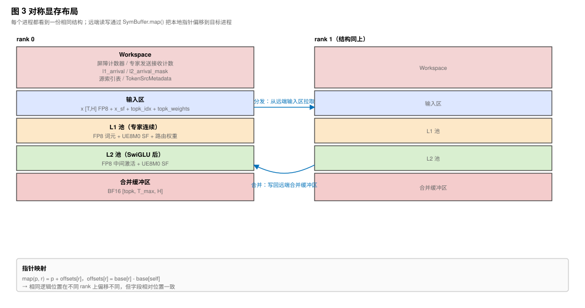
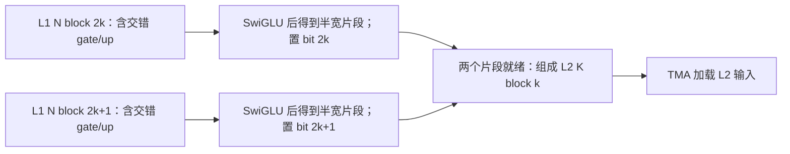

---
tags:
  - papers/LLM
  - systems/GPU
  - MoE
aliases:
  - "MegaMoE"
  - "DeepGEMM Mega MoE"
date: 2026
---

# MegaMoE：把 MoE 前向路径压进一个通信计算融合核

MoE 把每个 token 路由给少量专家，但专家可能位于不同 GPU。一次前向因此既包含两层矩阵乘，也包含分发、激活、量化和结果合并。MegaMoE 将这条路径放进一个持久化 CUDA kernel，用分块就绪信号连接通信与计算。

[DeepGEMM PR #304](https://github.com/deepseek-ai/DeepGEMM/pull/304)，源码版本 [`7f2a703`](https://github.com/deepseek-ai/DeepGEMM/tree/7f2a703)。下面的接口和布局对应这一版本；后续优化与性能数字见 [PR #316](https://github.com/deepseek-ai/DeepGEMM/pull/316)。

## 从传统 MoE 前向看阶段边界的成本

### MoE 前向的真实瓶颈不只是 GEMM

一个标准 MoE 前向可以写成：

$$
y_t = \sum_{j=1}^{k} g_{t,j} \cdot W^{(2)}_{e_{t,j}} \, \mathrm{SwiGLU}\left(W^{(1)}_{e_{t,j}} x_t\right)
$$

其中 $x_t$ 是 token 特征，$e_{t,j}$ 是第 $j$ 个被选专家，$g_{t,j}$ 是对应路由权重，$k$ 是每个 token 选择的专家数。该式表示无偏置的 MoE 数学运算；实际低精度执行还包含量化与舍入。

在专家并行场景下，一个词元选中的专家可能位于其他 GPU 进程上。于是 MoE 层实际会变成：

1. 根据 `topk_idx` 统计每个专家收到多少词元。
2. 把词元和缩放因子分发到专家所在进程。
3. 每个进程对本地专家执行第一层分组矩阵乘。
4. 执行 SwiGLU，并乘上前 k 个路由权重。
5. 执行第二层分组矩阵乘。
6. 把每个词元的前 k 个专家输出合并回原始进程。
7. 对前 k 个输出求和，得到最终 BF16 输出。

如果这些步骤由多个独立核函数和通信原语完成，瓶颈会来自三类开销：核函数启动、阶段间同步、以及通信和计算不能充分重叠。MoE 层的 GEMM 本身虽然很重，但词元路由带来的小批量、不均衡和跨 GPU 搬运，会让单纯优化分组矩阵乘不够。

### 基线路径是什么？

`tests/test_mega_moe.py` 里的基线很清楚：

1. 用 DeepEP 的 `ElasticBuffer.dispatch` 做专家并行分发。
2. 用 `m_grouped_fp8_fp4_gemm_nt_contiguous` 做第一层分组矩阵乘。
3. 用 TileLang 的 `swiglu_apply_weight_to_fp8` 做 SwiGLU、路由权重缩放和 FP8 再量化。
4. 再用 `m_grouped_fp8_fp4_gemm_nt_contiguous` 做第二层分组矩阵乘。
5. 用 DeepEP 的 `combine` 把专家输出合并回原词元。

MegaMoE 的直接目标就是把这条路径合并成一个 `deep_gemm.fp8_fp4_mega_moe(...)` 调用。

这里的对照是测试脚本采用的分阶段基线。其他专家并行实现也可能具有通信计算重叠，不能将其全部视为严格串行。

## 先跟踪一个 token 的完整路径

融合的价值取决于数据能否逐块交接。下面沿一个 token 追踪输入、专家中间状态和返回地址，再分别解释寻址与就绪条件。

```text
源进程：输入 x、topk_idx、topk_weights
    ↓ 交换路由索引，目标进程按索引拉取
专家进程：L1 token pool → Linear1 → SwiGLU × 路由权重 → FP8 再量化
    ↓ 中间激活写入 L2 token pool，发布就绪标记
专家进程：Linear2 → BF16 专家输出
    ↓ 根据来源元数据远端写回
源进程：combine_buffer[topk_slot, token, hidden] → top-k 归约 → y
```

专家连续布局让 GEMM 容易消费，来源元数据让结果仍能回到原 token。接下来需要解释的两个问题是：不同进程怎样寻址这些缓冲区，以及消费者如何确认生产者已经写完。

## 用对称显存连接源 token、专家池和输出槽位

### 对称显存是跨进程指针映射的基础

MegaMoE 依赖 PyTorch 的对称显存。主机端会为每个进程分配一块布局相同的缓冲区，然后把所有进程的基址指针收集起来传入核函数。设备端的对称缓冲区结构同时保存本进程的基址，以及一个长度等于进程数的偏移数组，每一项指向其他进程同一逻辑位置相对于本进程的偏移。结构上还带一个映射函数：传入本进程的指针和目标进程编号，返回该指针加上对应偏移后的地址，也就是目标进程上同一逻辑位置的地址。这个映射的本质是把本地逻辑指针加上"目标进程基址减本进程基址"，分发、合并和跨卡屏障都建立在这个映射之上。



自绘示意；缓冲区划分对应 [`get_symm_buffer_size_for_mega_moe`](https://github.com/deepseek-ai/DeepGEMM/blob/7f2a703/csrc/apis/mega.hpp)。
### 缓冲区被切成多个逻辑区域

`csrc/apis/mega.hpp` 中的 `get_symm_buffer_size_for_mega_moe` 决定了对称显存布局。它先放工作区，再依次放输入、第一层池化输入、第二层池化输入、合并缓冲区。

逻辑上可以画成：

```text
sym_buffer
  ├── Workspace
  │   ├── grid / NVLink 屏障 counters
  │   ├── expert send / recv counters
  │   ├── L1 arrival counts
  │   ├── L2 arrival masks
  │   ├── source token-topk index table
  │   └── token source metadata
  ├── input x                      FP8, [num_max_tokens_per_rank, hidden]
  ├── input x_sf                   UE8M0 packed scaling factor
  ├── topk_idx                     int64
  ├── topk_weights                 FP32
  ├── L1 token pool                FP8, expert-contiguous
  ├── L1 scaling factor pool       UE8M0
  ├── L1 top-k weight pool         FP32
  ├── L2 token pool                FP8, post-SwiGLU
  ├── L2 scaling factor pool       UE8M0
  └── 合并词元缓冲区         BF16, [topk, num_max_tokens_per_rank, hidden]
```

这套布局让通信、计算和最终归约可以直接交换地址，但也必须提前为专家池、元数据和 top-k 输出槽位预留容量。实现依赖 PyTorch ≥ 2.9 的对称显存接口；相同逻辑偏移能跨进程寻址，不表示这些区域不占实际存储。

### 容量如何估算？

专家词元池的容量不是简单的 `num_ranks * num_tokens * topk`，还要考虑每个专家按 `BLOCK_M` 对齐产生的填充。代码中的公式是：

$$\mathrm{pool}=\mathrm{align}(R \cdot T_{\max} \cdot \min(k,E_{\mathrm{local}})+E_{\mathrm{local}}\cdot(B_M-1),B_M)$$

其中各符号分别表示进程数、每进程最大词元数、专家选择数、本地专家数和矩阵乘分块大小；额外项表示每个专家尾部对齐最多带来的填充。

例如取 $R=2,T_{max}=8,k=2,E_{local}=3,B_M=4$，容量上界为 $\operatorname{align}(2\times8\times2+3\times3,4)=44$ 行。这是解释容量式的小规模例子，并非 GPU kernel 的合法启动配置。

## 调用前准备：格式、形状与 JIT 特化

### Python 侧看到的接口

调用顺序是：先创建 MegaMoE 对称显存缓冲区，再转换两层专家权重布局，然后把输入激活、缩放因子、专家索引和路由权重拷入缓冲区，最后调用 `deep_gemm.fp8_fp4_mega_moe(...)` 生成 BF16 输出。

这些预处理仍由调用方完成。输入拷贝可以融合进前一个 kernel，但不会因为主 MoE 只有一次调用就自动消失；`x` 为 FP8，`x_sf` 为 packed UE8M0，权重为转换好布局的 FP4。

### 主机端会做严格形状检查

`fp8_fp4_mega_moe` 的检查非常专用：

- `recipe` 必须是 `(1, 1, 32)`。
- 激活函数必须是 `swiglu`。
- 第一层权重形状必须是 `[num_experts_per_rank, 2 * intermediate_hidden, hidden]`。
- 第二层权重形状必须是 `[num_experts_per_rank, hidden, intermediate_hidden]`。
- `hidden` 和 `intermediate_hidden` 必须满足缩放因子对齐要求。
- 当前只支持主版本号为 10 的 CUDA 架构，也就是 SM100 路径。

这说明 MegaMoE 不是一个通用 MoE 运行时，而是一个针对特定数值格式、特定硬件和特定 MoE 前向模式的高性能核。

### JIT 特化参数很多

MegaMoE 通过 JIT 生成模板实例。关键模板参数包括：

- `kNumMaxTokensPerRank`
- `kHidden`
- `kIntermediateHidden`
- `kNumExperts`
- `kNumTopk`
- `kNumExpertsPerWave`
- `BLOCK_M / BLOCK_N / BLOCK_K`
- `STORE_BLOCK_M`
- 缩放因子 block 尺寸
- pool 容量
- pipeline 阶段数
- 分发、MMA、尾声阶段线程数
- SM 数、进程数
- 激活截断和快速数学近似开关

这会增加编译特化成本，但换来核内大量静态展开和布局确定性。例如代码中"K 维分块大小等于 N 维分块大小"以及"存储分块行数是矩阵乘分块行数的一半"这类硬约束都在编译期用静态断言固定下来，让后续尾声阶段用按位掩码同步成为可能。

## 把数据流映射到三组线程角色

MegaMoE 的核函数启动不是普通一个 CTA 做一个分块，而是每个 SM 驻留一个持久化 CTA，相邻两个 CTA 组成协作簇，按线程束角色固定分工。默认线程布局来自 `get_mega_moe_config`：

| 角色 | 线程数 | 主要任务 |
|---|---:|---|
| 分发线程束 | 128 | 统计路由、写源索引、跨进程拉取词元和缩放因子、清理工作区 |
| 非尾声矩阵乘线程束 | 128 | 异步加载激活和权重，并发射 SM100 矩阵乘指令 |
| 尾声和合并线程束 | 256 | 处理 L1/L2 尾声阶段、写回远端合并缓冲区、最终前 k 个归约 |

寄存器也按角色重新分配：

| 角色 | 每线程寄存器 |
|---|---:|
| 分发 | 48 |
| 非尾声矩阵乘 | 40 |
| 尾声阶段 | 208 |

这很符合实际工作负载：分发和异步加载线程束主要做地址计算与搬运，寄存器需求较小；尾声阶段要做门控激活、最大绝对值归约、量化、BF16 打包、合并累加，需要更多寄存器。每个 SM 上一共 16 个线程束（512 线程），三组分配的寄存器总量约等于 48 乘 128 加 40 乘 128 加 208 乘 256，合计 64,512 个 32-bit 寄存器，即 252 KiB。这里的计数单位是寄存器个数，不能写成 64 KiB。

线程分工对应 [`get_mega_moe_config`](https://github.com/deepseek-ai/DeepGEMM/blob/7f2a703/csrc/jit_kernels/heuristics/mega_moe.hpp)，寄存器分配对应主核的各角色分支。

## 分发：交换索引，再由专家进程拉取输入

### 第一步：每个 SM 统计专家收到的词元数

分发线程束读取 `topk_idx`。每个 lane 负责一个词元的前 k 个槽位；如果专家有效，就对共享内存中的 `smem_expert_count[expert_idx]` 做块内原子加。

随后每个 SM 把自己的统计结果累加到工作区的全局 `expert_send_count`。这里用了一个 64 位计数值：高 32 位像完成标记，低 32 位是词元数。这样调度器可以等待所有 SM、所有进程的专家计数都到齐。

### 第二步：写远端源索引表

分发不是立刻搬词元，而是先把“某个专家收到的第几个词元对应原始词元的哪个前 k 槽位”写到专家所在进程的工作区中。

关键实现是先根据全局专家编号求出目标进程，再用本地原子加获得目标槽位，最后通过对称显存映射把原始词元槽位写入目标进程的源索引表。

这一步把原始 `token_idx` 和 `topk_idx` 合并成 `token_topk_idx`，并写入目标专家所在进程。之后目标进程可以根据这个表把需要的词元从源进程拉过来。

### 第三步：跨进程同步

代码使用两类同步：

- `grid_sync`：同一进程内所有 SM 的同步。
- `nvlink_barrier`：所有进程之间通过对称显存做跨 GPU 屏障。

NVLink 屏障只让 SM0 参与跨进程信号发送。每个进程往所有进程的信号地址做系统范围原子加，然后等待本地信号达到目标值。它还带有 30 秒超时，避免死锁无声挂住。

### 第四步：目标进程主动拉取词元

分发完成索引交换后，专家所在进程根据本地专家的接收表，主动从源进程的输入缓冲区拉取词元和缩放因子。词元通过一维异步拷贝进入共享内存，再写入本地第一层词元池；缩放因子由线程直接搬运并重排到第一层缩放因子池。

这个阶段还会保存 `TokenSrcMetadata`，记录该词元来自哪个进程、原始词元下标、以及在 top-k 中的位置。后续 Linear2 尾声阶段就靠它把专家输出写回原词元所在进程的合并缓冲区。

### 轮转选择进程的意义

分发拉取阶段有一段复杂逻辑，用“逐轮剥离最小剩余量”在各进程之间轮转选择词元。这不是随机复杂化，而是为了把同一个专家内来自不同进程的词元均匀交错，减少长时间只拉一个进程的数据。它根据每个进程对当前专家贡献的词元数，逐轮取所有还没耗尽的进程的最小剩余长度，在这一轮内交错选择进程。

举一个具体例子帮助理解：假设某个本地专家收到来自四个远端进程的词元数分别是 5、3、9、2。朴素做法会把它们按进程顺序首尾相接，前八个词元的异步加载只触达前两个对端，跨卡路径会闲置。轮转算法则按下面的方式分轮：第一轮每个进程贡献 2 个（取最小剩余 2），第二轮三个进程各贡献 1 个（最小剩余 1），此时四个进程的剩余量变成 2、0、5、0，再取最小剩余 2，最后一轮只剩第三个进程还有 3 个。这样不同进程的词元在专家内的位置被打散，目标是在仍有多个来源进程时分散对端访问；实际链路利用率仍需测量。

## 波次调度：在并行度与 L1/L2 等待之间取舍

### 为什么要分波次？

MoE 路由天然不均衡。有的专家可能收到很多词元，有的专家几乎空闲。如果调度器一次处理所有专家，L1 和 L2 之间的依赖会很难高效流水化；如果一次只处理一个专家，又可能因为分块太少而填不满所有 SM。

MegaMoE 的做法是把本地专家切成波次。每个波次内：

1. 先调度这些专家的所有 Linear1 block。
2. 再调度这些专家的所有 Linear2 block。
3. 然后进入下一波次。

`MegaMoEScheduler` 的状态机只区分两种状态：第一层（`Linear1`）和第二层（`Linear2`）。在 `for_each_block()` 中它会根据 `next_phase` 从 L1 或 L2 空间取下一个分块，并在切换波次时更新 `wave_start_expert_idx` 与 `wave_end_expert_idx`。每个分块的坐标是 `(local_expert_idx, m_block_idx, n_block_idx)`，对应专家在词元池里的行偏移和该专家某一行/列方向上的小块。

每波次的专家数由配置启发式给出：当本地专家数较大且每个专家平均行数较少时，每波处理更多专家以提高并发；反之每波处理更少以减少第一层与第二层之间的相互等待。可以把每波次专家数的目标值粗略理解为，让 SM 数乘以分块行数大致等于该波次本地专家词元总数，从而让一个波次的第一层分块数量与 SM 数同量级。

### 波次启发式的覆盖边界

块高选择函数目前直接返回 192，注释写着仍待完善。波次选择函数把每波专家数限制为不大于 32 的本地专家数因子，并用不均衡因子估算波次大小；这不是“每进程最多 32 个专家”的限制，例如测试默认每进程有 48 个专家。这说明 MegaMoE 仍是强工程化实现，不是已经形式化到所有形状都自动最优。


### L1 到 L2 的依赖如何表达？

Linear1 的输出是 Linear2 的输入。MegaMoE 用每个池分块的到达掩码来表达依赖：

- 分发把一个 L1 pool block 的词元全部拉完后，递增 `l1_arrival_count`。
- 第一层尾声阶段完成一个输出分块后，对第二层到达掩码做按位或。
- Linear2 的 TMA 加载线程束在读取某个 K block 前，等待 mask 中相关 bit 到齐。

由于第一层输出宽度是中间维度的两倍，门控激活后会减半为中间维度。代码要求两个分块宽度相等，因此第二层的一个输入分块需要等待第一层的两个输出分块。实现上，第二层会轮询对应的 64 位到达掩码；只有当第一层的两个相关输出分块都置位后，第二层才读取这个输入分块。这就是核内数据流依赖的关键。



这里每个 L1 N block 内部就有 gate/up 配对；等待两个 N block，是因为每块激活后的宽度减半，不能解释成一个块只存 gate、另一个只存 up。对应主核的 `needed = 3ull << (k_block_idx * 2)`。

## 专家计算：从矩阵形状到加载与 MMA 流水线

### 矩阵形状

对每个专家 $e$，第一层和第二层分别是：

$$
Z_e = X_e W^{(1)\top}_e,\quad W^{(1)}_e \in \mathbb{R}^{2d_{\mathrm{ff}} \times d_{\mathrm{model}}}
$$

$$
Y_e = H_e W^{(2)\top}_e,\quad W^{(2)}_e \in \mathbb{R}^{d_{\mathrm{model}} \times d_{\mathrm{ff}}}
$$

其中 $X_e$ 是分发后属于专家 $e$ 的词元池，$H_e$ 是 SwiGLU 后的中间激活。

测试默认形状是：

| 参数 | 默认值 |
|---|---:|
| `hidden` | 7168 |
| `intermediate_hidden` | 3072 |
| `num_experts` | 384 |
| `num_topk` | 6 |
| `num_processes` | 8 |
| `num_max_tokens_per_rank` | 8192 |

这意味着每进程有 48 个专家，每个词元选择 6 个专家。

### 数值格式

MegaMoE 的数值路径是：

| 数据 | 格式 |
|---|---|
| 输入激活 | FP8 E4M3 |
| 输入激活缩放因子 | packed UE8M0 |
| L1 权重 | FP4 E2M1 |
| L1 权重缩放因子 | packed UE8M0 |
| L1 尾声阶段输出 | FP8 E4M3 |
| L2 权重 | FP4 E2M1 |
| L2 权重缩放因子 | packed UE8M0 |
| L2 尾声阶段输出 | BF16 |
| 最终输出 | BF16 |

主核注释直接把激活类型硬编码为 FP8 E4M3、权重类型硬编码为 FP4 E2M1，并在共享内存侧使用适合矩阵乘指令消费的解包表示，不预留通用化路径。

### 从数学矩阵到指令操作数

主核在构造指令描述符时交换 A/B：代码把权重放在指令的第一操作数，把激活放在第二操作数，并采用 2-CTA、K-major 的矩阵乘配置。实际调用为 `SM100_MMA_MXF8F6F4_2x1SM_SS::fma`，两侧输入使用共享内存描述符；缩放因子由 UTCCP 搬入 TMEM，累加结果也位于 TMEM。不能把交换 A/B 理解成“权重矩阵从 TMEM 读取”。

这一布局选择还决定了指令的 M/N 轴、输出累加器排列和后续 epilogue 的取数方式。源码对应主核的 `MMA configs` 与 `GEMM MMA issue warp` 两段。

### 张量内存（TMEM）的列分配

这里使用 `Allocator2Sm` 管理双 CTA 协作所需的张量内存。核函数为每个矩阵乘在张量内存中预留三段：两份累加器，每份占一段固定列宽，存放 32 位浮点累加结果，供尾声阶段与下一次矩阵乘之间做双缓冲；一段第一矩阵缩放因子列，由专用拷贝指令从共享内存搬入；以及一段第二矩阵缩放因子列，由同样的指令搬入。

张量内存的两个屏障（满屏障与空屏障）维护矩阵乘与尾声阶段之间的双缓冲：矩阵乘写满某个阶段后到达满屏障；尾声阶段读完后到达空屏障，把该阶段让出给下一次矩阵乘。

### TMA 加载与 UMMA pipeline

非尾声阶段线程束被分成三类：

- 一个线程束负责 A，也就是词元激活和 SFA。
- 一个线程束负责 B，也就是专家权重和 SFB。
- 一个线程束在 leader CTA 上发射 UMMA。

共享内存中有多阶段的激活、权重和缩放因子缓冲区，使用满屏障和空屏障管理生产者消费者关系：

1. TMA 加载线程束等待 `empty_barrier`。
2. 发起激活、权重和缩放因子的异步拷贝。
3. 到达 `full_barrier`。
4. MMA 线程束等待 `full_barrier`。
5. 发射 UMMA。
6. MMA 线程束到达 `empty_barrier`，释放该阶段。

这就是经典的多阶段 GEMM pipeline，只是它被嵌在更大的分发-compute-合并 pipeline 里。

## 第一层尾声：激活、路由加权与再量化

### 从张量内存直接取累加器

第一层尾声阶段等待张量内存的满屏障后，用一条张量内存加载指令把 FP32 累加器读到 8 个寄存器中。这 8 个值在通道方向上的排列恰好是"门控、上投影、门控、上投影"交错。这种顺序来自权重布局转换与累加器布局的配合；仅有 `[2I,H]` 形状并不能保证门控与上投影交错。矩阵乘完成后这种交错保持在张量内存上，因此尾声阶段不需要再做一次重排，相邻寄存器对就是同一通道上需要相乘的那对值。

### SwiGLU 计算

SwiGLU 的数学形式是：

$$
\mathrm{SwiGLU}(a, b) = \mathrm{SiLU}(a) \odot b
$$

其中：

$$
\mathrm{SiLU}(a)=a \cdot \sigma(a)=\frac{a}{1+\exp(-a)}
$$

MegaMoE 还把路由权重乘进去：

$$
h_{t,e}=g_{t,e}\,\mathrm{SiLU}(a_{t,e})\odot b_{t,e}.
$$

例如 $a=0,b=2,g=0.5$ 时，$\mathrm{SiLU}(0)=0$，输出为 0；$a=\ln 3,b=2,g=0.5$ 时，$\sigma(a)=3/4$，输出为 $3\ln3/4$，随后还需按块缩放并量化。

代码中先把门控分支和上投影分支转换成 BF16，再转回双浮点向量计算指数和乘法；快速数学开关打开时使用近似指数与倒数。

### 激活截断

第一层尾声阶段可选做激活截断，默认截断阈值是 10。代码对门控路只限制上界，防止门控激活在输入很大时近似输入本身，乘上投影路后溢出 FP8 表示范围；对上投影路同时限制上下界，避免对称地把负值过度放大。这不是通用深度学习框架语义，而是为了配合低精度路径的数值稳定性。

### 最大绝对值、缩放因子和 FP8 中间结果

门控激活后的值要作为第二层的低精度输入，因此第一层尾声阶段要计算每个三十二通道组的缩放因子。具体执行顺序是：先在每个线程束内对自己负责的连续三十二通道值取绝对值的最大；再用线程束内异或归约把局部最大值合并；然后用一次共享内存原子最大值在四个线程束之间归约，得到该通道组的全局最大绝对值。接下来调用低精度量化辅助函数：它返回一对值，前者是与最大绝对值最接近的二的整次幂格式（也就是无符号尾数八位幂指数格式），后者是它的倒数。再用倒数把浮点值缩放到 FP8 可表示范围，最后转成 FP8 打包格式，通过共享内存中转后用张量加速器存储指令写入第二层词元池，缩放因子写入第二层缩放因子池，并对第二层到达掩码做按位或，通知第二层可以消费这一段。

这里的关键点是门控激活、路由权重、动态再量化、缩放因子生成和第二层依赖通知都在第一层尾声阶段里完成，没有额外核函数；同时所有跨线程束的归约都用线程束组内屏障与共享内存原子完成，没有进入全局屏障。

## 第二层尾声：根据来源信息写回远端槽位

第二层矩阵乘的累加结果被转换成 BF16。与第一层不同，第二层输出不再写本地中间池，而是根据分发阶段记录的来源元数据写回词元原始所在进程的合并缓冲区。

写回逻辑需要三个索引：

- `dst_rank_idx`：原词元所在进程。
- `dst_token_idx`：原词元在该进程内的词元行号。
- `dst_topk_idx`：该专家输出属于词元的第几个前 k 个槽位。

目标缓冲区是：

```text
combine_token_buffer[topk_slot][token_idx][hidden]
```

每个专家输出先写入对应前 k 个槽位，最终合并阶段再把这些槽位相加。

这一阶段与传统 DeepEP 合并的区别在于：它不把所有专家输出交给单独通信库阶段处理，而是在 L2 尾声阶段中直接进行远端写回。这样 L2 计算一产出就能开始通信。

## 最终合并与缓冲区复用

所有 L2 尾声阶段写回完成后，尾声阶段线程束通过 NVLink 屏障确认跨进程合并缓冲区都可见，然后开始最终归约。

对每个词元，合并阶段：

1. 读取 `topk_idx`，确定有效前 k 个槽位。
2. 用两个加载阶段交替从 `combine_token_buffer` TMA 加载 BF16 chunk。
3. 在寄存器中用 FP32 累加所有前 k 个槽位。
4. cast 回 BF16。
5. TMA 存储到输出 `y[token_idx]`。

测试脚本中给出了合并归约时间的近似：

$$
t_{\mathrm{归约}} \approx
\frac{T \cdot H \cdot 2 \cdot (1+k)}{6.5 \times 10^{12}}
$$

它把每词元、每个隐藏维度元素的 BF16 读写与前 k 个归约估成一个串行尾部成本。因此测试打印里有一个 `approx_factor`，用于估算扣除归约后的重叠段吞吐。

此处合并发生在该次调用的专家计算和远端写回之后，并非每个专家波次结束就输出一次。分发线程束等待与 epilogue 的交接后清理 workspace，清理可与最终合并归约重叠；它是在准备缓冲区的下一次使用，不是重新分发下一波专家。

## 重新连起流水线：哪些工作可以重叠

到这里，数据流可以归纳为三个层次的生产者—消费者关系：

| 生产者 → 消费者 | 就绪条件 | 释放的工作 |
| --- | --- | --- |
| 分发 → L1 加载 | 对应 pool block 的到达计数满足要求 | 加载这一块 token |
| MMA → epilogue | TMEM 累加器 stage 的 full barrier | 读取并处理累加器；处理后用 empty barrier 释放 stage |
| L1 epilogue → L2 加载 | 对应 K 块需要的 L2 arrival mask 位已置位 | 加载已量化的中间激活 |
| L2 远端写回 → 最终 combine | 写回完成并经过跨进程屏障 | 读取原进程的 top-k 槽位并归约 |

还有初始化时的路由索引交换，以及退出前的 workspace 清理同步。因此，最终 combine 并不是整个 kernel 唯一的全局同步点。局部分块可以提前推进，也不意味着全部工作都能完美重叠。

```text
分发：  [拉取块0][拉取块1][拉取块2] …        [清理 workspace]
计算：       [L1 块0][L1 块1] … [L2 块0][L2 块1] …
尾声：            [SwiGLU/量化] … [远端写回] … [屏障][最终归约]
```

这是依赖关系示意，不是实测时间线。理想重叠段的成本可用 $\max(t_{comm},t_{compute})$ 建立直觉，但实际总时间还受路由不均衡、流水线启动与排空、同步、资源竞争和最终归约影响。源码中的并发结构只能说明存在重叠机会，不能直接证明已经达到该上界。

分块级依赖、持久化调度和跨进程寻址共同构成这一实现的核心：框架中的阶段边界被移入 kernel，转化成可逐块检查的就绪条件。

## 验证输出，并区分测量值与成本估算

### 正确性测试

测试入口依赖 SM100 GPU、PyTorch 2.9、DeepEP V2 和相关第三方基线：

```bash
python tests/test_mega_moe.py --num-processes 8
```

测试会先构造随机输入，比较融合实现和基线输出是否按位一致。通过后打印每进程的张量核心吞吐、显存带宽估算、跨卡带宽估算、总耗时、归约估算耗时和相对旧路径加速比。

### 性能剖析的口径

主分支后续提供了性能剖析脚本。它使用 Nsight Compute 分析 MegaMoE 主核，采集性能监控采样和源码计数器。主核内部包含分发拉取、异步加载、第一层尾声的门控激活与低精度再量化、第二层尾声的远端写回，以及最终合并归约；总耗时无法单独区分各阶段的瓶颈与重叠程度。

测试脚本存在不等于本地复现已经通过；这里记录源码提供的验证方式，没有新增 GPU 实测结果。后续 PR #316 的性能数字属于后续版本，不能直接作为 `7f2a703` 的测量结果。

### TFLOPS 计算

测试脚本的 TFLOPS 不是按所有进程输入词元计算，而是按本进程收到的专家词元数 `num_recv_tokens` 计算：

$$
\mathrm{FLOPs} =
2 \cdot N_{\mathrm{recv}}
\cdot \left(H \cdot I \cdot 3\right)
$$

这里的 $3$ 来自三次矩阵乘等价量：

- L1 门控分支：$H \times I$
- L1 上投影分支：$H \times I$
- L2：$I \times H$

所以总量是 $3HI$，矩阵乘有乘加两次浮点操作，因此乘以 2。

### HBM 字节估算

测试脚本估算 HBM 流量为：

| 项目 | 字节估算 |
|---|---|
| 第一层四位权重 | 本地专家数乘两倍中间维度乘隐藏维度再除以二 |
| 第二层四位权重 | 本地专家数乘隐藏维度乘中间维度再除以二 |
| 第一层激活读取 | 接收词元数乘隐藏维度 |
| 第一层输出写入 | 接收词元数乘中间维度 |
| 第二层激活读取 | 接收词元数乘中间维度 |
| 第二层输出写入 | 接收词元数乘隐藏维度再乘二 |

注意这里 FP4 权重按半字节估算，FP8 激活按 1 字节估算，BF16 输出按 2 字节估算。

### NVLink 字节估算

测试脚本把 NVLink 流量估为：

$$
\mathrm{NVLinkBytes}=N_{\mathrm{recv}} \cdot H \cdot 3
$$

直观上包括：

- 分发拉取的 FP8 词元：约 $N_{\mathrm{recv}} \cdot H$
- 合并写回的 BF16 词元：约 $N_{\mathrm{recv}} \cdot H \cdot 2$

这不包含所有元数据和缩放因子的细枝末节，是一个主要数据流估算。

**个人理解。** 这一实现将复杂度集中到布局、同步和专用调度中，换取跨阶段优化空间。`7f2a703` 是首次公开路径，PR 当时仍在优化；默认测试形状不能证明未由代码发布确认的模型部署关系。

## 源码导航

| 文件 | 职责 |
| --- | --- |
| `tests/test_mega_moe.py` | 对比基线和融合路径，定义输入格式、默认形状与性能指标 |
| `csrc/apis/mega.hpp` | 对称显存缓冲区切片、Python 张量视图，以及主机端形状和格式检查 |
| `deep_gemm/include/deep_gemm/layout/mega_moe.cuh` | 工作区、专家计数器、到达掩码、源索引表和元数据布局 |
| `deep_gemm/include/deep_gemm/scheduler/mega_moe.cuh` | 两层专家计算的波次调度、任务获取与遍历 |
| `deep_gemm/include/deep_gemm/impls/sm100_fp8_fp4_mega_moe.cuh` | 主核的分发、异步加载、矩阵乘发射、两层尾声与合并 |
