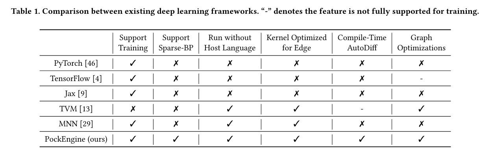
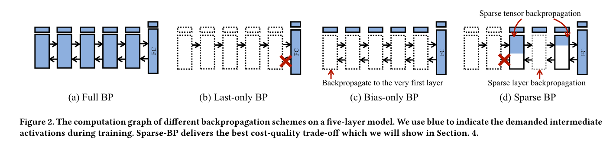
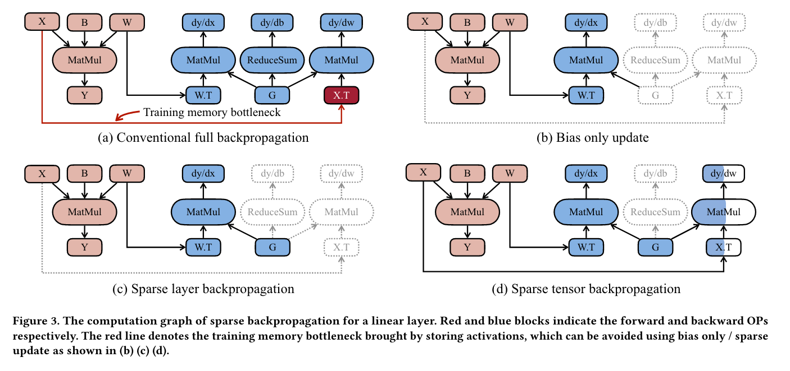
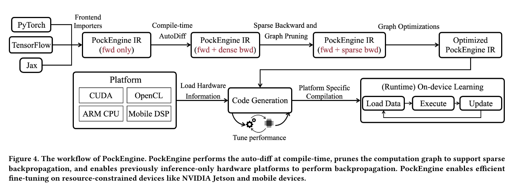
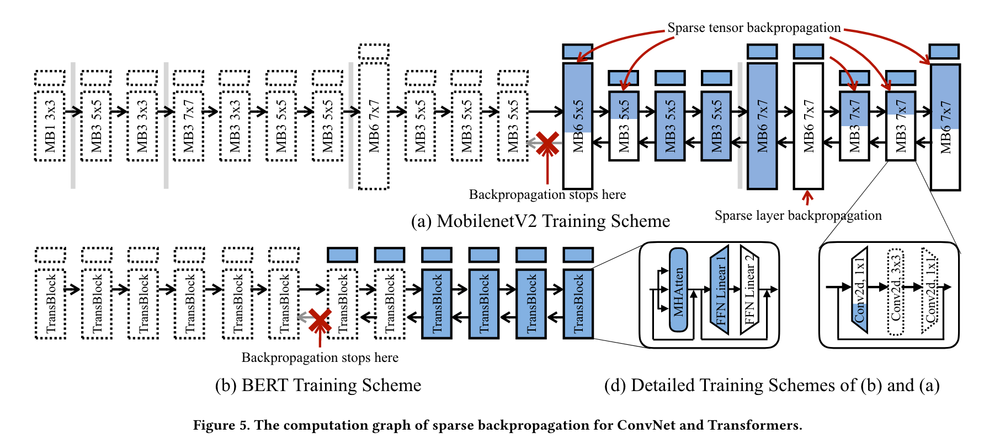
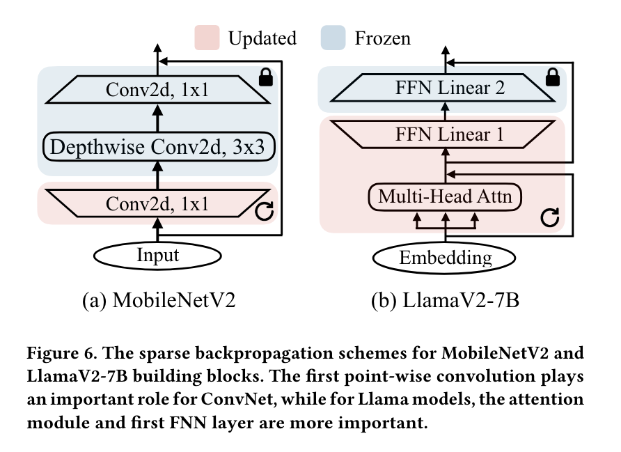
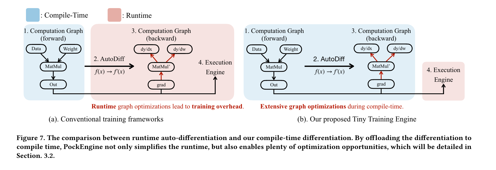

# PockEngine: Sparse and Efficient Fine-tuning in a Pocket：历史笔记

[所属主题](../index.md) · [GitHub 历史笔记目录](../../github-issues.md)

- 论文：[原文](https://arxiv.org/abs/2310.17752)
- 原记录：[Issue #29](https://github.com/KuangjuX/Papers-and-Learning-Notes/issues/29)

## 历史阅读笔记

### Abstract

PockEngine 是一个用于在边缘设备做训练微调的小的稀疏的和有效率的引擎。PockEngine 支持稀疏反向传播，编译优先，全部的训练计算图（包括前向，反向和优化）在编译时被提取，减少运行时开销并且为 graph transformations 带来优化。PockEngine 可以在 Nivida Jetson AGX Orin 上对 LLaMav2-7B 做 fine-tune，比 Pytorch 快 7.9 倍。

### Introduction

On-device 主要有以下困难：

- Resource Limitations
- Hardware Diversity

为了应对这些挑战，本篇文章提出了 PockEngine，一个小的和有效率的训练引擎为了 on-device training。它有如下特性：

- 对于稠密和稀疏矩阵的反向传播做了系统级的支持。
- PockEngine 是一个基于编译的高效训练引擎，可以使许多仅支持推理的框架能够训练。
- PockEngine 实现了一系列图优化策略以达到在边缘设备上的高性能，包括算子融合，算子重排序，layout 变换以及后端切换。

### Related Work

深度学习的成功建立在很多受欢迎的框架上例如 PyTorch，TensorFlow，MXNet，JAX 等等。这些系统被设计用于灵活开发并依赖于 host language（Python）执行。这带来了昂贵的内存开销并且在低频率的 CPU 例如 ARM Cortex 上执行非常慢。

#### Edge Deep Learning Systems

#### Efficient On-Device Learning Algorithms

边缘设备有限制的计算能力。因此，on-device 训练经常需要关注迁移学习。它首先在大规模数据集上预训练模型去学习通用的和丰富的特性，例如 ImageNet 为了 ConvNets 或者 BooksCorpus 为了 BERT。模型随后转移到 downstream 任务重，例如 Visual Wake Words 为了视觉或者 GLUE benchmark 为了语言。在那之后模型可以被定制为小规模个人数据去在相同的任务上做得更好。

但现有的训练框架无法通过稀疏反向传播实现实际的加速或内存节省。PockEngine为此类灵活工作负载提供了系统级支持，以提供更快的程序和高效的运行时。

#### Computation Graph Transformation and Optimizations

在推理场景中存在大量的图转换技术。例如，在边缘部署中常用的一种转换是数据布局转换，因为GPU训练中首选的 NCHW 布局在边缘设备上效率不高。另一个常见的优化技术是层融合。IO密集型层（如ReLU）通常可以融合到前面的计算密集型层（如CONV、LINEAR）中。此外，MetaFlow 提出了保持功能的图转换方法来优化DNN架构。TASO 进一步引入了使用形式验证自动生成转换规则的自动化方法。这些技术在推理中已被证明有效，但很少有研究探讨它们在训练中的性能，尽管训练图更加复杂。站在传统智慧的肩膀上，PockEngine是对这些图优化技术在设备端训练中应用的早期探索，并发现了更多潜在的优化。PockEngine显示这些优化可以带来高达1.2倍的加速。

#### Compilation-Based Workflow

当前存在的这些训练框架（例如 PyTorch，TensorFlow）基于在运行时做自动微分。然而这种方式在边缘设备不使用。因此 PockEngine 是基于编译的 workflow：

- Offload Workload from Runtime to Compile Time. 使用以编译为中心的技术，我们可以将一部分 workload 从 runtime 卸载到 compile time，例如基于 autodiff 的反向求导，内存调度，execution planing 等。现代神经网络包含数千种算子，对于云端服务器来说开销可能可以忽略但是对于边缘设备来说不可忽略。
- Support Diverse Frontends/Backends. 与 cloud 不同，边缘设备高度不一样，有很多不同的 ISA 与并行度。PockEngine 支持多个 frontends/backends。它能够在硬件和 vendor librarys 上面进行有效率的训练。PockEngine 前端支持多种不同的表示（torchscript, ONNX, tf.graph) 并且分析 DAG 结构。随后计算自动微分计算梯度和损失函数。伴随静态的正向和反向图，PockEngine 将其转化为统一的 IR，执行图优化并为不同的后端做代码生成。

#### Sparse Backpropagation and Compution Graph Pruning

在小规模上更新全部模型不一定是一个好的选择，更新模型的一个子集被认为是一个好的解决方案在小的训练开销下。

- Bias-only Update. Bias-only Update 不需要保存中间的激活，将会显著减少内存使用。
- Layer-wise Sparse Backpropagation. 对于迁移学习来说不是所有的 layers/weight tensors 同等重要。对于迁移学习到下游的任务，有一部分 layers 根本不会影响迁移学习的性能个。因此对于这些 layers 会直接跳过用于提高吞吐量。
- Sub-layer Sparse Backpropagation. 对于容量有限的边缘设备，例如微控制器来说支持子层级别的 sparse BP，只更新层的部分 channel，进一步减少梯度计算成本。

### PockEngine

#### Searching for Sparse Backpropagation Scheme

对于迁移学习来说不是所有权重都同等重要，目标是仅仅 fine-tune 重要的权重去在保证模型精度的情况下减少训练开销。

- Cost Model and Search Criterion.
- Generalization and Accleration.

#### Training Graph Optimization

在我们得到静态的，剪枝后的训练图后，PockEngine 在 unified IR 上进行图优化随后将其翻译到不同的 backend。

- Operator Reordering and In-place Update. 不同的执行顺序导致 Tensor 的生命周期不同，整体/峰值内存占用也会受到影响，这在之前推理的工作中已经被很好地讨论了，但是在训练中很少被讨论，因为 backward graph 通常是在运行时生成的，compiler/scheduler 没有训练过程的全局信息。一个具体的例子是优化器，在其中梯度被应用于更新模型参数。在传统的训练中，框架会计算所有的梯度，然后应用更新。这在像PyTorch和TensorFlow这样的框架中很常见，因为优化器和前向-后向传播在系统设计中是分离的组件。然而，这样的做法会导致存储梯度时出现显著的内存浪费。在使用稀疏反向传播的小批量训练中，存储参数梯度的成本接近于前向和后向传播的峰值内存使用量，如 Table 4 所示。为了解决这个开销，PockEngine获取所有张量信息并计划一个更好的执行调度。通过重新排序操作符，梯度可以立即应用于相应的参数，然后再向前传播到较早的层。
- Operator Fusion. 老生常谈了......
- Functional-Preserving Graph Transformation. 现有的 DNN 框架通过 domain experts 或者 auto discovered by program 来做图优化，但是反向图由于在运行时生成因此不能去应用这些优化，将会造成训练时间变慢和不必要的运行时开销。PockEngine 集成了这些优化技术，并且会为不同的硬件转换数据布局。

