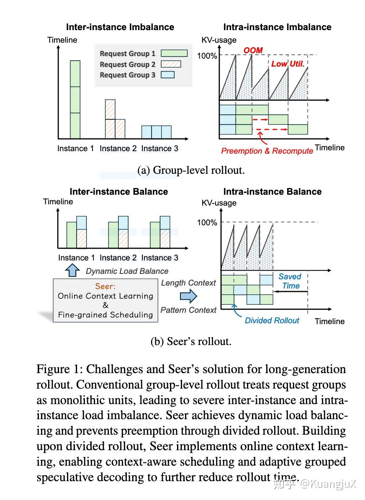
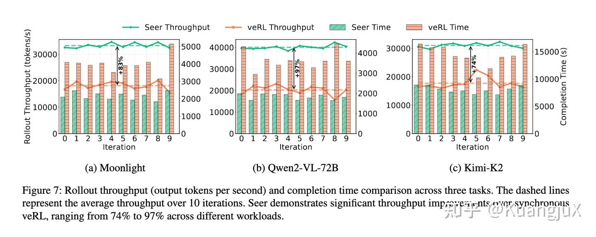
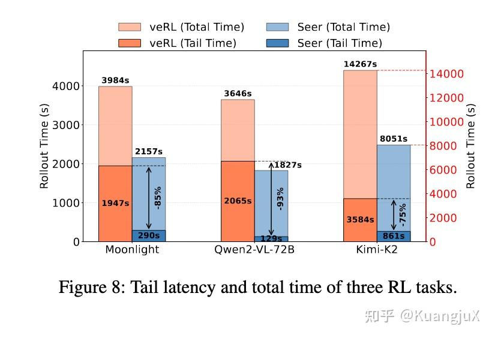

# Seer：同步 RL 的 rollout 切分、调度与分组投机

来源：[个人文章全文归档](../../../Foundations/05_Model_Architecture_and_Reasoning/Research-Reviews/llm-2025.md)。

将 RL 系统背景与 Seer 的三条设计路径放在一起：切分 rollout、利用长度相关性调度、利用组内模式生成草稿。

## 整理与复习

- 核对：[论文](https://arxiv.org/abs/2511.14617) 的系统概述（Zotero PDF）；系统围绕同步 RL 的 rollout 优化，并非声称所有异步 RL 都必然降低效果。
- 旧文中的 `GPRO` 应为 `GRPO`，LFS 按文中解释为 longest-first scheduling。
- 同 prompt 的响应在长度和模式上相关，这是估计与复用的统计依据，并非每个响应都相同。
- 文中的 74%–97% 吞吐和 75%–93% 长尾下降属于原文章节的实验记录；引用时仍需回原论文核对模型、基线和设置。

## 原笔记相关章节

### RL（强化学习）

最近读了 Seer[16](https://zhuanlan.zhihu.com/p/1994788371738949558#ref_16) 这篇 paper 也入门了下强化学习。RL 相比于 SFT（监督学习）的一个区别在于 SFT 是需要一个标准答案来不断训练的，而 RL 是不需要标准答案，只需要“奖励信号”让智能体自己探索最优方式。因此针对一些复杂任务，例如思维链推理和长文本生成等复杂任务，SFT 容易出现逻辑断裂或者不完整的内容，而 RL 可以通过多轮试错让模型学会生成更连贯、更深入的响应。

因此，RL 几乎不会作为大模型的预训练方法而是在 SFT pretrain 之后的 post-train 阶段进行使用。RL 的工作流大概分为五个阶段：

- 准备阶段：初始化基础模型与挑选覆盖目标场景的 Prompt 集以及确定 RL 算法。
- Rollout 阶段：对每个 Prompt 生成 G 个响应。
- 奖励阶段阶段：把“主观好坏”转化为模型能理解的数值，对每个响应给出具体的分数。
- 经验收集与模型更新：基于响应和分数，调整模型参数，让模型下次更可能生成高分响应，更少生成低分响应。
- 权重同步阶段：把更新后的模型参数同步到推理模型中，让下一轮 Rollout 用新模型生成响应，形成闭环。

当前 RL 的主要瓶颈在 Rollout 阶段：

- 耗时占比极高：rollout 阶段消耗 63%-87% 的 RL 总迭代时间，是制约训练速度的关键。
- 内存波动剧烈：长文本生成（如思维链推理，最长达 98K token）导致 KVCache 内存占用从数百 MB 动态增长至数十 GB，迫使系统缩减批次大小或抢占任务，引发昂贵的重新预填充开销，硬件利用率低下。
- 长尾延迟严重：生成长度呈长尾分布，少数超长请求在 rollout 后期独占 GPU 资源，导致大量节点闲置，长尾阶段耗时占比可达总时间的 50%。

现有的一些方案也有一些局限性：

- 异步 RL 牺牲算法保真度：通过重叠 rollout 与训练阶段提升效率，但引入离线学习（off-policy）问题，导致模型性能下降、调试困难，无法保证结果可复现。
- 传统推测解码（SD）不适应 RL 场景：依赖静态草稿模型，难以应对 RL 中目标模型的持续更新（模型漂移），且草稿生成的计算开销和内存占用在大批量场景下不可行。
- 分组级调度僵化：将请求组视为不可拆分的整体，忽略组内响应的相似性，无法实现细粒度负载均衡。

#### Seer: Online Context Learning for Fast Synchronous LLM Reinforcement Learning

Seer 这篇 paper 主要是聚焦同步 RL System 的 Rollout 阶段的优化。

**Divided Rollout**

传统的方案，在 Rollout 阶段将"把一个 prompt 生成 8 个响应"当成一个大的任务交给一个 GPU 运行，如果是超长文本，就会霸占 GPU，且内存从几百 MB 涨到几十 GB。Seer 通过先将 「1 个 prompt+8 个响应」 拆成 8 个独立请求，随后每个响应按照固定长度拆成 chunk，每个 chunk 进行单独调度。同时使用全局 KV Cache，一个 chunk 计算完之后，缓存暂时存起来，下一个片段可以在任意 GPU 上跑，不需要进行重新计算。

这里的 Global KV Cache 采取 DRAM/SSD 的双层存储，用来平衡访问速度和存储容量，这项技术继承于前作 MoonCake。KV Cache 服务器会根据请求缓冲区的队列信息，提前将对应的 KV Cache 从 SSD 或者远端 DRAM 预取到目标实例的本地 DRAM 或 HBM 中。

**Context-Aware Scheduling**

传统的调度不知道哪个请求长、哪个短，按顺序排队。结果短请求很快跑完，长请求最后才跑，霸占 GPU 形成长尾。而 Seer 首先通过**投机请求探测**来确定不同组的响应时长，随后通过**动态长度估计**来不断更新不同组的上下文，最后依靠 LFS（最长作业优先调度）优先调度预估长度长的请求片段，同时让长请求和短请求混合跑，避免长尾效应。

**Adaptive Grouped Speculative Decoding**

RL 算法，例如 GPRO 等，同一 prompt 生成的多个响应具有强模式相似性，可聚合为动态草稿资源，替代静态草稿模型。Seer 介绍了 DGDS（分布式分组草稿服务器），跨实例聚合组内所有响应的 token 序列。同时 Seer 根据系统并法度来对猜测长度进行动态调整，在短请求密集时少猜，在长请求密集时多猜。这样相比无加速以及使用静态投机解码的 RL 能够提高吞吐量与提高预测准确率。

**性能评估**

Seer 针对 Moonlight，Qwen2-VL-72B，Kimi-K2 进行了性能评估，使用 veRL 并与 Seer 共享相同的推理引擎（vLLM）以及 RL 算法（GRPO）。

最终 Seer 在吞吐量方面全面提升 74%-97%，同时长尾效应锐减 75%-93%：

