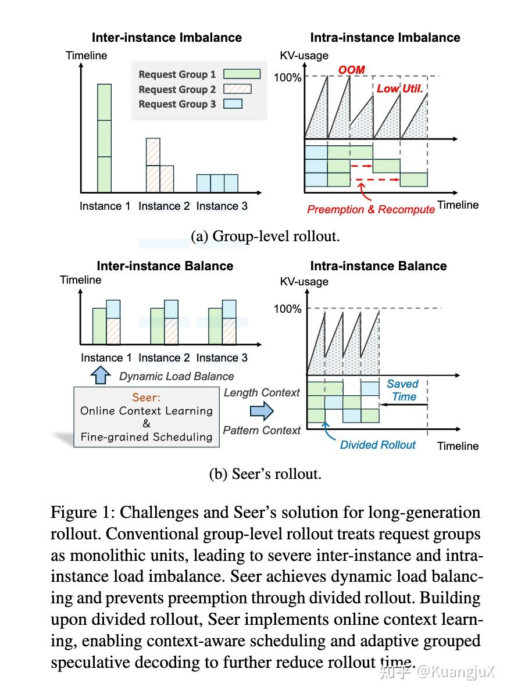
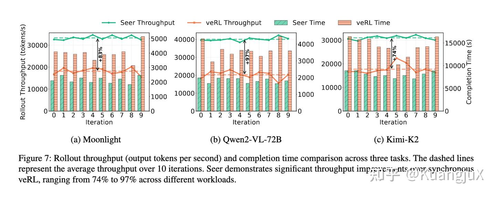
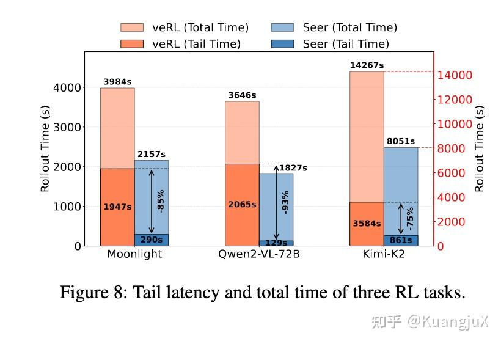

# Seer：同步 RL 的 rollout 切分、调度与分组投机

同步 RL 的一轮训练需要完成 rollout、计算奖励、更新模型，再将权重同步回推理端。一个 prompt 通常生成多个响应；响应长度差异会同时造成 KV 内存波动和长尾等待。Seer 围绕这两个约束，把 rollout 拆成可迁移的片段，并利用同 prompt 响应的长度与模式相关性调度和生成草稿。[论文](https://arxiv.org/abs/2511.14617)；[原始讨论](../../../Foundations/05_Model_Architecture_and_Reasoning/Research-Reviews/llm-2025.md)

## 切分响应，用共享 KV 支持迁移

将“一个 prompt 生成 8 个响应”作为整组任务交给同一 GPU，会让长响应持续占用该实例。Seer 先拆开组内响应，再按固定长度切成 chunk，分别调度；片段之间通过全局 KV cache 恢复状态，避免迁移后重新 prefill。

这条路径依赖 DRAM/SSD 分层缓存。沿用 Mooncake 的存储思路，缓存服务根据请求队列预取后续片段所需 KV，将其送到目标实例的本地 DRAM 或 HBM。拆分降低了任务调度粒度，也将一部分成本转移到缓存传输与预取。

## 用长度估计降低同步轮次的长尾

系统先通过投机请求探测估计各组的响应长度，再随生成过程更新估计。Longest-first scheduling（LFS）优先安排预计较长的请求片段，并混合长短请求，使长任务尽早推进，减少轮次末尾仅剩少数 GPU 工作的时间。

同 prompt 的响应具有统计相关性，才使组级观测可以帮助估计其他响应；它并不保证组内每个响应长度相同。异步 RL 也能重叠 rollout 与训练，但需处理策略滞后；Seer 选择保留同步流程，不能由此推出所有异步 RL 都必然损失质量。

## 从组内响应构建动态草稿

GRPO 等算法会为同一 prompt 生成多个响应。Seer 的分布式分组草稿服务器（DGDS）聚合这些 token 序列，利用反复出现的模式生成草稿，并根据系统并发度调整投机长度。

这一选择避免单独维护静态草稿模型：RL 中目标模型持续更新，静态模型可能失配；大 batch 下，额外草稿模型还会增加计算和内存成本。组内草稿的收益则依赖模式复用程度、接受率与草稿服务开销，不能由“同一 prompt”直接保证。

## 性能记录与比较口径

原始讨论记录了 Moonlight、Qwen2-VL-72B、Kimi-K2 的评测，对照 veRL，并使用相同推理引擎 vLLM 与 GRPO；吞吐提升范围为 74%–97%，长尾下降为 75%–93%。这些是来源记录中的范围值，各点的 GPU 配置、batch 与长度分布尚未在本笔记展开，不能作为任意部署的预计收益。

同一来源记录的 rollout 时间占比 63%–87%、最长约 98K token，以及长尾阶段可占约 50%，说明了其所考察负载的瓶颈；这些比例也依赖模型与请求分布。[实验记录来源](../../../Foundations/05_Model_Architecture_and_Reasoning/Research-Reviews/llm-2025.md)
