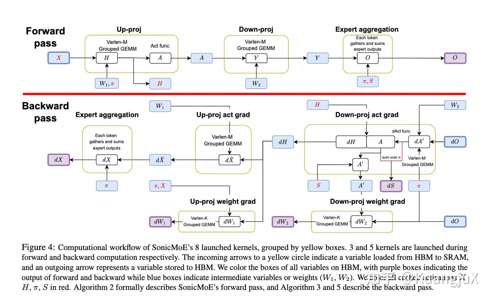
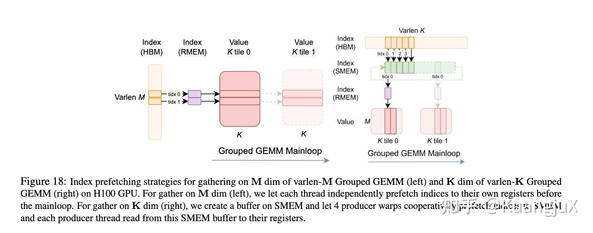
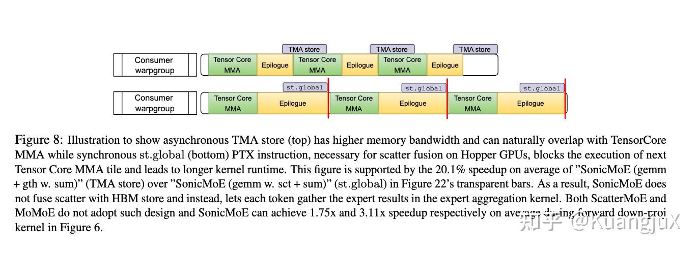
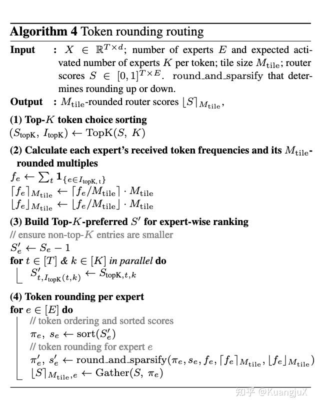
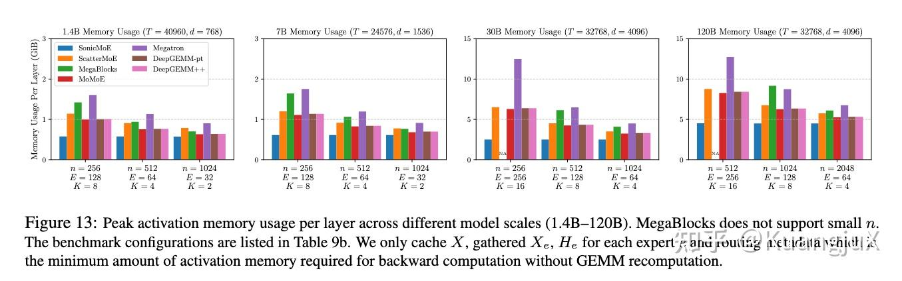
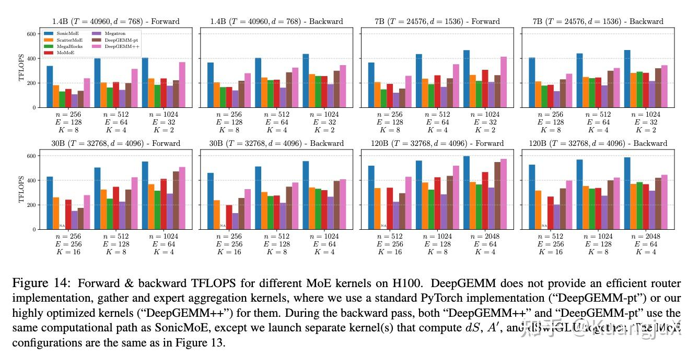

# SonicMoE：用梯度重排、异步 IO 和 tile 感知路由优化 MoE

AI 整理：[个人笔记](../../../Foundations/03_Distributed_Training_and_MoE/MoE/zhihu-reading.md)、[SonicMoE 原论文](https://arxiv.org/html/2512.14080v1)。实验数值为作者报告。

先修：[MoE 路由、Grouped GEMM、梯度与成本](../../../Foundations/03_Distributed_Training_and_MoE/MoE/moe-math-and-cost.md)。

## 背景：激活变大、计算强度下降、tile 利用率降低

在总 FLOPs 可比的设置下，专家变细意味着每个专家中间宽度 $n$ 变小、每 token 的激活专家数 $K$ 相应增加。某些实现会保存 $TKd$ 规模的专家输入与输出，导致跨层保存的激活随 $K$ 增长。另一方面，专家越多，每个专家收到的 token 越少，Grouped GEMM 的权重复用和 tile 利用率也会下降。

SonicMoE 分别处理这三个问题：重新组织梯度计算来减少激活缓存；用融合和异步流水线控制 IO；在高稀疏场景用 token rounding 调整路由。前两者可以保持原来的路由，第三项会改变训练时的 token–expert 分配，实验必须分开看。

## 计算图：前向 3 个核，反向 5 个核

图来自原个人文章中的论文计算流程截图。对应论文 §3 的八个计算 kernel；router GEMM、Top-k 和元数据处理不包含在“八个”中。

| 阶段 | 核的输出 | 计算与数据流 |
| --- | --- | --- |
| 前向 | $H,A$ | 按路由索引 Gather 输入，执行 up-projection，epilogue 中算 SwiGLU |
| 前向 | $Y$ | down-projection，输出暂存为专家连续布局 |
| 前向 | $O$ | 按原 token 位置聚合，加上路由权重 |
| 反向 | $dH,dS,A'$ | Gather $dO$，执行 down-projection 的激活梯度 GEMM，融合路由权重梯度与激活导数 |
| 反向 | $dW_2$ | 用 $A'=s\odot A$ 和 $dO$ 计算权重梯度 |
| 反向 | $d\widetilde X$ | 用 $dH,W_1$ 计算每个专家的输入梯度 |
| 反向 | $dW_1$ | Gather $X$，沿 token 维归约计算第一层权重梯度 |
| 反向 | $dX$ | 聚合同一 token 的所有专家梯度 |

这是一组协同设计的 fused kernels，而非把整个 MoE 前反向放进一个 kernel。

## 内存优化：避免跨层保存宽度为 d 的专家副本

对于无偏置的专家，设 $Y=AW_2$、$D=dO$，令 $G=DW_2^{\mathsf T}$。路由权重梯度可以写成：

$$
ds=\langle D,Y\rangle=\langle G,A\rangle.
$$

第二条路径能在 down-projection 的反向 GEMM epilogue 中使用已有的 $G$，由缓存的 $H$ 再计算 SwiGLU 得到 $A$，并同时计算 $dH$、$ds$ 和供 $dW_2$ 使用的 $A'$。它不需要为了将来计算 $ds$ 而跨层缓存 $Y$，也不需要重新执行 GEMM。

**数值检查。** $A=[2]$、$W_2=[3,4]$、$D=[1,2]$ 时，$Y=[6,8]$、$G=11$，两条路径都给出 $ds=22$。涉及专家偏置时要加入对应项，不能直接照抄无偏置等式。

输入 $X$ 和输出梯度 $dO$ 的 Gather 则融合到 HBM→SMEM 加载中，避免单独物化它们的专家副本。论文给出的主要跨层激活缓存为 $X,H$：

$$
B_{cache}\approx 2Td+4TKn\quad\text{bytes},
$$

忽略较小的路由元数据，元素按 2 字节统计。固定 $nK$ 时，这部分不随粒度上升；这不表示整个过程没有临时缓冲，前向 $Y$ 仍可短暂物化并回收。

**数值检查。** $T=1024,d=2048,K=4,n=512$ 时，$X$ 占 4 MiB，$H$ 占 8 MiB，共 12 MiB。改成 $K=8,n=256$ 后仍是 12 MiB；而单独保存 gathered $X_e$ 的代价会从 16 MiB 增到 32 MiB。

## Kernel 组织：融合的目标是降低关键路径成本

### Gather 与输入加载融合

Grouped GEMM 既可能接收专家连续布局，也可能按索引收集输入。后者将 token 索引读取与输入加载放进生产者路径，用 `cp.async` 获取所需数据，避免另起核生成完整副本。附录 D 还区分了 varlen-$M$ 与 varlen-$K$ 的索引预取策略：前者可由线程提前取入寄存器，后者由生产者协作预取到共享缓冲。

### Epilogue 融合

前向把 SwiGLU 放入 up-projection 的 epilogue；反向在 down-projection 的激活梯度 epilogue 中合并 $dH,dS$ 等计算。融合既避免额外读写，也为与其他 warpgroup 的 MMA 重叠创造条件。

### 为什么保留单独的聚合核

在原文讨论的 Hopper 路径中，直接 scatter-store 会增加地址处理与同步存储成本，干扰 PingPong 的 MMA／epilogue 重叠。SonicMoE 可以先连续地 TMA store，再用单独的聚合核回到原 token 布局。核的数量增加，仍可能缩短总时间；判断依据是整条执行路径，不是“融合越多越快”。具体后端会演进，不能把这一选择泛化成所有 GPU 上都禁止 scatter 融合。

## Router 与 token rounding

Top-k 核针对较小专家维度优化：原笔记记录了 $E\le4096,K\le16$ 的适用范围、bitonic sort、稳定索引与寄存器／warp shuffle 等实现点。这是所读版本的优化范围，不代表 MoE 数学定义的限制。

Token rounding 先做 token-choice Top-k，得到每个专家的 token 数，再把数量调整到附近的 tile 倍数。向下舍入删除低分配对，向上舍入从专家候选 token 中增加配对；这与仅在 GEMM 输入尾部加零不同。

**例子。** 一个专家接收 129 个 token，tile 高度为 128。普通执行仍需计算 256 行；就近向下舍入至 128 会删除一个配对，算一个 tile。它减少了无效物理计算，但也改变了路由。某些 token 的专家数可能随之改变，不能仍假设每个 token 都严格有 $K$ 个专家。训练后切回普通 token-choice 时还需检查 train–test gap。

## 实验：把内存、核吞吐和模型质量分开比较

| 问题 | 主要设置与基线 | 已有记录与可引用范围 |
| --- | --- | --- |
| 缓存是否随专家变细而增长 | 不同规模与专家粒度；ScatterMoE、MoMoE 等 | 原文章记录 7B、$n=256$ 时相对 ScatterMoE 内存减少约 45%；它是特定配置的结果 |
| 前反向是否更快 | H100、BF16；Grouped GEMM 与聚合构成的 MoE 路径 | 原文章记录了约 40% 的提升及部分大模型超过 500 TFLOP/s；不同曲线和阶段不能拼成统一加速比 |
| token rounding 是否值得 | 高稀疏设置，对照普通 Top-k；同时测试语言模型质量 | 吞吐改善与质量保持需要共同检查，不能只比较 padding 减少量 |

上述两图保留个人文章发表时的截图。核对当前论文时，§4.1 的运行时间分解给出了 $(T,d,n,E,K)=(24576,1536,256,128,8)$ 的 H100 7B 配置；更完整的图表配置见附录 G，不能把这个五元组套到所有评测图上。TFLOP/s、单层 MoE 吞吐和端到端训练 tokens/s 是不同指标。

## 从旧笔记保留的关键澄清

- 消除的是供反向传播跨层保存的 $Y$ 依赖，不是所有时刻都没有 $Y$。
- 可以重算逐元素激活，但无需重算 GEMM；旧文“用一部分重计算绕开依赖”应明确重算的对象。
- 成本式省略中间量的某些 IO，完整推导与例子见基础笔记。
- Token rounding 改变模型路由，不能当成保持逐元素结果不变的纯 kernel 优化。
