# AMOS: Enabling Automatic Mapping for Tensor Computations On Spatial Accelerators with Hardware Abstraction：历史笔记

[所属主题](../../index.md) · [GitHub 历史笔记目录](../../../github-issues.md)

- 论文：[原文](https://cs.stanford.edu/~anjiang/papers/ZhengETAL22AMOS.pdf)
- 原记录：[Issue #31](https://github.com/KuangjuX/Papers-and-Learning-Notes/issues/31)

## 易错概念

论文 §7.3、Figure 6(a)(b) 的基线是 **PyTorch**；113 种算子配置在 batch size 1、V100/A100 上，相对该基线的几何平均加速分别为 2.50× 和 2.80×。旧笔记“相比 C++”是误记，不能当作对某个未指明 C++ 实现的结论。

## 历史阅读笔记

本篇文章主要讲了如何在新出现的 Tensor Core 上提出 IR 并做 codegen。

### Motivation

主要原因是现在有很多带有 GEMM 计算的芯片架构产生，例如 Google TPU，Gemmini。

### Introduction

作者将计算加速器的软件到硬件的映射方式划分为两类：硬件可感知和指令集可感知。

- Hardware-aware：编译器知晓硬件架构细节信息，比如PE数量、PE间互联方式，这样软硬件映射过程可以转化为一个在给定硬件约束下的优化问题。这种映射方式具有较高的能效比，但是牺牲了一定的灵活性（当搜索空间发生变化后，映射过程需要重新生成）。代表性编译器有 Triton、CoSA、SRAR、HASCO。
- ISA-aware：映射过程对硬件架构无感知，只根据对外暴露的指令集进行软硬件映射。XLA、TVM、Ansor、AKG、Tiramisu等均归为指令集可感知。本文聚焦于指令集可感知的映射。

指令集可感知方式通过提供张量计算的若干内置函数(Intrinsics)提高了可编程性，但仍面临两方面挑战：

- 给定算法下，如何生成最优指令。比如，二维卷积的7层循环映射到Tensor Core上，映射方式有35种。现有的编译器如TVM、ISA Mapper等主要依赖基于模板或手工编写方式，这样可能会得到次优解。
- 理想的映射方法对不同加速器是统一的，然而不同加速器提供的指令集相差较大，在给定算法下，无法统一开发。比如，Tensor Core 使用不同的内置函数来描述矩阵加载/存储/相乘操作，在 Mali GPU 中只需使用一条内置函数 arm_dot 就可以完成数据加载和执行。

本文设计了一个在指令集之上的抽象层来解决如上两方面挑战。抽象层包括计算抽象和存储抽象两部分，可以统一描述不同加速器的指令集，实现了统一的自动映射流程。另外，作者设计了一个性能评估模型来评价所有可能解。最终，AMOS将映射问题抽象后转化为一个迭代优化问题。

### Background

专用计算加速器通常分为多个层级，最内层是有多个PE组成的计算阵列，中间层是由多个计算阵列组成的subcore，最外层是由多个subcore组成的core以及core间共享的全局存储器。不同的专用加速器对于 PE 计算阵列有不同的设计并且支持不同类型的计算。例如 Nvidia GPU with Tensor Core, Intel CPU with AVX-512, Mali GPU with dot unit, Ascend NPU with cube and vector units.
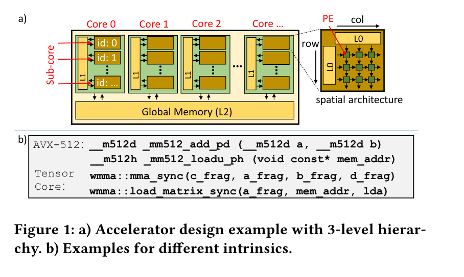

在编译器和加速器之间的接口叫做 **intrinsic**。一般有两种类型的 intrinsic，一种是 compute intrinsic,一种是 memory intrinsic(load/store)。当前的 SOTA 对于加速器有两类 compilers/mapplers：

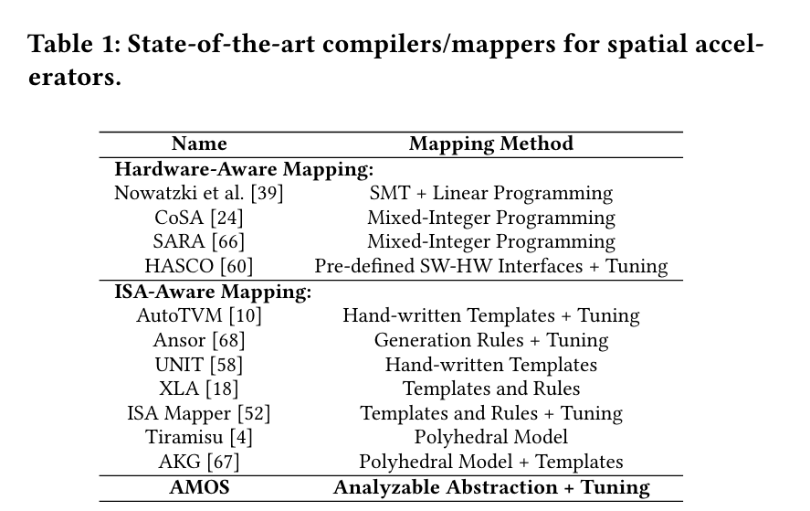

- Hardware-aware mapping: 关注于 PE 连接，buffer 配置的细节，软硬协同设计。
- ISA-aware mapping: 对于比较灵活的加速器，它们暴露 instrinsics 给程序员，为了使用这些 instrinsics，程序员必须要写 schedule templates 和对于性能进行调优并给出一个调度空间。

论文中给出了一些 motivational examples。当前的 SOTA 例如 XLA 对于现实中的 workloads 可能进行无效率的优化，对于在 V100 上，XLA 使用经过手工调优的复杂模版来匹配这些运算符，如果匹配上的话就会下降到底层手动优化的库例如 CuDNN 和 CUTLASS。

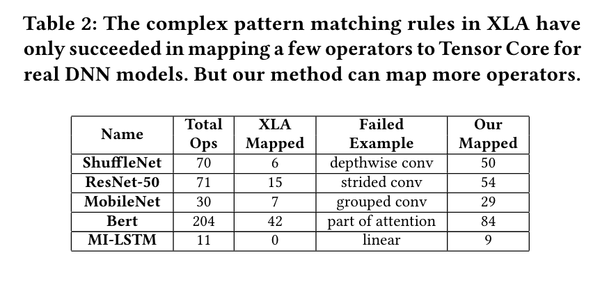

尽管 XLA 设计的很好，但只有一少部分算子被映射到了 Tensor Core 上面。而有一些算子可以映射到 Tensor Core 上面却失败映射了。手动设计的模版有两个限制，一个是依赖于显式的内部函数编程，例如 XLA 依赖于 CuDNN 和 CUTLASS 生成带有内部函数的代码。而 AutoTVM 和 UNIT 的模版则明确使用内部函数来处理固定循环模式。因此对运算符做一些微小的修改都可能导致模式匹配失败。

### Overview

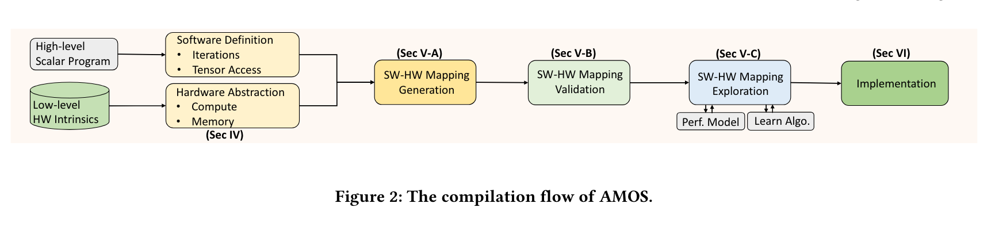

AMOS 的输入是一个使用 DSL 写的高级程序，定义了 loops 和 tensors。loops de的结构以及 tensor 的访问也在 DSL 里面被定义，例如 Figure 3(a)。AMOS 使用软硬件信息来生成不同的软硬件映射。软硬件映射包含计算映射和内存映射。计算映射表明了在软件中定义了什么操作应该对应映射到目标硬件中和通过合适的计算 intrinsics 来实现。内存映射表明如何从全局/共享内存中加载数据并且将其通过 memory instrinsics 存储在 on-chip 寄存器中。AMOS 和以往的设计不同，不依赖于手写的模版而提供全自动的编译流通过将 tensor program 映射到对应的加速器上。

### Hardware Abstraction

#### Compute Abstraction

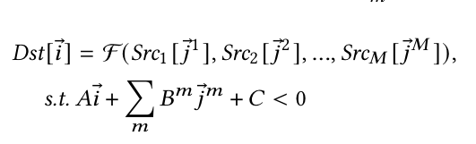

F 表示数学表达式例如加，乘或者乘加操作。假设有 M 个数据源，第 m 个数据源 $Src_m$ 是一个 $D_m$-dim 的数组。输出 Dst 是一个 N-dim 的数组。输出矩阵可以表示为 $\vec i = [i_1, i_2,..., i_N]$。第 m 个源操作数组可以表示为 $\vec j^m = [j_1^m, j_2^m, ..., j_{D_m}^m]$。

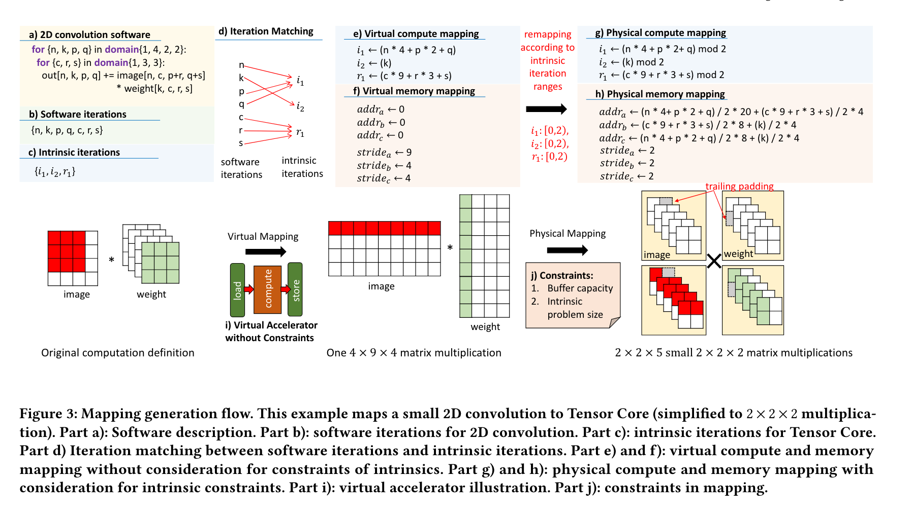

$A, B^m, C$ 被用于表示放射变换。矩阵 C 表示索引边界。，例如在 Tensor Core 中使用 32 x 8 x 16 表示 `mma_sync`。

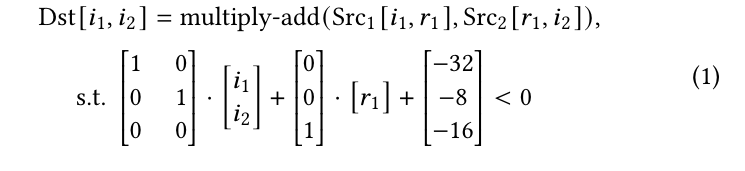

#### Memory Abstraction

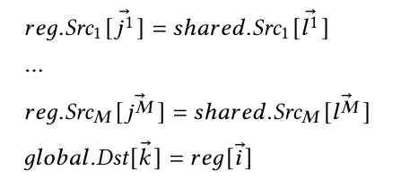

论文中举了一个 `load_matrix_sync` 和 `store_matrix_sync` 的例子：
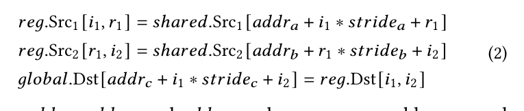

#### Software-Hardware Mapping

张量编译可以完美表示为嵌套循环。Software iteration 是 loop nest 的所有实例，见 Figure3(a)。定义了一个叫 **intrinsic iterations**，例如在 Tensor Core 里面的 $i_1, i_2, r$。**Software-Hardware Mapping** 包含两部分，Compute 把 Software iteration 转成 intrinsic iteration，Memory 把 software 转成 memory address。
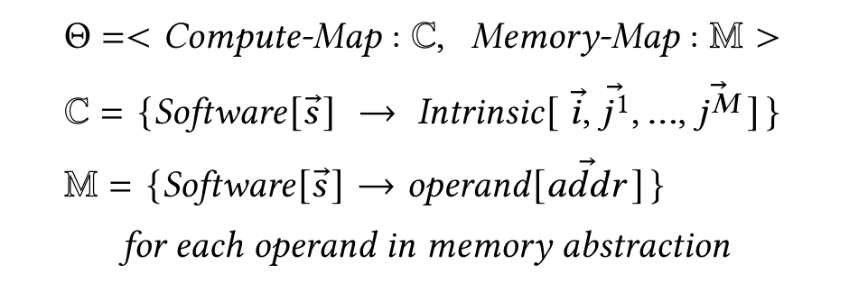

### Mapping Generation, Validation, And Exploration

#### Software-Hardware Mapping Generation

Two Step:
1. 将 software iteration 映射成只有一个 load engine, 一个 compute engine 和一个 store engine 的 virtual accelerator, Figure3 part(i)
2. 重新添加硬件和内部函数的约束，修改之前的映射。

第一步，AMOS 假设 virtual accelerator 可以把所有数据加载到 on-chip register，并且一次性可以完成所有计算。因此第一步的主要问题是将 software iteration 如何放到 intrinsic-provided computation slots 中。在 Figure3 part(d) 中将 software iterations 映射为了 intrinsic iterations。内存地址从 0 开始映射，stride 根据 matrix shape 决定，见 Figure3 part(e)(f)。

第二步考虑 intrinsic problem 和 memory capacity。硬件加速器只能在一次算一部分数据，所以需要对 intrinsic size 进行限制。对于内存容量的约束，AMOS 将整个输入输出分成小片段并加载多次，并不断更新基地址，stride 不再由总数据来决定而是由寄存器容量决定。

#### Software-Hardware Mapping Validation

生成的映射可能有无效的映射，因此 AMOS 使用验证方法来确保只考虑有效的映射。例如，在 Figure(3) part(d) 中，如果将软件迭代 𝑛、𝑘 映射到同一个内部迭代 𝑖1，即使满足了与硬件相关的约束，我们也会得到一个错误的映射。原因在于软件迭代 𝑛 和𝑘 在原始的2D卷积中具有不同的语义：𝑛 是输出和图像的公共索引，但从不出现在权重中，而𝑘是输出和权重的公共索引，但从不出现在图像中。因此，它们不应该映射到同一个 intrinsic iterations 中。

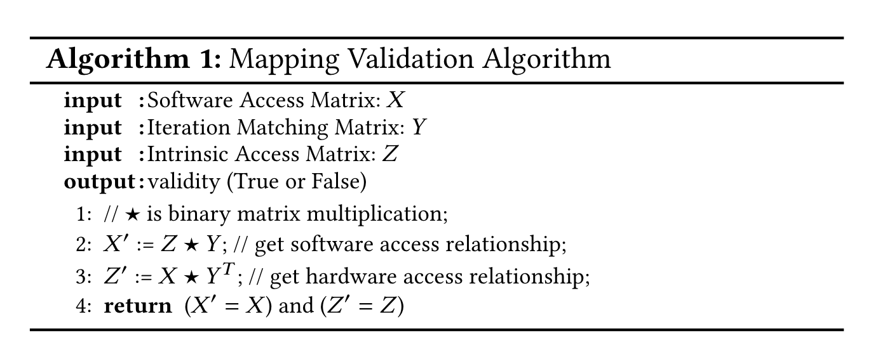

Algorithm1 展示了验证算法，Access Matrix 是一个二值矩阵，行表示向量，列表示索引，(row, col) 表示该索引是否会访问该向量。算法1 通过检查软件访问关系以及硬件访问关系来进行检查。软件访问关系定义哪一个 software iterations 访问了哪一个 hardware memory。硬件访问关系定义了哪一个 intrinsic iterations 访问了哪一个 software-defined tensors。算法首先使用 $Z * Y$ 找到 software access relationship。如果 $X' = X$ 表明对于每个输入输出张量和输入输出的 operand 在所有情况下相同。同理 $X*Y^T$  表示 hardware access relationship。

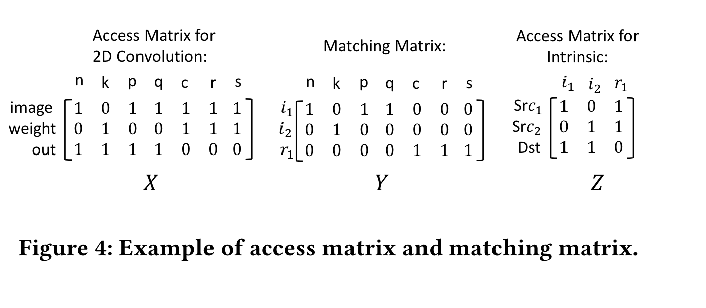

#### Exploration of Mapping and Schedule

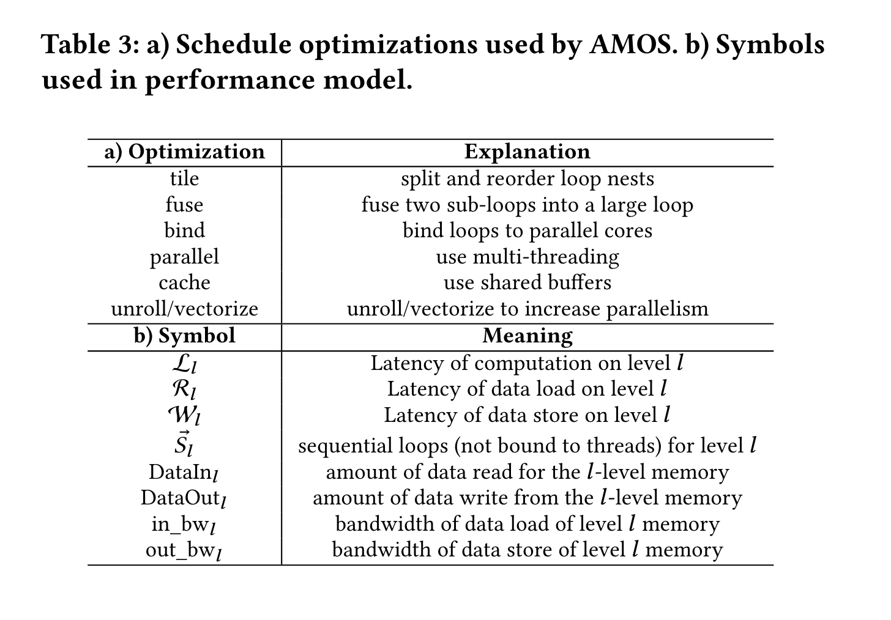
在上一节描述了如何选择有效的 mappings，但是很难描述这些 mappings 的性能当通过 tilling 和 parallelization 的优化后。本节描述如何对性能进行评估。

### Implementation

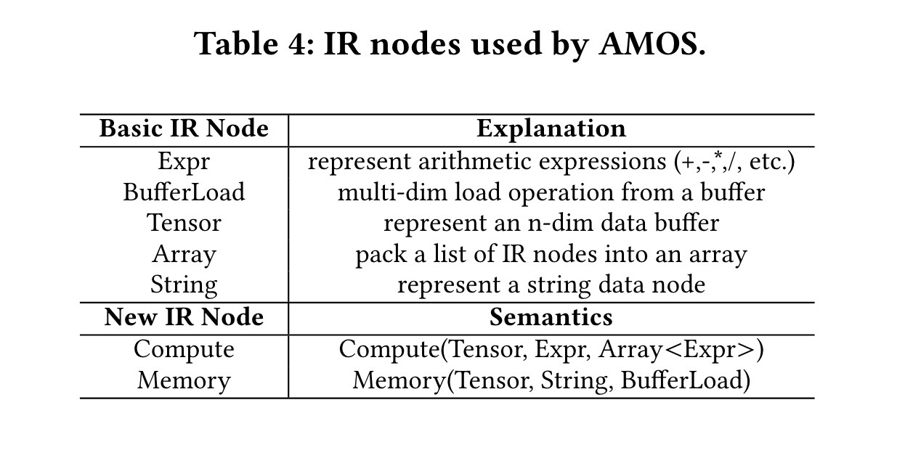
AMOS 新增了两个 IR Node(Compute, Memory) 在 TVM 上。

### Evaluation

算子里考虑了 GEMV (GMV), GEMM (GEM), 1D convolution (C1D), 2D convolution (C2D), 3D convolution (C3D), transposed 2D convolution (T2D), group convolution [23] (GRP), dilated convolution (DIL), depthwise convolution [12] (DEP), capsule convolution [21] (CAP), batched convolution [61] (BCV), grouped fully-connected layer [35] (GFC), matrix mean and variance (MEN and VAR), and scan computation [13] (SCN)。

首先 AMOS 和 Pytorch 的性能做对比，Pytorch 使用了手工优化的库例如 CuDNN，CuBLAS 和 CUTLASS 去支持不同的算子。AMOS 在 V100 和 A100 上相比 C++ 达到 2.5 和 2.8 倍的几何平均加速。AMOS 进行了全面的 software-hardware 的探索而 Pytorch 仅仅是用了固定的手动优化的库导致优化不够全面。

除此之外 AMOS 还和现有的 SOTA compilers 进行了比较，从 ResNet-18 中提取了 12 种不同配置的卷积层，结果如下图(2.38× to CuDNN, 1.79× to Ansor, 1.30× to AutoTVM-Expert, 4.96× to UNIT)：
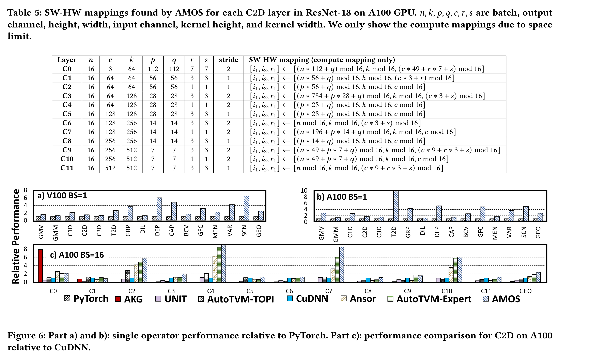
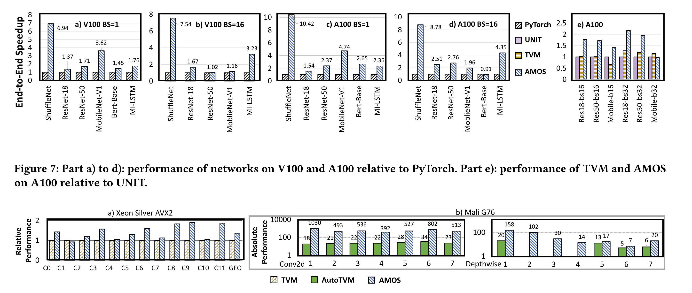
