# AStitch: Enabling a New Multi-dimensional Optimization Space for Memory-Intensive ML Training and Inference on Modern SIMT Architectures：阅读笔记

[所属主题](../../index.md)

- 论文：[原文](https://dl.acm.org/doi/10.1145/3503222.3507723)

## 论文笔记

### Introduction

机器学习模型包含两种算子，计算密集型和内存密集型。计算密集型通常包含许多计算 kernel（例如 GEMM/GEMV 和卷积操作），内存密集型经常受限于带宽（例如 element-wise，reduction）。
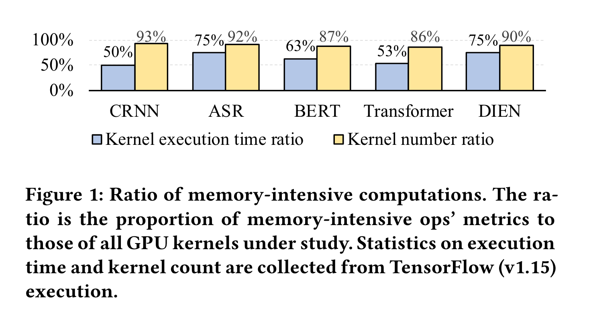
图一展示了很多模型都是内存密集型计算。内存密集型的开销主要来自于 off-chip 内存访问，CPU-GPU 的上下文切换和由于大量 kernels 要被启动和执行所造成的高的 framework 开销。尽管之前有一些工作可以将内存密集型子图合并为一个 GPU 内核来部分解决这个问题，但是不能完全满足当前各种各样的 ML model 的需要，这需要 JIT 技术而不是临时解决方案。

最近有一些 AI编译器（XLA，TVM）可以通过 kernel fusion 部分解决这个问题，然而这又面临了新的挑战：

- 无法高效率地处理算子间的两级依赖，这里的两级依赖指的是算子间依赖以及数据间的依赖。
-  没有办法处理不规整的张量形状。

为了解决这些限制，这篇文章提出了 AStitch，通过支持任意内存密集型子图的高效 JIT 操作来开启新的多维度优化空间。它提供了基于即时编译的依赖特性、内存层次结构（局部性）和并行性的联合优化。具体而言，提出了层次化数据重用技术（第3.2节），以应对复杂的两级依赖关系并扩大融合范围，避免在融合与计算开销之间做出选择的困境。还提出了自适应线程映射技术（第3.3节），以适应不同的输入张量形状，并生成适当的线程映射调度，以最大限度地利用硬件和并行性。最后，进行了几项关键设计观察（第4节），并通过利用这些观察结果，设计了一个编译器，以实现提出的优化自动化。这篇文章引用了 "stitch" 这个词将当前的 kernel fusion 技术与传统的技术区分开，当前的 kernel fusion 可以将小型和基本的融合组合成更大，更广阔的融合。

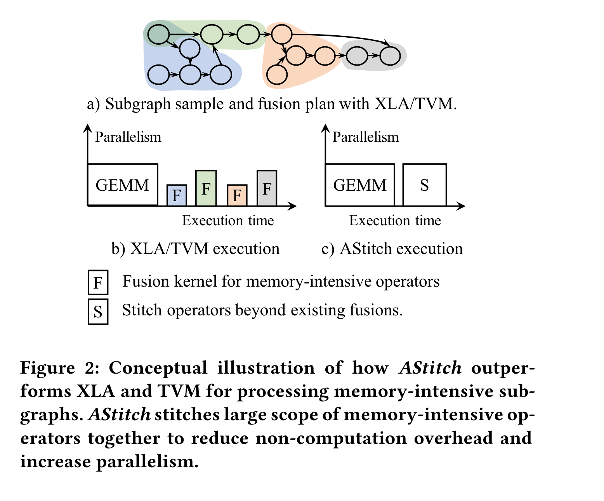
这个工作主要做了以下的贡献：

- 揭示了内存密集型算子是正在增长的影响性能的因素。
- 它做了两个主要的优化：低效率的 fusion 和不规则的 tensor shape。
- 这是第一项全面研究如何从依赖特性、内存层次结构和并行性的联合角度优化内存密集型机器学习计算的工作。
- 它设计了一个编译器，能够即时为任何给定的任意机器学习模型（包括训练和推理）实现所提出的优化。
- 它实现了一个可用于生产环境的机器学习编译器，可在任何版本的TensorFlow上使用。用户无需修改源代码或调整代码生成调度即可使用我们的编译器。、

### Background

#### Essential Memory-Intensive Ops in Current Models

在现代框架中经常把机器学习 workload 表示为一组计算图。在图中大部分计算密集型算子是分离的。它们把图划分成一系列子图，每个子图中有数十甚至数百个内存密集型算子。有两种广泛使用的算子覆盖了大部分内存密集型运算：element-wise 和 redece。
Element-wise 更进一步被分成轻量级算子和重量计算子，轻量级包括 add，sub 等，重量级包括 tanh，pow，log 等。广播操作也经常被认为是 element-wise。

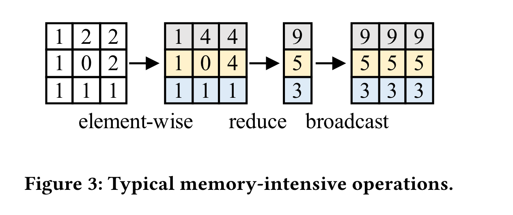

一个 reduce 操作接收一个 tensor 作为输入并 reduce 一个或多个维度，在连续内存进行 reduce 的叫 row-reduce，否则叫 column-reduce。Row-reduce 总是组织在一个 thread block 内部，在这里邻近的 thread 读取内存更加有效率。Column-reduce 经常需要几个线程并需要原子操作以保证其正确性。

#### Memory-Intensive Op Fusion

最先进的工作（XLA，TVM）可以支持一般内存密集型操作的内核融合，以减少频繁内核启动引起的 off-chip 内存访问、CPU-GPU 上下文切换和框架级算子调度开销。

fusion 最根本的技术之一是代码生成技术。ML Compiler 经常根据能否生成高效的代码来决定 fusion 策略。例如，TVM/XLA的代码生成器通过将每个元素的输入内联处理来处理所有数据依赖关系，将生产者与消费者合并在一起。然而，在第2.3节中已经确定了这种代码生成方法的一些限制。简单地修改融合决策逻辑（例如，扩大融合范围）可能会导致TVM/XLA性能不佳。

#### Major Limitations of the State-Of-The-Arts

在内存密集型算子中有一系列新的挑战。

##### Challenge I: Complex Two-Level Dependencies Combined With Just-In-Time Demand Exacerbates Training/Inference Inefficiency.

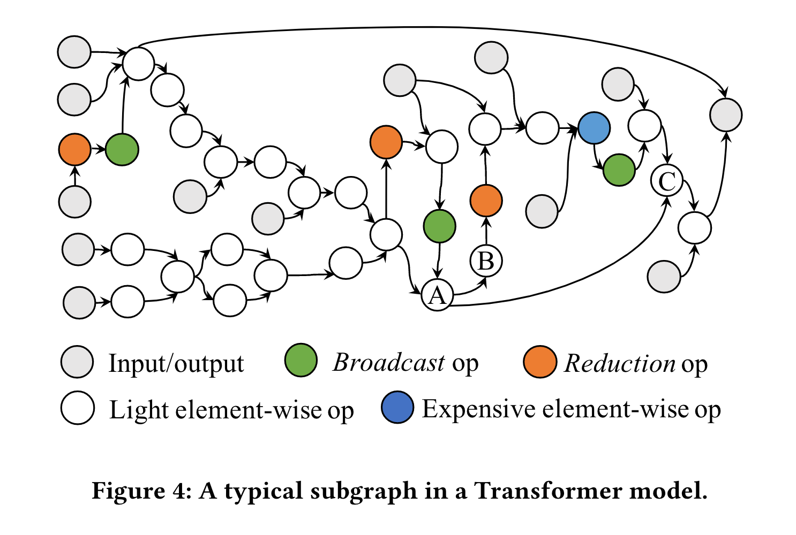
有两种级别的依赖，一种是算子级别的，例如图 4 中 A，B 对 C 的依赖；另一种是元素级别的，例如图 3 中 9 对 1，4，4 的依赖。算子级别，在子图中经常出现复杂的算子依赖关系；在元素级别，reduce 和 broadcast 经常会造成 one-to-many 的依赖。此外，机器学习模型的结构各不相同，变种也不计其数，需要针对给定的任意模型结构进行即时优化，而不是临时解决方案。机器学习从业者通常需要通过频繁的调整和执行来定制模型结构，这要求每次运行时都进行自动优化（即即时优化），而不是在每次试验之前手动调整融合。这也增加了设计优化的整体复杂性。因此，与JIT需求相结合的两级依赖关系使得对现代内存密集型机器学习模型进行融合优化变得极其具有挑战性。
受到这些独特挑战的限制，我们做出了一个关键观察：当前的机器学习优化编译器（例如XLA、TVM）在这种两级依赖下无法进行高效的融合。具体而言，对于具有复杂依赖关系的运算符，这些优化编译器要么简单地跳过必要的融合，要么在融合后产生冗余计算。我们将这些限制的根本原因分解如下。

**Key Inefficiency: large number of kernels generated by the ineffective fusion strategies for memory-intensive subgraphs.**
当前编译器的最佳实践（例如 TVM 和 XLA）由于无法处理一对多的依赖关系，因此无法有效有效融合两个正常的内存密集型算子：
(1) reduce 算子和它的消费者，例如图 4 中的橙色圆圈。
(2) 昂贵的 element-wise 操作接着广播操作（例如图 4 中蓝色和绿色的圆圈）。
本篇文章发现当前的机器学习框架当处理这两种情况时面临着以下困境：
(1) Fuse? Heavy redundant computation. 本篇文章观察到 TVM 和 XLA 在执行以上两种操作时，它们仅仅挖掘了每个线程的寄存器去融合 ops。当有一对多的 element，一个元素被一个生产者生成而被多个消费者需要的时候，每个消费者线程将独立计算 common elements，将造成巨大的计算冗余。

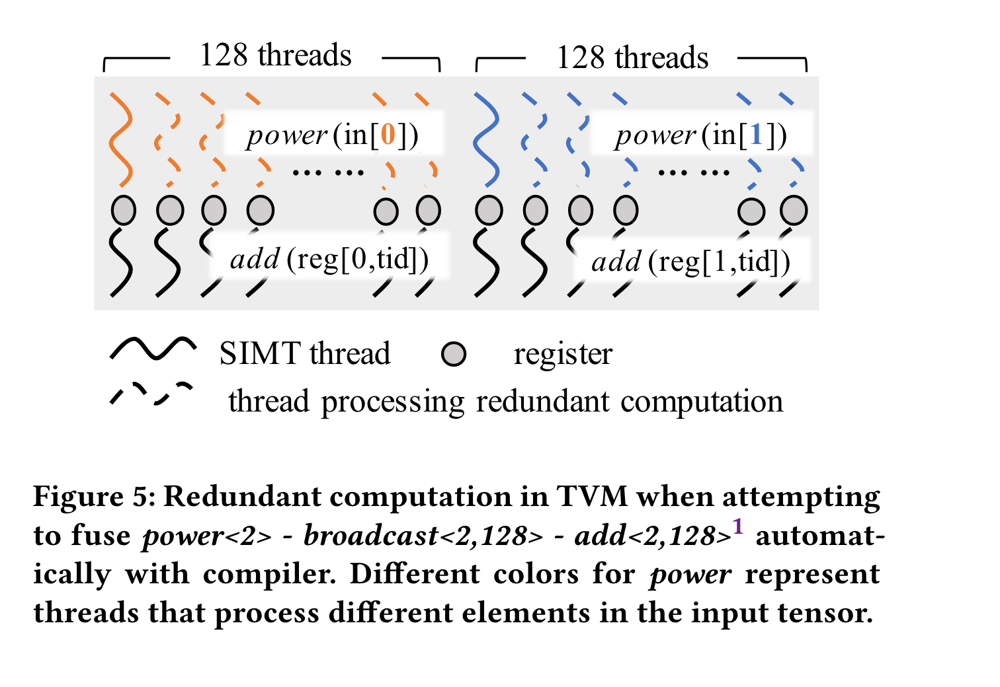
如图 5 所示，当 TVM 计算 `power<2>` - `broadcast<2,128>` - `add<2,128>` 操作时，每次计算 128 个 add 都要计算一次 power，但是 power 将在 128 个线程执行 128 次，将造成巨大的 GPU 资源浪费。

需要注意的是编译器优化与手动硬编码优化有很大的不同，在图五中 GPU 专家可能会将 pow 计算的结果放到共享内存中来确保在计算 add 时可以重复使用。然而，给编译器一个算子子图（例如图 4）伴随着频繁的 one-to-many 依赖与复杂的算子连接，鉴于依赖关系和底层硬件的复杂性，如何自动选择重用中间数据将变得十分棘手。

(2)Skipping fusion? More kernels are generated for execution. 为了避免这些冗余计算，现代设计倾向于在遇到这两种模式的一对多依赖时跳过融合。例如，XLA在遇到上述的模式（1）和（2）时会跳过融合，从而为内存密集型运算符生成大量的内核。对于Transformer模型，XLA为内存密集型计算生成的内核数量大约是相应的计算密集型计算的3倍左右。正如2.1节讨论的那样，由于有效的融合应该将两个计算密集型运算符之间的所有内存密集型运算符合并起来，以避免不必要的内核启动开销和片外内存访问，理想情况下，这两种计算的内核数量应该大致相同。另一方面，TVM在归约运算符（即模式1）上跳过融合，但会继续对模式2进行融合。尽管这可能显著减少生成的内核数量，但也会引入上述大量冗余计算开销。

在运算符级别，一对多的依赖关系，即一个算子作为多个算子的生产者，也可能导致冗余计算。例如，在图4中，算子B和C将在现代机器学习编译器中分为两个不同的 kernel，而算子A则会在这两个内核中重复内联。

##### Challenge II: Irregular Tensor Shapes in Real-World Production Workloads.

本篇文章也观察到在生产环境中 tensor 的维度是高度不规则的，这被称为 irregular tensor shapes，这需要在事先未知的情况下进行 JIT 优化，目前现代编译器在这方面做得较差。

**Key Inefficiency: irregular tensor shapes lead to either too many small partitions or too few large partitions on GPU.**

本篇文章观察到，在实际的生产环境中，张量的形状通常与标准模型库中的基准测试不同。图 6 展示了在生产环境中由于张量形状导致的两种并行性差的情况。例如，将形状从 `<750000,32>` 降维为 `<750000>` 时进行的行降维操作，这是DIEN模型中的一个实际案例，在XLA上出现了小块大小的问题（图6-(a)）。在这种情况下，XLA 自动生成了 750,000 个 GPU 线程块，每个块的大小为32，导致并行性较低。这是因为 GPU 可以同时执行的线程块数量是有上限的；当线程块大小太小时，任何给定时间的并发性也很低。另一个案例是对形状从 `<64,30000>` 降维为 `<64>` 的行降维操作，这是 Transformer 模型中的一个实际案例，导致 XLA 上出现小块计数问题（图6-(b)）。XLA 自动生成了 64 个大小为 1024 的线程块，而 V100 GPU 可以同时调度 160个 相同大小的线程块，导致严重的硬件利用不足。因此，这些生产工作负载需要更好的编译器设计，以自动生成适用于各种张量形状的线程映射方案。

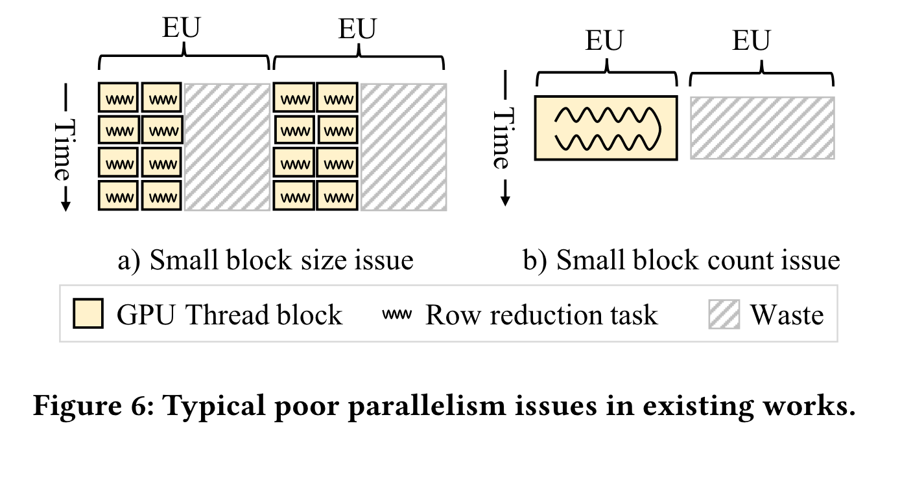

### Key Design Methodology

**High-level Objectives.** 为了解决上述提到的问题，这篇文章提出了一个新方法用于对内存密集型算子 open 一个新的多维度优化空间通过 JIT 操作。在本篇文章中提出了 **hierarchical data reuse** 解决挑战一，**adaptive thread mapping** 解决挑战二。

#### Operator-Stitching Scheme Abstraction

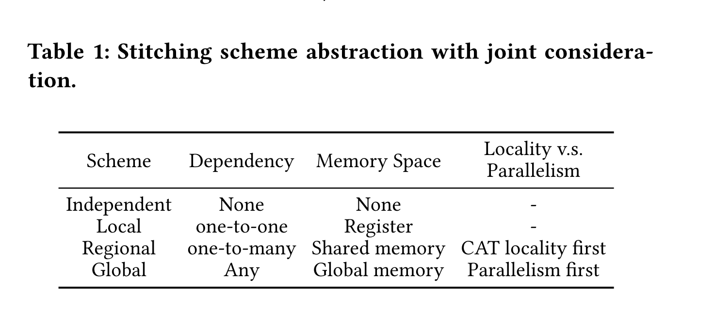
基于图一，**Independent** 指的是没有任何依赖关系的算子；**Local** 指的是 one-to-one 依赖关系的算子，每个线程都会将中间结果存储在 pre-thread buffer 中，这里保留 TVM，XLA 等 AI 编译器的做法。**Regional** 表示的是 one-to-many 的元素依赖，中间数据应当被存储在 sharded data 中。thread mapping 应当保证 thread-block 级别的局部性，例如 图 5 中的 power 的结果可以存储在 sharded data 中。**Global** 用来处理任何复杂的算子依赖关系，中间数据被缓冲在全局内存中。由于这是一个面向并行性的方案，因此没有局部性的需要。在局部性与并行性的权衡将在之后的章节讨论。

#### Hierarchical Data Reuse Illustration

多种运算符拼接方案实现了分层数据重用，通过这种方式，我们可以高效地将任何运算符进行拼接，避免了大量的计算冗余。它有助于突破挑战I中的困境。

##### Data Reuse.

根据表1中的拼接方案，AStitch实现了跨内存层次（即寄存器、共享内存和全局内存）的两级数据重用，以消除融合困境。
**Element-level data reuse.** 在 AStitch 中，对于一对多的元素级依赖，结果可以保存在 sharded/global buffer 中从而消费者可以从 buffer 中重用。
**Operator-level data reuse.** 对于一对多的算子级依赖，，AStitch 只处理一次生产者并且将结果缓冲到 buffer 为多个消费者使用。请注意当前的消费者可能并不是一个 kernel，这会导致冗余计算。

##### Kernel Form Illustration.

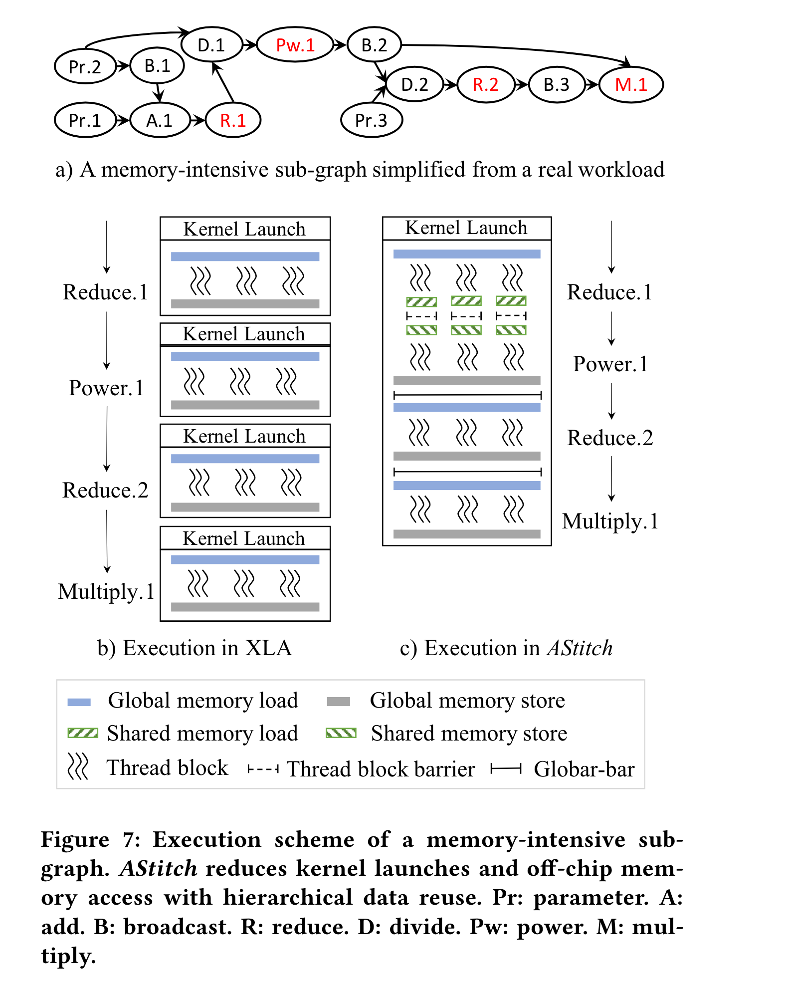
reduce.1 是 regional，power.1 和 reduce.2 是 global，multiply.1 是 independent，图 7 展示了 XLA 和 AStitch 生成的 kernel。

##### Global Barrier

全局拼接方案要求在以下约束条件下，为所有GPU线程设置一个全局屏障：GPU线程块的总数量不应超过每个波（wave）上可以同时执行的允许数量。否则，活动线程块和非活动线程块之间将会发生死锁。在第3.3节中满足了这个约束条件，这有助于限制线程块的数量，同时保持较高的并行性。与分开的内核相比，全局拼接将内核调用之间的隐式全局线程屏障内联到一个单独的内核中。

#### Adaptive Thread Mapping

为了解决第二个挑战，AStitch 引入了 **task packing** 和 **splitting**。
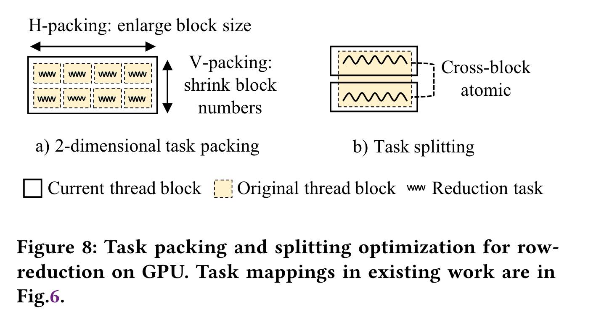

### Compiler Design And Optimizations

#### Stitching Scope Identification

首先，我们描述了AStitch如何确定在给定的机器学习模型中将哪些运算符进行拼接。为了最小化CPU-GPU上下文切换、框架调度开销和减少芯片外存取访问，AStitch尽可能将内存密集型的运算符（在资源约束下）进行大范围的拼接。请注意，AStitch能够有效地管理硬件资源，防止更大内核的资源爆炸（第4.4节、第4.5节）。给定一个机器学习计算图，AStitch首先应用BFS算法自动识别内存密集型的子图。然后，它用一个新的运算符（称为拼接运算符）替换每个子图。为了进一步扩大拼接范围，AStitch将不相连的拼接运算符分组，并形成一个更大的拼接运算符，我们称之为远程拼接。远程拼接的过程是遍历所有现有的拼接运算符，如果它们之间没有数据依赖关系，则将它们合并在一起。形成拼接运算符的一个约束是不允许有循环依赖。如果合并导致形成一个循环，AStitch不会将计算合并在一起。每个拼接运算符将被编译成一个CUDA内核。

#### Automatic Compiler Optimization Design

基于上一节的观察，可以首先确定几个关键算子，再由这些关键算子传播到其他算子。
根据 Obversation B，轻量级和昂贵的 element-wise 操作如果后面没有 broadcast 都是 local 级别的。那些不属于 local 级别的算子将被认为是 dominant op 的候选项。因此 reduce 和昂贵的 element-wise 后跟随 broadcast 将是 dominant op 的候选项。如果两个相邻的 dominant op 仅通过 local 相连接，那么将其进行 merge，其中一个作为 dominant op，另一个作为 sub-dominant。最终可以基于 dominant op 规定线程映射方式，并将其传播到 sub dominant。通常将 reduce 算子作为 dominant op，因为将 reduce 用于生成全局调度效果通常会更好。
最终 AStitch 将生成一个由 dominant op 组成的 group，每个 group 里的 op 都是通过 local 连接，AStitch 将在每个 group 中传播线程映射，并给予 dominant op 和 sub dominant 决定互相之间的通信方式。

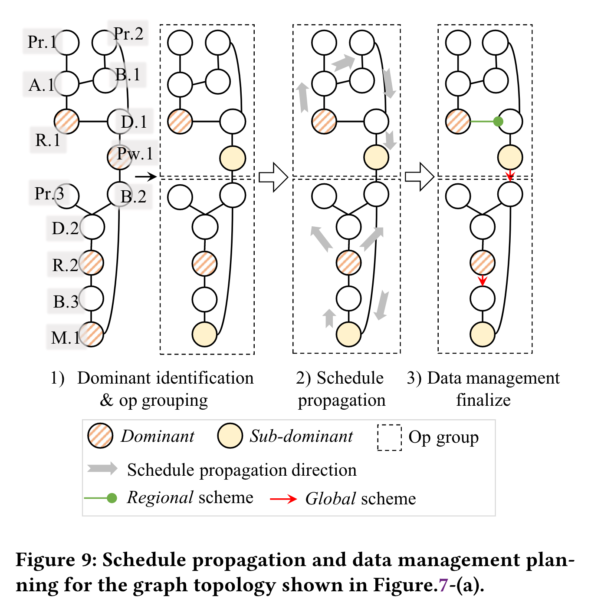

Figure 9 中展示了 AStitch 对于一个计算子图的 Dominant Op 的分组方案。首先先找出 dominant Op 并进行传播，最终对 op 进行分组并决定线程映射模式。
随后，AStitch 基于已经分好的算子组对其进行线性映射，并使用之前的章节提到的 *Adaptive Thread Mapping* 技术对于张量形状进行重新划分。

### Implemantation

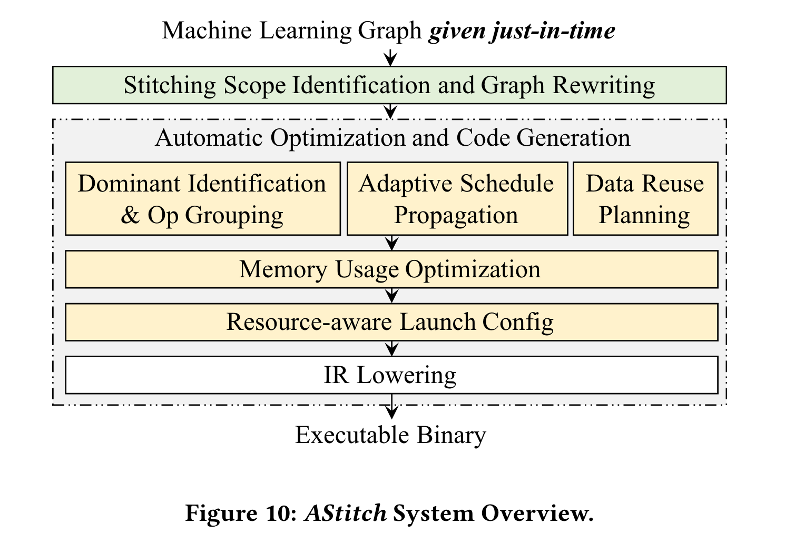

Figure 10 展示了 AStitch 的总体系统设计。AStitch 将其实现在了 Tensorflow XLA 上，AStitch 接受由 Tensorflow 传递来的计算图，使用 AStitch 策略代替了 XLA 的 kernel fusion 和 codegen 的过程。

### Evaluation

AStitch 采用 Nvidia V100 GPU、16GB 内存、CUDA 10.0 以及 cuDNN 7.6 来进行试验性能评估。

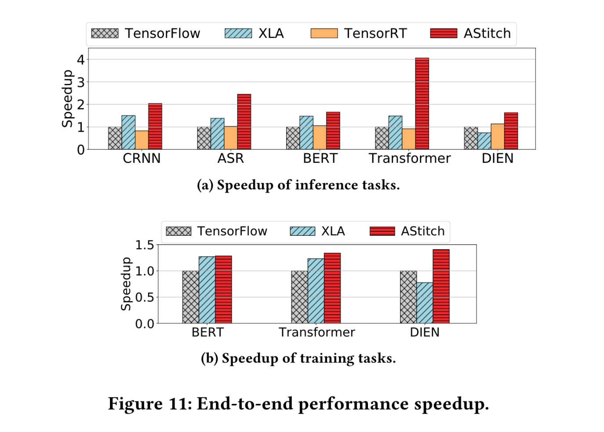
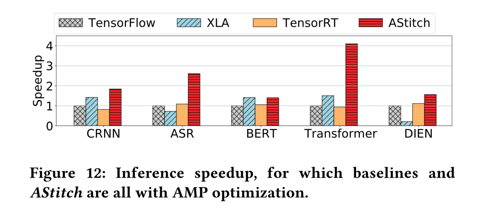
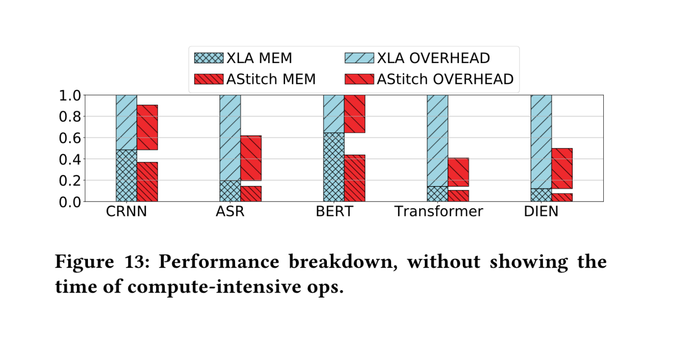

基于 Figure 11、 Figure 12、Figure 13 的实验评估结果，可以看到 AStitch 在当前具有大量开销的密集型算子的模型上的性能具有极大的提升。在 Transformer、DIEN 等模型上的内存密集型算子开销上的作用尤其显著。
