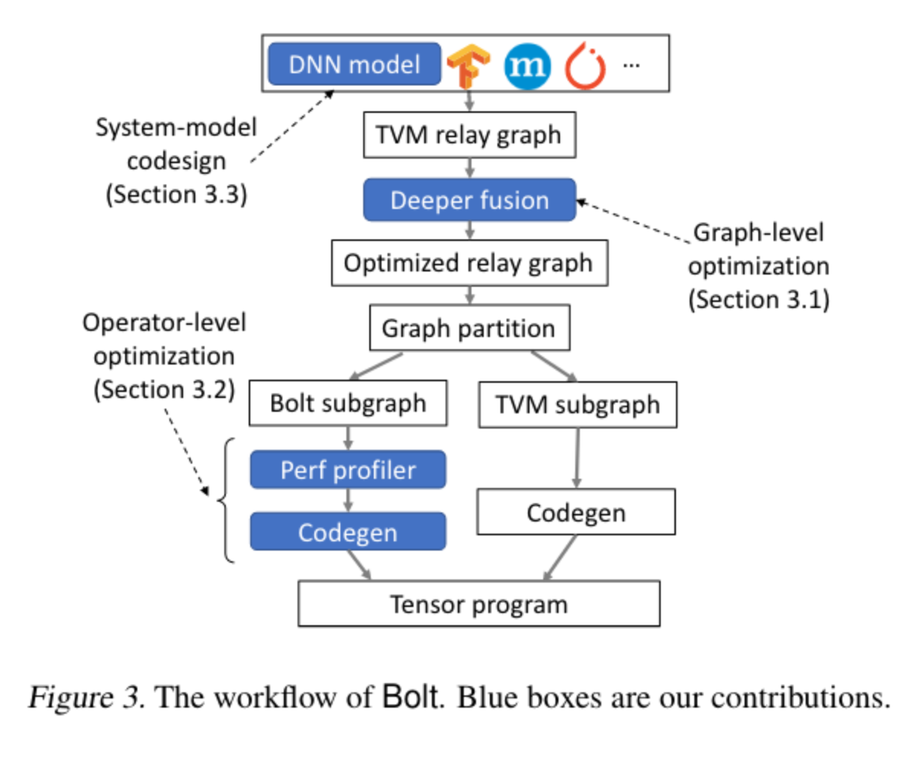
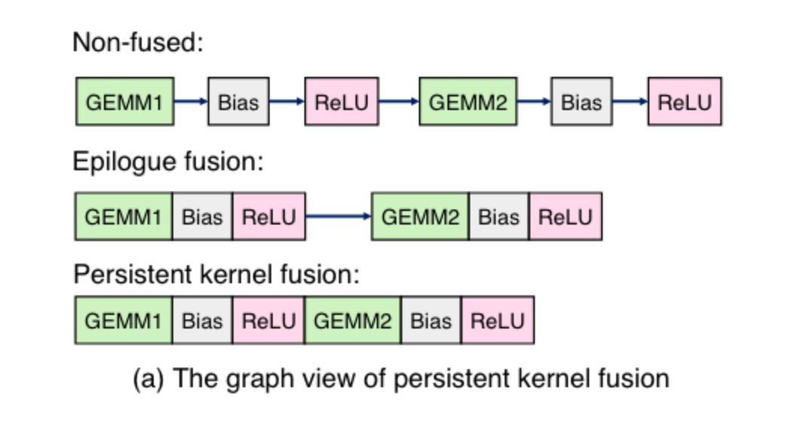
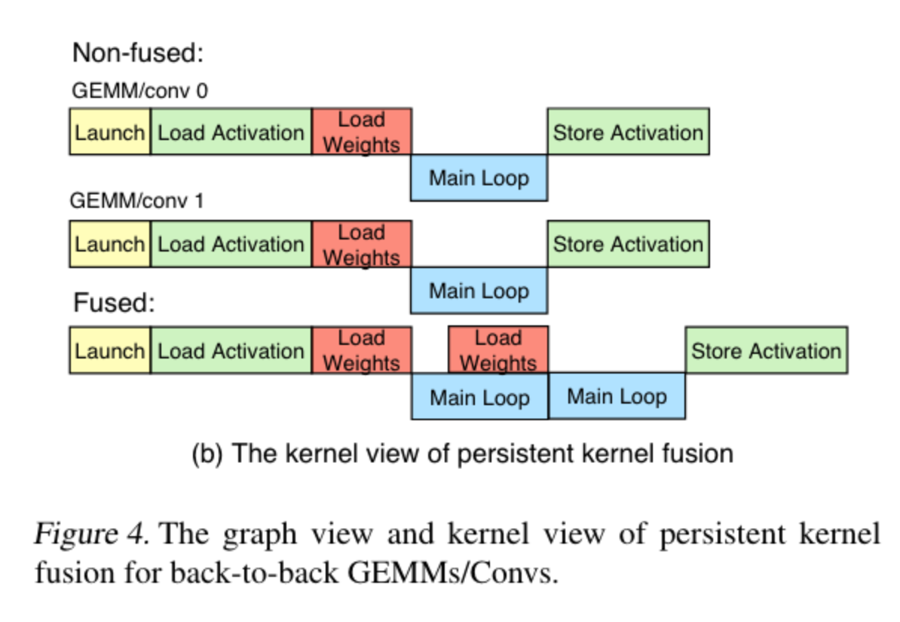
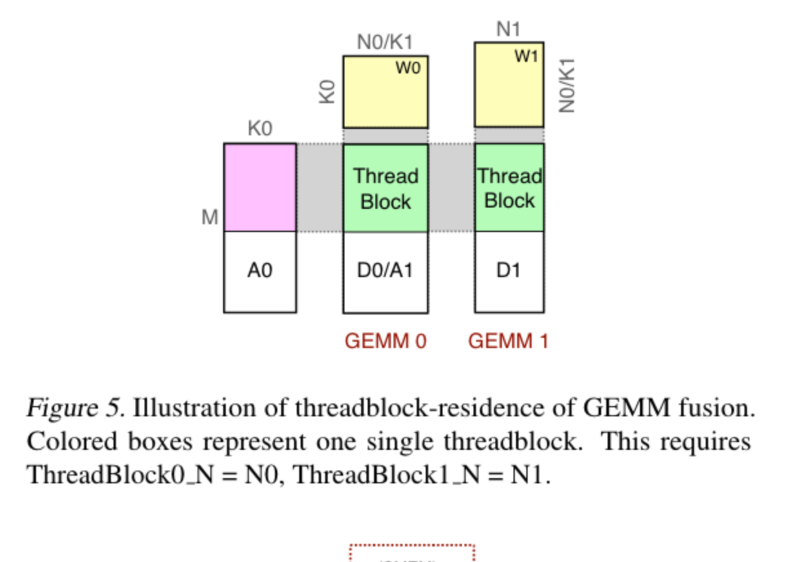
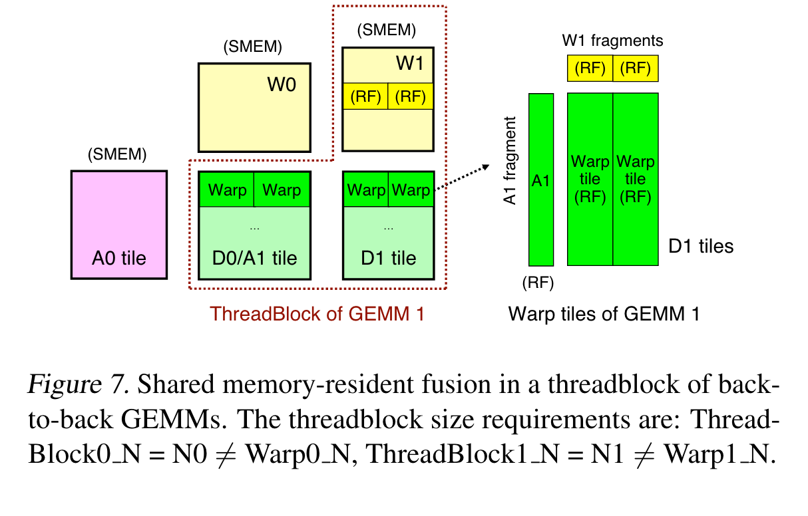

# BOLT: BRIDGING THE GAP BETWEEN AUTO-TUNERS AND HARDWARE-NATIVE PERFORMANCE：阅读笔记

[所属主题](../../index.md)

- 论文：[原文](https://proceedings.mlsys.org/paper_files/paper/2022/file/1f8053a67ec8e0b57455713cefdd8218-Paper.pdf)

## 易错概念

论文 §3.2.3 的 alignment 8 指 **8 个 FP16 元素**：8 × 16 bit = 128 bit，即 16 字节，旧笔记误写成了“8 bit 对齐”。同节关于布局和指令宽度的描述有论文版本背景，不作为所有后续 CUTLASS／GPU 版本的通用限制。历史材料中的 `sharded memory` 应为 `shared memory`。

## 论文笔记

### Introduction

Ansor 搜索花费时间长，性能又不好；因此希望借助 cutlass 进行模版化搜索，希望兼顾这两者。
本篇论文的贡献：

- 在 Auto-tune 和硬件原生性能之间做了扭带。
- 挖掘了更多优化机会，添加了更深的算子融合。
- 实现了轻量级的 profiler 用于搜索最好的模版参数。
- 从 Bolt 设计中提取了 3 个系统友好的模型设计原型并且将它们运用在 RepVGG 模型上进行运用。

### Motivation

当前关于 Auto-tunner 会造成与原生的 Nvidia SDK 库有较大的性能差异以及无效率的搜索。本篇文章的关注点在于使用模版库可以使 auto-tuners 的空间缩紧。

**Insights**

- 模版库提供了挖掘硬件性能的可重用原语。
- 对于不同的 tensor shape 可以轻易参数化。
- 对于 auto-tunning 搜索有更少的融合。
- 基础原语可以被扩展到更复杂的原语（deeper operator fusion）

**Graph Level**
Enable deeper operator fusion. Bolt 开发了一个叫 **persistent kernel fusion** 的技术用来提高性能。算子融合可以将多个算子融合成一个算子来提升性能。例如将 Conv2D + BiasAdd + Hardswish 在一个 kernel 中去提升性能，但是这种可能不会被 cuDNN 等库所支持。

**Operator Level**
Operator level: Automating templated code generation. Bolt 设计了一个轻量级的 profiler 进行自动搜索，搜索的结果随后被放在模版中并生成底层代码。

### Design

Bolt 追随 BYOC 的路径，对张量程序绘制合适子图并将其卸载到 Bolt 进行优化。首先从流行框架的 DNN model 开始，Bolt 首先复用 TVM 前端将其解析为 relay graph。在图上进行计算图优化（deeper operator fusion）和 graph partition。Bolt 接下来执行 hardware-native profilling 去搜索最好的 kernel。最终 Bolt 生成高性能的 CUDA 代码。

#### Enabling deeper operator fusion

Figure4(a) 展示了使用 epilogue 作为融合的基础，同时融合多个 GEMM 或者 Conv 进入一个单的算子用于提升性能：

- 消除了算子之间的加载和存储内存
- 消除了 kernel lanuch 的时间
- 扩大优化范围以探索更多指令调度的选择

Figure4(b) 展示了 persistent kernel fusion 在 kernel 级别的视角。

**Prerequisite: Epilogue fusion.** Cutlass 的 epilogue 模式包括：

- element-wise 算子
- 数据类型转换
- 在列上广播向量
- 在列上进行部分 reducation

##### Persistent kernel (GEMM/Conv) fusion

Persistent kernel 允许将多个 GEMMs 和 Conv 融合到一个算子用来提升性能。

**Key property: Threadblock residence.**
计算持久化内核融合的挑战在于计算第二个 GEMM/Conv 时不去从全局内存中加载它的 input activation。这就要求第一阶段 GEMM/Conv 输出的每个 threadblock 保留在第二个输入的 GEMM/Conv 相同的线程块中。论文中叫做 **threadblock residence**。如果不能做到这个，第二阶段的 GEMM/Conv 不得不从全局内存中加载内存，就消除了持久化 kernel 融合的优势。对于 GEMM fusion，要求对于每个算子 ThreadBlock_N = GEMM_N。对于 Conv，要求 ThreadBlock N = Conv output channel。

**RF-resident fusion.**

**Sharded memory-resident fusion.** 当 GEMM_N 更大时有更高的 RF 压力，因此使用 sharded memory-resident fusion 用于缓解 warp size 的限制。在第二阶段的 GEMM/Conv 需要在 warp 共享时，数据可以暂存在共享内存中。Figure7 展示了一个例子，计算 D1 需要 N 维度的多个 warp tile 流式传输 fragments。因此在 GEMM0 阶段在累加器产生的数据必须从 RF 加载到 sharded memory 为了加载 GEMM1。每个 warp 所拥有的数据将被在下一层进行共享。为了能够进行 sharded memory-resident fusion，本篇论文实现了一个 smem fragment iterator 可以把 accumulator tile 存到 sharded memory 中，之后从第二阶段的 GEMM 中的共享内存中取值。

#### Automating templated code generation

##### Light-weight performance profiler

Bolt 设计了一个轻量级的 performance profiler 用于搜索最好的模版参数。具体来说，Bolt 首先提取 CUTLASS 模版相关的性能参数，包括 threadblock，warp 和 instruction shape, swizzling functor 和 stages 等等。随后确定它们可能的值通过具体的 GPU 体系结构和 Auto-tunner。Hardware-specific guideline 包含以下几个方面：

- Bolt 倾向于使用大的 warp tile 实现更高的 compute-memory ratio
- 每个 threadblock 使用 4 个 或 8 个 warptile 可以在 Nvidia 上取得更好的性能
- 小的问题规模需要小的 threadblock size 从而启动足够的 threadblock 保持 SM 忙碌

##### Templated code generation

- **Layout Transformation.** CUTLASS 仅支持 NHWC 在 Conv 上因为它比 NCHW 更快，但不是所有模型都是都使用期待的 layout。代替在 Conv 之前和之后都插入 Layout transformation 算子，Bolt 直接把所有 Conv 算子全部改成 NHWC layout。将输入和最终的输出改成 NCHW。
- **Kernel padding.** 尽管 CUTLASS 支持 8，4，2，1 的对齐，性能在不同的对齐间依然有巨大差距。Nvidia GPU 最大的向量化 store/load 是 128 bits。所以对于 FP 16 最有效的方式是使用 8 bit 对齐（128/16）。因此 Bolt 自动将未对齐的张量填充为 8 bit 对齐。

### Evaluation

#### Microbenchmarks

##### GEMM/Conv2D

从 BERT 和 ResNet-50 这些模型中提取了一些内部算子做 micro benchmark，和 Ansor 的性能做对比。
