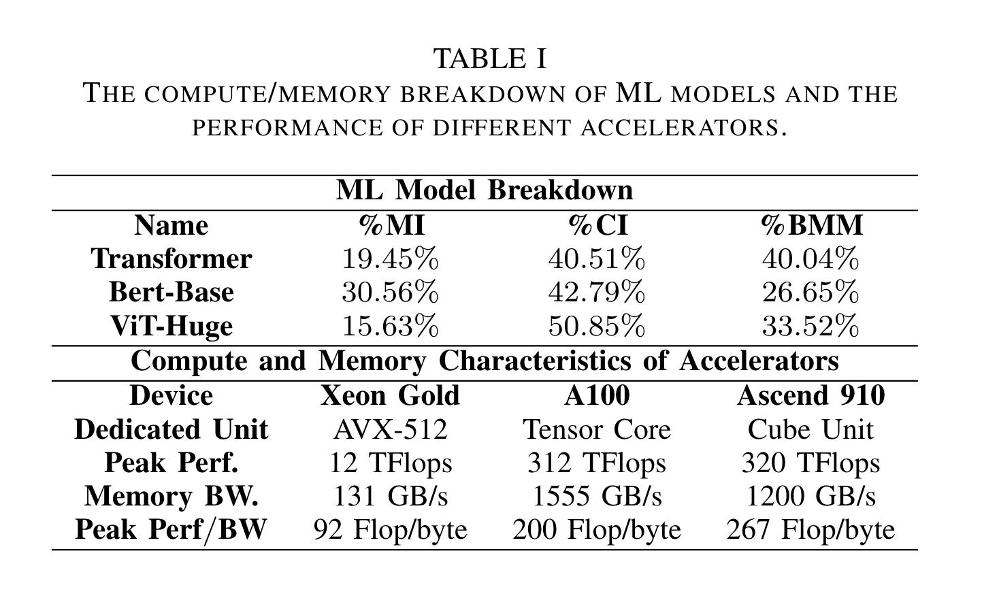
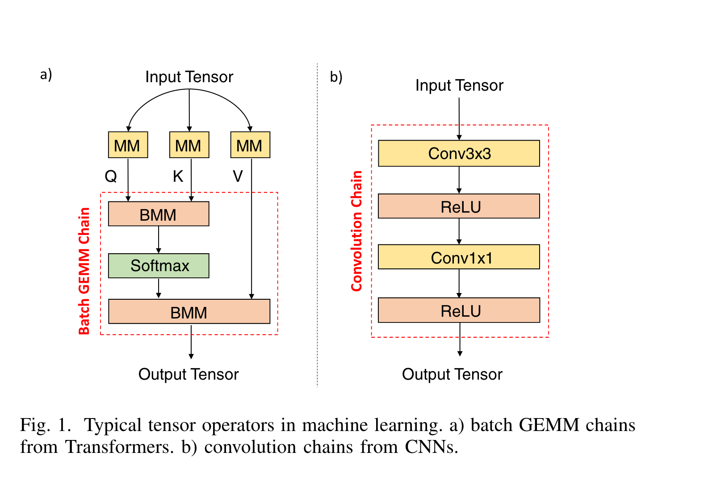
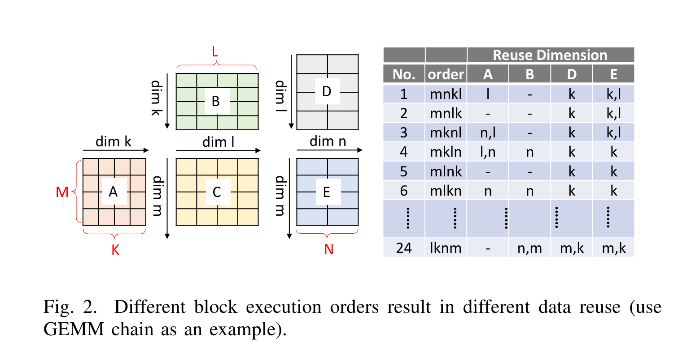
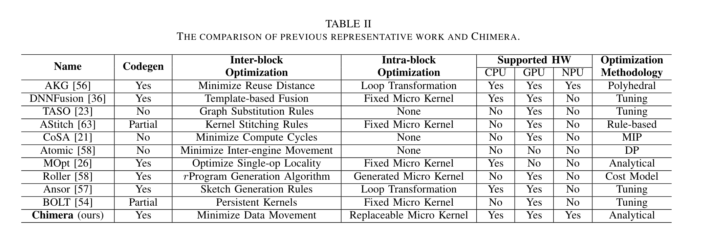

# Chimera: An Analytical Optimizing Framework for Effective Compute-intensive Operators Fusion：阅读笔记

[所属主题](../../index.md)

- 论文：HPCA 2023，[原文](https://light-of-hers.github.io/assets/Chimera.pdf) · [DOI](https://doi.org/10.1109/HPCA56546.2023.10071018) · [Zotero](zotero://select/library/items/KU4QF7DT)。下文页码为论文印刷页码。

## 计算密集型算子链为什么仍受数据移动限制

Chimera 研究连续 GEMM、卷积等算子的融合：既要安排计算块之间的数据复用，也要让每个块高效利用硬件指令。论文将 GEMM、卷积归为计算密集型算子，将 ReLU、softmax 等归为内存密集型算子；**算子类别不等于实际执行瓶颈**。具体实现是否 compute-bound，仍取决于输入形状、数据复用和硬件算力／带宽之比。专用计算单元的算力增长提高了所需算术强度，因此部分计算密集型算子链也会受内存带宽限制。〔§I–II-A，pp.1113–1114，[原文](https://light-of-hers.github.io/assets/Chimera.pdf#page=1)〕

Table I 的模型时间占比来自作者序列长度为 512 的设置；其中 `%CI` 不包含注意力层的 batched GEMM，后者单列为 `%BMM`。这些结果用于说明作者关注的瓶颈，不能推广到所有形状和实现。〔Table I、§I，p.1113〕

Kernel fusion 可以减少跨算子搬运，但算子链存在严格的数据依赖，分块大小与执行顺序又会改变输入、输出的复用。因此，仅决定“哪些算子融合”还不够：Chimera 的核心贡献是用**数据移动分析模型**选择分块和块间顺序，再用**可替换 micro-kernel**完成硬件相关的块内优化。〔§I，p.1114，[原文](https://light-of-hers.github.io/assets/Chimera.pdf#page=2)〕

## 从 GEMM 链区分块间与块内问题

Figure 1 给出两种典型链：BERT、ViT 等 Transformer 模型的 self-attention 中包含两个 batched GEMM 和一个 softmax；CNN 中的卷积链包含一个 3×3 卷积、一个 1×1 卷积和两个 ReLU。后者在特定输入形状下也可能受带宽限制。它们都要求跨算子复用中间结果，不能只优化单个算子内部的 tile。〔§II-A，p.1114〕

图源：论文 Figure 1，p.1114。

### 块间顺序改变哪些数据能够复用

Figure 2 用两个 GEMM 说明问题，其维度约定为：

$$
\begin{aligned}
C_{M\times L} &= A_{M\times K}B_{K\times L},\\
E_{M\times N} &= C_{M\times L}D_{L\times N}.
\end{aligned}
$$

链中有四个独立维度 $m,n,k,l$。顺序 `mnkl` 按**外层到内层**表示循环嵌套，即 `l` 位于最内层、变化最快；它不表示先完成整个 `l` 维度，也不允许绕过生产者与消费者的依赖。Chimera 在块重排时保留原始依赖。〔§II-B、§III，p.1115；§IV-B，p.1117〕

图源：论文 Figure 2，p.1115。中间矩阵 $C$ 保存在片上，因此表中只列 $A,B,D,E$ 的复用维度。

作者在 §IV-B 用 $A[m,k]$ 解释复用差异：`mknl` 的最内侧 `n,l` 不改变它的索引，可以连续复用同一 tile；`mnlk` 中最内层 `k` 已经使 tile 更换，因此模型还要计入外层 `l,n` 迭代造成的重复搬运。另一个跨算子规则是：`k` 仅是第一个 GEMM 的归约维度，其循环次数不应计入第二个 GEMM 的 $D,E$ 的搬运次数。〔§IV-B、Algorithm 1，pp.1116–1117，[原文](https://light-of-hers.github.io/assets/Chimera.pdf#page=5)〕

**AI 解读：中间结果不落到片外，不等于总数据移动量已经最小。** 评价融合方案还需要看：为保持中间结果驻留，其他输入、输出是否付出了更多重复读写。Figure 2 的价值在于把这个取舍显式化，而不仅是说明“融合能够省一次回写”。

### 相关工作分别解决了哪一部分

以下是 Chimera 作者对发表时相关方案的比较，不代表这些系统今天的能力边界。〔§II-B、Table II，pp.1115–1116，[原文](https://light-of-hers.github.io/assets/Chimera.pdf#page=3)〕

- **单算子局部性与固定融合规则**：作者将 Ansor、TASO、DNNFusion、MOpt、AStitch、Roller 的局限概括为优化单个计算密集型算子的块顺序，并用专家规则**固定**算子间顺序。其中 DNNFusion 将计算密集型算子归为 Many-to-Many，难以预测多个此类算子融合的收益。
- **优化目标或搜索范围不同**：CoSA 用混合整数规划优化执行周期，但未考虑这里的块间访存；HASCO 用强化学习与 Bayesian 优化探索软硬件协同空间，但该空间不包含算子融合。AKG 用多面体模型改善局部性，作者认为其广泛搜索空间迫使它依赖启发式，可能得到次优方案。Atomic 关注引擎间的中间结果复用，未优化链的输入／输出复用。
- **块内代码生成与扩展性**：作者批评 AKG、Ansor 当时所用的通用指令选择未充分利用 AVX-512、Tensor Core 等专用指令，而且调优需要大量硬件 profiling；这不能改写成“依赖 TVM／LLVM 就不能跨平台”。DNNFusion、AStitch、BOLT 的手调微内核则与固定流水线和块间优化耦合，增加了扩展算子或硬件的成本。

图源：论文 Table II，p.1116。

## 分块、重排与 micro-kernel 的分工

Chimera 接收计算 DAG，先建立计算块表示，再基于分析模型联合选择分块参数与执行顺序，最后调度块内计算并生成目标代码。**inter-block 是块间优化，intra-block 是块内优化**：前者回答数据如何复用，后者回答计算如何映射到硬件。〔§III、Figure 3，pp.1115–1116，[原文](https://light-of-hers.github.io/assets/Chimera.pdf#page=3)〕

## 块间优化：联合选择分块参数与执行顺序

### Block Decomposition

计算块是通过 loop tiling 与重排得到的小循环嵌套，读取输入 tile 并产生输出 tile，通常映射到单个处理核心；块的工作集需能容纳在片上局部存储中。作者用向量 $\mathbf{S}$ 表示分块参数，GEMM 链对应 $(T_M,T_N,T_K,T_L)$，卷积链最多涉及十个维度。**tile 大小与循环顺序不能独立选择**：顺序决定哪些数据可连续复用，大小决定每次保留多少数据及重复多少轮，两者共同决定数据移动量。〔§IV-A，p.1116，[原文](https://light-of-hers.github.io/assets/Chimera.pdf#page=4)〕

### Minimizing Data Movement Volume via Block Reordering

对每种候选顺序，Chimera 把数据移动量 $DV$ 和存储占用 $MU$ 表示为分块参数的函数。Algorithm 1 只对整条链的输入／输出累计搬运量，因为它假设中间结果留在片上；但中间结果的 tile 仍占用片上容量，需要纳入 $MU$。据此，对每种顺序求解：〔§IV-B、Algorithm 1、式 (1)，pp.1116–1117〕

$$
\min_{\mathbf{S}} DV(\mathbf{S})
\quad \text{s.t.}\quad
MU(\mathbf{S}) \leq \mathrm{MemoryCapacity}.
$$

作者先在实数域用拉格朗日乘子法求极值，再向下取整得到整数候选，比较各顺序下候选的数据移动量。这里得到的是模型下的优化／近似解，不能直接称为真实运行时间的全局最优解。〔§IV-B，pp.1117–1118，[原文](https://light-of-hers.github.io/assets/Chimera.pdf#page=5)〕

多级存储中，计算块继续递归分成子块。作者用各级数据移动量除以对应带宽来估算搬运时间，并在各级容量约束下最小化其中的最大值。因此，不同存储层的数据移动不能只按字节数直接等价比较。〔§IV-C，式 (2)–(3)，p.1118，[原文](https://light-of-hers.github.io/assets/Chimera.pdf#page=6)〕

## 块内优化：可替换微内核的作用与边界

减少块间搬运之后，块内仍需通过指令调度隐藏访存延迟、提高计算流水线利用率。可替换微内核用输入／输出缓冲区上的简单循环嵌套描述计算语义，再为同一语义注册不同硬件实现；编译时按目标后端替换成对应的低层代码。CPU 可使用汇编 SIMD，GPU 可使用 Tensor Core intrinsic，NPU 可通过 pragma 指导底层编译器生成专用指令。〔§V-A、Figure 4，p.1118〕

这种抽象将通用的块间优化与硬件实现分开，但**不会自动免除新后端的微内核实现工作**。作者还在微内核内部优化寄存器复用与指令组织：例如 CPU 路径在寄存器约束下提高计算／访存指令比，GPU 路径用 tiled outer-product 复用加载的矩阵 tile。〔§V-B，p.1119，[原文](https://light-of-hers.github.io/assets/Chimera.pdf#page=7)〕

**AI 解读：数据供给效率和计算执行效率是两个相互配合的条件。** 块间模型减少数据移动，块内微内核提高硬件利用率；前者不能替代后者。“数据移动最少的方案是否也是实际最快的方案”仍需结合具体形状、后端实现与测量判断，不能由上述模型单独推出。〔依据 §IV-C、§V，pp.1118–1119；[阅读讨论中的 AI 解读](https://github.com/KuangjuX/Papers-and-Learning-Notes/issues/30#issuecomment-6814012227)〕
