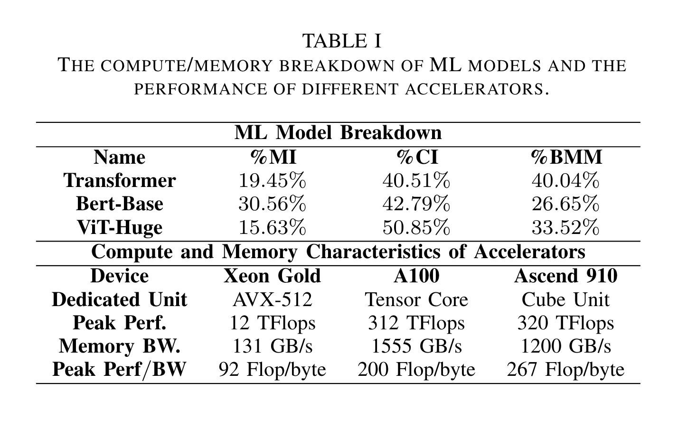
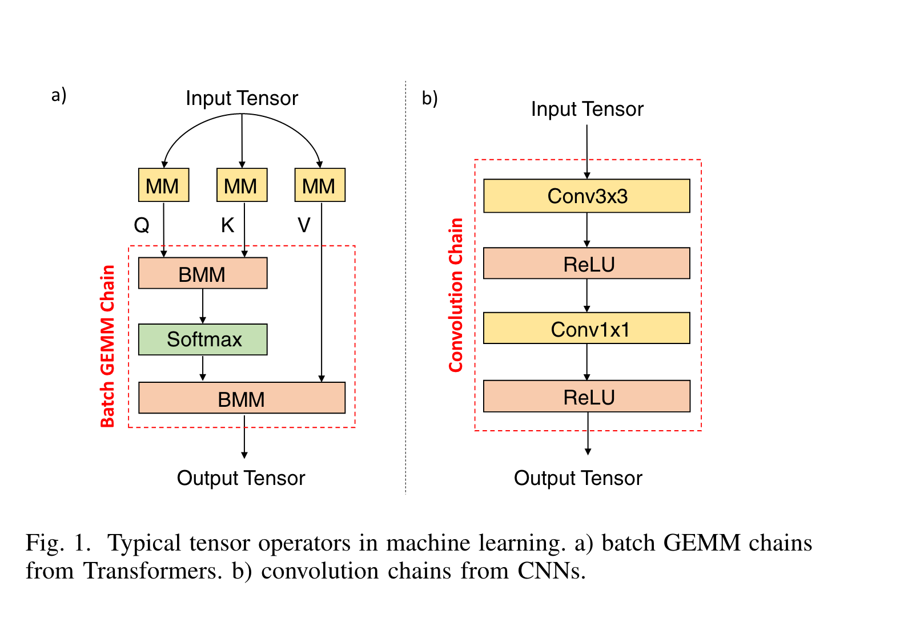
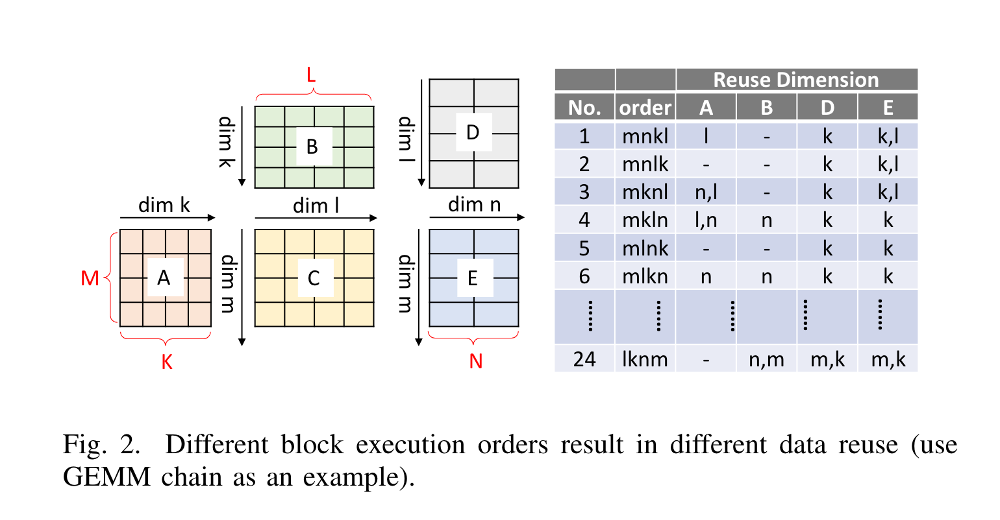
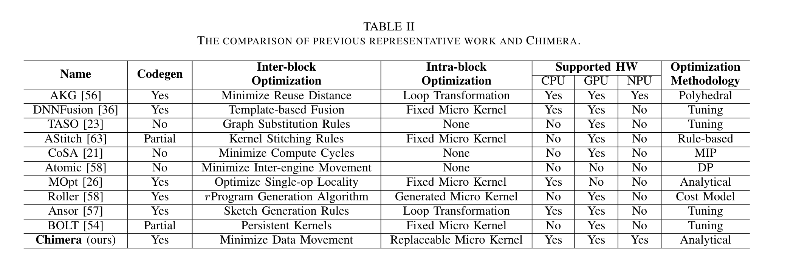

# Chimera: An Analytical Optimizing Framework for Effective Compute-intensive Operators Fusion：历史笔记

[所属主题](../../index.md) · [GitHub 历史笔记目录](../../../github-issues.md)

- 论文：[原文](https://light-of-hers.github.io/assets/Chimera.pdf)
- 原记录：[Issue #30](https://github.com/KuangjuX/Papers-and-Learning-Notes/issues/30) · 作者：KuangjuX
- 来源更新时间（UTC）：2023-12-13T12:12:45Z · 归档：2026-10-22
- 材料范围：历史笔记；沿用现有论文清单的阅读状态，不由 issue 的 open/closed 判断是否读完。

## 阅读线索与覆盖范围

按计算密集型算子链的融合挑战、块分解、块间重排和块内 micro-kernel 调度阅读。原记录停在减少数据移动的开篇，分析模型推导、完整实现和实验尚未展开。

下方是个人历史阅读记录，保留原有技术细节、未完成的小标题和截图；其表述属于当时的阅读理解。本次 AI 整理了来源、章节层级、公式格式与本地图片，校注单独列出。

## 归档校注（AI，2026-10-22）

旧笔记后半部分把 inter-block 与 intra-block 的中文含义混用了。按论文 §III：**inter-block reordering 是块间重排**，调整计算块之间的执行顺序；**intra-block scheduling/code generation 是块内调度与代码生成**，优化一个块内的指令。下方保留历史措辞；复习时应采用这里的对应关系。本次通过 Zotero PDF 核对了该节。

依据：[论文原文](https://light-of-hers.github.io/assets/Chimera.pdf)。校注仅核对上面列出的具体问题，其余历史内容尚未逐项复核。

## 历史阅读笔记

来源：[正文](https://github.com/KuangjuX/Papers-and-Learning-Notes/issues/30)；KuangjuX；最后编辑（UTC）：2023-12-13T12:12:45Z。

首先介绍了两种类型算子，计算密集型和内存密集型，内存密集型算子常用来连接计算密集型算子。随后介绍了一下现在专用计算核和片外内存的性能差距越来越大。因此许多计算密集型算子的性能被内存带宽限制。除此之外，计算性能和内存带宽之间的差距仍然在增长。许多计算密集型算子的实现（例如在 Transformer 中的 batched GEMM）正在变成性能瓶颈。

Kernel Fusion 可以有效优化 Memory-bound 的算子。然而，在新兴模型中计算密集型算子经常形成严格的数据依赖链，因此对于计算密集型算子形成有效率的融合是困难的。首先，算子可能会被分解成不同的计算块指向之前的工作。这些计算块的不同执行顺序可能会造成不同的数据移动。当前的工作（Ansor，TVM，AStitch，DNNFusion，Roller）不能优化计算密集型算子的执行顺序因为它们没有缺乏精确的性能模型去模拟数据移动。除此之外，在每个块中使用 hardware-specispecific 优化计算是很有挑战性的，过去的工作（DNNFusion，Bolt，AStitch）使用 fixed micro 来做不能扩展到其他平台。

在本篇文章中介绍了 Chimera，Chimera 把计算密集型算子切成 compution blocks 并做 inter-block 和 intra-block 两个级别的优化。对于 inter-block Chimera 通过调整执行顺序最小化数据移动进行优化，对于 intra-block Chimera 进行硬件相关的优化。为了处理硬件差异，Chimera 使用统一 replaceable micro kernel 作为高级抽象并且对于不同平台的硬件生成 low-level micro kernel。总结来说 Chimera 做了两件事：

- 对于不同的加速器使用 replaceable micro kernels 并且使用分析的方法优化 micro kernels。
- 对于不同的计算密集型算子链它比当前的 state-of-art 有更好的性能。

### Background and Challenges

最近的模型喜欢使用一连串计算密集型算子，而以前的算子在计算密集型算子周围包上内存密集型算子。

Figure 1 中展示了两个经典的例子，(a) self-attention 是一个在 Bert 和 ViT 中广泛使用的 Transformer-based 模型，这个 layer 主要部分包含一个 batch GEMM 链，其中包含两个 batch GEMM 和一个 softmax。b 包含一个卷积链，包含一个 3x3 和 1x1 的卷积和两个 ReLu 层。在某种特定的 input shape 情况下卷积也可以成为 memory bound。

#### 主要的挑战

在生成有效率的计算密集型算子链中提出了两个主要的挑战：

- 内部块的执行顺序。计算密集型算子链融合时不同的执行顺序具有不同的局部性优化。使用 Figure2 中的 GEMM chain 作为例子(C = A x B, E = C x D)去描述不同执行顺序的影响。在 GEMM chain 中有四个不同的维度（m,n,k,l）并且这两个 GEMM 被切分成多个计算块。mnkl 这个顺序首先执行维度 l，然后是维度 k，其次是维度 n，最后是维度 m。

这部分主要是作者分析了下现有的工作进行融合时存在的不足。

表 2 中的工作部分解决了这个问题。Ansor，TASO，DNNFusion，MOpt，AStitch 和 Roller 仅在一个计算密集型算子内优化 block orders 并且使用 expert rules 修复 inter-op 的顺序。DNNFusion 将计算密集型算子分类为 Many-to-Many 类型的算子，但是没有办法将两个或者多个 Many-to-Many 的算子融合在一起因为它的 code generator 不能预测复杂融合的收益。CoSA 使用 mixed-integer programming(MIP) 来优化全部的执行周期而不需要考虑 inter-block 内存访问。HASCO 使用强化学习和 Bayesian 优化方法去探索软硬协同空间。AKG 使用多面体模型提高局部性，但是多面体是一个通用的模型，搜索空间太过巨大而很难去全部枚举，因此它使用启发式算法去发现解决方案，因此在实践中给出的解决方法通常是次佳的。Atomic 仅仅考虑了 inter-engine 的数据重用（例如 Figure 2 中对矩阵 C 的重用）。但是输入输出的数据重用也对性能有很大的影响。

- 外部块的代码生成。在一个块中调度计算是高性能 kernel 实现的核心。一个块中的指令应该被调度以隐藏内存访问延迟以及最大化计算流水线的利用。AKG，Ansor 使用 loop transformations 以及 tunning 生成 micro kernel，但他们依赖 TVM 和 LLVM 并不能生成跨平台的代码。DNNFusion、AStitch 以及 Bolt 使用 hand-tuned 去优化 fixed computation pipeline。然而，它们的 micro kernels 与 inter-block 优化紧密耦合，这使得支持新的运算符或新的加速器变得困难。

### Overview

这节介绍了 Chimera 的整体的工作流，首先输入 DAG，Chimera 将 DAG 划分成计算块；随后基于分析模型选择优化过的块内执行顺序。之后使用 replaceable micro kernels 进行外部块的优化。

### 内部块优化

#### Block Decomposition

每个计算密集型算子可以被分成多个计算块。分块通过 loop tilling 和重排序进行实现。一个计算块包含一个小的 tile，它访问输入数据的 tile，产生输出数据的 tile。一个计算块通常可以放在一个小的计算核心中，并且一个块中的访问数据可以容纳在芯片的本地内存中。这里使用一个向量来表示所有的分块参数，例如在一个 GEMM chain 中，我们使用（T_M，T_N，T_K，T_L）因为有四个维度要去分解，而在卷积中最多有十个维度。Chimera 计划选择最优的块分解策略从而使得性能最大化。

#### Minimizing Data Movement Volume via Block Reordering

算子内优化的目标是去找到块执行顺序以及分块参数最终最小化数据移动。最小化数据移动和最大化数据局部性是等同的。

## 图片来源

以下图片来自上述 issue／评论中的历史截图；保留原图，不重新绘制。图号沿用旧笔记与截图，本次未为未编号截图猜配原论文图号。

| 本地图片 | 原始地址 |
| --- | --- |
| [issue-30-01.png](images/issue-30-01.png) | [GitHub 原图](https://github.com/KuangjuX/Paper-reading/assets/56680481/9683357b-0279-4f48-a83a-243d745a2e9e) |
| [issue-30-02.png](images/issue-30-02.png) | [GitHub 原图](https://github.com/KuangjuX/Paper-reading/assets/56680481/0f470c9d-2794-42dd-8ba8-ef817a903cc3) |
| [issue-30-03.png](images/issue-30-03.png) | [GitHub 原图](https://github.com/KuangjuX/Paper-reading/assets/56680481/887d2cfb-893f-4e6e-9ea5-ee197ae76578) |
| [issue-30-04.png](images/issue-30-04.png) | [GitHub 原图](https://github.com/KuangjuX/Paper-reading/assets/56680481/d137912f-2941-4094-b4dd-4e3135db1a3f) |
