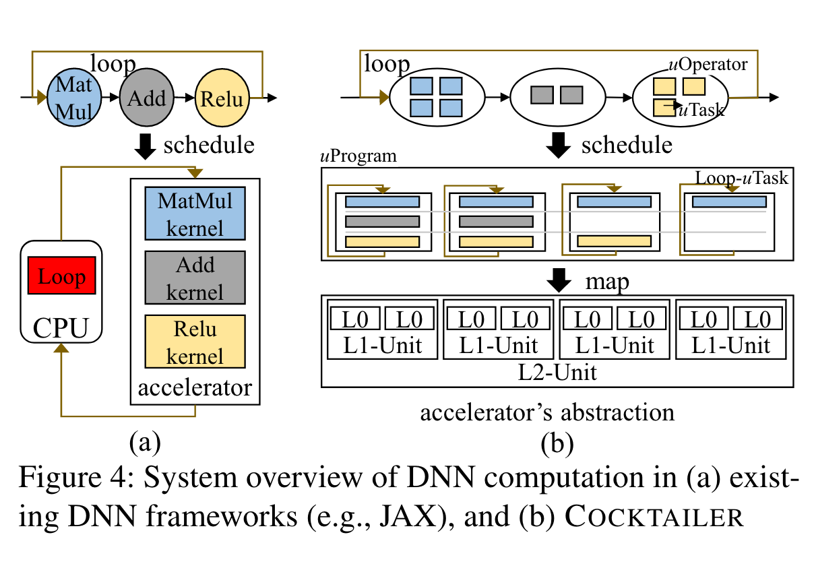

# Cocktailer: Analyzing and Optimizing Dynamic Control Flow in Deep Learning：历史笔记

[所属主题](../../index.md) · [GitHub 历史笔记目录](../../../github-issues.md)

- 论文：[原文](https://www.usenix.org/system/files/osdi23-zhang-chen.pdf)
- 原记录：[Issue #21](https://github.com/KuangjuX/Papers-and-Learning-Notes/issues/21)

## 阅读线索与覆盖范围

按 CPU–GPU 控制流同步开销、uTask/uOperator/uProgram 抽象、循环／分支／递归的表示顺序阅读。原笔记未展开调度优化算法和实验。

## 历史阅读笔记（原 issue 评论）

### 介绍

传统的 DNN 通常是 CPU 来执行控制流，加速器（例如 GPU）来执行数据流，但这样会影响程序执行效率：

- CPU 与 GPU 需要不断进行同步，CPU 需要知道 GPU 的执行状态，但这样会有很多额外的开销，例如昂贵的 PCIe 操作。
- DNN 控制流通常在两个数据流之间有明确的边界，因此限制了数据流的优化，例如在循环范围内合并两个操作符。
- 控制流可能隐式地串行了可能可以并行的数据流操作。

本篇文章提出了一个方法可以通过调度将一些控制流进行优化，放到加速器作为数据流进行执行，并能自动将控制流移入加速器的内核中，实现跨控制流边界的优化。

导致这种模式效率低下的根本原因是控制流通常是单线程的，而数据流通常是并行的。为了控制并行程序的执行流程，控制流和数据流之间的不匹配迫使要么将控制流放在 DNN 操作外，要么将其放置在单个操作符中，通过特定方式实现自定义内核（例如，ReLU 操作符），但这两种方法都不完美。

本文增加了 **uTask** 抽象作为 DNN 程序的基本执行单元，适用于控制流和数据流。在数据流中可以自然分解为不同的 uTask，对于控制流提出了三种 uTask:
1. loop uTask
2. branch uTask
3. uTask reference

通过引用 uTask，Cocktailer 构造了一种控制流与数据流的协同调度空间。这样可以讲一些控制流操作，例如循环和分支放到加速器端来执行，这样可以在控制流侧做更多的优化。Cocktailer 构建于通用的 DNN Tensor 编译器上，可以适配不同的加速器。例如 CUDA GPU 和 ROCm GPU。

在编程语言中，控制流通常包括顺序，循环，分支和函数调用。与之类似，DNN 模型也可以分成类似的：loops for temporal-wise dynamism，models with branches to skip computation 和 models with tree-based architecture via recursion：

- 循环：Seq2seq 可以生成任意长度的序列，它包含一个循环用于持续发出新的标志直到遇到 EOS。
- 分支：BlockDrop 是一个卷积神经网络，可以跳过一些卷积层。
- 递归：RAE 使用遍历树实现树的解析，使用递归来进行深度优先搜索。

由于现代加速器都有流多处理器用于并行执行，比较难以处理串行逻辑，因此目前的 DNN 串行逻辑都在 CPU 执行。在不同模型上去执行全部逻辑与只执行数据流运算有不同的效果，最显著的是 RAE，会慢 56.22 倍。

为什么会慢这么多？

1. CPU 和 GPU 之间的同步是一个很大的开销，同步过程会造成 CPU 阻塞和 GPU 空闲。
2. CPU 和 GPU 不在一个调度空间内，阻止了更进一步的整体的优化。
3. CPU 与 GPU 的边界阻止了更进一步本可以同时执行的算子的并行。

因此，本篇文章有一个动机，就是将控制流和数据流放在同一个调度空间内执行，也就是放在加速器端运行。并且幸运的事，调研发现在加速器端执行控制流是可行的。

### 设计



上图展示了 Cocktailer 的设计，首先将一个 DNN 程序（包含控制流和数据流）输入，每个数据流的一个算子叫作一个 **uOperator**，每个 uOperator 包含多个 **uTasks**，控制流则不在 CPU 端执行，而是生成并行的 **uProgram**，uProgram 包含多个 uTasks 并并行执行。

Cocktailer 把并行加速器抽象成三个层级，以 Nvidia GPU 举例，分别为：（1）core（thread)（2）SM(thread block)（3）GPU device(kernel)。

#### 基于 DNN 程序的 uTask 设计

**uTask**:
```cpp
interface uTask {
    void compute();
    void get_input_data();
};
```

**uOperator:**
```cpp
interface uOperator {
    void compute(uTask_id);
    size_t get_uTask_num();
    set<uTask> uTasks;
};
```

uTask 表示基础的操作，有获取输入的张量和计算两个方法。uOperator 是一系列 uTasks 的集合，当所有 uTask 完成后，uOperator 就完成了。数据流操作例如矩阵乘法可以抽象成 uOperator，矩阵乘法可以被调度到多个线程块，它们中的每个可以被映射到不同的 SM，同时每个线程块也可以被映射到多个线程。

uTask 的数据流很好表示，但是如何用 uTask 来执行控制流呢？这里引入了一个 `NestedUTask` 新增了一个 `body_utasks` 的 field，这里面的 utask 互相间有依赖关系，应当串行执行，并且 `get_input_data()` 也应当依赖于控制流串行执行结果进行。

- Loop uTask
```c++
interface LoopUTask: NestedUTask {
    void compute();
    void get_input_data();
    void control_flow();
    vector<uTask> body_uTasks;
};
```
`control_flow()` 用来表示 loop 或者 while 状态，其中 `body_uTasks` 需要执行多次，每次执行需要通过 `get_input_data()` 获取不同的张量数据。

- Branch uTask

```c++
interface BranchUTask: NestedUTask {
    void compute();
    void get_input_data();
    void control_flow();
    vector<uTask> then_uTasks;
    vector<uTask> else_uTasks;
};
```

- Function

函数可以简单表示成一个 `NestedUTask`，通过串行执行 `body_uTasks` 并且通过 `get_input_data()` 获取对应的张量数据。

- Recurisve

为了支持递归，新增了 uTask 引用，当执行到 uTask 引用时找到对应的 uTask 继续执行。

**uProgram**

```c++
interface uProgram {
    void compute(uTask_id);
    size_t get_uTask_num();
    set<uTask> uTasks;
    size_t unit_level;
};
```
整个 DNN 输入程序由 uProgram 表示，uProgram 包含独立的 `uTasks`，每个 `uTask` 是调度到加速器的 `unit_level` 层级。
