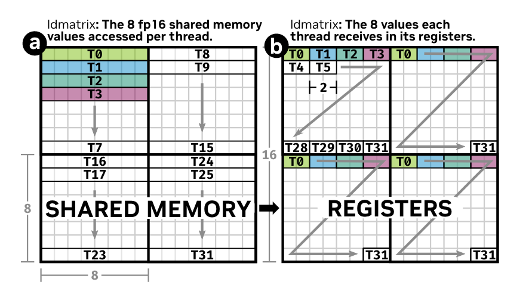
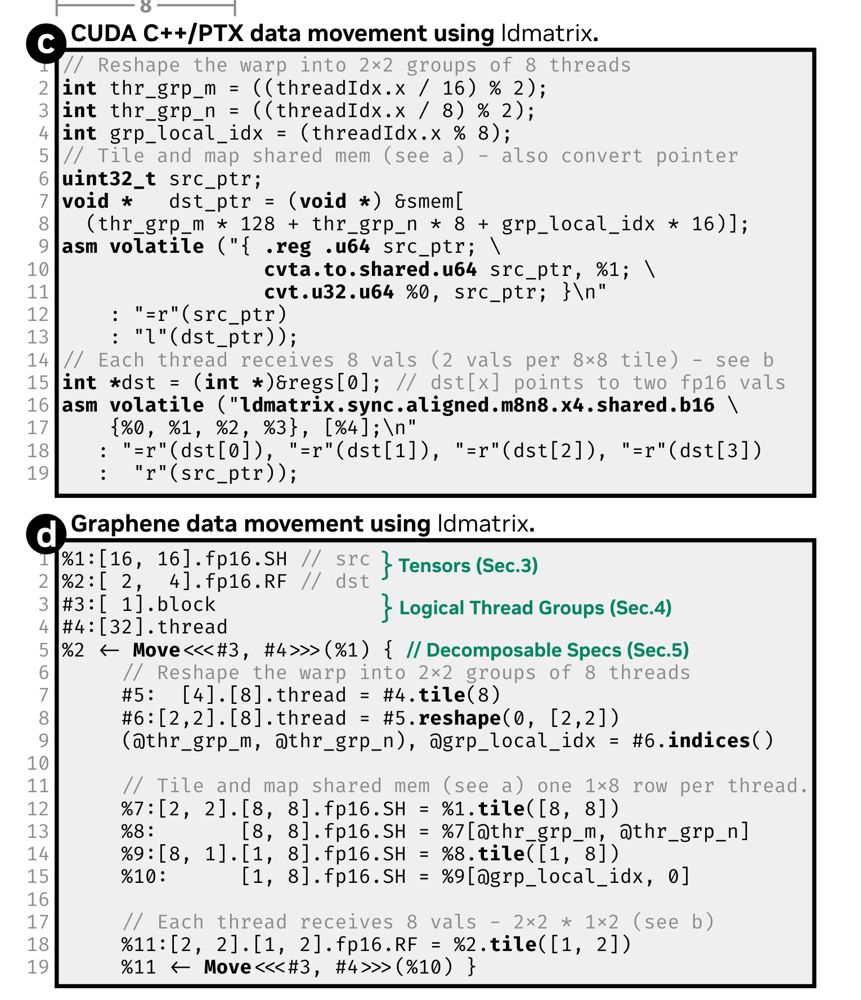
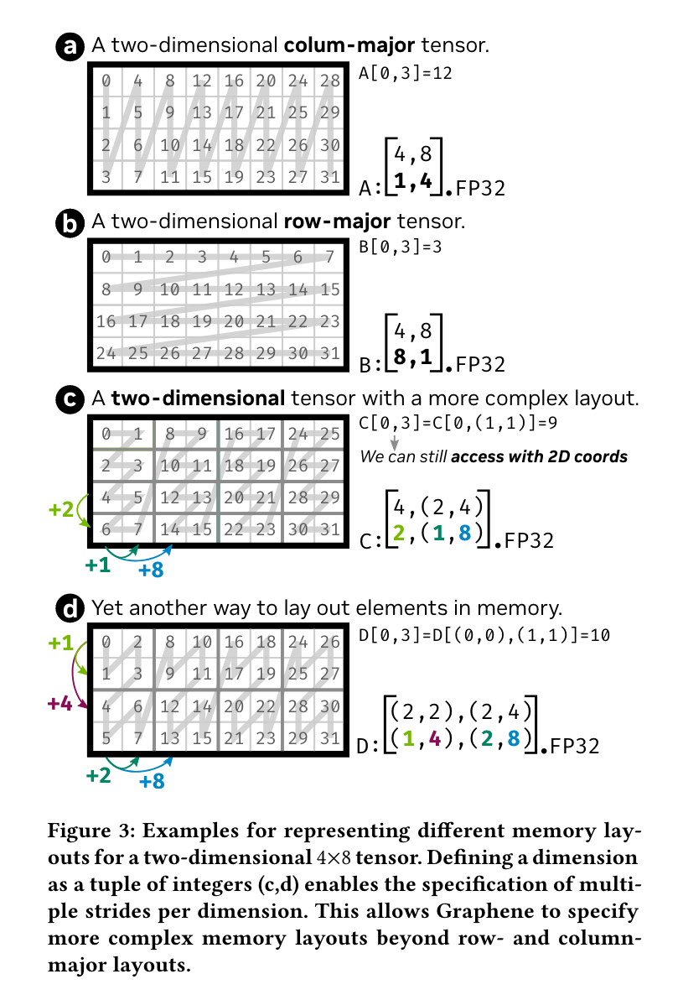
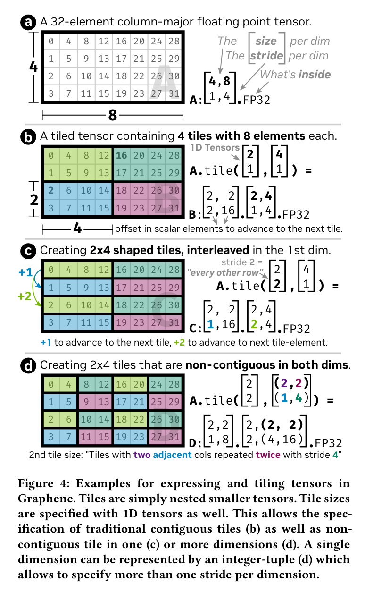
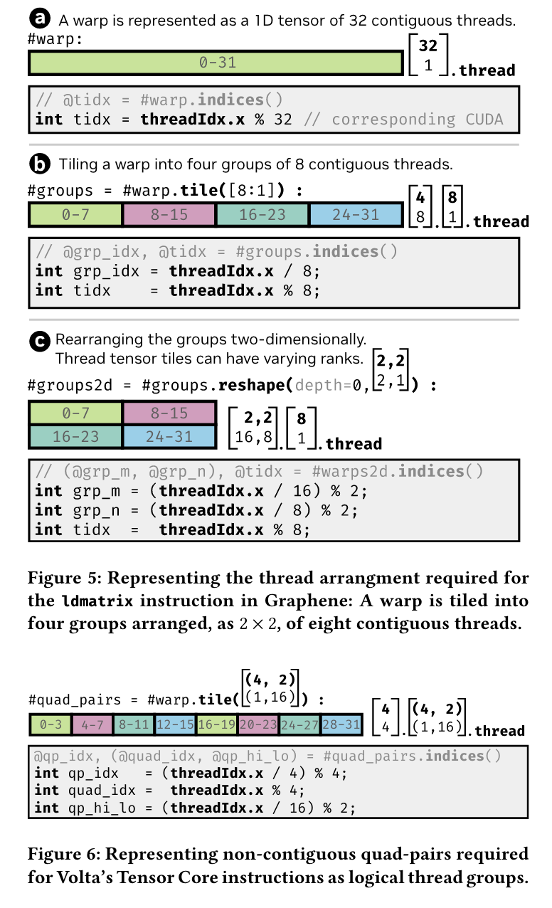

# Graphene: An IR for Optimized Tensor Computations on GPUs：历史笔记

[所属主题](../../index.md) · [GitHub 历史笔记目录](../../../github-issues.md)

- 论文：[原文](https://mgarland.org/papers/2023/graphene/)
- 原记录：[Issue #27](https://github.com/KuangjuX/Papers-and-Learning-Notes/issues/27) · 作者：KuangjuX
- 来源更新时间（UTC）：2023-11-28T11:38:48Z · 归档：2026-10-22
- 材料范围：历史笔记；沿用现有论文清单的阅读状态，不由 issue 的 open/closed 判断是否读完。

## 阅读线索与覆盖范围

内容集中在 ldmatrix 的数据分布、张量 shape/stride 表示、tiling 和 logical thread groups。线程组部分只留图，完整 IR、编译流程和实验尚未整理。

下方是个人历史阅读记录，保留原有技术细节、未完成的小标题和截图；其表述属于当时的阅读理解。本次 AI 整理了来源、章节层级、公式格式与本地图片，校注单独列出。

## 历史阅读笔记

来源：[正文](https://github.com/KuangjuX/Papers-and-Learning-Notes/issues/27)；KuangjuX；最后编辑（UTC）：2023-11-28T11:38:48Z。

### 优化 GPU 数据移动

Nvidia Ampere GPU 能够通过单指令移动两维张量。`ldmatrix` 使用 warp(32 个线程)将一个 8x8 的矩阵从共享内存移动到 warp 线程的寄存器。`ldmatrix` 指令描述了严格的数据到线程映射。

Figure 1a 表示没个线程在共享内存中必须访问的值，Figure 1b 表示在执行完指令后它在寄存器中接受的值。每个 warp 被分成每组有八个线程的四组。每一个八线程组在共享内存被分派一个独一无二的 8x8 tile。每个线程访问在共享内存中的一行，并在返回时接收每个 8x8 tile 中的两个相邻值，总共八个值。

 Figure 1c 和 1d 展示了 CUDA PTX 的实现和 IR 的实现。

### The Shape Of Tensors To Come

在这节里讲了如何使用新设计的 IR 去表示不同 memory layouts 的布局。

Figure 3(a) 和 Figure 3(b) 表示了列主序和行主序的矩阵表示方法，第一行表示维度，第二行表示步长，以 a 为例，维度为 (4, 8)，按行走步长为 1，按列走步长为 4。Figure 3(c) 和 Figure 3(d) 是更加复杂的维度表示。Figure 3(d) 分为 4 个维度，行上分为两个维度，小块步长为 1，大块步长为 4；列上也分为两个维度，小块步长为 2，大块步长为 8。

本节中也讲了如何使用 IR 去表示 tiling tensors。

Figure 4(b) 中的 tile 解释如下：在第一个维度中两个逻辑上相邻构成一个 tile，步长为 1，在第二个维度中两个维度构成一个 tile，维度为 2。

### Logical Thread Groups

在高效的张量计算中需要在不同 kernel 点使用不同的线程排列。

## 图片来源

以下图片来自上述 issue／评论中的历史截图；保留原图，不重新绘制。图号沿用旧笔记与截图，本次未为未编号截图猜配原论文图号。

| 本地图片 | 原始地址 |
| --- | --- |
| [issue-27-01.png](images/issue-27-01.png) | [GitHub 原图](https://github.com/KuangjuX/Paper-reading/assets/56680481/bb84c4c7-7c67-45f5-a651-3f772c68ba4d) |
| [issue-27-02.png](images/issue-27-02.png) | [GitHub 原图](https://github.com/KuangjuX/Paper-reading/assets/56680481/b5a771c8-2486-47ef-9acb-50a34c898784) |
| [issue-27-03.png](images/issue-27-03.png) | [GitHub 原图](https://github.com/KuangjuX/Paper-reading/assets/56680481/4e5d5a7f-dd87-4634-b9d3-9aef9465e813) |
| [issue-27-04.png](images/issue-27-04.png) | [GitHub 原图](https://github.com/KuangjuX/Paper-reading/assets/56680481/e5250565-5230-4a77-8d5a-1d7e603b1dd4) |
| [issue-27-05.png](images/issue-27-05.png) | [GitHub 原图](https://github.com/KuangjuX/Paper-reading/assets/56680481/b34b2a9a-e574-411c-a6dc-9fe83d58fc2a) |
