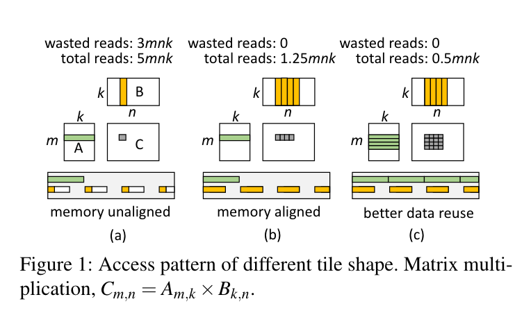
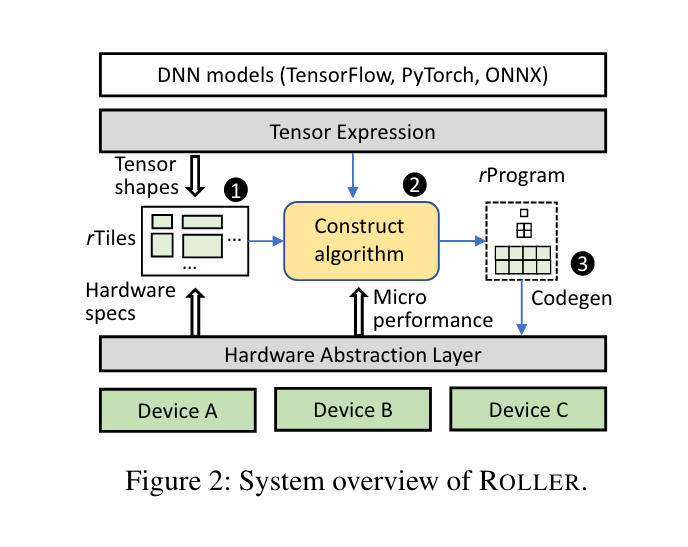
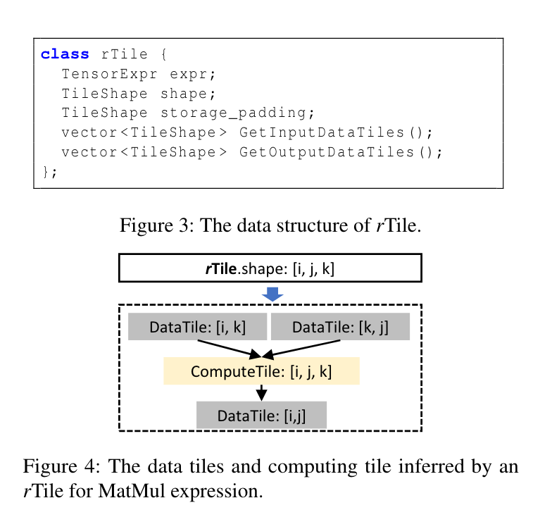
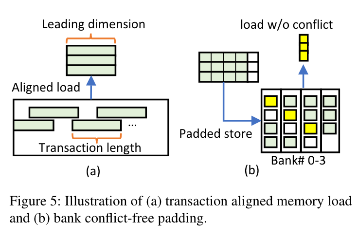
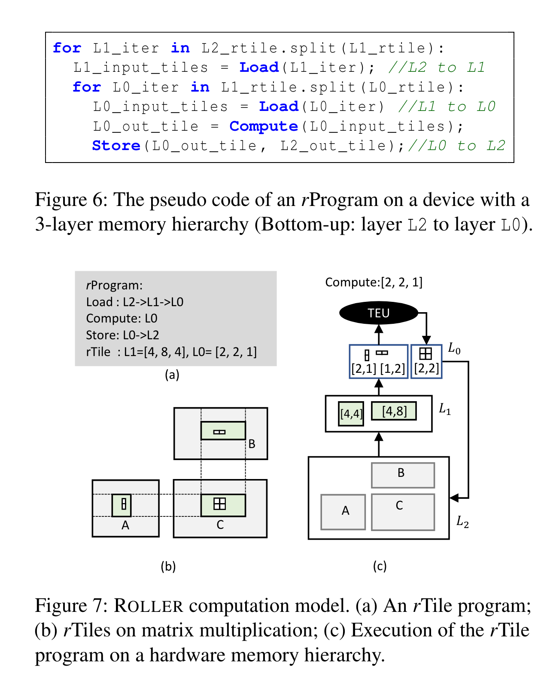
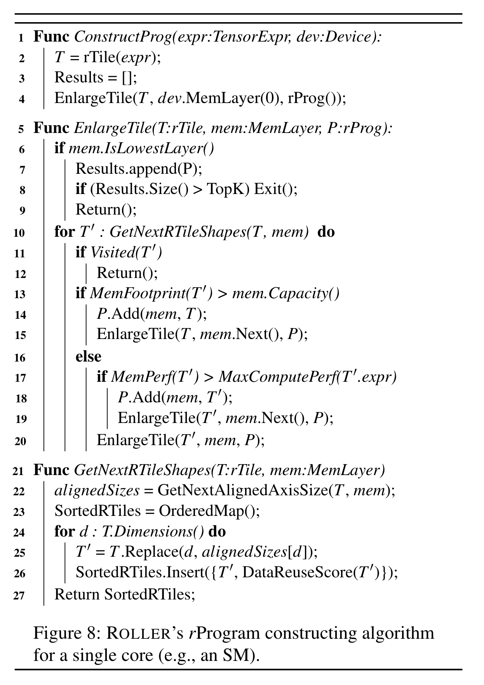
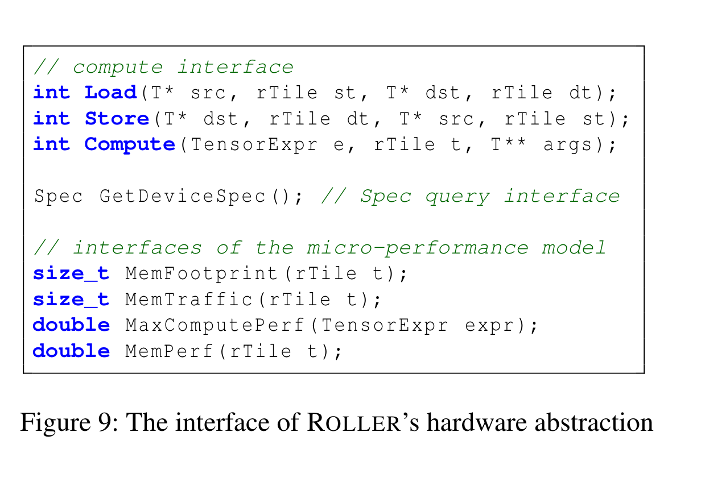

# Roller: Fast and Efficient Tensor Compilation for Deep Learning：阅读笔记

[所属主题](../../index.md)

- 论文：[原文](https://www.usenix.org/system/files/osdi22-zhu.pdf)

## 论文笔记

### Introduction

张量编译器用来优化算子并生成可以在特定加速器执行的代码。然而优化算子涉及到嵌套循环拆分/融合/重排序，实际上是一个组合优化问题，搜索空间巨大。目前先进的编译器像 TVM，Ansor，Flextensor 等通过机器学习算法搜索解决方案，然而这非常耗费时间。在本篇文章中提出了 Roller。

- 首先 Roller 把在 DNN 算子中的计算视为流水线数据处理而不是多级嵌套循环，数据块在并行执行单元和多级内存架构上进行移动和处理。目标由生成有效率的内核程序变成了提高流水线吞吐量。
- 其次，为了加速器执行有效率，tile(数据块）的大小应该和内存 bank，内存食物长度和最小调度单元（GPU warp size）对齐。
- 再其次，对齐流水线的性能是高度可预测的。

因此 Roller 提出了 **rTile** 抽象用于管理 data tile shapes 和加速器关键特性和输入的张量大小对齐。一系列流水线处理过程可以被描述为 rTile-based program。有 Load，Stroe，Compute 三个接口。它使用先扩展然后后扩展的方法。

### Motivation

- **Excessive compilation time**： 在 Ansor 上编译一组算子非常慢，在编译 NASNet 的时候花费了 41.8 个小时，这主要是由于搜索空间巨大造成的。
- **Observation and insights**： 以矩阵乘法为例，$C_{m,n} = A_{m,k} * B_{k,n}$，在存在的编译器中将这个视为三重循环。但是本文可以将其视为：1. Load 子矩阵（i.e. a tile）从 A 矩阵和 B 矩阵中。2. Compute 两个矩阵。3. 存储 C 的 tile 到内存中。因此计算结果的速度依赖于数据 tiles 可以在 Load-Compute-Store 流水线中有多快。

影响性能的关键因素在于 tile 的 shape 以及内存布局。图 1(a)(b)(c) 分别展示了不同的 tile 针对内存布局带来的性能的影响。

### System Design

Roller 从张量表达式中提取张量 shape 并基于硬件特性构建 rTiles，随后基于递归算法生成有效率的张量程序(rProgram)，构建后通过 micro-performance 模型评估性能。rTile 抽象层仅有 Load, Compute 和 Store 三个接口。

#### Tensor Expression and rTile

Raller 将 tensor 表达式计算作为一个基于索引的匿名表达式：`C = compute((M, N), lambda i,j: sum(A[i,k] * B[k,j]))`，可以覆盖大部分 DNN 模型中的算子。

给定 `shape` 和 `expr`，rTile 可以静态推断出输入和输出的 data tiles。rTile 的独特特性是他必须根据给定的张量表达式对齐潜在的硬件特性和张量形状。这些对齐由图 3 中的 rTile `shape` 和 `storage_padding` 来控制，分别标明 rTile 的逻辑形式和物理布局。

- **Alignment with the hardware execution unit.**: rTile 的大小必须是并行执行单元大小的倍数，例如运行在 GPU 上必须是 warp size 的倍数。
- **Alignment with memory transaction.**: leading dimension 应该是内存事务长度的倍数，在 Roller 中基于 Cache line 的长度用来分配内存避免内存浪费。
- **Alignment with memory bank.**: data tile 的步长应当和 memory bank 对齐以避免读冲突。由于 GPU 中共享内存是以 bank 为单位的，不同 thread 访问不同的 bank 可以并行访问，访问相同的 bank 会造成串行访问。如图 5(b) 所示，一个 [3,4] 的 data tile 横跨 4 个 bank，naive 的存储方法会造成 bank conflict，因此需要对内存进行填充。在这个例子中只需增加一个 padding 为 1 的 size 就可以将其放在 4 个 bank 中。
- **Aligenment with tensor shape.**：rTile 的 shape 应当和输入的 tensor 的 shape 对齐。否则，计算不能被均等地划分到 rTile 中，会有边界检查开销或者浪费计算资源。一个简单的方法是在 input tensor shape 上添加一个 padding，使其大小为 rTile 的倍数，但不能太大以浪费资源。
- **Deriving all rTiles.**：基于以上要求，Roller 通过一个 `vector<int> GetNextAlignedAxisSize(rTile T, Dev d)` 的接口通过给定的 rTile 以及设备用来生成 rTile 下一个对齐的 shape 的每一个 axis 大小，这是通过不断增长 dim 来查看是否满足对齐要求。
- **Calculating data reuse score.**：通过不断增加 rTile 可以带来更多的数据重用机会，但同时也会占用更多的内存。

#### Tensor Program Construction

**rTile program**
给定一个 rTile 以及一个现代加速器的内存层级，一个 tensor 的计算可以自然地被定义为一个数据流处理流水线。

Figure 6 和 Figure 7 是一个示例，首先从 L2 中加载 [4,4] 和 [4,8] 的 data tile 到 L1，然后从 L1 加载 [2,1] 和 [1,2] 的 data tile 加载到 L0，L0 计算后直接将 [2,2] 的 data tile 存储到 L2 中。

给定一个 data process pipeline 中，优化目标是最大化 pipeline 的吞吐量。目标可以被翻译成三个状态：

- 计算和内存移动应当充分挖掘硬件特性
- 吞吐量应该使瓶颈阶段达到饱和
- 需要充分利用所有并行单元

**Scaling up an rProgram.**
由于 rTile 保证了内存对齐特性，因此 Roller 可以通过正确的 rTile 来最大化内存重用率。单核心 rProgram 构建逐渐扩大 rTile 直到 most-effective cost 的轴。

Figure 8 展示了构建 rTile 的算法，输入张量表达式和设备，通过递归调用 `EnlargeTile` 来获得 rTile，每次将会获得 Top K 个，防止设备有些隐藏特性不能使用。

**Scaling out an rProgram.**
**Small operator and irregular tensor shape.**

#### Efficient Evaluation of an rProgram

Roller 也引入了一个 efficient evaluation 用来评估性能，在 Figure 8 中提到了。这些 evaluation 可以通过一次 offline profile 并将其缓存。

### Implementation

Roller 的实现基于 Rammer 和 TVM 两个开源项目。

- **Code Generation.**
- **Tensor padding.** 由于最底层内存，例如 DRAM 由机器学习框架进行分配，因此 Roller 只对上层内存进行填充，例如可以使用 TVM 的 `storage_align` 原语来添加 padding。
- **Performance profiling.** Roller 实现了两个 profiller，分别是 micro-performance profiler 和 kernel profiler。前者通过一组微分析生成设备规格，包括内存带宽，计算吞吐量。对于每个设备类型和张量表达式类型（不管 tensor shape 是什么）进行一次离线分析。kernel profiler 从 top K 个 rProgram 中进行评估。
