# Rammer: Enabling Holistic Deep Learning Compiler Optimizations with rTasks：历史笔记

[所属主题](../../index.md) · [GitHub 历史笔记目录](../../../github-issues.md)

- 论文：[原文](https://www.usenix.org/system/files/osdi20-ma.pdf)
- 原记录：[Issue #22](https://github.com/KuangjuX/Papers-and-Learning-Notes/issues/22)

## 易错概念

原笔记中“GPU 仅允许一次执行一个算子”不能当作通用硬件限制。本文要解决的是如何由编译器控制更细的 rTask 调度；§4.1.2、Figure 9 描述了同一个 vDevice 中两个 vEU 并行执行不同算子的 rTask，并在依赖处同步。

## 历史阅读笔记（原 issue 评论）

### 动机

当前深度学习框架都将神经网络计算抽象成算子数据流图，然后将其拓扑排序后交给硬件执行。而在此之下又存在另一层调度器（block dispatcher, warp scheduler）负责充分发掘单个算子中的并行性（intra operator parallelism）并将计算任务映射给更小粒度的处理单元（SMs, CUDA Cores）。

这样的两层调度的方法尽管为系统设计带来了一些简洁，但在实际的部署中，两层调度器互相不感知会导致几个问题：runtime的调度开销很大（prepare kernel context，kernel launch，redundant IO, etc.），inter operator parallelism不能够被有效的利用，忽视了inter和intra operator两种并行性的相互影响。

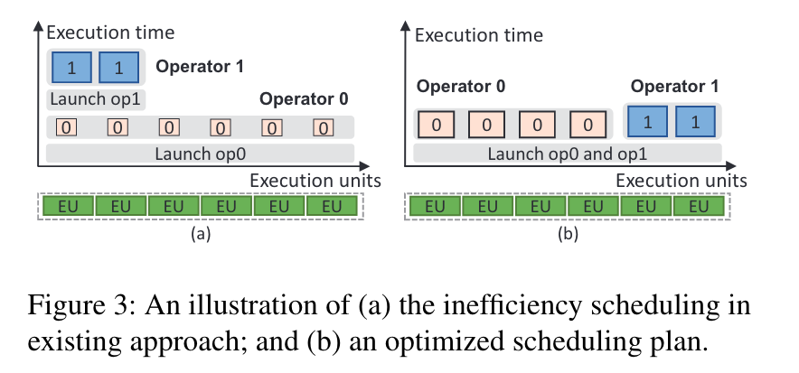

为了解决两层调度带来的开销，本篇文章提出新的抽象，分别是 **rOperator** 和 **rTask**，这样可以将算子内的操作细化为更细粒度的 **rTask** 从而将调度空间扩大以便进行更好的优化。

### RAMMER 设计

RAMMER 是一个能够同时管理算子内和算子外调度的 DNN 编译器，下图展示了 RAMMER 和其他深度学习框架的不同：

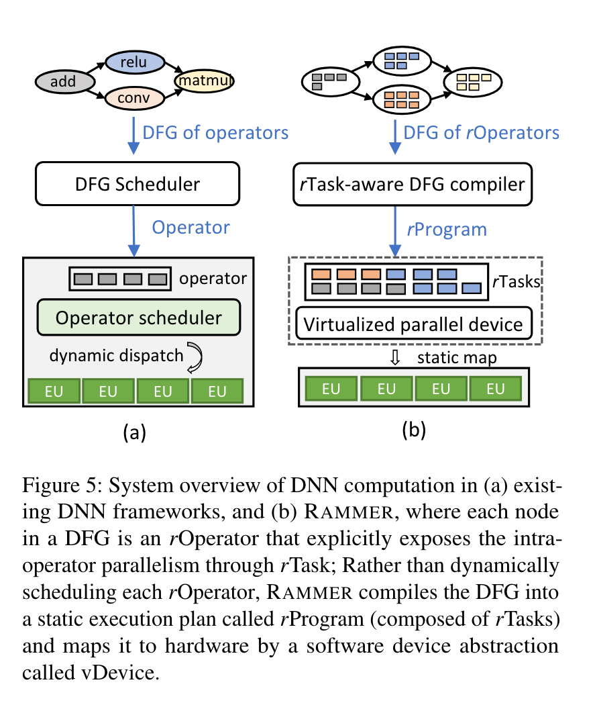

RAMMER 将生成一个静态的 execution plan 供运行执行，由于在单个加速器设备上进行计算不够有效率，因此会生成多个 **rPrograms**。除此之外还在编译时引入了 **vDevice** 和 **vEU** 并在运行时将其映射到对应的物理设备。

#### rOperator

rOperator 是一组 rTasks 的集合，rTask 是能够在加速器设备上进行并行执行的最小任务。rOperator 依赖于外部工具将其分成 rTasks（例如，TVM）。

这里作者举了一个例子，一个矩阵乘法操作可以被分成多个同构的 rTasks，每个计算每个输出矩阵的一个 tile。如果一个复杂的 DNN 算子难以被分成多个同构的 rTasks（例如 SeparableConv2D)，它能够被分成多个独立的 rOperators，每个可以被分成多个 rTasks。

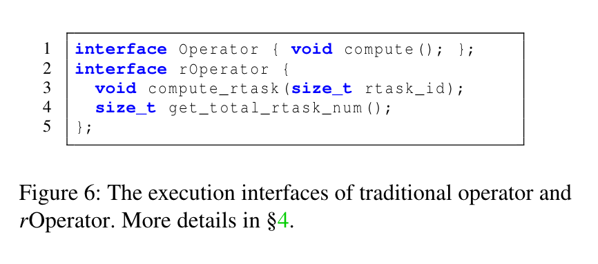

传统的 Operator 只有 `compute()` 一个方法，在 rOpertaor 中通过 `rTask_id` 来索引 rTask 并执行。rOperator 抽象允许 RAMMER 暴露算子内和算子外的并行，打开了新的 DNN 计算的优化空间。

#### Virtualized Parallel Device

现代加速器不提供直接把对应的 rTask 映射到执行单元执行的功能。GPU 仅允许一次执行一个算子（也叫做 kernel）。为了解决这个挑战，RAMMER 设计了一个叫做 vDevice（virtualized parallel device）的概念。一个 vDevice 中含有多个 vEUs(virtual execution units)。因此 RAMMER 可以将 rProgram 组织成一个二维数组，`prog[vEU_id][order]`，order 表示在一个 vEU 中的任务的执行顺序。为了确保互相有依赖的任务正确进行执行，RAMMER 添加了一个 **barrier-rTask**。barrier-rTask 接受一系列 `<vEU_id, order>` 的任务。barrier-rTask 会等待每一个 rTask 完成后才会继续执行。

#### rTask-aware DFG Compiler

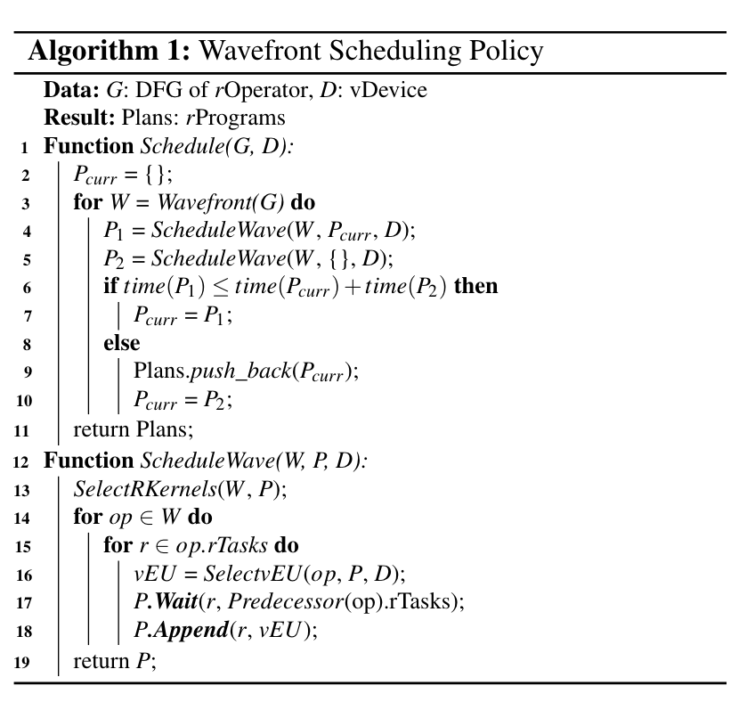

有两个接口，一个是 `Append()` 一个是 `Wait`。`Append(task_uid, vEU_id)`，`task_uid` 是一个全局的 id，可以看成是 operator id 和 rtask_id 的一个组合。`Append` 将一个 rTask 从一个 Operator 按顺序添加到一个特殊的 vEU 中。`Wait(wtask_id, list<task_uid>` 允许一个 id 为 wtask_id 的 rTask 等待放在 list 中的任务完成。`Wait` 接口隐式地 `Append` 了 barrier-rTask 在 wtask_uid rTask 前。一种优化方法是，当有连续的 rTasks r1,r2...rn，只需将最后一个 rn 添加到等待列表即可。

在这里假定 rOperator 有一个或者多个被叫做 rKernels 的实现，每个 rKernel 都去将一个 Operator 分成多个 rTasks 并且其中包含运行时间和所需资源的 trade-offs。在这其中包含最快和 resource-effecient 的做法。 `SelectRkernels()` 使用一个启发式算法进行：如果全都用最快的并且资源也够用就用最快的，否则使用 resource-effecient 的做法。在选择 rKernel 后，`SelectvEU()` 去决定将这个 rTask 调度到哪一个 vEU，给定当前的 rProgram，`SelectvEU()` 选择能够最早执行 rTask 的 vEU。随后调用 `Wait()` 确保 rTask level 顺序最终调用 `Append()` 将 rTask 放到对应的 vEU 中。

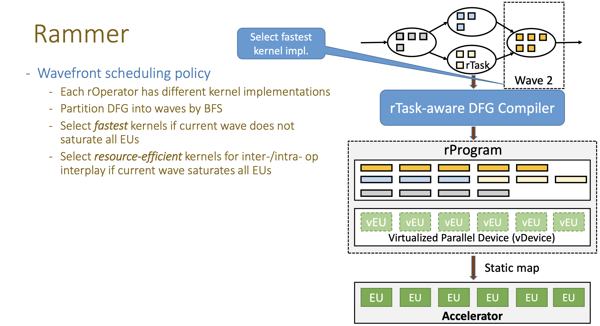

### 实现

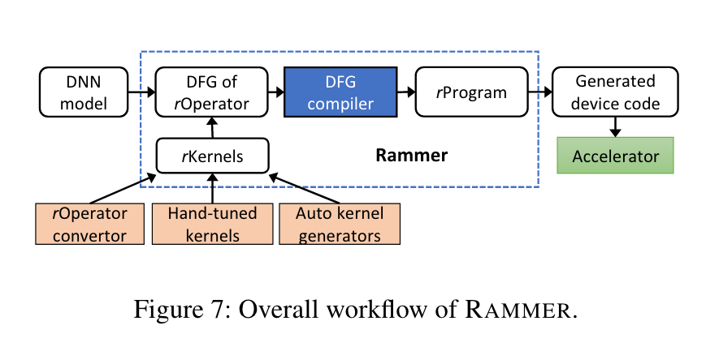

上图展示了 RAMMER 的实现流程。本篇文章也举了一个使用 CUDA 实现将 rOperator 分为 rTask 的例子：

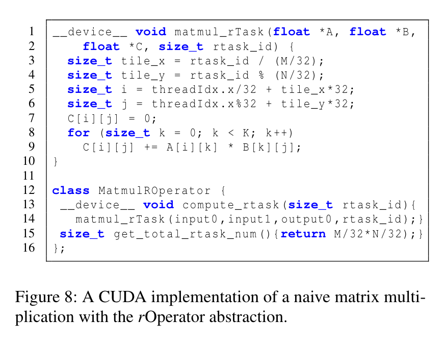

由于 GPU 在外部算子会自己进行调度，为了绕过 GPU 调度，RAMMER 使用 PTB（持久线程块）在 vDevice 实现 vEU，这样 RAMMER 可以将 PTB 固定在期望的 SM 上面。除此之外本篇文章也给了一个在多个 vEU 上执行的例子，假设一个 vDevice 有两个 vEU，一个 rProgram 需要去执行 MatMul, ReLU 和 Conv2d 等几个算子，vEU0 去执行 MatMul，vEU1 去执行 ReLU，随后两遍进行等待直到全部执行完两个 vEU 再同时执行 Conv2D。

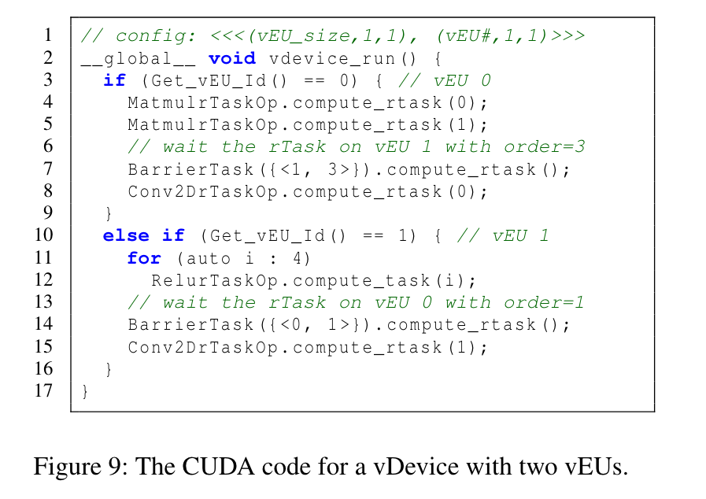

为了实现高效的 barrier-rTask 引入了一个步骤数组，其中每个元素用来追踪在每个 vEU 上已完成的 rTasks 的数量。完成后，rTask 将使用其第一个线程将对应的元素加 1。当在 N 个 vEU 上等待 rTasks 列表时，barrier-rTask 使用前 N 个线程轮询步骤数组中的合适元素知道步骤比那些 rTasks 的顺序更大。在之后 barrier-rTask 会插入 `__syncthreads` 确保在 vEU 中的所有线程准备去运行下一个 rTask。

除此之外，许多从 DNN Model 输入的操作符被 CUDA kernel code 所描述，RAMMER 提供了一个 source-to-source 的 converter 可以将 legacy CUDA operator 转换成一个 rOperator。这里有个问题是原有算子的线程块既可能是一维的也可能是二维的也可能是三维的，但是在 vEU 中的线程都是一维的（这里的 vEU 对标的是 thread blocks,已知 GPU 的架构为 Device -> SMs -> thread blocks -> threads)，因此需要对 threadIdx 进行重映射。

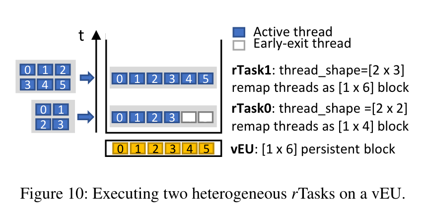

### Evaluation

这里分别对于执行时间、GPU 资源利用率以及调度开销与其他机器学习框架以及张量编译器进行对比并进行了评估：

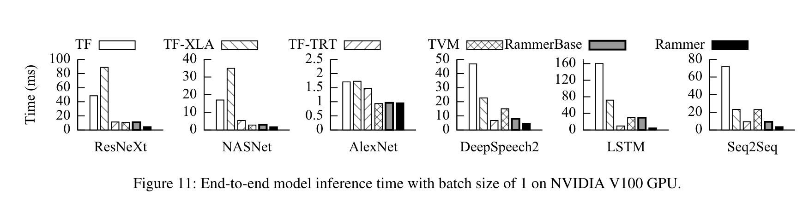

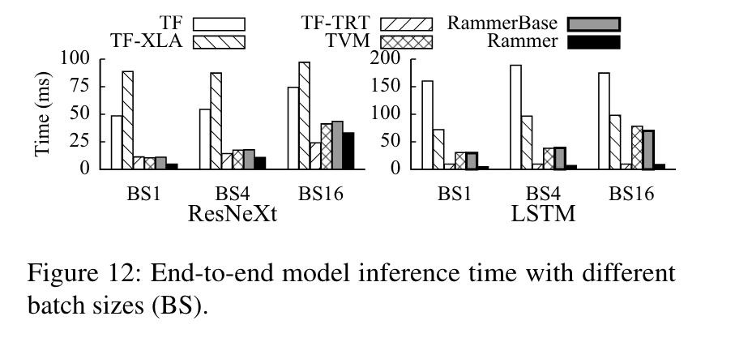

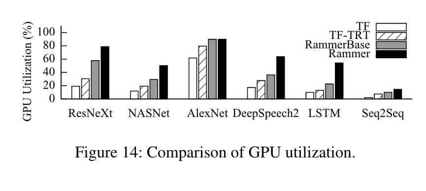

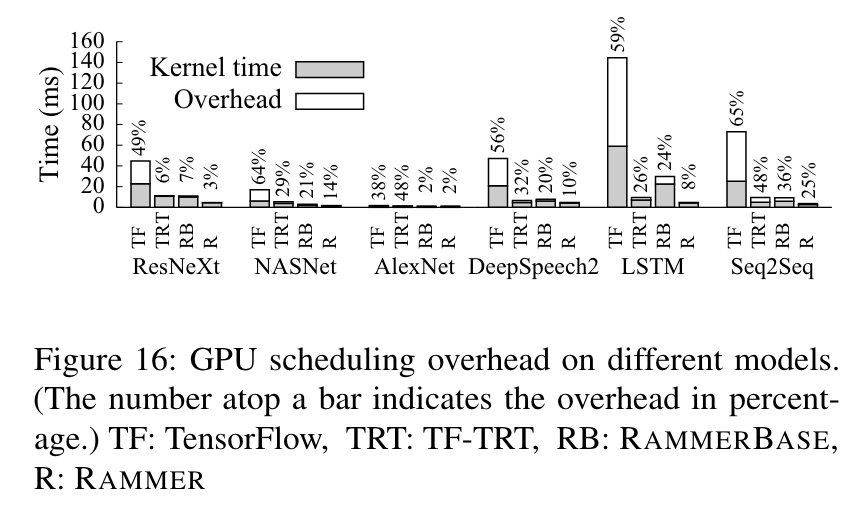
