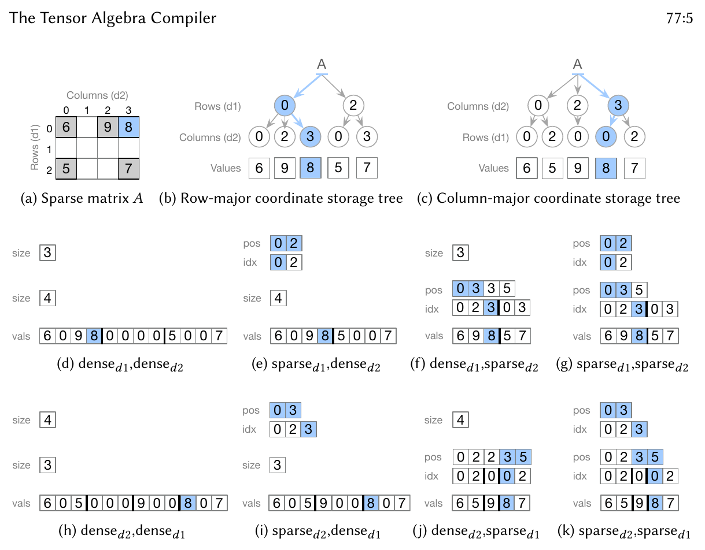
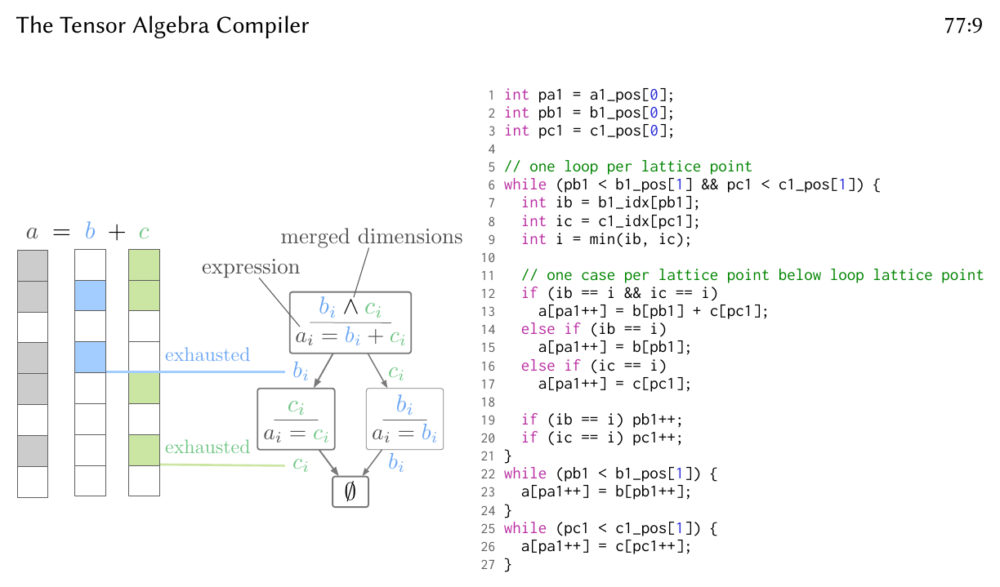

---
tags:
  - topics/tensor-compiler
  - topics/sparse-computation
aliases:
  - The Tensor Algebra Compiler
  - taco
  - 张量代数编译器
---

# The Tensor Algebra Compiler

稀疏张量计算的实现同时取决于代数表达式和存储格式：压缩存储通常不能高效随机访问，多个输入需要按坐标共同遍历；复合表达式若拆成多个库调用，还可能产生比输入、输出更大的中间张量。Kjolstad 等人在 OOPSLA 2017 提出的 **taco（Tensor Algebra COmpiler）**，将张量索引表达式和格式描述编译为计算 kernel，以可组合的代码生成替代逐算子、逐格式手写实现。[§1–2，pp. 1–4][intro]

## Background

以张量乘向量（TTV）为例，$B$ 是三阶张量，$c$ 是向量，输出 $A$ 是矩阵；$i,j$ 是输出的自由索引，$k$ 是归约索引：

$$
A_{ij}=\sum_k B_{ijk}c_k.
$$

全部稠密时，三层循环遍历完整空间并用下标计算地址；$B$ 采用压缩稀疏纤维（CSF）格式时，循环改为逐层遍历它的存储坐标，再用 $k$ 读取稠密 $c$；若 $c$ 也稀疏，就要同时遍历两份有序的 $k$ 坐标，仅在坐标重合时执行乘法。论文 Figs. 1–3 展示了这三种代码，并指出该表达式在所支持格式下就有 384 种组合。再考虑任意复合表达式，靠有限的手写 kernel 难以覆盖。[§2，pp. 2–4][intro]

taco 用存储描述表示各层如何访问，用 **iteration graph** 表示循环的嵌套约束，再用 **merge lattice** 决定同一循环内多个输入怎样共同遍历。融合粒度仍由用户选择，编译器负责为给定表达式和格式生成实现。[§2，p. 3；§6，p. 12][codegen]

## Tensor Storage

论文将张量表示为坐标树：每层对应一个维度，从根到叶的路径确定一个完整坐标，数值单独保存在 `vals` 数组中。格式由两部分组成：维度的存储顺序，以及每层使用 `dense` 还是 `sparse`。[§3，pp. 4–6][storage]

- **Dense 层**保存维度大小，覆盖该维度的全部坐标，包括值为零的位置；已知父层位置后，可以通过乘加计算子层位置。
- **Sparse 层**使用 `pos` 和 `idx`：父层位置 $p$ 的子坐标位于 `idx[pos[p]:pos[p+1]]`，段内坐标有序。遍历时先取得段边界，再顺序读取坐标；这里的存储位置 $p$ 与逻辑坐标不是同一个量。

图 5（原论文 p. 5）：同一矩阵可按行或按列组织坐标树，再分别选择各层的 dense/sparse 表示。[原图来源][storage]

CSR 是“行在外、列在内”的 dense–sparse，CSC 交换两个维度的顺序；两层均 sparse 对应 DCSR/DCSC，高阶张量每层均 sparse 则对应 CSF。图 5(f) 的 CSR 中，`pos=[0,3,3,5]`：第 0 行的三个列坐标是 `idx[0:3]=[0,2,3]`，第 1 行因相邻边界相同而为空。这样，循环生成只需组合每层的访问规则，而不必为每个完整格式另写一套逻辑。[§3，pp. 5–6][storage]

Dense 层也能表示稀疏结构内部的小型稠密块。论文把 blocked SpMV 的矩阵表示为四阶张量，内部两个维度存储稠密块；这属于**数据分块的表示能力**，并不意味着已经支持通用的迭代空间 tiling。[§3，p. 6；§10，p. 26][limits]

## Iteration Graphs

Iteration graph 的节点是索引变量，每个张量访问形成一条按存储顺序排列的路径，输出张量也有对应路径。例如 CSR 的 $B_{ij}$ 形成 $i\to j$，CSC 则形成 $j\to i$。合并各条路径后，编译器把索引变量排成森林，要求路径边均从外层指向内层，以保证按坐标树从根到叶访问存储。[§4，pp. 6–8，Figs. 7–8][graphs]

对于 $A_{ij}=\sum_k B_{ijk}c_k$，$B$ 的路径依次经过 $i,j,k$，$c$ 的路径只包含 $k$。多个输入路径在 $k$ 相遇，意味着该层需要共同遍历 $B$ 当前纤维与 $c$；乘法要求两者坐标相交，而具体的归并循环由 merge lattice 决定。

若格式约束冲突，例如 CSR 与 CSC 相加，路径可能形成环。**迭代图能表示这种表达式，但本文的代码生成算法不能直接处理有环图**；反向遍历压缩结构需要额外索引搜索，论文采用先转换格式来打破循环依赖的办法。因此，“支持张量索引表达式”不能理解为任意格式组合都可不经转换直接生成代码。[§4，p. 8][graphs]

## Merge Lattices

同一个索引变量访问多个稀疏输入时，表达式决定哪些坐标需要参与计算：逐元素乘法对应交集，加法对应并集。归并格将这些关系进一步展开为**输入耗尽前后的循环**和**每个循环内的计算分支**，使编译器能为复合表达式生成有序归并代码。[§5，pp. 8–11][merge]

图 9（原论文 p. 9）：$a_i=b_i+c_i$ 的归并格对应一个双输入循环和两个处理剩余元素的循环。[原图来源][merge]

在两个向量都尚未耗尽时，循环取当前坐标的最小值：两者都有该坐标则计算 $b_i+c_i$，只有一方有则直接取该值，并推进参与该坐标的指针。一方耗尽后，只需遍历另一方的剩余元素。格中的一个点既指定需要共同遍历的维度和表达式，又参与确定循环中的分支；不能把“当前坐标缺值”与“整个输入已经耗尽”混为一谈。[§5，pp. 9–10，Fig. 9][merge]

复合表达式也按相同规则构造。例如论文 Fig. 10(b) 的

$$
a_i=b_i+c_i d_i
$$

先为 $c_i d_i$ 构造交集，再与 $b_i$ 做并集。顶层循环归并三个输入；若 $c$ 或 $d$ 先耗尽，剩余计算只依赖 $b$；若 $b$ 先耗尽，则继续归并 $c,d$ 的交集。构造过程沿表达式树自底向上组合各子表达式的格。[§5.1，pp. 10–11][merge]

用集合记号解释这一机制（AI 解读），令 $S_x$ 是输入 $x$ 的存储坐标集合，则候选输出坐标为

$$
S_{\mathrm{candidate}}=S_b\cup(S_c\cap S_d).
$$

这里的“候选”描述结构上的参与关系，不保证结果值非零；例如同一坐标上的两项可能相消。图 9 的生成代码也直接存储加法结果，没有按结果是否为零做过滤。[§5，Fig. 9][merge]

稠密输入允许简化归并：同一索引的多个稠密维度只需遍历其中一个；稠密维度覆盖完整坐标范围，耗尽后无需保留其他尾部循环；稠密与稀疏输入做乘法时，可以只遍历稀疏坐标，再随机读取稠密值。最后一项把 SpMV 等操作化为由稀疏输入驱动的计算。[§5.2，p. 11][merge]

## Code Generation and Fusion

代码生成沿迭代图的森林顺序递归。每个索引变量先构造归并格，生成对应循环与分支，再递归生成内层循环；同时根据存储描述计算位置，并插入数值计算与输出索引构造语句。对最内层的自由索引，编译器写出输出值；它以下的循环执行归约，它以上的循环可先计算已经具备输入的子表达式，以避免重复计算。[§6.1–6.2，pp. 12–13，Fig. 11][codegen]

稀疏输出还需要 **assembly**：向 `idx` 写入坐标，更新 `pos` 段边界，并在容量不足时扩容。父坐标下的输入即使各有非零项，内层交集也可能为空；因此构造上层索引时要确认内层确实产生了条目。Assembly 可以与 compute 融合，也可以分开；当重复计算只改变数值、稀疏结构保持不变时，已构造的输出结构可复用。[§6、§6.3，pp. 12–14][codegen]

融合还可以避免计算不会影响结果的中间值。SDDMM（sampled dense-dense matrix multiplication）为

$$
A_{ij}=B_{ij}\sum_k C_{ik}D_{kj},
$$

其中 $B$ 稀疏、$C,D$ 稠密。taco 遍历 $B$ 的存储坐标，只计算这些位置的内积。论文对 $n\times n$ 输入给出的工作量是 $\Theta(n\cdot\operatorname{nnz}(B))$；对照中的 uBLAS 则先计算完整稠密矩阵乘积，执行 $\Theta(n^3)$ 工作。这个差异来自保留稀疏掩码与内积之间的关系，不能仅归结为减少临时张量的读写。[§4，Fig. 8(d)；§8.3，p. 18][compound]

## Evaluation

作者在 Intel Xeon E5-2695 v2（2.4 GHz）双路机器上测试，使用 GCC 5.4、MATLAB 2016b 和 128 GB 内存。输入来自 SuiteSparse、FROSTT 以及 Facebook wall-post 数据。默认报告**单线程、冷缓存的平均执行时间**；多线程结果使用 12 个线程，并通过 `numactl` 限制在一个 socket，因为当时的 taco 尚不支持 NUMA 感知代码生成。[§8.1，pp. 16–17，Table 1][evaluation]

| 实验 | 作者报告的结果与比较范围 | 来源 |
|---|---|---|
| SpMV（稀疏矩阵乘向量） | 非分块矩阵上，taco 与 MKL、OSKI 等成熟实现的性能相近；有稠密块时，分块表示能改善性能，但串行 OSKI 在几乎所有所测案例中更快。taco 的块大小沿用了 OSKI 调优结果。 | [§8.2，Figs. 14–15，pp. 17–18][evaluation] |
| 复合线性代数 | 对 SDDMM、PLUS3、MATTRANSMUL、RESIDUAL 生成融合 kernel；SDDMM 减少无贡献的内积，后两项避免中间向量或额外拷贝。PLUS3 的时间包含输出索引 assembly；SDDMM、PLUS3 没有并行结果。 | [§8.3，Fig. 16，pp. 18–20][compound] |
| 高阶张量 | 在 Facebook、NELL-2、NELL-1 上测试 TTV、TTM（张量乘矩阵）、MTTKRP（matricized tensor times Khatri–Rao product）、加法和内积，taco 支持全部五项，快于 Tensor Toolbox 能完成的所测案例；后者在 NELL-1 的 TTM 上内存不足。MTTKRP 对 SPLATT 有胜有负，作者报告最差慢 1.53 倍。 | [§8.4，Table 2，pp. 20–21][higher-order] |
| 格式选择 | 对不同稀疏结构生成矩阵，比较格式的存储量和 SpMV 时间；不存在普遍最优格式，错误格式可能令两项成本增加多个数量级。 | [§8.5，Fig. 18，pp. 22–23][formats] |

Table 2 的三阶输入使用 CSF，输入矩阵和向量为稠密；MTTKRP 的并行行中，Tensor Toolbox 仍是串行实现，因此该行不能当作同线程数比较。SPLATT 在较大输入上通过提出重复乘法因子减少运算，论文当时的 taco 尚未做这项优化。[§8.4，pp. 20–21][higher-order]

格式实验也解释了为什么“支持很多格式”具有实际意义。Row-slicing 与 column-slicing 矩阵具有相同密度，但行外层 sparse、列内层 dense 的格式适合前者，却可能为后者存储大量零；thermal 矩阵用该格式时也几乎存下整个矩阵，使 SpMV 从按非零项计算退化为二次工作量。格式选择必须考虑非零项的分布，而不只是整体比例。[§8.5，pp. 22–23，Fig. 18][formats]

## Scope and Limitations

本文解决的是**给定表达式与格式后的代码生成**。自动选择格式、决定表达式拆分或融合粒度、引入 workspace、迭代空间 tiling，以及 GPU/TPU 和分布式内存后端，均被列为未来工作。论文没有给出自动判断任意输入最优格式的方法，格式实验也不能视为已经实现自动调优。[§10，pp. 25–26][limits]

2017 年实现的 OpenMP 并行生成只处理外层循环，并有三个限制：该循环必须是不需要归并的 `for` 循环；自由索引不能位于归约索引之下，以避免尚未处理同步的 scatter；输出的全部维度必须是 dense。这些限制与前述有环迭代图的限制共同界定了本文代码生成和并行实验的适用范围。[§6.4，p. 14][parallel]

[intro]: https://commit.csail.mit.edu/papers/2017/kjolstad-oopsla17-tensor-compiler.pdf#page=2
[storage]: https://commit.csail.mit.edu/papers/2017/kjolstad-oopsla17-tensor-compiler.pdf#page=5
[graphs]: https://commit.csail.mit.edu/papers/2017/kjolstad-oopsla17-tensor-compiler.pdf#page=7
[merge]: https://commit.csail.mit.edu/papers/2017/kjolstad-oopsla17-tensor-compiler.pdf#page=9
[codegen]: https://commit.csail.mit.edu/papers/2017/kjolstad-oopsla17-tensor-compiler.pdf#page=12
[parallel]: https://commit.csail.mit.edu/papers/2017/kjolstad-oopsla17-tensor-compiler.pdf#page=14
[evaluation]: https://commit.csail.mit.edu/papers/2017/kjolstad-oopsla17-tensor-compiler.pdf#page=16
[compound]: https://commit.csail.mit.edu/papers/2017/kjolstad-oopsla17-tensor-compiler.pdf#page=18
[higher-order]: https://commit.csail.mit.edu/papers/2017/kjolstad-oopsla17-tensor-compiler.pdf#page=20
[formats]: https://commit.csail.mit.edu/papers/2017/kjolstad-oopsla17-tensor-compiler.pdf#page=22
[limits]: https://commit.csail.mit.edu/papers/2017/kjolstad-oopsla17-tensor-compiler.pdf#page=26
