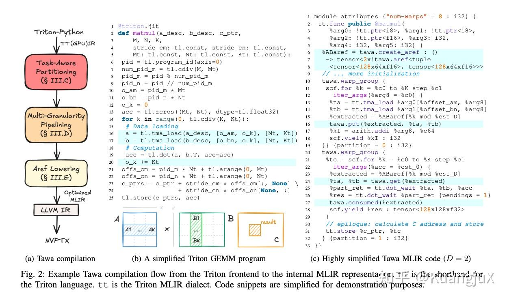
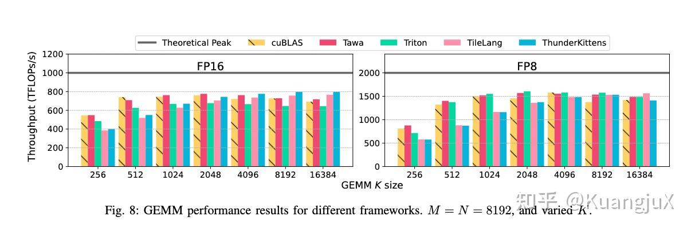
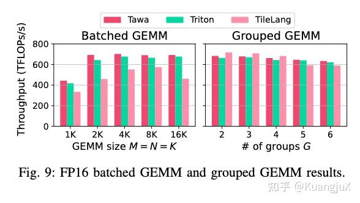
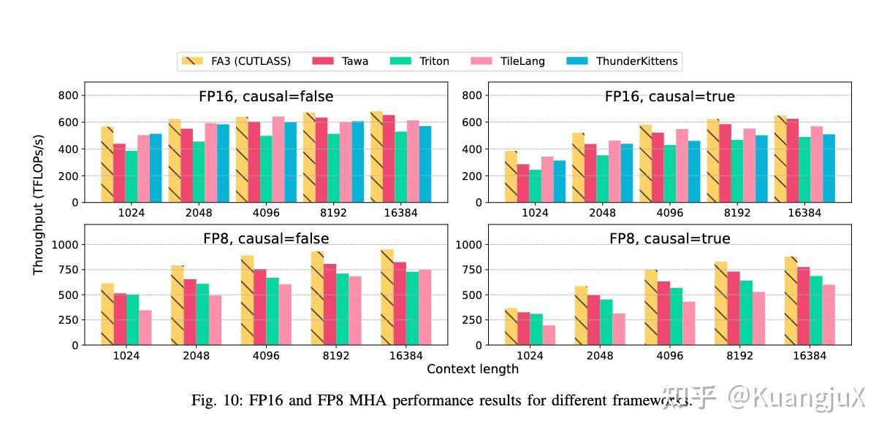

# Tawa：用异步引用自动生成 warp specialization

Tawa 从高层 Triton 程序生成 warp-specialized kernel：编译器划分生产者和消费者，用异步引用 aref 表达数据生命周期，再生成流水线与同步。开发者无需在原程序中手写 warp 分区和对应的底层通信。[论文 §III](https://arxiv.org/html/2510.14719v1)

## 从依赖图生成生产者与消费者

Triton 程序进入 MLIR 后，编译器根据计算图的任务与依赖关系建立分区，进行循环分发，再在跨分区的数据流上插入 aref。这样，加载、矩阵乘与其他计算可以分配给不同 warp groups，同时保留必要的先后关系。

## aref 管理缓冲区的生产、借用与复用

aref 将异步通信与存储生命周期放入 IR，核心操作为：

- `put(a, v)`：生产者等待可复用空间，向 aref 写入数据。
- `get(a)`：消费者等待数据就绪并借用它。
- `consumed(a)`：消费结束后释放借用，允许生产者复用空间。

关键约束是先就绪再消费、先消费完再覆盖。实现需要协调 shared-memory buffer 与同步状态，但上述生命周期不能直接等同于每次调用都“置位或清除一个 mbarrier”。[论文 §III-B、§III-E](https://arxiv.org/html/2510.14719v1#S3)

Lowering 将 aref 变成具体的缓冲区分配、等待、数据搬运与完成通知；在对应的异步加载路径中使用 TMA 和 mbarrier。多粒度流水线再让不同迭代或任务的搬运与计算交叠。

## 重叠的收益取决于工作负载

论文在 H100 上评估 GEMM、变体 GEMM 和 attention。原始讨论观察到 attention 短序列（长度小于 4K）的优势较小，长序列下流水线的收益更明显；这一趋势需结合图中的 shape 与基线解释，不能推广为所有长序列算子都更快。[论文 §V](https://arxiv.org/html/2510.14719v1#S5)；[图与原始讨论](../../../../Foundations/05_Model_Architecture_and_Reasoning/Research-Reviews/llm-2025.md)
