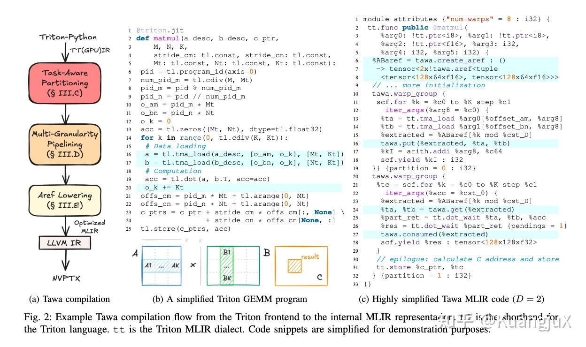
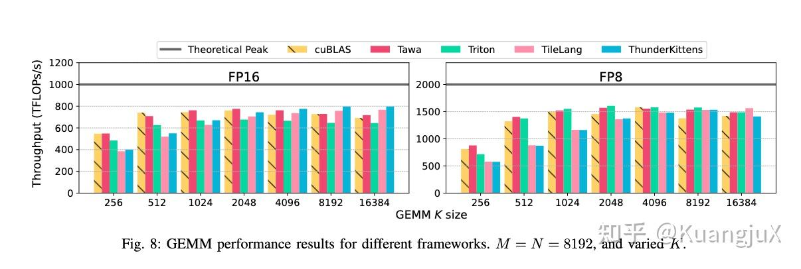
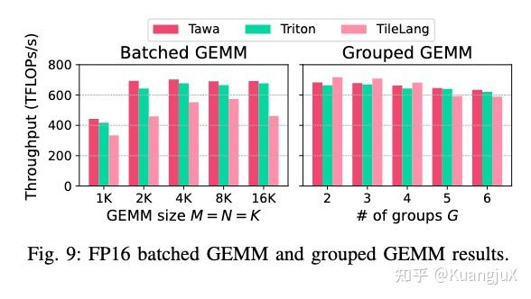
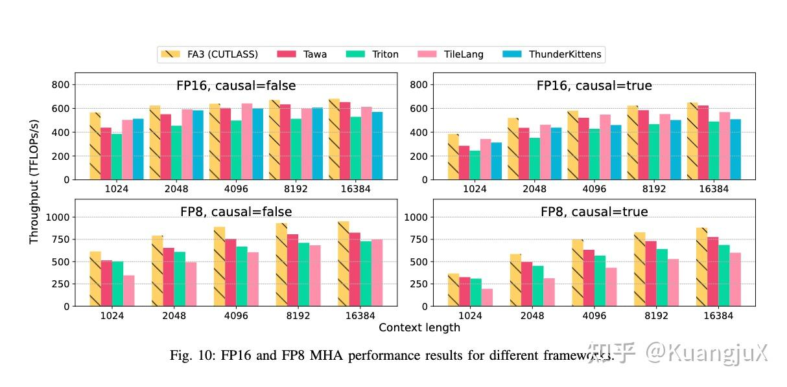

# Tawa：用异步引用自动生成 warp specialization

来源：[个人文章全文归档](../../../../Foundations/05_Model_Architecture_and_Reasoning/Research-Reviews/llm-2025.md)。

从原 Triton 程序中推导生产者／消费者分区，以 aref 连接异步数据流，再生成流水线和同步。

## 整理与复习

- [Tawa](https://arxiv.org/abs/2510.14719) 的目标是无需给原 Triton 程序加入手写 warp 分区注解。
- `put/get/consumed` 表达生产、借用和释放的生命周期；旧记录对 mbarrier 状态的解释是概念示意，不能直接当作每种 lowering 都逐条成立的 PTX 实现。
- 比较性能需注明 GEMM 或 attention、输入形状、H100 平台与对应基线，不能仅由“长序列更快”推出全部工作负载的结论。

## 原笔记相关章节

#### Tawa[15](https://zhuanlan.zhihu.com/p/1994788371738949558#ref_15)

Tawa 这篇 paper 主要的目的为了解决在 Triton 在 Hopper 架构上的 Auto Warp Specialization。Tawa 的目标是希望用户无需修改 Triton 代码，而通过引入新的 IR 抽象来进行编译优化实现。

Tawa 从 Triton 前端编译到 MLIR 中间表示

Tawa 通过提出了一个名为***异步引用（asynchronous reference, aref）***的 IR 抽象，封装线程束间的通信语义，屏蔽硬件细节。

ARef 用来建模线程束间异步通信，屏蔽 TMA、mbarrier 等底层细节，是实现自动同步的基础。同时 ARef 包含数据缓冲区和硬件 mbarrier 状态，用来表示是否可读或者可写。同时有以下的核心操作：

- `put(a, v)`：生产者将数据 `v` 写入 aref `a`，仅当 empty 状态有效时执行，写完后切换为 full 状态。
- `get(a)`：消费者从 aref `a` 读取数据，仅当 full 状态有效时执行，读完后切换为「借用中」（均无效）。
- `consumed(a)`：消费者使用数据后释放缓冲区，切换为 empty 状态，允许生产者复用。

Tawa 通过对 MLIR 计算图的依赖关系将代码自动划分为**生产者**和**消费者**，依据一系列的规则将其进行分区构建并进行循环分发以及 aref 的插入，aref 插入的语句如上图所示。

最后，在代码生成阶段，aref 语句也被映射为一系列的硬件代码：

- `create_aref`：分配 SMEM 缓冲区和 mbarrier；
- `put`：展开为「检查 empty mbarrier → TMA 异步加载 → 置位 full mbarrier」；
- `get`：展开为「等待 full mbarrier → 读取 SMEM 缓冲区 → 清除 mbarrier 状态」；
- `consumed`：展开为「置位 empty mbarrier」；

最终的成果表明在短序列（L &lt; 4K) 时的优势不明显，而在长序列时数据移动占比提升，Tawa 的流水线重叠效果凸显。
