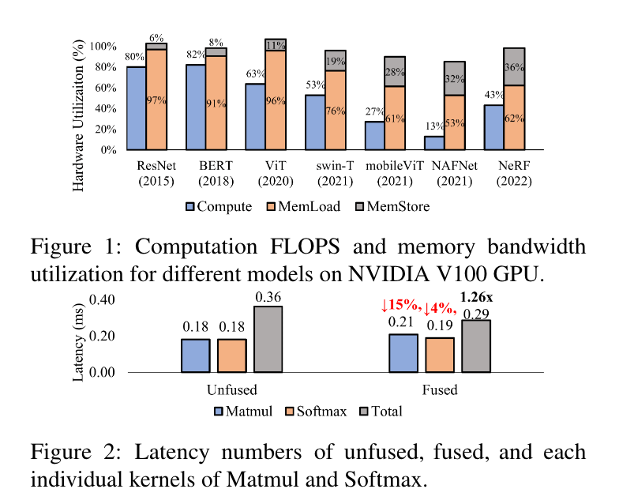
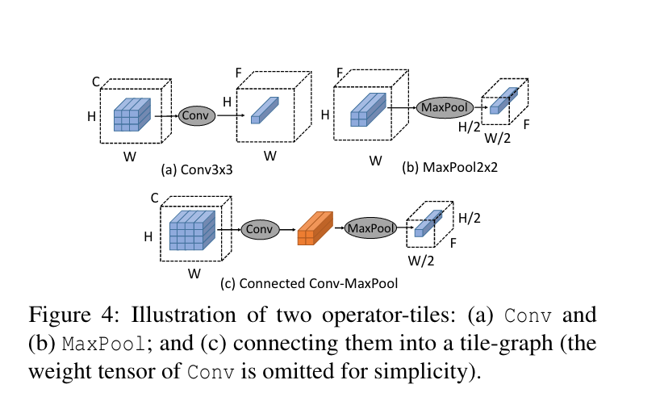
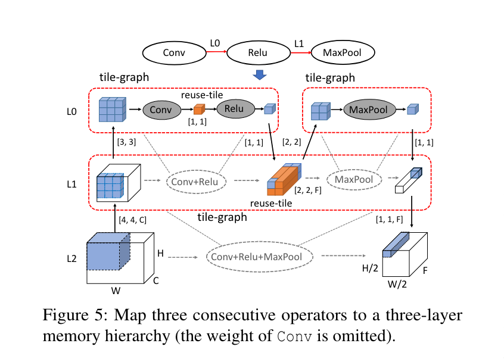
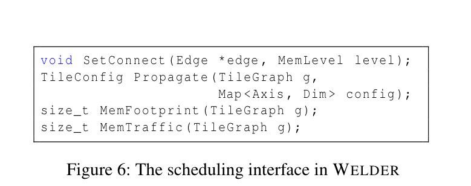
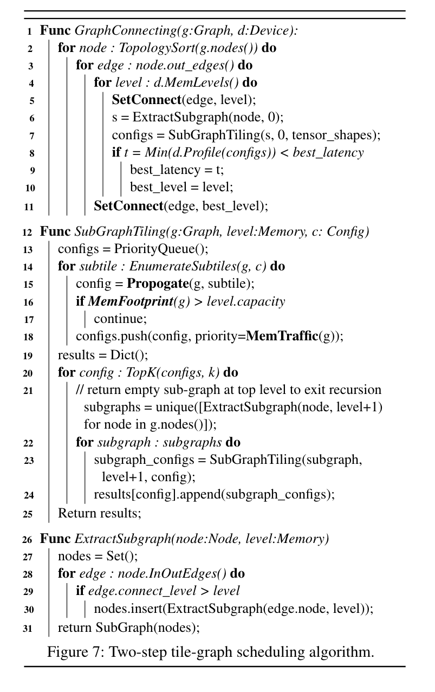
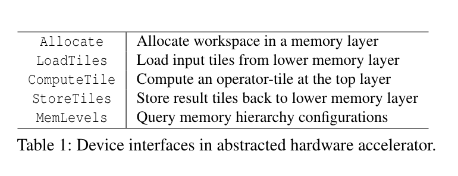
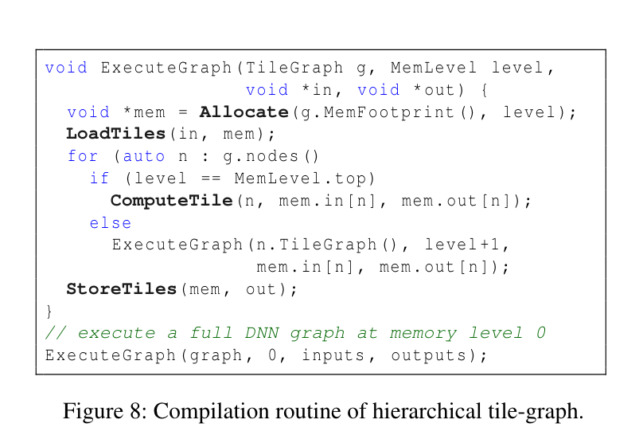

# Welder: Scheduling Deep Learning Memory Access via Tile-graph：历史笔记

[所属主题](../../index.md) · [GitHub 历史笔记目录](../../../github-issues.md)

- 论文：[原文](https://www.usenix.org/system/files/osdi23-shi.pdf)
- 原记录：[Issue #25](https://github.com/KuangjuX/Papers-and-Learning-Notes/issues/25)

## 阅读线索与覆盖范围

沿 operator-tile/reuse-tile、tile 传播、图连接与子图 tiling、硬件映射和代码生成阅读。原笔记的评估部分只写了“略”，不能据此恢复性能结论。

## 校注（AI）

原记录中的 `sharded memory` 应理解为 `shared memory`（共享内存），见论文 §4.2。关于“每个 SM 有 4 个 warp”的说法先保留在历史材料中，但不能据此推导 SM 可驻留的 warp 数；该硬件解释需另行核对。

依据：[论文原文](https://www.usenix.org/system/files/osdi23-shi.pdf)。校注仅核对上面列出的具体问题，其余历史内容尚未逐项复核。

## 历史阅读笔记（原 issue 评论）

### 动机

由于观测到内存操作在模型推理运行中占据了大量的时间，算子的输入输出在三级内存（寄存器，共享内存，全局内存）中互相搬运浪费太多时间，因此想提出一个方案用于解决过多的内存加载与存储。

### 设计

Welder 提出了 tile-graph 的概念，采取先连接后融合。首先猜测两个相邻的算子是否可以在某个内存层级进行数据 tile 重用，然后获得最通用的 tile shape 查看是否可以减少内存流量。抽象了 **SetConnect**, **Propagate** 两个接口。设计了两步算法，图连接和子图调度。

#### Operator-tile and Tile-graph

Conv 算子计算 1x1xC 大小的 tile，输入是一个 3x3xC 的 data tile，MaxPool 输入一个 2x2xF，输出 1x1xF。为了提高内存利用资源，Welder 允许两个相邻的算子 tile 通过中间 tile 进行连接，也叫做 **reuse-tile**。

- Tile propagation. 连接后在 tile-graph 中的大部分 tile 相互关联，可以通过自动推断传播到整个图。输入的 region 可能包含不规整模式例如系数矩阵活着不连续访问（Gather 或者带步长的卷积），分析中会有一个 input tile shape 的上界。
- Memory traffic and footprint. 传播后，内存带宽和足迹可以被确定。单独的 tile-graph 的内存带宽可以累加输入和输出 tile size。最小的内存可以使用例如 bestfit 等内存分配算法进行分配通过拓扑排序进行分配。

#### Tile-graph Scheduling

在 Figure 5 中 Conv 和 ReLu 在 L0 进行融合并形成了一个 tile-graph。同时它们在 L1 级别被视为一个虚拟节点。ReLU 的输出被 spill 到 L1 中并且作为 MaxPool 的输入。这允许三个算子在 L1 形成一个单 tile-graph。

- Decoupling optimization space.
- Scheduling interface. Weilder 提供了两个接口用于控制图连接和子图 tiling，如 Figure 6 展示。**SetConnect** 为一条边在 tile-graph 上分配 memory level。链接后，tile shape 可以在图中进行广播。在 Figure 5 中可以使用这个接口连接 Conv 和 ReLU 在 L0，链接 ReLU 和 MaxPool 在 L1。连接后通过传播推断出 reuse tile 大小为 [1,1]，输出 tile 大小为 [1, 1]。我们也可以推断出 Conv + Relu + MaxPool 子图的 reuse tile 大小为 (2,2,F)，输出大小为 (1,1,F)。Welder 通过这个接口可以用于在两个节点间连接并且进行传播。除了这个外，**MemFootprint** 和 **MemTraffic** 用来计算内存 footprint 和 整个 tile-graph 的流量。

- Scheduling policy. Weler 使用两步调度算法优化数据流。graph-connecting scheduler 首先枚举不同的图连接 plans 通过为每个边设置不同的重用规则，然后 sub-graph scheduler 对于每个子图搜索有效率的 tile 配置。算法描述如下：

- 首先变量图中所有节点的所有出边，对每个边都是用 SetConnect(line 5) 去尝试不同的连接。
- 调用 ExtractSubgraph 中拿到所有连接级别大于 0 的子图。
- 随后调用 SubGraphTiling 得到几个有效率的 tile 配置然后通过在硬件 profiling 选择最优的一个。
- SubGraphTiling 将子图和最后一级 tile 配置作为输入然后为当前的 level 搜索有效率的 tile 配置：
    - 首先将输出维度的 tile size 进行消除，然后使用 Roller 中那种不断扩张的方法来对 tile 进行扩张直到可以减少内存带宽并可以进行内存对齐。
    - 在得到输出的 tile shapes 之后，我们可以推断所有的 tile 配置使用 Propagate 接口并且检查是否超过了内存容量通过使用 MemFootprint 接口。
    - 最后我们选择 topK 种最高内存层级的配置，然后提取子图。

#### Mapping to Hardware Accelerator

为了实际在硬件加速器生成代码，Welder 提出了几个内存相关的抽象。Figure 8 展示了一个执行多层次 tile-graph 使用这些接口的流程。

### 实现

#### Hardware-aligned Tile Search

- Enumerate efficient data tile size. Welder 考虑了多种硬件相关的特性，同时引入惩罚因子来进行衡量。例如对于内存访问没有进行合并访问将添加惩罚。最终 Welder 仅搜索效果最好的 top K 个输出 tile 大小。
- Decide aligned compution parallelism. 在 GPU 中在最上层的算子的 block 大小，即线程数量必须是一样的。首先强制将 thread block 与硬件并行度对齐，例如在 Nividia V100 中 tile 数必须大于 128，因为每个 SM 有 4 个 warp，每个 warp 有 32 个线程。如果算子 tiles 的最大公约数在 128 和 1024（每个 block 最多的线程数）就用最大公约数，否则用 hardware parallesim。
- Support TensorCore. Welder 使用 TensorCore 用来加速 GEMM、BatchMatMul 和 Conv 等算子。

#### Code Generation and Compilation

TVM: `compute_inline` 调度原语用来实现寄存器级别 tile 连接。对于 sharded memory 级别仅仅生成单个 kernel 并使用几个额外的 passes 去将这些单独的 kernels 压缩成一个融合内核。

- Load/store rewriting. TVM 生成的独立的 kernel 从全局内存加载和存储。可以通过添加额外的 TIR 来使用从共享内存读取代替从全局内存读取。同时添加 memory fence 阻止竞争。
- Block/thread index remapping. 一些算子不能和其他算子进行直接连接需要进行重新映射 blockIdx 和 threadIdx。
- Memory management. Welder 管理所有共享内存包括单个算子内创建的以及算子间重用的缓存。首先基于拓扑序分析每个 buffer 的生命周期并将其转换成一系列分配内存和释放内存操作，然后使用最优内存分配算法计算每个共享内存的偏移量，也会将对齐要求和 TensorCore 纳入考虑。
- Compilation speedup. Welder 通过并行计算和子图 cache 来优化编译速度。

### 评估

略。
