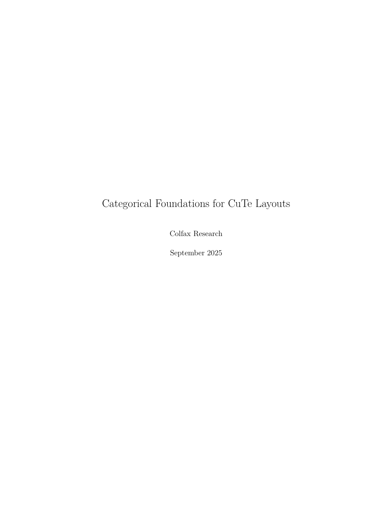
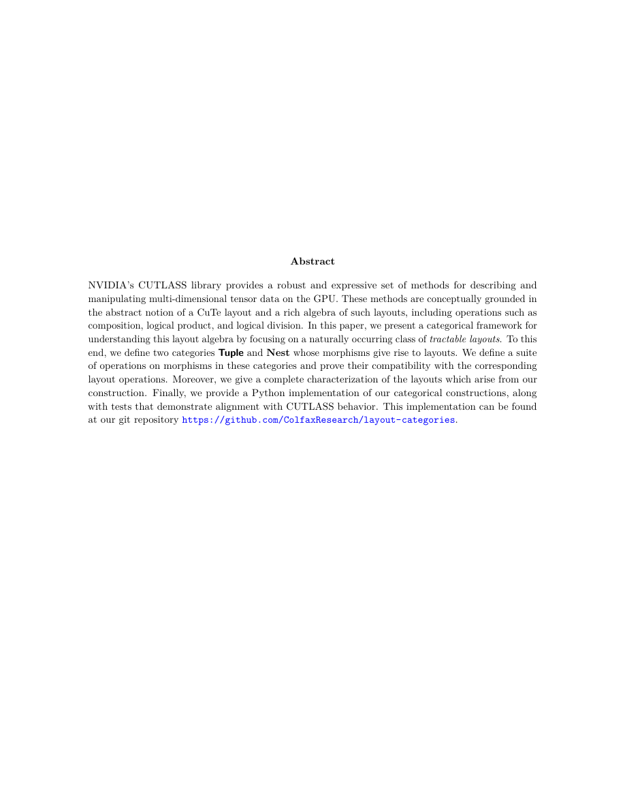
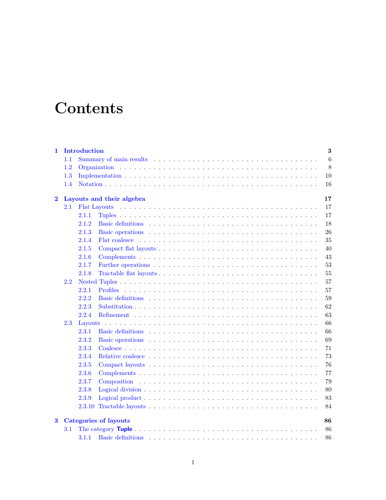
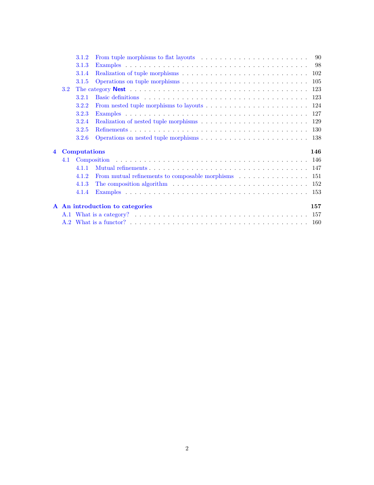

# 扉页、摘要与目录
[译文总目录](Layout.md) · [第 1 章：引言](Translation-01-Introduction.md)
> 来源：Colfax Research，2025 年 9 月版。本文为中文逐段译文，保留原文顺序及定义、命题、例子、证明和公式；校对说明以“校注”明确区分于原文，详见[校对记录](Proofreading.md)。复杂数学式与图示直接使用本地原文裁片。每页末尾可展开原页核对。

## PDF 第 1 页

### CuTe 布局的范畴基础

### Colfax Research

### 2025 年 9 月

展开原页对照（保留全部图示、代码、标签和数学排版）

展开本页英文正文

<pre v-pre style="white-space:pre-wrap;overflow-wrap:anywhere">Categorical Foundations for CuTe Layouts

Colfax Research

September 2025</pre>

## PDF 第 2 页

摘要

NVIDIA 的 CUTLASS 库提供了一套稳健且富有表达力的方法，用于描述和操作 GPU 上的多维张量数据。这些方法在概念上以 CuTe 布局这一抽象概念及其丰富的布局代数为基础，其中包括复合、逻辑乘积和逻辑除法等运算。本文聚焦于一类自然出现的可处理布局，提出了一个用于理解这一布局代数的范畴论框架。为此，我们定义了两个范畴 Tuple 和 Nest，其中的态射能够产生布局。我们在这些范畴的态射上定义了一组运算，并证明它们与相应的布局运算兼容。此外，我们完整刻画了通过我们的构造所产生的布局。最后，我们给出了这些范畴论构造的 Python 实现，并提供了测试，以展示其行为与 CUTLASS 一致。实现位于我们的 Git 仓库：https://github.com/ColfaxResearch/layout-categories。

展开原页对照（保留全部图示、代码、标签和数学排版）

展开本页英文正文

<pre v-pre style="white-space:pre-wrap;overflow-wrap:anywhere">Abstract

NVIDIA’s CUTLASS library provides a robust and expressive set of methods for describing and manipulating multi-dimensional tensor data on the GPU. These methods are conceptually grounded in the abstract notion of a CuTe layout and a rich algebra of such layouts, including operations such as composition, logical product, and logical division. In this paper, we present a categorical framework for understanding this layout algebra by focusing on a naturally occurring class of tractable layouts. To this end, we define two categories Tuple and Nest whose morphisms give rise to layouts. We define a suite of operations on morphisms in these categories and prove their compatibility with the corresponding layout operations. Moreover, we give a complete characterization of the layouts which arise from our construction. Finally, we provide a Python implementation of our categorical constructions, along with tests that demonstrate alignment with CUTLASS behavior. This implementation can be found at our git repository https://github.com/ColfaxResearch/layout-categories.</pre>

## PDF 第 3 页 · 原书第 1 页

| 节 | 标题 | 原书页码 |
| --- | --- | --- |
| 1 | [引言](Translation-01-Introduction.md#paper-section-1) | 3 |
| 1.1 | [主要结果概述](Translation-01-Introduction.md#paper-section-1-1) | 6 |
| 1.2 | [文章结构](Translation-01-Introduction.md#paper-section-1-2) | 8 |
| 1.3 | [实现](Translation-01-Introduction.md#paper-section-1-3) | 10 |
| 1.4 | [记号](Translation-01-Introduction.md#paper-section-1-4) | 16 |
| 2 | [布局及其代数](Translation-02-Flat-Layouts.md#paper-section-2) | 17 |
| 2.1 | [平坦布局](Translation-02-Flat-Layouts.md#paper-section-2-1) | 17 |
| 2.1.1 | [元组](Translation-02-Flat-Layouts.md#paper-section-2-1-1) | 17 |
| 2.1.2 | [基本定义](Translation-02-Flat-Layouts.md#paper-section-2-1-2) | 18 |
| 2.1.3 | [基本运算](Translation-02-Flat-Layouts.md#paper-section-2-1-3) | 26 |
| 2.1.4 | [平坦合并](Translation-03-Flat-Layout-Algebra.md#paper-section-2-1-4) | 35 |
| 2.1.5 | [紧致平坦布局](Translation-03-Flat-Layout-Algebra.md#paper-section-2-1-5) | 40 |
| 2.1.6 | [补布局](Translation-03-Flat-Layout-Algebra.md#paper-section-2-1-6) | 43 |
| 2.1.7 | [进一步的运算](Translation-03-Flat-Layout-Algebra.md#paper-section-2-1-7) | 53 |
| 2.1.8 | [可处理平坦布局](Translation-03-Flat-Layout-Algebra.md#paper-section-2-1-8) | 55 |
| 2.2 | [嵌套元组](Translation-04-Nested-Tuples.md#paper-section-2-2) | 57 |
| 2.2.1 | [轮廓](Translation-04-Nested-Tuples.md#paper-section-2-2-1) | 57 |
| 2.2.2 | [基本定义](Translation-04-Nested-Tuples.md#paper-section-2-2-2) | 59 |
| 2.2.3 | [代入](Translation-04-Nested-Tuples.md#paper-section-2-2-3) | 62 |
| 2.2.4 | [细化](Translation-04-Nested-Tuples.md#paper-section-2-2-4) | 63 |
| 2.3 | [布局](Translation-05-Layouts.md#paper-section-2-3) | 66 |
| 2.3.1 | [基本定义](Translation-05-Layouts.md#paper-section-2-3-1) | 66 |
| 2.3.2 | [基本运算](Translation-05-Layouts.md#paper-section-2-3-2) | 69 |
| 2.3.3 | [合并](Translation-05-Layouts.md#paper-section-2-3-3) | 71 |
| 2.3.4 | [相对合并](Translation-05-Layouts.md#paper-section-2-3-4) | 73 |
| 2.3.5 | [紧致布局](Translation-05-Layouts.md#paper-section-2-3-5) | 76 |
| 2.3.6 | [补布局](Translation-05-Layouts.md#paper-section-2-3-6) | 77 |
| 2.3.7 | [复合](Translation-05-Layouts.md#paper-section-2-3-7) | 79 |
| 2.3.8 | [逻辑除法](Translation-05-Layouts.md#paper-section-2-3-8) | 80 |
| 2.3.9 | [逻辑乘积](Translation-05-Layouts.md#paper-section-2-3-9) | 83 |
| 2.3.10 | [可处理布局](Translation-05-Layouts.md#paper-section-2-3-10) | 84 |
| 3 | [布局的范畴](Translation-06-Tuple.md#paper-section-3) | 86 |
| 3.1 | [Tuple 范畴](Translation-06-Tuple.md#paper-section-3-1) | 86 |
| 3.1.1 | [基本定义](Translation-06-Tuple.md#paper-section-3-1-1) | 86 |

展开原页对照（保留全部图示、代码、标签和数学排版）

展开本页英文正文

<pre v-pre style="white-space:pre-wrap;overflow-wrap:anywhere">Contents

1 Introduction 3 1.1 Summary of main results . . . . . . . . . . . . . . . . . . . . . . . . . . . . . . . . . . 6 1.2 Organization . . . . . . . . . . . . . . . . . . . . . . . . . . . . . . . . . . . . . . . . . 8 1.3 Implementation . . . . . . . . . . . . . . . . . . . . . . . . . . . . . . . . . . . . . . . . 10 1.4 Notation . . . . . . . . . . . . . . . . . . . . . . . . . . . . . . . . . . . . . . . . . . . . 16

2 Layouts and their algebra 17 2.1 Flat Layouts . . . . . . . . . . . . . . . . . . . . . . . . . . . . . . . . . . . . . . . . . 17 2.1.1 Tuples . . . . . . . . . . . . . . . . . . . . . . . . . . . . . . . . . . . . . . . . . 17 2.1.2 Basic definitions . . . . . . . . . . . . . . . . . . . . . . . . . . . . . . . . . . . 18 2.1.3 Basic operations . . . . . . . . . . . . . . . . . . . . . . . . . . . . . . . . . . . 26 2.1.4 Flat coalesce . . . . . . . . . . . . . . . . . . . . . . . . . . . . . . . . . . . . . 35 2.1.5 Compact flat layouts . . . . . . . . . . . . . . . . . . . . . . . . . . . . . . . . . 40 2.1.6 Complements . . . . . . . . . . . . . . . . . . . . . . . . . . . . . . . . . . . . . 43 2.1.7 Further operations . . . . . . . . . . . . . . . . . . . . . . . . . . . . . . . . . . 53 2.1.8 Tractable flat layouts . . . . . . . . . . . . . . . . . . . . . . . . . . . . . . . . . 55 2.2 Nested Tuples . . . . . . . . . . . . . . . . . . . . . . . . . . . . . . . . . . . . . . . . . 57 2.2.1 Profiles . . . . . . . . . . . . . . . . . . . . . . . . . . . . . . . . . . . . . . . . 57 2.2.2 Basic definitions . . . . . . . . . . . . . . . . . . . . . . . . . . . . . . . . . . . 59 2.2.3 Substitution . . . . . . . . . . . . . . . . . . . . . . . . . . . . . . . . . . . . . . 62 2.2.4 Refinement . . . . . . . . . . . . . . . . . . . . . . . . . . . . . . . . . . . . . . 63 2.3 Layouts . . . . . . . . . . . . . . . . . . . . . . . . . . . . . . . . . . . . . . . . . . . . 66 2.3.1 Basic definitions . . . . . . . . . . . . . . . . . . . . . . . . . . . . . . . . . . . 66 2.3.2 Basic operations . . . . . . . . . . . . . . . . . . . . . . . . . . . . . . . . . . . 69 2.3.3 Coalesce . . . . . . . . . . . . . . . . . . . . . . . . . . . . . . . . . . . . . . . . 71 2.3.4 Relative coalesce . . . . . . . . . . . . . . . . . . . . . . . . . . . . . . . . . . . 73 2.3.5 Compact layouts . . . . . . . . . . . . . . . . . . . . . . . . . . . . . . . . . . . 76 2.3.6 Complements . . . . . . . . . . . . . . . . . . . . . . . . . . . . . . . . . . . . . 77 2.3.7 Composition . . . . . . . . . . . . . . . . . . . . . . . . . . . . . . . . . . . . . 79 2.3.8 Logical division . . . . . . . . . . . . . . . . . . . . . . . . . . . . . . . . . . . . 80 2.3.9 Logical product . . . . . . . . . . . . . . . . . . . . . . . . . . . . . . . . . . . . 83 2.3.10 Tractable layouts . . . . . . . . . . . . . . . . . . . . . . . . . . . . . . . . . . . 84

3 Categories of layouts 86 3.1 The category Tuple . . . . . . . . . . . . . . . . . . . . . . . . . . . . . . . . . . . . . . 86 3.1.1 Basic definitions . . . . . . . . . . . . . . . . . . . . . . . . . . . . . . . . . . . 86</pre>

## PDF 第 4 页 · 原书第 2 页

| 节 | 标题 | 原书页码 |
| --- | --- | --- |
| 3.1.2 | [从元组态射到平坦布局](Translation-06-Tuple.md#paper-section-3-1-2) | 90 |
| 3.1.3 | [例子](Translation-06-Tuple.md#paper-section-3-1-3) | 98 |
| 3.1.4 | [元组态射的具象化](Translation-06-Tuple.md#paper-section-3-1-4) | 102 |
| 3.1.5 | [元组态射上的运算](Translation-07-Tuple-Operations.md#paper-section-3-1-5) | 105 |
| 3.2 | [Nest 范畴](Translation-08-Nest.md#paper-section-3-2) | 123 |
| 3.2.1 | [基本定义](Translation-08-Nest.md#paper-section-3-2-1) | 123 |
| 3.2.2 | [从嵌套元组态射到布局](Translation-08-Nest.md#paper-section-3-2-2) | 124 |
| 3.2.3 | [例子](Translation-08-Nest.md#paper-section-3-2-3) | 127 |
| 3.2.4 | [嵌套元组态射的具象化](Translation-08-Nest.md#paper-section-3-2-4) | 129 |
| 3.2.5 | [细化](Translation-08-Nest.md#paper-section-3-2-5) | 130 |
| 3.2.6 | [嵌套元组态射上的运算](Translation-09-Nest-Operations.md#paper-section-3-2-6) | 138 |
| 4 | [计算](Translation-10-Computations.md#paper-section-4) | 146 |
| 4.1 | [复合](Translation-10-Computations.md#paper-section-4-1) | 146 |
| 4.1.1 | [共同细化](Translation-10-Computations.md#paper-section-4-1-1) | 147 |
| 4.1.2 | [从共同细化到可复合态射](Translation-10-Computations.md#paper-section-4-1-2) | 151 |
| 4.1.3 | [复合算法](Translation-10-Computations.md#paper-section-4-1-3) | 152 |
| 4.1.4 | [例子](Translation-10-Computations.md#paper-section-4-1-4) | 153 |
| A | [范畴入门](Translation-11-Appendix.md#paper-section-A) | 157 |
| A.1 | [什么是范畴？](Translation-11-Appendix.md#paper-section-A-1) | 157 |
| A.2 | [什么是函子？](Translation-11-Appendix.md#paper-section-A-2) | 160 |

展开原页对照（保留全部图示、代码、标签和数学排版）

展开本页英文正文

<pre v-pre style="white-space:pre-wrap;overflow-wrap:anywhere">3.1.2 From tuple morphisms to flat layouts . . . . . . . . . . . . . . . . . . . . . . . 90 3.1.3 Examples . . . . . . . . . . . . . . . . . . . . . . . . . . . . . . . . . . . . . . . 98 3.1.4 Realization of tuple morphisms . . . . . . . . . . . . . . . . . . . . . . . . . . . 102 3.1.5 Operations on tuple morphisms . . . . . . . . . . . . . . . . . . . . . . . . . . . 105 3.2 The category Nest . . . . . . . . . . . . . . . . . . . . . . . . . . . . . . . . . . . . . . 123 3.2.1 Basic definitions . . . . . . . . . . . . . . . . . . . . . . . . . . . . . . . . . . . 123 3.2.2 From nested tuple morphisms to layouts . . . . . . . . . . . . . . . . . . . . . . 124 3.2.3 Examples . . . . . . . . . . . . . . . . . . . . . . . . . . . . . . . . . . . . . . . 127 3.2.4 Realization of nested tuple morphisms . . . . . . . . . . . . . . . . . . . . . . . 129 3.2.5 Refinements . . . . . . . . . . . . . . . . . . . . . . . . . . . . . . . . . . . . . . 130 3.2.6 Operations on nested tuple morphisms . . . . . . . . . . . . . . . . . . . . . . . 138

4 Computations 146 4.1 Composition . . . . . . . . . . . . . . . . . . . . . . . . . . . . . . . . . . . . . . . . . 146 4.1.1 Mutual refinements . . . . . . . . . . . . . . . . . . . . . . . . . . . . . . . . . . 147 4.1.2 From mutual refinements to composable morphisms . . . . . . . . . . . . . . . 151 4.1.3 The composition algorithm . . . . . . . . . . . . . . . . . . . . . . . . . . . . . 152 4.1.4 Examples . . . . . . . . . . . . . . . . . . . . . . . . . . . . . . . . . . . . . . . 153

A An introduction to categories 157 A.1 What is a category? . . . . . . . . . . . . . . . . . . . . . . . . . . . . . . . . . . . . . 157 A.2 What is a functor? . . . . . . . . . . . . . . . . . . . . . . . . . . . . . . . . . . . . . . 160</pre>

---
[译文总目录](Layout.md) · [第 1 章：引言](Translation-01-Introduction.md)
