# 第 1 章：引言
[译文总目录](Layout.md) · [扉页、摘要与目录](Translation-00-Front-Matter.md) · [第 2.1 节：平坦布局的基本定义与运算](Translation-02-Flat-Layouts.md)
> 来源：Colfax Research，2025 年 9 月版。本文为中文逐段译文，保留原文顺序及定义、命题、例子、证明和公式；校对说明以“校注”明确区分于原文，详见[校对记录](Proofreading.md)。复杂数学式与图示直接使用本地原文裁片。每页末尾可展开原页核对。

## PDF 第 5 页 · 原书第 3 页

### 第 1 章

### 引言

在现代计算中，尤其是在 GPU 编程中，性能在很大程度上取决于多维数据在内存中的存储和访问方式。我们关心的大多数数据，例如图像、视频和机器学习中的张量，本质上都是多维的，而计算机内存在根本上却是一维的。这意味着，当我们想要加载、存储或以其他方式操作数据时，需要将多维逻辑坐标映射到一维物理坐标。这种称为布局的映射，对于正确且高效地读写内存至关重要。此外，在 GPU 的 SIMT 执行模型中，布局还用于描述和操作线程在数据上的划分。这对于优化内存访问模式，以及正确调用用于张量核心等专用硬件的指令，都十分重要。

作为一个引出问题的例子，假设我们希望将 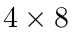 矩阵

存入内存。为此，我们需要为矩阵的每一个元素指定一个内存地址。做法是为 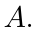 的第 (0, 0) 个元素选定一个地址，再为其余各元素指定相对于该地址的偏移量。一种常见选择是行主序布局：

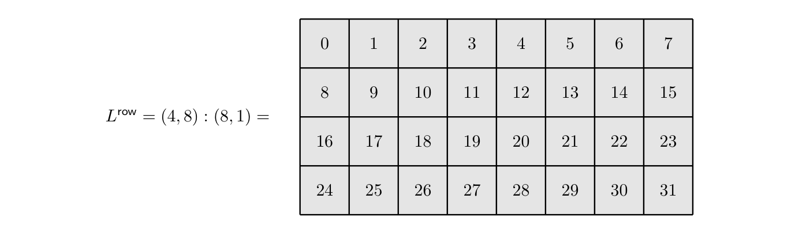

记号 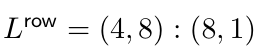 表示，矩阵第 (i, j) 个元素的偏移量为：

展开原页对照（保留全部图示、代码、标签和数学排版）

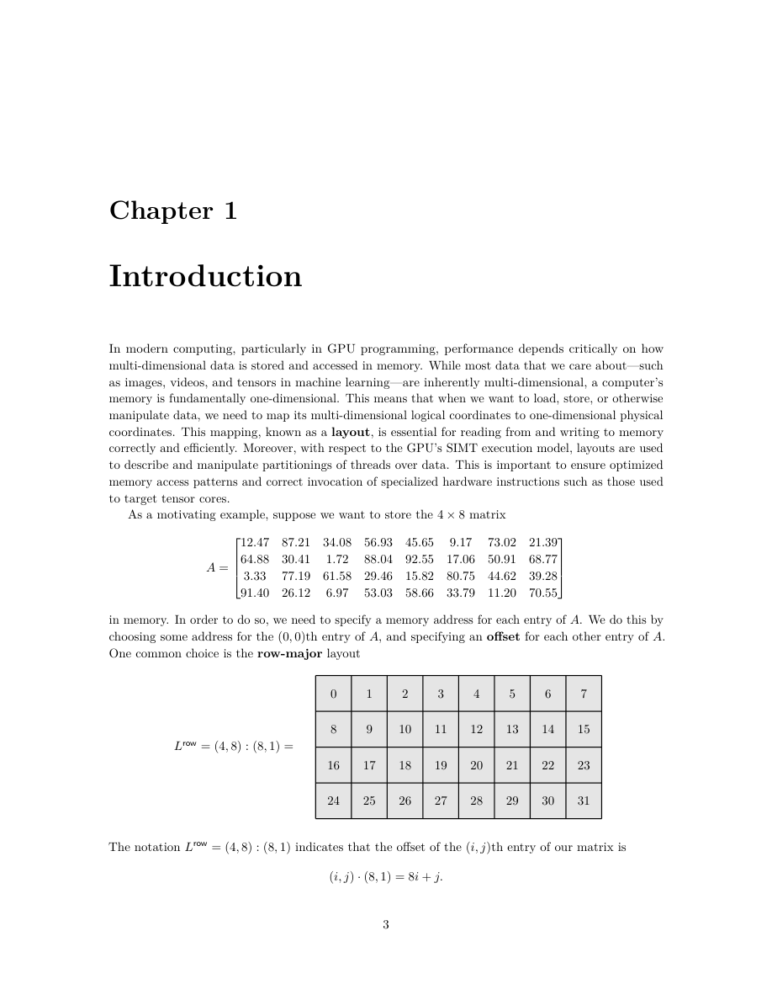

展开本页英文正文

<pre v-pre style="white-space:pre-wrap;overflow-wrap:anywhere">Chapter 1

Introduction

In modern computing, particularly in GPU programming, performance depends critically on how multi-dimensional data is stored and accessed in memory. While most data that we care about—such as images, videos, and tensors in machine learning—are inherently multi-dimensional, a computer’s memory is fundamentally one-dimensional. This means that when we want to load, store, or otherwise manipulate data, we need to map its multi-dimensional logical coordinates to one-dimensional physical coordinates. This mapping, known as a layout, is essential for reading from and writing to memory correctly and efficiently. Moreover, with respect to the GPU’s SIMT execution model, layouts are used to describe and manipulate partitionings of threads over data. This is important to ensure optimized memory access patterns and correct invocation of specialized hardware instructions such as those used to target tensor cores.

As a motivating example, suppose we want to store the 4 × 8 matrix

in memory. In order to do so, we need to specify a memory address for each entry of A. We do this by choosing some address for the (0, 0)th entry of A, and specifying an offset for each other entry of A. One common choice is the row-major layout

The notation Lrow = (4, 8) : (8, 1) indicates that the offset of the (i, j)th entry of our matrix is</pre>

## PDF 第 6 页 · 原书第 4 页

另一种常见选择是列主序布局：

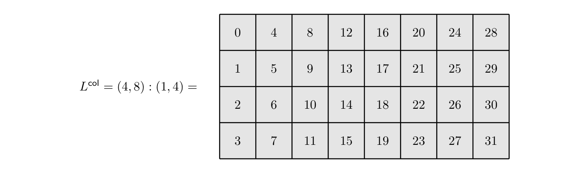

同样，记号 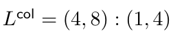 表示，矩阵第 (i, j) 个元素的偏移量为：

这些布局非常有用，但并不能满足所有用途。例如，在高性能计算中，人们经常通过以下步骤计算矩阵乘积 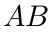：

1. 将操作数矩阵  和 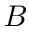 划分成分块；

2. 计算各个分块之间的矩阵乘积；

3. 合并这些部分结果，得到完整结果 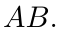。

例如，我们可以将 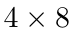 矩阵  划分为 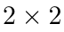 的分块，如下图所示。

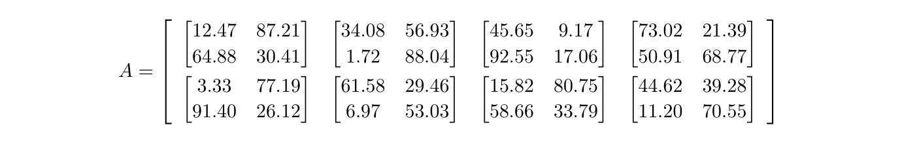

现在假设我们希望从 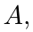 中切出单独的分块，并假设该矩阵在内存中按列主序布局存放。为此，可以手动计算偏移量：对于第 (i, j) 个分块，索引到该分块左上角元素的偏移量为 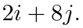。另一方面，为了更好地组织这项计算，我们可以使用分块的交错布局：

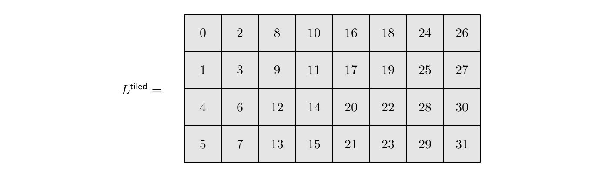

其中，各列对应  的各个分块，各行对应分块形状内的坐标。这里，我们采用余字典序对分块和分块内的坐标进行线性枚举，因此布局 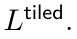 的顶层形状为 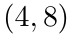。

展开原页对照（保留全部图示、代码、标签和数学排版）

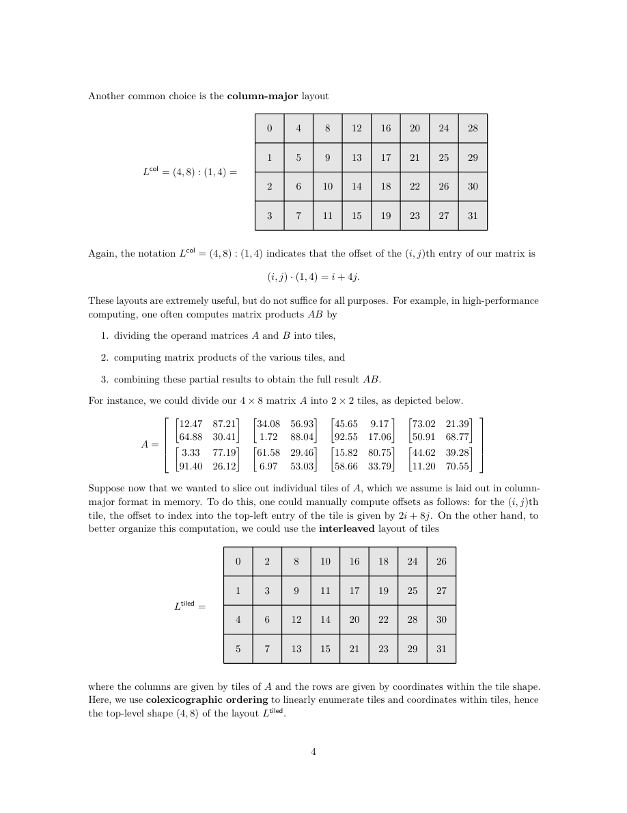

展开本页英文正文

<pre v-pre style="white-space:pre-wrap;overflow-wrap:anywhere">Another common choice is the column-major layout

Again, the notation Lcol = (4, 8) : (1, 4) indicates that the offset of the (i, j)th entry of our matrix is

These layouts are extremely useful, but do not suffice for all purposes. For example, in high-performance computing, one often computes matrix products AB by

1. dividing the operand matrices A and B into tiles,

2. computing matrix products of the various tiles, and

3. combining these partial results to obtain the full result AB.

For instance, we could divide our 4 × 8 matrix A into 2 × 2 tiles, as depicted below.

Suppose now that we wanted to slice out individual tiles of A, which we assume is laid out in column- major format in memory. To do this, one could manually compute offsets as follows: for the (i, j)th tile, the offset to index into the top-left entry of the tile is given by 2i + 8j. On the other hand, to better organize this computation, we could use the interleaved layout of tiles

where the columns are given by tiles of A and the rows are given by coordinates within the tile shape. Here, we use colexicographic ordering to linearly enumerate tiles and coordinates within tiles, hence the top-level shape (4, 8) of the layout Ltiled.</pre>

## PDF 第 7 页 · 原书第 5 页

然而，注意 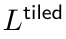 所示的交错模式意味着，无论步长 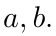 如何选择，都不能将其表示为布局 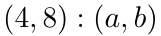。我们可以转而对形状 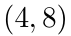 的各个模态进行因子分解，并定义：

于是，对 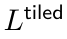 在坐标 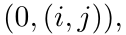 处求值，就得到先前的偏移量计算 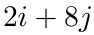；分块本身的布局则由第一个模态给出。因此，为  赋予布局 ，形成 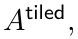 后，我们可以用下列切片得到矩阵的第 (i, j) 个分块：

CUTLASS 所发展的一项核心思想是，像 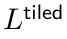 这样有用但较为复杂的辅助布局，

可以通过某些基本运算，从更简单的布局中系统地推导出来。在 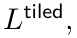 的例子中，这项运算称为逻辑除法。如果我们将分块布局写成：

那么，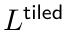 就是以下逻辑除法的结果：

如下图所示。

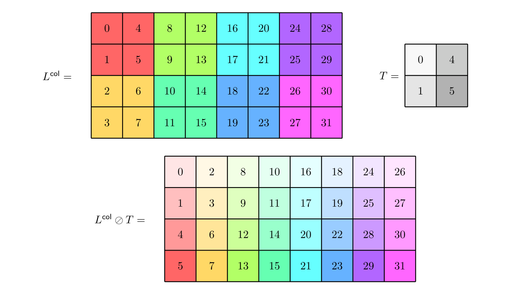

除了逻辑除法之外，其他基本布局运算还包括逻辑乘积、补布局，以及最重要的复合。这些布局运算构成了 CUTLASS 的支柱；深入理解其行为，有助于编写正确且具有很高

展开原页对照（保留全部图示、代码、标签和数学排版）

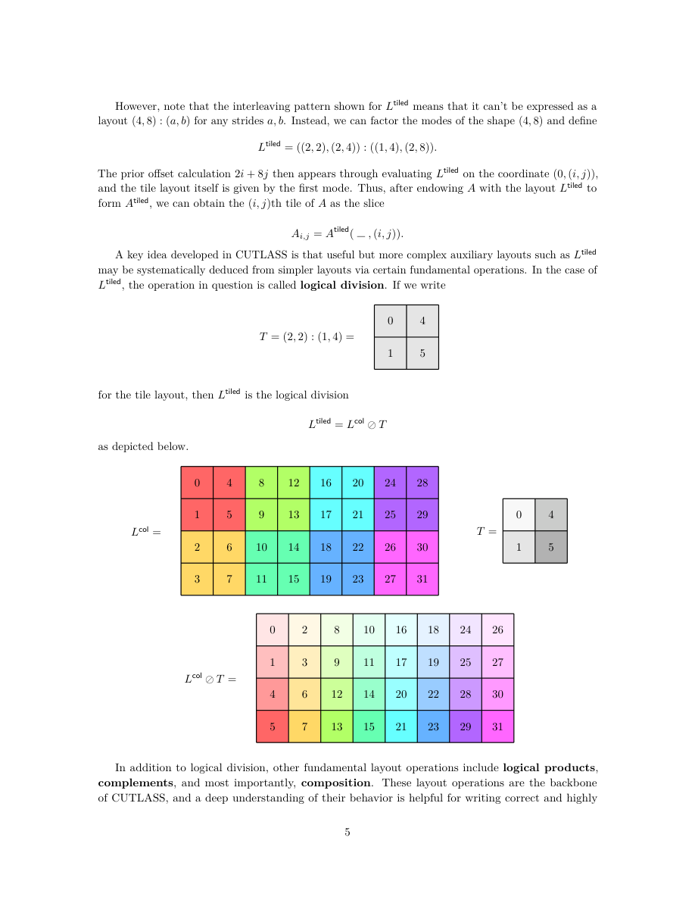

展开本页英文正文

<pre v-pre style="white-space:pre-wrap;overflow-wrap:anywhere">However, note that the interleaving pattern shown for Ltiled means that it can’t be expressed as a layout (4, 8) : (a, b) for any strides a, b. Instead, we can factor the modes of the shape (4, 8) and define

The prior offset calculation 2i + 8j then appears through evaluating Ltiled on the coordinate (0, (i, j)), and the tile layout itself is given by the first mode. Thus, after endowing A with the layout Ltiled to form Atiled, we can obtain the (i, j)th tile of A as the slice

A key idea developed in CUTLASS is that useful but more complex auxiliary layouts such as Ltiled

may be systematically deduced from simpler layouts via certain fundamental operations. In the case of Ltiled, the operation in question is called logical division. If we write

for the tile layout, then Ltiled is the logical division

as depicted below.

In addition to logical division, other fundamental layout operations include logical products, complements, and most importantly, composition. These layout operations are the backbone of CUTLASS, and a deep understanding of their behavior is helpful for writing correct and highly</pre>

## PDF 第 8 页 · 原书第 6 页

性能的代码。然而，这些运算的定义和构造相当微妙。例如，只有当布局  和  满足某些整除性约束时，它们的复合 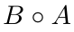 才有良好定义；CUTLASS 会在内部检查这些约束。具体而言，两个布局什么时候可以复合，以及应当如何解释其复合，并不总是一目了然。

### 1.1 主要结果概述

本工作的主要思想是：将注意力限制在可处理布局上，就能建立一个直观而强大的数学框架来处理布局。可处理布局的各个分量满足一个简单的整除性条件（见定义 2.3.10.1）。可处理布局涵盖了实际中遇到的几乎所有布局，例如：

• 无处不在的行主序布局和列主序布局；

• 将数据存储在连续内存地址中的紧致布局；

• 用于广播多份数据副本的投影；

• 支持带填充的加载与存储的扩张。

如果  是可处理布局，就可以用图来表示它。例如，布局 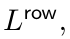、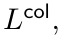 和 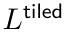 可以用下面的图表示。

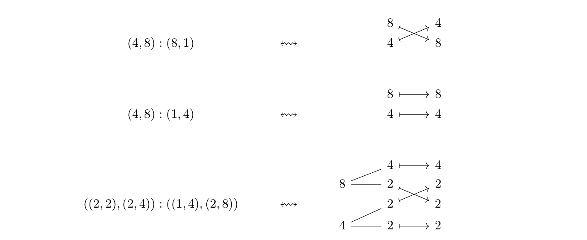

这些图可以解释为某个范畴中的态射。这样，我们就能利用范畴论来描述布局及其运算。1

更准确地说，我们定义了一个范畴 `Nest`，其对象是正整数的嵌套元组，其态射 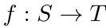 对应于上述这类图（详细内容见定义 3.1.1.13 和定义 3.2.1.1）。如果  是非退化的可处理布局（见定义 2.3.1.24），那么就存在一个本质唯一的 Nest 态射来编码它，下面的对应定理说明了这一点。

定理 A（见 3.2.2.15）。存在以下一一对应：

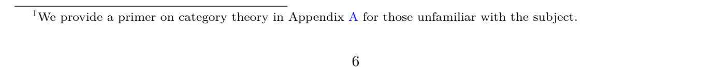

非退化的可处理布局 ↔ 标准形式的非退化 Nest 态射。
**定理 A 的原图及脚注：**
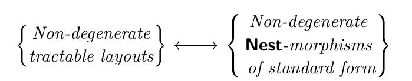
脚注 1：我们在附录 A 中为不熟悉这一主题的读者提供了范畴论入门。

展开原页对照（保留全部图示、代码、标签和数学排版）

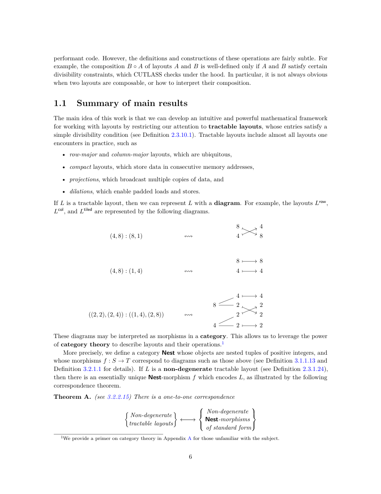

展开本页英文正文

<pre v-pre style="white-space:pre-wrap;overflow-wrap:anywhere">performant code. However, the definitions and constructions of these operations are fairly subtle. For example, the composition B ◦A of layouts A and B is well-defined only if A and B satisfy certain divisibility constraints, which CUTLASS checks under the hood. In particular, it is not always obvious when two layouts are composable, or how to interpret their composition.

1.1 Summary of main results

The main idea of this work is that we can develop an intuitive and powerful mathematical framework for working with layouts by restricting our attention to tractable layouts, whose entries satisfy a simple divisibility condition (see Definition 2.3.10.1). Tractable layouts include almost all layouts one encounters in practice, such as

• row-major and column-major layouts, which are ubiquitous,

• compact layouts, which store data in consecutive memory addresses,

• projections, which broadcast multiple copies of data, and

• dilations, which enable padded loads and stores.

If L is a tractable layout, then we can represent L with a diagram. For example, the layouts Lrow, Lcol, and Ltiled are represented by the following diagrams.

These diagrams may be interpreted as morphisms in a category. This allows us to leverage the power of category theory to describe layouts and their operations.1

More precisely, we define a category Nest whose objects are nested tuples of positive integers, and whose morphisms f : S →T correspond to diagrams such as those above (see Definition 3.1.1.13 and Definition 3.2.1.1 for details). If L is a non-degenerate tractable layout (see Definition 2.3.1.24), then there is an essentially unique Nest-morphism f which encodes L, as illustrated by the following correspondence theorem.

Theorem A. (see 3.2.2.15) There is a one-to-one correspondence

 Non-degenerate

Non-degenerate Nest-morphisms

tractable layouts

of standard form</pre>

## PDF 第 9 页 · 原书第 7 页

复合、逻辑除法和逻辑乘积等布局运算，可以在范畴  中得到自然解释。如果

是 Nest 态射，那么我们可以通过拼接对应的图，形成其复合：

例如：

我们证明，`Nest` 中的复合与布局复合兼容。

定理 B（见 3.2.6.21）。如果  和  是非退化且可复合的 Nest 态射，那么：

我们可以通过收缩相邻箭头，合并 Nest 态射 。例如：

我们证明，这项运算与布局合并兼容。

定理 C（见 3.2.6.13）。如果 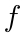 是 Nest 态射，那么：

Nest 态射  的补态射，是没有被 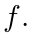 命中的那些分量的包含映射。例如：

我们证明，`Nest` 中的补态射与布局的补布局运算兼容。

定理 D（见 3.2.6.20）。如果 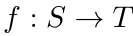 是单射的 Nest 态射，并且 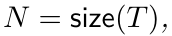，那么：

展开原页对照（保留全部图示、代码、标签和数学排版）

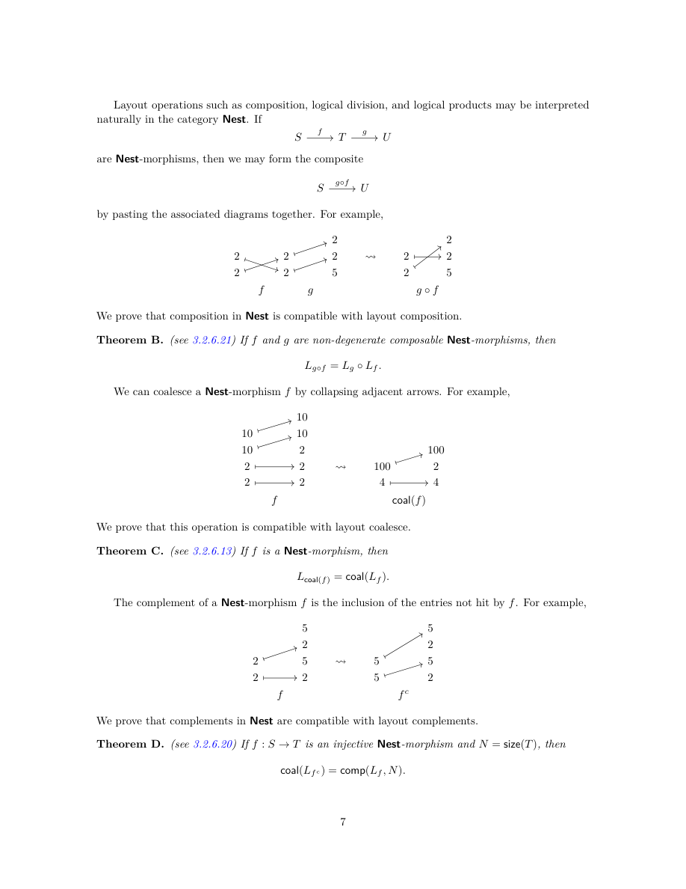

展开本页英文正文

<pre v-pre style="white-space:pre-wrap;overflow-wrap:anywhere">Layout operations such as composition, logical division, and logical products may be interpreted naturally in the category Nest. If

are Nest-morphisms, then we may form the composite

by pasting the associated diagrams together. For example,

We prove that composition in Nest is compatible with layout composition.

Theorem B. (see 3.2.6.21) If f and g are non-degenerate composable Nest-morphisms, then

We can coalesce a Nest-morphism f by collapsing adjacent arrows. For example,

We prove that this operation is compatible with layout coalesce.

Theorem C. (see 3.2.6.13) If f is a Nest-morphism, then

The complement of a Nest-morphism f is the inclusion of the entries not hit by f. For example,

We prove that complements in Nest are compatible with layout complements.

Theorem D. (see 3.2.6.20) If f : S →T is an injective Nest-morphism and N = size(T), then</pre>

## PDF 第 10 页 · 原书第 8 页

我们定义了 Nest 态射的整除性，并在 g 整除 f 时定义逻辑除法运算：

例如：

我们证明，`Nest` 中的逻辑除法与布局的逻辑除法兼容。

定理 E（见 3.2.6.26）。如果  和  是非退化的 Nest 态射，并且 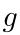 整除 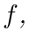，那么：

我们定义了 Nest 态射的乘积容许性，并在 f 与 g 满足乘积容许条件时定义逻辑乘积运算：

例如：

我们证明，`Nest` 中的逻辑乘积与布局的逻辑乘积兼容。

定理 F（见 3.2.6.31）。如果  和  是非退化的 Nest 态射，并且两者满足乘积容许条件，那么：

在第 4 章中，我们说明如何使用这个新框架计算复合、逻辑除法和逻辑乘积等重要的布局运算。具体而言，我们给出了一种算法（算法 4.1.3），用于计算可处理布局 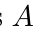 和 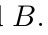 的复合 。略去细节，这种算法的基本思想是：如果希望计算复合 ，可以用恰当选择的 Nest 态射  和  分别表示这两个布局，将这些态射复合成 ，再取出它所编码的布局，得到：

我们通过许多例子说明这一算法。

### 1.2 文章结构

本文的组织如下。

展开原页对照（保留全部图示、代码、标签和数学排版）

展开本页英文正文

<pre v-pre style="white-space:pre-wrap;overflow-wrap:anywhere">We define divisibility of Nest-morphisms, and a logical division operation

when g divides f. For example,

We prove that logical division in Nest is compatible with logical division of layouts.

Theorem E. (see 3.2.6.26) If f and g are non-degenerate Nest-morphisms and g divides f, then

We define product admissibility of Nest-morphisms, and a logical product operation

when f and g are product admissible. For example,

We prove that the logical products in Nest are compatible with logical products of layouts.

Theorem F. (see 3.2.6.31) If f and g are non-degenerate Nest-morphisms and f and g are product admissible, then

In Chapter 4, we illustrate how our new framework may be used to compute important layout operations such as composition, logical division, and logical products. In particular, we present an algorithm (Algorithm 4.1.3) for computing the composition B ◦A of tractable layouts A and B. Eliding details, the basic idea of our algorithm is that if we want to compute the composition B ◦A, we can represent A and B by suitably chosen Nest-morphisms f and g, compose these morphisms to form g ◦f, then take the encoded layout to obtain

We illustrate this algorithm with many examples.

1.2 Organization

The current work is organized as follows.</pre>

## PDF 第 11 页 · 原书第 9 页

第 1.3 节介绍布局在 cute 中的实现细节。我们以 tract 模块的形式提供了范畴 Nest 的 Python 实现，并展示 tract 与 cute 的兼容性。Python 实现位于我们的 Git 仓库：https://github.com/ColfaxResearch/layout-categories。

第 2 章是布局及其代数的综合参考。它对布局及其支持的运算给出严格定义，并建立这些运算的基本性质。这一章包含大量例子，对实际编程的程序员可能有所帮助。

第 3 章提出了一个处理可处理布局的新数学框架。具体而言，我们将布局及其代数与范畴和运算子（operad）理论联系起来。这一章的内容具有独立的数学意义，也具有实际价值，因为它提供了一种用于可视化布局和计算各种布局运算的新框架。

第 4 章利用第 3 章建立的框架，给出计算可处理布局  与  之复合的算法，并通过许多例子说明该复合算法。

展开原页对照（保留全部图示、代码、标签和数学排版）

展开本页英文正文

<pre v-pre style="white-space:pre-wrap;overflow-wrap:anywhere">In section 1.3, we provide details regarding the cute implementation of layouts. We provide a Python implementation of the category Nest in the form of a module tract, and illustrate the compatibility of tract with cute. Our Python implementation may be found at our git repository https://github.com/ColfaxResearch/layout-categories.

Chapter 2 serves as a comprehensive reference for layouts and their algebra. It provides rigorous definitions of layouts and the operations they support, and establishes the fundamental properties of these operations. This chapter is replete with examples, and may be of use to the working programmer.

In Chapter 3, we present a new mathematical framework for working with tractable layouts. In particular, we connect layouts and their algebra to the theory of categories and operads. The content of this chapter is of independent mathematical interest. It is also of practical value, as it provides a new framework for visualizing layouts and computing their various operations.

In Chapter 4, we provide an algorithm for computing the composite of tractable layouts A and B using the framework developed in Chapter 3. We illustrate the composition algorithm with many examples.</pre>

## PDF 第 12 页 · 原书第 10 页

### 1.3 实现

本节介绍如何在 NVIDIA 的 CuTe DSL 中处理布局，我们将 CuTe DSL 记为 cute。我们在 Git 仓库 https://github.com/ColfaxResearch/layout-categories 中，以 Python 模块 tract 的形式提供了这个范畴论框架的实现。这里展示 cute 与 tract 的兼容性。

1. 构造元组与嵌套元组：我们在 Python 中按以下方式构造元组与嵌套元组。

注意，如果要构造长度为 1 的元组，必须在该元组的分量后面加上逗号。例如：

返回：

2. 构造布局与态射：我们在 cute 中按如下方式构造布局

如下所示。

例如：

返回：

我们在 tract 中按如下方式构造嵌套元组态射

如下所示。

例如：

展开原页对照（保留全部图示、代码、标签和数学排版）

展开本页英文正文

<pre v-pre style="white-space:pre-wrap;overflow-wrap:anywhere">1.3 Implementation

In this section, we illustrate how to work with layouts in NVIDIA’s CuTe DSL, which we denote as cute. We provide an implementation of our categorical framework in the form of a Python module tract in our git repository https://github.com/ColfaxResearch/layout-categories. Here, we show the compatibility of cute and tract.

1. Constructing tuples and nested tuples: We construct tuples and nested tuples in Python as follows.

Note that if we want to construct a tuple of length 1, we must include a comma following the tuple’s entry. For example,

returns

2. Constucting layouts and morphisms: We construct a layout

in cute as follows.

For example,

returns

We construct a nested tuple morphism

in tract as follows.

For example,</pre>

## PDF 第 13 页 · 原书第 11 页

返回：

注意，在 tract 中指定映射时，我们使用符号 0，而不是 。

3. 在可处理布局与态射之间转换：如果  是布局，我们可以用以下方式检查  是否可处理：

例如：

返回：

如果  是可处理布局，那么可以用以下方式构造其标准表示 ：

例如：

返回：

如果  是嵌套元组态射，那么可以用以下方式构造由  编码的布局 ：

例如：

返回：

展开原页对照（保留全部图示、代码、标签和数学排版）

展开本页英文正文

<pre v-pre style="white-space:pre-wrap;overflow-wrap:anywhere">returns

Note that we use the symbol 0 rather than ∗when specifying maps in tract.

3. Translating between tractable layouts and morphisms: If L is a layout, we can check if L is tractable with

For example,

returns

If L is a tractable layout, then we can construct the standard representation fL with

For example,

returns

If f is a nested tuple morphism, we can construct the layout Lf encoded by f with

For example,

returns</pre>

## PDF 第 14 页 · 原书第 12 页

4. 复合：在有定义时，这项运算从一对布局  和  产生布局 。精确定义见定义 2.3.7.1。我们可以在 cute 中用以下方式计算复合 ：

例如，运行：

返回：

如果  和  是可复合的嵌套元组态射，那么可以在 tract 中用以下方式计算复合 ：

例如：

返回：

5. 合并：这项运算从布局  产生布局 。详见定义 2.3.3.1。我们可以在 cute 中用以下方式计算 ：

例如：

返回：

展开原页对照（保留全部图示、代码、标签和数学排版）

展开本页英文正文

<pre v-pre style="white-space:pre-wrap;overflow-wrap:anywhere">4. Composition: When defined, this operation produces a layout B ◦A from a pair of layouts A and B. See Definition 2.3.7.1 for a precise definition. We can compute the composition B ◦A in cute with

For example, running

returns

If f and g are composable nested tuple morphisms, we can compute the composition g ◦f in tract with

For example,

returns

5. Coalesce: This operation produces a layout coal(A) from a layout A. See Definition 2.3.3.1 for details. We can compute coal(A) in cute with

For example,

returns</pre>

## PDF 第 15 页 · 原书第 13 页

还存在相对合并运算 ，它额外接收一个嵌套元组  作为输入；布局的形状是这个元组的细化。详见定义 2.3.4.7。我们可以在 cute 中用以下方式计算 ：

返回：

如果  是嵌套元组态射，就可以构造 。详见定义 3.2.6.11。我们在 tract 中按以下方式计算 ：

例如：

返回：

6. 补布局：在有定义时，这项运算从布局  和正整数 N 产生布局 。详见定义 2.3.6.5。我们可以在 cute 中用以下方式计算 ：

例如：

返回：

如果  是嵌套元组态射，就可以构造其补态射 。详见定义 3.2.6.17。我们在 tract 中按以下方式计算 ：

例如：

展开原页对照（保留全部图示、代码、标签和数学排版）

展开本页英文正文

<pre v-pre style="white-space:pre-wrap;overflow-wrap:anywhere">There is also a relative coalesce operation A 7→coal(A, S), which receives as input an additional nested tuple S which is refined by the shape of A. See Definition 2.3.4.7 for details. We can compute coal(A, S) in cute with

returns

If f is a nested tuple morphism, we may form coal(f). See Definition 3.2.6.11 for details. We compute coal(f) in tract with

For example,

returns

6. Complement: When defined, this operation produces a layout comp(A, N) from a layout A and positive integer N. See Definition 2.3.6.5 for details. We can compute comp(A, N) in cute with

For example,

returns

If f is a nested tuple morphism, then we may form the complement f c of f. See Definition 3.2.6.17 for details. We compute f c in tract with

For example,</pre>

## PDF 第 16 页 · 原书第 14 页

返回：

7. 逻辑除法：在有定义时，这项运算从一对布局  和  产生布局 。详见定义 2.3.8.1。我们在 cute 中按以下方式计算 ：

例如：

返回：

如果  和  是嵌套元组态射，并且  整除 ，就可以构造逻辑除法 。详见定义 3.2.6.23。我们在 tract 中按以下方式计算 ：

例如：

返回：

8. 逻辑乘积：在有定义时，这项运算从一对布局  和  产生布局 。详见定义 2.3.9.1。我们在 cute 中按以下方式计算 ：

例如，运行：

返回：

展开原页对照（保留全部图示、代码、标签和数学排版）

展开本页英文正文

<pre v-pre style="white-space:pre-wrap;overflow-wrap:anywhere">returns

7. Logical Division: When defined, this operation produces a layout A ⊘B from a pair of layouts A and B. See Definition 2.3.8.1 for details. We compute A ⊘B in cute with

For example,

returns

If f and g are nested tuple morphisms and g divides f, then we may form the logical division f ⊘g. See Definition 3.2.6.23 for details. We compute f ⊘g in tract with

For example,

returns

8. Logical Product: When defined, this operation produces a layout A ⊗B from a pair of layouts A and B. See Definition 2.3.9.1 for details. We compute A ⊗B in cute with

For example, running

returns</pre>

## PDF 第 17 页 · 原书第 15 页

如果  和  是嵌套元组态射，并且  和  满足乘积容许条件，就可以构造逻辑乘积 。详见定义 3.2.6.28。我们在 tract 中按以下方式计算 ：

例如：

返回：

展开原页对照（保留全部图示、代码、标签和数学排版）

展开本页英文正文

<pre v-pre style="white-space:pre-wrap;overflow-wrap:anywhere">If f and g are nested tuple morphisms and f and g are product admissible, then we may form the logical product f ⊗g. See Definition 3.2.6.28 for details. We compute f ⊗g in tract with

For example,

returns</pre>

## PDF 第 18 页 · 原书第 16 页

### 1.4 记号

，并且 。

，并且 。

：长度为 m 的元组，其中

第 i 个分量为 1，其余分量均为 0。

：集合  上的对称群。

，其中  为元组，

 为置换。

： 与  的平坦拼接。

：嵌套元组  的展平。

：嵌套元组  的轮廓。

： 的（嵌套）拼接。

：对于轮廓 ，将  作 Q 代入。

：分量属于集合  的元组所组成的集合。

：分量属于集合  的嵌套元组所组成的集合。

：轮廓的集合。

：平坦布局的集合。

：布局的集合。

：A 与 B 的复合。

：A 除以 B 的逻辑除法。

：A 与 B 的逻辑乘积。

：集合范畴。

：有限集范畴。

：由 n ≥ 0 时的 ⟨n⟩ 张成的 FinSet 的满子范畴。

：带基点的有限集范畴。

：由 n ≥ 0 时的 ⟨n⟩∗ 张成的 FinSet∗ 的满子范畴。

：元组与元组态射的范畴。

：嵌套元组与嵌套元组态射的范畴。

：嵌套元组与细化的范畴。

：（小）范畴与函子的范畴。

展开原页对照（保留全部图示、代码、标签和数学排版）

展开本页英文正文

<pre v-pre style="white-space:pre-wrap;overflow-wrap:anywhere">1.4 Notation

[0, n) = {0, . . . , n −1}, and [0, 0) = ∅.

⟨n⟩= {1, 2, . . . , n}, and ⟨0⟩= ∅.

i = (0, . . . , 1, . . . , 0), the tuple of length m with

ith entry 1 and all other entries 0.

Σn = the symmetric group on ⟨n⟩.

Xσ = (xσ(1), . . . , xσ(m)) for a tuple X = (x1, . . . , xm)

and a permutation σ ∈Σm.

X ⋆Y = the flat concatenation of X and Y.

X♭= the flattening of a nested tuple X.

prof(X) = the profile of a nested tuple X.

(X1, . . . , Xk) = the (nested) concatenation of X1, . . . , Xk.

(X1, . . . , Xk)Q = the Q-substitution of X1, . . . , Xk for a profile Q.

Tuple(V ) = the set of tuples with entries in a set V.

Nest(V ) = the set of nested tuples with entries in a set V.

Profile = the set of profiles.

FlatLayout = the set of flat layouts.

Layout = the set of layouts.

B ◦A = the composition of A and B.

A ⊘B = the logical division of A by B.

A ⊗B = the logical product of A and B.

Set = the category of sets.

FinSet = the category of finite sets.

Fin = the full subcategory of FinSet spanned by ⟨n⟩for n ≥0.

FinSet∗= the category of pointed finite sets.

Fin∗= the full subcategory of FinSet∗spanned by ⟨n⟩∗for n ≥0.

Tuple = the category of tuples and tuple morphisms.

Nest = the category of nested tuples and nested tuple morphisms.

Ref = the category of nested tuples and refinements.

Cat = the category of (small) categories and functors.</pre>

---
[译文总目录](Layout.md) · [扉页、摘要与目录](Translation-00-Front-Matter.md) · [第 2.1 节：平坦布局的基本定义与运算](Translation-02-Flat-Layouts.md)
