# 第 2.1 节：平坦布局的基本定义与运算
[译文总目录](Layout.md) · [第 1 章：引言](Translation-01-Introduction.md) · [第 2.1 节：合并、紧致性、补布局与可处理性](Translation-03-Flat-Layout-Algebra.md)
> 中文译文：[Colfax Research，2025 年 9 月版](source.pdf)。[校注](Proofreading.md)。

## PDF 第 19 页 · 原书第 17 页

### 第 2 章

### 布局及其代数

本章旨在建立一套全面且有数学基础的布局理论。我们首先在第 2.1 节发展平坦布局的理论，并在第 2.2 节介绍

嵌套元组所需的背景知识，以便在第 2.3 节讨论完全一般的布局。

### 2.1 平坦布局

本节研究平坦布局。这是一类重要的布局，其中形状和步长均为元组，而不是更一般的嵌套元组。为使讨论严格化，我们先约定与元组有关的记号。

### 2.1.1 元组

定义 2.1.1.1。设 V 为集合。分量属于 V 的元组是一个有限有序列表

其中，对每个 1 ≤ i ≤ m，都有 xᵢ ∈ V。这样的元组 X = (x₁, …, xₘ) 的长度为

我们将所有分量属于 V 的元组组成的集合记为 Tuple(V)。我们特别关心

V = ℤ 的情形，此时将 X ∈ Tuple(ℤ) 称为整数元组。如果 X 为整数元组，则 X 的大小是下列乘积：

示例 2.1.1.2. 以下是元组的一些示例及其长度和大小：

定义 2.1.1.3. 如果 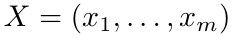 和 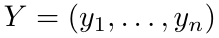 是元组，那么我们写

表示 X 与 Y 的拼接。

展开原页对照（保留全部图示、代码、标签和数学排版）

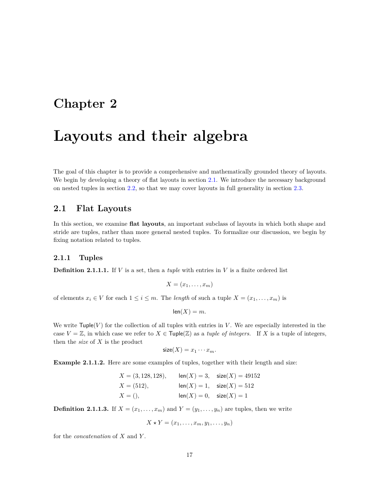

展开本页英文正文

<pre v-pre style="white-space:pre-wrap;overflow-wrap:anywhere">Chapter 2

Layouts and their algebra

The goal of this chapter is to provide a comprehensive and mathematically grounded theory of layouts. We begin by developing a theory of flat layouts in section 2.1. We introduce the necessary background

on nested tuples in section 2.2, so that we may cover layouts in full generality in section 2.3.

2.1 Flat Layouts

In this section, we examine flat layouts, an important subclass of layouts in which both shape and stride are tuples, rather than more general nested tuples. To formalize our discussion, we begin by fixing notation related to tuples.

2.1.1 Tuples

Definition 2.1.1.1. If V is a set, then a tuple with entries in V is a finite ordered list

of elements xi ∈V for each 1 ≤i ≤m. The length of such a tuple X = (x1, . . . , xm) is

We write Tuple(V ) for the collection of all tuples with entries in V . We are especially interested in the

case V = Z, in which case we refer to X ∈Tuple(Z) as a tuple of integers. If X is a tuple of integers, then the size of X is the product

Example 2.1.1.2. Here are some examples of tuples, together with their length and size:

Definition 2.1.1.3. If X = (x1, . . . , xm) and Y = (y1, . . . , yn) are tuples, then we write

for the concatenation of X and Y .</pre>

## PDF 第 20 页 · 原书第 18 页

示例 2.1.1.4. 如果 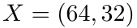 和 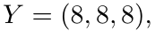 那么

备注 2.1.1.5. 如果 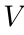 是集合，则该集合

即所有分量属于 V 的元组所组成的集合，是 V 上的自由结合幺半群。其幺半群乘法为拼接，单位元为空元组 ()。

定义 2.1.1.6。设 X 和 X′ 为元组。如果存在元组 X″ 满足下式，就称 X′ 整除 X：

例 2.1.1.7。如果 X′ = (81, 9)，X = (81, 9, 64, 8)，则 X′ 整除 X，因为元组 X″ = (64, 8) 满足

定义 2.1.1.8. 如果 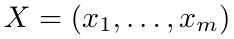 是一个元组并且 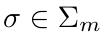 是一个置换，那么我们写

表示用 σ 对 X 进行的置换。这确定了 Σₘ 在 ℤ×ᵐ 上的一个右作用。

示例 2.1.1.9. 如果 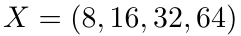 和 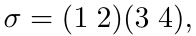 那么

符号 2.1.1.10. 如果 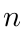 是一个正整数，我们写

如果 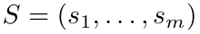 是一个正整数元组，我们写

表示满足 0 ≤ xᵢ < sᵢ 的所有元组 (x₁, …, xₘ) 所组成的集合。

示例 2.1.1.11. 如果 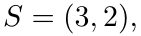 那么

### 2.1.2 基本定义

有了固定的符号，我们就可以定义平坦布局了。

定义 2.1.2.1. 平坦布局是一对

展开原页对照（保留全部图示、代码、标签和数学排版）

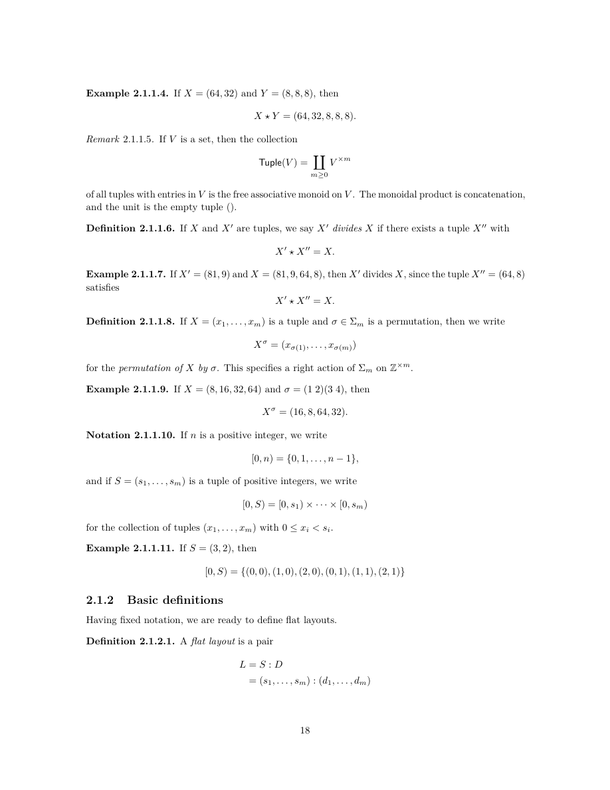

展开本页英文正文

<pre v-pre style="white-space:pre-wrap;overflow-wrap:anywhere">Example 2.1.1.4. If X = (64, 32) and Y = (8, 8, 8), then

Remark 2.1.1.5. If V is a set, then the collection

of all tuples with entries in V is the free associative monoid on V . The monoidal product is concatenation, and the unit is the empty tuple ().

Definition 2.1.1.6. If X and X′ are tuples, we say X′ divides X if there exists a tuple X′′ with

Example 2.1.1.7. If X′ = (81, 9) and X = (81, 9, 64, 8), then X′ divides X, since the tuple X′′ = (64, 8) satisfies

Definition 2.1.1.8. If X = (x1, . . . , xm) is a tuple and σ ∈Σm is a permutation, then we write

for the permutation of X by σ. This specifies a right action of Σm on Z×m.

Example 2.1.1.9. If X = (8, 16, 32, 64) and σ = (1 2)(3 4), then

Notation 2.1.1.10. If n is a positive integer, we write

and if S = (s1, . . . , sm) is a tuple of positive integers, we write

for the collection of tuples (x1, . . . , xm) with 0 ≤xi &lt; si.

Example 2.1.1.11. If S = (3, 2), then

2.1.2 Basic definitions

Having fixed notation, we are ready to define flat layouts.

Definition 2.1.2.1. A flat layout is a pair</pre>

## PDF 第 21 页 · 原书第 19 页

由正整数元组组成

称为 L 的形状，以及一个非负整数元组

称为 L 的步长。

备注 2.1.2.2. 如果  是平坦布局，则根据定义，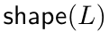 和  具有相同的长度。

备注 2.1.2.3. 平坦布局是定义 2.3.1.1, 的更一般布局的示例，因此我们

有时将平坦布局  称为布局。

示例 2.1.2.4. 以下是平坦布局的一些示例：

示例 2.1.2.5. 我们可以将布局 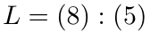 描述为

我们可以将布局 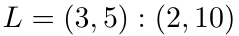 描述为

我们在备注 2.1.2.17. 中明确了这些图片代表相关布局的意义

平坦布局中最重要的例子或许就是列主序布局和行主序布局，下面给出其定义。

定义 2.1.2.6. 假设

是平坦布局。如果下式对每个 1 ≤ i ≤ m 成立，就称 L 为列主序布局：

展开原页对照（保留全部图示、代码、标签和数学排版）

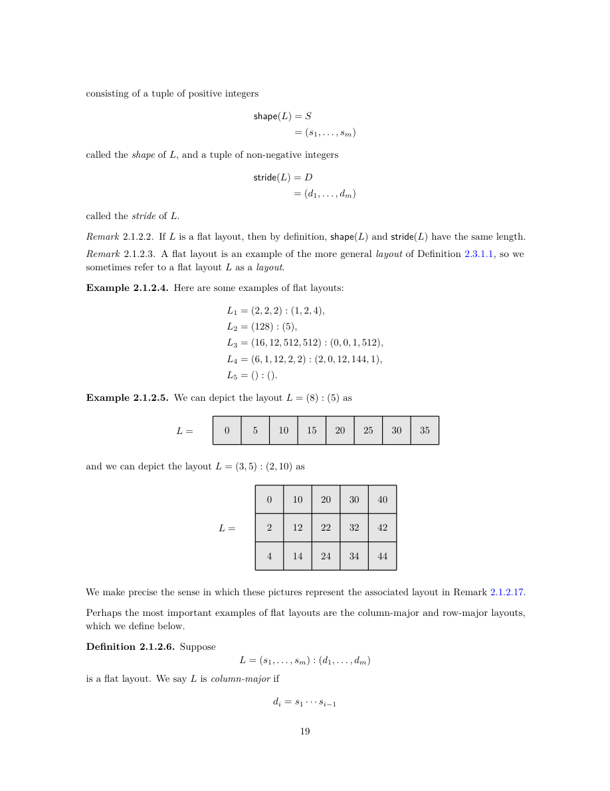

展开本页英文正文

<pre v-pre style="white-space:pre-wrap;overflow-wrap:anywhere">consisting of a tuple of positive integers

called the shape of L, and a tuple of non-negative integers

called the stride of L.

Remark 2.1.2.2. If L is a flat layout, then by definition, shape(L) and stride(L) have the same length.

Remark 2.1.2.3. A flat layout is an example of the more general layout of Definition 2.3.1.1, so we

sometimes refer to a flat layout L as a layout.

Example 2.1.2.4. Here are some examples of flat layouts:

Example 2.1.2.5. We can depict the layout L = (8) : (5) as

and we can depict the layout L = (3, 5) : (2, 10) as

We make precise the sense in which these pictures represent the associated layout in Remark 2.1.2.17.

Perhaps the most important examples of flat layouts are the column-major and row-major layouts, which we define below.

Definition 2.1.2.6. Suppose

is a flat layout. We say L is column-major if</pre>

## PDF 第 22 页 · 原书第 20 页

其中 1 ≤ i ≤ m。如果下式对每个 1 ≤ i ≤ m 成立，就称 L 为行主序布局：

对于每个 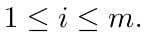

示例 2.1.2.7. 布局

是列主序布局，而布局

是行主序布局。这些图清楚说明了术语的由来：如果 L 是秩为 2 的列主序布局，则 L 的各列在内存中连续；如果 L 是秩为 2 的行主序布局，则 L 的各行在内存中连续。

示例 2.1.2.8. 布局

是列主序布局，而布局

是行主序布局。

现在我们已经看到了一些示例，让我们定义平坦布局的一些重要属性。

定义 2.1.2.9. 假设 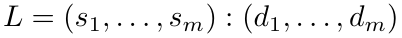 是平坦布局。

•  的秩为 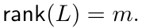

展开原页对照（保留全部图示、代码、标签和数学排版）

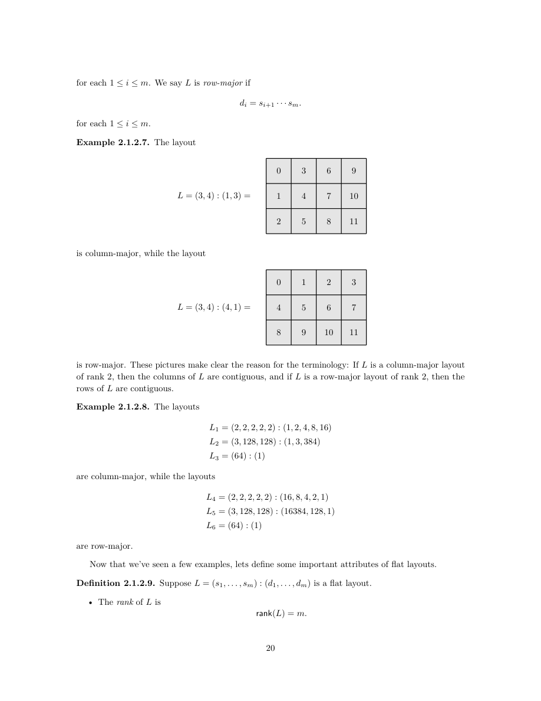

展开本页英文正文

<pre v-pre style="white-space:pre-wrap;overflow-wrap:anywhere">for each 1 ≤i ≤m. We say L is row-major if

for each 1 ≤i ≤m.

Example 2.1.2.7. The layout

is column-major, while the layout

is row-major. These pictures make clear the reason for the terminology: If L is a column-major layout of rank 2, then the columns of L are contiguous, and if L is a row-major layout of rank 2, then the rows of L are contiguous.

Example 2.1.2.8. The layouts

are column-major, while the layouts

are row-major.

Now that we’ve seen a few examples, lets define some important attributes of flat layouts.

Definition 2.1.2.9. Suppose L = (s1, . . . , sm) : (d1, . . . , dm) is a flat layout.

• The rank of L is rank(L) = m.</pre>

## PDF 第 23 页 · 原书第 21 页

•  的大小为

•  的余大小为

• 对于任意 1 ≤ i ≤ rank(L)，L 的第 i 个模态为下列二元组：

示例 2.1.2.10. 布局

有 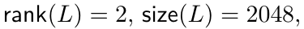 和 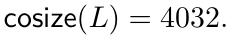 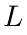 的模态为

示例 2.1.2.11. 布局

有 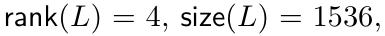 和 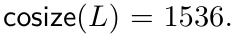 布局  有四种模态，例如 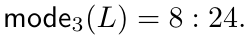

示例 2.1.2.12. 布局

具有 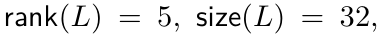 和 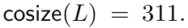 布局 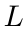 具有 5 模态，例如 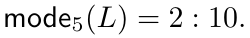

如果 L 是平坦布局，它就编码了一个坐标函数 $\varphi_L$。L 的坐标函数通过与 stride(L) 取点积，实现从多维到一维的变换。回顾一下，如果 S = (s₁, …, sₘ) 是正整数元组，那么

是满足 0 ≤ xᵢ < sᵢ 的所有元组 (x₁, …, xₘ) 组成的集合。特别地，如果 S = () 为空元组，则 [0, S) = {()}。

构造 2.1.2.13（坐标函数）。如果

是平坦布局，那么的坐标函数就是函数

由下式给出：

展开原页对照（保留全部图示、代码、标签和数学排版）

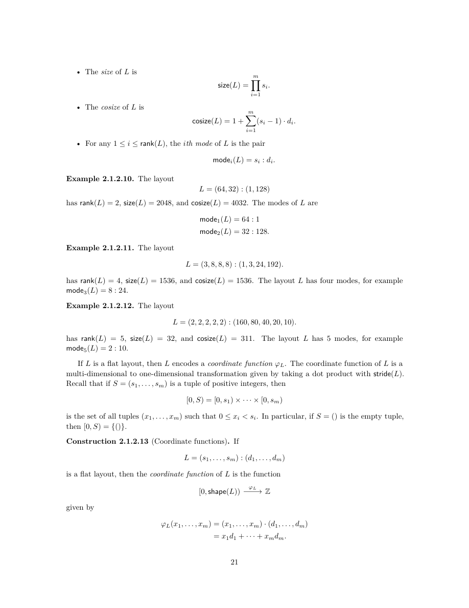

展开本页英文正文

<pre v-pre style="white-space:pre-wrap;overflow-wrap:anywhere">• The size of L is

• The cosize of L is

• For any 1 ≤i ≤rank(L), the ith mode of L is the pair

Example 2.1.2.10. The layout

has rank(L) = 2, size(L) = 2048, and cosize(L) = 4032. The modes of L are

Example 2.1.2.11. The layout

has rank(L) = 4, size(L) = 1536, and cosize(L) = 1536. The layout L has four modes, for example mode3(L) = 8 : 24.

Example 2.1.2.12. The layout

has rank(L) = 5, size(L) = 32, and cosize(L) = 311. The layout L has 5 modes, for example mode5(L) = 2 : 10.

If L is a flat layout, then L encodes a coordinate function φL. The coordinate function of L is a multi-dimensional to one-dimensional transformation given by taking a dot product with stride(L). Recall that if S = (s1, . . . , sm) is a tuple of positive integers, then

is the set of all tuples (x1, . . . , xm) such that 0 ≤xi &lt; si. In particular, if S = () is the empty tuple, then [0, S) = {()}.

Construction 2.1.2.13 (Coordinate functions). If

is a flat layout, then the coordinate function of L is the function

given by</pre>

## PDF 第 24 页 · 原书第 22 页

坐标函数 $\varphi_L$ 可以经包含映射 [0, cosize(L)) ⊂ ℤ 分解。我们将

记为分解后所得的映射。更一般地，对任意 N ≥ cosize(L)，将 $\varphi_L$ 经包含映射 [0, N) ⊂ ℤ 分解后所得的映射记为 $\varphi_L^N$。

稍微放宽术语的用法，我们也将这样的映射

$\varphi_L^N$ 称为 L 的坐标函数。

示例 2.1.2.14. 如果  则坐标函数

由下式给出

示例 2.1.2.15. 如果 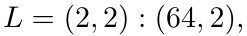 则坐标函数

由下式给出

例 2.1.2.16。如果 E = () : () 是空布局，那么 E 的坐标函数为下列映射：

由下式给出：

备注 2.1.2.17. 例如，我们现在可以给出像的含义的精确描述

展开原页对照（保留全部图示、代码、标签和数学排版）

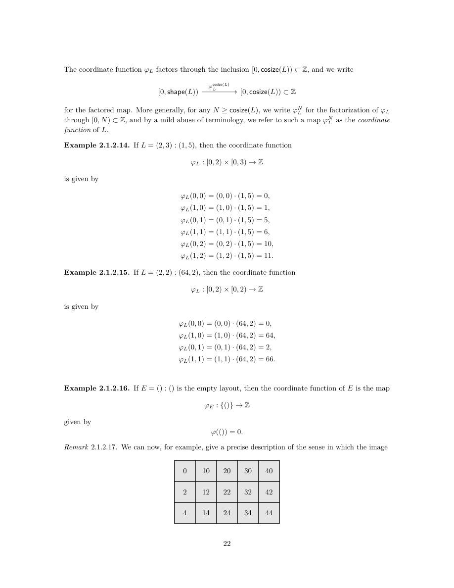

展开本页英文正文

<pre v-pre style="white-space:pre-wrap;overflow-wrap:anywhere">The coordinate function φL factors through the inclusion [0, cosize(L)) ⊂Z, and we write

for the factored map. More generally, for any N ≥cosize(L), we write φN

L for the factorization of φL through [0, N) ⊂Z, and by a mild abuse of terminology, we refer to such a map φN

L as the coordinate function of L.

Example 2.1.2.14. If L = (2, 3) : (1, 5), then the coordinate function

is given by

Example 2.1.2.15. If L = (2, 2) : (64, 2), then the coordinate function

is given by

Example 2.1.2.16. If E = () : () is the empty layout, then the coordinate function of E is the map

given by

Remark 2.1.2.17. We can now, for example, give a precise description of the sense in which the image</pre>

## PDF 第 25 页 · 原书第 23 页

表示布局 L = (3, 5) : (2, 10)：网格的第 (i, j) 个单元格标记为

L 的坐标函数在该坐标处的值。

在实践中，平坦布局 L 最重要的不变量是其布局函数 $\Phi_L$。它由下列坐标函数

在输入端与下列余字典序同构的逆进行复合而得：

定义 2.1.2.18. 假设 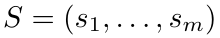 是一个正整数元组，回想一下

余字典序同构是下列映射：

当元组 S 可以由上下文确定时，有时将 colexS 简记为 colex。

余字典序同构的逆为下列映射：

由下式给出：

其中

对 sᵢ 取模。

请注意，如果 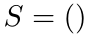 是空元组，则

和

是规范同构。

构造2.1.2.19（布局函数）。如果

是平坦布局，那么的布局函数就是复合

展开原页对照（保留全部图示、代码、标签和数学排版）

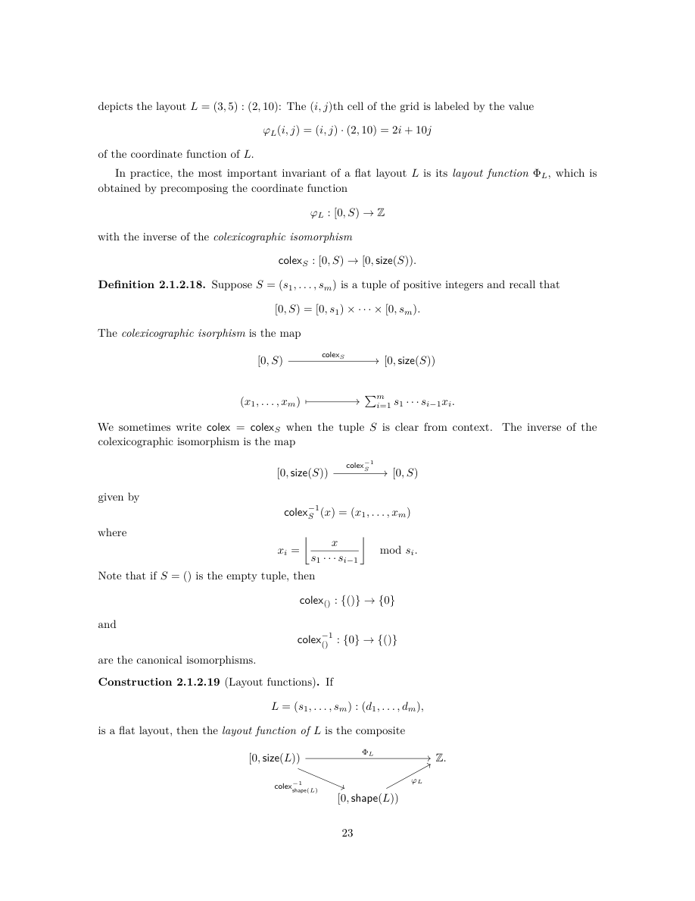

展开本页英文正文

<pre v-pre style="white-space:pre-wrap;overflow-wrap:anywhere">depicts the layout L = (3, 5) : (2, 10): The (i, j)th cell of the grid is labeled by the value

of the coordinate function of L.

In practice, the most important invariant of a flat layout L is its layout function ΦL, which is obtained by precomposing the coordinate function

with the inverse of the colexicographic isomorphism

Definition 2.1.2.18. Suppose S = (s1, . . . , sm) is a tuple of positive integers and recall that

The colexicographic isorphism is the map

We sometimes write colex = colexS when the tuple S is clear from context. The inverse of the

colexicographic isomorphism is the map

given by

where

mod si.

Note that if S = () is the empty tuple, then

and

are the canonical isomorphisms.

Construction 2.1.2.19 (Layout functions). If

is a flat layout, then the layout function of L is the composite</pre>

## PDF 第 26 页 · 原书第 24 页

明确地，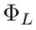 由下式给出

其中

对 sᵢ 取模。

布局函数 $\Phi_L$ 可以经包含映射 [0, cosize(L)) ⊂ ℤ 分解。我们将

记为分解后所得的映射。更一般地，对任意 N ≥ cosize(L)，将 $\Phi_L$ 经包含映射 [0, N) ⊂ ℤ 分解后所得的映射记为 $\Phi_L^N$。

稍微放宽术语的用法，我们也将这样的映射

称为 L 的布局函数。（原文此句将记号写为小写 $\varphi_L^N$；按本段构造应为大写 $\Phi_L^N$。）

示例 2.1.2.20. 如果 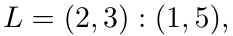 则布局函数

由下式给出

示例 2.1.2.21. 如果  则布局函数

由下式给出

示例 2.1.2.22. 如果 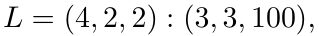 则例如  的布局函数满足

示例 2.1.2.23. 如果 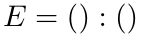 是空布局，则

由下式给出

展开原页对照（保留全部图示、代码、标签和数学排版）

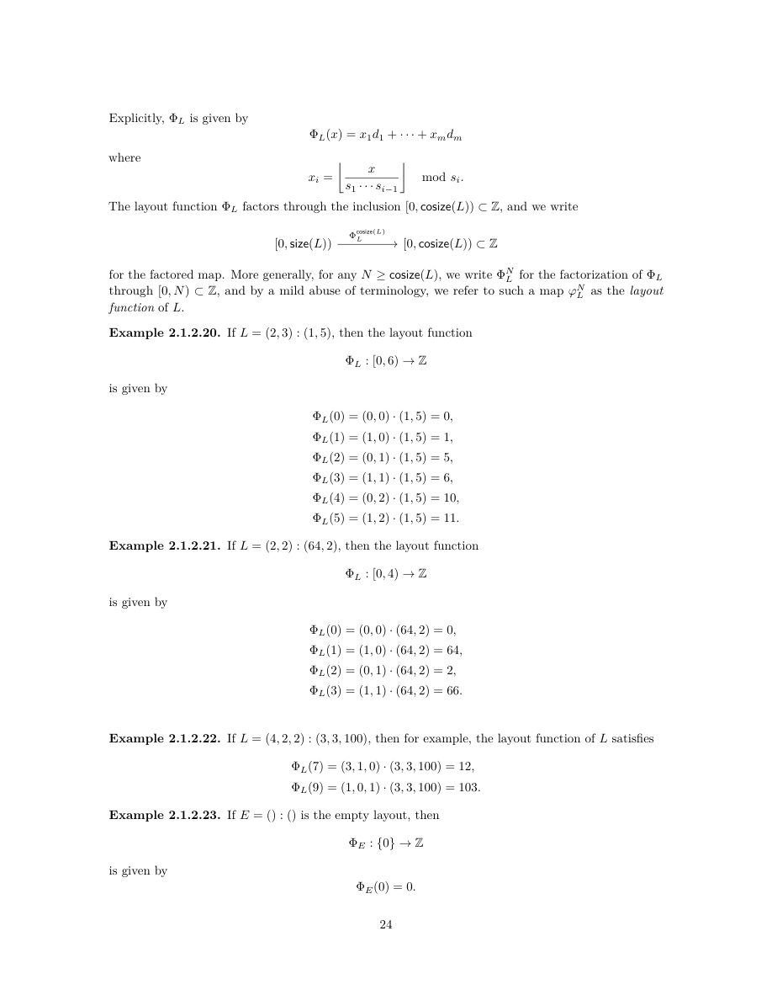

展开本页英文正文

<pre v-pre style="white-space:pre-wrap;overflow-wrap:anywhere">Explicitly, ΦL is given by

where

mod si.

The layout function ΦL factors through the inclusion [0, cosize(L)) ⊂Z, and we write

for the factored map. More generally, for any N ≥cosize(L), we write ΦN

L for the factorization of ΦL through [0, N) ⊂Z, and by a mild abuse of terminology, we refer to such a map φN

L as the layout function of L.

Example 2.1.2.20. If L = (2, 3) : (1, 5), then the layout function

is given by

Example 2.1.2.21. If L = (2, 2) : (64, 2), then the layout function

is given by

Example 2.1.2.22. If L = (4, 2, 2) : (3, 3, 100), then for example, the layout function of L satisfies

Example 2.1.2.23. If E = () : () is the empty layout, then

is given by</pre>

## PDF 第 27 页 · 原书第 25 页

示例 2.1.2.24. 如果  是任意平坦布局，则  的布局函数 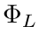 满足

注记 2.1.2.25。设 S = (s₁, …, sₘ) 为正整数元组。下列余字典序同构

等于下列列主序布局 L 的坐标函数 φᶜᵒˢⁱᶻᵉ⁽ᴸ⁾L：

其中 L 为

这意味着，如果平坦布局 L 为列主序布局，那么

是 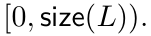 上的恒等映射

注记 2.1.2.26。存在彼此不同但布局函数相同的布局，即 A ≠ B 而 $\Phi_A$ = $\Phi_B$。例如，下列布局

并不相等，但 $\Phi_A$ = $\Phi_B$。稍后，我们将精确刻画两个平坦布局 A 与 B 具有相同布局函数的条件（见命题 2.1.4.18）。

在继续讨论布局操作之前，我们需要定义非退化性的概念。

定义 2.1.2.27. 假设

是平坦布局。如果对任意 1 ≤ i ≤ m 都有下式，就称 L 为非退化布局：

示例 2.1.2.28. 布局

是非退化的，而布局

是退化的。

观察 2.1.2.29。假设布局 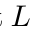 是非退化的，并没有真正失去一般性。更准确地说，如果

是形状相同的平坦布局，并且只要 sᵢ > 1 就有 dᵢ = d′ᵢ，

那么 $\varphi_L$ = $\varphi_{L\prime}$ 且 $\Phi_L$ = $\Phi_{L\prime}$。特别地，只要 sᵢ = 1，就可以将 dᵢ 设为 0，而不改变 L 的坐标函数或布局函数。

展开原页对照（保留全部图示、代码、标签和数学排版）

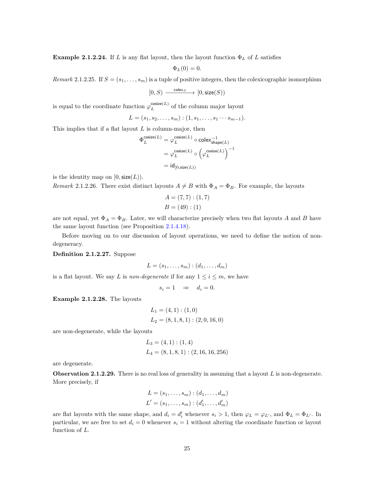

展开本页英文正文

<pre v-pre style="white-space:pre-wrap;overflow-wrap:anywhere">Example 2.1.2.24. If L is any flat layout, then the layout function ΦL of L satisfies

Remark 2.1.2.25. If S = (s1, . . . , sm) is a tuple of positive integers, then the colexicographic isomorphism

is equal to the coordinate function φcosize(L)

L of the column major layout

This implies that if a flat layout L is column-major, then

is the identity map on [0, size(L)).

Remark 2.1.2.26. There exist distinct layouts A̸ = B with ΦA = ΦB. For example, the layouts

are not equal, yet ΦA = ΦB. Later, we will characterize precisely when two flat layouts A and B have the same layout function (see Proposition 2.1.4.18).

Before moving on to our discussion of layout operations, we need to define the notion of non- degeneracy.

Definition 2.1.2.27. Suppose

is a flat layout. We say L is non-degenerate if for any 1 ≤i ≤m, we have

Example 2.1.2.28. The layouts

are non-degenerate, while the layouts

are degenerate.

Observation 2.1.2.29. There is no real loss of generality in assuming that a layout L is non-degenerate. More precisely, if

are flat layouts with the same shape, and di = d′

i whenever si &gt; 1, then φL = φL′, and ΦL = ΦL′. In particular, we are free to set di = 0 whenever si = 1 without altering the coordinate function or layout function of L.</pre>

## PDF 第 28 页 · 原书第 26 页

### 2.1.3 基本运算

建立了平坦布局的基本词汇后，我们转向它们支持的操作。在本节中，我们定义构建更复杂的操作（例如合并、补布局和复合）所需的基本操作。

2.1.3.1 限制

如果 L 是平坦布局，那么只保留 L 的部分模态往往很有用。回顾一下，对非负整数 m，我们记

定义 2.1.3.1. 假设

是一个平坦布局，假设

是一个子集。我们定义到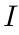的限制为平坦布局

示例 2.1.3.2. 如果

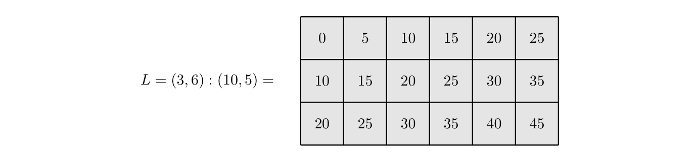

且 I = {2}，那么

示例 2.1.3.3. 如果

且 I = {1, 2, 3}，那么

示例 2.1.3.4. 如果

是平坦布局，且 I = ⟨m⟩，那么

示例 2.1.3.5. 如果

是平坦布局，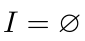 是空集，那么

是空的布局。

展开原页对照（保留全部图示、代码、标签和数学排版）

展开本页英文正文

<pre v-pre style="white-space:pre-wrap;overflow-wrap:anywhere">2.1.3 Basic operations

Having established the basic vocabulary for flat layouts, we turn to the operations they support. In this section, we define basic operations that will be needed to construct more sophisticated operations such as coalesce, complement, and composition.

2.1.3.1 Restriction

If L is a flat layout, it is often useful to restrict to a subset of the modes of L. Recall that for a non-negative integer m, we write

Definition 2.1.3.1. Suppose

is a flat layout, and suppose

is a subset. We define the restriction of L to I to be the flat layout

Example 2.1.3.2. If

and I = {2}, then

Example 2.1.3.3. If

and I = {1, 2, 3}, then

Example 2.1.3.4. If

is a flat layout and I = ⟨m⟩, then

Example 2.1.3.5. If

is a flat layout and I = ∅is the empty set, then

is the empty layout.</pre>

## PDF 第 29 页 · 原书第 27 页

2.1.3.2 挤压

如果  是平坦布局，则操作  将删除  的所有模态 ，其中 

构造 2.1.3.6. 假设

是一个平坦布局，让

是其对应的形状分量不等于 1. 的索引的集合我们定义

示例 2.1.3.7. 如果

那么

示例 2.1.3.8. 如果

那么

示例 2.1.3.9. 如果  是平坦布局，则

当且仅当  不包含等于 1. 的分量

示例 2.1.3.10. 如果  是平坦布局，则

是空布局当且仅当  的所有分量都等于 1.

该结构的一个基本属性是  保持  的布局函数不变。

引理 2.1.3.11. 如果  是平坦布局，则

 和

证明。让

表示对应形状分量满足 sᵢⱼ > 1 的那些指标组成的集合，于是

展开原页对照（保留全部图示、代码、标签和数学排版）

展开本页英文正文

<pre v-pre style="white-space:pre-wrap;overflow-wrap:anywhere">2.1.3.2 Squeeze

If L is a flat layout, then the operation L 7→squeeze(L) removes all modes si : di of L where si = 1.

Construction 2.1.3.6. Suppose

is a flat layout, and let

be the collection of indices whose corresponding shape entry is not equal to 1. We define

Example 2.1.3.7. If

then

Example 2.1.3.8. If

then

Example 2.1.3.9. If L is a flat layout, then

if and only if shape(L) contains no entries equal to 1.

Example 2.1.3.10. If L is a flat layout, then

is the empty layout if and only if all entries of shape(L) are equal to 1.

An essential property of this construction is that L 7→squeeze(L) leaves the layout function of L unchanged.

Lemma 2.1.3.11. If L is a flat layout, then

2. cosize(squeeze(L)) = cosize(L), and

Proof. Let

denote the collection of indices with sij &gt; 1, so that</pre>

## PDF 第 30 页 · 原书第 28 页

对于第一个断言，我们计算

对于第二个断言，我们计算

对于第三个断言，足以表明从平坦布局中删除  形式的模态会使布局函数保持不变。假设  并假设一些  让

表示从 L 中删除第 i 个模态得到的平坦布局，于是

和 

 的布局函数由下式给出

对 sⱼ 取模。L′ 的布局函数则为

其中

其中

对 s′ⱼ 取模。

我们观察到

由于  必然是 0, 我们有

展开原页对照（保留全部图示、代码、标签和数学排版）

展开本页英文正文

<pre v-pre style="white-space:pre-wrap;overflow-wrap:anywhere">For the first assertion, we compute

For the second assertion, we compute

For the third assertion, it suffices to show that removing a mode of the form 1 : di from a flat layout leaves the layout function unchanged. Suppose L = (s1, . . . , sm) : (d1, . . . , dm), and suppose that some si = 1. Let

denote the flat layout obtained from L by removing its ith mode, so that

and d′

The layout function for L is given by

mod sj, and the layout function for L′ is given by

where xj =

where x′

mod s′

j. We observe that

and since xi ∈[0, 1) is necessarily 0, we have</pre>

## PDF 第 31 页 · 原书第 29 页

2.1.3.3 过滤零步长

如果 L 是平坦布局，那么运算 L ↦ filter(L) 会删除所有满足 dᵢ = 0 的模态 sᵢ : dᵢ。

定义 2.1.3.12. 假设

是一个平坦布局，让

是其对应步长分量不等于 0. 的索引的集合我们定义

示例 2.1.3.13. 如果

那么

示例 2.1.3.14. 如果

那么

示例 2.1.3.15. 如果

那么

示例 2.1.3.16. 如果  是平坦布局，则

当且仅当  的所有分量均非零时。

示例 2.1.3.17. 如果  是平坦布局，则

是空布局当且仅当  的所有分量都等于 0.

展开原页对照（保留全部图示、代码、标签和数学排版）

展开本页英文正文

<pre v-pre style="white-space:pre-wrap;overflow-wrap:anywhere">2.1.3.3 Filter zeros

If L is a flat layout, then the operation L 7→filter(L) removes all modes si : di with di = 0.

Definition 2.1.3.12. Suppose

is a flat layout, and let

be the collection of indices whose corresponding stride entry is not equal to 0. We define

Example 2.1.3.13. If

then

Example 2.1.3.14. If

then

Example 2.1.3.15. If

then

Example 2.1.3.16. If L is a flat layout, then

if and only if all entries of stride(L) are nonzero.

Example 2.1.3.17. If L is a flat layout, then

is the empty layout if and only if all entries of stride(L) are equal to 0.</pre>

## PDF 第 32 页 · 原书第 30 页

2.1.3.4 置换

回想一下，如果  是长度为  的元组，并且  是置换，那么我们写

用于  的置换 

定义 2.1.3.18. 如果  是秩  的平坦布局，并且  是置换，我们定义

示例 2.1.3.19. 如果

且 σ = (1 2) ∈ Σ₂ 是换位，那么

是转置的布局。

示例 2.1.3.20. 如果

且 σ = (1 2) ∈ Σ₃，那么

示例 2.1.3.21. 如果

且 σ = (1 5)(3 2 4) ∈ Σ₅，那么

示例 2.1.3.22. 如果

是一个平坦布局，其所有模态都相等，那么对于任何  我们有

展开原页对照（保留全部图示、代码、标签和数学排版）

展开本页英文正文

<pre v-pre style="white-space:pre-wrap;overflow-wrap:anywhere">2.1.3.4 Permute

Recall that if X = (x1, . . . , xm) is a tuple of length m and σ ∈Σm is a permutation, then we write

for the permutation of X by σ.

Definition 2.1.3.18. If L = (s1, . . . , sm) : (d1, . . . , dm) is a flat layout of rank m and σ ∈Σm is a permutation, we define

Example 2.1.3.19. If

and σ = (1 2) ∈Σ2 is the transposition, then

is the transposed layout.

Example 2.1.3.20. If

and σ = (1 2) ∈Σ3, then

Example 2.1.3.21. If

and σ = (1 5)(3 2 4) ∈Σ5, then

Example 2.1.3.22. If

is a flat layout all of whose modes are equal, then for any σ ∈Σm, we have</pre>

## PDF 第 33 页 · 原书第 31 页

2.1.3.5 排序

如果 L 是平坦布局，那么往往可以按照下面的意义，对 L 进行置换，使其模态递增。

定义 2.1.3.23. 我们定义整数对  的线性序：

   或  和 

示例 2.1.3.24. 我们有

定义 2.1.3.25。设 L 为平坦布局。如果对任意 1 ≤ i < rank(L) 都满足下式，就称 L 已排序：

示例 2.1.3.26. 布局

已排序，而布局

没有排序。

示例 2.1.3.27. 空布局  已排序。

示例 2.1.3.28. 如果

是一个平坦布局， 的所有分量等于 0,，那么  被排序当且仅当

平坦布局  是否排序与  的布局函数  的行为密切相关，如以下引理中所述。

引理 2.1.3.29. 假设  是平面布局。如果  是非递减的，则  已排序。〔校注：本引理原文未排除退化布局。若 $L=(1,2):(5,1)$，则 $\Phi_L$ 的值依次为 $0,1$，因而非递减，但步长 $5,1$ 未排序；所以按字面陈述存在反例，需补充假设或先规范化。〕

证明。我们证明其逆否命题。假设 L 未排序，将证明在 $\Phi_L$ 的定义域中存在 x ≤ y，使得 $\Phi_L$(x) > $\Phi_L$(y)。如果存在 1 ≤ i < m，使得 dᵢ > dᵢ₊₁，那么可以令

 和 

在这种情况下  但是

展开原页对照（保留全部图示、代码、标签和数学排版）

展开本页英文正文

<pre v-pre style="white-space:pre-wrap;overflow-wrap:anywhere">2.1.3.5 Sort

If L is a flat layout, it is often useful to permute L so that its modes are increasing, in the following sense.

Definition 2.1.3.23. We define a linear ordering on pairs s : d of integers by

s : d ⪯s′ : d′ ⇔ d &lt; d′, or d = d′ and s ≤s′.

Example 2.1.3.24. We have

Definition 2.1.3.25. Suppose L is a flat layout. We say L is sorted if for any 1 ≤i &lt; rank(L), we have

Example 2.1.3.26. The layouts

are sorted, while the layouts

are not sorted.

Example 2.1.3.27. The empty layout E = () : () is sorted.

Example 2.1.3.28. If

is a flat layout with all entries of stride(L) equal to 0, then L is sorted if and only if

Whether or not a flat layout L is sorted is intimately related to the behavior of the layout function ΦL of L, as described in the following lemma.

Lemma 2.1.3.29. Suppose L is a flat layout. If ΦL is non-decreasing, then L is sorted.

Proof. We prove the contrapositive. Suppose that L is not sorted. We will show that there exists some x ≤y in the domain of ΦL with ΦL(x) &gt; ΦL(y). If there exists some 1 ≤i &lt; m such that di &gt; di+1, then we can let

sj, and y =

in which case x &lt; y, but</pre>

## PDF 第 34 页 · 原书第 32 页

另一方面，如果存在一些  使得  和  我们可以设置

 和 

在这种情况下  但是

我们得出结论， 不是非递减的。

备注 2.1.3.30. 上一个引理的逆命题是假的。例如，平坦布局

已排序，但是

严格大于

如果是平坦布局，那么我们可以对的模态进行置换以获得排序布局

构造 2.1.3.31. 假设

是平坦布局。在 ⟨m⟩ 上定义线性序 ⪯：当且仅当以下条件成立时，规定 i ⪯ j：

 和

2. 如果  那么 

令 σ ∈ Σₘ 为与 ⟨m⟩ 上的线性序 ⪯ 对应的置换。将 sort(L) 定义为用 σ 对 L 进行置换所得到的布局：

示例 2.1.3.32. 如果

那么

示例 2.1.3.33. 如果

那么

展开原页对照（保留全部图示、代码、标签和数学排版）

展开本页英文正文

<pre v-pre style="white-space:pre-wrap;overflow-wrap:anywhere">On the other hand, if there exists some 1 ≤i &lt; m such that di = di+1 and si &gt; si+1, we can set

, and y = (si+1 −1)

in which case x &lt; y, but

We conclude that ΦL is not non-decreasing.

Remark 2.1.3.30. The converse of the previous lemma is false. For example, the flat layout

is sorted, but

is strictly greater than

If L is a flat layout, then we can permute the modes of L to obtain a sorted layout sort(L).

Construction 2.1.3.31. Suppose

is a flat layout. Define a linear ordering ⪯on ⟨m⟩by i ⪯j if

1. modei(L) ⪯modej(L), and

2. if modei(L) = modej(L) then i ≤j.

Let σ ∈Σm be the permutation associated to the linear ordering ⪯of ⟨m⟩. We define sort(L) to be permutation of L by σ:

Example 2.1.3.32. If

then

Example 2.1.3.33. If

then</pre>

## PDF 第 35 页 · 原书第 33 页

示例 2.1.3.34. 如果  已排序，则  特别是，这意味着  是幂等操作：

观察 2.1.3.35。如果 L 是平坦布局，一般有 $\Phi_{\operatorname{sort}(L)}$ ≠ $\Phi_L$。不过，布局函数 $\Phi_L$ 与 $\Phi_{\operatorname{sort}(L)}$ 总有相同的像。为说明这一点，记

 和

其中 σ ∈ Σₘ 为某个置换。如果整数 n 属于 $\Phi_L$ 的像，则存在元组 (x₁, …, xₘ) 属于

 这样

在这种情况下，元组 

 满足

这就证明了 $\operatorname{Image}(\Phi_{\operatorname{sort}(L)})\subseteq\operatorname{Image}(\Phi_L)$；反向包含可类似证明。〔校注：原文这里将包含方向写反了；前面的推导实际证明 $\operatorname{Image}(\Phi_L)\subseteq\operatorname{Image}(\Phi_{\operatorname{sort}(L)})$。等像结论不受影响。〕

2.1.3.6 拼接

回想一下，如果  和  是元组，那么  和  的拼接就是元组

这个定义自然地延伸到平坦布局的拼接。

定义 2.1.3.36. 假设

是平坦布局。那么和的拼接就是平坦布局

平坦布局的拼接满足结合律。因此，更一般地，如果 L₁, …, Lₖ 为平坦布局，就可以构造它们的拼接：

示例 2.1.3.37. 如果  和  那么

示例 2.1.3.38. 如果  是空布局，则对于任何平坦布局  我们有

展开原页对照（保留全部图示、代码、标签和数学排版）

展开本页英文正文

<pre v-pre style="white-space:pre-wrap;overflow-wrap:anywhere">Example 2.1.3.34. If L is sorted, then sort(L) = L. In particular, this implies that sort(−) is an idempotent operation:

Observation 2.1.3.35. If L is a flat layout, then typically Φsort(L)̸ = ΦL. However, the layout functions ΦL and Φsort(L) always have the same image. To see this, let’s write

L = (s1, . . . , sm) : (d1, . . . , dm), and

for some permutation σ ∈Σm. If an integer n is in the image of ΦL, then there exists a tuple (x1, . . . , xm) ∈Qm

i=1 [0, si) such that

in which case the tuple (xσ(1), . . . , xσ(m)) ∈Qm

i=1 [0, sσ(i)) satisfies

This proves that Image(Φsort(L)) ⊆Image(ΦL), and the reverse inclusion is proved similarly.

2.1.3.6 Concatenate

Recall that if X = (x1, . . . , xm) and Y = (y1, . . . , yn) are tuples, then the concatenation of X and Y is the tuple

This definition extends naturally to the concatenation of flat layouts.

Definition 2.1.3.36. Suppose

are flat layouts. Then the concatenation of L1 and L2 is the flat layout

Concatenation of flat layouts is associative, so more generally, if L1, . . . , Lk are flat layouts, we may form the concatenation

Example 2.1.3.37. If L1 = (7, 2) : (2, 1) and L2 = (3, 3, 3) : (0, 10, 30), then

Example 2.1.3.38. If E = () : () is the empty layout, then for any flat layout L we have</pre>

## PDF 第 36 页 · 原书第 34 页

观察 2.1.3.39. 假设

是平坦布局。如果我们写

那么我们可以将  写为拼接

如果是平坦布局，则拼接的布局函数由的布局函数确定，如下所示。

命题 2.1.3.40。设 L₁, …, Lₖ 为平坦布局，其形状分别为 S₁, …, Sₖ，大小分别为 N₁, …, Nₖ。那么，下列坐标函数

即 L₁ ⋆ ··· ⋆ Lₖ 的坐标函数，等于下列复合映射：

和布局函数

即 L₁ ⋆ ··· ⋆ Lₖ 的布局函数，等于下列复合映射：

证明。让我们为每个  写  第一个声明成立，因为如果

对应于

在规范同构  下，则

对于第二个主张，我们认为该图

交换。由于余字典序同构满足结合律，左侧方块交换；由第一个结论，右侧三角形交换。

展开原页对照（保留全部图示、代码、标签和数学排版）

展开本页英文正文

<pre v-pre style="white-space:pre-wrap;overflow-wrap:anywhere">Observation 2.1.3.39. Suppose

is a flat layout. If we write

then we can write L as the concatenation

If L1, . . . , Lk are flat layouts, then the layout function of the concatenation L1⋆· · ·⋆Lk is determined by the layout functions of L1, . . . , Lk as follows.

Proposition 2.1.3.40. Suppose L1, . . . , Lk are flat layouts of shape S1, . . . , Sk, and size N1, . . . , Nk, respectively. Then the coordinate function

of L1 ⋆· · · ⋆Lk is equal to the composite

and the layout function

of L1 ⋆· · · ⋆Lk is equal to the composite

Proof. Let’s write Li = Si : Di for each 1 ≤i ≤k. The first claim holds because if

corresponds to

under the canonical isomorphism [0, S1 ⋆· · · ⋆Sk) ∼= [0, S1) × · · · × [0, Sk), then

For the second claim, we argue that the diagram

commutes. The left-hand square commutes since colexicographic isomorphisms are associative, and the right-hand triangle commutes by the first claim.</pre>

---
[译文总目录](Layout.md) · [第 1 章：引言](Translation-01-Introduction.md) · [第 2.1 节：合并、紧致性、补布局与可处理性](Translation-03-Flat-Layout-Algebra.md)
