# 第 2.1 节：合并、紧致性、补布局与可处理性
[译文总目录](Layout.md) · [第 2.1 节：平坦布局的基本定义与运算](Translation-02-Flat-Layouts.md) · [第 2.2 节：嵌套元组](Translation-04-Nested-Tuples.md)
> 中文译文：[Colfax Research，2025 年 9 月版](source.pdf)。[校注](Proofreading.md)。

## PDF 第 37 页 · 原书第 35 页

我们可以如下描述拼接布局的重要属性。

命题 2.1.3.41. 假设 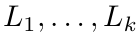 是平坦布局。然后

1. 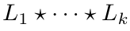 的秩是

2. 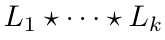 的大小为

3. 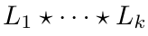 的余大小为

证明。对每个 1 ≤ i ≤ k，记 Lᵢ = Sᵢ : Dᵢ。对结论 1，计算得

对于 2, 我们计算

对于 3, 我们计算

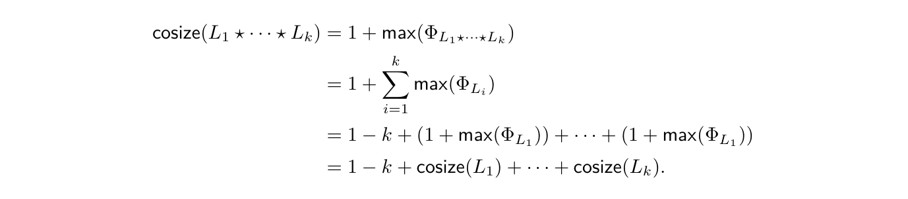

这里使用了命题 2.1.3.40 给出的拼接布局函数的表达式。

### 2.1.4 平坦合并

我们已经看到，平坦布局 L 的布局函数 $\Phi_L$ 是一个重要不变量。许多情况下，我们只关心布局函数 $\Phi_L$，因此可以使用任何具有相同布局函数的布局。平坦合并运算

为我们提供了最简单的平坦布局，其布局函数为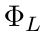（见命题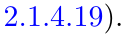）

我们首先定义合并平坦布局的概念。

展开原页对照（保留全部图示、代码、标签和数学排版）

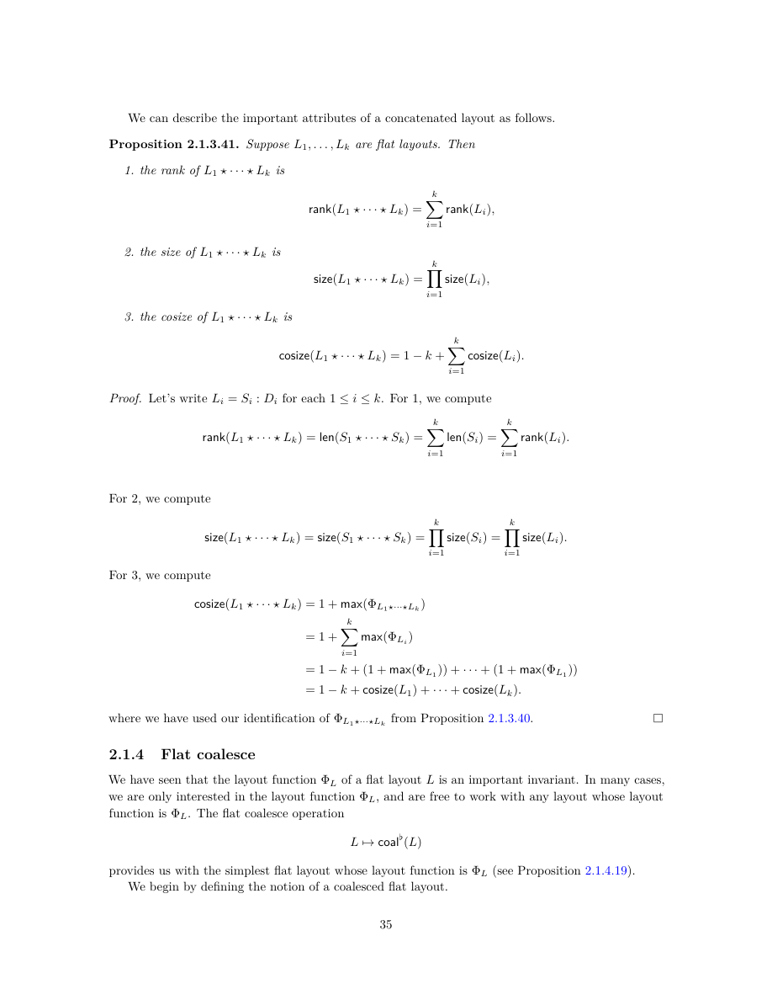

展开本页英文正文

<pre v-pre style="white-space:pre-wrap;overflow-wrap:anywhere">We can describe the important attributes of a concatenated layout as follows.

Proposition 2.1.3.41. Suppose L1, . . . , Lk are flat layouts. Then

1. the rank of L1 ⋆· · · ⋆Lk is

2. the size of L1 ⋆· · · ⋆Lk is

3. the cosize of L1 ⋆· · · ⋆Lk is

Proof. Let’s write Li = Si : Di for each 1 ≤i ≤k. For 1, we compute

For 2, we compute

For 3, we compute

where we have used our identification of ΦL1⋆···⋆Lk from Proposition 2.1.3.40.

2.1.4 Flat coalesce

We have seen that the layout function ΦL of a flat layout L is an important invariant. In many cases, we are only interested in the layout function ΦL, and are free to work with any layout whose layout function is ΦL. The flat coalesce operation

provides us with the simplest flat layout whose layout function is ΦL (see Proposition 2.1.4.19).

We begin by defining the notion of a coalesced flat layout.</pre>

## PDF 第 38 页 · 原书第 36 页

定义 2.1.4.1。设 L = (s₁, …, sₘ) : (d₁, …, dₘ) 为平坦布局。如果满足以下条件，就称 L 已合并：

1. 对任意 1 ≤ i ≤ m，都有 sᵢ ≠ 1；并且

2. 对任意 1 ≤ i < m，都有 sᵢdᵢ ≠ dᵢ₊₁。

示例 2.1.4.2. 平坦布局

未合并，因为 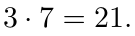

示例 2.1.4.3. 平坦布局

是合并的。

示例 2.1.4.4. 空布局 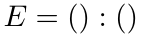 已合并。

例 2.1.4.5。如果 L = (s) : (d)，且 s ≠ 1，那么 L 已合并。

示例 2.1.4.6. 如果  是具有 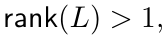 的列主序布局，则  不会合并，因为对于任何 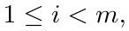 我们有

示例 2.1.4.7. 如果 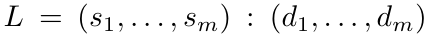 是行主序布局，且所有 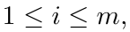 均具有 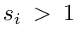，则  被合并： 如果 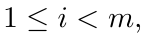 那么

例 2.1.4.8。形如下式的平坦布局

已合并，当且仅当 m ≤ 1。

如果 L 是平坦布局，可以先去掉满足 sᵢ = 1 的模态，再将满足 sᵢdᵢ = dᵢ₊₁ 的相邻模态合并，从而得到与 L 具有相同布局函数的已合并布局 coal♭(L)。更准确地说，作如下构造。

构造2.1.4.9. 假设是平坦布局，则写

在 ⟨m⟩ 上，以满足下式的相邻指标之间的关系 i ∼ i + 1 生成一个等价关系 ∼：

商集 ⟨m⟩/∼ 的次序由 i ≤ i′ ⇒ [i] ≤ [i′] 给出，因此可将它与 ⟨m̄⟩ 等同，其中 m̄ 为商集 ⟨m⟩/∼ 的大小。如果 i ∈ ⟨m̄⟩ 对应于下列等价类

展开原页对照（保留全部图示、代码、标签和数学排版）

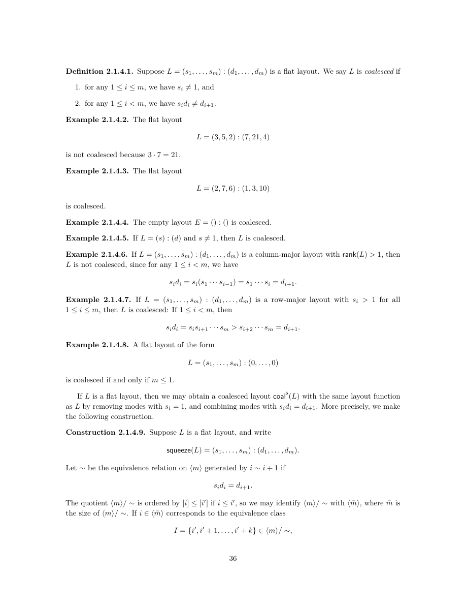

展开本页英文正文

<pre v-pre style="white-space:pre-wrap;overflow-wrap:anywhere">Definition 2.1.4.1. Suppose L = (s1, . . . , sm) : (d1, . . . , dm) is a flat layout. We say L is coalesced if

1. for any 1 ≤i ≤m, we have si̸ = 1, and

2. for any 1 ≤i &lt; m, we have sidi̸ = di+1.

Example 2.1.4.2. The flat layout

is not coalesced because 3 · 7 = 21.

Example 2.1.4.3. The flat layout

is coalesced.

Example 2.1.4.4. The empty layout E = () : () is coalesced.

Example 2.1.4.5. If L = (s) : (d) and s̸ = 1, then L is coalesced.

Example 2.1.4.6. If L = (s1, . . . , sm) : (d1, . . . , dm) is a column-major layout with rank(L) &gt; 1, then L is not coalesced, since for any 1 ≤i &lt; m, we have

Example 2.1.4.7. If L = (s1, . . . , sm) : (d1, . . . , dm) is a row-major layout with si &gt; 1 for all 1 ≤i ≤m, then L is coalesced: If 1 ≤i &lt; m, then

Example 2.1.4.8. A flat layout of the form

is coalesced if and only if m ≤1.

If L is a flat layout, then we may obtain a coalesced layout coal♭(L) with the same layout function as L by removing modes with si = 1, and combining modes with sidi = di+1. More precisely, we make the following construction.

Construction 2.1.4.9. Suppose L is a flat layout, and write

Let ∼be the equivalence relation on ⟨m⟩generated by i ∼i + 1 if

The quotient ⟨m⟩/ ∼is ordered by [i] ≤[i′] if i ≤i′, so we may identify ⟨m⟩/ ∼with ⟨¯m⟩, where ¯m is the size of ⟨m⟩/ ∼. If i ∈⟨¯m⟩corresponds to the equivalence class</pre>

## PDF 第 39 页 · 原书第 37 页

然后我们将整数 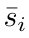 和 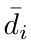 定义为

和

并定义

观察 2.1.4.10. 检查定义，我们可以等效地将 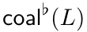 定义为从

通过迭代执行操作

直至结果合并。

示例 2.1.4.11. 如果 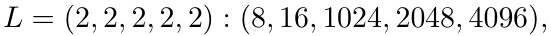 那么

示例 2.1.4.12. 如果 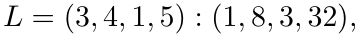 那么

示例 2.1.4.13. 如果 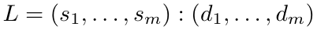 是列主的，并且并非所有 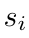 都等于 1,，则

示例 2.1.4.14. 如果  是行主序，则

我们来证明操作 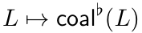 会导致合并布局。

引理 2.1.4.15. 如果  是平坦布局，则 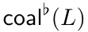 是合并的。

证明。借用构造 2.1.4.9, 的符号让

并让

我们要证明 coal♭(L) 已合并。设 1 ≤ i ≤ m̄，那么 i 对应于一个非空的

等价类 I ∈ ⟨m⟩/∼，并且

是整数 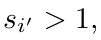 的乘积，所以 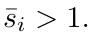

展开原页对照（保留全部图示、代码、标签和数学排版）

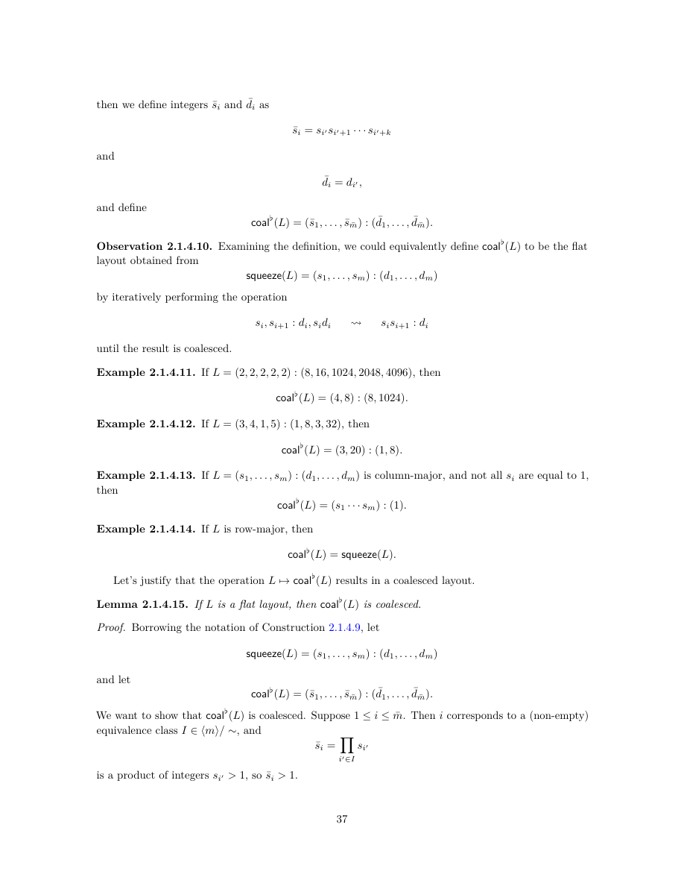

展开本页英文正文

<pre v-pre style="white-space:pre-wrap;overflow-wrap:anywhere">then we define integers ¯si and ¯di as

and

and define

Observation 2.1.4.10. Examining the definition, we could equivalently define coal♭(L) to be the flat layout obtained from

by iteratively performing the operation

until the result is coalesced.

Example 2.1.4.11. If L = (2, 2, 2, 2, 2) : (8, 16, 1024, 2048, 4096), then

Example 2.1.4.12. If L = (3, 4, 1, 5) : (1, 8, 3, 32), then

Example 2.1.4.13. If L = (s1, . . . , sm) : (d1, . . . , dm) is column-major, and not all si are equal to 1, then

Example 2.1.4.14. If L is row-major, then

Let’s justify that the operation L 7→coal♭(L) results in a coalesced layout.

Lemma 2.1.4.15. If L is a flat layout, then coal♭(L) is coalesced.

Proof. Borrowing the notation of Construction 2.1.4.9, let

and let

We want to show that coal♭(L) is coalesced. Suppose 1 ≤i ≤¯m. Then i corresponds to a (non-empty)

equivalence class I ∈⟨m⟩/ ∼, and

is a product of integers si′ &gt; 1, so ¯si &gt; 1.</pre>

## PDF 第 40 页 · 原书第 38 页

假设 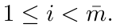 我们声称 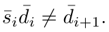 假设 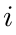 对应于等价类

假设 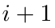 对应于等价类

然后通过使用 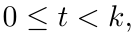 的等式 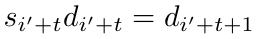 我们可以写

由于 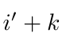 和 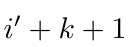 不属于同一等价类，因此我们有

示例 2.1.4.16. 如果  被合并，则 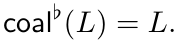 特别是，这意味着 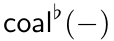 是幂等操作：

接下来，我们认为合并平坦布局会使布局函数保持不变。

引理 2.1.4.17. 如果  是平坦布局，则 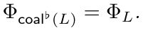

证明。通过观察 2.1.4.10, 足以表明，用 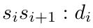 替换 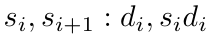 的实例会使布局函数保持不变。假设

是一个平坦布局，并且存在一些 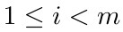 使得 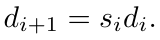 让

表示将 L 的第 i 与第 i + 1 个模态合并所得到的平坦布局。更准确地说，有

和 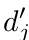

 的布局函数由下式给出

对 sⱼ 取模。L′ 的布局函数则为

其中 

展开原页对照（保留全部图示、代码、标签和数学排版）

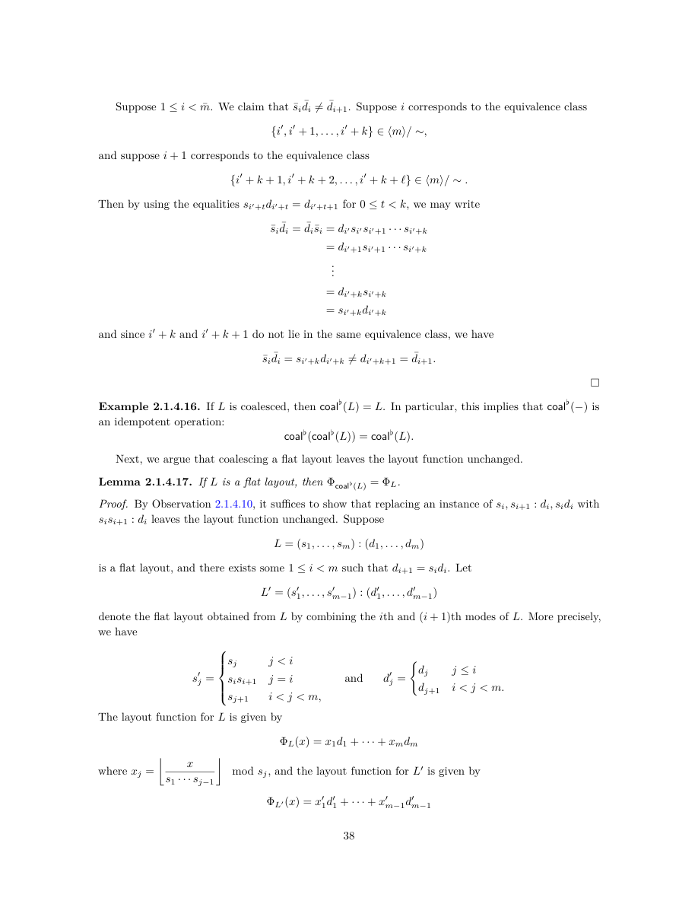

展开本页英文正文

<pre v-pre style="white-space:pre-wrap;overflow-wrap:anywhere">Suppose 1 ≤i &lt; ¯m. We claim that ¯si ¯di̸ = ¯di+1. Suppose i corresponds to the equivalence class

and suppose i + 1 corresponds to the equivalence class

Then by using the equalities si′+tdi′+t = di′+t+1 for 0 ≤t &lt; k, we may write

and since i′ + k and i′ + k + 1 do not lie in the same equivalence class, we have

Example 2.1.4.16. If L is coalesced, then coal♭(L) = L. In particular, this implies that coal♭(−) is an idempotent operation:

Next, we argue that coalescing a flat layout leaves the layout function unchanged.

Lemma 2.1.4.17. If L is a flat layout, then Φcoal♭(L) = ΦL.

Proof. By Observation 2.1.4.10, it suffices to show that replacing an instance of si, si+1 : di, sidi with sisi+1 : di leaves the layout function unchanged. Suppose

is a flat layout, and there exists some 1 ≤i &lt; m such that di+1 = sidi. Let

denote the flat layout obtained from L by combining the ith and (i + 1)th modes of L. More precisely, we have

and d′

The layout function for L is given by

mod sj, and the layout function for L′ is given by

where xj =</pre>

## PDF 第 41 页 · 原书第 39 页

其中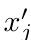

对 s′ⱼ 取模。

我们观察到

因此

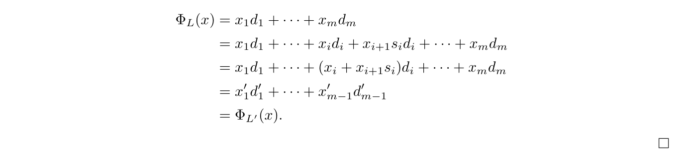

我们可以利用合并运算，刻画两个平坦布局何时具有相同的布局函数。

命题 2.1.4.18. 假设  和  是平坦布局。然后

证明。如果 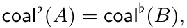 那么根据引理 2.1.4.17, 我们有

相反，假设 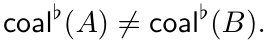 我们将论证  让我们写

如果  之一非零，另一个是 0,，那么显然是 ，因此我们可以假设  让  表示满足  的最小整数那么，特别是，对于任何 ，我们都有  有两种情况考虑：

• （情况  假设  让  那么

所以  和 

• （情况  假设  使得  不失一般性，我们可以假设  让  那么

同时

由于  被合并，我们有  我们推断出  以及 

展开原页对照（保留全部图示、代码、标签和数学排版）

展开本页英文正文

<pre v-pre style="white-space:pre-wrap;overflow-wrap:anywhere">where x′

mod s′

j. We observe that

and so

We can use the coalesce operation to characterize when two flat layouts have the same layout function.

Proposition 2.1.4.18. Suppose A and B are flat layouts. Then

Proof. If coal♭(A) = coal♭(B), then by Lemma 2.1.4.17, we have

Inversely, suppose that coal♭(A)̸ = coal♭(B). We will argue that ΦA̸ = ΦB. Let’s write

If one of m, n is nonzero and the other is 0, then clearly ΦA̸ = ΦB, so we may assume m, n ≥1. Let i denote the least integer such that (si, di)̸ = (ti, ei). Then, in particular, we have s1 · · · sj = t1 · · · tj for any j &lt; i. There are two cases to consider:

• (Case 1): Suppose di̸ = ei. Let N = s1 · · · si−1 = t1 · · · ti−1. Then

so Φcoal♭(A)̸ = Φcoal♭(B), and hence ΦA̸ = ΦB.

• (Case 2): Suppose di = ei, so that si̸ = ti. Without loss of generality we may assume si &lt; ti. Let N = s1 · · · si = (t1 · · · ti−1)si. Then

while

and since coal♭(A) is coalesced, we have di+1̸ = sidi. We deduce that Φcoal♭(A)̸ = Φcoal♭(B), and hence ΦA̸ = ΦB.</pre>

## PDF 第 42 页 · 原书第 40 页

前面的命题为我们提供了  的以下抽象特征

命题 2.1.4.19。设 L 为平坦布局。在所有布局函数等于 $\Phi_L$ 的平坦布局中，coal♭(L) 是秩最小的唯一一个。

证明。设 L′ 为满足 $\Phi_{L\prime}$ = $\Phi_L$ 的平坦布局。由命题 2.1.4.18，有

由此可见

其中相等成立当且仅当

### 2.1.5 紧致平坦布局

在处理布局补之前，我们必须定义一个重要的布局系列，称为紧致平坦布局。这些是平坦布局，其布局函数是双射的。就描述布局的标准网格图而言，如果每个整数  恰好出现一次，则平坦布局  是紧致的。例如，布局

紧致，而布局

和

不紧致。更准确地说，我们有以下定义。

展开原页对照（保留全部图示、代码、标签和数学排版）

展开本页英文正文

<pre v-pre style="white-space:pre-wrap;overflow-wrap:anywhere">The previous proposition affords us the following abstract characterization of coal♭(L).

Proposition 2.1.4.19. If L is a flat layout, then coal♭(L) is the unique flat layout of minimal rank whose layout function is ΦL.

Proof. Suppose L′ is a flat layout with ΦL′ = ΦL. Then by Proposition 2.1.4.18, we have

and it follows that

where equality holds if and only if

2.1.5 Compact flat layouts

Before treating layout complements, we must define an important family of layouts called compact flat layouts. These are the flat layouts whose layout functions are bijective. In terms of the standard grid diagrams depicting layouts, a flat layout L is compact if each integer 0 ≤i &lt; size(L) appears exactly once. For instance, the layout

is compact, while the layouts

and

are not compact. More precisely, we have the following definition.</pre>

## PDF 第 43 页 · 原书第 41 页

定义 2.1.5.1. 假设  是平坦布局。我们说  是紧致的，如果

是同构。

示例 2.1.5.2. 平坦布局

是紧致的。更一般地，如果  是列主序的，则  是紧致的。

示例 2.1.5.3. 平坦布局

是紧致的。更一般地，如果  是行主序的，则  是紧致的。

示例 2.1.5.4. 空布局

是紧致的。

示例 2.1.5.5. 假设

是平坦布局。如果 L 存在一个模态满足 sᵢ > 1 且 dᵢ = 0，那么 L 不是紧致布局。

我们可以如下给出紧致布局的明确特征。

命题 2.1.5.6. 假设  是平坦布局，并写

那么，L 为紧致布局，当且仅当存在置换 σ ∈ Σₘ，使得

对于所有  换句话说， 是紧致的当且仅当存在置换  使得  是列主序的。

证明。假设是平坦布局，并写

先假设 $L$ 紧致，因而存在置换 $\sigma\in\Sigma_m$，使每个 $1\le i\le m$ 都满足 $d_{\sigma(i)}=s_{\sigma(1)}\cdots s_{\sigma(i-1)}$。记 $S^\sigma=(s_{\sigma(1)},\ldots,s_{\sigma(m)})$，则可将 $\Phi_L^{\operatorname{cosize}(L)}$ 写成〔校注：原文这一开头直接从“紧致”推出待证的置换条件，论证顺序有循环。此段实际验证的是“存在该置换条件 ⇒ 紧致”；必要性由后面的归纳论证给出。〕

表示为下列复合映射：

由于这些映射中的每一个都是同构，所以复合  也是同构

展开原页对照（保留全部图示、代码、标签和数学排版）

展开本页英文正文

<pre v-pre style="white-space:pre-wrap;overflow-wrap:anywhere">Definition 2.1.5.1. Suppose L is a flat layout. We say L is compact if

is an isomorphism.

Example 2.1.5.2. The flat layout

is compact. More generally, if L is column-major, then L is compact.

Example 2.1.5.3. The flat layout

is compact. More generally, if L is row-major, then L is compact.

Example 2.1.5.4. The empty layout

is compact.

Example 2.1.5.5. Suppose

is a flat layout. If there is some mode of L with si &gt; 1 and di = 0, then L is not compact.

We can give an explicit characterization of compact layouts as follows.

Proposition 2.1.5.6. Suppose L is a flat layout, and write

then L is compact if and only if there exists a permutation σ ∈Σm such that

for all 1 ≤i ≤m. In other words, L is compact if and only if there exists a permutation σ ∈Σm such that squeeze(L)σ is column-major.

Proof. Suppose L is a flat layout, and write

Suppose first that L is compact, so there exists a permutation σ ∈Σm such that dσ(i) = sσ(1) · · · sσ(i−1) for each 1 ≤i ≤m. If we write Sσ = (sσ(1), . . . , sσ(m)), then we can write Φcosize(L)

L as the composite

and since each of these maps is an isomorphism, so is the composite Φcosize(L)</pre>

## PDF 第 44 页 · 原书第 42 页

相反，假设 

 是同构。首先，我们注意到步长  必须成对不同：假设  并让 

 和 

 表示第 （分别为 ）分量为 1, 且所有其他分量为 0. 的元组这些元组满足

由于下列布局函数

是单射，必有 i = j。既然步长 d₁, …, dₘ 两两不同，就令 σ ∈ Σₘ 为满足下式的置换：

我们将通过对  的归纳来论证  对于基本情况  我们注意到 1 在   的像中，并且  的最小非零值

 是  因此可以得出  假设  并且我们已经证明了所有  的声明考虑步长  我们知道不存在  形式的元组使得

因为这样的表达式的最大可能值是

由于布局函数

是满射，并且 dσ(i) < dσ(i+1) < ··· < dσ(m)，所以它的下一个更大的值

为 dσ(i)，因此必有 dσ(i) = sσ(1) ··· sσ(i−1)，所证即得。

我们通过给出一系列使平坦布局  紧致的等效条件来结束本节。

命题 2.1.5.7. 假设  是平坦布局。那么下面的都是等价的。

1. L 紧致。

2. coal♭(L) 紧致。

3. squeeze(L) 紧致。

4. sort(L) 紧致。

证明。 1, 2, 和 3, 的等效性来自以下事实：

还需证明 $L$ 紧致当且仅当 $\operatorname{sort}(L)$ 紧致。利用以下事实：

我们有

sort(L) 紧致 ⇔ squeeze(sort(L)) 紧致。

⇔ sort(squeeze(L)) 紧致。

对某个 $\tau\in\Sigma_m$，有 $\operatorname{sort}(\operatorname{squeeze}(L))=\operatorname{squeeze}(L)^\tau$。因此，存在 $\sigma$ 使 $\operatorname{squeeze}(L)^\sigma$ 为列主序布局，当且仅当存在 $\sigma'\in\Sigma_m$ 使 $\operatorname{sort}(\operatorname{squeeze}(L))$ 为列主序布局，其中 $\sigma'=\tau^{-1}\sigma$。于是〔校注：原文后一处布局漏写了置换上标，应为 $(\operatorname{sort}(\operatorname{squeeze}(L)))^{\sigma'}$。〕

sort(squeeze(L)) 紧致 ⇔ squeeze(L) 紧致。

⇔ L 紧致。

展开原页对照（保留全部图示、代码、标签和数学排版）

展开本页英文正文

<pre v-pre style="white-space:pre-wrap;overflow-wrap:anywhere">Conversely, suppose that Φcosize(L)

L is an isomorphism. First, we note that the strides d1, . . . , dm must be pairwise distinct: Suppose di = dj, and let δm

i and δm

j denote the tuples whose ith (resp. jth) entry is 1, and all of whose other entries are 0. These tuples satisfy

and since Φcosize(L)

L is injective, we must have i = j. Given that the strides d1, . . . , dm are pairwise distinct, let σ ∈Σm be the permutation such that

We will argue by induction on i ≥1 that dσ(i) = sσ(1) · · · sσ(i−1). For the base case i = 1, we note that 1 is in the image of Φcosize(L) L , and the smallest non-zero value of Φcosize(L)

L is dσ(1), so it follows that dσ(1) = 1. Suppose i &gt; 1, and that we have proved the claim for all j &lt; i. Consider the stride dσ(i). We know that there is no tuple of the form (x1, . . . , xi−1, 0, . . . , 0)σ such that

since the largest possible value of such an expression is

Since Φcosize

L (L) is surjective, and dσ(i) &lt; dσ(i+1) &lt; · · · &lt; dσ(m), it follows that the next largest value

L is dσ(i), so we must have dσ(i) = sσ(1) · · · sσ(i−1), as claimed.

We conclude this section by giving a family of equivalent conditions for a flat layout L to be compact.

Proposition 2.1.5.7. Suppose L is a flat layout. Then the following are equivalent.

1. L is compact.

2. coal♭(L) is compact.

3. squeeze(L) is compact.

4. sort(L) is compact.

Proof. The equivalence of 1, 2, and 3, follows from the fact that

It remains to prove that L is compact if and only if sort(L) is compact. Using the fact that

we have

sort(L) is compact. ⇔ squeeze(sort(L)) is compact.

⇔ sort(squeeze(L)) is compact.

Now sort(squeeze(L)) = squeeze(L)τ for some permutation τ ∈Σm, so there exists a permutation σ such that squeeze(L)σ is column-major if and only if there exists a permutation σ′ ∈Σm such that sort(squeeze(L)) is column-major, namely σ′ = τ −1σ. It follows that

sort(squeeze(L)) is compact. ⇔ squeeze(L) is compact.

⇔ L is compact.</pre>

## PDF 第 45 页 · 原书第 43 页

### 2.1.6 补布局

在本节中，我们定义互补平坦布局的概念。回想一下定义 2.1.5.1，如果布局函数如下，则平坦布局  是紧致的

是同构。

定义 2.1.6.1。设 A 与 B 为平坦布局。如果拼接布局 A ⋆ B 紧致，就称 B 为 A 的一个补布局，并记为 A ⊥ B。

例 2.1.6.2。如果 A = (3) : (5)，B = (5) : (1)，则 A ⊥ B，因为

是紧致的。

例 2.1.6.3。如果 A = (4, 2, 10) : (1400, 2, 20)，B = (2, 5, 7, 2) : (1, 4, 200, 5600)，则 A ⊥ B，因为

是紧致的。

例 2.1.6.4. 若 $A$ 为平坦布局，$E=():()$ 为空布局，则 $A\perp A$ 当且仅当 $A$ 紧致，因为〔校注：原文这里的 $A\perp A$ 应为 $A\perp E$；后面的例 2.1.6.6 才讨论自互补。〕

示例 2.1.6.5. 如果  和  是平坦布局，则

示例 2.1.6.6. 如果  是平坦布局，则  当且仅当 

观察 2.1.6.7。A 存在补布局的必要条件是 $\Phi_A$ 为单射。不过，确实存在 $\Phi_A$ 为单射但 A 没有补布局的平坦布局 A。例如，考虑布局

 的布局函数是单射的，因为

 和 

展开原页对照（保留全部图示、代码、标签和数学排版）

展开本页英文正文

<pre v-pre style="white-space:pre-wrap;overflow-wrap:anywhere">2.1.6 Complements

In this section, we define the notion of complementary flat layouts. Recall from Definition 2.1.5.1 that a flat layout L is compact if the layout function

is an isomorphism.

Definition 2.1.6.1. Suppose A and B are flat layouts. We say B is a complement of A, and write A ⊥B, if the concatenated layout A ⋆B is compact.

Example 2.1.6.2. If A = (3) : (5) and B = (5) : (1), then A ⊥B since

is compact.

Example 2.1.6.3. If A = (4, 2, 10) : (1400, 2, 20) and B = (2, 5, 7, 2) : (1, 4, 200, 5600), then A ⊥B since

is compact.

Example 2.1.6.4. If A is a flat layout and E = () : () is the empty layout, then A ⊥A if and only if A is compact, since

Example 2.1.6.5. If A and B are flat layouts, then

Example 2.1.6.6. If A is a flat layout, then A ⊥A if and only if size(A) = 1.

Observation 2.1.6.7. In order for A to admit a complement, it is necessary that ΦA is injective. There do, however, exist flat layouts A such that ΦA is injective, and A does not admit a complement. For example, consider the layout

The layout function of A is injective since

ΦA(0) = 0, ΦA(1) = 1, ΦA(2) = 3, and ΦA(3) = 4,</pre>

## PDF 第 46 页 · 原书第 44 页

但 A 不存在补布局：假设

是任何其他平坦布局。如果不存在元组

使得  则  不是紧致的。否则假设有这样一个元组  那么 

•（情况  如果  则

•（情况  如果  则

•（情况  如果  则

无论如何，我们推断  不是单射的，因此  也不是。这意味着  不是紧的，所以  不是  的补布局

观察 2.1.6.8. 补布局不是唯一的。例如，如果

然后每个布局

都是 A 的补布局。因此，A 的补布局构成一个可能为空的集合：

 平坦布局  是  的补

即所有与 A 互补的平坦布局。

给出 B 为 A 的补布局的一组等价条件很有用（见命题 2.1.6.10）。为此，需要下面的技术性引理，它描述拼接运算与 squeeze(−)、sort(−)、coal♭(−) 各运算之间的相互关系。

引理 2.1.6.9. 假设  和  是平坦布局。然后

2. $\operatorname{sort}(A\star B)=\operatorname{sort}(L\star\operatorname{sort}(B))$，且〔校注：右侧的 $L$ 未定义，应为 $A$。〕

展开原页对照（保留全部图示、代码、标签和数学排版）

展开本页英文正文

<pre v-pre style="white-space:pre-wrap;overflow-wrap:anywhere">but A does not admit a complement: Suppose

is any other flat layout. If there does not exist a tuple

such that φA⋆B(x1, x2, y1, . . . , ym) = 2, then A ⋆B is not compact. Suppose otherwise that there is such a tuple (x1, x2, y1, . . . , ym). Then φB(y1, . . . , ym) ∈{0, 1, 2}.

• (Case 1): If φB(y1, . . . , ym) = 0, then

• (Case 2): If φB(y1, . . . , ym) = 1, then

• (Case 3): If φB(y1, . . . , ym) = 2, then

In any case, we deduce that φA⋆B is not injective, hence neither is ΦA⋆B. This implies that A ⋆B is not compact, so B is not a complement of A.

Observation 2.1.6.8. Complements are not unique. For example, if

then each of the layouts

is a complement of A. Instead, there is a (possibly empty) set

complements♭(A) = {flat layouts B | B is a complement of A}.

of layouts which are complementary to A.

It will be useful to provide a family of equivalent conditions for B to be a complement of A (see Proposition 2.1.6.10). In order to do so, we need the following technical lemma, which describes the interplay between concatenation, and the operations squeeze(−), sort(−), and coal♭(−).

Lemma 2.1.6.9. Suppose A and B are flat layouts. Then

2. sort(A ⋆B) = sort(L ⋆sort(B)), and</pre>

## PDF 第 47 页 · 原书第 45 页

证明。写

如果我们让  表示  的索引， 表示  的索引，那么

这证明了 1. 对于 2,，我们注意到对于任何平坦布局  和任何置换  我们有  结果来自观察

其中 σ 是形如 σ = id × σ′ ∈ Σₘ × Σₙ ⊂ Σₘ₊ₙ 的分块置换。对于结论 3，只需证明 A ⋆ B 与 A ⋆ coal♭(B) 具有相同的布局函数；这由命题 2.1.3.40 得到。

命题 2.1.6.10. 假设  和  是平坦布局。那么下面的都是等价的。

证明。我们使用命题 2.1.5.7 和引理 2.1.6.9 来证明这些条件的等价性。首先，我们注意到  意味着 1 和 2. 等价接下来，我们注意到，根据引理 2.1.6.9,，如果  是操作  或  中的任何一个，则

因此

A ⊥ B ⇔ A ⋆ B 紧致。

⇔ op(A ⋆ B) 紧致。

⇔ op(A ⋆ op(B)) 紧致。

⇔ op(B) 是 A 的补布局。

我们想要描述平坦布局何时允许补。为此，我们制定

以下定义。

定义 2.1.6.11. 假设  是平坦布局，则写

如果对任意 1 ≤ i < m，整数 sᵢdᵢ 都整除 dᵢ₊₁，就称 A 可取补。

展开原页对照（保留全部图示、代码、标签和数学排版）

展开本页英文正文

<pre v-pre style="white-space:pre-wrap;overflow-wrap:anywhere">Proof. Write

If we let {i1 &lt; · · · &lt; im′} ⊂⟨m⟩denote the indices with sik̸ = 1, and {j1, . . . , jn′} ⊂⟨n⟩denote the indices with tjℓ̸ = 1, then

This proves 1. For 2, we note that for any flat layout L, and any permutation σ ∈Σlen(L), we have sort(L) = sort(Lσ). The result follows from the observation that

where σ is a block permutation of the form σ = id × σ′ ∈Σm × Σn ⊂Σm+n. For 3., it suffices to show that A ⋆B and A ⋆coal♭(B) have the same layout function. This follows from Proposition 2.1.3.40.

Proposition 2.1.6.10. Suppose A and B are flat layouts. Then the following are equivalent.

Proof. We use Proposition 2.1.5.7 and Lemma 2.1.6.9 to prove the equivalence of these conditions. First, we note that sort(A ⋆B) = sort(B ⋆A), which implies the equivalence of 1 and 2. Next, we note that, by Lemma 2.1.6.9, if op(−) is any of the operations squeeze(−), sort(−), or coal♭(−), then

and so

A ⊥B ⇔ A ⋆B is compact.

⇔ op(A ⋆B) is compact.

⇔ op(A ⋆op(B)) is compact.

⇔ op(B) is a complement of A.

We would like to characterize when a flat layout admits a complement. To this end, we make the

following definition.

Definition 2.1.6.11. Suppose A is a flat layout, and write

We say A is complementable if for any 1 ≤i &lt; m, the integer sidi divides di+1.</pre>

## PDF 第 48 页 · 原书第 46 页

示例 2.1.6.12. 平坦布局

可取补，而平坦布局

不可取补。

示例 2.1.6.13. 平坦布局

可取补，而平坦布局

不可取补。

示例 2.1.6.14. 如果  是紧致的，则根据命题  是可取补的。

示例 2.1.6.15. 假设

是平坦布局。如果存在 1 ≤ i ≤ m，使得 sᵢ ≠ 1 且 dᵢ = 0，那么 A 不可取补。

如果  是可取补的，那么我们可以如下构造  的补布局。

构造2.1.6.16. 假设是平坦布局，则写

如果  是可取补的，那么我们将平坦布局  定义为

其中

示例 2.1.6.17. 如果  那么

是空的布局。更一般地，如果  是紧致的，则  是空布局。

示例 2.1.6.18. 如果  那么

示例 2.1.6.19. 如果  那么

让我们证明  实际上是  的补布局

展开原页对照（保留全部图示、代码、标签和数学排版）

展开本页英文正文

<pre v-pre style="white-space:pre-wrap;overflow-wrap:anywhere">Example 2.1.6.12. The flat layout

is complementable, while the flat layout

is not complementable.

Example 2.1.6.13. The flat layout

complementable, while the flat layout

is not complementable.

Example 2.1.6.14. If A is compact, then by Proposition 2.1.5.6, A is complementable.

Example 2.1.6.15. Suppose

is a flat layout. If there is any 1 ≤i ≤m such that si̸ = 1 and di = 0, then A is not complementable.

If A is complementable, then we can construct a complement of A as follows.

Construction 2.1.6.16. Suppose A is a flat layout, and write

If A is complementable, then we define a flat layout comp♭(A) as

where

Example 2.1.6.17. If A = (8, 8) : (1, 8), then

is the empty layout. More generally, if A is compact, then comp♭(A) = () : () is the empty layout.

Example 2.1.6.18. If A = (2, 2) : (2, 8), then

Example 2.1.6.19. If A = (3, 3, 8) : (16, 96, 1), then

Let’s justify that comp♭(A) is, in fact, a complement of A.</pre>

## PDF 第 49 页 · 原书第 47 页

引理 2.1.6.20。设 A 为平坦布局。如果 A 可取补，那么

证明。让我们写一下

所以  哪里

由命题 2.1.6.10，只需证明 C 是 sort(squeeze(A)) 的补布局。事实确实如此，因为拼接布局

等于

它的排序等于

为列主序布局。

我们已经证明，如果 A 可取补，那么 A 存在补布局。接下来证明其逆命题也成立。

命题 2.1.6.21. 假设  是平坦布局。那么当且仅当  是可取补的时，存在  的补布局 。

证明。如果  是可取补的，则根据引理 2.1.6.20，布局  是  的补布局。反之，假设存在  的补布局 ，并考虑平坦布局

由于  和  是单射的，我们知道  我们将认为  即  是列主序的。由于

是双射，我们知道 1 在  的像中，这意味着  假设  并假设我们已经证明  对于所有  考虑步长  我们知道不存在这样的   因为这样的表达式的最大可能值为

由于 $\Phi_L$ 为满射，且 dᵢ ≤ dᵢ₊₁ ≤ ··· ≤ dₘ，其下一个更大的值为 dᵢ，因此必有 dᵢ = s₁ ··· sᵢ₋₁，所证即得。

展开原页对照（保留全部图示、代码、标签和数学排版）

展开本页英文正文

<pre v-pre style="white-space:pre-wrap;overflow-wrap:anywhere">Lemma 2.1.6.20. Suppose A is a flat layout. If A is a complementable, then

Proof. Lets write

so that comp♭(A) = coal♭(C) where

By Proposition 2.1.6.10, it suffices to prove that C is a complement of sort(squeeze(A)). This is the case since the concatenation

is equal to

and its sorting is equal to

which is column-major.

We have shown that if A is complementable, then A admits a complement. Next, we prove that the converse also holds.

Proposition 2.1.6.21. Suppose A is a flat layout. Then there exists a complement B of A if and only if A is complementable.

Proof. If A is complementable, then by Lemma 2.1.6.20 the layout B = comp♭(A) is a complement of A. Conversely, suppose there exists a complement B of A, and consider the flat layout

Since ΦL(0) = 0, and ΦL is injective, we know that d1̸ = 0. We will argue that di = s1 · · · si−1, i.e., that L is column-major. Since

is a bijection, we know that 1 is in the image of ΦL, which implies that d1 = 1. Suppose 1 &lt; i ≤m, and suppose we have proved that dj = s1 · · · sj−1 for all j &lt; i. Consider the stride di. We know that there is no (x1, . . . , xi−1, 0, . . . , 0) such that (x1, . . . , xi−1, 0, . . . , 0) · (d1, . . . , dm) = s1 · · · si−1, since the largest possible value of such an expression is

Since ΦL is surjective, and di ≤di+1 ≤· · · ≤dm, it follows that the next largest value of ΦL is di, so we must have di = s1 · · · si−1, as claimed.</pre>

## PDF 第 50 页 · 原书第 48 页

回到我们的主要目标，考虑布局

那么存在  使得 

 和 

 对于每个  如果  那么

整除

因此可知 A 可取补。

我们的下一个目标是给出平坦布局  的补布局  的抽象表征。为此，我们需要以下引理。

引理 2.1.6.22. 假设  是平坦布局。如果  可取补且已排序，则布局函数

严格递增。

证明。写

如果  我们声称

k = 1 时，由于求和范围为空，此式自然成立。再对 k 归纳，得到

现在，假设我们有  和  这些整数在余字典序同构下对应于元组。

由于 x ≤ y，存在最大的指标 1 ≤ k ≤ m，使得 xₖ < yₖ，并且对所有 k < ℓ ≤ m 都有 xℓ = yℓ。现在可以计算（x = y 的情形直接给出相等；原文这里未单列该情形）：

展开原页对照（保留全部图示、代码、标签和数学排版）

展开本页英文正文

<pre v-pre style="white-space:pre-wrap;overflow-wrap:anywhere">Returning to our main goal, consider the layout

Then there exist j1 &lt; · · · &lt; jm′ such that s′

i = sji and d′

i = dji for each 1 ≤i ≤m′. If 1 ≤i &lt; m′, then

divides

so we conclude that A is complementable.

Our next goal is to give an abstract characterization of the complement comp♭(A) of a flat layout A. In order to do so, we need the following lemma.

Lemma 2.1.6.22. Suppose A is a flat layout. If A is complementable and sorted, then the layout function

is increasing.

Proof. Write

If 1 ≤k ≤m, we claim that

If k = 1, this holds vacuously, and by induction on k, we have

Now, suppose we have x, y ∈[0, size(A)) with x ≤y. These integers correspond, under the colexico- graphic isomorphism, to tuples.

Since x ≤y, we know there is some maximal 1 ≤k ≤m such that xk &lt; yk, and xℓ= yℓfor all k &lt; ℓ≤m. Now we can compute</pre>

## PDF 第 51 页 · 原书第 49 页

命题 2.1.6.23. 假设  和  是平坦布局。如果

 被合并，并且

 已排序，

然后

证明。条件1和2意味着和具有相同的像。由于  和  已排序，根据引理 2.1.6.22 我们知道  和  是递增的。结合这两个事实，得出  命题 2.1.4.18 和条件 3 意味着

定义 2.1.6.24。设 A、B 为平坦布局，N 为正整数。如果 B 是 A 的补布局，并且满足下式，就称 B 为 A 的一个 N 补布局：

定义 2.1.6.25. 假设  是平坦布局，则写

如果满足以下条件，就称 A 可取 N 补：

1. 对所有 1 ≤ i < m，整数 sᵢdᵢ 整除 dᵢ₊₁；并且

2. 整数 sₘdₘ 整除 N。

观察 2.1.6.26。如果  可取补，且  是布局  的最后一个模态，那么  可以取 N 补，当且仅当 N 是  的正整数倍。

观察 2.1.6.27。N 补布局并不唯一。例如，如果 A = (2, 2) : (1, 50)，N = 100，那么布局 B₁ = (25) : (2) 与 B₂ = (5, 5) : (2, 10) 都是 A 的 N 补布局。更一般地，如果 B 是 A 的 N 补布局，则 coal♭(B) 也是 A 的 N 补布局。

注记 2.1.6.28。设 A 为平坦布局，B₁ 与 B₂ 都是 A 的 N 补布局。它们的布局

函数 $\Phi_{B_1}$ 与 $\Phi_{B_2}$ 未必相等，但两者必有相同的像。例如，如果 A = (4) : (63)，N = 252，则 B₁ = (7, 9) : (1, 7) 与 B₂ = (9, 7) : (7, 1) 都是 A 的 N 补布局，且 $\Phi_{B_1}$ ≠ $\Phi_{B_2}$，因为

更一般地，如果 B 是 A 的 N 补布局，则 sort(B) 也是 A 的 N 补布局。

构造 2.1.6.29。假设是平坦布局，是正整数，并且是可取补的。如果我们写

展开原页对照（保留全部图示、代码、标签和数学排版）

展开本页英文正文

<pre v-pre style="white-space:pre-wrap;overflow-wrap:anywhere">Proposition 2.1.6.23. Suppose A and B are flat layouts. If

3. B is coalesced, and

4. B is sorted,

then B = comp♭(A).

Proof. Conditions 1 and 2 imply that ΦB and Φcomp♭(A) have the same image. Since B and comp♭(A) are sorted, we know by Lemma 2.1.6.22 that ΦB and Φcomp♭(A) are increasing. Combining these two facts, it follows that ΦB = Φcomp♭(A). Proposition 2.1.4.18 and condition 3 then imply that

Definition 2.1.6.24. Suppose A and B are flat layouts, and N is a positive integer. We say B is a N-complement of A if B is a complement of A and

Definition 2.1.6.25. Suppose A is a flat layout, and write

We say A is N-complementable if

1. for all 1 ≤i &lt; m, the integer sidi divides di+1, and

2. the integer smdm divides N.

Observation 2.1.6.26. If A is complementable, and sm : dm is the last mode in the layout sort(squeeze(A)), then A is N-complementable exactly when N is a positive integer multiple of smdm.

Observation 2.1.6.27. N-complements are not unique. For example, if A = (2, 2) : (1, 50) and N = 100, then each of the layouts B1 = (25) : (2), and B2 = (5, 5) : (2, 10) is a N-complement of A. As a more general example, if B is a N-complement of A, then coal♭(B) is also a N-complement of A.

Remark 2.1.6.28. Suppose A is a flat layout and B1 and B2 are N-complements of A. Then the layout

functions ΦB1 and ΦB2 need not be equal, but they necessarily have the same image. For example, if A = (4) : (63) and N = 252 then B1 = (7, 9) : (1, 7) and B2 = (9, 7) : (7, 1) are N-complements of A, and ΦB1̸ = ΦB2, since

As a more general example, if B is a N-complement of A, then sort(B) is also a N-complement of A.

Construction 2.1.6.29. Suppose A is a flat layout, N is a positive integer, and A is N-complementable. If we write</pre>

## PDF 第 52 页 · 原书第 50 页

然后我们定义一个平坦布局 

其中

示例 2.1.6.30. 如果  和  那么

引理 2.1.6.31. 假设  是平坦布局， 是正整数，并且  是  可取补的。那么  是  的  补布局

证明。让我们写一下

所以  哪里

首先，我们计算

我们需要检查  是否紧致。同样，我们需要检查 

 是同构。由引理 2.1.5.6, 足以证明

是紧致的。就是这种情况，因为这个布局等于

所以它的排序

等于

这是列主。

展开原页对照（保留全部图示、代码、标签和数学排版）

展开本页英文正文

<pre v-pre style="white-space:pre-wrap;overflow-wrap:anywhere">then we define a flat layout comp♭(A, N) by

where

Example 2.1.6.30. If A = (3, 10) : (80, 4) and N = 2400, then

Lemma 2.1.6.31. Suppose A is a flat layout, N is a positive integer, and A is N-complementable. Then comp♭(A, N) is a N-complement of A.

Proof. Lets write

so that comp♭(A, N) = coal♭(C) where

First, we compute

We need to check that A ⋆B is compact. Equivalently, we need to check that ΦN

A⋆B is an isomorphism. By Lemma 2.1.5.6, it suffices to prove that

is compact. This is the case since this layout is equal to

and so its sorting

is equal to

which is column-major.</pre>

## PDF 第 53 页 · 原书第 51 页

命题 2.1.6.32。设 A 为平坦布局，N 为正整数。A 存在 N 补布局 B，当且仅当 A 可取 N 补。

证明。若 $A$ 可取 $N$-补，则由引理 2.1.6.31，布局 $B=\operatorname{comp}^{\flat}(L,N)$ 是 $A$ 的一个 $N$-补布局。〔校注：原文式中的 $L$ 应为 $A$。〕

另一方面，假设存在  的  -补  考虑平坦布局

由于  和  是单射的，我们知道  我们将认为  即  是列主序的。由于

是双射，我们知道 1 在  的像中，这意味着  假设  并假设我们已经证明  对于所有  考虑步长  我们知道不存在这样的   因为这样的表达式的最大可能值为

由于  是满射的，并且  遵循  的下一个最大值是 ，因此我们必须具有所声明的 。

回到我们的主要目标，考虑布局

那么存在  使得 

 和 

 对于每个  如果  那么

整除

如果  那么

整除

因此，A 可取 N 补。

命题 2.1.6.33. 假设  是正整数，并且  是  可取补的平坦布局。如果  是平坦布局，使得

1. $B$ 是 $L$ 的一个 $N$-补布局，〔校注：按本命题的变量约定，原文 $L$ 应为 $A$。〕

 被合并，并且

已排序，

然后

展开原页对照（保留全部图示、代码、标签和数学排版）

展开本页英文正文

<pre v-pre style="white-space:pre-wrap;overflow-wrap:anywhere">Proposition 2.1.6.32. Suppose A is a flat layout and N is a positive integer. Then there exists a N-complement B of A if and only if A is N-complementable.

Proof. If A is N-complementable, then by Lemma 2.1.6.31 the layout B = comp♭(L, N) is a N- complement of A.

On the other hand, suppose there exists a N-complement B of A. Consider the flat layout

Since ΦL(0) = 0, and ΦL is injective, we know that d1̸ = 0. We will argue that di = s1 · · · si−1, i.e., that L is column-major. Since

is a bijection, we know that 1 is in the image of ΦL, which implies that d1 = 1. Suppose 1 &lt; i ≤m, and suppose we have proved that dj = s1 · · · sj−1 for all j &lt; i. Consider the stride di. We know that there is no (x1, . . . , xi−1, 0, . . . , 0) such that (x1, . . . , xi−1, 0, . . . , 0) · (d1, . . . , dm) = s1 · · · si−1, since the largest possible value of such an expression is

Since ΦL is surjective, and di ≤di+1 ≤· · · ≤dm, it follows that the next largest value of ΦL is di, so we must have di = s1 · · · si−1, as claimed.

Returning to our main goal, consider the layout

Then there exist j1 &lt; · · · &lt; jm′ such that s′

i = sji and d′

i = dji for each 1 ≤i ≤m′. If 1 ≤i &lt; m′, then

divides

If i = m′, then

divides

We conclude that A is N-complementable.

Proposition 2.1.6.33. Suppose N is a positive integer, and A is a N-complementable flat layout. If B is a flat layout such that

1. B is a N-complement of L,

2. B is coalesced, and

3. B is sorted,

then B = comp♭(A, N).</pre>

## PDF 第 54 页 · 原书第 52 页

证明。条件 1、2 表明 $\Phi_B$ 与 $\Phi_{\operatorname{comp}^{\flat}(A,N)}$ 具有相同的像。由于 B 和 comp♭(A, N) 都已排序，由引理 2.1.6.22，它们的布局函数均严格递增。结合这两点，得到 $\Phi_B$ = $\Phi_{\operatorname{comp}^{\flat}(A,N)}$。再由命题 2.1.4.18 及条件 3，可得

引理 2.1.6.34. 假设  是平坦布局。如果  是正整数，使得  是  可取补的并且  是  可取补的，则

证明。写

并写

这样

然后我们有一个交换图

其中，由命题 2.1.3.40，顶行的复合是 $C_1=C\star E_1$ 的布局函数，底行的复合是 $C_2=C\star E_2$ 的布局函数。这说明 $\Phi_{C_2}$ 在 $[0,\operatorname{size}(C_2))$ 上的限制为 $\Phi_{C_1}$，再由下列事实即得结论：〔校注：原文限制区间的上界应为 $\operatorname{size}(C_1)$，才能与 $\Phi_{C_1}$ 的定义域一致。〕

展开原页对照（保留全部图示、代码、标签和数学排版）

展开本页英文正文

<pre v-pre style="white-space:pre-wrap;overflow-wrap:anywhere">Proof. Conditions 1 and 2 imply that ΦB and Φcomp♭(A,N) have the same image. Since B and comp♭(A, N) are sorted, we know by Lemma 2.1.6.22 that ΦB and Φcomp♭(A,N) are increasing. Combining these two facts, it follows that ΦB = Φcomp♭(A,N). Proposition 2.1.4.18 and condition 3 then imply that

Lemma 2.1.6.34. Suppose A is a flat layout. If N1 ≤N2 are positive integers such that A is N1-complementable and A is N2-complementable, then

Proof. Write

and write

so that

Then we have a commuting diagram

where, by Proposition 2.1.3.40, the composite of the top row is the layout function of C1 = C ⋆E1, and the composite of the bottom row is the layout function of C2 = C ⋆E2. This tells us that the restriction of ΦC2 to [0, size(C2)) is ΦC1, and the result follow from the fact that</pre>

## PDF 第 55 页 · 原书第 53 页

### 2.1.7 进一步的运算

本节在平坦布局上进一步定义复合、平坦除法与平坦乘积。这些是（嵌套）布局上更自然的运算经展平后得到的版本。虽然实际中并不经常直接使用这些运算，为完整起见，仍在此列出。

2.1.7.1 复合

如果和是平坦布局，则复合是平坦布局，其布局函数是和的布局函数的复合。更准确地说，我们有以下定义。

定义 2.1.7.1。设  和  是平坦布局。如果满足以下条件，就称平坦布局  为  与  的复合，并记作 ：

 是非退化的，

备注 2.1.7.2. 定义中的条件 2 保证 $\Phi_R$ 与 $\Phi_A$ 具有相同的定义域，〔校注：定义 2.1.7.1 将结果命名为 $C$，后续条件及本备注却写成 $R$，应统一为 $C$。〕

条件 3 意味着 

示例 2.1.7.3. 如果  和  那么

更一般地说，如果

是非退化平坦布局，并且

是一个秩为 1 且满足 t ≥ cosize(A) 的平坦布局，那么 A 与 B 可复合，并且

示例 2.1.7.4. 如果  和  那么

更一般地，如果 A 是所有步长分量均为零的平坦布局，B 是任意平坦布局，那么 A 与 B 可复合，且 B ◦ A = A。

示例 2.1.7.5. 如果  和  那么

更一般地说，如果  是任何平坦布局，并且  是具有  的列主平坦布局，则 

例 2.1.7.6。如果 A = (4) : (2)，B = (2, 2, 6) : (12, 6, 1)，就不存在满足 R = B ◦ A 的平坦布局 R。

备注 2.1.7.7. 如果  和  具有相同的布局函数，则 

备注 2.1.7.8. 平坦布局是更一般的布局概念的特例（定义 

事实上，在某些情形下（如例 2.1.7.6），不存在满足 C = B ◦ A 的平坦布局 C，却存在满足该等式的（嵌套）布局 C（见例 2.3.7.6）。因此，我们暂缓对复合的深入讨论，待定义了完全一般的布局之后再进行分析。

展开原页对照（保留全部图示、代码、标签和数学排版）

展开本页英文正文

<pre v-pre style="white-space:pre-wrap;overflow-wrap:anywhere">2.1.7 Further operations

In this section, we define several further operations on flat layouts, namely composition, flat division, and flat products. These are the flattened variants of more natural operations on (nested) layouts. We do not often work with these operations, but include them anyway for completeness.

2.1.7.1 Composition

If A and B are flat layouts, then the composite B ◦A is a flat layout whose layout function is the composite of the layout functions of A and B. More precisely, we have the following definition.

Definition 2.1.7.1. Suppose A and B are flat layouts. We say the flat layout C is the composition of A and B, and write C = B ◦A, if

1. C is non-degenerate,

Remark 2.1.7.2. Note that condition 2 in our definition ensures that ΦR and ΦA have the same domain,

and condition 3 implies cosize(A) ≤size(B).

Example 2.1.7.3. If A = (2, 3) : (5, 6) and B = (80) : (10), then

More generally, if

is a non-degenerate flat layout, and

is a rank 1 flat layout with t ≥cosize(A), then A and B are composable, and

Example 2.1.7.4. If A = (128, 128) : (0, 0) and B = (64, 32) : (1, 64), then

More generally, if A is a flat layout each of whose stride entries is zero, and B is any flat layout, then A and B are composable with B ◦A = A.

Example 2.1.7.5. If A = (64, 32) : (2, 256) and B = (2048, 2048) : (1, 2048), then

More generally, if A is any flat layout, and B is a column-major flat layout with cosize(A) ≤size(B), then B ◦A = A.

Example 2.1.7.6. If A = (4) : (2) and B = (2, 2, 6) : (12, 6, 1), then there is no flat layout R with R = B ◦A.

Remark 2.1.7.7. If B′ and B have the same layout function, then B ◦A = B′ ◦A.

Remark 2.1.7.8. Flat layouts are a special case of the more general notion of layouts (Definition 2.3.1.1).

It turns out that there are cases (such as Example 2.1.7.6) where there does not exist a flat layout C with C = B ◦A, but there does exist a (nested) layout C with C = B ◦A (see Example 2.3.7.6). For this reason, we postpone further discussion and analysis of composition until we have defined layouts in their full generality.</pre>

## PDF 第 56 页 · 原书第 54 页

2.1.7.2 平坦除法

设 A 与 B 为平坦布局。A 除以 B 的平坦除法，是布局逻辑除法经展平后得到的版本。详见第 2.3.8 节。

定义 2.1.7.9. 假设  和  是平坦布局，并且  是  )-可取补的，有

我们将 A 除以 B 的平坦除法定义为下列平坦布局：

示例 2.1.7.10. 如果  和  那么

示例 2.1.7.11. 如果  和  那么

示例 2.1.7.12. 如果  是任意平坦布局且  是空布局，则

2.1.7.3 平坦乘积

设 A 与 B 为平坦布局。它们的平坦乘积 A ⊗♭ B，是布局逻辑乘积经展平后得到的版本。详见第 2.3.9 节。

定义 2.1.7.13。假设  和  是平坦布局，并且  是  )-可取补的，

我们将 A 与 B 的平坦乘积定义为：

示例 2.1.7.14. 如果  和  那么

示例 2.1.7.15. 如果  和  那么

示例 2.1.7.16. 如果  是任意平坦布局，而  是空布局，则

展开原页对照（保留全部图示、代码、标签和数学排版）

展开本页英文正文

<pre v-pre style="white-space:pre-wrap;overflow-wrap:anywhere">2.1.7.2 Flat division

If A and B are flat layouts, then the flat division of A by B is a flattened version of the more natural logical division of layouts. See Section 2.3.8 for details.

Definition 2.1.7.9. Suppose A and B are flat layouts, and that B is size(A)-complementable, with

We define the flat division of A by B to be the flat layout

Example 2.1.7.10. If A = (2, 2, 2, 2) : (1, 4, 2, 8) and B = (2, 2) : (4, 2), then

Example 2.1.7.11. If A = (3, 5, 9, 6) : (54, 0, 6, 1) and B = (6, 3) : (135, 1), then

Example 2.1.7.12. If A is any flat layout and B = () : () is the empty layout, then

2.1.7.3 Flat products

If A and B are flat layouts, then the flat product A ⊗♭B of A and B is a flattened version of the more natural logical product of layouts. See Section 2.3.9 for details.

Definition 2.1.7.13. Suppose A and B are flat layouts, and that A is size(A)·cosize(B)-complementable, with

We define the flat product of A and B by

Example 2.1.7.14. If A = (2, 2, 2) : (1, 2, 4) and B = (2, 2, 2) : (1, 2, 4), then

Example 2.1.7.15. If A = (2, 2, 2) : (1, 2, 4) and B = (3, 5) : (5, 1), then

Example 2.1.7.16. If A is any flat layout and B = () : () is the empty layout, then</pre>

## PDF 第 57 页 · 原书第 55 页

### 2.1.8 可处理平坦布局

本节定义一类性质特别良好的平坦布局，称为可处理平坦布局。它们包含最重要的实际例子，例如行主序、列主序、紧致和可取补布局。稍后将看到，可处理布局恰好是由某个范畴 Tuple 产生的布局。

定义 2.1.8.1. 假设  是平坦布局，则写

如果对每个  都满足下列条件，我们就称  是可处理的：

2. sᵢdᵢ 整除 dᵢ₊₁。

示例 2.1.8.2. 平坦布局

是可处理的。更一般地说，任何秩为 1 的平坦布局都是可处理的。

示例 2.1.8.3. 平坦布局

是可处理的。更一般地说，任何以列为主的布局

是可处理的。

示例 2.1.8.4. 平坦布局

是可处理的。更一般地说，任何行主序布局

是可处理的。

示例 2.1.8.5. 平坦布局

是可处理的。更一般地说，任何紧致的平坦布局都是可处理的。

示例 2.1.8.6. 平坦布局

是可处理的。更一般地说，任何具有恰好一个非零步长的平坦布局都是可处理的。

示例 2.1.8.7. 平坦布局

是可处理的。更一般地说，任何可取补的平坦布局都是可处理的。

展开原页对照（保留全部图示、代码、标签和数学排版）

展开本页英文正文

<pre v-pre style="white-space:pre-wrap;overflow-wrap:anywhere">2.1.8 Tractable flat layouts

In this section we define an especially well-behaved class of flat layouts, called tractable flat layouts. Tractable flat layouts include the most important examples of interest, such as row-major, column- major, compact, and complementable layouts. Later on, we will see that tractable flat layouts are precisely the layouts which arise from a certain category Tuple.

Definition 2.1.8.1. Suppose L is a flat layout, and write

We say L is tractable if for each 1 ≤i &lt; m, we have

2. sidi divides di+1.

Example 2.1.8.2. The flat layout

is tractable. More generally, any flat layout of rank 1 is tractable.

Example 2.1.8.3. The flat layout

is tractable. More generally, any column-major layout

is tractable.

Example 2.1.8.4. The flat layout

is tractable. More generally, any row-major layout

is tractable.

Example 2.1.8.5. The flat layout

is tractable. More generally, any compact flat layout is tractable.

Example 2.1.8.6. The flat layout

is tractable. More generally, any flat layout with exactly one non-zero stride is tractable.

Example 2.1.8.7. The flat layout

is tractable. More generally, any complementable flat layout is tractable.</pre>

## PDF 第 58 页 · 原书第 56 页

示例 2.1.8.8. 假设  是平坦布局。如果  是可处理的并且  是任何子集，则限制  是可处理的。特别是，如果  是可处理的，则  和  是可处理的。

示例 2.1.8.9. 平坦布局

不可处理。特别地，这说明，即使 L₁ 与 L₂ 都是可处理平坦布局，其拼接 L₁ ⋆ L₂ 也未必可处理。

观察 2.1.8.10. 如果  是可处理的平坦布局，并且  的任何分量都不等于 0,，则  是可取补的。特别是，如果  是可处理的，则  是可取补的。

我们通过枚举使平坦布局  可处理的一系列等效条件来结束本节。

命题 2.1.8.11. 假设  是平坦布局。那么下面的条件是等价的。

1. L 可处理。

2. sort(L) 可处理。

3. filter(L) 可处理。

4. filter(L) 可取补。

证明。假设是平坦布局。

 这是因为

 这是因为

 这是根据以下事实得出的：如果

是一个平坦布局，使得每个步长分量  都不为零，那么可处理性的定义与可互补性的定义一致。

展开原页对照（保留全部图示、代码、标签和数学排版）

展开本页英文正文

<pre v-pre style="white-space:pre-wrap;overflow-wrap:anywhere">Example 2.1.8.8. Suppose L is a flat layout. If L is tractable and I ⊂⟨m⟩is any subset, then the restriction L |I is tractable. In particular, if L is tractable, then squeeze(L) and filter(L) are tractable.

Example 2.1.8.9. The flat layout

is not tractable. In particular, this shows that the concatenation L1 ⋆L2 of tractable flat layouts L1 and L2 need not be tractable.

Observation 2.1.8.10. If L is a tractable flat layout and no entry of stride(L) is equal to 0, then L is complementable. In particular, if L is tractable, then filter(L) is complementable.

We conclude this section by enumerating a family of equivalent conditions for a flat layout L to be tractable.

Proposition 2.1.8.11. Suppose L is a flat layout. Then the following conditions are equivalent.

1. L is tractable.

2. sort(L) is tractable.

3. filter(L) is tractable.

4. filter(L) is complementable.

Proof. Suppose L is a flat layout.

• (1 ⇔2): This follows from the fact that

• (1 ⇔3): This follows from the fact that

• (3 ⇔4): This follows from the fact that if

is a flat layout such that each of the stride entries di is nonzero, then the definition of tractability coincides with that of complementability.</pre>

---
[译文总目录](Layout.md) · [第 2.1 节：平坦布局的基本定义与运算](Translation-02-Flat-Layouts.md) · [第 2.2 节：嵌套元组](Translation-04-Nested-Tuples.md)
