# 第 2.2 节：嵌套元组
[译文总目录](Layout.md) · [第 2.1 节：合并、紧致性、补布局与可处理性](Translation-03-Flat-Layout-Algebra.md) · [第 2.3 节：布局](Translation-05-Layouts.md)
> 中文译文：[Colfax Research，2025 年 9 月版](source.pdf)。[校注](Proofreading.md)。

## PDF 第 59 页 · 原书第 57 页

### 2.2 嵌套元组

在本节中，我们将介绍嵌套元组，它们是定义完全通用布局所需的元组的概括。

### 2.2.1 轮廓

嵌套元组  由其展平（普通元组）及其轮廓（描述  上的括号模式）决定。我们精确地定义轮廓如下。

定义 2.2.1.1。轮廓 P 是以下两者之一：

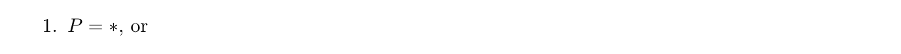

2. 对某个 r ≥ 0，由轮廓 P₁, …, Pᵣ 组成的元组 P = (P₁, …, Pᵣ)。

将所有轮廓组成的集合记为 Profile。

示例 2.2.1.2. 以下是轮廓的一些示例。

让我们定义轮廓的一些重要属性。

定义 2.2.1.3. 假设  是一个轮廓。

• P 的秩为（原文此行将 P 写为 X）：

当 P = (P₁, …, Pᵣ) 为轮廓元组时，值为 r。

•  的长度为

当 P = (P₁, …, Pᵣ) 为轮廓元组时，值为上式所示的长度之和。

• 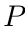 的深度为

当 P = (P₁, …, Pᵣ) 为轮廓元组时，值为 1 + max₁≤ᵢ≤ᵣ depth(Pᵢ)。

示例 2.2.1.4. 以下是轮廓的一些示例，以及它们的秩、长度和深度：

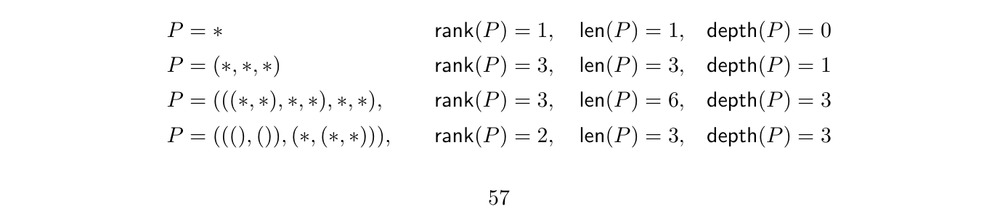

展开原页对照（保留全部图示、代码、标签和数学排版）

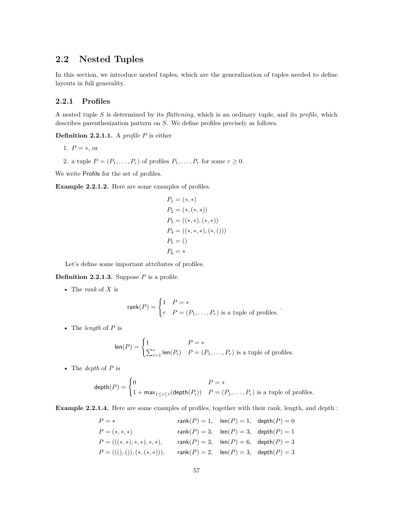

展开本页英文正文

<pre v-pre style="white-space:pre-wrap;overflow-wrap:anywhere">2.2 Nested Tuples

In this section, we introduce nested tuples, which are the generalization of tuples needed to define layouts in full generality.

2.2.1 Profiles

A nested tuple S is determined by its flattening, which is an ordinary tuple, and its profile, which describes parenthesization pattern on S. We define profiles precisely as follows.

Definition 2.2.1.1. A profile P is either

2. a tuple P = (P1, . . . , Pr) of profiles P1, . . . , Pr for some r ≥0.

We write Profile for the set of profiles.

Example 2.2.1.2. Here are some examples of profiles.

Let’s define some important attributes of profiles.

Definition 2.2.1.3. Suppose P is a profile.

• The rank of X is

r P = (P1, . . . , Pr) is a tuple of profiles.

• The length of P is

i=1 len(Pi) P = (P1, . . . , Pr) is a tuple of profiles.

• The depth of P is

1 + max1≤i≤r(depth(Pi)) P = (P1, . . . , Pr) is a tuple of profiles.

Example 2.2.1.4. Here are some examples of profiles, together with their rank, length, and depth :</pre>

## PDF 第 60 页 · 原书第 58 页

定义 2.2.1.5. 假设  是具有 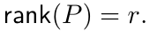 的轮廓如果 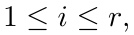 则 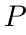 的第 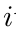 模态为

P，当 depth(P) = 0 时（此时 i = r = 1）；

Pᵢ，当 P = (P₁, …, Pᵣ) 的深度至少为 1 时。

示例 2.2.1.6. 如果 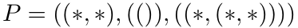，则  的模态为

下面的符号将会很有用。

记号 2.2.1.7。设轮廓 P 的深度大于 0。对任意 1 ≤ j ≤ rank(P)，记

轮廓支持的最重要运算是代入：若 Q 是长度为 m 的轮廓，P₁, …, Pₘ 也是轮廓，则对每个 1 ≤ i ≤ m，将 Q 的第 i 个分量替换为 Pᵢ，便得到新轮廓 (P₁, …, Pₘ)Q。更准确地说，有如下定义。

定义 2.2.1.8。设 Q 是长度为 m 的轮廓，P₁, …, Pₘ 为轮廓。它们的 Q 代入是轮廓

定义如下。写入 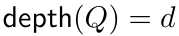 和 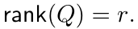

• 如果 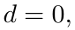，则 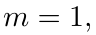，我们定义 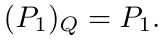

• 再设 d > 0，并且已经对所有深度小于 d 的轮廓 Q′ 定义了 Q′ 代入。可写成

其中每个模态 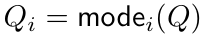 都有深度 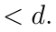 如果对于每个 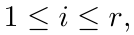 我们设置

然后我们定义

示例 2.2.1.9. 如果 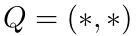 和 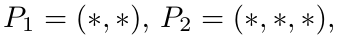

更一般地说，如果 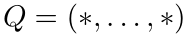 是具有 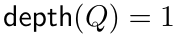 和 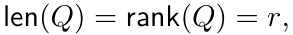 的轮廓，则

是普通的拼接。

展开原页对照（保留全部图示、代码、标签和数学排版）

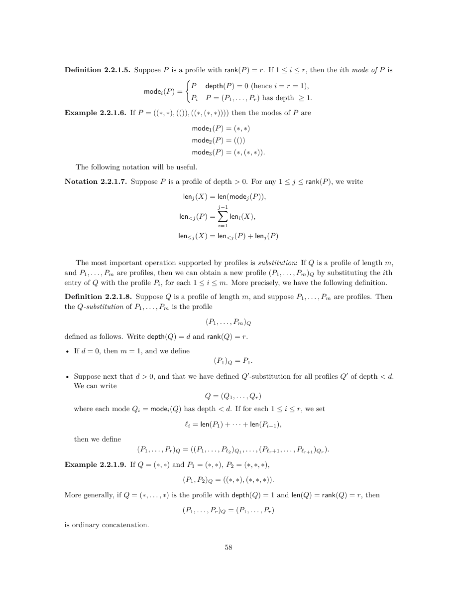

展开本页英文正文

<pre v-pre style="white-space:pre-wrap;overflow-wrap:anywhere">Definition 2.2.1.5. Suppose P is a profile with rank(P) = r. If 1 ≤i ≤r, then the ith mode of P is

P depth(P) = 0 (hence i = r = 1),

Pi P = (P1, . . . , Pr) has depth ≥1.

Example 2.2.1.6. If P = ((∗, ∗), (()), ((∗, (∗, ∗)))) then the modes of P are

The following notation will be useful.

Notation 2.2.1.7. Suppose P is a profile of depth &gt; 0. For any 1 ≤j ≤rank(P), we write

The most important operation supported by profiles is substitution: If Q is a profile of length m, and P1, . . . , Pm are profiles, then we can obtain a new profile (P1, . . . , Pm)Q by substituting the ith entry of Q with the profile Pi, for each 1 ≤i ≤m. More precisely, we have the following definition.

Definition 2.2.1.8. Suppose Q is a profile of length m, and suppose P1, . . . , Pm are profiles. Then the Q-substitution of P1, . . . , Pm is the profile

defined as follows. Write depth(Q) = d and rank(Q) = r.

• If d = 0, then m = 1, and we define (P1)Q = P1.

• Suppose next that d &gt; 0, and that we have defined Q′-substitution for all profiles Q′ of depth &lt; d. We can write

where each mode Qi = modei(Q) has depth &lt; d. If for each 1 ≤i ≤r, we set

then we define

Example 2.2.1.9. If Q = (∗, ∗) and P1 = (∗, ∗), P2 = (∗, ∗, ∗),

More generally, if Q = (∗, . . . , ∗) is the profile with depth(Q) = 1 and len(Q) = rank(Q) = r, then

is ordinary concatenation.</pre>

## PDF 第 61 页 · 原书第 59 页

旁注 2.2.1.10。Q 代入可以用运算子（operad）来解释。轮廓的集合 Profile 具有

一个（非对称）运算子的结构：其中集合

构成 Profile 的 n 元运算集合。如果 n = m₁ + ··· + mᵣ，那么结构映射

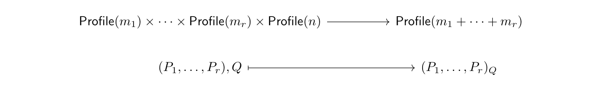

由 Q 代入给出。也可以在这个非对称运算子上构造余自由对称运算子；这相当于在各个 n 元运算集合上赋予平凡的对称群作用。

### 2.2.2 基本定义

定义了轮廓及其基本属性后，我们现在可以定义嵌套元组。

定义 2.2.2.1. 如果 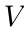 是一个集合，则包含  中的分量的嵌套元组 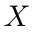 是一对 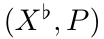，其中包含

1. 一个分量属于 V 的元组 X♭ = (x₁, …, xₘ)，称为 X 的展平；以及

2. 长度为  的轮廓 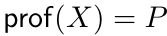 称为 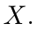 的轮廓

将所有分量属于集合 V 的嵌套元组组成的集合记为 Nest(V)。

示例 2.2.2.2. 以下是嵌套元组的一些示例，以及它们的展平和轮廓。

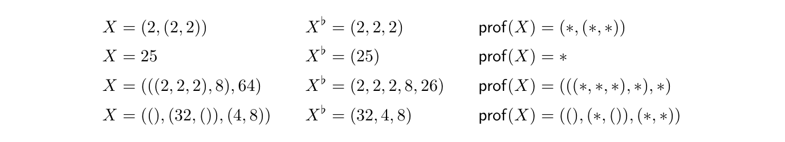

符号 2.2.2.3. 我们有时会写

用 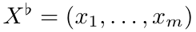 和轮廓 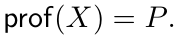 表示嵌套元组

观察 2.2.2.4。如果  是任意集合，那么根据定义，我们有下列拉回方块：

注记 2.2.2.5。根据轮廓的递归定义，也可以等价地将分量属于 V 的嵌套元组定义为以下两者之一：

1. 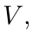 的元素或

展开原页对照（保留全部图示、代码、标签和数学排版）

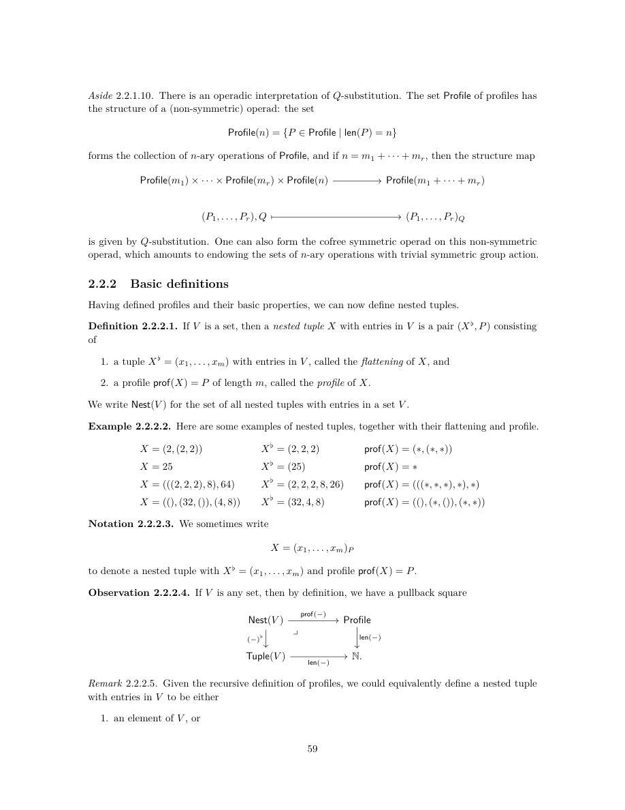

展开本页英文正文

<pre v-pre style="white-space:pre-wrap;overflow-wrap:anywhere">Aside 2.2.1.10. There is an operadic interpretation of Q-substitution. The set Profile of profiles has

the structure of a (non-symmetric) operad: the set

forms the collection of n-ary operations of Profile, and if n = m1 + · · · + mr, then the structure map

is given by Q-substitution. One can also form the cofree symmetric operad on this non-symmetric operad, which amounts to endowing the sets of n-ary operations with trivial symmetric group action.

2.2.2 Basic definitions

Having defined profiles and their basic properties, we can now define nested tuples.

Definition 2.2.2.1. If V is a set, then a nested tuple X with entries in V is a pair (X♭, P) consisting of

1. a tuple X♭= (x1, . . . , xm) with entries in V , called the flattening of X, and

2. a profile prof(X) = P of length m, called the profile of X.

We write Nest(V ) for the set of all nested tuples with entries in a set V .

Example 2.2.2.2. Here are some examples of nested tuples, together with their flattening and profile.

Notation 2.2.2.3. We sometimes write

to denote a nested tuple with X♭= (x1, . . . , xm) and profile prof(X) = P.

Observation 2.2.2.4. If V is any set, then by definition, we have a pullback square

Remark 2.2.2.5. Given the recursive definition of profiles, we could equivalently define a nested tuple with entries in V to be either

1. an element of V , or</pre>

## PDF 第 62 页 · 原书第 60 页

2. 嵌套元组的元组，其分量位于 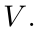 中

让我们定义嵌套元组的一些重要属性。嵌套元组  的每个此类属性都通过其展平 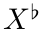 或其轮廓 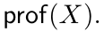 继承

定义 2.2.2.6. 假设  是一个嵌套元组，其分量位于 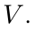 中

• 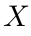 的秩为 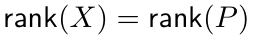

•  的长度为 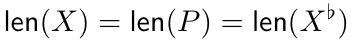

•  的深度为 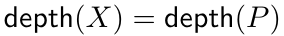

• 如果是 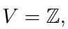，则  的大小为 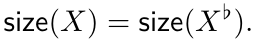

示例 2.2.2.7. 以下是整数嵌套元组的一些示例，以及它们的秩、长度、深度和大小：

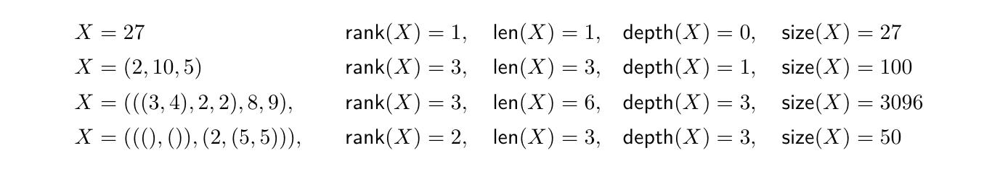

示例 2.2.2.8. 深度为 0 的嵌套整数元组只是一个整数。

例 2.2.2.9。深度为 1 的整数嵌套元组就是普通整数元组。如果 X 是这样的嵌套元组，则 rank(X) = len(X)。

定义 2.2.2.10. 假设 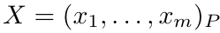 是一个嵌套元组，其中 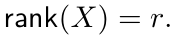 如果是 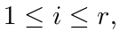，那么  的第  模态就是嵌套元组

示例 2.2.2.11. 如果

那么  的模态是

示例 2.2.2.12. 如果 ，则  的模态为

展开原页对照（保留全部图示、代码、标签和数学排版）

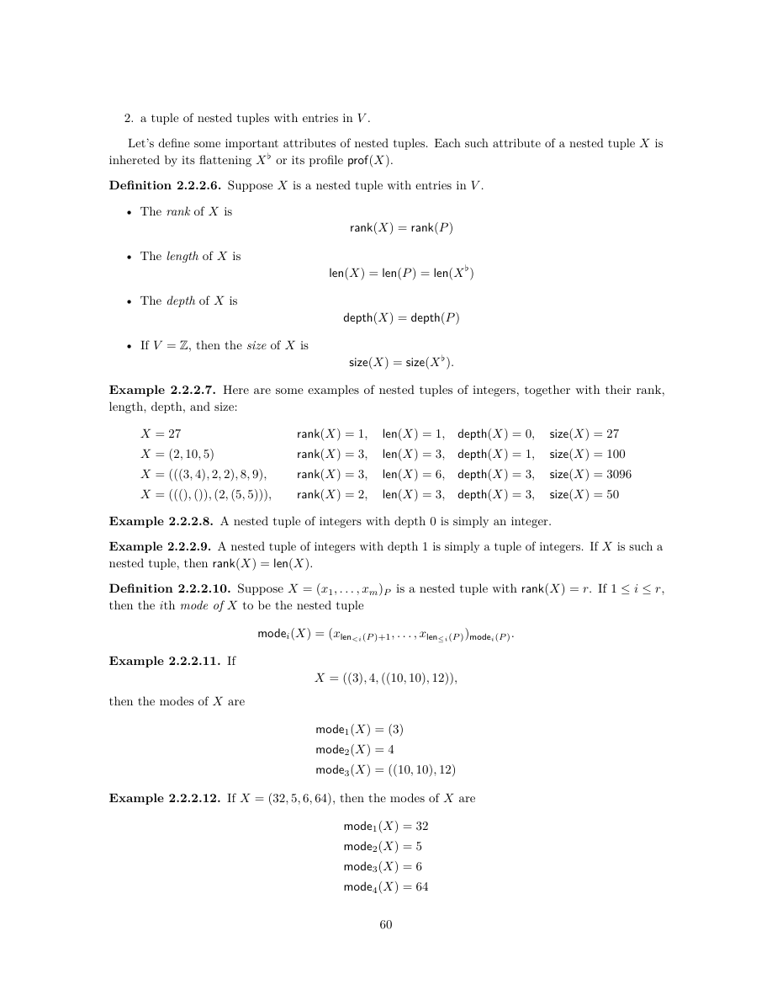

展开本页英文正文

<pre v-pre style="white-space:pre-wrap;overflow-wrap:anywhere">2. a tuple of nested tuples with entries in V .

Let’s define some important attributes of nested tuples. Each such attribute of a nested tuple X is inhereted by its flattening X♭or its profile prof(X).

Definition 2.2.2.6. Suppose X is a nested tuple with entries in V .

• The rank of X is rank(X) = rank(P)

• The length of X is len(X) = len(P) = len(X♭)

• The depth of X is depth(X) = depth(P)

• If V = Z, then the size of X is size(X) = size(X♭).

Example 2.2.2.7. Here are some examples of nested tuples of integers, together with their rank, length, depth, and size:

Example 2.2.2.8. A nested tuple of integers with depth 0 is simply an integer.

Example 2.2.2.9. A nested tuple of integers with depth 1 is simply a tuple of integers. If X is such a nested tuple, then rank(X) = len(X).

Definition 2.2.2.10. Suppose X = (x1, . . . , xm)P is a nested tuple with rank(X) = r. If 1 ≤i ≤r, then the ith mode of X to be the nested tuple

Example 2.2.2.11. If

then the modes of X are

Example 2.2.2.12. If X = (32, 5, 6, 64), then the modes of X are</pre>

## PDF 第 63 页 · 原书第 61 页

引入以下符号将很方便。

表示法 2.2.2.13. 假设  是带有 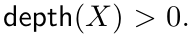 的整数嵌套元组对于任何   我们写

同样，我们写

 和

定义 2.2.2.14. 如果  是嵌套元组且 ，则  的第  分量是

示例 2.2.2.15. 如果

那么  的分量是

示例 2.2.2.16. 如果 ，则  的分量为

示例 2.2.2.17. 如果  是深度为 1, 的嵌套元组，则  对于所有  

观察 2.2.2.18. 如果  是整数的嵌套元组，则  的分量是整数，而  的模态本身就是整数的嵌套元组。

最后，引入嵌套元组的同形关系（congruence），用来表示它们具有相同轮廓。

展开原页对照（保留全部图示、代码、标签和数学排版）

展开本页英文正文

<pre v-pre style="white-space:pre-wrap;overflow-wrap:anywhere">It will be convenient to introduce the following notation.

Notation 2.2.2.13. Suppose X is a nested tuple of integers with depth(X) &gt; 0. For any 1 ≤j ≤ rank(X), we write

and similarly, we write

sizej(X), and

Definition 2.2.2.14. If X = (x1, . . . , xm)P is a nested tuple and 1 ≤i ≤m, then the ith entry of X is

Example 2.2.2.15. If

then the entries of X are

Example 2.2.2.16. If X = (32, 5, 6, 64), then the entries of X are

Example 2.2.2.17. If X is a nested tuple with depth 1, then modei(X) = entryi(X) for all 1 ≤i ≤ rank(X) = len(X).

Observation 2.2.2.18. If X is a nested tuple of integers, then the entries of X are integers, while the modes of X are themselves nested tuples of integers.

Finally, we introduce the notion of congruence of nested tuples, which indicates when nested tuples have the same profile.</pre>

## PDF 第 64 页 · 原书第 62 页

定义 2.2.2.19。设 X₁ 与 X₂ 为嵌套元组。如果满足下式，就称 X₁ 与 X₂ 同形：

示例 2.2.2.20. 以下是嵌套元组  和  的一些示例以及它们是否同形

  同形

  同形

  同形

  同形

  不同形

  不同形

  不同形

### 2.2.3 代入

回想一下，如果  是长度为  的轮廓，并且  是轮廓，那么我们定义了一个轮廓

称为 P₁, …, Pᵣ 的 Q 代入。它将 Q 的第 i 个分量替换为轮廓 Pᵢ，从而得到新的轮廓。下面将这一运算推广到嵌套元组。

定义 2.2.3.1. 假设  是具有轮廓  的嵌套元组，并假设  是长度为  的轮廓我们定义  替换

将 X₁, …, Xₘ 的 Q 代入定义为具有下列展平的嵌套元组：

和轮廓

更一般地，如果  是嵌套元组并且  是长度为  的嵌套元组，我们定义

示例 2.2.3.2. 如果  和  那么

示例 2.2.3.3. 如果  和  那么

示例 2.2.3.4. 如果  和  那么

展开原页对照（保留全部图示、代码、标签和数学排版）

展开本页英文正文

<pre v-pre style="white-space:pre-wrap;overflow-wrap:anywhere">Definition 2.2.2.19. If X1 and X2 are nested tuples, we say X1 and X2 are congruent, if

Example 2.2.2.20. Here are some examples of nested tuples X1 and X2, and whether or not they are congruent

X1 = 27 X2 = 100 congruent

X1 = (2, 2) X2 = (8, 64) congruent

X1 = ((4, 8), (4, 8)) X2 = ((1, 1), (5, 10)) congruent

X1 = ((64, (8, 8)), (25, (5, 5))) X2 = ((2, (3, 5)), (7, (11, 13))) congruent

X1 = 27 X2 = (100) not congruent

X1 = (2, 2) X2 = (8, 64, 128) not congruent

X1 = ((4, 8), (4, 8)) X2 = (((1, 1), (5, 10))) not congruent

2.2.3 Substitution

Recall that if Q is a profile of length r and P1, . . . , Pr are profiles, then we defined a profile

called the Q-substitution of P1, . . . , Pr. This profile is obtained from Q by replacing the ith entry of Q with the profile Pi. We can extend this to an operation on nested tuples as follows.

Definition 2.2.3.1. Suppose X1, . . . , Xm are nested tuples with profiles P1, . . . , Pm, and suppose Q is a profile of length m. We define the Q-substitution

of X1, . . . , Xm to be the nested tuple with flattening

and profile

More generally, if X1, . . . , Xm are nested tuples and Y is a nested tuple of length m, we define

Example 2.2.3.2. If (X1, X2, X3) = (64, 16, 4) and Q = (∗, (∗, ∗)), then

Example 2.2.3.3. If (X1, X2, X3, X4) = ((2, 2), (3, 3), (5, 5), (7, 7)) and Q = ((∗, ∗), (∗, ∗)), then

Example 2.2.3.4. If X = (12) and Q = ∗, then</pre>

## PDF 第 65 页 · 原书第 63 页

示例 2.2.3.5. 如果  和  那么

更一般地说，如果  是任何嵌套元组并且  那么

是  的拼接

旁注 2.2.3.6。嵌套元组的代入可以用运算子来解释。整数嵌套元组的集合 

是运算子 Profile 上的一个代数，其结构映射由 Q 代入给出：

### 2.2.4 细化

在本节中，我们将介绍嵌套元组上的一个重要关系，称为细化。直观上，如果  和  是整数的嵌套元组，如果可以通过用相同大小的某个嵌套元组替换  的每个分量来从  获得 ，则我们说  细化了 。更准确地说，我们有以下定义。

定义 2.2.4.1. 如果  和  是嵌套元组，那么我们说  细化了 ，如果

(b)  和

(c) 对于每个  细化 

书写方式 2.2.4.2. 写

表示细化

示例 2.2.4.3. 以下是嵌套元组细化的一些示例。

观察 2.2.4.4。嵌套元组的细化关系具有自反性、传递性与反对称性，因此在正整数嵌套元组的集合上确定了一个偏序。

如果 X′ 细化 X，就可以将 X′ 看作从 X 得到的嵌套元组：将 X 的每个分量 xᵢ 替换为某个大小为 xᵢ 的嵌套元组 X′ᵢ。将 X′ᵢ 称为 X′ 相对于 X 的第 i 个模态。更准确地说，有如下定义。

展开原页对照（保留全部图示、代码、标签和数学排版）

展开本页英文正文

<pre v-pre style="white-space:pre-wrap;overflow-wrap:anywhere">Example 2.2.3.5. If X1 = 2, X2 = 2, X3 = (5, 5), and Q = (∗, ∗, ∗), then

More generally, if X1, . . . , Xm are any nested tuples and P = (∗, . . . , ∗) then

is the concatenation of X1, . . . , Xm.

Aside 2.2.3.6. There is an operadic interpretation of substitutions of nested tuples. The set Nest(Z)

of nested tuples of integers is an algebra over the operad Profile, with structure maps given by Q-substitution:

2.2.4 Refinement

In this section, we introduce an important relation on nested tuples called refinement. Intuitively, if X′ and X are nested tuples of integers, we say X′ refines X if X′ may be obtained from X by replacing each entry of X with some nested tuple of the same size. More precisely, we have the following definition.

Definition 2.2.4.1. If X′ and X are nested tuples, then we say X′ refines X if either

(b) rank(X′) = rank(X), and

(c) for each 1 ≤i ≤rank(X), modei(X′) refines modei(X).

Notation 2.2.4.2. We write

to indicate that X′ refines X.

Example 2.2.4.3. Here are some examples of refinements of nested tuples.

Observation 2.2.4.4. Refinement of nested tuples is reflexive, transitive, and antisymmetric, so refinement specifies a partial ordering on the collection of nested tuples of positive integers.

If X′ refines X, then we can think of X′ as being obtained from X by replacing each entry xi of X with some nested tuple X′

i as the ith mode of X′ relative to X. More precisely, we have the following definition.

i of size xi. We refer to the nested tuple X′</pre>

## PDF 第 66 页 · 原书第 64 页

构造 2.2.4.5. 假设  是长度为  的整数的嵌套元组，并假设  细化  对于任何 ，我们定义一个嵌套元组

称为 X′ 相对于 X 的第 i 个模态，由下列公式定义：

X′，当 depth(X) = 0 时（此时 i = ℓ = 1）；

modeᵢ₋N(modeⱼ(X′), modeⱼ(X))，其中 j 为满足下式的最大整数：

示例 2.2.4.6. 如果  和 ，则  细化 ，并且  相对于  的模态为

示例 2.2.4.7. 如果  是任何嵌套元组，则  细化  并且对于任何  我们有

示例 2.2.4.8. 如果  是一个元组，并且  细化 ，那么对于任何  我们有

示例 2.2.4.9. 如果  是带有  的嵌套元组，则  细化 ，并且  相对于  的唯一模态是

符号 2.2.4.10. 如果  是一个细化并且  那么我们写

定义 2.2.4.11. 假设  细化  并写成 

 那么相对于的展平就是嵌套元组

示例 2.2.4.12. 如果  和  那么

示例 2.2.4.13. 如果  是任何嵌套元组，则  相对于  的展平为

展开原页对照（保留全部图示、代码、标签和数学排版）

展开本页英文正文

<pre v-pre style="white-space:pre-wrap;overflow-wrap:anywhere">Construction 2.2.4.5. Suppose X is a nested tuple of integers of length m, and suppose X′ refines X. For any 1 ≤i ≤m, we define a nested tuple

called the ith mode of X′ relative to X, by the formula

X′ depth(X) = 0 (hence i = ℓ= 1)

modei−N(modej(X′), modej(X)) j is the largest integer such that

Example 2.2.4.6. If X = ((4, 9), (25, 36)), and X′ = (((2, 2), (3, 3)), (25, (6, (2, 3)))), then X′ refines X and the modes of X′ relative to X are

Example 2.2.4.7. If X is any nested tuple, then X refines X, and for any 1 ≤i ≤len(X) we have

Example 2.2.4.8. If X = X♭is a tuple, and X′ refines X, then for any 1 ≤i ≤len(X), we have

Example 2.2.4.9. If X′ is a nested tuple with size(X′) = N, then X′ refines N, and the only mode of X′ relative to N is

Notation 2.2.4.10. If X′ ↠X is a refinement and 1 ≤i ≤len(X), then we write

Definition 2.2.4.11. Suppose X′ refines X, and write X′

i = modei(X′, X). Then the flattening of X′ relative to X is the nested tuple

Example 2.2.4.12. If X′ = (((2, 2), (3, 3)), ((5, 5), (7, 7))) and X = ((4, 9), (25, 49)), then

Example 2.2.4.13. If X is any nested tuple, then the flattening of X relative to X is</pre>

## PDF 第 67 页 · 原书第 65 页

示例 2.2.4.14. 如果  是元组，并且  细化 ，则  相对于  的展平为

示例 2.2.4.15. 如果  是带有  的嵌套元组，则  细化 ，并且  相对于  的展平为

观察 2.2.4.16. 如果  细化 ，则  细化 

展开原页对照（保留全部图示、代码、标签和数学排版）

展开本页英文正文

<pre v-pre style="white-space:pre-wrap;overflow-wrap:anywhere">Example 2.2.4.14. If X = X♭is a tuple, and X′ refines X, then the flattening of X′ relative to X is

Example 2.2.4.15. If X′ is a nested tuple with size(X′) = N, then X′ refines N, and the flattening of X′ relative to N is

Observation 2.2.4.16. If X′ refines X, then flat(X′, X) refines X♭.</pre>

---
[译文总目录](Layout.md) · [第 2.1 节：合并、紧致性、补布局与可处理性](Translation-03-Flat-Layout-Algebra.md) · [第 2.3 节：布局](Translation-05-Layouts.md)
