# 第 2.3 节：布局
[译文总目录](Layout.md) · [第 2.2 节：嵌套元组](Translation-04-Nested-Tuples.md) · [第 3.1 节：Tuple 范畴、编码与具象化](Translation-06-Tuple.md)
> 来源：Colfax Research，2025 年 9 月版。本文为中文逐段译文，保留原文顺序及定义、命题、例子、证明和公式；校对说明以“校注”明确区分于原文，详见[校对记录](Proofreading.md)。复杂数学式与图示直接使用本地原文裁片。每页末尾可展开原页核对。

## PDF 第 68 页 · 原书第 66 页

### 2.3 布局

有了嵌套元组的必要背景，现在转向布局。布局推广了平坦布局：其形状和步长可为嵌套元组。

### 2.3.1 基本定义

定义 2.3.1.1. 布局是一对

由正整数的嵌套元组组成

称为 L 的形状，以及一个非负整数嵌套元组

称为 L 的步长；要求 S 与 D 同形，即具有相同的轮廓。

定义 2.3.1.2. 如果 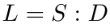 是布局，则  的秩、长度、深度、大小和轮廓分别定义为 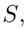 的秩、长度、深度、大小和轮廓。

示例 2.3.1.3. 布局 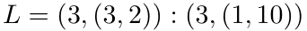 可能如下图所示。

示例 2.3.1.4. 布局 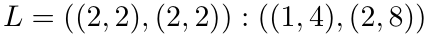 可能如下图所示。

示例 2.3.1.5. 布局

有 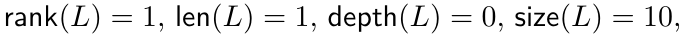 和 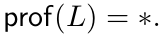

展开原页对照（保留全部图示、代码、标签和数学排版）

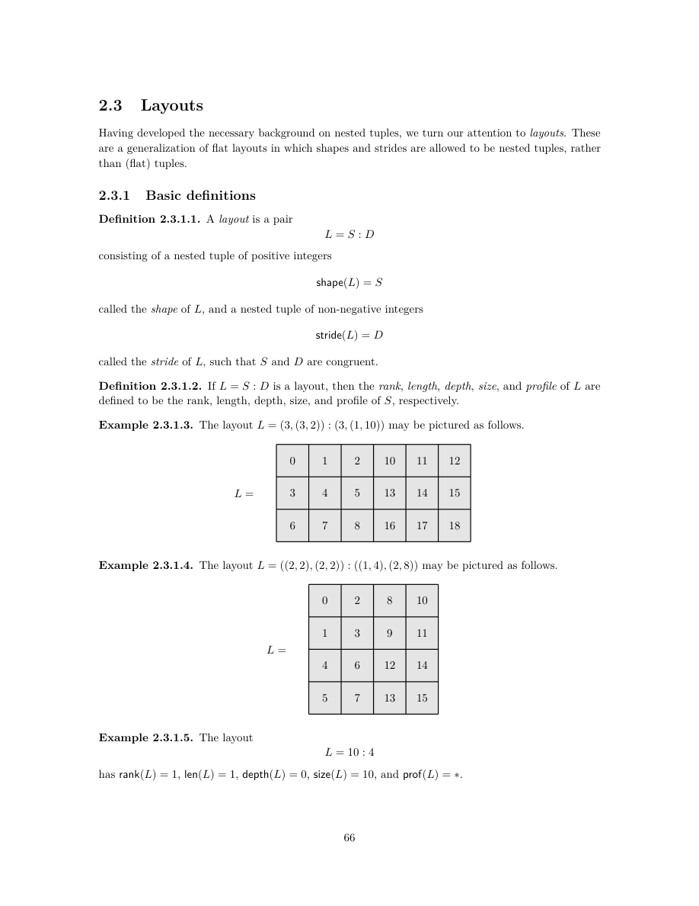

展开本页英文正文

<pre v-pre style="white-space:pre-wrap;overflow-wrap:anywhere">2.3 Layouts

Having developed the necessary background on nested tuples, we turn our attention to layouts. These are a generalization of flat layouts in which shapes and strides are allowed to be nested tuples, rather than (flat) tuples.

2.3.1 Basic definitions

Definition 2.3.1.1. A layout is a pair

consisting of a nested tuple of positive integers

called the shape of L, and a nested tuple of non-negative integers

called the stride of L, such that S and D are congruent.

Definition 2.3.1.2. If L = S : D is a layout, then the rank, length, depth, size, and profile of L are defined to be the rank, length, depth, size, and profile of S, respectively.

Example 2.3.1.3. The layout L = (3, (3, 2)) : (3, (1, 10)) may be pictured as follows.

Example 2.3.1.4. The layout L = ((2, 2), (2, 2)) : ((1, 4), (2, 8)) may be pictured as follows.

Example 2.3.1.5. The layout

has rank(L) = 1, len(L) = 1, depth(L) = 0, size(L) = 10, and prof(L) = ∗.</pre>

## PDF 第 69 页 · 原书第 67 页

示例 2.3.1.6. 布局

有 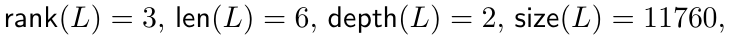 和 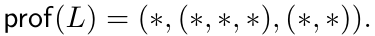

示例 2.3.1.7. 布局

有 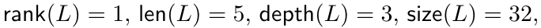 和 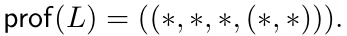

示例 2.3.1.8. 该对

不是布局，因为 S 与 D 不同形。

定义 2.3.1.9. 如果  是一个布局，那么对于任何 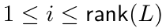，我们将  的第 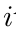 模态定义为布局

对于任何 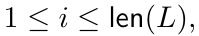，我们将  的第 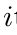 分量定义为布局

示例 2.3.1.10. 如果 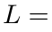

，则  的模态为

 的分量是

注记 2.3.1.11。如果 L 是布局，其模态仍是布局，而其各个分量都是

深度为 0 的布局。

注记 2.3.1.12。平坦布局恰好就是深度为 1 的布局。另一方面，对于任意布局 L，可以按以下方式得到平坦布局 L♭。

定义 2.3.1.13. 如果 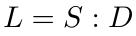 是一个布局，我们将  的展平定义为平坦布局

示例 2.3.1.14. 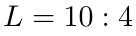 的展平为 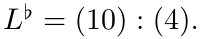

示例 2.3.1.15. 的展平

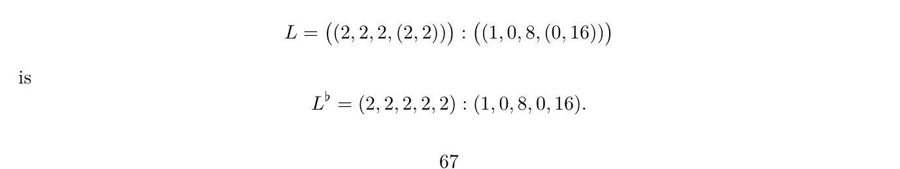

展开原页对照（保留全部图示、代码、标签和数学排版）

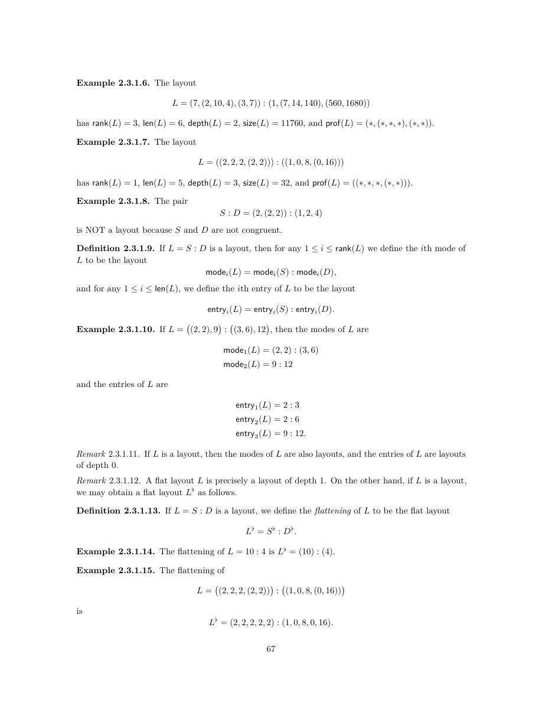

展开本页英文正文

<pre v-pre style="white-space:pre-wrap;overflow-wrap:anywhere">Example 2.3.1.6. The layout

has rank(L) = 3, len(L) = 6, depth(L) = 2, size(L) = 11760, and prof(L) = (∗, (∗, ∗, ∗), (∗, ∗)).

Example 2.3.1.7. The layout

has rank(L) = 1, len(L) = 5, depth(L) = 3, size(L) = 32, and prof(L) = ((∗, ∗, ∗, (∗, ∗))).

Example 2.3.1.8. The pair

is NOT a layout because S and D are not congruent.

Definition 2.3.1.9. If L = S : D is a layout, then for any 1 ≤i ≤rank(L) we define the ith mode of L to be the layout

and for any 1 ≤i ≤len(L), we define the ith entry of L to be the layout

Example 2.3.1.10. If L =

, then the modes of L are

and the entries of L are

Remark 2.3.1.11. If L is a layout, then the modes of L are also layouts, and the entries of L are layouts

of depth 0.

Remark 2.3.1.12. A flat layout L is precisely a layout of depth 1. On the other hand, if L is a layout, we may obtain a flat layout L♭as follows.

Definition 2.3.1.13. If L = S : D is a layout, we define the flattening of L to be the flat layout

Example 2.3.1.14. The flattening of L = 10 : 4 is L♭= (10) : (4).

Example 2.3.1.15. The flattening of</pre>

## PDF 第 70 页 · 原书第 68 页

备注 2.3.1.16. 如果  是布局，则 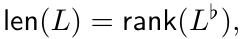 并且对于任何 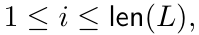 我们有

我们可以使用上面的展平结构将许多概念从平坦布局扩展到嵌套

布局。例如：

构造2.3.1.17（布局函数）。如果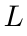是嵌套布局，我们定义的布局函数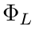为

其中 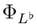 是构造 2.1.2.19. 的布局函数类似地，如果  是这样的  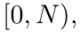 我们定义

为 $\Phi_L$ 经包含映射 [0, N) ⊂ ℤ 分解后所得的映射。

示例 2.3.1.18. 如果 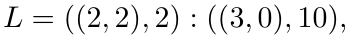 则布局函数

 的计算公式为

给定布局 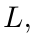，我们可以获得平坦布局  和轮廓 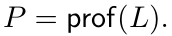 相反，如果给定平坦布局  和与 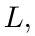 长度相同的轮廓 ，那么我们可以构造具有展平  和轮廓的布局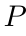如下。

构造 2.3.1.19. 如果 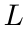 是平坦布局，并且 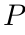 是具有 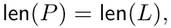 的轮廓，那么我们可以定义

为形状如下的布局：

步长为

其中 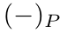 是定义 2.2.1.8. 的  替换操作

示例 2.3.1.20. 如果 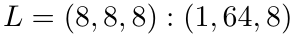 和 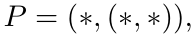 那么

示例 2.3.1.21. 如果 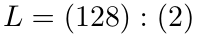 和 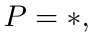 那么

命题 2.3.1.22。如果 L′ 是平坦布局，P 为轮廓，且 len(L′) = len(P)，则存在唯一的布局 L，其展平为 L♭ = L′，轮廓为 prof(L) = P；具体而言，L = L′ₚ，其中下标 P 表示按轮廓 P 进行代入。

证明。这是根据嵌套元组的定义得出的，因为嵌套元组是由其展平和轮廓唯一确定的。

展开原页对照（保留全部图示、代码、标签和数学排版）

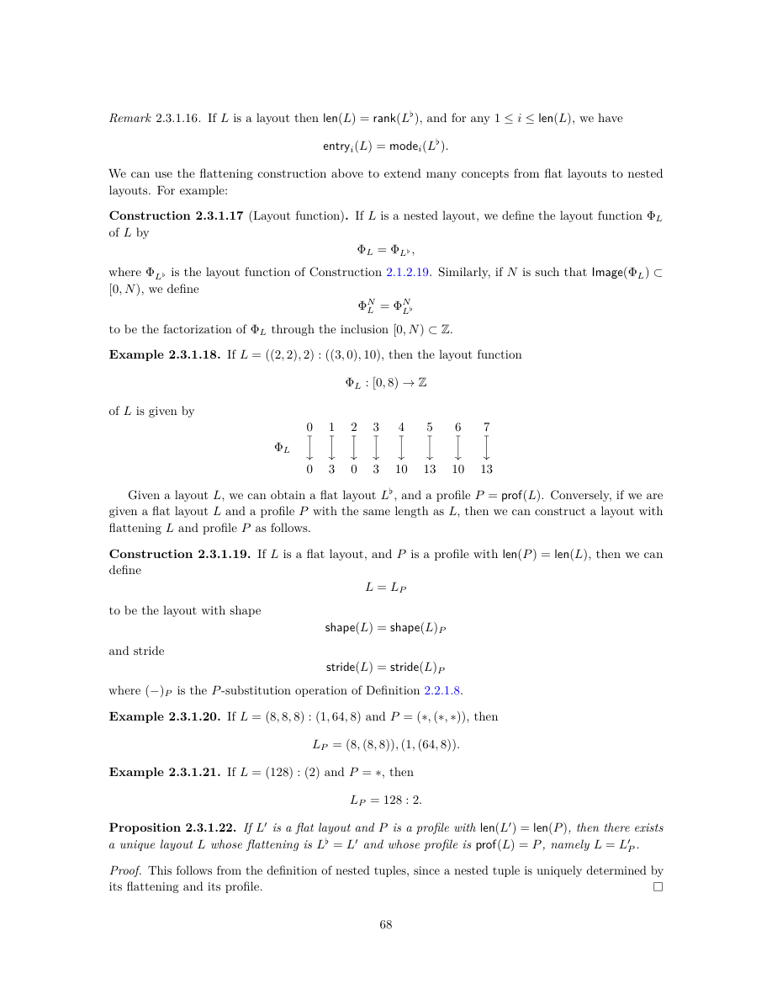

展开本页英文正文

<pre v-pre style="white-space:pre-wrap;overflow-wrap:anywhere">Remark 2.3.1.16. If L is a layout then len(L) = rank(L♭), and for any 1 ≤i ≤len(L), we have

We can use the flattening construction above to extend many concepts from flat layouts to nested

layouts. For example:

Construction 2.3.1.17 (Layout function). If L is a nested layout, we define the layout function ΦL of L by

where ΦL♭is the layout function of Construction 2.1.2.19. Similarly, if N is such that Image(ΦL) ⊂ [0, N), we define

to be the factorization of ΦL through the inclusion [0, N) ⊂Z.

Example 2.3.1.18. If L = ((2, 2), 2) : ((3, 0), 10), then the layout function

of L is given by

Given a layout L, we can obtain a flat layout L♭, and a profile P = prof(L). Conversely, if we are given a flat layout L and a profile P with the same length as L, then we can construct a layout with flattening L and profile P as follows.

Construction 2.3.1.19. If L is a flat layout, and P is a profile with len(P) = len(L), then we can define

to be the layout with shape

and stride

where (−)P is the P-substitution operation of Definition 2.2.1.8.

Example 2.3.1.20. If L = (8, 8, 8) : (1, 64, 8) and P = (∗, (∗, ∗)), then

Example 2.3.1.21. If L = (128) : (2) and P = ∗, then

Proposition 2.3.1.22. If L′ is a flat layout and P is a profile with len(L′) = len(P), then there exists a unique layout L whose flattening is L♭= L′ and whose profile is prof(L) = P, namely L = L′

Proof. This follows from the definition of nested tuples, since a nested tuple is uniquely determined by its flattening and its profile.</pre>

## PDF 第 71 页 · 原书第 69 页

观察 2.3.1.23。前一个命题表明，我们有下列拉回方块：

我们可以将非退化性的概念扩展到嵌套情况，如下所示。

定义 2.3.1.24. 假设 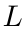 是一个布局。如果对于所有  满足以下条件，我们称  是非退化的：

示例 2.3.1.25. 布局

是非退化的，而布局

是退化的。

### 2.3.2 基本运算

建立了布局的基本词汇后，我们转向它们支持的操作。在本节中，我们定义构建更复杂的操作所需的基本操作，例如合并、求补、复合、逻辑除法和逻辑乘积。

2.3.2.1 展平

如果是一个布局，那么我们可以通过展平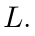的形状和步长来获得平坦布局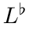

定义 2.3.2.1. 如果 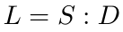 是一个布局，我们将  的展平定义为平坦布局

示例 2.3.2.2. 的展平

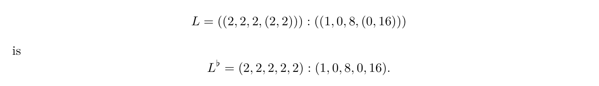

示例 2.3.2.3. 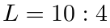 的展平为 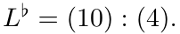

示例 2.3.2.4. 假设  是一个布局。那么 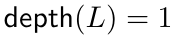 当且仅当 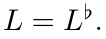

展开原页对照（保留全部图示、代码、标签和数学排版）

展开本页英文正文

<pre v-pre style="white-space:pre-wrap;overflow-wrap:anywhere">Observation 2.3.1.23. The previous proposition tells us that we have a pullback square

We can extend the notion of non-degeneracy to the nested case as follows.

Definition 2.3.1.24. Suppose L is a layout. We say L is non-degenerate if for all 1 ≤i ≤len(L), the following condition holds:

Example 2.3.1.25. The layouts

are non-degenerate, while the layouts

are degenerate.

2.3.2 Basic operations

Having established the basic vocabulary for layouts, we turn to the operations they support. In this section, we define basic operations that will be needed to construct more sophisticated operations such as coalesce, complement, composition, logical division, and logical product.

2.3.2.1 Flattening

If L is a layout, then we may obtain a flat layout L♭by flattening the shape and stride of L.

Definition 2.3.2.1. If L = S : D is a layout, we define the flattening of L to be the flat layout

Example 2.3.2.2. The flattening of

Example 2.3.2.3. The flattening of L = 10 : 4 is L♭= (10) : (4).

Example 2.3.2.4. Suppose L is a layout. Then depth(L) = 1 if and only if L = L♭.</pre>

## PDF 第 72 页 · 原书第 70 页

2.3.2.2 拼接

我们可以通过拼接它们的形状和拼接它们的步长来拼接布局。

定义 2.3.2.5. 如果  和  是布局，则  和  的拼接就是布局 

更一般地，如果  是布局的任何有限集合，与  ，则  的拼接是布局

注记 2.3.2.6。嵌套元组的拼接不满足结合律，因此布局的拼接也不满足结合律。例如，

取  和  然后

而且，这些布局都不等于“三重”拼接   但是，我们看到这些布局中的每一个都具有相同的展平，因此这些布局中的每一个

具有相同的布局函数。

示例 2.3.2.7. 如果  和  那么

备注 2.3.2.8. 拼接增加了布局的深度。更准确地说，我们有

depth(L, L′) = 1 + max(depth(L), depth(L′))。

注记 2.3.2.9。当 L 与 L′ 为平坦布局时，定义 2.3.2.5 的拼接运算

并不同于定义 2.1.3.36 中平坦布局的拼接。不过，两者满足下列关系：

备注 2.3.2.10. 如果  是带有  和  的任何布局，那么我们可以写

作为其模态的拼接。

示例 2.3.2.11. 如果

那么  其中

 和

展开原页对照（保留全部图示、代码、标签和数学排版）

展开本页英文正文

<pre v-pre style="white-space:pre-wrap;overflow-wrap:anywhere">2.3.2.2 Concatenate

We can concatenate layouts by concatenating their shapes and concatenating their strides.

Definition 2.3.2.5. If L = S : D and L′ = S′ : D′ are layouts, then the concatenation of L and L′ is the layout (L, L′)

More generally, if L1, . . . , Lk is any finite collection of layouts, with Li = Si : Di, then the concatenation of L1, . . . , Lk is the layout

Remark 2.3.2.6. Concatenation of nested tuples (and hence of layouts) is not associative. For example,

take L1 = 3 : 4, L2 = 2 : 2, and L3 = 5 : 1. Then

Moreover, neither of these layouts is equal to the “three-fold” concatenation (L1, L2, L3) = (3, 2, 5) : (4, 2, 1). However, we see that each of these layouts has the same flattening, so each of these layouts

has the same layout function.

Example 2.3.2.7. If L = (3, 7, 2) : (1, 3, 6) and L′ = (2, (2, (4, 3))) : (5, 3, (2, 2)), then

Remark 2.3.2.8. Concatenation increases the depth of layouts. More precisely, we have

depth(L, L′) = 1 + max(depth(L), depth(L′)).

Remark 2.3.2.9. When L and L′ are flat layouts, the concatenation of Definition 2.3.2.5 does NOT

agree with the concatenation of flat layouts of Definition 2.1.3.36. Instead, these operations are related by the formula

Remark 2.3.2.10. If L is any layout with depth(L) &gt; 0 and rank(L) = r, then we may write

as the concatenation of its modes.

Example 2.3.2.11. If

then L = (L1, L2, L3) where

L2 = 2 : 0, and</pre>

## PDF 第 73 页 · 原书第 71 页

2.3.2.3 代入

回想一下，如果  是嵌套元组，并且  是具有  的轮廓，那么我们可以形成  替换

它是将轮廓  的第 i 个分量替换为嵌套元组  得到的。我们可以按以下方式，将这一构造从嵌套元组推广到布局。

定义 2.3.2.12. 假设  是一个布局，并假设  是一个轮廓，其中  我们定义

其中 Sₚ 和 Dₚ 分别是对 S 与 D 的各个模态进行 P 代入所得的结果。

示例 2.3.2.13. 如果  和  那么

示例 2.3.2.14. 如果  和

那么

示例 2.3.2.15. 如果  和  那么

### 2.3.3 合并

回想一下，如果  是一个平坦布局，那么  就是一个最小秩的唯一平坦布局，其布局函数为  我们可以在任意（嵌套）布局的设置中进行类似的构造。我们首先定义合并布局的概念。

定义 2.3.3.1. 假设  是一个布局。如果满足以下条件之一，我们称  已合并。

 和  或

 和  在定义 2.1.4.1. 的意义上合并

示例 2.3.3.2. 布局

未合并，因为 depth(L) > 1。

示例 2.3.3.3. 布局

没有合并，而布局

是合并的。

展开原页对照（保留全部图示、代码、标签和数学排版）

展开本页英文正文

<pre v-pre style="white-space:pre-wrap;overflow-wrap:anywhere">2.3.2.3 Substitution

Recall that if X1, . . . , Xk are nested tuples and P is a profile with len(P) = k, then we may form the P-substitution

which is obtained by replacing the ithe entry of P with the nested tuple Xi. We can extend this construction from nested tuples to layouts as follows.

Definition 2.3.2.12. Suppose L = S : D is a layout, and suppose P is a profile with len(P) = rank(L). We define

where SP and DP are the P-substitutions of (the modes of) S and D.

Example 2.3.2.13. If P = (∗, (∗, ∗)) and L = (8, 8, 8) : (1, 8, 64), then

Example 2.3.2.14. If P = (∗, (∗, ∗))) and

then

Example 2.3.2.15. If L = (16) : (1) and P = ∗, then

2.3.3 Coalesce

Recall that if L is a flat layout, then coal♭(L) is a the unique flat layout of minimal rank whose layout function is ΦL. We can make a similar construction in the setting of arbitrary (nested) layouts. We begin by defining the notion of a coalesced layout.

Definition 2.3.3.1. Suppose L is a layout. We say L is coalesced if one of the following conditions holds.

2. depth(L) = 0 and shape(L) &gt; 1, or

3. depth(L) = 1, rank(L) &gt; 1, and L is coalesced in the sense of Definition 2.1.4.1.

Example 2.3.3.2. The layout

is not coalesced since depth(L) &gt; 1.

Example 2.3.3.3. The layout

is not coalesced, while the layout

is coalesced.</pre>

## PDF 第 74 页 · 原书第 72 页

示例 2.3.3.4. 布局

没有合并，而布局

是合并的。

示例 2.3.3.5. 空布局

没有合并。

观察 2.3.3.6. 回想一下，布局  是非退化的，如果

如果  被合并，则  是非退化的。

如果是任意布局，我们可以获得如下合并布局。

构造2.3.3.7. 假设是一个布局，并写

1. 如果  我们定义 

2. 如果  我们定义 

3. 如果  我们定义 

示例 2.3.3.8. 如果  是空布局，则

示例 2.3.3.9. 如果  那么

示例 2.3.3.10. 如果  那么

示例 2.3.3.11. 如果  那么

示例 2.3.3.12. 如果  那么

备注 2.3.3.13. 如果  是布局，则  具有深度 0 或 1.

展开原页对照（保留全部图示、代码、标签和数学排版）

展开本页英文正文

<pre v-pre style="white-space:pre-wrap;overflow-wrap:anywhere">Example 2.3.3.4. The layout

is not coalesced, while the layout

is coalesced.

Example 2.3.3.5. The empty layout

is not coalesced.

Observation 2.3.3.6. Recall that a layout L is non-degenerate if

If L is coalesced, then L is non-degenerate.

If L is any layout, we can obtain a coalesced layout coal(L) as follows.

Construction 2.3.3.7. Suppose L is a layout, and write

1. If m &gt; 1, we define coal(L) = coal♭(L♭)

2. If m = 1, we define coal(L) = s1 : d1

3. If m = 0, we define coal(L) = 1 : 0.

Example 2.3.3.8. If E = () : () is the empty layout, then

Example 2.3.3.9. If L = (1, 1) : (2, 4), then

Example 2.3.3.10. If L = (512) : (4), then

Example 2.3.3.11. If L = (2, 2, 2) : (1, 2, 4), then

Example 2.3.3.12. If L = ((2, 2, 2), (5, 5)) : ((1, 2, 4), (10, 50)), then

Remark 2.3.3.13. If L is a layout, then coal(L) has depth 0 or 1.</pre>

## PDF 第 75 页 · 原书第 73 页

命题 2.3.3.14. 如果  和  是布局，则

证明。使用命题 2.1.4.18, 我们有

定义 2.3.3.15. 如果  是布局，则将  的复杂度定义为整数

命题 2.3.3.16. 如果  是布局， 则  是唯一的复杂度最小化布局，其布局函数为 

证明。假设  是一个与  具有相同布局函数的布局，并假设  那么

有两种情况需要考虑。

• （案例  假设  那么  结合这些不等式，我们观察到

其中等式成立当且仅当 

• （情况  假设  那么  或  对于某些整数  和  在任何一种情况下，我们都有  和

其中等式成立当且仅当 

备注 2.3.3.17. 我们需要排除  情况的唯一原因是，如果 

那么 1 : 0 和空布局 () : () 是具有最小复杂度的不同布局，并且与  具有相同的布局函数（即平凡布局函数 

### 2.3.4 相对合并

合并运算有一种重要的变体，称为相对合并，记为 $\operatorname{coal}(L,\bar S)$。它额外接收一个被 $\operatorname{shape}(L)$ 细化的嵌套元组 $\bar S$ 作为输入。在保证结果的形状仍细化 $\bar S$ 的前提下，相对合并尽可能简化布局 $L$。〔校注：原文将“变体”写成 invariant（不变量）；按本段定义及用途，应读作 variant。〕

展开原页对照（保留全部图示、代码、标签和数学排版）

展开本页英文正文

<pre v-pre style="white-space:pre-wrap;overflow-wrap:anywhere">Proposition 2.3.3.14. If A and B are layouts, then

Proof. Using Proposition 2.1.4.18, we have

Definition 2.3.3.15. If L is a layout, define the complexity of L to be the integer

Proposition 2.3.3.16. If L is a layout and size(L) &gt; 1, then coal(L) is the unique complexity minimizing layout whose layout function is ΦL.

Proof. Suppose L′ is a layout with the same layout function as L, and suppose coal(L′)̸ = 1 : 0. Then

There are two cases to consider.

• (Case 1): Suppose len(L′) &gt; 1. Then depth(L′) ≥1 ≥depth(coal(L)). Combining these inequalities, we observe that

where equality holds if and only if L′ = coal(L′) = coal(L).

• (Case 2): Suppose len(L′) = 1. Then L′ = (s) : (d) or L′ = s : d for some integers s &gt; 1 and d ≥0. In either case, we have coal(L′) = s : d, and

where equality holds if and only if L′ = s : d = coal(L).

Remark 2.3.3.17. The only reason that we need to exclude the case size(L) = 1 is that if size(L) = 1,

then 1 : 0 and the empty layout () : () are distinct layouts with minimal complexity, and the same layout function as L (namely the trivial layout function 0 7→0).

2.3.4 Relative coalesce

There is an important invariant of coalesce called relative coalesce, denoted coal(L, ¯S). This operation receives as an additional input a nested tuple ¯S which is refined by shape(L). In this case, the relative coalesce operation simplifies the layout L has much as possible, while ensuring that the resulting shape still refines ¯S.</pre>

## PDF 第 76 页 · 原书第 74 页

定义 2.3.4.1。设 L = S : D 为布局，S̄ 为长度为 m 且被 S 细化的嵌套元组。回顾一下，对于任意 1 ≤ i ≤ m，可以考虑 S 相对于 S̄ 的第 i 个模态，记作

由于  和  同形，因此存在一个嵌套元组

对应于，我们将相对于的模态定义为布局

示例 2.3.4.2. 如果  和

那么

观察 2.3.4.3. 假设  是一个布局，并假设  是一个嵌套元组，长度为 ，轮廓为 ，由  细化如果对于任何  我们写

那么

是其各个相对模态的 P 代入。

定义 2.3.4.4。设 L = S : D 为布局，S̄ 是长度为 m、轮廓为 P 且被 S 细化的嵌套元组。如果每个相对模态

都已合并，就称 L 在 S̄ 上已合并。

观察 2.3.4.5. 在定义 2.3.4.4, 的设置中，如果  合并到  上，则  是非退化的。

示例 2.3.4.6. 如果  是布局，则  会合并到  上，当且仅当  是非退化的，即

定义 2.3.4.7（相对合并）。设 L = S : D 为布局，S̄ 是长度为 m、轮廓为 P 且被 S 细化的嵌套元组。定义

备注 2.3.4.8. 在定义 2.3.4.7, 的设置中， 的形状细化了 

展开原页对照（保留全部图示、代码、标签和数学排版）

展开本页英文正文

<pre v-pre style="white-space:pre-wrap;overflow-wrap:anywhere">Definition 2.3.4.1. Suppose L = S : D is a layout, and suppose ¯S is some nested tuple of length m which is refined by S. Recall that for any 1 ≤i ≤m, we may consider the ith mode of S relative to ¯S, denoted

Since S and D are congruent, there is a nested tuple

corresponding to modei(S, ¯S), and we define the ith mode of L relative to ¯S to be the layout

Example 2.3.4.2. If ¯S = (4, (9, 25)) and

then

Observation 2.3.4.3. Suppose L = S : D is a layout, and suppose ¯S is a nested tuple of length m and profile P which is refined by S. If for any 1 ≤i ≤m, we write

then

is the P-substitution of its relative modes.

Definition 2.3.4.4. Suppose L = S : D is a layout, and suppose ¯S is a nested tuple of length m and profile P which is refined by S. We say L is coalesced over ¯S if each relative mode

is coalesced.

Observation 2.3.4.5. In the setting of Definition 2.3.4.4, if L is coalesced over ¯S, then L is non- degenerate.

Example 2.3.4.6. If L is a layout, then L is coalesced over shape(L) if and only if L is non-degenerate, i.e.

Definition 2.3.4.7 (Relative coalesce). Suppose L = S : D is a layout, and suppose ¯S is a nested tuple of length m and profile P which is refined by S. We define

Remark 2.3.4.8. In the setting of Definition 2.3.4.7, the shape of coal(L, ¯S) refines ¯S.</pre>

## PDF 第 77 页 · 原书第 75 页

引理 2.3.4.9. 如果  是一个布局并且  细化  那么

证明。如上，让

表示 $L$ 相对于 $S$ 的第 $i$ 个模态，并令 $\bar L_i=\operatorname{coal}(L_i)$。于是〔校注：本引理的相对基准应为 $\bar S$；原文这里及上一行写成了 $S$。〕

命题 2.3.4.10. 假设  和  是布局，并假设  是长度为  的嵌套元组，使得  细化 ， 细化  那么

证明。如果  使用引理 2.3.4.9, 我们有

反过来，设 $\Phi_A$ = $\Phi_B$。将证明 coal(A, S̄) = coal(B, S̄)。令 P = prof(S̄)，并对任意 1 ≤ i ≤ m 令

由于

和

只需证明对所有 1 ≤ i ≤ m 都有 coal(Aᵢ) = coal(Bᵢ)。利用余字典序同构的结合性，可以将 A 的布局函数 $\Phi_A$ 写为

我们可以将的布局函数写为

展开原页对照（保留全部图示、代码、标签和数学排版）

展开本页英文正文

<pre v-pre style="white-space:pre-wrap;overflow-wrap:anywhere">Lemma 2.3.4.9. If L = S : D is a layout and S refines ¯S, then

Proof. As above, let

denote the ith mode of L relative to S, and set ¯Li = coal(Li). Then

Proposition 2.3.4.10. Suppose A and B are layouts, and suppose ¯S is a nested tuple of length m such that shape(A) refines ¯S and shape(B) refines ¯S. Then

Proof. If coal(A, ¯S) = coal(B, ¯S), the using Lemma 2.3.4.9, we have

Conversely, suppose that ΦA = ΦB. We will argue that coal(A, ¯S) = coal(B, ¯S). Set P = prof( ¯S), and for any 1 ≤i ≤m, set

Since

and

it suffices to prove that coal(Ai) = coal(Bi) for all 1 ≤i ≤m. By the associativity of colexicographic isomorphisms, we can write the layout function ΦA of A as

and we can write the layout function ΦB of B as</pre>

## PDF 第 78 页 · 原书第 76 页

对于固定的  考虑子集

及其像

由于  对于所有  这与像相同

对此子集的限制是，对此子集的限制是，因此可以得出，并且根据命题2.3.3.14,，我们有 我们推论

根据需要。

### 2.3.5 紧致布局

我们可以轻松地将紧致布局的概念扩展到嵌套情况。再次，从标准上来说

描述布局的网格图，如果每个整数  只出现一次，则布局  是紧致的。更准确地说，我们有以下定义。

定义 2.3.5.1。设 L 为布局。如果下列布局函数

是同构。

示例 2.3.5.2. 布局

紧致，而布局

展开原页对照（保留全部图示、代码、标签和数学排版）

展开本页英文正文

<pre v-pre style="white-space:pre-wrap;overflow-wrap:anywhere">For a fixed 1 ≤i ≤m, consider the subset

and its image

Since size(Aj) = size(Bj) for all 1 ≤j ≤m, this is the same as the image

The restriction of ΦA to this subset is ΦAi, and the restriction of B to this subset is ΦBi, so it follows that ΦAi = ΦBi, and by Proposition 2.3.3.14, we have coal(Ai) = coal(Bi). We deduce that

as desired.

2.3.5 Compact layouts

We can easily extend the concept of compact layouts to the nested case. Again, in terms of the standard

grid diagrams depicting layouts, a layout L is compact if each integer 0 ≤i &lt; size(L) appears exactly once. More preciesly, we have the following definition.

Definition 2.3.5.1. Suppose L is a layout. We say L is compact if the layout function

is an isomorphism.

Example 2.3.5.2. The layout

is compact, while the layouts</pre>

## PDF 第 79 页 · 原书第 77 页

和

不紧致。

示例 2.3.5.3. 以下布局是紧致的：

示例 2.3.5.4. 布局

不是紧致的，因为整数  不在  的像中更一般地，如果  则  不是紧致的。

我们通过列出  布局紧致的一些等效条件来结束本节。

命题 2.3.5.5. 假设  是一个布局。那么下面的条件是等价的。

 紧致。

 紧致。

 紧致。

证明。这些条件的等价性源自以下事实：

### 2.3.6 补布局

我们可以轻松地将补布局的概念扩展到嵌套情况，如下所示。

定义 2.3.6.1。设 A 与 B 为布局。如果拼接布局 (A, B) 紧致，就称 B 为 A 的补布局，并记为 A ⊥ B。

引理 2.3.6.2. 假设  和  是布局。然后

证明。这是根据  的观察得出的

展开原页对照（保留全部图示、代码、标签和数学排版）

展开本页英文正文

<pre v-pre style="white-space:pre-wrap;overflow-wrap:anywhere">and

are not compact.

Example 2.3.5.3. The following layouts are compact:

Example 2.3.5.4. The layout

is not compact since the integer 1 ∈[0, 29) = [0, cosize(L)) is not in the image of ΦL. More generally, if size(L)̸ = cosize(L), then L is not compact.

We conclude this section by listing some equivalent conditions for a layout L to be compact.

Proposition 2.3.5.5. Suppose L is a layout. Then the following conditions are equivalent.

1. L is compact.

2. L♭is compact.

3. coal(L) is compact.

Proof. The equivalence of these conditions follows from the fact that

2.3.6 Complements

We can easily extend the concept of complement to the nested case as follows.

Definition 2.3.6.1. Suppose A and B are layouts. We say B is a complement of A, and write A ⊥B, if the concatenated layout (A, B) is compact.

Lemma 2.3.6.2. Suppose A and B are layouts. Then

Proof. This follows from the observation that (A, B)♭= A♭⋆B♭.</pre>

## PDF 第 80 页 · 原书第 78 页

定义 2.3.6.3. 假设  是一个布局。如果  可取补，我们就说  可取补。

引理 2.3.6.4. 假设  是一个布局。那么存在  的补布局  当且仅当  是可取补的。

证明。若 $A$ 可取补，则 $A^\flat$ 可取补，故存在平坦布局 $B$，使平坦拼接 $A^\flat\star B$ 紧致。于是嵌套拼接 $(A,B)$ 也紧致，故 $A$ 存在补布局。反之，若存在布局 $B$ 使 $(A,B)$ 紧致，则 $B^\flat$ 是 $A^\flat$ 的补布局。由命题 2.1.6.21，$A^\flat$ 可取补，因而按定义 $A$ 也可取补。

定义 2.3.6.5. 假设  是一个布局。如果  是可取补的，那么我们定义

如构造 2.1.6.16. 如果  是正整数并且  是  可取补的，那么我们定义

如构造 2.1.6.29.

备注 2.3.6.6. 假设  可取补布局。那么我们几乎总是有 

 更准确地说，如果  的长度为  那么

如果  的长度为 1, 那么

如果  那么

定义 2.3.6.7。设 A 为布局，N 为正整数。如果 A ⊥ B，并且满足下式，就称布局 B 为 A 的一个 N 补布局：

定义 2.3.6.8。设 A 为布局，N 为正整数。如果平坦布局 A♭ 可取 N 补，就称 A 可取 N 补，具体条件见定义 2.1.6.25（原文此处误引为 2.1.6.24）。

命题 2.3.6.9. 假设  是一个布局。那么存在  的  补布局当且仅当  是  可取补布局。

证明。如果 B 是 A 的 N 补布局，则 B♭ 是 A♭ 的 N 补布局。由命题 2.1.6.32，A♭ 可取 N 补，因此 A 也可取 N 补。反过来，如果 A 可取 N 补，则 comp(A, N) 是 A 的 N 补布局。

示例 2.3.6.10. 如果  和  那么

示例 2.3.6.11. 如果  和  那么

展开原页对照（保留全部图示、代码、标签和数学排版）

展开本页英文正文

<pre v-pre style="white-space:pre-wrap;overflow-wrap:anywhere">Definition 2.3.6.3. Suppose A is a layout. We say A is complementable if A♭is complementable.

Lemma 2.3.6.4. Suppose A is a layout. Then there exists a complement B of A if and only if A is complementable.

Proof. If A is complementable, then A♭is complementable, so there exists a flat layout B such that the flat concatenation A♭⋆B is compact. It follows that the concatenation (A, B) is also compact, so A admits a complement. Conversely, suppose there exists a layout B such that (A, B) is compact. Then B♭is a complement of A♭, so by Proposition 2.1.6.21, A♭is complementable, hence, by definition, so is A.

Definition 2.3.6.5. Suppose A is a layout. If A is complementable, then we define

as in Construction 2.1.6.16. If N is a positive integer and A is N-complementable, then we define

as in Construction 2.1.6.29.

Remark 2.3.6.6. Suppose A is a complementable layout. Then we almost always have comp(A) =

comp♭(A♭). More precisely, if comp♭(A♭) has length &gt; 1, then

if comp♭(A♭) = (s) : (d) has length 1, then

and if comp♭(A♭) = () : (), then

Definition 2.3.6.7. Suppose A is a layout and N is a positive integer. We say a layout B is a N-complement of A if A ⊥B, and

Definition 2.3.6.8. Suppose A is a layout and N is a positive integer. We say A is N-complementable if the flat layout A♭is N-complementable, as in Definition 2.1.6.24.

Proposition 2.3.6.9. Suppose A is a layout. Then there exists a N-complement of A if and only if A is N-complementable.

Proof. If B is a N-complement of A, then B♭is a N-complement A♭, and so by Proposition 2.1.6.32, A♭is N-complementable, hence, so is A. Conversely, if A is N-complementable, then comp(A, N) is a N-complement of A.

Example 2.3.6.10. If A = ((4, 2), (2, 2)) : ((3, 24), (192, 96)) and N = 768 then

Example 2.3.6.11. If A = ((16, 4), 64) : ((1, 16), 64) and N = 4096 then</pre>

## PDF 第 81 页 · 原书第 79 页

示例 2.3.6.12. 如果  和  那么

示例 2.3.6.13. 如果  和  那么

### 2.3.7 复合

在本节中，我们讨论布局上最重要的操作，即复合。如果和是布局，那么和的复合就是一个布局，其布局函数是和的布局函数的复合。更准确地说，我们有以下定义。

定义 2.3.7.1（布局的复合）。设 A 与 B 为布局。它们的复合是满足以下性质的唯一布局 B ◦ A：

 细化 

2. B ◦ A 在 shape(A) 上已合并；并且

备注 2.3.7.2. 为了使  存在，我们必须有

备注 2.3.7.3. 布局复合的定义中有一个隐含的断言，即

最多有一种布局满足这三个条件。命题 2.3.4.10. 证明了这一点。我们可以将  和  的弱复合定义为满足条件 1. 和 3. 的布局 （但是

不一定  在这种情况下

稍后我们将看到，当尝试计算布局的复合时，计算

 和  的任何弱复合  然后在  上合并以形成实际的复合 

备注 2.3.7.4. 请注意，通过观察 2.3.4.5, 复合定义中的条件 2 意味着

 是非退化的。

示例 2.3.7.5. 如果  和  那么

示例 2.3.7.6. 如果  和 ，则  和  的组成为

注记 2.3.7.7。例 2.3.7.6 表明，平坦布局 A 与 B 的复合

未必仍然是平坦布局。

示例 2.3.7.8. 如果  和  那么

展开原页对照（保留全部图示、代码、标签和数学排版）

展开本页英文正文

<pre v-pre style="white-space:pre-wrap;overflow-wrap:anywhere">Example 2.3.6.12. If A = ((16, 4), 64) : ((1, 16), 64) and N = 8192 then

Example 2.3.6.13. If A = ((16, 4), 64) : ((8, 1), 128) and N = 16384, then

2.3.7 Composition

In this section, we discuss the most important operation on layouts, namely composition. If A and B are layouts, then the composition of A and B is a layout B ◦A whose layout function is the composite of the layout functions of A and B. More precisely, we have the following definition.

Definition 2.3.7.1 (Composition of layouts). Suppose A and B are layouts. The composite of A and B is the unique layout B ◦A satisfying the following properties.

1. shape(B ◦A) refines shape(A),

2. B ◦A is coalesced over shape(A), and

Remark 2.3.7.2. In order for B ◦A to exist, we must have

Remark 2.3.7.3. There is an implicit assertion in the definition of layout composition, namely that

there is at most one layout satisfying the three conditions. This is justified by Proposition 2.3.4.10. We might define a weak composite of A and B to be a layout C satisfying conditions 1. and 3. (but

not necessarily 2.), in which case

We will see later on that when attempting to compute compositions of layouts, it is useful to compute

any weak composite C of A and B, then coalesce over shape(A) to form the actual composite B ◦A.

Remark 2.3.7.4. Note that, by Observation 2.3.4.5, condition 2. in the definition of composition implies

that B ◦A is non-degenerate.

Example 2.3.7.5. If A = (3, 5) : (10, 2) and B = (100) : (7), then

Example 2.3.7.6. If A = (4) : (2) and B = (2, 2, 6) : (12, 6, 1), then the composition of A and B is

Remark 2.3.7.7. Example 2.3.7.6 illustrates the fact that the composition of flat layouts A and B need

not be flat.

Example 2.3.7.8. If A = ((2, 4), 8) : ((4, 8), 8) and B = (4, 4, 4, 4) : (2, 4, 8, 16), then</pre>

## PDF 第 82 页 · 原书第 80 页

示例 2.3.7.9. 如果  和  那么

接下来，我们开发一些有用的属性来计算布局的组成。

命题 2.3.7.10. 假设  是一个布局，并假设  和  是布局，使得

 和

如果  和  可复合，则

证明。假设  和  是可复合的。那么  以及  是  和  的复合物这一事实由等式得出

推论 2.3.7.11. 如果  和  是布局，则  和  是可复合的当且仅当  和  是可复合的，并且

现在我们已经掌握了布局复合的基本属性，我们将注意力转向复合的两个最重要的实例，即逻辑除法和逻辑乘积。

### 2.3.8 逻辑除法

在本节中，我们定义布局的逻辑除法。作为一个激励示例，请考虑布局

出于各种目的，我们可能希望对布局  进行平铺，例如，以下是通过各种布局  对  进行平铺

展开原页对照（保留全部图示、代码、标签和数学排版）

展开本页英文正文

<pre v-pre style="white-space:pre-wrap;overflow-wrap:anywhere">Example 2.3.7.9. If A = ((3, (2, 2)), 24) : ((3, (9, 18)), 72) and B = (9, 8, 3, 8) : (24, 3, 1, 384) then

Next, we develop some useful properties for computing the composition of layouts.

Proposition 2.3.7.10. Suppose A is a layout, and suppose B and ˜B are layouts such that

• size(B) ≤size( ˜B), and

If A and B are composable, then

Proof. Suppose A and B are composable. Then cosize(A) ≤size(B), and the fact that B ◦A is the composite of A and ˜B follows from the equality

Corollary 2.3.7.11. If A and B are layouts, then A and B are composable if and only if A and coal(B) are composable, and

Now that we have developed the basic properties of layout composition, we turn our attention to the two most important instances of composition, namely logical division and logical products.

2.3.8 Logical division

In this section, we define the logical division of layouts. As a motivating example, consider the layout

For various purposes, we may want to tile the layout A. For example, here are the tilings of A by various layouts B.</pre>

## PDF 第 83 页 · 原书第 81 页

处理这样的分块布局时，我们希望用形如 (tile coordinate, tile) 的坐标进行索引，其中 tile 指定正在处理哪个分块，tile coordinate 指定该分块内的一个坐标。例如，如果 A 与 B 的秩均为 2，就希望将 ((i, j), (k, ℓ)) 写成 A 的第 (k, ℓ) 个分块中第 (i, j) 个分量的索引。逻辑除法 A ⊘ B 恰好给出了支持这种索引方式的布局。

定义 2.3.8.1. 假设  和  是布局，并假设

是  相对于  的补布局那么  除以  的逻辑除法就是布局

示例 2.3.8.2. 如果  和  那么

展开原页对照（保留全部图示、代码、标签和数学排版）

展开本页英文正文

<pre v-pre style="white-space:pre-wrap;overflow-wrap:anywhere">When working with such tiled layouts, we would like to index into our layout with coordinates of the form (tile coordinate, tile) where tile specifies which tile we are working with, and tile coordinate specifies a coordinate within the specified tile. For example, if both A and B have rank 2, we would like to write ((i, j), (k, ℓ)) as the index of the (i, j)th entry of the (k, ℓ)th tile of A. The logical division of A ⊘B is precisely the layout which affords us this ability.

Definition 2.3.8.1. Suppose A and B are layouts, and suppose

is the complement of B with respect to size(A). Then the logical division of A by B is the layout

Example 2.3.8.2. If A = (4, 8) : (1, 4) and B = (2, 2) : (1, 4), then</pre>

## PDF 第 84 页 · 原书第 82 页

如下图所示。

注记 2.3.8.3。A ⊘ B 中每个分量的颜色表示其所属分块，而每个分量的

不透明度表示它在所属分块中对应哪个分量。因此，A ⊘ B 的每一列颜色相同，每一行不透明度相同。

示例 2.3.8.4. 如果  和  那么

如下图所示。

展开原页对照（保留全部图示、代码、标签和数学排版）

展开本页英文正文

<pre v-pre style="white-space:pre-wrap;overflow-wrap:anywhere">as depicted below.

Remark 2.3.8.3. The color of each entry in A ⊘B indicates the tile to which it belongs, and the opacity

of each entry in A ⊘B indicates which entry of the tile it represents. This is why each column of A ⊘B has the same color, and each row of A ⊘B has the same opacity.

Example 2.3.8.4. If A = (4, 8) : (1, 4) and B = (2, 2) : (4, 1), then

as depicted below.</pre>

## PDF 第 85 页 · 原书第 83 页

备注 2.3.8.5. 请注意前两个示例之间的差异。  的平铺在每个

这两个示例是相同的，但每个图块的布局不同。在第一个示例中，图块具有列主序布局，而在第二个示例中，图块具有行主序布局。当进行逻辑除法时，这会导致不同的布局。

示例 2.3.8.6. 如果  和  那么

示例 2.3.8.7. 如果  和  那么

示例 2.3.8.8. 如果  和  那么

示例 2.3.8.9. 如果  和  那么

### 2.3.9 逻辑乘积

在本节中，我们定义布局的逻辑积。

定义 2.3.9.1. 假设  和  是布局，并假设

是  相对于  的补布局那么  和  的逻辑积就是布局

观察 2.3.9.2. 通过命题 2.3.7.10 和命题 2.3.7.11, 如果我们让

对于任何有效的  那么

这意味着在计算  时，我们可以将  视为  的任何足够大（已排序）的补布局

示例 2.3.9.3. 如果  和  是布局

展开原页对照（保留全部图示、代码、标签和数学排版）

展开本页英文正文

<pre v-pre style="white-space:pre-wrap;overflow-wrap:anywhere">Remark 2.3.8.5. Note the difference between the previous two examples. The tiling of A in each of

the two examples is identical, but the layout of each tile is different. In first example, the tiles have column-major layouts, while in the second example, the tiles have row-major layouts. This results in different layouts when one performs logical division.

Example 2.3.8.6. If A = (4, 8) : (1, 4) and B = (2, 4) : (2, 4), then

Example 2.3.8.7. If A = (4, 6) : (1, 40) and B = 6 : 4, then

Example 2.3.8.8. If A = (4, 6, 2, 4, 2, 5) : (36, 1, 18, 0, 0, 144) and B = (4, 10) : (1, 192), then

Example 2.3.8.9. If A = (8, (4, 4)) and B = (2, (8, 16)), then

2.3.9 Logical product

In this section, we define the logical product of layouts.

Definition 2.3.9.1. Suppose A and B are layouts, and suppose

is the complement of A with respect to size(A) · cosize(B). Then the logical product of A and B is the layout

Observation 2.3.9.2. By Proposition 2.3.7.10 and Proposition 2.3.7.11, if we let

for any valid N ≥size(A) · cosize(B), then

This means that when computing A⊗B, we can take Ac to be any sufficiently large (sorted) complement of A.

Example 2.3.9.3. If A = (2, 2) : (5, 10) and B = (3, 5) : (5, 1) are the layouts</pre>

## PDF 第 86 页 · 原书第 84 页

那么  就是布局

如下图所示。

示例 2.3.9.4. 如果  和  那么

示例 2.3.9.5. 如果  和  那么

示例 2.3.9.6. 如果  和  那么

### 2.3.10 可处理布局

在本节中，我们定义一类表现特别良好的布局，称为可处理布局。我们将看到可处理布局正是源自某个范畴  的布局

定义 2.3.10.1. 若平坦布局 $L^\flat$ 在定义 2.1.8.1 的意义下可处理，就称布局 $L$ 可处理。具体而言，若下列平坦布局

写出后，要求对每个 1 ≤ i < m 满足以下条件：

2. sᵢdᵢ 整除 dᵢ₊₁。

示例 2.3.10.2. 布局

是可处理的。更一般地，任何长度为 1 的布局  都是可处理的。

示例 2.3.10.3. 布局

是可处理的。更一般地说，任何以列为主的布局都是可处理的。

展开原页对照（保留全部图示、代码、标签和数学排版）

展开本页英文正文

<pre v-pre style="white-space:pre-wrap;overflow-wrap:anywhere">then A ⊗B is the layout

as depicted below.

Example 2.3.9.4. If A = (3, 3) : (6, 1) and B = (10, 12) : (24, 2), then

Example 2.3.9.5. If A = (2, 10) : (1680, 4) and B = (4, 9) : (2, 56), then

Example 2.3.9.6. If A = (4, (2, 2)) : (9, (1, 3)) and B = ((2, 4), 8) : ((1, 4), 2), then

2.3.10 Tractable layouts

In this section we define an especially well-behaved class of layouts, called tractable layouts. We will see that tractable layouts are precisely the layouts which arise from a certain category Nest.

Definition 2.3.10.1. We say a layout L is tractable if the flat layout L♭is tractable, in the sense of Definition 2.1.8.1. Explicitly, L is tractable if the flat layout

is such that for each 1 ≤i &lt; m, we have

2. sidi divides di+1.

Example 2.3.10.2. The layout

is tractable. More generally, any layout L of length 1 is tractable.

Example 2.3.10.3. The layout

is tractable. More generally, any column-major layout is tractable.</pre>

## PDF 第 87 页 · 原书第 85 页

示例 2.3.10.4. 布局

是可处理的。更一般地说，任何行主序布局  都是可处理的。

示例 2.3.10.5. 布局

是可处理的。更一般地说，任何紧致的布局都是可处理的。

示例 2.3.10.6. 布局

是可处理的。更一般地说，任何具有恰好一个非零步长分量的布局都是可处理的。

示例 2.3.10.7. 布局

是可处理的。更一般地说，任何可取补的布局都是可处理的。

示例 2.3.10.8. 布局

不可处理。特别地，这说明可处理布局 L₁、L₂ 的拼接 (L₁, L₂) 未必可处理。

展开原页对照（保留全部图示、代码、标签和数学排版）

展开本页英文正文

<pre v-pre style="white-space:pre-wrap;overflow-wrap:anywhere">Example 2.3.10.4. The layout

is tractable. More generally, any row-major layout L is tractable.

Example 2.3.10.5. The layout

is tractable. More generally, any compact layout is tractable.

Example 2.3.10.6. The layout

is tractable. More generally, any layout with exactly one non-zero stride entry is tractable.

Example 2.3.10.7. The layout

is tractable. More generally, any complementable layout is tractable.

Example 2.3.10.8. The layout

is not tractable. In particular, this shows that the concatenation (L1, L2) of tractable layouts L1 and L2 need not be tractable.</pre>

---
[译文总目录](Layout.md) · [第 2.2 节：嵌套元组](Translation-04-Nested-Tuples.md) · [第 3.1 节：Tuple 范畴、编码与具象化](Translation-06-Tuple.md)
