# 第 3.1 节：Tuple 范畴、编码与具象化
[译文总目录](Layout.md) · [第 2.3 节：布局](Translation-05-Layouts.md) · [第 3.1 节：元组态射上的运算](Translation-07-Tuple-Operations.md)
> 来源：Colfax Research，2025 年 9 月版。本文为中文逐段译文，保留原文顺序及定义、命题、例子、证明和公式；校对说明以“校注”明确区分于原文，详见[校对记录](Proofreading.md)。复杂数学式与图示直接使用本地原文裁片。每页末尾可展开原页核对。

## PDF 第 88 页 · 原书第 86 页

### 第 3 章

### 布局范畴

在彻底探索了布局的代数之后，我们现在将注意力转向这项工作的数学核心：将布局具象化为适当定义的范畴中的态射。在此过程中，我们开发了布局图的图形演算，可以提供更直接的布局操作计算。

### 3.1 Tuple 范畴

在本节中，我们定义一个范畴 `Tuple`，其对象是正整数的元组，其态射我们称为元组态射。每个元组态射 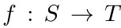 编码一个平坦布局  元组态射的复合与布局复合兼容，因为如果  和  是可复合的元组态射，则

我们定义一个具象化函子（构造 3.1.4.4）：

通过公式恢复的布局函数

我们建立“元组态射代数”，其中包含排序（第 3.1.5.3 节）、合并（第 3.1.5.4 节）、补态射（第 3.1.5.6 节）、拼接（第 3.1.5.5 节）、平坦除法（第 3.1.5.7 节）和平坦乘积（第 3.1.5.8 节）等运算，它们与

平坦布局上的相应运算兼容。

### 3.1.1 基本定义

定义 3.1.1.1。令 Fin∗ 表示下列范畴：其对象是带基点的有限集

其中 m ≥ 0；其态射 α : ⟨m⟩∗ → ⟨n⟩∗ 是满足 α(∗) = ∗ 的函数。这些态射称为保基点映射，或简称映射。

旁注 3.1.1.2。Fin∗ 是有限带基点集范畴 FinSet∗ 的一个骨架。

展开原页对照（保留全部图示、代码、标签和数学排版）

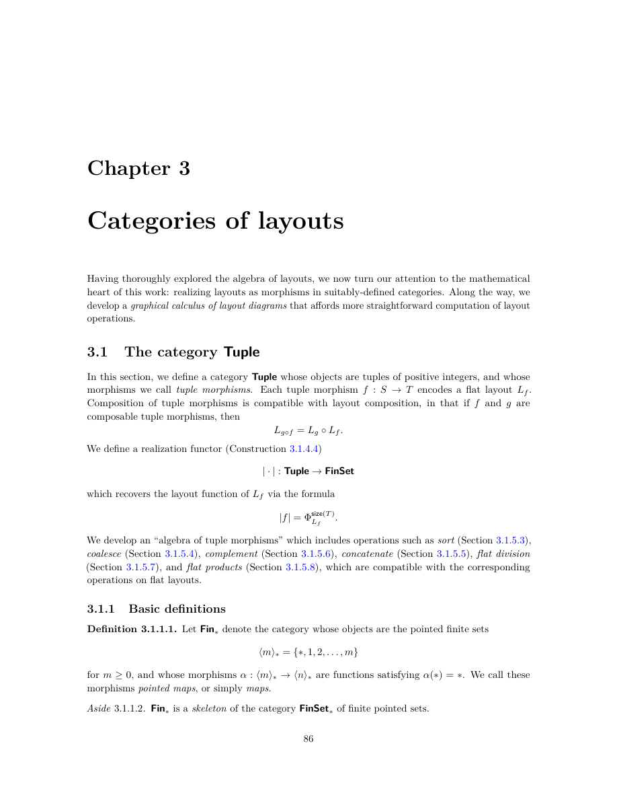

展开本页英文正文

<pre v-pre style="white-space:pre-wrap;overflow-wrap:anywhere">Chapter 3

Categories of layouts

Having thoroughly explored the algebra of layouts, we now turn our attention to the mathematical heart of this work: realizing layouts as morphisms in suitably-defined categories. Along the way, we develop a graphical calculus of layout diagrams that affords more straightforward computation of layout operations.

3.1 The category Tuple

In this section, we define a category Tuple whose objects are tuples of positive integers, and whose morphisms we call tuple morphisms. Each tuple morphism f : S →T encodes a flat layout Lf. Composition of tuple morphisms is compatible with layout composition, in that if f and g are composable tuple morphisms, then

We define a realization functor (Construction 3.1.4.4)

which recovers the layout function of Lf via the formula

We develop an “algebra of tuple morphisms” which includes operations such as sort (Section 3.1.5.3), coalesce (Section 3.1.5.4), complement (Section 3.1.5.6), concatenate (Section 3.1.5.5), flat division (Section 3.1.5.7), and flat products (Section 3.1.5.8), which are compatible with the corresponding

operations on flat layouts.

3.1.1 Basic definitions

Definition 3.1.1.1. Let Fin∗denote the category whose objects are the pointed finite sets

for m ≥0, and whose morphisms α : ⟨m⟩∗→⟨n⟩∗are functions satisfying α(∗) = ∗. We call these morphisms pointed maps, or simply maps.

Aside 3.1.1.2. Fin∗is a skeleton of the category FinSet∗of finite pointed sets.</pre>

## PDF 第 89 页 · 原书第 87 页

记号 3.1.1.3。当保基点映射 α : ⟨m⟩∗ → ⟨n⟩∗ 的陪域可以由上下文确定时，有时将

作为长度为 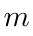 的元组，其中分量位于 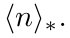 中

示例 3.1.1.4.  中有一个态射 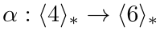，由下式给出

我们可以使用下图来可视化。

注意，对应于分量 3 的圆点没有箭头，因为它被映到基点 ∗。

示例 3.1.1.5.  中有一个态射 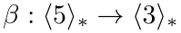，由下式给出

我们可以使用下图来可视化。

示例 3.1.1.6. 对于任何 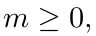， 中存在唯一的态射，其形式为 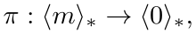，即

例 3.1.1.7. 对任意 $n\ge0$，$\mathrm{Fin}_*$ 中存在唯一的形如 $\delta:\langle0\rangle_*\to\langle m\rangle_*$ 的态射，即〔校注：原文量词使用 $n$，陪域却使用 $m$；二者应统一。〕

旁注 3.1.1.8。范畴 Fin∗ 是交换运算子的算子范畴，因此我们

有时写

我们对 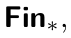 中可处理的态射特别感兴趣，我们在下面定义它。

定义 3.1.1.9。如果对任意 j ∈ ⟨n⟩ ⊂ ⟨n⟩∗，原像 α⁻¹(j) 为空或仅包含一个元素，就称保基点映射 α : ⟨m⟩∗ → ⟨n⟩∗ 可处理。

展开原页对照（保留全部图示、代码、标签和数学排版）

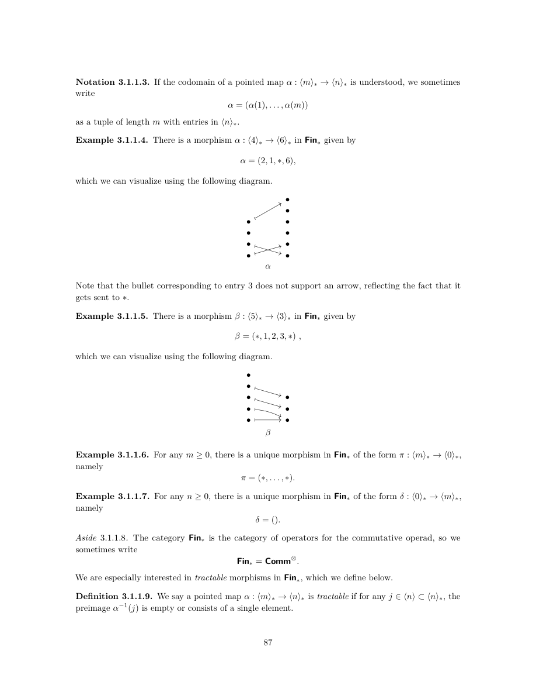

展开本页英文正文

<pre v-pre style="white-space:pre-wrap;overflow-wrap:anywhere">Notation 3.1.1.3. If the codomain of a pointed map α : ⟨m⟩∗→⟨n⟩∗is understood, we sometimes write

as a tuple of length m with entries in ⟨n⟩∗.

Example 3.1.1.4. There is a morphism α : ⟨4⟩∗→⟨6⟩∗in Fin∗given by

which we can visualize using the following diagram.

Note that the bullet corresponding to entry 3 does not support an arrow, reflecting the fact that it gets sent to ∗.

Example 3.1.1.5. There is a morphism β : ⟨5⟩∗→⟨3⟩∗in Fin∗given by

which we can visualize using the following diagram.

Example 3.1.1.6. For any m ≥0, there is a unique morphism in Fin∗of the form π : ⟨m⟩∗→⟨0⟩∗, namely

Example 3.1.1.7. For any n ≥0, there is a unique morphism in Fin∗of the form δ : ⟨0⟩∗→⟨m⟩∗, namely

Aside 3.1.1.8. The category Fin∗is the category of operators for the commutative operad, so we

sometimes write

We are especially interested in tractable morphisms in Fin∗, which we define below.

Definition 3.1.1.9. We say a pointed map α : ⟨m⟩∗→⟨n⟩∗is tractable if for any j ∈⟨n⟩⊂⟨n⟩∗, the preimage α−1(j) is empty or consists of a single element.</pre>

## PDF 第 90 页 · 原书第 88 页

示例 3.1.1.10. 映射

可处理，而映射

不可处理

备注 3.1.1.11. 如果我们将  中的态射 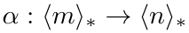 表示为元组，即

那么，α 可处理，当且仅当 α 中没有任何正整数出现超过一次。

旁注 3.1.1.12。由可处理的保基点映射组成的宽子范畴

在可处理的带基点映射上得到的范畴，就是 E₀ 运算子的算子范畴。

定义 3.1.1.13。令 Tuple 表示下列范畴：其对象是元组

其中各分量为正整数；而态射

由满足下列条件的可处理保基点映射 α : ⟨m⟩∗ → ⟨n⟩∗ 指定：

• 如果 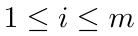 和 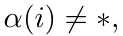 则 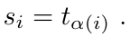

我们说这样的态射  位于  之上，并将  称为元组态射。

符号 3.1.1.14. 如果 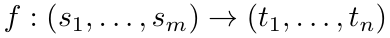 是位于 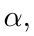 之上的元组态射，那么我们有时将  描述为

我们开发的布局的图形演算基于  中态射的自然可视化，如下所示。

展开原页对照（保留全部图示、代码、标签和数学排版）

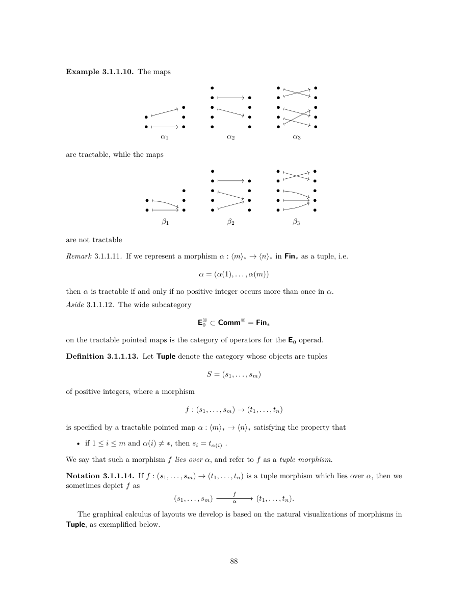

展开本页英文正文

<pre v-pre style="white-space:pre-wrap;overflow-wrap:anywhere">Example 3.1.1.10. The maps

are tractable, while the maps

are not tractable

Remark 3.1.1.11. If we represent a morphism α : ⟨m⟩∗→⟨n⟩∗in Fin∗as a tuple, i.e.

then α is tractable if and only if no positive integer occurs more than once in α.

Aside 3.1.1.12. The wide subcategory

on the tractable pointed maps is the category of operators for the E0 operad.

Definition 3.1.1.13. Let Tuple denote the category whose objects are tuples

of positive integers, where a morphism

is specified by a tractable pointed map α : ⟨m⟩∗→⟨n⟩∗satisfying the property that

• if 1 ≤i ≤m and α(i)̸ = ∗, then si = tα(i) .

We say that such a morphism f lies over α, and refer to f as a tuple morphism.

Notation 3.1.1.14. If f : (s1, . . . , sm) →(t1, . . . , tn) is a tuple morphism which lies over α, then we sometimes depict f as

The graphical calculus of layouts we develop is based on the natural visualizations of morphisms in Tuple, as exemplified below.</pre>

## PDF 第 91 页 · 原书第 89 页

示例 3.1.1.15. 元组态射

可以使用下图进行可视化。

示例 3.1.1.16. 元组态射

可以使用下图进行可视化。

示例 3.1.1.17. 元组态射

可以使用下图进行可视化。

观察 3.1.1.18。我们可以按以下方式，将范畴 Tuple 与若干熟知的运算子联系起来。令 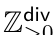

表示以整除关系为序的正整数偏序集，并将其视为一个对称幺半范畴，其幺半乘积由整数乘法给出。令

下列记号表示这个对称幺半范畴的算子范畴：

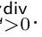 那么有明显的函子

和

使得该图

展开原页对照（保留全部图示、代码、标签和数学排版）

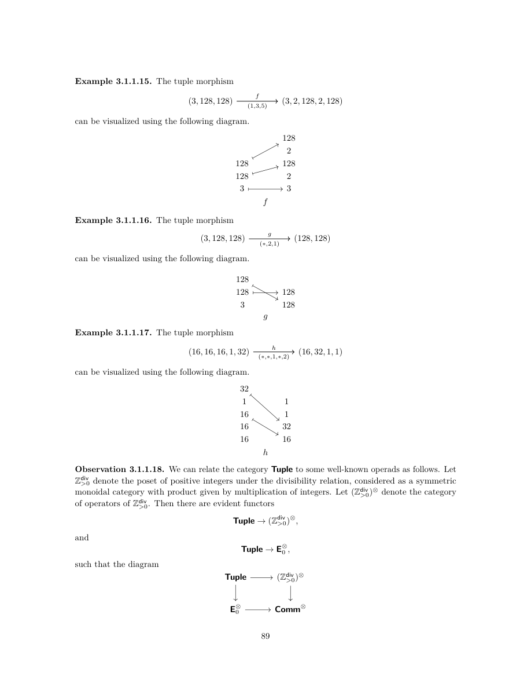

展开本页英文正文

<pre v-pre style="white-space:pre-wrap;overflow-wrap:anywhere">Example 3.1.1.15. The tuple morphism

can be visualized using the following diagram.

Example 3.1.1.16. The tuple morphism

can be visualized using the following diagram.

Example 3.1.1.17. The tuple morphism

can be visualized using the following diagram.

Observation 3.1.1.18. We can relate the category Tuple to some well-known operads as follows. Let Zdiv

&gt;0 denote the poset of positive integers under the divisibility relation, considered as a symmetric monoidal category with product given by multiplication of integers. Let (Zdiv

&gt;0)⊗denote the category of operators of Zdiv

&gt;0. Then there are evident functors

and

such that the diagram</pre>

## PDF 第 92 页 · 原书第 90 页

交换。这表明，Tuple 是下列拉回运算子的一个宽子范畴：

中，由下列态射组成的子范畴：

满足

### 3.1.2 从元组态射到平坦布局

使用范畴 `Tuple` 的动力是每个元组态射 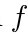 编码一个平坦布局 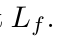 此外，每个可处理布局  产生一个元组态射 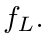 我们证明作为命题 3.1.2.10 这些结构在某种意义上是逆的，并且可处理布局正是由元组态射编码的布局。

构造 3.1.2.1. 假设

是元组态射。我们将 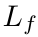 定义为平坦布局，其形状

是 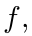 的域，其步长

由公式定义

我们将 Lf 称为 f 编码的布局，或与 f 关联的布局。

示例 3.1.2.2. 元组态射

示例 3.1.1.15 对布局进行编码

注意，利用构造 3.1.2.1 的公式计算步长，就是从某个形状分量沿箭头找到其目标分量，然后将目标分量下方的所有分量相乘，空乘积取为 1。

展开原页对照（保留全部图示、代码、标签和数学排版）

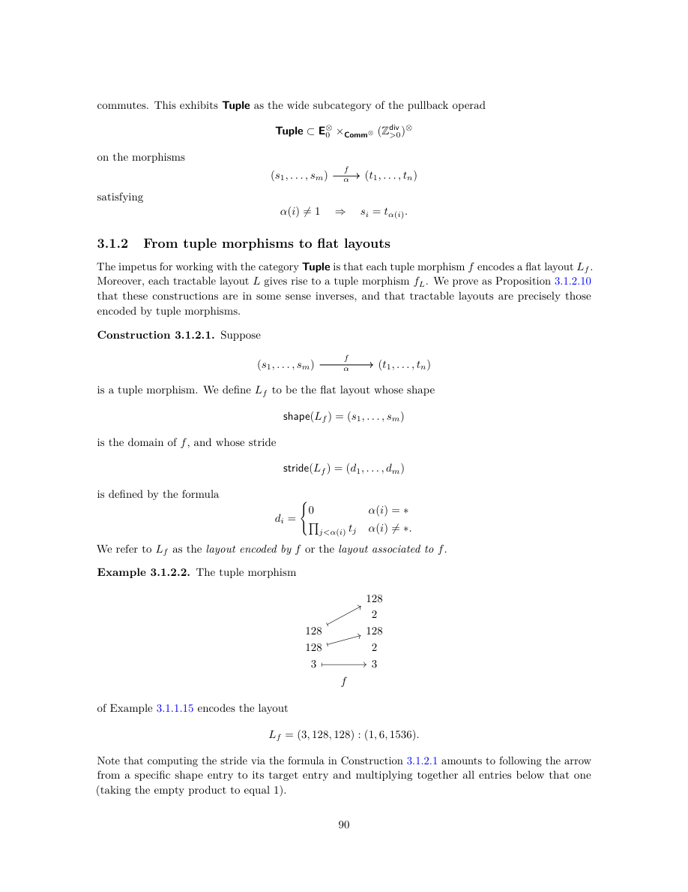

展开本页英文正文

<pre v-pre style="white-space:pre-wrap;overflow-wrap:anywhere">commutes. This exhibits Tuple as the wide subcategory of the pullback operad

on the morphisms

satisfying

3.1.2 From tuple morphisms to flat layouts

The impetus for working with the category Tuple is that each tuple morphism f encodes a flat layout Lf. Moreover, each tractable layout L gives rise to a tuple morphism fL. We prove as Proposition 3.1.2.10 that these constructions are in some sense inverses, and that tractable layouts are precisely those encoded by tuple morphisms.

Construction 3.1.2.1. Suppose

is a tuple morphism. We define Lf to be the flat layout whose shape

is the domain of f, and whose stride

is defined by the formula

We refer to Lf as the layout encoded by f or the layout associated to f.

Example 3.1.2.2. The tuple morphism

of Example 3.1.1.15 encodes the layout

Note that computing the stride via the formula in Construction 3.1.2.1 amounts to following the arrow from a specific shape entry to its target entry and multiplying together all entries below that one (taking the empty product to equal 1).</pre>

## PDF 第 93 页 · 原书第 91 页

示例 3.1.2.3. 元组态射

示例 3.1.1.16 对布局进行编码

示例 3.1.2.4. 元组态射

示例 3.1.1.17 对布局进行编码

我们已经看到了如何计算由元组态射 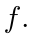 编码的平坦布局 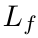 另一方面，如果  是可处理的，那么我们可以朝另一个方向走，构造一个编码  的元组态射  回顾定义 2.1.8.1 ，平坦布局 是可处理的，如果

满足以下性质：

对每个 1 ≤ i < m，都有 dᵢ = 0，或 sᵢdᵢ 整除 dᵢ₊₁。

构造 3.1.2.5. 假设 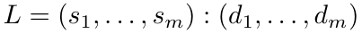 可处理，并且设置

因此存在置换 σ ∈ Σₘ，使得 sort(L) = Lσ。换言之，对每个 1 ≤ i ≤ m，有 s′ᵢ = sσ(i)，d′ᵢ = dσ(i)。

如果每个 d′ᵢ 都非零，

令 k = 0；否则，令 k 为满足

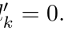 让 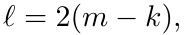 并且让

我们定义

是位于映射 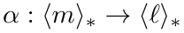 上的元组态射

令 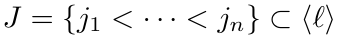 表示索引集合，使得 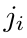 为偶数或 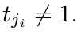 让

令 $\iota:\langle n\rangle_*\to\langle\ell\rangle_*$ 为包含映射 $i\mapsto j_i$。由构造，$\alpha'$ 分解为 $\alpha'=\iota\circ\alpha$，定义 $L$ 的标准表示为下列元组态射：〔校注：本页前面在定义到 $\langle\ell\rangle_*$ 的映射时使用了 $\alpha$，而分段式及此处使用 $\alpha'$；应将那个初始映射记为 $\alpha'$，$\alpha$ 留给删去冗余陪域分量后的映射。〕

展开原页对照（保留全部图示、代码、标签和数学排版）

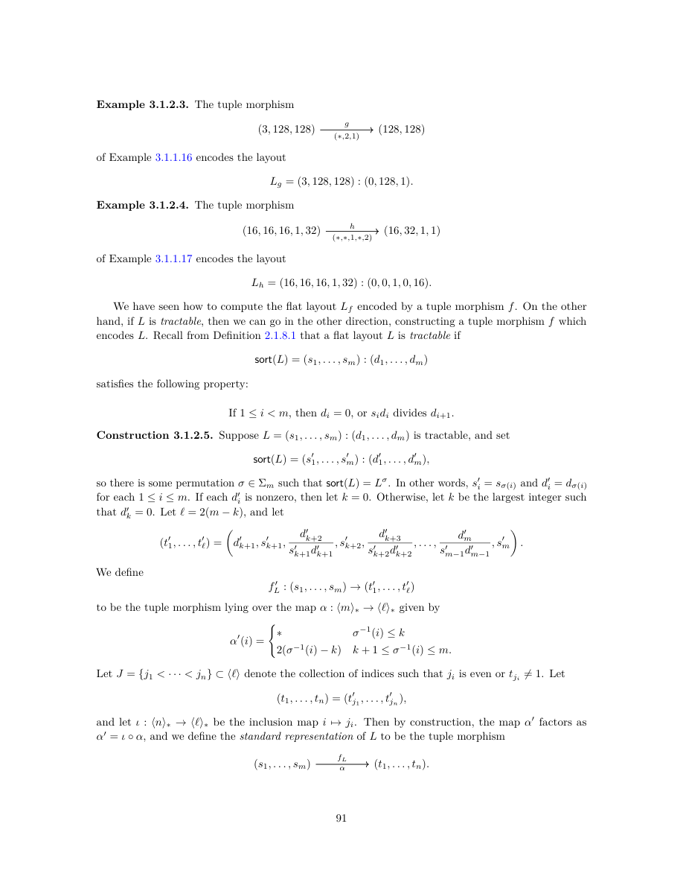

展开本页英文正文

<pre v-pre style="white-space:pre-wrap;overflow-wrap:anywhere">Example 3.1.2.3. The tuple morphism

of Example 3.1.1.16 encodes the layout

Example 3.1.2.4. The tuple morphism

of Example 3.1.1.17 encodes the layout

We have seen how to compute the flat layout Lf encoded by a tuple morphism f. On the other hand, if L is tractable, then we can go in the other direction, constructing a tuple morphism f which encodes L. Recall from Definition 2.1.8.1 that a flat layout L is tractable if

satisfies the following property:

If 1 ≤i &lt; m, then di = 0, or sidi divides di+1.

Construction 3.1.2.5. Suppose L = (s1, . . . , sm) : (d1, . . . , dm) is tractable, and set

so there is some permutation σ ∈Σm such that sort(L) = Lσ. In other words, s′

i = sσ(i) and d′

i = dσ(i) for each 1 ≤i ≤m. If each d′

i is nonzero, then let k = 0. Otherwise, let k be the largest integer such that d′

k = 0. Let ℓ= 2(m −k), and let

We define

to be the tuple morphism lying over the map α : ⟨m⟩∗→⟨ℓ⟩∗given by

Let J = {j1 &lt; · · · &lt; jn} ⊂⟨ℓ⟩denote the collection of indices such that ji is even or tji̸ = 1. Let

and let ι : ⟨n⟩∗→⟨ℓ⟩∗be the inclusion map i 7→ji. Then by construction, the map α′ factors as α′ = ι ◦α, and we define the standard representation of L to be the tuple morphism</pre>

## PDF 第 94 页 · 原书第 92 页

示例 3.1.2.6. 如果

那么  是可处理的， 的标准表示是元组态射

请注意，非正式地，通过构造 3.1.2.5 计算 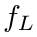 相当于

• 将陪域初始化为空元组 ()；

• 以升序遍历  的非零步长，

• 如果 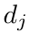 是当前步长，并且  是之前访问过的步长，则附加

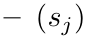 如果 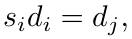 或

和

• 映射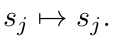

示例 3.1.2.7. 如果

那么  是可处理的， 的标准表示是元组态射

示例 3.1.2.8. 如果

那么  是可处理的，而  的标准表示是元组态射

让我们证明构造 3.1.2.5 的元组态射 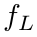 实际上对布局 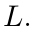 进行了编码

引理 3.1.2.9. 假设  是一个可处理的平坦布局，而 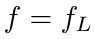 是 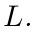 的标准表示，那么  编码的布局是

展开原页对照（保留全部图示、代码、标签和数学排版）

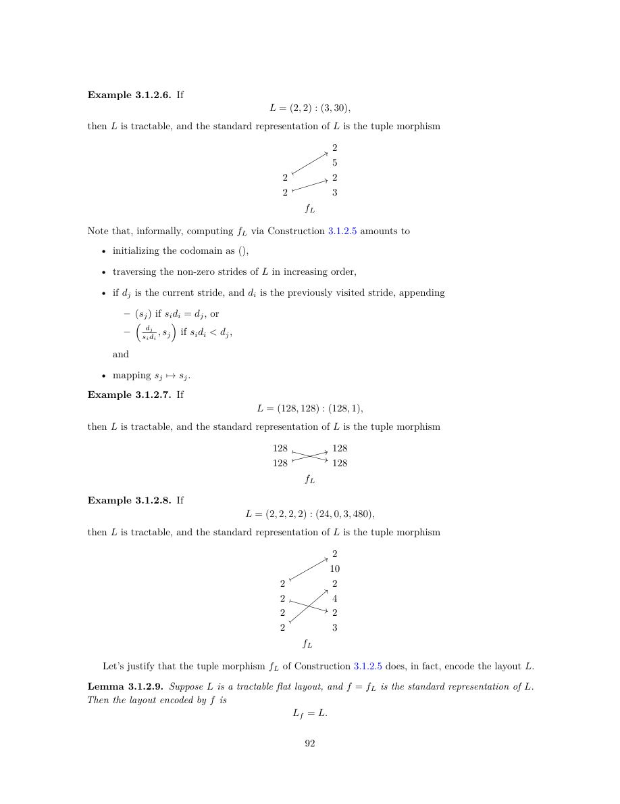

展开本页英文正文

<pre v-pre style="white-space:pre-wrap;overflow-wrap:anywhere">Example 3.1.2.6. If

then L is tractable, and the standard representation of L is the tuple morphism

Note that, informally, computing fL via Construction 3.1.2.5 amounts to

• initializing the codomain as (),

• traversing the non-zero strides of L in increasing order,

• if dj is the current stride, and di is the previously visited stride, appending

– (sj) if sidi = dj, or

and

• mapping sj 7→sj.

Example 3.1.2.7. If

then L is tractable, and the standard representation of L is the tuple morphism

Example 3.1.2.8. If

then L is tractable, and the standard representation of L is the tuple morphism

Let’s justify that the tuple morphism fL of Construction 3.1.2.5 does, in fact, encode the layout L.

Lemma 3.1.2.9. Suppose L is a tractable flat layout, and f = fL is the standard representation of L. Then the layout encoded by f is</pre>

## PDF 第 95 页 · 原书第 93 页

证明。假设  是可处理的，并且让

为 L 的标准表示。显然

需要检查 stride(Lf) = stride(L)。换言之，对任意 1 ≤ i ≤ m，需要验证

借用构造 3.1.2.5 的记号。如果 α(i) = ∗，则 α′(i) = ∗，因此 σ⁻¹(i) ≤ k。这

意味着

否则，设 α(i) ≠ ∗，则 α′(i) ≠ ∗，因此 k + 1 ≤ σ⁻¹(i) ≤ m。计算得

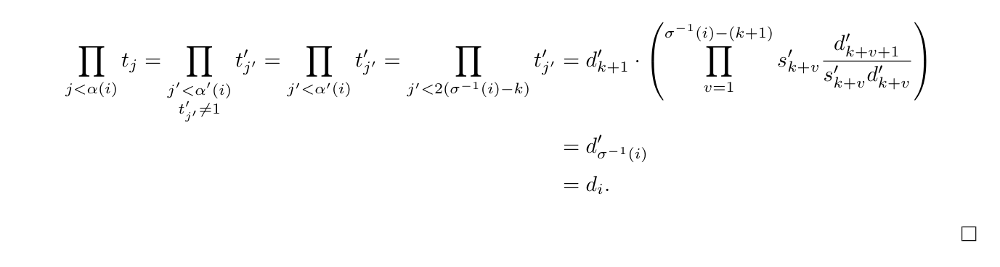

我们已经证明，如果是一个可处理的平坦布局，那么就存在一个编码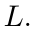的元组态射。接下来，我们证明了相反的情况，这意味着可处理的平坦布局正是由元组态射编码的布局。

命题 3.1.2.10. 假设  是平坦布局。那么存在编码  的元组态射  当且仅当  是可处理的。

证明。首先，假设  是平坦布局，而 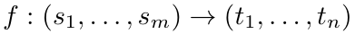 是与 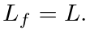 的元组态射。我们想要证明  是可处理的。让

为 L 的排序，设 1 ≤ i < m。将证明 dᵢ = 0，或者 s′ᵢdᵢ 整除 dᵢ₊₁。

若 dᵢ = 0，则结论成立。否则，设 dᵢ ≠ 0。那么

其中某个 1 ≤ k ≤ n 满足

s′ᵢ = tₖ。由于 dᵢ₊₁ ≥ dᵢ，必有 dᵢ₊₁ ≠ 0，因此 dᵢ₊₁ 具有下列形式：

对于某些 有两种情况需要考虑：

展开原页对照（保留全部图示、代码、标签和数学排版）

展开本页英文正文

<pre v-pre style="white-space:pre-wrap;overflow-wrap:anywhere">Proof. Suppose L = (s1, . . . , sm) : (d1, . . . , dm) is tractable, and let

be the standard representation of L. Clearly

We need to check that stride(Lf) = stride(L). In other words, we need to check that for any 1 ≤i ≤m, we have

We borrow the notation of Construction 3.1.2.5. If α(i) = ∗, then α′(i) = ∗, and so σ−1(i) ≤k. This

implies

Suppose otherwise that α(i)̸ = ∗. Then α′(i)̸ = ∗, and so k + 1 ≤σ−1(i) ≤m. We compute

We have proved that if L is a tractable flat layout, then there exists a tuple morphism f which encodes L. Next, we prove the converse, which implies that tractable flat layouts are precisely the layouts encoded by tuple morphisms.

Proposition 3.1.2.10. Suppose L is a flat layout. Then there exists a tuple morphism f encoding L if and only if L is tractable.

Proof. First, suppose L is a flat layout, and f : (s1, . . . , sm) →(t1, . . . , tn) is a tuple morphism with Lf = L. We want to show that Lf is tractable. Let

be the sorting of L, and suppose that 1 ≤i &lt; m. We will argue that di = 0, or s′

idi divides di+1. If di = 0, then we are done. Suppose otherwise that di̸ = 0. Then

for some 1 ≤k ≤n with s′

i = tk. Since di+1 ≥di, we know that di+1̸ = 0, so di+1 has the form

for some 1 ≤ℓ≤n. There are two cases to consider:</pre>

## PDF 第 96 页 · 原书第 94 页

•（案例  如果  则

s′ᵢdᵢ 整除 dᵢ₊₁。

• 情况 2：若 ℓ ≤ k，由于

我们必须有

和

特别是，我们有 

s′ᵢ₊₁ = tℓ = 1。但 sort(Lf) 已排序，且 dᵢ₊₁ = dᵢ，所以

 我们推断

所以特别是 

s′ᵢdᵢ 整除 dᵢ₊₁。

我们的结论是  是可处理的。

接下来，假设  是可处理的。然后我们可以将  作为  的标准表示（参见构造  在这种情况下，根据引理 3.1.2.9, 我们有 

注记 3.1.2.11。需要注意，许多不同的元组态射可以

编码同一个布局。例如，下图中的每个元组态射

对布局进行编码

其中，f 最简单：与 g 不同，f 的像上方没有多余分量；与 h 不同，未被 f 命中的分量已合并在一起。为精确表达 f 相对于这些态射的简单性，引入标准形式的概念。

定义 3.1.2.12. 假设

是元组态射。如果满足以下条件，我们称  具有标准形式：

展开原页对照（保留全部图示、代码、标签和数学排版）

展开本页英文正文

<pre v-pre style="white-space:pre-wrap;overflow-wrap:anywhere">• (Case 1) If ℓ&gt; k, then

idi divides di+1.

• (Case 2) If ℓ≤k, then since Y

we must have

and

In particular, we have s′

i+1 = tℓ= 1. But since sort(Lf) is sorted and di+1 = di, we have s′

i = 1. We deduce that

so in particular, s′

idi divides di+1.

We conclude that L is tractable.

Next, suppose that L is tractable. Then we can take f = fL to be the standard representation of L (see Construction 3.1.2.5), in which case, by Lemma 3.1.2.9, we have L = Lf.

Remark 3.1.2.11. It is important to note that there are many different tuple morphisms which give

rise to the same layout. For example, each of the tuple morphisms shown below

encodes the layout

Among these, f is the simplest: There are no extraneous entries lying above the image of f (unlike g), and the entries not hit by f are condensed (unlike h). To make precise the simplicity of f among these morphisms, we introduce the notion of standard form.

Definition 3.1.2.12. Suppose

is a tuple morphism. We say f has standard form if the following conditions hold:</pre>

## PDF 第 97 页 · 原书第 95 页

1. 如果  则 

2. 如果  那么

若 j ∉ Image(α)，则要求 tⱼ ≠ 1，并且 j + 1 ∈ Image(α)。

示例 3.1.2.13. 备注 3.1.2.11 的元组态射  具有标准形式，而  和  则没有。

示例 3.1.2.14. 元组态射

具有标准形式，而元组态射

不。

示例 3.1.2.15. 如果  是可处理布局，则通过构造， 的标准表示  具有标准形式。

如果我们限制标准形式的元组态射，那么与可处理布局几乎是一一对应的。但是，我们需要排除一种有问题的情况，如以下示例所示。

示例 3.1.2.16. 考虑下面所示的元组态射  和 。

和都有标准形式，并且

此示例说明  和  形式的分量的存在可能导致标准形式的表示元组态射的非唯一性。在布局方面，这对应于形状分量  = 1 和步长  为了排除这种病态的例子，我们引入了非退化性的概念。

展开原页对照（保留全部图示、代码、标签和数学排版）

展开本页英文正文

<pre v-pre style="white-space:pre-wrap;overflow-wrap:anywhere">1. If n &gt; 1, then n ∈Image(α).

2. If 1 ≤j &lt; n, then

j /∈Image(α) ⇒ tj̸ = 1, and j + 1 ∈Image(α)

Example 3.1.2.13. The tuple morphisms f of Remark 3.1.2.11 has standard form, while g and h do not.

Example 3.1.2.14. The tuple morphisms

have standard form, while the tuple morphisms

do not.

Example 3.1.2.15. If L is a tractable layout, then by construction, the standard representation fL of L has standard form.

If we restrict to tuple morphisms of standard form, then there is almost a one-to-one correspondence with tractable layouts. However, there is one problematic case we need to exclude, as explicated in the following example.

Example 3.1.2.16. Consider the tuple morphisms f and g shown below.

Both f and g have standard form, and

This example illustrates that the presence of entries of the form si = 1 and α(i)̸ = ∗can lead to non-uniqueness of a representing tuple morphism of standard form. On the layout side, this corresponds to shape entries si = 1 with stride di̸ = 0. In order to exclude such pathological examples, we introduce the notion of non-degeneracy.</pre>

## PDF 第 98 页 · 原书第 96 页

定义 3.1.2.17. 假设

是一个元组态射并且

是平坦布局。

1. 如果    我们说  是非退化的

2. 如果    我们说  是非退化的

观察 3.1.2.18. 如果  是非退化元组态射，则由  编码的布局  是非退化的。相反，如果  是非退化平坦布局，则  的标准表示  是非退化的。

观察 3.1.2.19. 限制到非退化平坦布局并不真正损失一般性。若 $L$ 是任意平坦布局，则 $\operatorname{filter}(L)$ 是非退化平坦布局，并且与 $L$ 具有相同的坐标函数和布局函数。〔校注：本句按原文译出，但与此前 filter 的定义不完全相容。例如 $L=(1):(3)$ 已被 filter 保留，却不满足本页的非退化条件；删除零步长模态后，坐标函数的定义域也可能改变。此处不能直接当作已证明结论使用。〕

标准形式的非退化元组态射的基本属性是它们由它们编码的布局来表征。具体如下。

引理 3.1.2.20. 假设  和  是标准形式的非简并元组态射。如果  则 〔校注：标准形式的单位边界还需要额外约定。按定义 3.1.2.12 的字面条件，$f:()\to()$ 与 $g:()\to(1)$ 都是标准形式的非退化元组态射，且编码同一空布局；因此本引理与后续一一对应定理在该边界上存在歧义，详见校对记录。〕

证明。假设

和

为标准形式的非退化元组态射，并满足

我们想要证明  首先，我们将论证  让

分别表示和的前缀积的集合。我们声称  因为这些集合中的每一个都等于

 和 

让我们论证  假设  如果存在一些  和  那么  另一方面，如果  不在  的像中，那么由于  具有标准形式，因此存在一些 使得  在这种情况下  这证明了 

展开原页对照（保留全部图示、代码、标签和数学排版）

展开本页英文正文

<pre v-pre style="white-space:pre-wrap;overflow-wrap:anywhere">Definition 3.1.2.17. Suppose

is a tuple morphism and

is a flat layout.

1. We say f is non-degenerate if si = 1 ⇒ α(i) = ∗.

2. We say L is non-degenerate if si = 1 ⇒ di = 0.

Observation 3.1.2.18. If f is a non-degenerate tuple morphism, then the layout Lf encoded by f is non-degenerate. Conversely, if L is a non-degenerate flat layout, then the standard representation fL of L is non-degenerate.

Observation 3.1.2.19. Restricting to non-degenerate flat layouts is no real loss of generality. If L is an arbitrary flat layout, then filter(L) is a non-degenerate flat layout with the same coordinate function and layout function as L.

The essential property of non-degenerate tuple morphisms of standard form is that they are characterized by the layouts which they encode. This is made precise as follows.

Lemma 3.1.2.20. Suppose f and g are non-degenerate tuple morphisms of standard form. If Lf = Lg, then f = g.

Proof. Suppose

and

are non-degenerate tuple morphisms of standard form with

We want to show that f = g. First, we will argue that (t1, . . . , tn) = (u1, . . . , up). Let

denote the sets of prefix products of (t1, . . . , tn) and (u1, . . . , up), respectively. We claim X = Y , since each of these sets is equal to

Z = {di, sidi | 1 ≤i ≤m and di̸ = 0}.

Lets argue that X = Z. Suppose 1 ≤j ≤n. If there exists some i ∈⟨m⟩with α(i) = j, then t1 · · · tj = sidi. On the other hand, if j is not in the image of α, then since f has standard form, there exists some i ∈⟨m⟩such that α(i) = j + 1, in which case t1 · · · tj = di. This proves that X ⊆Z.</pre>

## PDF 第 99 页 · 原书第 97 页

反之，如果  和  那么  和  证明  我们推论  同样的论证证明 

由于  和  是标准形式的非退化，我们知道每个  和每个  都大于 1,，这意味着

又因为 X = Y，故 n = p，且对每个 1 ≤ j ≤ n 都有 t₁ ··· tⱼ = u₁ ··· uⱼ。因此，(t₁, …, tₙ) = (u₁, …, uₚ)。

接下来证明 α = β。反设存在 i ∈ ⟨m⟩，使得 α(i) ≠ β(i)。分两种情况讨论。

• 如果  则 

矛盾。案例 类似。

• 若 $\alpha(i)\ne *\ne\beta(i)$，则不失一般性可设 $\alpha(i)<\beta(j)$，此时〔校注：原文 $\beta(j)$ 中的指标应为 $i$。〕

矛盾。

我们推断  所以 

我们现在准备证明我们的对应定理，该定理识别标准形式的非退化元组态射与非退化可处理的平坦布局。

定理 3.1.2.21. 映射

构造 3.1.2.1 和 3.1.2.5 确定标准形式的非简并元组态射与非简并易处理的平面布局之间的一对一对应关系。〔校注：本定理沿用引理 3.1.2.20；单位及空元组边界的疑点见校对记录，译文未擅自补充原文没有写出的假设。〕

证明。要证明，当限制在上述形式的态射与布局上时，构造 f ↦ Lf 与 L ↦ fL 互为逆。如果 L 是非退化可处理平坦布局，由引理 3.1.2.9，有 LfL = L。再设 f 是标准形式的非退化元组态射，L = Lf 为其编码的布局。f 和 fLf 都是标准形式的非退化元组态射，且编码的布局相同，因此由引理 3.1.2.20，f = fLf。

展开原页对照（保留全部图示、代码、标签和数学排版）

展开本页英文正文

<pre v-pre style="white-space:pre-wrap;overflow-wrap:anywhere">Conversely, if 1 ≤i ≤m and di̸ = 0, then di = t1 · · · tα(i)−1 and sidi = t1 · · · tα(i), which proves Z ⊆X. We deduce that X = Z. The same argument proves Y = Z.

Since f and g are non-degenerate of standard form, we know that each tj and each uk is greater than 1, which implies

and since X = Y , it follows that n = p, and t1 · · · tj = u1 · · · uj for each 1 ≤j ≤n. We deduce that (t1, . . . , tn) = (u1, . . . , up).

Next, we need to argue that α = β. Suppose for contradiction that there exists some i ∈⟨m⟩with α(i)̸ = β(i). There are two cases to consider.

• If α(i) = ∗̸ = β(i), then 0 = di = t1 · · · tβ(i)−1,

a contradiction. The case α(i)̸ = ∗= β(i) is analogous.

• If α(i)̸ = ∗̸ = β(i), then without loss of generality we may assume α(i) &lt; β(j), in which case

a contradiction.

We deduce that α = β, so f = g.

We are now ready to prove our correspondence theorem, which identifies non-degenerate tuple morphisms of standard form with non-degenerate tractable flat layouts.

Theorem 3.1.2.21. The maps

Non-degenerate tuple morphisms of

Non-degenerate

tractable flat

standard form

layouts

of Constructions 3.1.2.1 and 3.1.2.5 determine a one-to-one correspondence between non-degenerate tuple morphisms of standard form, and non-degenerate tractable flat layouts.

Proof. We want to show that the constructions f 7→Lf and L 7→fL are inverses, when restricted to tuple morphisms and layouts of the stated form. If L is a non-degenerate tractable flat layout, then by Lemma 3.1.2.9 we have LfL = L. Suppose next that f is a non-degenerate tuple morphism of standard form and L = Lf is the layout encoded by f. Since f and fLf are non-degenerate tuple morphisms of standard form, and the layouts encoded by these tuple morphsims are equal, it follows from Lemma 3.1.2.20 that f = fLf .</pre>

## PDF 第 100 页 · 原书第 98 页

### 3.1.3 例子

在本节中，我们将介绍一些重要的元组态射族，并描述它们所产生的平坦布局。

示例 3.1.3.1（恒等态射）。我们说元组态射  是恒等态射，如果  对于某些元组  如果  是恒等态射，则  是具有形状  的列主序布局例如，这里是恒等态射的示例 及其相关布局 

示例 3.1.3.2（同构）。如果存在元组态射  使得  和  ，则元组态射  是同构。如果  是同构，则其关联布局  是紧致的。例如，这是一个同构  及其相关布局 

观察 3.1.3.3. 请注意，如果元组态射

是同构，则  是双射，因此  是置换。相反，如果  是一个置换，并且  是一个正整数元组，那么我们可以构造同构

我们得出结论，具有域  的元组同构  与  中的置换之间存在一一对应关系

示例 3.1.3.4（投影）。假设  是一个形状，并且假设

是某个子集。让

展开原页对照（保留全部图示、代码、标签和数学排版）

展开本页英文正文

<pre v-pre style="white-space:pre-wrap;overflow-wrap:anywhere">3.1.3 Examples

In this section, we introduce some important families of tuple morphisms, and describe the flat layouts to which they give rise.

Example 3.1.3.1 (Identity morphisms). We say a tuple morphism f is an identity morphism if f = idS for some tuple S. If f = idS is an identity morphism, then Lf is the column-major layout with shape S. For instance, here is an example of an identity morphism f together with its associated layout Lf.

Example 3.1.3.2 (Isomorphisms). A tuple morphism f : S →T is an isomorphism if there is a tuple morphism g : T →S such that g ◦f = idS and f ◦g = idT . If f is an isomorphism, then its associated layout Lf is compact. For instance, here is an isomorphism f together with its associated layout Lf.

Observation 3.1.3.3. Note that if a tuple morphism

is an isomorphism, then α : ⟨m⟩∗→⟨m⟩∗is a bijection, and so α |⟨m⟩∈Σm is a permutation. Conversely, if σ ∈Σm is a permutation, and (s1, . . . , sm) is a tuple of positive integers, then we may construct the isomorphism

We conclude that there is a one-to-one correspondence between tuple isomorphisms f with domain (s1, . . . , sm), and permutations in Σm.

Example 3.1.3.4 (Projections). Suppose S = (s1, . . . , sm) is a shape, and suppose

is some subset. Let</pre>

## PDF 第 101 页 · 原书第 99 页

是位于映射  上的元组态射

j，当 x = iⱼ 时；∗，其他情形。

我们将  称为  在  上的投影  编码的布局是

其中

si₁ ··· siⱼ₋₁，当存在 1 ≤ j ≤ r 使得 i = iⱼ 时；

否则为 0。

例如，以下是  到  的投影  及其关联布局。

示例 3.1.3.5（膨胀）。假设  是一个形状，并且假设  是正整数。元组态射

称为  对  的膨胀与此态射相关的布局  是 ，其中

例如，下面给出按 (2, 4) 对 (512, 512) 进行的扩张 f，以及其关联布局。

示例 3.1.3.6（扩展）。假设是一个正整数元组，假设使得整除则元组态射

称为  到  的扩展  编码的布局是形状为  的列主序布局例如，这里是  到  的扩展

展开原页对照（保留全部图示、代码、标签和数学排版）

展开本页英文正文

<pre v-pre style="white-space:pre-wrap;overflow-wrap:anywhere">be the tuple morphism lying over the map α with

j x = ij ∗ else.

We call p the projection of (s1, . . . , sm) onto (si1, . . . , sir). The layout encoded by p is

where

si1 · · · sij−1 i = ij for some 1 ≤j ≤r

0 otherwise.

For instance, here is a projection p of (64, 64, 3, 8) onto (64, 3), together with its associated layout.

Example 3.1.3.5 (Dilations). Suppose S = (s1, . . . , sm) is a shape, and suppose c1, . . . , cm are positive integers. The tuple morphism

is called the dilation of (s1, . . . , sm) by (c1, . . . , cm). The layout Lf associated to this morphism is Lf = (s1, . . . , sm) : (d1, . . . , dm), where

For instance, here is the dilation f of (512, 512) by (2, 4), together with its associated layout.

Example 3.1.3.6 (Expansions). Suppose S = (s1, . . . , sm) is a tuple of positive integers, and suppose 1 ≤i ≤m′, so that S′ = (s1, . . . , sm′) divides S. Then the tuple morphism

is called the expansion of S′ to S. The layout encoded by e is the column-major layout with shape (s1, . . . , sm′). For instance, here is the expansion of S′ = (4, 4) to S = (4, 4, 8, 8).</pre>

## PDF 第 102 页 · 原书第 100 页

扩展的一个重要属性是，如果  是任何元组态射并且  是扩展，那么

换言之，在 f 之后复合一个扩展态射，不改变 f 编码的布局。

示例 3.1.3.7（限制）。假设

是一个元组态射，并且假设

是索引的子集。然后是元组态射

称为  对  的限制如果  编码的布局为

那么编码的布局是

例如，这里是元组态射  的限制 ，其中 

例 3.1.3.8（分量包含映射）。前一构造的一个重要特例如下。如果 f : (s₁, …, sₘ) → (t₁, …, tₘ) 是元组态射，且 1 ≤ i ≤ m，那么 f 的第 i 个分量 fᵢ 为

如果编码的布局是

那么编码的布局是

展开原页对照（保留全部图示、代码、标签和数学排版）

展开本页英文正文

<pre v-pre style="white-space:pre-wrap;overflow-wrap:anywhere">An important property of expansions is that if f : S →T is any tuple morphism and e : T →T ′ is an expansion, then

In other words, post-composing f with an expansion does not change the layout encoded by f.

Example 3.1.3.7 (Restrictions). Suppose

is a tuple morphism, and suppose

is a subset of indices. Then the tuple morphism

is called the restriction of f to I. If the layout encoded by f is

then the layout encoded by f |I is

For instance, here is the restriction f |I of a tuple morphism f, where I = {2, 4}.

Example 3.1.3.8 (Entry inclusions). An important special case of the previous construction is as follows. If f : (s1, . . . , sm) →(t1, . . . , tm) is a tuple morphism and 1 ≤i ≤m, then the ith entry fi of f is

If the layout encoded by f is

then the layout encoded by fi is</pre>

## PDF 第 103 页 · 原书第 101 页

例如，这是一个元组态射  及其第四个分量 

注记 3.1.3.9。给定 ⟨n⟩∗ ∈ Fin∗，对每个 i ∈ ⟨n⟩，都有一个态射 φᵢ : ⟨1⟩∗ → ⟨n⟩∗，它将

 和  对于位于  之上的元组态射 ，第  分量位于复合  之上

示例 3.1.3.10（因式分解）。假设

是一个元组态射，并且假设

为满足 Image(α) ⊆ J ∪ {∗} 的子集。将映射 k ↦ jₖ 记为 ι : ⟨ℓ⟩∗ → ⟨n⟩∗，则存在唯一的映射 ᾱ : ⟨m⟩∗ → ⟨ℓ⟩∗，使得 α = ι ◦ ᾱ。我们将 f 经 J 的分解定义为下列元组态射：

如果编码的布局是

那么编码的布局是

其中

展开原页对照（保留全部图示、代码、标签和数学排版）

展开本页英文正文

<pre v-pre style="white-space:pre-wrap;overflow-wrap:anywhere">For instance, here is a tuple morphism f, and its fourth entry f4.

Remark 3.1.3.9. Given an ⟨n⟩∗∈Fin∗, there is a morphism φi : ⟨1⟩∗→⟨n⟩∗for each i ∈⟨n⟩sending

∗7→∗and 1 7→i. For a tuple morphism f : (s1, . . . , sm) →(t1, . . . , tn) lying over α : ⟨m⟩∗→⟨n⟩∗, the i-th entry lies over the composite α ◦φi : ⟨1⟩∗→⟨n⟩∗.

Example 3.1.3.10 (Factorizations). Suppose

is a tuple morphism, and suppose

is a subset such that Image(α) ⊆J ∪{∗}. If we write ι : ⟨ℓ⟩∗→⟨n⟩∗for the map k 7→jk, then α factors as α = ι ◦¯α for a unique map ¯α : ⟨m⟩∗→⟨ℓ⟩∗, and we define the factorization of f through J to be the tuple morphism

If the layout encoded by f is

then the layout encoded by f |J is

where</pre>

## PDF 第 104 页 · 原书第 102 页

例如，这里是元组态射  的因式分解 ，其中 

备注 3.1.3.11. 因式分解有范畴论解释。借用记号

例 3.1.3.10，我们可以观察到，存在一个位于  之上的元组态射 ，并且  是  沿  的拉回：

### 3.1.4 元组态射的具象化

正如我们所看到的，元组态射  编码平坦布局  在本节中，我们将构造一个具象化函子

这使得这种编码变得明确。具象化函子  将元组态射  发送到  的布局函数  为了构造我们的具象化函子 ，我们首先构造一个辅助函子

我们将在我们的构造中使用它。

构造 3.1.4.1. 我们定义一个函子

如下。

• 对于 中的对象，我们定义

展开原页对照（保留全部图示、代码、标签和数学排版）

展开本页英文正文

<pre v-pre style="white-space:pre-wrap;overflow-wrap:anywhere">For instance, here is the factorization f |J of a tuple morphism f, where J = {2, 4, 5}.

Remark 3.1.3.11. There is a categorical interpretation of factorizations. Borrowing the notation of

Example 3.1.3.10, we may observe that there is a tuple morphism i : (tj1, . . . , tjℓ) →(t1, . . . , tn) lying over ι, and f |J is the pullback of f along i:

3.1.4 Realization of tuple morphisms

As we have seen, a tuple morphism f : S →T encodes a flat layout Lf. In this section, we will construct a realization functor

which makes this encoding explicit. The realization functor | · | sends a tuple morphism f to the layout function |f| of Lf. In order to construct our realization functor | · |, we first construct an auxiliary functor

which we will use in our construction.

Construction 3.1.4.1. We define a functor

as follows.

• For an object S = (s1, . . . , sm) in Tuple, we define</pre>

## PDF 第 105 页 · 原书第 103 页

• 对于 `Tuple` 中的态射  位于  之上，我们将  定义为映射

由下式给出：

其中

xᵢ，当存在 1 ≤ i ≤ m 使得 α(i) = j 时；

0，其他情形。

人们可以很容易地验证  和 ，因此  实际上是一个函子。

示例 3.1.4.2. 假设  是位于  上的元组态射那么

由下式给出

示例 3.1.4.3. 假设  是位于  上的元组态射那么

由下式给出

构造 3.1.4.4. 我们定义一个函子

如下。

• 对于 中的对象，我们定义

• 对于元组态射 ，我们定义

（回顾定义 

如果  和  是可复合元组态射，那么

展开原页对照（保留全部图示、代码、标签和数学排版）

展开本页英文正文

<pre v-pre style="white-space:pre-wrap;overflow-wrap:anywhere">• For a morphism f : (s1, . . . , sm) →(t1, . . . , tn) in Tuple lying over α, we define Ff to be the map

given by

where

xi there exists 1 ≤i ≤m with α(i) = j,

0 else.

One may easily verify that F(g ◦f) = Fg ◦Ff and FidS = idF S, so F is in fact a functor.

Example 3.1.4.2. Suppose f : (4, 4) →(4, 4, 4) is the tuple morphism lying over α = (1, 3). Then

is given by

Example 3.1.4.3. Suppose g : (3, 256, 256, 512) →(3, 256, 256) is the tuple morphism lying over β = (∗, 3, 2, ∗). Then

is given by

Construction 3.1.4.4. We define a functor

as follows.

• For an object S = (s1, . . . , sm) in Tuple, we define

• For a tuple morphism f : S →T, we define

(recall Definition 2.1.2.18).

If f : S →T and g : T →U are composable tuple morphisms then</pre>

## PDF 第 106 页 · 原书第 104 页

如果  是恒等态射，那么

所以  实际上指定了一个函子。接下来，我们观察到，对于  中的态射 ，映射  是  的布局函数。这使我们能够轻松推断出 `Tuple` 中态射的复合与平坦布局的复合兼容（参见推论 

引理 3.1.4.5. 如果  是元组态射，则  的具象化  就是  的布局函数

证明。设  并设

表示与  关联的布局，其步长  由以下公式定义

其余情形取上式所示的乘积。

在输入端与余字典序同构预复合后，

只需证明，对于任意 (x₁, …, xₘ) ∈ ∏ᵢ₌₁ᵐ [0, sᵢ)，

都有下式成立：

对一般的输入 (x₁, …, xₘ) ∈ ∏ᵢ₌₁ᵐ [0, sᵢ)，

有

其中，当  时， 等于 ，否则等于 0。由此可得：

所证即得。

推论 3.1.4.6. 如果  和  是非退化可复合元组态射，则

证明。假设  和  是 `Tuple` 中的态射，分别位于  和  之上。写入  和  我们需要检查

展开原页对照（保留全部图示、代码、标签和数学排版）

展开本页英文正文

<pre v-pre style="white-space:pre-wrap;overflow-wrap:anywhere">and if f = idS is an identity morphism, then

so | · | does in fact specify a functor. Next, we observe that for a morphism f in Tuple, the map |f| is the layout function of Lf. This allows us to easily deduce that composition of morphisms in Tuple is compatible with composition of flat layouts (see Corollary 3.1.4.6).

Lemma 3.1.4.5. If f : S →T is a tuple morphism, then the realization |f| of f is the layout function of Lf:

Proof. Let S = (s1, . . . , sm), T = (t1, . . . , tn), and let

denote the layout associated to f, whose strides di are defined by the formula

j&lt;α(i) tj else.

By precomposing with colexS : Qm

i=1[0, si) →[0, size(S)), it suffices to prove that for any (x1, . . . , xm) ∈ Qm

i=1[0, si), we have

For a general input (x1, . . . , xm) ∈Qm

i=1[0, si), we have

where yj is equal to xi if α(i) = j, and 0 otherwise. It follows that

as desired.

Corollary 3.1.4.6. If f and g are non-degenerate composable tuple morphisms, then

Proof. Suppose f : S →T and g : T →U are morphisms in Tuple lying over α and β, respectively. Write S = (s1, . . . , sm) and T = (t1, . . . , tn). We need to check that</pre>

---
[译文总目录](Layout.md) · [第 2.3 节：布局](Translation-05-Layouts.md) · [第 3.1 节：元组态射上的运算](Translation-07-Tuple-Operations.md)
