# 第 3.1 节：元组态射上的运算
[译文总目录](Layout.md) · [第 3.1 节：Tuple 范畴、编码与具象化](Translation-06-Tuple.md) · [第 3.2 节：Nest 范畴与细化](Translation-08-Nest.md)
> 来源：Colfax Research，2025 年 9 月版。本文为中文逐段译文，保留原文顺序及定义、命题、例子、证明和公式；校对说明以“校注”明确区分于原文，详见[校对记录](Proofreading.md)。复杂数学式与图示直接使用本地原文裁片。每页末尾可展开原页核对。

## PDF 第 107 页 · 原书第 105 页

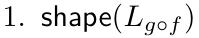 细化 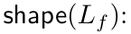 这成立，因为  和 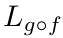 的形状都等于 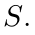

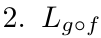 合并在 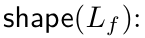 上这是成立的，因为元组态射 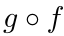 是非退化的，因此布局 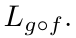 也是非退化的

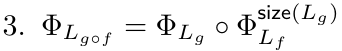 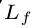 ：使用引理 3.1.4.5, 我们有

并通过包含 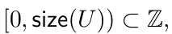 进行后复合并观察 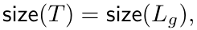，结果如下。

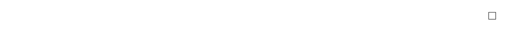

### 3.1.5 元组态射上的运算

接下来建立“元组态射代数”，其中包含合并、补态射、复合、平坦除法和平坦乘积等运算。将证明，这些运算分别

与平坦布局上的相应操作兼容。

3.1.5.1 和

元组态射  和  的和 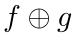 是通过拼接  和 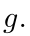 的域和陪域得到的。为了精确地定义这个运算，我们首先在 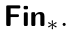 中定义一个对应的态射运算

定义 3.1.5.1. 假设 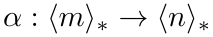 和 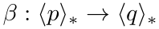 是  中的态射我们定义 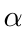 和  的和为态射

由下式给出：

这一运算满足结合律，因此对 Fin∗ 中任意有限多个态射 α₁, …, αₖ，都可以考虑其和 α₁ ⊕ ··· ⊕ αₖ。

备注 3.1.5.2. 如果 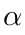 和 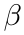 是可处理的保基点映射，则 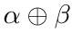 是可处理的。

现在我们可以定义 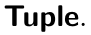 中的态射之和

定义 3.1.5.3. 假设 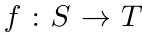 和 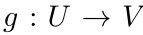 分别是位于  和  上的元组态射。我们将  和  的和定义为元组态射

它位于 α ⊕ β 之上。这一运算满足结合律，因此对 Tuple 中任意有限多个态射 f₁, …, fₖ，都可以考虑其和 f₁ ⊕ ··· ⊕ fₖ。

展开原页对照（保留全部图示、代码、标签和数学排版）

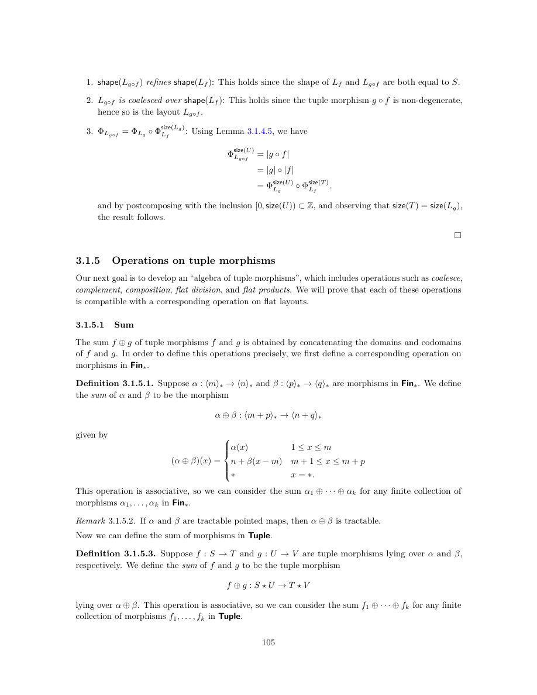

展开本页英文正文

<pre v-pre style="white-space:pre-wrap;overflow-wrap:anywhere">1. shape(Lg◦f) refines shape(Lf): This holds since the shape of Lf and Lg◦f are both equal to S.

2. Lg◦f is coalesced over shape(Lf): This holds since the tuple morphism g ◦f is non-degenerate, hence so is the layout Lg◦f.

3. ΦLg◦f = ΦLg ◦Φsize(Lg) Lf : Using Lemma 3.1.4.5, we have

and by postcomposing with the inclusion [0, size(U)) ⊂Z, and observing that size(T) = size(Lg), the result follows.

3.1.5 Operations on tuple morphisms

Our next goal is to develop an “algebra of tuple morphisms”, which includes operations such as coalesce, complement, composition, flat division, and flat products. We will prove that each of these operations

is compatible with a corresponding operation on flat layouts.

3.1.5.1 Sum

The sum f ⊕g of tuple morphisms f and g is obtained by concatenating the domains and codomains of f and g. In order to define this operations precisely, we first define a corresponding operation on morphisms in Fin∗.

Definition 3.1.5.1. Suppose α : ⟨m⟩∗→⟨n⟩∗and β : ⟨p⟩∗→⟨q⟩∗are morphisms in Fin∗. We define the sum of α and β to be the morphism

given by

This operation is associative, so we can consider the sum α1 ⊕· · · ⊕αk for any finite collection of morphisms α1, . . . , αk in Fin∗.

Remark 3.1.5.2. If α and β are tractable pointed maps, then α ⊕β is tractable.

Now we can define the sum of morphisms in Tuple.

Definition 3.1.5.3. Suppose f : S →T and g : U →V are tuple morphisms lying over α and β, respectively. We define the sum of f and g to be the tuple morphism

lying over α ⊕β. This operation is associative, so we can consider the sum f1 ⊕· · · ⊕fk for any finite collection of morphisms f1, . . . , fk in Tuple.</pre>

## PDF 第 108 页 · 原书第 106 页

示例 3.1.5.4. 以下是元组态射  和 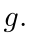 之和  的示例

示例 3.1.5.5. 下面是元组态射  和 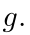 之和  的另一个示例

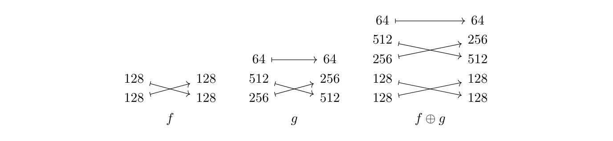

备注 3.1.5.6. 元组态射之和有一个范畴论解释：如果 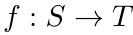 和

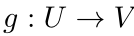 是元组态射，那么

是箭头范畴 $\operatorname{Ar}(\mathrm{Tuple})$ 中 $f$ 与 $g$ 的余积。

3.1.5.2 挤压

通常情况下，我们希望从元组中删除整数 1 的任何实例。这是通过挤压函子来完成的。

定义 3.1.5.7. 我们定义一个函子

如下。如果 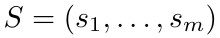 是 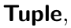 中的一个对象，我们定义

其中 $\{i_1<\cdots<i_k\}\subset\langle m\rangle$ 是满足 $s_{i_j}\ne1$ 的那些指标。若 $f:(s_1,\ldots,s_m)\to(t_1,\ldots,t_n)$ 是元组态射，则定义

是元组态射

其中 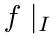 是  的限制

其中的限制见定义 3.1.3.7，而 $(f|_I)|_J$ 是 $f|_I$ 经由下列对象得到的分解：

如定义 3.1.3.10.

展开原页对照（保留全部图示、代码、标签和数学排版）

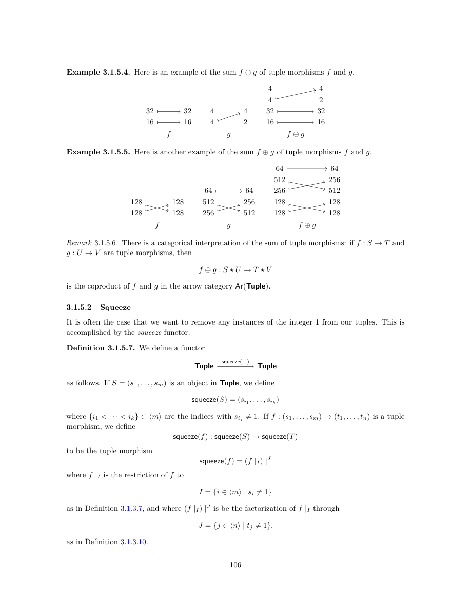

展开本页英文正文

<pre v-pre style="white-space:pre-wrap;overflow-wrap:anywhere">Example 3.1.5.4. Here is an example of the sum f ⊕g of tuple morphisms f and g.

Example 3.1.5.5. Here is another example of the sum f ⊕g of tuple morphisms f and g.

Remark 3.1.5.6. There is a categorical interpretation of the sum of tuple morphisms: if f : S →T and

g : U →V are tuple morphisms, then

is the coproduct of f and g in the arrow category Ar(Tuple).

3.1.5.2 Squeeze

It is often the case that we want to remove any instances of the integer 1 from our tuples. This is accomplished by the squeeze functor.

Definition 3.1.5.7. We define a functor

as follows. If S = (s1, . . . , sm) is an object in Tuple, we define

where {i1 &lt; · · · &lt; ik} ⊂⟨m⟩are the indices with sij̸ = 1. If f : (s1, . . . , sm) →(t1, . . . , tn) is a tuple morphism, we define

to be the tuple morphism

where f |I is the restriction of f to

as in Definition 3.1.3.7, and where (f |I) |J is be the factorization of f |I through

as in Definition 3.1.3.10.</pre>

## PDF 第 109 页 · 原书第 107 页

示例 3.1.5.8. 下面是态射  和相应态射 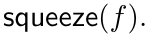 的示例

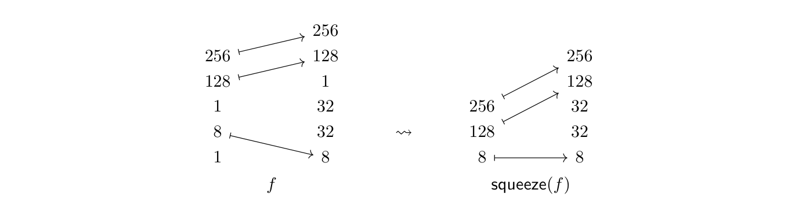

示例 3.1.5.9. 如果 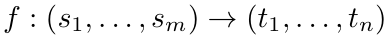 是元组态射，则

$f=\operatorname{squeeze}(f)$ 当且仅当所有 $s_i$、$t_j$ 均不等于 $1$。

命题 3.1.5.10. 如果  是元组态射，则

证明。假设 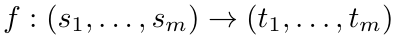 是元组态射，令

是与 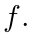 关联的平坦布局令 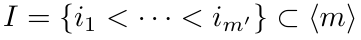 表示 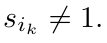 的索引子集那么

令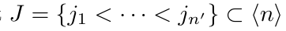 表示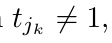 的索引子集，使得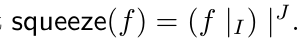 令 表示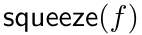 所在的映射。然后

其中

因为对任意 $\ell\notin J$，都有 $t_\ell=1$。于是得到

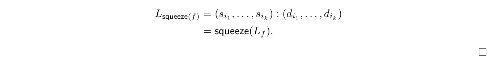

观察 3.1.5.11. 如果  是元组态射，则

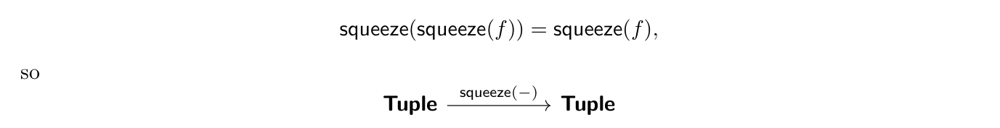

是幂等函子。

展开原页对照（保留全部图示、代码、标签和数学排版）

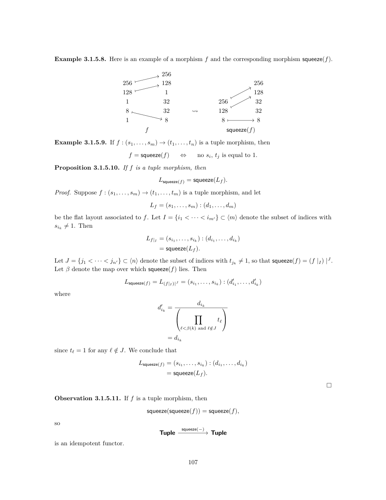

展开本页英文正文

<pre v-pre style="white-space:pre-wrap;overflow-wrap:anywhere">Example 3.1.5.8. Here is an example of a morphism f and the corresponding morphism squeeze(f).

Example 3.1.5.9. If f : (s1, . . . , sm) →(t1, . . . , tn) is a tuple morphism, then

f = squeeze(f) ⇔ no si, tj is equal to 1.

Proposition 3.1.5.10. If f is a tuple morphism, then

Proof. Suppose f : (s1, . . . , sm) →(t1, . . . , tm) is a tuple morphism, and let

be the flat layout associated to f. Let I = {i1 &lt; · · · &lt; im′} ⊂⟨m⟩denote the subset of indices with sik̸ = 1. Then

Let J = {j1 &lt; · · · &lt; jn′} ⊂⟨n⟩denote the subset of indices with tjk̸ = 1, so that squeeze(f) = (f |I) |J. Let β denote the map over which squeeze(f) lies. Then

where

since tℓ= 1 for any ℓ/∈J. We conclude that

Observation 3.1.5.11. If f is a tuple morphism, then

is an idempotent functor.</pre>

## PDF 第 110 页 · 原书第 108 页

3.1.5.3 排序

排序运算 $f\mapsto\operatorname{sort}(f)$ 对 $f$ 的定义域作置换，使所得态射满足下面定义的“已排序”条件。

定义 3.1.5.12. 对于元组态射

若对任意 $1\le i,j\le m$，以下条件均成立，就称其为已排序的：

1. 如果 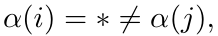 则 

2. 如果  则   

3. 如果  则   

示例 3.1.5.13. 态射  和  如下所示

已排序，态射  和  如下所示

没有排序。态射  和  分别违反条件 3, 1, 和 2,。

命题 3.1.5.14. 如果  是排序元组态射，则平坦布局  是排序的。

证明。假设

已排序，并考虑布局

假设  我们想要表明  或  和  有两种情况需要考虑。

• （案例  假设  使得  如果  那么  并且由于  已排序，我们有  如果  那么 

展开原页对照（保留全部图示、代码、标签和数学排版）

展开本页英文正文

<pre v-pre style="white-space:pre-wrap;overflow-wrap:anywhere">3.1.5.3 Sort

The sort operation f 7→sort(f) permutes the domain of f so that the resulting morphism is sorted, in the following sense.

Definition 3.1.5.12. We say a tuple morphism

is sorted if for any 1 ≤i, j ≤m, the following conditions hold.

1. If α(i) = ∗̸ = α(j), then i &lt; j.

2. If α(i) = ∗= α(j), then i ≤j ⇒ si ≤sj.

3. If α(i)̸ = ∗̸ = α(j), then i ≤j ⇒ α(i) ≤α(j).

Example 3.1.5.13. The morphisms f1, f2, and f3 shown below

are sorted, while the morphisms g1, g2, and g3 shown below

are not sorted. The morphisms g1, g2, and g3 violate conditions 3, 1, and 2, respectively.

Proposition 3.1.5.14. If f is a sorted tuple morphism, then the flat layout Lf is sorted.

Proof. Suppose

is sorted, and consider the layout

Suppose 1 ≤i &lt; m. We want to show that di &lt; di+1, or di = di+1 and si ≤si+1. There are two cases to consider.

• (Case 1) Suppose that α(i) = ∗, so that di = 0. If α(i + 1) = ∗, then di+1 = 0 and since f is sorted we have si ≤si+1. If α(i + 1)̸ = ∗, then di+1 ≥1 &gt; 0 = di.</pre>

## PDF 第 111 页 · 原书第 109 页

• (案例  假设  在这种情况下  和  那么

其中仅当  时相等才成立，这意味着 

我们得出结论  已排序。

接下来，我们在  上定义  操作。如果  是元组态射，则通过将  与适当的置换  进行预复合来获得 

构造 3.1.5.15. 假设

是元组态射。我们如下定义置换 $\sigma\in\Sigma_m$。令

于是 $\langle m\rangle$ 是 $P$ 与 $Q$ 的不交并。在 $P$ 上定义线性序：当下列条件之一成立时，规定 $i_1\preceq_P i_2$：

 和 

在 $Q$ 上定义线性序：当 $\alpha(i_1)\le\alpha(i_2)$ 时，规定 $j_1\preceq_Q j_2$。再如下定义 $\langle m\rangle$ 上的线性序：〔校注：本句原文的 $i_1,i_2$ 与正在比较的 $j_1,j_2$ 不一致，应读作 $\alpha(j_1)\le\alpha(j_2)$。〕

 和 

 和  或

 和 

令 $\sigma$ 为 $\langle m\rangle$ 上线性序 $\preceq$ 对应的置换，$\sigma^{-1}$ 为其逆。保基点映射 $\sigma^{-1}_*:\langle m\rangle_*\to\langle m\rangle_*$ 由下列元组态射覆盖：

我们定义  为复合

示例 3.1.5.16. 显示了示例 3.1.5.13 的态射  和  的排序

展开原页对照（保留全部图示、代码、标签和数学排版）

展开本页英文正文

<pre v-pre style="white-space:pre-wrap;overflow-wrap:anywhere">• (Case 2) Suppose that α(i)̸ = ∗, in which case α(i + 1)̸ = ∗and α(i) &lt; α(i + 1). Then

where equality holds only if si = tα(i) = 1, which implies si ≤si+1.

We conclude that Lf is sorted.

Next, we define our sort(−) operation on Tuple. If f is a tuple morphism, then sort(f) will be obtained by precomposing f with an appropriate permutation g.

Construction 3.1.5.15. Suppose

is a tuple morphism. We define a permutation σ ∈Σm as follows. Set

so ⟨m⟩is the disjoint union of P and Q. We define a linear ordering of P by i1 ⪯P i2 if

2. si1 = si2 and i1 ≤i2.

We define a linear ordering on Q by j1 ⪯Q j2 if α(i1) ≤α(i2). We define a linear ordering on ⟨m⟩by

1. i1 ∈P and i2 ∈Q,

2. i1, i2 ∈P and i1 ⪯P i2, or

3. i1, i2 ∈Q and i1 ⪯Q i2.

Let σ be permutation associated to the linear ordering ⪯of ⟨m⟩, and let σ−1 be its inverse. The map σ−1

∗ : ⟨m⟩∗→⟨m⟩∗is covered by a tuple morphism

and we define sort(f) to be the composite

Example 3.1.5.16. The sortings of the morphisms g1, g2, and g3 of Example 3.1.5.13 are shown</pre>

## PDF 第 112 页 · 原书第 110 页

下面。

引理 3.1.5.17. 假设  是元组态射。那么  被排序当且仅当 

证明。排序运算的构造保证：对任意元组态射 $f$，$\operatorname{sort}(f)$ 都是已排序的。因此，若 $f=\operatorname{sort}(f)$，则 $f$ 已排序。反之，若 $f$ 已排序，则构造 3.1.5.15 中的 $\sigma\in\Sigma_m$ 为恒等置换，故 $g=\operatorname{id}_S$，从而

命题 3.1.5.18. 如果  是元组态射，则

证明。沿用构造 3.1.5.15 的记号，有 $\operatorname{sort}(f)=f\circ g$，其中

位于保基点映射 $\sigma^{-1}_*:\langle m\rangle_*\to\langle m\rangle_*$ 之上。若 $L_f=(s_1,\ldots,s_m):(d_1,\ldots,d_m)$，则

由于 $L_{\operatorname{sort}(f)}$ 的模态是 $L_f$ 的模态的一个置换，只需证明前者已排序。设 $1\le i<m$。先设 $\sigma^{-1}(i)\in P$，于是 $d'_i=d_{\sigma^{-1}(i)}=0$。若 $\sigma^{-1}(i+1)\in P$，则 $d'_{i+1}=d_{\sigma^{-1}(i+1)}=0$。由 $\sigma$ 的构造，$s'_i=s_{\sigma^{-1}(i)}\le s_{\sigma^{-1}(i+1)}=s'_{i+1}$。若 $\sigma^{-1}(i+1)\in Q$，则 $d'_{i+1}=d_{\sigma^{-1}(i+1)}>0=d'_i$。再设 $\sigma^{-1}(i)\in Q$。由 $\sigma$ 的构造，$\sigma^{-1}(i+1)\in Q$ 且 $\alpha(\sigma^{-1}(i))<\alpha(\sigma^{-1}(i+1))$，因此

展开原页对照（保留全部图示、代码、标签和数学排版）

展开本页英文正文

<pre v-pre style="white-space:pre-wrap;overflow-wrap:anywhere">below.

Lemma 3.1.5.17. Suppose f : S →T is a tuple morphism. Then f is sorted if and only if sort(f) = f.

Proof. Our construction of sort(−) guarantees that sort(f) is sorted for any tuple morphism f. In particular, if f = sort(f), then f is sorted. Conversely, if f is sorted, then the permutation σ ∈Σm from Construction 3.1.5.15 is the identity permutation, so g = idS, and so

Proposition 3.1.5.18. If f is a tuple morphism, then

Proof. Borrowing our notation form Construction 3.1.5.15, we have sort(f) = f ◦g where

lies over σ−1

∗ : ⟨m⟩∗→⟨m⟩∗. If Lf = (s1, . . . , sm) : (d1, . . . , dm), then

Since the modes of Lsort(f) are a permutation of the modes of Lf, it suffices to prove that Lsort(f) is sorted. Suppose 1 ≤i &lt; m. Suppose first that σ−1(i) ∈P, so that d′

i = dσ−1(i) = 0. If σ−1(i + 1) ∈P, then d′

i+1 = dσ−1(i+1) = 0. By construction of σ, we have s′

i+1. If instead σ−1(i + 1) ∈Q, then d′

i. Suppose next that σ−1(i) ∈Q. Then by construction of σ, we have σ−1(i + 1) ∈Q and α(σ−1(i)) &lt; α(σ−1(i + 1)), and we have</pre>

## PDF 第 113 页 · 原书第 111 页

其中等号成立当且仅当 $t_{\alpha(\sigma^{-1}(i))}=\cdots=t_{\alpha(\sigma^{-1}(i+1))-1}=1$。特别地，$s'_i=s_{\sigma^{-1}(i)}=t_{\alpha(\sigma^{-1}(i))}=1$，故 $s'_i\le s'_{i+1}$。于是 $L_{\operatorname{sort}(f)}$ 已排序，从而 $L_{\operatorname{sort}(f)}=\operatorname{sort}(L_f)$。〔校注：原文本句第一次出现的 $s_i$ 缺少撇号，应为 $s'_i$。〕

备注 3.1.5.19. 运算 $\operatorname{sort}(-)$ 不具有函子性。例如，考虑以下元组态射：

$f$ 与 $g$ 可复合，且 $g\circ f=\operatorname{id}_{(25,10)}$，但以下排序后的态射〔校注：本例首幅图的 $f:(2,3)\to(3,2)$ 与 $g:(10,25)\to(25,10)$ 实际不可复合，与这句话及后图不一致。若按后图及所述恒等态射理解，首幅 $f$ 应为 $(25,10)\to(10,25)$ 的交换态射；原图保持不改。〕

不可复合。

3.1.5.4 合并

我们首先介绍合并元组态射的概念。

定义 3.1.5.20. 假设  是位于  之上的元组态射我们说  是合并的，如果

 和

2. 对于任何  恰好满足以下条件之一：

(d) $\alpha(i)<\alpha(i+1)$，且存在满足 $\alpha(i)<j<\alpha(i+1)$ 的 $j$，使得 $t_j>1$。

例 3.1.5.21. 若存在 $1\le i<\operatorname{len}(S)$ 使 $\alpha(i+1)=\alpha(i)+1$，则 $f$ 不是已合并的。

备注 3.1.5.22. 设元组态射 $f:S\to T$ 满足 $f=\operatorname{squeeze}(f)$。则 $f$ 已合并，当且仅当对任意 $1\le i<\operatorname{len}(S)$，以下条件之一成立：

示例 3.1.5.23. 态射

展开原页对照（保留全部图示、代码、标签和数学排版）

展开本页英文正文

<pre v-pre style="white-space:pre-wrap;overflow-wrap:anywhere">where equality holds if and only if tα(σ−1(i)) = · · · = tα(σ−1(i+1))−1 = 1. In particular, we have si = sσ−1(i) = tα(σ−1(i)) = 1, and so s′

i+1. We conclude that Lsort(f) is sorted, so Lsort(f) = sort(Lf).

Remark 3.1.5.19. The operation sort(−) is not functorial. For example, consider the tuple morphisms

(2, 3) (3, 2) and (10, 25) (25, 10) f

Then f and g are composable with g ◦f = id(25,10), but the sorted morphisms

(10, 25) (10, 25) and (25, 10) (25, 10) sort(f)

are not composable.

3.1.5.4 Coalesce

We begin by introducing the notion of a coalesced tuple morphism.

Definition 3.1.5.20. Suppose f : S →T is a tuple morphism lying over α. We say f is coalesced if

1. S = squeeze(S) and

2. for any 1 ≤i &lt; len(S), exactly one of the following conditions holds:

(d) α(i) &lt; α(i + 1), and there exists α(i) &lt; j &lt; α(i + 1) with tj &gt; 1.

Example 3.1.5.21. If there exists some 1 ≤i &lt; len(S) with α(i + 1) = α(i) + 1, then f is not coalesced.

Remark 3.1.5.22. If f : S →T is a tuple morphism such that f = squeeze(f), then f is coalesced if

and only if for any 1 ≤i &lt; len(S), one of the following conditions holds:

Example 3.1.5.23. The morphisms</pre>

## PDF 第 114 页 · 原书第 112 页

被合并，而态射

没有合并。

命题 3.1.5.24. 假设  是元组态射。然后，当且仅当  被合并时， 才被合并。

证明。假设  是元组态射，令

是编码的布局

首先假设  已合并。那么  中没有分量等于 1. 假设  我们想证明  不等于  如果  那么  我们有

但是，由于我们假定  已合并，有 ，因此 。如果 ，那么 。如果 ，那么 ，故 。如果 ，那么 ；又因为 ，有 。最后，如果 ，那么：

我们得出的结论是  已合并。

接下来假设布局  已合并。那么  中没有分量等于 1。假设  如果  那么  并且由于  被合并，我们必须有  因此  假设  和 由于  被合并，我们有  但如果我们写

和

这意味着 $\prod_{\alpha(i)<j<\alpha(i+1)}t_j\ne1$。特别地，存在 $\alpha(i)<j<\alpha(i+1)$ 使得 $t_j>1$。于是 $f$ 已合并。

接下来，我们定义元组态射上的  操作。

展开原页对照（保留全部图示、代码、标签和数学排版）

展开本页英文正文

<pre v-pre style="white-space:pre-wrap;overflow-wrap:anywhere">are coalesced, while the morphisms

are not coalesced.

Proposition 3.1.5.24. Suppose f is a tuple morphism. Then f is coalesced if and only if Lf is coalesced.

Proof. Suppose f : (s1, . . . , sm) →(t1, . . . , tn) is a tuple morphism, and let

be the layout encoded by f.

Suppose first that f is coalesced. Then no entry of shape(Lf) = domain(f) is equal to 1. Suppose 1 ≤i &lt; m. We want to show that sidi is not equal to di+1. If di = 0, then α(i) = ∗, and we have

but by our assumption that f is coalesced, we have α(i + 1)̸ = ∗, hence sidi̸ = di+1. If di̸ = 0, then α(i)̸ = ∗. If α(i + 1) = ∗, then di+1 = 0, so sidi̸ = di+1. If α(i + 1) &lt; α(i), then di ≥di+1, and since si̸ = 1, we have sidi &gt; di+1. Finally, if α(i) &lt; α(i + 1), then

We conclude that Lf is coalesced.

Suppose next that the layout Lf is coalesced. Then no entry in domain(f) = shape(Lf) is equal to 1. Suppose 1 ≤i &lt; m. If α(i) = ∗, then di = 0, and since Lf is coalesced, we must have di+1̸ = sidi = 0, hence α(i + 1)̸ = ∗. Suppose α(i)̸ = ∗, and α(i) &lt; α(i + 1). Since Lf is coalesced, we have sidi̸ = di+1. But if we write

and

this implies that Q

α(i)&lt;j&lt;α(i+1) tj̸ = 1. In particular, there exists some α(i) &lt; j &lt; α(i+1) with tj &gt; 1. We conclude that f is coalesced.

Next, we define our coal(−) operation on tuple morphisms.</pre>

## PDF 第 115 页 · 原书第 113 页

构造 3.1.5.25. 假设  是元组态射。我们定义态射  如下：

1. 首先，令 $g=\operatorname{squeeze}(f)$，并以 $\beta:\langle m\rangle_*\to\langle n\rangle_*$ 表示 $g$ 所在的保基点映射。

2. 接下来，我们在  上定义一个等价关系 ，其中  如果

(a)  用于  或

(b)  为 

在商 $\langle m\rangle/{\sim}$ 上，按 $i_1\le i_2$ 时 $[i_1]\le[i_2]$ 定义次序。因此可将该商与 $\langle\bar m\rangle$ 视为同一对象，其中 $\bar m$ 是该商的大小。

3. 接下来，在  上定义一个等价关系 ，其中  如果存在 ，使得

对所有 $j\le j''\le j'$ 均成立。在商 $\langle n\rangle/{\sim}$ 上，按 $j_1\le j_2$ 时 $[j_1]\le[j_2]$ 定义次序。因此可将该商与 $\langle\bar n\rangle$ 视为同一对象，其中 $\bar n$ 是该商的大小。

4. 注意到映射 $\beta:\langle m\rangle_*\to\langle n\rangle_*$ 在商上诱导出映射

由  给出

5.  的域  通过设置定义

其中 $i\in\langle\bar m\rangle$ 对应于等价类 $I\in\langle m\rangle/{\sim}$。$\operatorname{coal}(f)$ 的陪域 $\bar T=(\bar t_1,\ldots,\bar t_{\bar n})$ 定义为

如果  对应于等价类  我们然后定义

是  上的元组态射

示例 3.1.5.26. 下面是元组态射  和合并态射  的示例

展开原页对照（保留全部图示、代码、标签和数学排版）

展开本页英文正文

<pre v-pre style="white-space:pre-wrap;overflow-wrap:anywhere">Construction 3.1.5.25. Suppose f is a tuple morphism. We define a morphism coal(f) as follows:

1. First, we set g = squeeze(f), and we write β : ⟨m⟩∗→⟨n⟩∗for the map over which g lies.

2. Next, we define an equivalence relation ∼on ⟨m⟩where i ∼i′ if either

(a) β(i′′) = ∗for i ≤i′′ ≤i′, or

(b) β(i′′) = β(i) + (i′′ −i) for i ≤i′′ ≤i′.

The quotient ⟨m⟩/ ∼is ordered by [i1] ≤[i2] if i1 ≤i2, so we can identify this quotient with ⟨¯m⟩ where ¯m is the size of ⟨m⟩/ ∼.

3. Next, define an equivalence relation ∼on ⟨n⟩where j ∼j′ if there exists i ∈⟨m⟩such that

for all j ≤j′′ ≤j′. The quotient ⟨n⟩/ ∼is ordered by [j1] ≤[j2] if j1 ≤j2, so we can identify this quotient with ⟨¯n⟩where ¯n is the size of ⟨n⟩/ ∼.

4. Next, we observe that the map β : ⟨m⟩∗→⟨n⟩∗descends to a map

given by ¯β([i]) = [β(i)].

5. The domain ¯S = (¯s1, . . . , ¯s ¯m) of coal(f) is defined by setting

if i ∈⟨¯m⟩corresponds to the equivalence class I ∈⟨m⟩/ ∼. The codomain ¯T = (¯t1, . . . , ¯t¯n) of coal(f) is defined by setting

if j ∈⟨¯n⟩corresponds to the equivalence class J ∈⟨n⟩/ ∼. We then define

to be the tuple morphism lying over ¯β.

Example 3.1.5.26. Here is an example of a tuple morphism f and the coalesced morphism coal(f).</pre>

## PDF 第 116 页 · 原书第 114 页

示例 3.1.5.27. 我们可以按如下方式合并示例 3.1.5.8 的态射 

命题 3.1.5.28. 如果  是元组态射，则

 被合并，并且

证明。先证明 $\operatorname{coal}(f)$ 已合并。这由构造直接可得：应用 $\operatorname{squeeze}$ 去除了所有等于 $1$ 的模态，而取商将所有满足 $\alpha(i+1)=\alpha(i)+1$ 的相邻模态合并了。

接下来证明 $L_{\operatorname{coal}(f)}=\operatorname{coal}(L_f)$。根据命题 2.1.4.18 和 3.1.5.24，只需证明 $\Phi_{\operatorname{coal}(f)}=\Phi_f$。对 $f$ 应用 $\operatorname{squeeze}(-)$ 显然不影响所关联的布局函数，因此只需说明构造中的取商也不改变该函数。这个商可逐步形成，每一步合并满足 $\alpha(i)=*=\alpha(i+1)$ 或 $\alpha(i+1)=\alpha(i)+1$ 的相邻模态。它们分别对应于将 $s_i,s_{i+1}:0,0$ 替换成 $s_is_{i+1}:0$，以及将 $s_i,s_{i+1}:d_i,s_id_i$ 替换成 $s_is_{i+1}:d_i$。两种操作都不改变布局函数，故 $\Phi_{L_{\operatorname{coal}(f)}}=\Phi_{\operatorname{coal}(L_f)}$，得证。〔校注：本段前半的 $\Phi_f$ 是关联布局函数 $\Phi_{L_f}$ 的简写。〕

3.1.5.5 拼接

接下来，我们将定义元组态射的拼接操作。该操作可以在满足“不相交”条件的元组态射上执行，我们在下面指定。

定义 3.1.5.29. 假设  和  是  中具有相同陪域的态射。我们说  和  具有不相交的像，如果

构造 3.1.5.30. 如果  和  有不相交的像，那么我们有一个明确定义的态射

由下式给出：

此运算满足结合律，因此对 $\mathrm{Fin}_*$ 中像两两不交的任意一组态射 $\alpha_1,\ldots,\alpha_k$，均可构造 $\alpha_1\star\cdots\star\alpha_k$。

展开原页对照（保留全部图示、代码、标签和数学排版）

展开本页英文正文

<pre v-pre style="white-space:pre-wrap;overflow-wrap:anywhere">Example 3.1.5.27. We can coalesce the morphism f of Example 3.1.5.8 as follows

Proposition 3.1.5.28. If f is a tuple morphism, then

1. coal(f) is coalesced, and

Proof. First, we will argue that coal(f) is coalesced. This is immediate from our construction, since applying squeeze eliminates all modes equal to 1, and passing to the quotient in our construction consolidated all adjacent modes with α(i + 1) = α(i) + 1.

Next, we will prove that Lcoal(f) = coal(Lf). In light of Proposition 2.1.4.18 and Proposition 3.1.5.24, it suffices to prove that Φcoal(f) = Φf. Certainly applying squeeze(−) to f has no impact on the associated layout function, so we need to argue that passing to the quotient in our construction does not change the layout function of the associated layout. This follows from the fact that forming our quotient can be formed in steps, where in each step we combine adjacent modes with either α(i) = ∗= α(i + 1), or α(i + 1) = α(i) + 1. These correspond to replacing adjacent modes of the form si, si+1 : 0, 0 with sisi+1 : 0, and si, si+1 : di, sidi with sisi+1 : di, respectively. Neither such operation changes the layout function of a layout, and so we conclude that ΦLcoal(f) = Φcoal(Lf ), as desired.

3.1.5.5 Concatenate

Next, we will define a concatenation operation on tuple morphisms. This operation may be performed on tuple morphisms satisfying a “disjointness” condition, which we specify below.

Definition 3.1.5.29. Suppose α : ⟨m⟩∗→⟨n⟩∗and β : ⟨p⟩∗→⟨n⟩∗are morphisms in Fin∗with the same codomain. We say α and β have disjoint images if

Construction 3.1.5.30. If α : ⟨m⟩∗→⟨n⟩∗and β : ⟨p⟩∗→⟨n⟩∗have disjoint images, then we have a well-defined morphism

given by

This operation is associative, so we can consider α1 ⋆· · ·⋆αk for any collection of morphisms α1, . . . , αk in Fin∗with pairwise disjoint images.</pre>

## PDF 第 117 页 · 原书第 115 页

备注 3.1.5.31. 如果  和  是可处理的保基点映射，并且  和  具有不相交的像，则 

是可处理的。

定义 3.1.5.32. 假设

和

分别是  和  上的元组态射。如果态射  和  具有不相交像，我们就说  和  具有不相交像。

示例 3.1.5.33. 考虑如下所示的元组态射  和 。

那么和有不相交的像，而和没有不相交的像。

构造 3.1.5.34. 假设

 和 

分别是位于  和  上的元组态射，并且  和  具有不相交的像。我们将  和  的拼接定义为态射

位于 $\alpha\star\beta$ 之上。此运算满足结合律，所以对像两两不交的任意有限组态射 $f_i$，均可构造 $f_1\star\cdots\star f_k$。

例 3.1.5.35. 若 $f,g$ 为例 3.1.5.33 中的 Tuple 态射，则它们的拼接为下图所示态射。

示例 3.1.5.36。假设  ) 是一个元组态射，对于任何 1  让

表示  的第  分量，如示例 3.1.3.8. 那么我们可以写

作为其分量的拼接。

展开原页对照（保留全部图示、代码、标签和数学排版）

展开本页英文正文

<pre v-pre style="white-space:pre-wrap;overflow-wrap:anywhere">Remark 3.1.5.31. If α and β are tractable pointed maps and α and β have disjoint images, then α ⋆β

is tractable.

Definition 3.1.5.32. Suppose

and

are tuple morphisms lying over α and β, respectively. We say f and g have disjoint images if the morphisms α and β have disjoint images.

Example 3.1.5.33. Consider the tuple morphisms f, g, and h shown below.

Then f and g have disjoint images, while h and g do not have disjoint images.

Construction 3.1.5.34. Suppose

f : S →T, and g : U →T

are tuple morphisms lying over α and β, respectively, and that f and g have disjoint images. We define the concatenation of f and g to be the morphism

lying over α ⋆β. This operation is associative, so we can consider f1 · · · fk for any finite collection of morphisms fi with pairwise disjoint images.

Example 3.1.5.35. If f and g are the morphisms in Tuple from Example 3.1.5.33, then the concate- nation of f and g is the morphism shown below.

Example 3.1.5.36. Suppose f : (s1, . . . , sm) →(t1, . . . , tn) is a tuple morphism, and for any 1 ≤i ≤m, let

denote the ith entry of f, as in Example 3.1.3.8. Then we can write

as the concatenation of its entries.</pre>

## PDF 第 118 页 · 原书第 116 页

引理 3.1.5.37. 假设  和  是具有不相交像的元组态射。如果  是任意元组态射，则

证明。假设  和  分别位于  和  之上。所讨论的两个映射具有相同的域和相同的陪域，因此足以证明

我们计算

命题 3.1.5.38. 假设  是 `Tuple` 中具有相同陪域且具有成对不相交像的态射。那么布局  满足

证明。首先，我们证明  的结果假设

 和 

有不相交的像，并写

$L_f=(s_1,\ldots,s_m):(d_1,\ldots,d_m)$，以及 $L_g=(u_1,\ldots,u_p):(d'_1,\ldots,d'_p)$。

那么布局  由下式给出

其中

这总结了当  时结果的证明。 一般情况来自元组态射拼接的结合性和平坦布局拼接的结合性。

展开原页对照（保留全部图示、代码、标签和数学排版）

展开本页英文正文

<pre v-pre style="white-space:pre-wrap;overflow-wrap:anywhere">Lemma 3.1.5.37. Suppose f1 : S1 →T and f2 : S2 →T are tuple morphisms with disjoint images. If g : T →U is any tuple morphism, then

Proof. Suppose f1, f2, and g lie over α1 : ⟨m1⟩∗→⟨n⟩, α2 : ⟨m2⟩∗→⟨n⟩, and β : ⟨n⟩→⟨p⟩, respectively. The two maps in question have the same domains and the same codomains, so it suffices to prove that

We compute

Proposition 3.1.5.38. Suppose f1, . . . , fk are morphisms in Tuple with the same codomain and with pairwise disjoint images. Then the layouts Lf1, . . . , Lfk satisfy

Proof. First, we prove the result for k = 2. Suppose

f = (s1, . . . , sm) →(t1, . . . , tn), and g : (u1, . . . , up) →(t1, . . . , tn)

have disjoint images, and write

Lf = (s1, . . . , sm) : (d1, . . . , dm), and Lg = (u1, . . . , up) : (d′

Then the layout Lf⋆g is given by

where

This concludes the proof of the result when k = 2. The general case follows from the associativity of concatenation of tuple morphisms, and the associativity of concatenation of flat layouts.</pre>

## PDF 第 119 页 · 原书第 117 页

3.1.5.6 补

我们首先定义互补元组态射的概念。

定义 3.1.5.39. 设 $f:S\to T$ 与 $g:U\to T$ 是元组态射。若满足以下条件，就称 $g$ 为 $f$ 的一个补态射：

 和  具有不相交的像，并且

2. 拼接 $f\star g:S\star U\to T$

是同构。

示例 3.1.5.40. 如果  和  是如下所示的态射

则 $g$ 是 $f$ 的一个补态射。

示例 3.1.5.41. 如果  是如下所示的态射

则 $f$ 不存在补态射。

接下来，我们证明互补元组态射会产生互补平坦布局。

命题 3.1.5.42. 若 $f:S\to T$ 是元组态射，且 $g$ 是 $f$ 的补态射，则 $L_g$ 是 $L_f$ 的一个 $\operatorname{size}(T)$-补布局。

证明。写和 首先，我们注意到

接下来，我们注意到  是同构，因此也是

这里使用了引理 3.1.4.5 对 $\Phi_{L_{f\star g}}^{\operatorname{size}(T)}$ 的刻画。

展开原页对照（保留全部图示、代码、标签和数学排版）

展开本页英文正文

<pre v-pre style="white-space:pre-wrap;overflow-wrap:anywhere">3.1.5.6 Complement

We begin by defining the notion of complementary tuple morphisms.

Definition 3.1.5.39. Suppose f : S →T and g : U →T are tuple morphisms. We say g is a complement of f if

1. f and g have disjoint images, and

2. the concatenation f ⋆g : S ⋆U T ∼ =

is an isomorphism.

Example 3.1.5.40. If f and g are the morphisms shown below

then g is a complement of f.

Example 3.1.5.41. If f is the morphism shown below

then f does not admit a complement.

Next, we prove that complementary tuple morphisms give rise to complementary flat layouts.

Proposition 3.1.5.42. If f : S →T is a tuple morphism and g is a complement of f, then Lg is a size(T)-complement of Lf.

Proof. Write S = domain(f), U = domain(g), and T = codomain(f) = codomain(g). First, we note that

Next, we note that f ⋆g is an isomorphism, hence so is

where we have used the identification of Φsize(T )

Lf⋆g of Lemma 3.1.4.5.</pre>

## PDF 第 120 页 · 原书第 118 页

命题 3.1.5.43. 如果  是单射元组态射，则

证明。由命题 3.1.5.42，$L_{f^c}$ 是 $L_f$ 的一个 $\operatorname{size}(T)$-补布局。由于 $f^c$ 已排序，$L_{f^c}$ 也已排序。由命题 2.1.6.33，得到

因为这两个布局都是 $L_f$ 的大小相同、已排序且已合并的平坦补布局。〔校注：一般的 $f^c$ 虽然已排序，却未必已合并；本句用于合并后的布局，不能据此断言任意补态射均已合并。〕

命题 3.1.5.44. 如果  是标准形式的单射元组态射，则

证明。写

表示 $f$ 编码的布局。由命题 3.1.5.42，$L_{f^c}$ 是 $L_f$ 的一个 $\operatorname{size}(T)$-补布局，其中

通过构造， 已排序，因此  也已排序。此外，由于  具有标准形式，因此可以得出 

是合并的。根据命题 2.1.6.23, 我们推断

定义 3.1.5.45. 假设  是位于  之上的元组态射如果  是单射的，我们说  是可取补的。

构造3.1.5.46. 假设 是可取补元组态射。令  表示  中不在  的像中的索引的集合我们将  的补定义为元组态射

它位于映射 $\operatorname{complement}(\alpha):\langle n-m\rangle_*\to\langle n\rangle_*$ 之上，该映射由 $k\mapsto j_k$ 给出。由构造可见，$f^c$ 是定义 3.1.5.39 意义下 $f$ 的一个补态射。

例 3.1.5.47. 下图给出态射 $f$ 及其补态射 $f^c$ 的一个例子。

命题 3.1.5.48. 若 $f$ 是元组态射，且 $g$ 是 $f$ 的补态射，则

展开原页对照（保留全部图示、代码、标签和数学排版）

展开本页英文正文

<pre v-pre style="white-space:pre-wrap;overflow-wrap:anywhere">Proposition 3.1.5.43. If f is an injective tuple morphism, then

Proof. By Proposition 3.1.5.42, we know that Lf c is a size(T)-complement of Lf. Since f c is sorted, so is Lf c and it follows from Proposition 2.1.6.33, it follows that

since both of these layouts are flat, sorted, coalesced complements of Lf of the same size.

Proposition 3.1.5.44. If f : (s1, . . . , sm) →(t1, . . . , tn) is an injective tuple morphism of standard form, then

Proof. Write

for the layout encoded by f. By Proposition 3.1.5.42, we know that Lf c is a size(T)-complement of Lf. Where

By construction, f c is sorted, hence so is Lf c. Moreover, since f has standard form, it follows that f c

is coalesced. By Proposition 2.1.6.23, we deduce that

Definition 3.1.5.45. Suppose f is a tuple morphism lying over α : ⟨m⟩∗→⟨n⟩∗. We say f is complementable if α is injective.

Construction 3.1.5.46. Suppose f : (s1, . . . , sm) →(t1, . . . , tn) is a complementable tuple morphism. Let j1 &lt; · · · &lt; jn−m denote the collection of indices in ⟨n⟩which are not in the image of α. We define the complement of f to be the tuple morphism

lying over the map complement(α) : ⟨n −m⟩∗→⟨n⟩∗given by k 7→jk. By construction, we may observe that f c is a complement of f, in the sense of Definition 3.1.5.39

Example 3.1.5.47. Below is an example of a morphism f and its complement f c.

Proposition 3.1.5.48. If f is a tuple morphism and g is a complement of f, then</pre>

## PDF 第 121 页 · 原书第 119 页

证明。假设  位于  位于  之上，并且  位于  之上，则  和  是具有相同像的递增映射，即

因此  和 

命题 3.1.5.49. 元组态射 $f$ 存在补态射，当且仅当它是定义 3.1.5.45 意义下可取补的。

证明。若 $f$ 所在的映射 $\alpha$ 不是单射，则对任意与 $f$ 具有不相交像的态射 $f^*$，

$f\star f^*$ 所在的映射也不是单射，因此 $f\star f^*$ 不是同构。反之，若 $f$ 所在的映射为单射，则构造 3.1.5.46 中的 $f^c$ 是 $f$ 的一个补态射。

命题 3.1.5.50. 如果  是可取补元组态射，则

证明。两个映射都严格递增且为单射，并具有相同的像，因此它们相等。

3.1.5.7 平坦除法

在本节中，我们定义元组态射的除法运算。

定义 3.1.5.51. 设 $f,g$ 是元组态射。若 $g$ 与 $f$ 可复合，则称 $g$ 整除 $f$。换言之，

定义 3.1.5.52. 设 $g:S\to T$ 与 $f:T\to U$ 是元组态射。$f$ 除以 $g$ 的平坦除法定义为元组态射

示例 3.1.5.53. 下面是元组态射  和  及其平坦商  的示例

示例 3.1.5.54. 下面是元组态射  和  及其平坦商  的示例

展开原页对照（保留全部图示、代码、标签和数学排版）

展开本页英文正文

<pre v-pre style="white-space:pre-wrap;overflow-wrap:anywhere">Proof. Suppose f lies over α : ⟨m⟩∗→⟨n⟩∗, sort(g) lies over β : ⟨n −m⟩∗→⟨n⟩∗and f c lies over αc : ⟨n −m⟩∗→⟨n⟩∗. Then β and αc are increasing maps with the same image, namely

hence β = αc, and hence sort(g) = f c.

Proposition 3.1.5.49. Suppose f is a tuple morphism. Then f admits a complement if and only if f is complementable, in the sense of Definition 3.1.5.45.

Proof. If f lies over a map α which is not injective, then for any morphism f ∗such that f and f ∗

have disjoint images, the morphism f ⋆f ∗lies over a map which is not injective, hence f ⋆f ∗is not an isomorphism. Conversely, if f lies over an injective map, then the morphism f c of Construction 3.1.5.46 is a complement of f.

Proposition 3.1.5.50. If f is a complementable tuple morphism, then

Proof. Both maps are increasing, injective, and have the same image, so they are equal.

3.1.5.7 Flat division

In this section, we define a division operation on tuple morphisms.

Definition 3.1.5.51. If f and g are tuple morphisms, we say g divides f if g and f are composable. In other words,

Definition 3.1.5.52. Suppose g : S →T and f : T →U are tuple morphisms. The flat division of f by g is the tuple morphism

Example 3.1.5.53. Here is an example of tuple morphisms f and g together with their flat quotient f ⊘♭g.

Example 3.1.5.54. Here is an example of tuple morphisms f and g together with their flat quotient f ⊘♭g.</pre>

## PDF 第 122 页 · 原书第 120 页

示例 3.1.5.55. 下面是元组态射  和  及其平坦商  的示例

命题 3.1.5.56. 如果  和  是非退化可复合元组态射，则

证明。根据命题 3.2.6.20,，我们有

我们计算

3.1.5.8 平坦乘积

在本节中，我们定义元组态射的乘积运算。

定义 3.1.5.57. 设 $f,g$ 是元组态射。若 $\operatorname{codomain}(g)=\operatorname{domain}(f^c)$，就称 $f,g$ 是乘积可容许的。在此条件下，定义 $f,g$ 的平坦乘积为

示例 3.1.5.58. 如果  和  是如下所示的元组态射

那么  和  是乘积可容许的， 是如下所示的元组态射。

展开原页对照（保留全部图示、代码、标签和数学排版）

展开本页英文正文

<pre v-pre style="white-space:pre-wrap;overflow-wrap:anywhere">Example 3.1.5.55. Here is an example of tuple morphisms f and g together with their flat quotient f ⊘♭g.

Proposition 3.1.5.56. If f and g are non-degenerate composable tuple morphisms, then

Proof. By Proposition 3.2.6.20, we have

and we compute

3.1.5.8 Flat products

In this section we define a product operation on tuple morphisms.

Definition 3.1.5.57. Suppose f and g are tuple morphisms. We say f and g are product admissible if codomain(g) = domain(f c). If f and g are product admissible, then we define flat product of f and g to be

Example 3.1.5.58. If f and g are the tuple morphisms shown below

then f and g are product-admissible, and f ⊗♭g is the tuple morphism shown below.</pre>

## PDF 第 123 页 · 原书第 121 页

示例 3.1.5.59. 如果  和  是如下所示的元组态射

那么  和  是乘积可容许的， 是如下所示的元组态射。

引理 3.1.5.60. 若 $f,g$ 乘积可容许，且 $g$ 为单射，则 $f\otimes^\flat g$ 为单射，并且

证明。元组态射 $(f\otimes^\flat g)^c$ 与 $f^c\circ g^c$ 均为单射且严格递增，并具有相同的陪域，故只需证明它们的像相同。$(f\otimes^\flat g)^c=(f\star(f^c\circ g))^c$ 的像由既不在 $f$ 的像中、也不在 $f^c\circ g$ 的像中的分量组成。$f^c$ 的像由不在 $f$ 的像中的分量组成，所以复合 $f^c\circ g^c$ 的像也由既不在 $f$ 的像中、也不在 $f^c\circ g$ 的像中的分量组成。

命题 3.1.5.61. 设 $f,g$ 乘积可容许，且 $g,h$ 乘积可容许，则

1. $f\otimes^\flat g$ 与 $h$ 乘积可容许，

2. $f$ 与 $g\otimes^\flat h$ 乘积可容许，且

证明。使用引理 3.1.5.37 和引理 3.1.5.60, 我们计算

命题 3.1.5.62. 设 $f,g$ 是非退化元组态射，且乘积可容许，则

展开原页对照（保留全部图示、代码、标签和数学排版）

展开本页英文正文

<pre v-pre style="white-space:pre-wrap;overflow-wrap:anywhere">Example 3.1.5.59. If f and g are the tuple morphisms shown below

then f and g are product-admissible, and f ⊗♭g is the tuple morphism shown below.

Lemma 3.1.5.60. If f and g are product admissible and g is injective, then f ⊗♭g is injective and

Proof. The tuple morphisms (f ⊗♭g)c and f c ◦gc are injective, increasing, and have the same codomain, so it suffices to show that they have the same image. The image of (f ⊗♭g)c = (f ⋆(f c ◦g))c consists of those entries which are not in the image of f, and not in the image of f c ◦g. The image of f c

consists of those entries which are not in the image of f, and so the image of the composition f c ◦gc

consists of those entries which are not in the image of f, and not in the image of f c ◦g.

Proposition 3.1.5.61. Suppose f and g are product admissible, and g and h are product admissible. Then

1. f ⊗♭g and h are product admissible,

2. f and g ⊗♭h are product admissible, and

Proof. Using Lemma 3.1.5.37 and Lemma 3.1.5.60, we compute

Proposition 3.1.5.62. Suppose f and g are non-degenerate tuple morphisms and that f and g are product admissible. Then</pre>

## PDF 第 124 页 · 原书第 122 页

证明。设 $f:S\to T$ 与 $g:U\to V$ 乘积可容许，并令

由于  是单射的，并且  的陪域是  的域，因此可以得出：

利用这个事实，以及事实

我们有

利用这个事实，我们计算

展开原页对照（保留全部图示、代码、标签和数学排版）

展开本页英文正文

<pre v-pre style="white-space:pre-wrap;overflow-wrap:anywhere">Proof. Suppose f : S →T and g : U →V are product admissible, and set

Since f is injective and the codomain of g is the domain of f c, it follows that

Using this fact, and the fact that

we have

Using this fact, we compute</pre>

---
[译文总目录](Layout.md) · [第 3.1 节：Tuple 范畴、编码与具象化](Translation-06-Tuple.md) · [第 3.2 节：Nest 范畴与细化](Translation-08-Nest.md)
